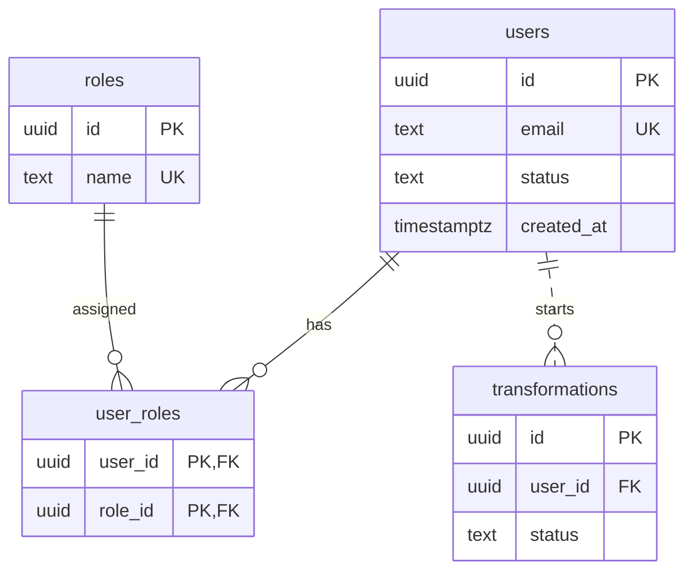

# Databases

## Contents

- [Types of databases](#types-of-databases)
- [Relational model](#relational-model)
- [Keys, constraints, and relationships](#keys-constraints-and-relationships)
- [SQL](#sql)
- [Normal forms](#normal-forms)
- [Transactions and ACID](#transactions-and-acid)
- [Indexes](#indexes)
- [Working with the database from the application](#working-with-the-database-from-the-application)
- [Common mistakes](#common-mistakes)
- [Useful links](#useful-links)
- [Review questions](#review-questions)

## Types of databases

A database is an organized set of data. A DBMS is a program that stores the data, runs queries, checks constraints, and shares access among clients. PostgreSQL is a DBMS. `myapp` inside it is a database.

| Type | Examples | When it fits |
| --- | --- | --- |
| Relational: tables, a schema, relationships by keys, and SQL | PostgreSQL, MySQL, SQLite | related business data with transactions: users, roles, and operation history |
| Document: JSON-like documents | MongoDB | an object that is read as a whole, without complex relationships |
| Key-value | Redis, Memcached | a cache, rate-limit counters, and data with a TTL |
| Search | Elasticsearch | full-text search. The source of truth stays in the main database |
| Graph | Neo4j | relationships many levels deep: recommendations and routes |

OLTP is many short operations on individual rows (sign-in, an order). OLAP is infrequent heavy aggregates over large volumes. PostgreSQL is built for OLTP.

A relational database is the default choice for business data. Other types are added for a task that a relational database handles poorly. In PostgreSQL, extensions cover some of those tasks: `jsonb`, full-text search, PostGIS, and pgvector.

## Relational model

Data is stored in tables. A row describes one object. A column is one property of a fixed type. Row order is undefined: without `ORDER BY`, the DBMS may return rows in any order.

| Data | PostgreSQL type | Why |
| --- | --- | --- |
| identifier | `uuid` or `bigint GENERATED ALWAYS AS IDENTITY` | `uuid` can be created before the insert, and it does not reveal the number of rows |
| string | `text` | `varchar(n)` is just as fast and only limits the length |
| money | `numeric(12, 2)` | `real` and `double precision` produce rounding errors |
| point in time | `timestamptz` | stored in UTC. `timestamp` without a time zone does not know the time zone |
| document | `jsonb` | for data without a fixed structure. Fields for filters and relationships are separate columns |

`NULL` means "the value is unknown." A comparison with `NULL` yields `NULL`, so the check is written as `IS NULL`, not `= NULL`.

## Keys, constraints, and relationships

- A **primary key** (`PRIMARY KEY`) identifies a row uniquely. It is unique and is never `NULL`.
- A **natural key** has meaning outside the system (`email`), but it can change. The primary key is therefore a surrogate `id`, and `UNIQUE` is created for `email`.
- A **composite key** consists of several columns, for example `(user_id, role_id)`.
- A **foreign key** (`FOREIGN KEY`) references a primary or unique key of another table. The DBMS will not save a reference to a row that does not exist.

The DBMS itself checks constraints on every write, so neither concurrent queries nor another client can bypass them.

| Constraint | What it guarantees |
| --- | --- |
| `NOT NULL` | the value is required |
| `UNIQUE` | the value does not repeat. A `SELECT` before `INSERT` without it does not protect against a race |
| `CHECK` | the value satisfies a condition, for example `status IN ('active', 'blocked')` |
| `FOREIGN KEY` | the reference points to an existing row |

On deletion of a parent: `RESTRICT` forbids deletion while references exist; `CASCADE` deletes dependent rows; `SET NULL` clears the reference. A cascade fits parts that do not exist without the parent (an email confirmation attempt). A restriction fits independent entities (a role that cannot be deleted while it is assigned).

| Relationship | How it is implemented | Example |
| --- | --- | --- |
| one-to-one | a foreign key with `UNIQUE` | `user_settings.user_id` |
| one-to-many | a foreign key on the "many" side | `transformations.user_id` |
| many-to-many | a junction table with two foreign keys | `user_roles(user_id, role_id)` |



The ends of a line are cardinality: `||` is exactly one, `|o` is zero or one, and `}o` is zero or many. A solid line (`--`) means the foreign key is part of the child table's primary key. A dashed line (`..`) means the child table has its own `id`.

## SQL

| Group | Commands | Purpose |
| --- | --- | --- |
| DDL | `CREATE`, `ALTER`, `DROP` | structure: tables, indexes, and constraints |
| DML | `SELECT`, `INSERT`, `UPDATE`, `DELETE` | data |
| TCL | `BEGIN`, `COMMIT`, `ROLLBACK` | transactions |

```sql
CREATE TABLE users (
  id         uuid PRIMARY KEY DEFAULT gen_random_uuid(),
  email      text NOT NULL UNIQUE,
  status     text NOT NULL CHECK (status IN ('pending', 'active', 'blocked', 'deleting', 'deleted')),
  created_at timestamptz NOT NULL DEFAULT now()
);

CREATE TABLE user_roles (
  user_id uuid REFERENCES users (id) ON DELETE CASCADE,
  role_id uuid REFERENCES roles (id) ON DELETE RESTRICT,
  PRIMARY KEY (user_id, role_id)
);

SELECT r.name, count(*) AS users_count
FROM roles r
JOIN user_roles ur ON ur.role_id = r.id
JOIN users u ON u.id = ur.user_id
WHERE u.status = 'active'
GROUP BY r.name
HAVING count(*) >= 2
ORDER BY users_count DESC;
```

The logical order of execution is `FROM` / `JOIN` → `WHERE` → `GROUP BY` → `HAVING` → `SELECT` → `ORDER BY` → `LIMIT`. `WHERE` does not see aggregates, and `HAVING` filters groups that already exist.

| JOIN | Result |
| --- | --- |
| `INNER JOIN` | only rows with a match in both tables |
| `LEFT JOIN` | all rows of the left table; without a match, the columns of the right table are `NULL` |
| `FULL JOIN` | all rows of both tables |

Users without roles are found this way: `LEFT JOIN user_roles` and `WHERE user_roles.user_id IS NULL`.

## Normal forms

Normalization removes duplication that causes anomalies. In the table `user_roles_flat(user_id, role_name, email)` with the key `(user_id, role_name)`, email is repeated on every row of the user:

- **update**: changing the email requires fixing every row. A missed row keeps the old address.
- **insert**: a user without roles cannot be stored, because `role_name` is part of the key.
- **delete**: removing the last role also removes the email.

A functional dependency `A → B` means that the value of `A` uniquely determines `B`, for example `user_id → email`. Each following form includes the requirements of the previous one.

| Form | Requirement | Violation | Fix |
| --- | --- | --- | --- |
| 1NF | one value in a cell | `users.roles = 'admin,editor'` | a separate row for each pair in `user_roles` |
| 2NF | a non-key column depends on the whole composite key | `email` depends only on `user_id` | `email` is stored in `users` |
| 3NF | a non-key column does not depend on another non-key column | `transformations(id, user_id, user_email)`: `id → user_id → user_email` | email is read from `users` through a `JOIN` |
| BCNF | the left side of every dependency is a key | see the example below | a split by the violating dependency |
| 4NF | independent lists are not mixed in the table | `user_facts(user_id, role_id, phone)` | `user_roles` and `user_phones` |

**BCNF.** The table `mentoring(student, topic, mentor)`: a student has one mentor per topic, and each mentor teaches one topic (`mentor → topic`). The keys are `(student, topic)` and `(student, mentor)`. 3NF holds, because every column is a key column, but `mentor` determines `topic` without being a key. Changing a mentor's topic means updating the rows of all of that mentor's students. A split into `mentor_topics(mentor, topic)` and `student_mentors(student, mentor)` removes the anomaly.

In practice, a schema is brought to 3NF or BCNF. If every key of a table is a single column, 3NF already implies the higher forms as well.

Denormalization is deliberate duplication for faster reads, for example a user counter on a role. Each copy needs a synchronization mechanism. The price in an order row is not denormalization. It is a historical fact that must not change together with the product price.

## Transactions and ACID

A transaction groups several operations: either all of them are applied, or none of them are.

```sql
BEGIN;
DELETE FROM user_roles WHERE user_id = $1;
INSERT INTO user_roles (user_id, role_id) VALUES ($1, $2), ($1, $3);
COMMIT;
```

If any command ends with an error, the roles stay as they were.

| Property | Meaning |
| --- | --- |
| Atomicity | applied as a whole, or not applied |
| Consistency | after the transaction, every schema constraint holds |
| Isolation | concurrent transactions affect each other only within the isolation level |
| Durability | committed data survives a server failure |

In PostgreSQL, the default is Read Committed: reading the same row again can return a different value. Repeatable Read and Serializable work from a snapshot of the data. On a conflict, a transaction can receive the serialization error `40001` and must be retried.

A lost update: two transactions read `attempts = 3` and both write `4`, so one attempt is lost. An atomic `UPDATE ... SET attempts = attempts + 1` or `SELECT ... FOR UPDATE` prevents it.

## Indexes

An index finds rows without a full scan of the table. Reads get faster. Inserts and updates get slower.

`PRIMARY KEY` and `UNIQUE` create an index automatically. A foreign key does not, so the index for `transformations.user_id` is added by hand.

B-tree is the default type: `=`, `<`, `>`, and `ORDER BY`. A composite index works from left to right. `(user_id, created_at)` speeds up a filter by `user_id` and sorting by date within a user, but it barely helps a query by `created_at` alone.

```sql
CREATE INDEX transformations_user_created_idx
  ON transformations (user_id, created_at DESC, id DESC);

CREATE UNIQUE INDEX deletion_challenges_one_open_idx
  ON deletion_challenges (user_id)
  WHERE consumed_at IS NULL;
```

The second index, with a condition, expresses the rule "at most one unconsumed attempt per user." `EXPLAIN ANALYZE` shows the plan: `Seq Scan` is a full scan, and `Index Scan` is an index lookup. An index is not used when the column is wrapped in a function, or when the pattern starts with `%`.

## Working with the database from the application

An **ORM** (Prisma, TypeORM, EF Core, SQLAlchemy) maps tables to classes and builds parameterized queries. During development, the generated SQL is inspected in the query log.

**Migrations** are files of schema changes in the repository. A record of applied migrations is stored in the database, so every environment reaches the same schema. Automatic synchronization of models with the database (`synchronize` in TypeORM) is not enabled in production: it can drop a column together with the data.

**N+1** is one query for a list and one more query for each item. Related data is loaded in one query: `JOIN`, `WHERE user_id = ANY($1)`, `include` in Prisma, `relations` in TypeORM, `Include` in EF Core, and `selectinload` in SQLAlchemy.

**Connection pool.** A new connection to PostgreSQL is expensive. A pool keeps several connections open and hands them out to queries. The sum of the pool sizes of all application instances must not exceed the server's `max_connections`.

**SQL injection.** Values are passed as parameters and are never inserted into the query text.

```javascript
await client.query(`SELECT id FROM users WHERE email = '${email}'`); // vulnerable
await client.query("SELECT id FROM users WHERE email = $1", [email]); // safe
```

In .NET, a parameter is written as `@email`. In Python, it is `%s`. An ORM parameterizes queries on its own. Raw SQL inside an ORM again requires parameters.

`SELECT *` reads extra fields and can return `password_hash` to the client. Columns are listed explicitly.

## Common mistakes

| What you see | Cause and fix |
| --- | --- |
| Roles are stored as the string `'admin,editor'` | 1NF is violated. A junction table is required |
| Two users with the same email | uniqueness was checked only by a `SELECT` before `INSERT`. A `UNIQUE` constraint is required, and the conflict is turned into **409** |
| The list slows down as the table grows | there is no index for the filter and the sort |
| A `JOIN` on a foreign key is slow | PostgreSQL does not index a foreign key automatically |
| `0.1 + 0.2` yields `0.30000000000000004` | money is stored in `double precision`. `numeric` is required |
| The time shifted by several hours | `timestamp` without a time zone was used. `timestamptz` is required |
| `password_hash` ended up in the API response | `SELECT *`, or the whole ORM entity |
| A page of 20 items takes 21 queries | N+1 |
| The attempt counter skips an invalid input | a lost update. An atomic `UPDATE` is required |
| The schema on the server differs from the local one | changes were made by hand, not by migrations |

## Useful links

### General

- [PostgreSQL — Tutorial](https://www.postgresql.org/docs/current/tutorial.html): SQL by example: tables, queries, `JOIN`, and transactions.
- [PostgreSQL — Constraints](https://www.postgresql.org/docs/current/ddl-constraints.html): keys, `UNIQUE`, `CHECK`, and actions on delete.
- [PostgreSQL — Transaction Isolation](https://www.postgresql.org/docs/current/transaction-iso.html): isolation levels.
- [PostgreSQL — Indexes](https://www.postgresql.org/docs/current/indexes.html): index types, plus composite and partial indexes.
- [Use The Index, Luke](https://use-the-index-luke.com/): indexes and query plans for developers.
- [Wikipedia — Database normalization](https://en.wikipedia.org/wiki/Database_normalization): definitions of normal forms.
- [OWASP — SQL Injection Prevention](https://cheatsheetseries.owasp.org/cheatsheets/SQL_Injection_Prevention_Cheat_Sheet.html): parameterized queries.
- [Mermaid — Entity Relationship Diagrams](https://mermaid.js.org/syntax/entityRelationshipDiagram.html): ER diagram syntax.

### By language

#### Node.js

- [Prisma — Relational data modeling](https://www.prisma.io/docs/orm/data-modeling/relational-databases): one-to-one, one-to-many, and many-to-many relationships.
- [Prisma — How migrations work](https://www.prisma.io/docs/orm/migrations/how-migrations-work): schema migrations.
- [TypeORM — How migrations work?](https://typeorm.io/docs/migrations/why/): migrations, and why `synchronize` is unsafe in production.
- [node-postgres — Queries](https://node-postgres.com/features/queries): parameterized queries in `pg`.

#### .NET

- [EF Core — Relationships](https://learn.microsoft.com/en-us/ef/core/modeling/relationships): relationships and foreign keys.
- [EF Core — Migrations](https://learn.microsoft.com/en-us/ef/core/managing-schemas/migrations/): schema migrations.
- [Npgsql — Basic usage](https://www.npgsql.org/doc/basic-usage.html): connecting to PostgreSQL and query parameters.
- [IEnumrable and IQueryable in C#](https://www.c-sharpcorner.com/article/ienumrable-and-iqueryable-in-c-sharp)

#### Python

- [SQLAlchemy — ORM Quick Start](https://docs.sqlalchemy.org/en/20/orm/quickstart.html): models, relationships, and queries.
- [Alembic — Tutorial](https://alembic.sqlalchemy.org/en/latest/tutorial.html): schema migrations.
- [psycopg — Passing parameters](https://www.psycopg.org/psycopg3/docs/basic/params.html): query parameters.

## Review questions

1. Why are users, roles, and operation history stored in a relational database, while rate-limit counters fit key-value storage?
2. Which anomalies arise in the table `user_roles_flat(user_id, role_name, email)`, and which normal form does it violate?
3. How does 3NF differ from BCNF, and what does a table that is in 3NF but not in BCNF look like?
4. Why does a check with `SELECT` before `INSERT` fail to protect against two users with the same email?
5. How is a wrong code-entry attempt kept when two requests run in parallel?
6. Why does the index `(user_id, created_at)` speed up one user's history, but not a search by date alone?
7. How is an N+1 problem detected, and how is related data loaded in one query?
