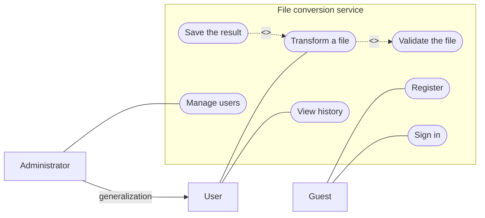
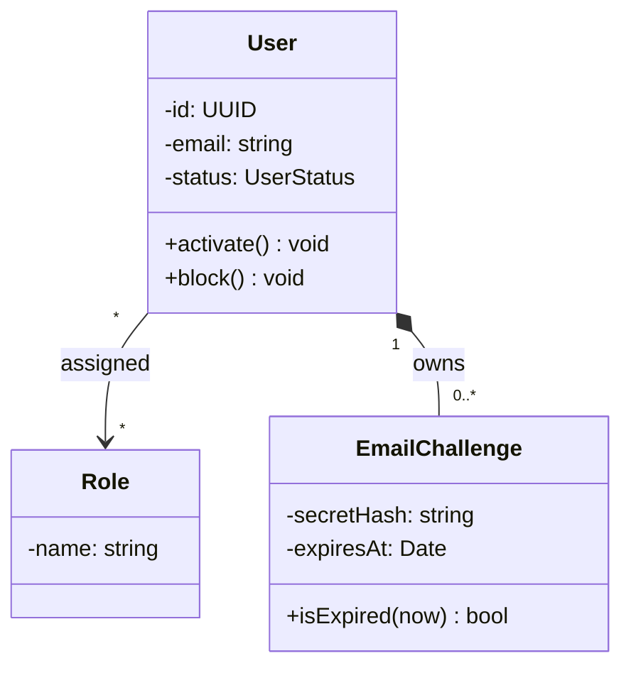
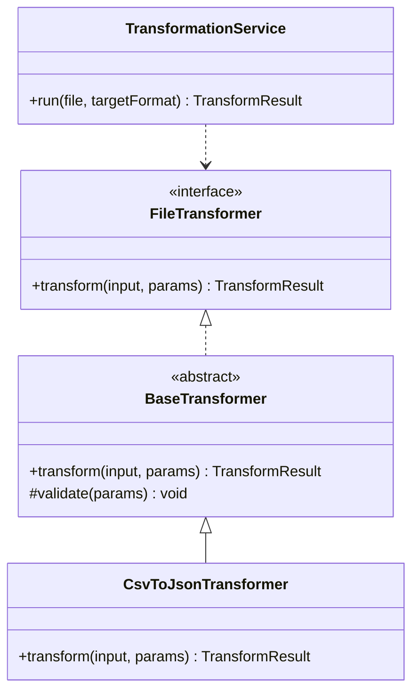
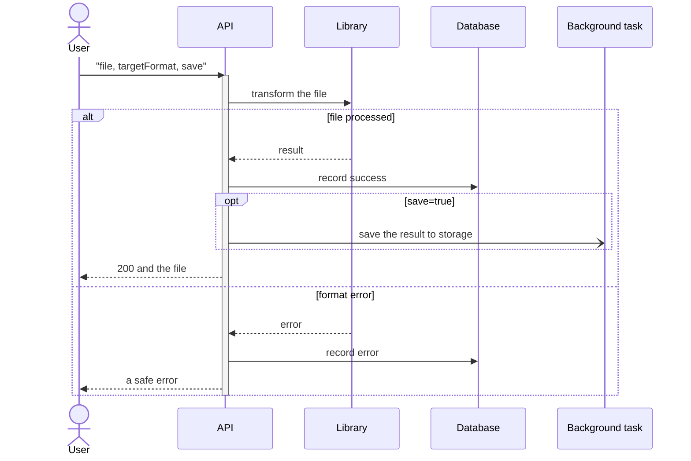
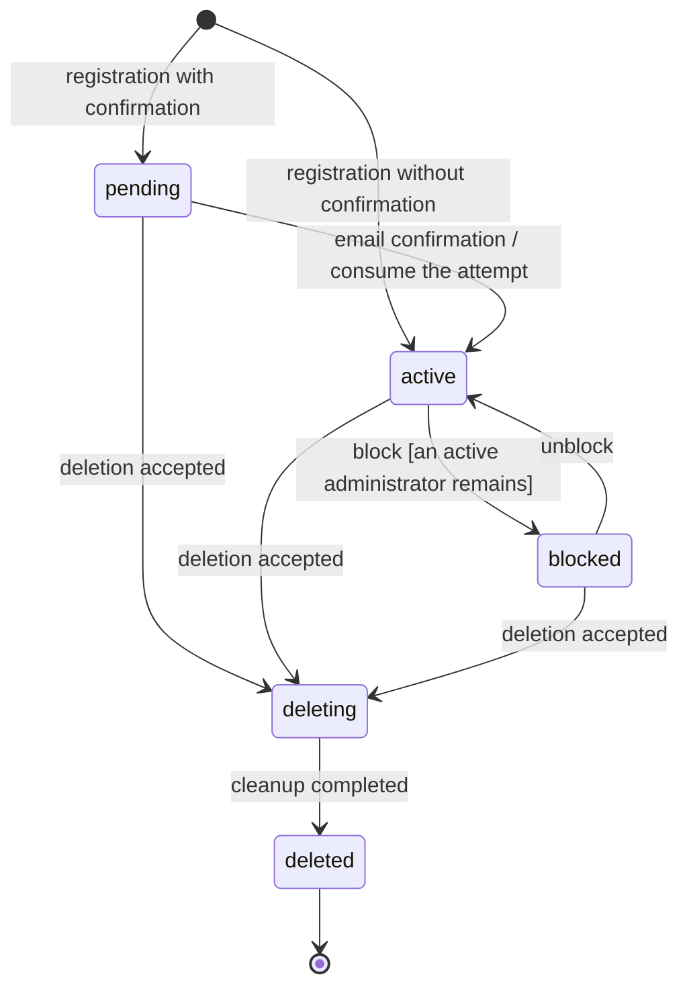
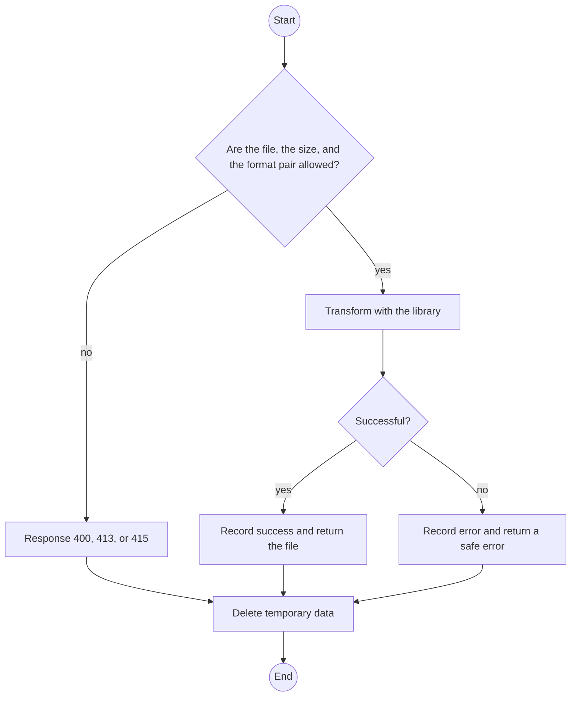
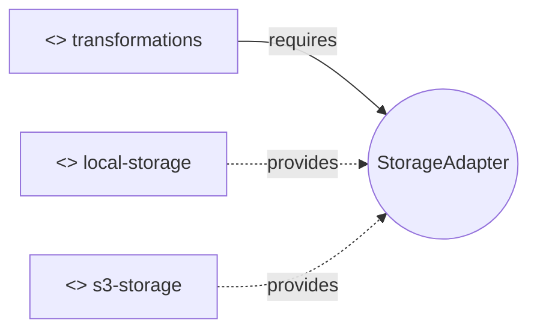
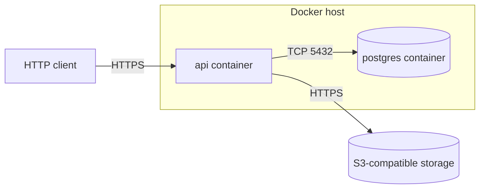

# UML diagrams

## Contents

- [What UML is](#what-uml-is)
- [Which diagram to choose](#which-diagram-to-choose)
- [Common notation](#common-notation)
- [Use case diagram](#use-case-diagram)
- [Class diagram](#class-diagram)
- [Sequence diagram](#sequence-diagram)
- [State diagram](#state-diagram)
- [Activity diagram](#activity-diagram)
- [Component and deployment diagrams](#component-and-deployment-diagrams)
- [Diagrams as code](#diagrams-as-code)
- [Common mistakes](#common-mistakes)
- [Useful links](#useful-links)
- [Review questions](#review-questions)

## What UML is

UML (Unified Modeling Language) is a graphical language for describing the structure and behavior of a system. The current version is UML 2.5.1. Each diagram shows one aspect: which parts the system consists of, how the parts interact, or how an object's state changes.

On the backend, UML is used as a sketch: agree on a scenario, the data, and module boundaries, then document the decision. Complete formal models with code generation are rare.

| Structural | Behavioral |
| --- | --- |
| **class** | **use case** |
| **component** | **activity** |
| **deployment** | **state** |
| package, object | **sequence** |

Bold marks the diagrams that a backend needs most often. A table schema is an ER diagram. It is not part of UML. The notation is covered in `0.1 Базы данных.md` (Databases).

## Which diagram to choose

| Question | Diagram | Mermaid |
| --- | --- | --- |
| Who uses the system, and which goals do they reach? | use case | none, an approximation through `flowchart` |
| Which classes and interfaces does a module consist of? | class | `classDiagram` |
| How does a request pass between the client, the API, the database, and external services? | sequence | `sequenceDiagram` |
| Which statuses does an entity have, and which transitions are allowed? | state | `stateDiagram-v2` |
| Which steps and branches does a process have? | activity | an approximation through `flowchart` |
| Which parts does the system consist of, and through which interfaces are they connected? | component | an approximation through `flowchart` |
| On which servers and in which containers is everything running? | deployment | an approximation through `flowchart` |

## Common notation

- A **stereotype** in angle brackets specifies the kind of element: `<<interface>>`, `<<include>>`. In Mermaid it is written as `<<interface>>`.
- **Cardinality:** `1` is exactly one, `0..1` is zero or one, `*` is any number, and `1..*` is at least one.
- **Visibility:** `+` public, `-` private, `#` protected, `~` package.

## Use case diagram

It shows who interacts with the system and which goals they reach, without implementation details.

| Element | Drawing | Meaning |
| --- | --- | --- |
| Actor | a stick figure | an external role: a person or another system |
| Use case | an oval | a goal of the actor, phrased as a verb: "Transform a file" |
| System boundary | a rectangle around the ovals | what belongs to the system |
| `<<include>>` | a dashed line from the base use case to the included one | the included use case always runs |
| `<<extend>>` | a dashed line from the extension to the base use case | the extension runs only when a condition holds |
| Generalization | a solid line with a hollow triangle at the general element | an administrator can do everything a user can do |

Mermaid does not support this diagram, so an actor is drawn as a rectangle and a use case as a rounded shape:

A transformation always includes file validation. Saving to storage extends it only when `save=true`.

## Class diagram

It shows classes and interfaces, their fields, methods, and relationships. A class is drawn as a rectangle of three sections: name, attributes, and operations. An attribute is `visibility name: type`. An operation is `visibility name(parameters): type`.

| Relationship | Meaning | Drawing |
| --- | --- | --- |
| Association | objects stay linked over time | a solid line |
| Aggregation | a whole and its parts; the parts exist on their own | a hollow diamond at the whole |
| Composition | the parts do not exist without the whole | a filled diamond at the whole |
| Generalization | inheritance, "is a" | a hollow triangle at the parent |
| Realization | a class implements an interface | a dashed line, with a hollow triangle at the interface |
| Dependency | temporary use | a dashed arrow |

In Mermaid: `-->` is association, `o--` is aggregation, `*--` is composition, `<|--` is generalization, `<|..` is realization, and `..>` is dependency.

Email confirmation attempts do not exist without a user: that is composition. A role lives apart from a user: that is association.

The transformer structure from `2.0 Общие требования к трансформации файлов.md` (General requirements for file transformation):

In TypeScript, generalization is written with `extends`, and realization with `implements`. In C#, both relationships use a colon. In Python, a class inherits an abstract base class from the `abc` module.

## Sequence diagram

It shows the exchange of messages over time. Time runs from top to bottom. Each participant has a vertical lifeline.

| Element | Drawing | Mermaid |
| --- | --- | --- |
| Synchronous message | a solid line, a filled arrow; the sender waits | `A->>B: text` |
| Reply | a dashed line | `B-->>A: text` |
| Asynchronous message | an open arrow; the sender does not wait | `A-)B: text` |
| Fragment | a frame: `alt` is a branch, `opt` is an optional part, `loop` is a loop | `alt condition` … `else` … `end` |

The API waits synchronously for the library and for the history write. Saving goes to a background task asynchronously, so the response to the user does not wait for storage.

## State diagram

It shows which states an object can be in and which events move it from one state to another. A transition is labeled `event [condition] / action`.

The user lifecycle according to `1.0`, `1.5`, and `1.6`:

The server does not perform a transition that is missing from the diagram (from `deleted` to `active`). In the contract for changing a user, such a request receives **409**.

## Activity diagram

It shows the order of actions in a process: branches, merges, and parallel paths. Unlike a sequence diagram, the steps matter here, rather than the participants and the messages.

A decision is drawn as a diamond. Parallel paths use a thick bar (fork / join). Swimlanes show who performs an action. Mermaid does not support this diagram. The closest substitute is `flowchart`.

## Component and deployment diagrams

A component diagram shows the large parts of a system and the interfaces between them. A component provides an interface (a lollipop) or requires one (a socket). A component can be replaced by any other implementation of the same interface.

The transformations module depends only on the storage interface, so a local disk and S3 are connected without a change to its code.

A deployment diagram shows nodes (servers, containers), the artifacts placed on them, and the communication channels.

## Diagrams as code

Text diagrams are stored in the repository next to the code: changes are visible in review and in Git history.

| Tool | Features |
| --- | --- |
| Mermaid | `mermaid` blocks render in GitHub, Notion, and Obsidian. Sequence, class, state, ER, and `flowchart` diagrams are available. Use case, component, deployment, and activity diagrams in UML notation are not |
| PlantUML | the full set of UML diagrams. A server or an IDE plugin is required to render them |
| draw.io | manual drawing. A `.drawio` file can be stored in the repository |

## Common mistakes

| Mistake | The correct form |
| --- | --- |
| The inheritance triangle is at the child | the triangle is always at the parent or the interface |
| Composition and aggregation are chosen at random | the part is deleted together with the whole: composition. It lives on its own: aggregation |
| A reply is drawn as a solid line | a reply is a dashed line. An asynchronous message is an open arrow |
| Every scenario and class of the system is on one diagram | one diagram answers one question |
| A use case: "Press the button" | a use case is a goal of the actor: "Transform a file" |
| The `<<include>>` arrow starts at the included use case | `<<include>>` goes from the base use case to the included one. `<<extend>>` goes from the extension to the base use case |
| The code allows a transition that is missing from the state diagram | the checks in the code match the diagram |

## Useful links

- [OMG — UML 2.5.1](https://www.omg.org/spec/UML/2.5.1/): the official specification.
- [uml-diagrams.org](https://www.uml-diagrams.org/): a reference for diagram types and notation.
- [Martin Fowler — UML Distilled](https://martinfowler.com/books/uml.html): practical use of UML.
- [Mermaid — Sequence diagrams](https://mermaid.js.org/syntax/sequenceDiagram.html): participants, messages, and fragments.
- [Mermaid — Class diagrams](https://mermaid.js.org/syntax/classDiagram.html): classes, relationships, and cardinality.
- [Mermaid — State diagrams](https://mermaid.js.org/syntax/stateDiagram.html): states and transitions.
- [Mermaid — Flowcharts](https://mermaid.js.org/syntax/flowchart.html): shapes for diagrams that Mermaid does not have.
- [Mermaid Live Editor](https://mermaid.live/): checking a diagram in the browser.
- [PlantUML](https://plantuml.com/): every kind of UML diagram in text form.

## Review questions

1. How do structural diagrams differ from behavioral diagrams? Give two examples of each kind.
2. How is aggregation distinguished from composition, and which one describes the link between a user and email confirmation attempts?
3. How does a synchronous message differ from an asynchronous one, and why is saving the result to storage asynchronous on the diagram?
4. How does the user state diagram help determine which API requests must end with **409**?
5. How does `<<include>>` differ from `<<extend>>`, and which way do their arrows point?
6. When is a process described by an activity diagram, and when by a sequence diagram?
7. Why is a database schema usually drawn as an ER diagram, rather than as a class diagram?
