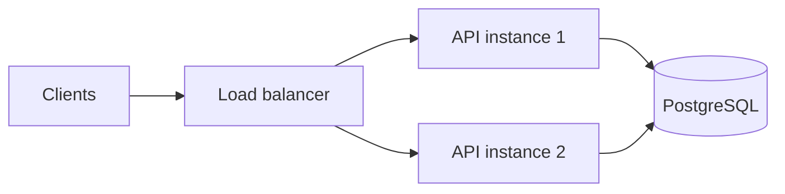
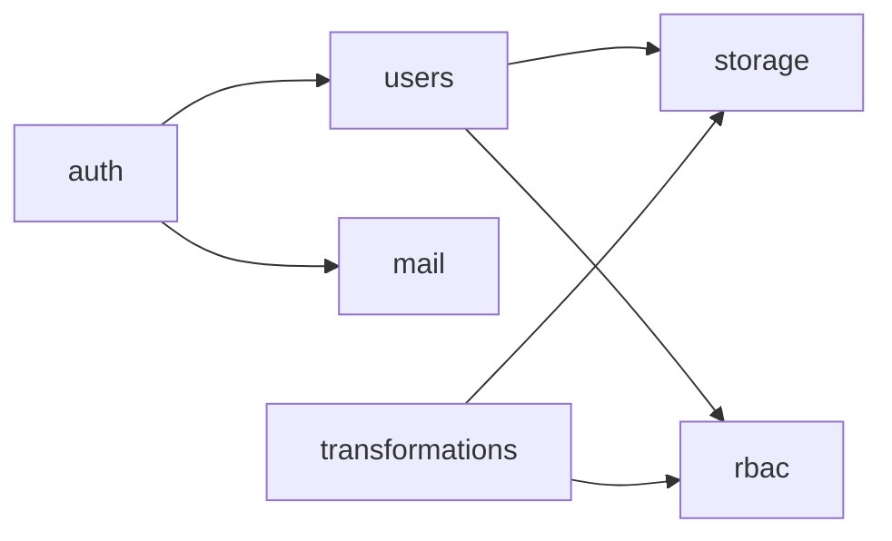
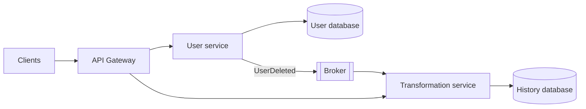
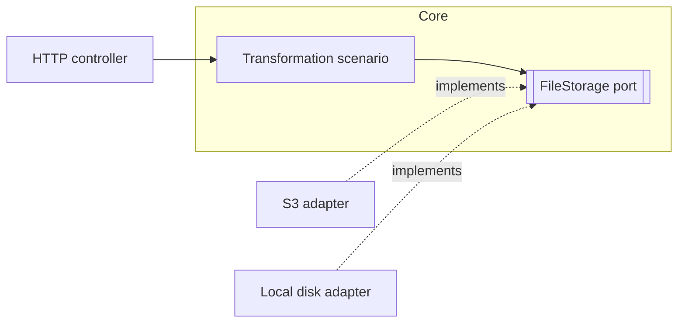

# Back-end architectures

## Contents

- [Two levels of architecture](#two-levels-of-architecture)
- [Monolith](#monolith)
- [Modular monolith](#modular-monolith)
- [Microservices](#microservices)
- [SOA](#soa)
- [Serverless](#serverless)
- [Events and CQRS](#events-and-cqrs)
- [Architecture inside the application](#architecture-inside-the-application)
- [Comparison](#comparison)
- [How to choose](#how-to-choose)
- [Common mistakes](#common-mistakes)
- [Useful links](#useful-links)
- [Review questions](#review-questions)

## Two levels of architecture

The system level decides how many independently deployable parts the system has: a monolith, microservices, SOA, or serverless. The application level decides how the code is organized inside one such part: modules, layers, ports, and adapters.

The course project is a monolith. The code is split into modules by business function (`auth`, `users`, `rbac`, `transformations`, `storage`), and each module is split into layers.

## Monolith

The whole application is built into one artifact and runs as one process with one database. Modules call each other with ordinary function calls, without a network.

| Advantages | Disadvantages |
| --- | --- |
| one repository, one build, one deployment | any change requires rebuilding the whole application |
| calls between modules are fast and are not lost | without explicit boundaries, the code grows together |
| one transaction covers data from any modules | a fault in one module stops the whole process |
| simple to run locally | a busy part cannot be scaled on its own |

A monolith scales horizontally as a whole: several identical instances run behind a load balancer. This works only if an instance does not keep state in process memory or on a local disk. In this course, that problem is solved with JWTs without server sessions, and with object storage instead of a local disk in production.

It fits an MVP, a small team, and most projects at the start.

## Modular monolith

One process and one deployment, but the code is divided into modules by business function:

- a module exposes only a public API to the others. In NestJS, those are the providers in `exports`;
- a module owns its tables. Other modules get data only through its API;
- dependencies point in one direction and do not form cycles;
- shared code without business logic (configuration, logging) is kept separate.

An arrow means "calls the public API". A mutual call between `users` and `rbac` points to poor boundaries: the shared part is moved into its own module, or the call is replaced with an event.

As load or the team grows, a module is extracted into its own service: an in-process call is replaced with a network call, and ownership of the tables is already separated.

## Microservices

The system is made of small services. Each one is responsible for one business function, is deployed independently, and owns its database (database per service). They communicate over HTTP, gRPC, or a message broker. Clients go through an API gateway: routing, token checks, and rate limiting.

After a user is deleted, the user service publishes `UserDeleted`. The transformation service receives the event and deletes its own history. The two services have no shared transaction.

| Advantages | Disadvantages |
| --- | --- |
| services scale and ship independently | a network call is slower and can fail |
| a failure of one service does not necessarily stop the others | data is reconciled with a delay |
| each team has its own release cycle | orchestration, tracing, and monitoring are required |
| each service can use its own stack | debugging is harder than in one process |

- **Saga.** An operation made of local transactions in different services. A failed step is undone by a compensating action: if a booking fails, the payment that was charged is returned.
- **Distributed monolith.** Services that ship only together, or that share one database. It combines the disadvantages of both approaches.
- **Conway's law.** The structure of a system repeats the structure of communication in the organization. Microservices pay off when several independent teams work on the system.

This fits large systems and parts whose load differs sharply.

## SOA

Service-oriented architecture is the predecessor of microservices. The services are large (customers, accounts, warehouse) and are reused by different applications. An enterprise service bus (ESB) connects them: routing, format transformation, and often business logic as well. The exchange usually uses SOAP.

The main difference from microservices is where the integration logic lives. In SOA it lives in the bus, which becomes a bottleneck. Microservices follow "smart services, dumb pipes": the logic is in the services, and the broker only delivers messages.

New projects rarely choose SOA. It fits the integration of legacy enterprise systems.

## Serverless

The code is written as functions that the cloud runs in response to events: an HTTP request, a file upload, a queue message, or a schedule. The provider takes care of servers and scaling (AWS Lambda, Azure Functions, Yandex Cloud Functions). Billing is by the number of invocations and the execution time. The model is called FaaS.

| Advantages | Disadvantages |
| --- | --- |
| no servers to configure | a cold start after idle time |
| scaling without configuration | a time limit. For AWS Lambda it is 15 minutes |
| cheaper than an always-on server when calls are rare | usually more expensive under constant high load |
| a single function can be shipped quickly | lock-in to the provider, and local debugging is harder |

A function does not keep state between invocations. Hundreds of parallel instances exhaust `max_connections` in PostgreSQL if each one opens its own connection, so a pool sits between the functions and the database (PgBouncer, Amazon RDS Proxy).

This fits webhooks, processing of uploaded files, scheduled jobs, and rare load spikes.

## Events and CQRS

A component publishes an event ("user deleted"), and subscribers react independently. The sender does not know the receivers and does not wait for a result. The approach is used both inside a monolith (background jobs) and between services.

Brokers usually deliver a message at least once, so the handler must be idempotent: a repeat does not change the result. This is covered in `0.4 Идемпотентность.md` (Idempotency). If the data is written to the database and the event is sent afterward, a failure between the two steps loses the event. A transactional outbox writes the event to a table in the same transaction as the data. A separate process delivers it to the broker. The user-deletion job from `1.6` is stored in the database for the same reason.

**CQRS** separates the write model from the read model. Commands change state and check rules. Queries only read data in a convenient shape. In the simple variant, both models use one database. A separate read store is needed when the load or the shape of the data differs sharply. For ordinary CRUD, CQRS only adds code. It is a module pattern, not a way to deploy: it is also used inside a monolith.

## Architecture inside the application

### Layers

| Layer | Responsible for | Example in NestJS |
| --- | --- | --- |
| Presentation | HTTP: routes, DTOs, validation, and statuses | `UsersController` |
| Business logic | scenarios, rules, and transactions | `UsersService` |
| Data access | SQL or an ORM | a TypeORM repository, Prisma Client |

Dependencies point only downward. A controller does not talk to the database directly. A service knows nothing about HTTP: it does not choose the response status and does not read cookies. The same service can therefore be called from a controller, a background job, or a test. The layers are the same in ASP.NET Core and FastAPI.

### Ports and adapters

Hexagonal architecture develops the same idea. At the center is a core with the scenarios. The core declares interfaces (ports) for storage, mail, and the database. Infrastructure implements them with adapters. The core imports neither a storage SDK nor an ORM.

The concrete adapter is supplied by the dependency-injection mechanism: providers in NestJS, `IServiceCollection` in ASP.NET Core, and `Depends` in FastAPI. That is how this course connects file storage and format transformers.

For simple CRUD, a full hexagonal structure is more than is needed. A practical compromise is layers inside modules, and interfaces only at the boundaries with external systems.

## Comparison

| Style | Deployment | Data | Complexity | Fits |
| --- | --- | --- | --- | --- |
| Monolith | one application | one database | low | an MVP and small teams |
| Modular monolith | one application, isolated modules | one database, tables owned by modules | low | most new projects |
| Microservices | many services | a database for each | high | large systems and several teams |
| SOA | large services and a bus | often shared databases | high | integration of legacy systems |
| Serverless | separate functions | an external database and storage | medium | event-driven and uneven load |

## How to choose

1. Start with a modular monolith: it is fast to build, and it does not close the path to services.
2. Extract a module into its own service only for a concrete reason: its load grows independently, a separate team works on it, or it needs its own release cycle.
3. Use serverless for occasional tasks around the main system: webhooks, file processing, and schedules.
4. Use CQRS locally, where reading and writing diverge sharply.

## Common mistakes

| What you see | Cause and fix |
| --- | --- |
| Business logic cannot be tested without an HTTP request | the logic is in the controller. Move it into a service |
| A module runs SQL against another module's tables | get the data through that module's public API |
| Modules import each other in a circle | the boundaries are poor. Extract the shared part, or replace the call with an event |
| Microservices ship only together | a distributed monolith: a shared database or tightly coupled contracts |
| A failure of one service stops the chain | there are no timeouts. Replace some calls with events |
| The second API instance answers differently from the first | state lives in process memory. Move it to the database or a cache |
| A repeated event delivery performed the action twice | the handler is not idempotent |
| Serverless functions exhausted the database connections | each function opens its own connection. A pool is required |

## Useful links

### General

- [Martin Fowler — Microservices](https://martinfowler.com/articles/microservices.html) — the definition and characteristics of microservices.
- [Martin Fowler — MonolithFirst](https://martinfowler.com/bliki/MonolithFirst.html) — why a project starts as a monolith.
- [Martin Fowler — Serverless Architectures](https://martinfowler.com/articles/serverless.html) — how serverless is built, and its trade-offs.
- [Martin Fowler — CQRS](https://martinfowler.com/bliki/CQRS.html) — when splitting the models is justified.
- [microservices.io — Patterns](https://microservices.io/patterns/) — Saga, Database per service, API Gateway, and Transactional outbox.
- [Alistair Cockburn — Hexagonal Architecture](https://alistair.cockburn.us/hexagonal-architecture) — ports and adapters.
- [The Twelve-Factor App](https://12factor.net/) — a stateless application that can run as several instances.

### By language

#### Node.js

- [NestJS — Modules](https://docs.nestjs.com/modules) — module boundaries, `imports`, and `exports`.
- [NestJS — Custom providers](https://docs.nestjs.com/fundamentals/custom-providers) — swapping an interface implementation through DI.
- [NestJS — Microservices](https://docs.nestjs.com/microservices/basics) — transports for communication between services.

#### .NET

- [Microsoft — Common web application architectures](https://learn.microsoft.com/en-us/dotnet/architecture/modern-web-apps-azure/common-web-application-architectures) — the monolith, layers, and clean architecture in ASP.NET Core.
- [.NET — Dependency injection](https://learn.microsoft.com/en-us/dotnet/core/extensions/dependency-injection/overview) — registering interface implementations.

#### Python

- [FastAPI — Bigger Applications](https://fastapi.tiangolo.com/tutorial/bigger-applications/) — splitting an application into modules with `APIRouter`.
- [FastAPI — Dependencies](https://fastapi.tiangolo.com/tutorial/dependencies/) — dependency injection.
- [Cosmic Python](https://www.cosmicpython.com/) — the repository, the unit of work, and events in Python.

## Review questions

1. Why can a monolith be scaled horizontally, and what prevents a second instance of the application from being started?
2. How does a modular monolith differ from an ordinary one, and which rules keep the modules from growing together?
3. Why does each microservice have its own database, and how is data across several services reconciled without a shared transaction?
4. What happens if a broker delivers an event again and the handler is not idempotent?
5. For which tasks is serverless cheaper than an always-on server, and for which is it more expensive?
6. How does CQRS differ from a split into microservices, and does it require a separate database for reading?
7. Why, in hexagonal architecture, does the storage interface belong to the core, while the S3 implementation belongs to an adapter?
