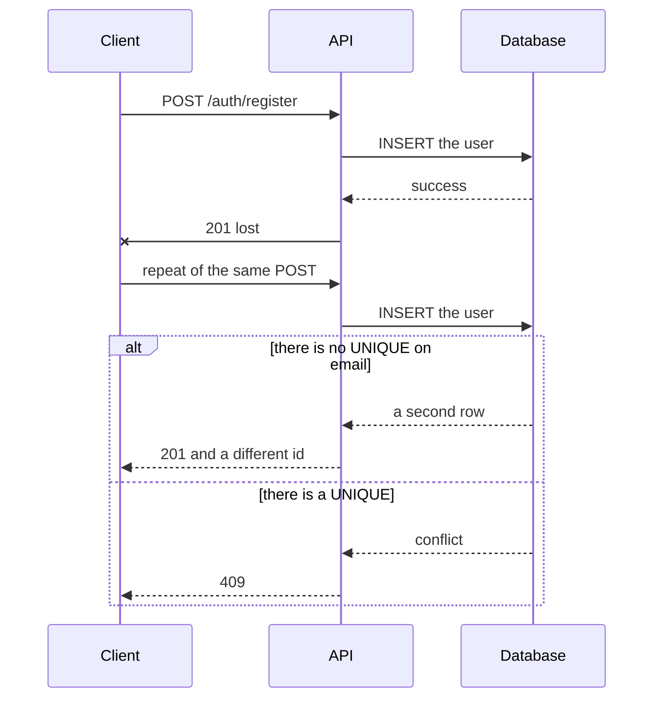
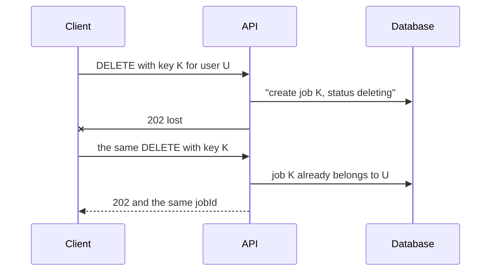

# Idempotency

## Contents

- [What idempotency is](#what-idempotency-is)
- [Safe and idempotent HTTP methods](#safe-and-idempotent-http-methods)
- [Examples](#examples)
- [Why requests are repeated](#why-requests-are-repeated)
- [How to make an operation idempotent](#how-to-make-an-operation-idempotent)
- [The idempotency key](#the-idempotency-key)
- [Retries of background jobs](#retries-of-background-jobs)
- [How this shows up in the system](#how-this-shows-up-in-the-system)
- [Common mistakes](#common-mistakes)
- [Useful links](#useful-links)
- [Review questions](#review-questions)

## What idempotency is

An operation is idempotent if repeating it does not change the result of the first successful run. One call and three identical calls leave the server in the same state. The client can send the request again after a dropped connection and will not create a second entity, send a second email, or start a second deletion process.

In mathematics the property is written as `f(f(x)) = f(x)`. The absolute-value function is idempotent: the absolute value of −3, taken again, is still 3. The assignment `name = 'Anna'` is idempotent too: a repeat leaves the same value. The increment `attempts = attempts + 1` is not idempotent: every call increases the counter.

Idempotency is about **the client's intention to change the server's state**, not about the response bytes. A log, a rate-limit counter, and an `updated_at` field may change on every request. RFC 9110 allows this: what counts is the effect on the resource, not side observations.

Matching the HTTP status on a repeat is a separate, stronger property. The first `DELETE` often returns **204**, and the second returns **404**, because the resource is already gone. The state is the same: the object is absent. A contract that **replays the stored response** in full is needed where the client must receive the same `jobId` or the same body, and not only the same final effect.

A unique constraint in the database protects the invariant "no more than one row", but by itself it does not make the HTTP operation idempotent. A repeated registration with an email that is already taken returns **409**, while the first success returned **201**. The state "one user per address" is preserved, but a client that did not receive the first response will not learn the `id` of the created record from the repeat.

## Safe and idempotent HTTP methods

RFC 9110 separates two properties of a method.

| Property | Meaning | Methods in the specification |
| --- | --- | --- |
| Safe | the client does not intend to change state | `GET`, `HEAD`, `OPTIONS`, `TRACE` |
| Idempotent | several identical requests have the same effect as one | the safe methods, and also `PUT` and `DELETE` |
| Neither, by default | a repeat accumulates an effect | `POST`, `PATCH` |

A safe method is always idempotent. The reverse is not true: `PUT` and `DELETE` change data, but a repeat does not strengthen the change. `PUT /admin/rbac/roles/{roleId}` with the same body leaves the role in one state. `POST /admin/rbac/roles` with the same `name` tries to create another role.

The specification describes **the semantics of the method**. It does not force the server. Nothing stops a `GET` from performing a deletion, or `POST /auth/logout` from being made idempotent. Clients and intermediaries rely on the declared semantics, so safe methods do not write, and an idempotent contract is declared explicitly when it differs from the `POST` default.

`PATCH` is not idempotent in general: a JSON Patch `add` into an array appends an element on every call. Replacing a field with an absolute value (`displayName: "Anna"`) has the same effect as a `PUT` of that field. In `1.5`, the profile's text fields are updated with such an absolute PATCH. Uploading a new photo generates a new object key, so that upload is not a repeat.

An automatic retry is appropriate only for an idempotent method, or for a `POST` that carries an idempotency key. A blind retry of `POST /api/convert` creates a second history record.

## Examples

**Assigning a name.** The client sends one value twice.

| Call | Before | After |
| --- | --- | --- |
| 1. `displayName = "Anna"` | `"Ivan"` | `"Anna"` |
| 2. the same request | `"Anna"` | `"Anna"` |

The state after one call and after two calls is the same. The operation is idempotent.

**Creating a transformation.** The client sends the same CSV twice to `POST /api/convert`.

| Call | History |
| --- | --- |
| 1 | row `t1`, status `success` |
| 2 | rows `t1` and `t2` |

A second operation appeared. This is not a failure: each transformation is a separate fact, which the user sees in the history from `2.3`. The method is `POST` precisely because a repeat must create a new attempt, not return the previous file.

**Deleting an object in storage.** The background cleanup from `2.4` calls `delete` by key. On an S3-compatible boundary, deleting an object that is already absent succeeds. If absence is treated as an error, a failure after the object was actually deleted loops the worker: every retry receives "not found" and does not mark the job complete.

**Reading a list.** `GET /admin/users` with the same parameters does not create users and does not move the cursor. Between two calls the data may change, for example a new registration may appear, because the safety of the method does not freeze the database. The stable cursor pagination from `1.7` adds a stronger promise about traversal: repeating a page with the same cursor does not duplicate items because of an equal `createdAt`, and it does not insert rows into the middle after `snapshotAt`.

**Sign-out.** `POST /auth/logout` clears the current client's cookies and responds **204** whether or not the cookies were present. A second call after the first leaves the browser without a session and returns **204** again. For this client, the operation is idempotent. A copied refresh JWT on another device is not revoked by logout: that is a limit of the stateless scheme from `1.2`, not a break in the idempotency of the current request.

## Why requests are repeated

The client repeats a request for more reasons than a double click. The network, the load balancer, and the message broker make a repeat normal.

A typical lost response:



The first request already created the user, but the client did not see it. Without a unique constraint, the repeat creates a second user. With the constraint, the invariant "one email, one row" survives, but the client receives an error instead of the original **201** and `id`.

Other sources of repeats:

- the user presses "Submit" again while the first request is still running;
- an HTTP client or a proxy retries the request after a timeout;
- the load balancer closes the connection when API instances switch;
- a broker delivers a message "at least once";
- after a lease expires, a worker starts the same deletion job again.

Where a repeat is dangerous, the contract forbids it (`POST` of a transformation) or makes it safe (a deletion key, `UNIQUE`, "a missing object means success").

## How to make an operation idempotent

Several techniques cover different cases. They can be combined.

**Method semantics.** Replacing a resource entirely is `PUT`. Deletion is `DELETE`. Reading is `GET`. Creating a new fact is `POST`. In `1.1`, the user's role list is replaced through `PUT /admin/rbac/users/{userId}/roles`: two identical `roleIds` arrays leave the same links. Creating a role stays `POST`, because the server issues the identifier.

**A natural key.** A repeat is recognized from the meaning of the operation, not from a random header. For the deletion in `1.6`, a user has at most one deletion job: a second `DELETE` of the same target returns the existing `jobId`, even if the client sent a different key.

**A unique constraint.** A `UNIQUE` on `users.email`, on the pair `(role_id, permission_id)`, and a partial unique index "one unredeemed attempt" turn a race of two parallel `INSERT`s into a database conflict. The handler turns that conflict into **409**, not into an unhandled error. This protects the invariant. A safe retry after a timeout usually also needs the stored response.

**"Already done" as success.** An idempotent eraser and storage cleanup do not require the object to exist at the moment of the call. Deleting a missing file, clearing a field that is already empty, and repeating finalization when `job.status = succeeded` all finish successfully.

**A conditional write.** `UPDATE ... WHERE status = 'queued'` or `INSERT ... ON CONFLICT DO NOTHING` makes the state transition atomic. A second worker does not take the same job while the first holds the lease.

```sql
INSERT INTO deletion_jobs (id, user_id, status)
VALUES ($1, $2, 'queued')
ON CONFLICT (user_id) DO NOTHING;
```

If the row already exists, the repeat does not create a second process. The client is returned the `id` that was found.

## The idempotency key

When there is no natural key, or the client must know the identifier **before** the response, the client sends its own key. Stripe stores the status and body of the first request for a given `Idempotency-Key` and, on a repeat, returns the stored result without running the operation again. The client generates the key: enough randomness to rule out collisions. An email and other PII are not used in the key.

In `1.6`, the client creates 16 random bytes and sends 32 lowercase hex characters as `Idempotency-Key`. The server uses that value as `jobId`, so the address of the status endpoint is known even if the **202** was lost. The repeat rules:



- the same key and the same target: the previous job, **202**, with no second process and no repeated challenge check;
- a different key, but the user already has a job: the existing `jobId`, because the natural key is one per target;
- the same key for a different target: **409**, so that one operation does not acquire two meanings.

The key is compared together with the parameters of the intention. Otherwise a repeat with a different body would silently run someone else's operation under the guise of a retry. A failed validation before work starts does not "burn" the key: the client can correct the request and use the key again. After the side effect has started, a repeat must return the original outcome.

`GET` and `DELETE` are already idempotent in the RFC sense, so they usually do not need a separate key. The exception is the `DELETE` that accepts deletion: it is a long process with **202**, and the client needs a stable `jobId` after a lost response.

## Retries of background jobs

Brokers and queues almost always deliver a message at least once. A handler that creates an object or charges a resource on every call will perform the action twice. A background step is therefore made idempotent, and its progress is stored in the database.

In `1.6`, the worker atomically takes a lease on the job, calls every registered eraser, and then runs finalization. While the lease is alive, a second worker does not start the same job. After a process crash the lease expires, and the job can be taken again. The repeat is safe because:

- a missing storage object is treated as already deleted;
- calling an eraser again after success returns `succeeded` again;
- `eraseUserData` returns `succeeded` when the user's data is already empty;
- the final transaction, when `job.status = succeeded` and `user.status = deleted`, finishes as an internal success.

The same technique is needed for the retention cleanup in `2.4`: the object is deleted first, then the history fields are cleared. If the process crashes between the steps, the repeat calls `delete` again and finishes the record.

If a row is written to the database and a message is then sent to the broker, a failure between the steps loses the event. A transactional outbox puts the event in a table in the same transaction as the data. A separate process delivers it to the broker and must also tolerate a repeated delivery: the event key is unique, and the handler is idempotent.

## How this shows up in the system

In this course, idempotency is not a separate module. It is a property of particular operations. Some are idempotent on purpose, and others are not, also on purpose.

**Registration (`1.0`).** `POST /auth/register` creates a user and is therefore not an idempotent method. A `UNIQUE` on the normalized email stops two requests from creating two rows, including for `pending`. A lost **201** becomes **409** on a repeat: the account exists, but the client does not receive the previous `id`. This is acceptable for registration, because a later sign-in and email confirmation use the address, not the lost identifier.

**Authentication (`1.2`).** Login, confirm, and refresh are `POST` operations with a new effect: an email, a redeemed attempt, a new cookie pair. They cannot be retried blindly as "the same sign-in". Logout, by contrast, always clears the current client's cookies and responds **204**: a repeat is safe and expected.

**RBAC (`1.1`).** A `PUT` of a role, a permission, an assignment, and the user's `roleIds` list replaces the resource entirely. A repeat with the same body leaves the policy unchanged. The policy version may increase if the write actually ran. A `POST` that creates a role or a grant returns **409** on a uniqueness conflict: a second "role to permission" link does not appear. This protects the invariant. It does not return the first **201**.

**Profile update (`1.5`).** A repeated PATCH with the same `displayName` leaves the same name. Uploading the photo again creates a new object with a new random key: the file bytes match, but the operation does not. A partial unique index of one open email attempt stops a second request, after an SMTP failure, from creating a parallel challenge.

**Deletion (`1.6`).** The central example in the system. Acceptance is idempotent at two levels: the client's `Idempotency-Key` matches `jobId`, and a user has at most one job. The **202** response can be lost and requested again. The worker, the eraser, and finalization are idempotent. Otherwise a repeat after a file that is already deleted would stop the cleanup. An administrative repeat of `DELETE` when the status is `failed` does not create a new job and does not change the tombstone: it returns the same process to the queue.

**Lists (`1.7`, `2.3`).** `GET` does not create entities: the same parameters do not produce side records. A cursor that includes `id` in the key also removes page duplicates that look like "the repeat returned something else". This is a property of reading and pagination, not an idempotency key for a write.

**File transformation (`2.0`–`2.2`).** `POST /api/convert` and `POST /api/images/convert` are intentionally not idempotent. Each call is a new attempt with its own history row, `success` or `error`. An idempotent `PUT` would be a contract error here: the user would not see repeated failed attempts and could not tell two transformations of one file apart.

**Storage (`2.4`).** A download by `GET` returns the same object while it exists and retention has not expired. A background write with `save=true` must survive a repeated task without a second object under a different key: the key is bound to the history row in advance. Cleanup and the user eraser treat a missing object as success. Otherwise the deletion from `1.6` would not converge.

**Architecture.** Several API instances behind a load balancer do not store "already done" in process memory: the key, the job, and the lease live in PostgreSQL. Otherwise a repeat would land on another instance and run again.

| Operation | Idempotent? | What provides it |
| --- | --- | --- |
| `PUT` of a role or `roleIds` | yes, a full replacement | `PUT` semantics |
| `POST` of registration, a grant, or convert | no, as an HTTP method | `UNIQUE` only protects the invariant |
| `POST /auth/logout` | yes, for the current client | always **204** and clearing cookies |
| `DELETE` that accepts deletion | yes | a key plus one job per user |
| the deletion worker and eraser | yes | "already gone" means success, plus a lease |
| `GET` of a list, history, or a file | yes, as a method | no write; the cursor stabilizes traversal |
| retention cleanup | yes | a repeated `delete` of the object |

## Common mistakes

| What you see | Where to look |
| --- | --- |
| Two users with one email after a "repeated registration" | there is no `UNIQUE`. Uniqueness was checked only with `SELECT` before `INSERT` |
| A repeated deletion confirm created a second job | there is no unique job on `user_id`, or the key is not used as `jobId` |
| A deletion key from request A was applied to user B | a repeat with a different intention was not rejected with **409** |
| A worker retries file deletion forever | a missing object is treated as an error, not as success |
| Two history rows for one "repeated" convert | expected behavior of `POST`. The mistake is making convert idempotent and hiding the attempt |
| An automatic HTTP retry after a login timeout created a second email | retry is enabled for a non-idempotent `POST` without a key |
| A second API instance ran the background job again | "already done" was stored in process memory, not in the database |
| An equal `createdAt` duplicated a user on two pages | a cursor without `id`. This is confused with the idempotency of `GET` |
| A repeated photo PATCH left the old object in the bucket | the new key was written and the old one was not deleted. The upload itself is not idempotent |
| Logout returned **401** the second time | the contract requires **204** without a session check |

## Useful links

### General

- [RFC 9110 — Idempotent Methods](https://www.rfc-editor.org/rfc/rfc9110.html#name-idempotent-methods) — the definition of an idempotent method, and why a client may repeat a request after a dropped connection.
- [RFC 9110 — Safe Methods](https://www.rfc-editor.org/rfc/rfc9110.html#name-safe-methods) — how the safety of a method differs from idempotency.
- [MDN — Idempotent](https://developer.mozilla.org/en-US/docs/Glossary/Idempotent) — short examples of `GET`, `POST`, and `DELETE`, including a different status with the same effect.
- [Stripe — Idempotent requests](https://docs.stripe.com/api/idempotent_requests) — the `Idempotency-Key` header, storing the first response, and forbidding a change of parameters on a repeat.
- [IETF — Idempotency-Key header](https://datatracker.ietf.org/doc/draft-ietf-httpapi-idempotency-key-header/) — a draft of a standard header for non-idempotent methods.
- [Microsoft — Retry pattern](https://learn.microsoft.com/en-us/azure/architecture/patterns/retry) — when an automatic retry is allowed, and why it is dangerous for non-idempotent calls.
- [Amazon S3 — DeleteObject](https://docs.aws.amazon.com/AmazonS3/latest/API/API_DeleteObject.html) — deleting an object that is already absent.
- [PostgreSQL — INSERT ... ON CONFLICT](https://www.postgresql.org/docs/current/sql-insert.html#SQL-ON-CONFLICT) — an atomic "insert or do nothing" on a unique key.

### By language

#### Node.js

**Node.js, NestJS.** On Express or Fastify the idempotency contract stays the same: unique constraints, the key, and the route semantics define it, not a framework decorator.

- [Prisma — Constraints and indexes](https://www.prisma.io/docs/orm/prisma-schema/data-model/indexes) — `UNIQUE` and handling a conflict on create.
- [node-postgres — Queries](https://node-postgres.com/features/queries) — a parameterized `INSERT ... ON CONFLICT`.
- [NestJS — Exception filters](https://docs.nestjs.com/exception-filters) — turning a uniqueness conflict into **409**.

#### .NET

**.NET, ASP.NET Core.** Either Minimal APIs or controllers may be used. The retry rules do not depend on that choice.

- [EF Core — Indexes](https://learn.microsoft.com/en-us/ef/core/modeling/indexes) — unique indexes as the guarantee of a natural key.
- [ASP.NET Core — Handle errors](https://learn.microsoft.com/en-us/aspnet/core/web-api/handle-errors) — a uniqueness conflict as **409**, not as an unhandled exception.
- [Polly — Resilience strategies](https://www.pollydocs.org/strategies/retry.html) — retrying an HTTP call only for idempotent operations.

#### Python

**Python, FastAPI.** On Django or Flask the same `UNIQUE`, the same key, and the same "absence means success" apply.

- [SQLAlchemy — IntegrityError](https://docs.sqlalchemy.org/en/20/core/exceptions.html#sqlalchemy.exc.IntegrityError) — a unique-constraint conflict.
- [psycopg — Passing parameters](https://www.psycopg.org/psycopg3/docs/basic/params.html) — a safe `ON CONFLICT` with parameters.
- [Celery — Tasks](https://docs.celeryq.dev/en/stable/userguide/tasks.html) — retriable background jobs, and the requirement that the handler be idempotent.

## Review questions

1. How does the idempotency of a method differ from its safety, and why can a repeated `GET` return different data?
2. Why may a second `DELETE` respond **404** and still be idempotent?
3. Why does a `UNIQUE` on email not make registration idempotent for a client that lost the first **201**?
4. Why does user deletion need both an `Idempotency-Key` and a unique job on `user_id`?
5. Why can file transformation not be made an idempotent `PUT`, and what would the history lose?
6. What happens if the deletion eraser treats a missing object in storage as an error?
7. Why is an automatic retry appropriate for a `PUT` of a role, and dangerous for a sign-in `POST` without an extra key?
