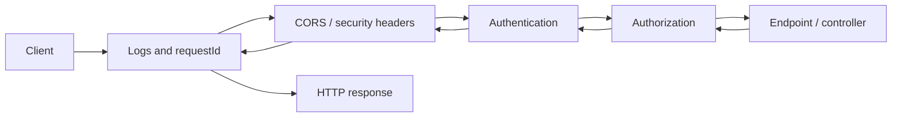
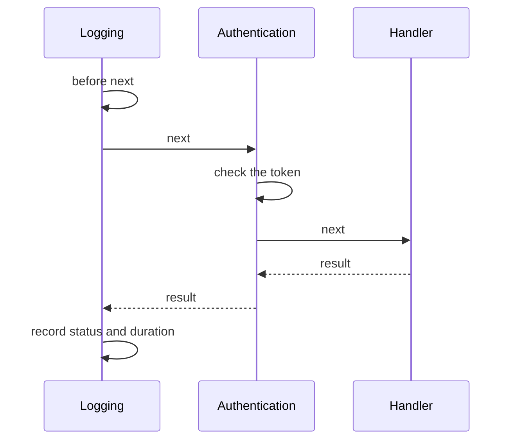

# Middleware

## Contents

- [What is middleware](#what-is-middleware)
- [Why this matters](#why-this-matters)
- [How the chain works](#how-the-chain-works)
- [What to put in middleware](#what-to-put-in-middleware)
- [Order matters](#order-matters)
- [.NET: middleware pipeline](#net-middleware-pipeline)
- [NestJS: middleware and request lifecycle](#nestjs-middleware-and-request-lifecycle)
- [Debugging and tests](#debugging-and-tests)
- [Common mistakes](#common-mistakes)
- [Useful links](#useful-links)
- [Review questions](#review-questions)

## What is middleware

**Middleware** is a component that sits between the HTTP server and the handler of a specific endpoint. It receives the request and the response. It can perform shared work, pass control to the next component, and process the response on the way back.

This is not unique to .NET. The same idea exists in Express and NestJS, FastAPI, Django, Spring, and an API gateway. Names and APIs differ. The model is the same. A request passes through a sequence of small layers before it reaches the business handler.



Middleware does not have to forward the request. For example, CORS can answer a preflight `OPTIONS`, a rate limiter can return **429**, and a token check can return **401**. Such a component is called _short-circuiting_ (it ends the chain).

## Why this matters

Without a shared pipeline, controllers quickly start repeating the same code: create a correlation ID, record the time, check the origin, parse the token, and build one uniform JSON error. Different endpoints then follow different rules. A security change becomes expensive.

Middleware moves cross-cutting tasks into one place:

- uniform logs, metrics, tracing, and `X-Request-Id`;
- handling of uncaught exceptions without leaking a stack trace to the client;
- CORS, an HTTPS redirect, security headers, and rate limiting;
- parsing a cookie or a bearer token and setting the request identity;
- compression, caching, and serving static files;
- checking technical requirements at the API boundary.

The benefit is not only fewer lines. Order and policy become visible in one application startup file. This is especially important for the chain in [authorization](2.1.2%20Авторизация.md). The request first establishes identity, then checks permissions, and only then runs the business logic.

Middleware does not replace application layers. It must not contain the SQL logic of a specific use case, create a user, or decide whether this particular resource can be edited. Those decisions stay in the handler, the service, and the policy/guard.

## How the chain works

Simplified middleware pseudocode looks like this:

```text
async function middleware(request, response, next):
    run code before next()
    await next()             // pass the request to the next layer
    run code after next()
```

Code before `next()` runs in registration order. Code after `next()` runs in reverse. An outer middleware is a convenient place to measure the full request time or to catch an exception from any inner layer.



If authentication returned **401** and did not call `next`, the handler does not run. The outer logging layer still sees the final status. If the handler throws an exception, the outer exception handler catches it. That exception handler sits earlier in the chain.

## What to put in middleware

A good candidate has three properties. The rule applies to many endpoints. It depends on the HTTP boundary. It does not require knowledge of the business meaning of a specific action.

| Task | Where it usually lives | Why |
| --- | --- | --- |
| `X-Request-Id`, time, and the access log | middleware | Needed for every request, including 404 and 401 |
| CORS, HTTPS, and security headers | platform middleware | Applied before business code, and often before the route |
| Uncaught exceptions → Problem Details | outer middleware / exception filter | One safe error form for the whole API |
| Token signature check | middleware or framework authentication | Sets the identity for the following layers |
| The `users@read` role for an endpoint | .NET policy / Nest guard | The rule knows which handler was selected |
| DTO validation | endpoint filter / model binding / Nest pipe | Depends on the input model of a specific operation |
| Change a user or write to the database | handler/service | This is a business operation, not a transport policy |

The selection rule is simple. If a component needs metadata of the selected route (for example, `@Roles('admin')`), NestJS usually uses a guard, and ASP.NET Core uses an authorization policy or a filter. Ordinary middleware should not make that domain decision yet.

## Order matters

The chain is a program. Swapping two lines changes the result. A baseline order for an API looks like this:

1. The exception handler and the request ID sit on the outside, so they cover all of the following code.
2. HTTPS redirect, static files, and technical headers.
3. CORS comes before authentication and authorization, so the browser receives the headers even on a rejection.
4. Routing (if the framework requires an explicit step).
5. Authentication sets `user`/`HttpContext.User`.
6. Authorization decides whether the selected endpoint is allowed for the established user.
7. The endpoint, controller, or handler.

The exact scheme depends on the framework and the task. For example, a global rate limit can be placed before routing, and an endpoint-specific rate limit in ASP.NET Core can be placed after it. The order from another project should not be copied without understanding which component depends on which.

## .NET: middleware pipeline

In ASP.NET Core, middleware is added in `Program.cs` through `app.Use…` calls. The call order is the request processing order. The response path runs in reverse. `app.Run` is terminal middleware and does not call the next component. `MapGet`, `MapGroup`, and controllers declare endpoints.

Below is a compact API structure. The JWT and policy configuration is omitted on purpose. The pipeline order matters, not a specific token provider.

```csharp
var builder = WebApplication.CreateBuilder(args);

builder.Services.AddProblemDetails();
builder.Services.AddCors(options => options.AddPolicy("frontend", policy =>
    policy.WithOrigins("https://app.example.test")
          .AllowAnyHeader()
          .AllowAnyMethod()
          .AllowCredentials()));

builder.Services.AddAuthentication(/* JWT or cookie scheme */);
builder.Services.AddAuthorization();

var app = builder.Build();

// This layer sits outside the exception handler: after a handled error, it sees the final status.
app.Use(async (context, next) =>
{
    var requestedId = context.Request.Headers["X-Request-Id"].FirstOrDefault();
    var requestId = Guid.TryParse(requestedId, out var id) ? id.ToString() : Guid.NewGuid().ToString();

    context.TraceIdentifier = requestId;
    context.Response.Headers["X-Request-Id"] = requestId;

    var startedAt = Stopwatch.GetTimestamp();
    await next();
    var elapsed = Stopwatch.GetElapsedTime(startedAt);

    app.Logger.LogInformation(
        "{Method} {Path} -> {StatusCode} in {ElapsedMs} ms; requestId={RequestId}",
        context.Request.Method, context.Request.Path, context.Response.StatusCode,
        elapsed.TotalMilliseconds, requestId);
});

app.UseExceptionHandler();              // catches exceptions from the following components
app.UseHttpsRedirection();

app.UseCors("frontend");                // before authentication and authorization
app.UseAuthentication();                 // creates HttpContext.User
app.UseAuthorization();                  // applies the endpoint policy

app.MapGet("/me", (ClaimsPrincipal user) =>
    Results.Ok(new { user = user.Identity?.Name }))
   .RequireAuthorization();

app.Run();
```

The example needs `using System.Diagnostics;`, `using System.Security.Claims;`, and the ASP.NET Core namespaces from the template. In a real application, a separate `RequestContextMiddleware` class usually replaces the inline request ID function. That class is easier to test and reuse.

`UseAuthentication()` does not reject a request by itself. It tries to establish the user. The decision "this endpoint must have an authenticated user with a particular permission" is made by `UseAuthorization()` from the endpoint metadata, for example `.RequireAuthorization("users.read")`. Therefore `UseAuthentication` must come before `UseAuthorization`.

### A variant with a custom class

```csharp
public sealed class RequestIdMiddleware(RequestDelegate next, ILogger<RequestIdMiddleware> logger)
{
    public async Task InvokeAsync(HttpContext context)
    {
        var requestId = Guid.NewGuid().ToString();
        context.TraceIdentifier = requestId;
        context.Response.Headers["X-Request-Id"] = requestId;

        try
        {
            await next(context);
        }
        finally
        {
            logger.LogInformation("{RequestId} {StatusCode}",
                requestId, context.Response.StatusCode);
        }
    }
}

// Program.cs
app.UseMiddleware<RequestIdMiddleware>();
app.UseExceptionHandler();
```

`try/finally` keeps the log even when an exception is thrown. A single `UseExceptionHandler` should turn the exception into an HTTP response. Several middleware components should not compete over who writes the response.

## NestJS: middleware and request lifecycle

NestJS uses Express or Fastify middleware at the HTTP boundary, and it adds its own mechanisms. The simplified inbound order is **middleware → guards → interceptors → pipes → controller**. After the result, an interceptor receives the response on the way back. Exception filters form the response when an exception occurs.

A class-based middleware fits a request ID. The example below uses Express types. With `FastifyAdapter`, the `Request` and `Response` types differ, but the role of the component stays the same.

```ts
// request-id.middleware.ts
import { Injectable, NestMiddleware } from "@nestjs/common";
import { randomUUID } from "node:crypto";
import type { NextFunction, Request, Response } from "express";

@Injectable()
export class RequestIdMiddleware implements NestMiddleware {
  use(req: Request, res: Response, next: NextFunction) {
    const requestId = req.header("x-request-id") ?? randomUUID();

    res.setHeader("x-request-id", requestId);
    res.on("finish", () => {
      console.info({
        requestId,
        method: req.method,
        path: req.originalUrl,
        statusCode: res.statusCode,
      });
    });

    next(); // without this, the controller does not receive the request
  }
}
```

Attaching it to the module routes:

```ts
// app.module.ts
import { MiddlewareConsumer, Module, NestModule, RequestMethod } from "@nestjs/common";
import { RequestIdMiddleware } from "./common/request-id.middleware";

@Module({})
export class AppModule implements NestModule {
  configure(consumer: MiddlewareConsumer) {
    consumer.apply(RequestIdMiddleware).forRoutes({ path: "*path", method: RequestMethod.ALL });
  }
}
```

A simple function can also be registered globally: `app.use((req, res, next) => { ...; next(); })`. Module-bound middleware through `MiddlewareConsumer` is more convenient when the rule applies only to a specific controller or a group of routes.

### Middleware is not a guard

The format of a bearer token can be checked, and the user can be attached to `req`, before the controller. Middleware does not know which handler will be called, and it does not read that handler's decorators. The rule "`GET /users` requires the admin role" should be expressed as a guard, not as `if (req.path …)` in middleware.

```ts
// roles.guard.ts — an outline, not a finished JWT implementation
import {
  CanActivate,
  Controller,
  ExecutionContext,
  Get,
  Injectable,
  SetMetadata,
  UseGuards,
} from "@nestjs/common";
import { Reflector } from "@nestjs/core";

@Injectable()
export class RolesGuard implements CanActivate {
  constructor(private readonly reflector: Reflector) {}

  canActivate(context: ExecutionContext): boolean {
    const roles =
      this.reflector.getAllAndOverride<string[]>("roles", [
        context.getHandler(),
        context.getClass(),
      ]) ?? [];

    const request = context.switchToHttp().getRequest<{ user?: { roles: string[] } }>();
    return roles.length === 0 || roles.some((role) => request.user?.roles.includes(role));
  }
}

@Controller("users")
@UseGuards(RolesGuard)
export class UsersController {
  @Get()
  @SetMetadata("roles", ["admin"])
  findAll() {
    /* service call */
  }
}
```

A real JWT flow usually uses a Passport strategy and `AuthGuard('jwt')`. `RolesGuard` runs after that guard. A guard can see `ExecutionContext`, the controller, and the handler, so it fits declarative authorization. More on the access contract of this course is in [authorization](2.1.2%20Авторизация.md).

## Debugging and tests

First, make the pipeline observable: log the method, path, status, duration, and request ID. Do not log the `Authorization`, `Cookie`, and `Set-Cookie` headers, the password body, or the JWT itself. One `X-Request-Id` in the response links the client response to the server log.

A minimal set of checks for middleware:

- a request to an existing route and to a missing route receives `X-Request-Id`;
- an endpoint that throws an exception returns one safe JSON error, not a stack trace;
- a preflight `OPTIONS` receives a correct CORS response;
- a protected route without a token returns **401** before the handler;
- a user without the permission receives **403** after identity is established;
- the handler is not called when middleware or a guard has finished the request.

In .NET, this scenario is convenient to run through `WebApplicationFactory<Program>` and `HttpClient`. In NestJS, it runs through `@nestjs/testing`, `app.getHttpServer()`, and `supertest`. Middleware order is not checked through internal calls for their own sake. The test checks the observable contract: status, headers, body, and the absence of a side effect.

## Common mistakes

| What you see | Cause and fix |
| --- | --- |
| The controller is not called and the request hangs | In Nest/Express, middleware did not call `next()` and did not send a response |
| The browser does not show the error body on **401** | CORS is placed after authentication/authorization; place CORS earlier |
| Any protected endpoint sees an empty user | In .NET, `UseAuthorization()` comes before `UseAuthentication()`, or the scheme is not configured |
| A policy does not account for `.RequireAuthorization()` | `UseAuthorization()` is placed before routing; follow the ASP0001 diagnostic |
| An error from the handler returned a stack trace | There is no outer exception handler, or a development response is enabled in production |
| Logs do not contain **404** and **401** | Logging is inside the controller, not at the outer level of the pipeline |
| In Nest, permissions are checked by `req.path` | Middleware does not know the handler metadata; move the rule into a guard |
| Two middleware components build different JSON errors | Make a single exception handler/filter the owner of the error format |
| Middleware reads the whole body of a huge file | Memory limits and streaming are violated; set limits on the parser/upload mechanism |

## Useful links

### General

- [MDN — Middleware](https://developer.mozilla.org/en-US/docs/Glossary/Middleware) — a short definition of middleware in web applications.
- [OWASP — REST Security Cheat Sheet](https://cheatsheetseries.owasp.org/cheatsheets/REST_Security_Cheat_Sheet.html) — headers, authentication, and API protection.

### .NET

- [Microsoft Learn — ASP.NET Core middleware](https://learn.microsoft.com/en-us/aspnet/core/fundamentals/middleware/) — the pipeline, `Use`, `Run`, component order, and short-circuiting.
- [Microsoft Learn — middleware in Minimal APIs](https://learn.microsoft.com/en-us/aspnet/core/fundamentals/minimal-apis/middleware) — automatic and explicit parts of the pipeline, and the order of CORS, auth, and authz.
- [Microsoft Learn — Authentication overview](https://learn.microsoft.com/en-us/aspnet/core/security/authentication/) — schemes and `UseAuthentication`.
- [Microsoft Learn — ASP0001](https://learn.microsoft.com/en-us/aspnet/core/diagnostics/asp0001) — why authorization between routing and the endpoint is critical.

### NestJS

- [NestJS — Middleware](https://docs.nestjs.com/middleware) — class/function middleware and `MiddlewareConsumer`.
- [NestJS — Request lifecycle](https://docs.nestjs.com/faq/request-lifecycle) — the exact order of middleware, guards, interceptors, pipes, and filters.
- [NestJS — Guards](https://docs.nestjs.com/guards) — a permission check with access to handler metadata.
- [NestJS — Exception filters](https://docs.nestjs.com/exception-filters) — unified exception handling.

## Review questions

1. Why must logging of the whole request come before the controller and route-specific middleware?
2. What changes if middleware calls `next()` twice or does not call it at all?
3. Why is CORS usually placed before authentication and authorization?
4. How does middleware in NestJS differ from a guard, a pipe, and an interceptor?
5. Why does `UseAuthentication()` not replace `UseAuthorization()` in ASP.NET Core?
6. Which data must not be written to middleware logs, and why?
7. Where should the check "a user can edit only their own profile" be implemented, and why is that not global middleware?
