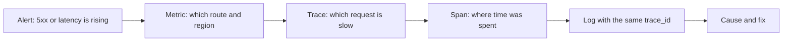
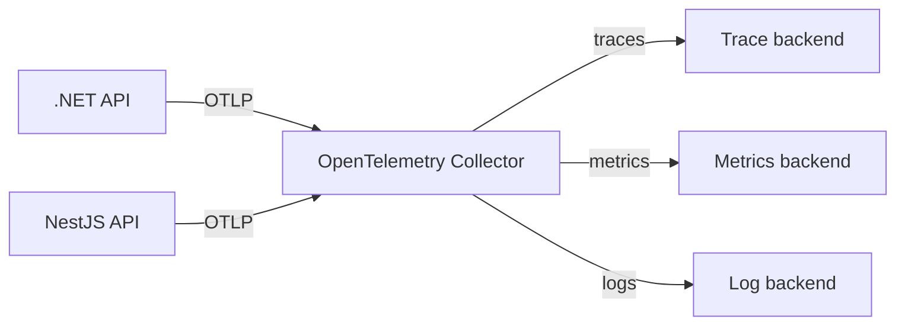

# Observability

## Contents

- [What observability is and why it is needed](#what-observability-is-and-why-it-is-needed)
- [Signals and shared context](#signals-and-shared-context)
- [OpenTelemetry and the Collector](#opentelemetry-and-the-collector)
- [A quick local Collector](#a-quick-local-collector)
- [.NET: traces, metrics, and logs](#net-traces-metrics-and-logs)
- [NestJS: automatic and manual instrumentation](#nestjs-automatic-and-manual-instrumentation)
- [Context propagation](#context-propagation)
- [What to measure and how not to break production](#what-to-measure-and-how-not-to-break-production)
- [Common mistakes](#common-mistakes)
- [Useful links](#useful-links)
- [Review questions](#review-questions)

## What observability is and why it is needed

Observability is the ability to understand the internal state of a running system from the telemetry it produces: logs, metrics, and traces. It answers "Is the service down?" It also answers why `POST /orders` started taking 4 seconds, and in which of the five services that happened.

A local debugger works while the error can be reproduced on one machine. In production, a request passes through a load balancer, an API, a database, a cache, a queue, and another service. Several instances of the application are running, and the response to the client may already be lost. Observability shows the whole picture without a debugger attached to a live process.

Good telemetry shortens the time from a symptom to a cause:



For example, the p95 latency of `POST /orders` rose. The metric shows that the problem is only in `eu-west`. The trace shows 2.7 seconds in the outgoing payments call. The correlated log reveals the external provider's response code. Without a trace, the scattered logs of every service have to be matched by time.

Observability does not replace tests, health checks, alerts, or SLOs. A test prevents a known error. Telemetry helps detect an unknown one: a degraded dependency, a rare race condition, a specific client, or a rise in load.

## Signals and shared context

The three main signals complement each other.

| Signal | What it stores | What question it answers | Example |
| --- | --- | --- | --- |
| Logs | an event with details | What happened in a specific place? | `payment declined`, `orderId` |
| Metrics | a numeric series over time | How often, how long, or how much? | p95 latency, the **5xx** share, and queue length |
| Traces | the work tree of one request | Where exactly was the resource spent? | API → PostgreSQL → payments |

A **trace** describes the path of one operation. It consists of **spans**: an incoming HTTP request, an SQL query, a call to `HttpClient`, or a section of application code. All spans on one path share one `trace_id`. Each span has its own `span_id` and a parent. This context links a signal from a .NET service with a signal from a NestJS service.

**Resource attributes** describe the process, not a single request: `service.name`, `service.version`, `deployment.environment`, and the region. They are required for filtering, and so that two applications do not show up as one service on the dashboard.

**Attributes** of a span or a metric describe the operation: the HTTP route, the status code, and the payment type. The values must be bounded. `http.route = /orders/{id}` is useful. `http.target = /orders/8f1c...` creates millions of time series and is dangerous as a metric label.

A password, a JWT, a cookie, a card number, an email address, and the full request body are not written into telemetry. Even when the telemetry backend is closed, that widens the surface for access to personal data.

## OpenTelemetry and the Collector

[OpenTelemetry](https://opentelemetry.io/) (OTel) is an open standard for the API, the SDK, semantic conventions, and the [OTLP](https://opentelemetry.io/docs/specs/otel/protocol/) protocol. Application code is instrumented once. The backend can be replaced: Jaeger/Tempo, Prometheus/Grafana, a cloud APM, or another OTLP-compatible service.

A typical layout looks like this:



The SDK in the application creates telemetry and batches it. The Collector accepts OTLP, limits memory, performs batching, filters or enriches the data when needed, and routes it to a backend. In production, applications send data to the Collector first. They do not send it to a vendor endpoint. One configuration changes. The services stay as they are.

`OTEL_EXPORTER_OTLP_ENDPOINT=http://collector:4318` is the base OTLP/HTTP endpoint. For that endpoint, the SDK builds `/v1/traces`, `/v1/metrics`, and `/v1/logs`. Port `4317` is normally used for OTLP/gRPC. The two protocols are not mixed. `/v1/traces` is not added to a gRPC endpoint.

## A quick local Collector

To check the SDK, it is enough to print every accepted signal to the container's stdout. `otel-collector-config.yaml` is saved next to the project:

```yaml
receivers:
  otlp:
    protocols:
      grpc:
        endpoint: 0.0.0.0:4317
      http:
        endpoint: 0.0.0.0:4318

processors:
  memory_limiter:
    check_interval: 1s
    limit_mib: 256
  batch: {}

exporters:
  debug:
    verbosity: detailed

service:
  pipelines:
    traces:
      receivers: [otlp]
      processors: [memory_limiter, batch]
      exporters: [debug]
    metrics:
      receivers: [otlp]
      processors: [memory_limiter, batch]
      exporters: [debug]
    logs:
      receivers: [otlp]
      processors: [memory_limiter, batch]
      exporters: [debug]
```

The Collector is started, and the endpoint is set for the applications:

```powershell
docker run --rm -p 4317:4317 -p 4318:4318 `
  -v "${PWD}/otel-collector-config.yaml:/etc/otelcol/config.yaml" `
  otel/opentelemetry-collector

$env:OTEL_EXPORTER_OTLP_ENDPOINT = 'http://localhost:4318'
```

A configuration with `debug` is not a monitoring system. It only proves that the application really exports data. The Collector exporter is then replaced with the agreed production backend.

## .NET: traces, metrics, and logs

In .NET, a span is called `Activity`, and `ActivitySource` is the source of application spans. Metrics are created through `Meter`. Logs go through the usual `ILogger`. OpenTelemetry connects to these platform APIs and exports the data.

### 1. Install packages

For an ASP.NET Core API with outgoing HTTP calls and runtime metrics:

```powershell
dotnet add package OpenTelemetry.Extensions.Hosting
dotnet add package OpenTelemetry.Exporter.OpenTelemetryProtocol
dotnet add package OpenTelemetry.Instrumentation.AspNetCore
dotnet add package OpenTelemetry.Instrumentation.Http
dotnet add package OpenTelemetry.Instrumentation.Runtime
```

### 2. Configure `Program.cs`

```csharp
using System.Diagnostics;
using System.Diagnostics.Metrics;
using OpenTelemetry.Logs;
using OpenTelemetry.Metrics;
using OpenTelemetry.Resources;
using OpenTelemetry.Trace;

var builder = WebApplication.CreateBuilder(args);
const string serviceName = "orders-api";

builder.Services.AddOpenTelemetry()
    .ConfigureResource(resource => resource.AddService(
        serviceName: serviceName,
        serviceVersion: typeof(Program).Assembly.GetName().Version?.ToString()))
    .WithTracing(tracing => tracing
        .AddAspNetCoreInstrumentation(options => options.RecordException = true)
        .AddHttpClientInstrumentation()
        .AddSource(OrdersTelemetry.ActivitySource.Name)
        .AddOtlpExporter())
    .WithMetrics(metrics => metrics
        .AddAspNetCoreInstrumentation()
        .AddHttpClientInstrumentation()
        .AddRuntimeInstrumentation()
        .AddMeter(OrdersTelemetry.Meter.Name)
        .AddOtlpExporter());

builder.Logging.AddOpenTelemetry(logging =>
{
    logging.IncludeFormattedMessage = true;
    logging.IncludeScopes = true;
    logging.ParseStateValues = true;
    logging.AddOtlpExporter();
});

var app = builder.Build();
app.MapGet("/health", () => Results.Ok());
app.Run();

public static class OrdersTelemetry
{
    public static readonly ActivitySource ActivitySource = new("orders-api");
    public static readonly Meter Meter = new("orders-api");
    public static readonly Counter<long> OrdersCreated =
        Meter.CreateCounter<long>("orders.created");
}
```

`AddAspNetCoreInstrumentation()` creates spans for incoming HTTP requests. `AddHttpClientInstrumentation()` creates spans for outgoing requests. When `traceparent` is passed to `HttpClient`, the context is propagated automatically. Runtime instrumentation adds data such as GC information and the process CPU use.

### 3. Add only a useful application span and metric

Automatic instrumentation is not enough to learn the duration of the business operation "reserve stock". A span is added at the boundary of significant work. It does not wrap every line.

```csharp
public sealed class OrderService(ILogger<OrderService> logger)
{
    public async Task ReserveStockAsync(CreateOrder command, CancellationToken ct)
    {
        using var activity = OrdersTelemetry.ActivitySource.StartActivity(
            "order.reserve_stock", ActivityKind.Internal);

        activity?.SetTag("order.currency", command.Currency);

        try
        {
            await ReserveAsync(command, ct);
            OrdersTelemetry.OrdersCreated.Add(1,
                new KeyValuePair<string, object?>("order.currency", command.Currency));
            logger.LogInformation("Stock reserved for order {OrderId}", command.OrderId);
        }
        catch (Exception exception)
        {
            activity?.RecordException(exception);
            activity?.SetStatus(ActivityStatusCode.Error, exception.Message);
            logger.LogError(exception, "Could not reserve stock for order {OrderId}", command.OrderId);
            throw;
        }
    }

    private static Task ReserveAsync(CreateOrder command, CancellationToken ct) => Task.CompletedTask;
}
```

`ActivitySource.StartActivity()` can return `null` when the trace is not sampled, so correct code uses `?.`. The log receives `TraceId` and `SpanId` from the current `Activity` through the OTel logging provider. `OrderId` stays in a structured log field. It is not used as a metric label.

## NestJS: automatic and manual instrumentation

Node instrumentation must load **before** `@nestjs/core`, Express/Fastify, `pg`, and the other libraries. It patches them on import. A compiled NestJS application is therefore started through a preload. The SDK is not imported after `NestFactory.create()`.

### 1. Install packages

```powershell
npm i @opentelemetry/api @opentelemetry/sdk-node `
  @opentelemetry/sdk-metrics `
  @opentelemetry/auto-instrumentations-node `
  @opentelemetry/exporter-trace-otlp-http `
  @opentelemetry/exporter-metrics-otlp-http
```

### 2. Create `src/instrumentation.ts`

```ts
import { metrics } from "@opentelemetry/api";
import { getNodeAutoInstrumentations } from "@opentelemetry/auto-instrumentations-node";
import { OTLPMetricExporter } from "@opentelemetry/exporter-metrics-otlp-http";
import { OTLPTraceExporter } from "@opentelemetry/exporter-trace-otlp-http";
import { PeriodicExportingMetricReader } from "@opentelemetry/sdk-metrics";
import { NodeSDK } from "@opentelemetry/sdk-node";

export const otelSdk = new NodeSDK({
  serviceName: "orders-api",
  traceExporter: new OTLPTraceExporter(),
  metricReader: new PeriodicExportingMetricReader({
    exporter: new OTLPMetricExporter(),
  }),
  instrumentations: [getNodeAutoInstrumentations()],
});

otelSdk.start();

export const ordersMeter = metrics.getMeter("orders-api");
export const quotesCalculated = ordersMeter.createCounter("pricing.quotes.calculated");
```

`OTLPTraceExporter` and `OTLPMetricExporter` read `OTEL_EXPORTER_OTLP_ENDPOINT`. Auto-instrumentations create spans for HTTP, `fetch`, common database drivers, and Nest core, where the package version supports the NestJS version in use. In NestJS 12, compatibility of `@opentelemetry/instrumentation-nestjs-core` is checked. HTTP and database spans still work. Framework spans may be missing.

### 3. Start before NestJS

For an ESM build, `dist/instrumentation.js` must be imported before `dist/main.js`:

```json
{
  "scripts": {
    "start:prod": "node --import ./dist/instrumentation.js dist/main.js"
  }
}
```

For CommonJS, `node --require ./dist/instrumentation.js dist/main.js` is used. On graceful shutdown, `otelSdk.shutdown()` is called after NestJS stops, so the last batch is sent.

### 4. Add a span in the provider

Auto-instrumentation shows the controller and the SQL or HTTP calls. It does not know the meaning of an application method. An explicit span supplies that boundary.

```ts
import { Injectable } from "@nestjs/common";
import { SpanStatusCode, trace } from "@opentelemetry/api";
import { quotesCalculated } from "./instrumentation";

const tracer = trace.getTracer("orders-api");

@Injectable()
export class PricingService {
  async quote(cart: { items: unknown[]; currency: string }) {
    return tracer.startActiveSpan("PricingService.quote", async (span) => {
      try {
        span.setAttribute("cart.items_count", cart.items.length);
        span.setAttribute("order.currency", cart.currency);
        const total = await this.calculate(cart);
        quotesCalculated.add(1, { "order.currency": cart.currency });
        return total;
      } catch (error) {
        span.recordException(error as Error);
        span.setStatus({ code: SpanStatusCode.ERROR });
        throw error;
      } finally {
        span.end();
      }
    });
  }

  private async calculate(cart: { items: unknown[] }) {
    return cart.items.length * 100;
  }
}
```

`startActiveSpan()` makes the span current, so child HTTP and database spans nest correctly. `finally` is required. A span that is not ended on an error produces a distorted trace.

## Context propagation

For HTTP, OpenTelemetry uses W3C Trace Context by default. The client sends a header such as `traceparent: 00-<trace-id>-<parent-span-id>-01`. The server continues the same trace and creates a child span. `HttpClient` in .NET and Node auto-instrumentation do this on their own when the SDK is started early enough.

A new `trace_id` is not generated in each service. `traceparent` is not replaced with a custom `X-Request-Id`. A separate request ID can be kept for UX or for search. That value is a different identifier. After a format check, it is added as a span attribute or a structured log field, along with the standardized context.

A queue has no nested synchronous call. The producer writes the context into the message headers. The consumer extracts it and starts a `CONSUMER` span. The worker's work is then linked to the original HTTP request. For fan-out, [span links](https://opentelemetry.io/docs/concepts/signals/traces/#span-links) are appropriate. One arbitrary parent is not selected.

## What to measure and how not to break production

The starting point is the result a user sees. It is not the number of charts.

| Goal | Signal | Example |
| --- | --- | --- |
| API availability | counter + alert | the share of `5xx` by `http.route` |
| API speed | histogram | p50/p95/p99 latency by route |
| Saturation | gauge/histogram | the job queue, the connection pool, and GC pauses |
| Business result | counter | successful orders by currency or channel |
| Cause of a single failure | trace + logs | a trace with an exception and a payment log |

Practical rules:

- A metric has a limited set of attributes: `route`, a status class, and a currency from a catalog. A user ID, an order ID, a URL with an ID, a random UUID, or error text is not used.
- Recording every trace requires an estimate of traffic and cost first. Sampling starts with parent-based sampling and a small share of successful requests. Errors and slow requests are kept according to the rules of the backend or the Collector.
- An error must be visible in every signal. HTTP **5xx** increases the metric. The server span has an error status and an exception. The log contains the exception and the trace context.
- `service.name` is set explicitly and kept stable. The version and the environment are passed as resource attributes. A hostname is not added to `service.name`. A hostname is an instance attribute.
- The owner of the dashboards, the SLOs, and the alerts is defined in advance. Telemetry that nobody watches, and that triggers no action, is extra load.

## Common mistakes

| What you see | Cause | Fix |
| --- | --- | --- |
| The backend has no NestJS spans | The SDK is imported after Nest or the driver | Preload it with `--import` or `--require` before `main.js` |
| HTTP spans exist, but the business time is one large block | Auto-instrumentation does not know the provider | Add one manual span around the significant operation |
| .NET does not show its own span | `ActivitySource` is not registered | Add `.AddSource(OrdersTelemetry.ActivitySource.Name)` |
| Two services have different traces for one request | The gateway removes `traceparent`, or a new trace is created | Pass the W3C headers through, and do not generate an ID by hand |
| The backend is overloaded or expensive | Metric attributes have millions of values | Keep only low-cardinality labels |
| Tokens or addresses are visible in the trace | The whole request body or headers were recorded | Use an allowlist of safe attributes, and redact before export |
| The last data disappears when the process exits | The SDK does not finish sending the batch | Use a graceful shutdown and `otelSdk.shutdown()`. In .NET, host shutdown closes the provider |
| Data is present locally and missing in production | The endpoint, protocol, or network differs | Check `OTEL_EXPORTER_OTLP_ENDPOINT`, port `4318` for HTTP, and the Collector logs |

## Useful links

### General

- [OpenTelemetry — Documentation](https://opentelemetry.io/docs/) — the API, the SDK, semantic conventions, and the Collector.
- [OTLP exporter configuration](https://opentelemetry.io/docs/languages/sdk-configuration/otlp-exporter/) — the endpoint, the ports, and signal-specific environment variables.
- [W3C Trace Context](https://www.w3.org/TR/trace-context/) — the `traceparent` format and cross-service context propagation.
- [OpenTelemetry Collector in Docker](https://opentelemetry.io/docs/collector/install/docker/) — a minimal receiver, pipeline, and exporter configuration.

### .NET

- [.NET observability with OpenTelemetry](https://learn.microsoft.com/en-us/dotnet/core/diagnostics/observability-with-otel) — how OTel uses `ILogger`, `Meter`, and `ActivitySource`.
- [OpenTelemetry .NET: ASP.NET Core traces](https://opentelemetry.io/docs/languages/dotnet/traces/getting-started-aspnetcore/) — registering ASP.NET Core instrumentation.
- [OpenTelemetry .NET: metrics](https://opentelemetry.io/docs/languages/dotnet/metrics/) — meters, instruments, and metric export.
- [OTLP + Aspire Dashboard](https://learn.microsoft.com/en-us/dotnet/core/diagnostics/observability-otlp-example) — local OTLP visualization for .NET.

### NestJS and Node.js

- [NestJS — OpenTelemetry](https://docs.nestjs.com/observability/opentelemetry) — SDK load order, auto-instrumentation, and manual spans.
- [OpenTelemetry JavaScript](https://opentelemetry.io/docs/languages/js/) — the SDK, exporters, and Node.js instrumentation.
- [OpenTelemetry JS auto-instrumentations](https://github.com/open-telemetry/opentelemetry-js-contrib/tree/main/metapackages/auto-instrumentations-node) — the list of packages that can be instrumented automatically.

## Review questions

1. Why can a rise in p95 latency not be diagnosed from logs alone?
2. How does `trace_id` differ from `span_id`, and why must a service not start a new trace on every hop?
3. Why is `order.id` dangerous as a metric attribute, but acceptable as a structured log field?
4. Why must the NestJS SDK be loaded before `@nestjs/core` and the database driver are imported?
5. Why does an application SDK usually send data to the Collector rather than directly to the backend?
6. What must be done with a manual span on an exception, and why?
