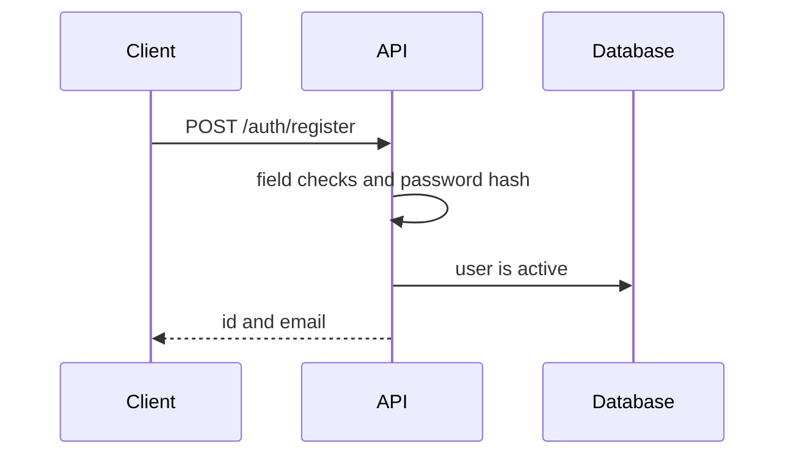
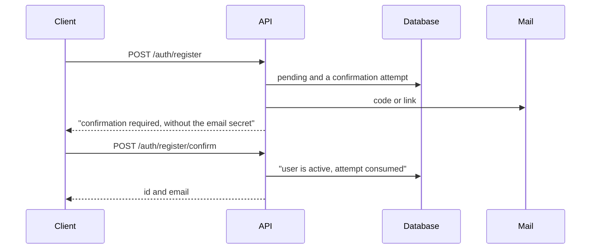

# Registration

## Contents

- [Theory](#theory)
  - [Situation](#situation)
  - [Model](#model)
  - [Concepts and how they relate to the backend](#concepts-and-how-they-relate-to-the-backend)
  - [Responsibilities](#responsibilities)
  - [Example](#example)
  - [Common failures](#common-failures)
  - [Useful links](#useful-links)
  - [Review questions](#review-questions)
- [Practical assignment](#practical-assignment)
  - [1.1 General](#11-general)
  - [1.2 Scenarios](#12-scenarios-user-stories)
  - [1.3 Contract](#13-contract)
  - [1.4 Errors and constraints](#14-errors-and-constraints)
  - [1.5 Audit](#15-audit-and-logs)
  - [1.6 Non-functional requirements](#16-non-functional-requirements)

# Theory

## Situation

A guest sends an email and a password. One of these outcomes follows: the account becomes active immediately, the server waits for a code or for the link from the message, the fields fail validation, the email is already taken, the message was not sent, or a limit on request rate or on the number of attempts takes effect.

A separate frontend is not required. Every request can be sent from an HTTP client.

## Model

Registration involves the guest, the API, the database, and, when the flag is on, the mail server. The server decides whether to send a message and which method to use. If the client made that choice, the same request could bypass confirmation.

Without confirmation, the server checks the fields, computes the password hash, and creates an active user.



With confirmation on, the server creates a user in the `pending` state and one unconsumed attempt. The email is already treated as taken, so a second registration request for it receives the same error as a repeated registration of an active account. Another storage schema is allowed only when the API responses stay the same, including the email being taken before activation.



The attempt stores an HMAC-SHA256 of the code or token, keyed from configuration. The code or token itself is not stored. For a six-digit code, the attempt is found by its identifier first, and the HMAC is compared only after that. Scanning hashes of a short code across the whole table is too easy. The link token is 32 random bytes, and the attempt is found by the HMAC of that token. Brute force is impossible here. The identifier is not part of the token. The `attemptId.secret` format belongs to sign-in, not to registration. The secret is compared in constant time. Ordinary string comparison is unsuitable for this. The HMAC key does not replace the password salt.

A POST request activates the account from the link. Mail scanners and previews open the URL on their own with GET and would consume the one-time token before a person opens the message.

A possible set of fields (the schema can differ):

| `users` | Description |
| --- | --- |
| `id` | user identifier |
| `email` | normalized email: no leading or trailing spaces, lowercase, with a unique index |
| `password_hash` | a slow password hash; the salt is part of the string, and there is no separate field for it |
| `status` | `pending` or `active` |
| `created_at` | creation time |
| `updated_at` | update time |

| `registration_challenges` | Description |
| --- | --- |
| `id` | attempt identifier: the registration response returns it, and `confirm` uses it to find the attempt for a code |
| `user_id` | reference to `users.id` |
| `method` | method: `otp` or `magic_link` |
| `secret_hash` | HMAC-SHA256 of the code or token with a key from configuration; the secret itself is not stored |
| `expires_at` | end of the TTL: 10 minutes after the message is sent; a resend starts the countdown again |
| `attempts` | number of wrong code entries: after the fifth, the attempt is consumed; a resend resets the counter |
| `last_sent_at` | time of the last message: the next one is no earlier than 60 seconds later |
| `consumed_at` | time the attempt is consumed: a successful confirmation, or the fifth wrong code entry |

### Normal form

The `users` table is in Boyce-Codd normal form (BCNF). `registration_challenges` would also meet BCNF, but because of the derived field `expires_at` it formally remains in second normal form (2NF).

Each successive form includes the requirements of the previous one:

- **1NF:** each cell holds one value, with no lists or sets. `password_hash` stores the algorithm, the cost, the salt, and the hash itself in one string, but database queries do not read those parts separately. The library verification function parses the whole string, so for the database it is one value.
- **2NF:** a non-key field depends on the whole key, with no partial dependencies. Every key in the schema is simple, meaning it consists of one field: `id` and `email` in `users`, and `id` in `registration_challenges`. A simple key has no parts, so 2NF holds automatically.
- **3NF and BCNF:** non-key fields depend only on the key and do not determine one another. For tables with simple keys, these two forms coincide. An attempt refers to the user through `user_id`, and that user's `email` and `status` are stored only in `users`.
- **4NF and 5NF:** one table does not mix independent lists of facts, for example one user's roles and phone numbers. A table in 3NF with simple keys meets this requirement automatically (the Date-Fagin theorem), so `users` is in 5NF as well.

The field `expires_at` is the exception. Its value is always `last_sent_at` plus 10 minutes, so one non-key field determines another. A transitive dependency on the key through `last_sent_at` appears, and 3NF does not allow it.

This dependency creates a risk of an update anomaly. If a resend updates `last_sent_at` but not `expires_at`, the TTL countdown does not start again, although the contract requires that. Both fields are therefore updated by one `UPDATE`.

The dependency disappears if `expires_at` is not stored and is computed at check time as `last_sent_at` plus 10 minutes. The attempt table is then in BCNF and in 5NF, as `users` is. Storing both fields is also allowed. This is deliberate denormalization, so the lifetime of the attempt can be read from the row without a calculation.

## Concepts and how they relate to the backend

### Password

The database stores the result of a one-way function. At sign-in, the server runs the entered password through the same function and compares the results.

Argon2id is preferred for a new application. If native Argon2 does not build in the environment, bcrypt with a cost of at least 12 replaces it. The cost parameter sets the cost of computing one hash at registration and at sign-in. Both algorithms create a separate salt for each password and embed it in the resulting string. Two hashes of the same password therefore differ, and a check through the library still succeeds.

MD5, SHA-1, SHA-256 without a salt and without a large number of iterations, CRC32, and homemade functions with one shared secret for every user are unsuitable for passwords. After a database leak, such passwords are too cheap to brute-force. bcrypt has a limit of its own: bytes after the 72nd are dropped silently, and different passwords that share a prefix start to match. Validation therefore rejects a password that is too long, before hashing.

### Message

Messages are sent over SMTP. This API does not need IMAP or POP3, because the server does not read the mailbox.

The message then follows this path:

1. The application hands it to the SMTP server.
2. The SMTP server finds the mail server of the recipient's domain.
3. The recipient's server places the message in the inbox or in spam, taking the sender's SPF and DKIM into account, among other checks.

In a local environment, a local mail catcher such as Mailpit replaces steps 2 and 3. The message is visible in its interface. That visibility says nothing about delivery to a production domain. The language library performs only step 1. A Gmail or Yandex mailbox password is not required for local work. Application access to a production mailbox often needs a separate app password.

If SMTP does not accept the message, the attempt and the `pending` record are kept, and the client receives **503**. A repeated registration in that case returns the taken-email error, so the message is requested again by resend.

### What sign-in will include

After registration with an active status, the user has not signed in. Later, the authentication module will issue two JWTs in cookies: access for 15 minutes and refresh for 30 days. This is a separate contract. Registration does not sign tokens.

A JWT has three parts separated by dots: a header, a payload, and a signature. The first two are base64url-encoded, and anyone who obtains the token can read them. The signature lets the server detect tampering. It does not hide the contents, so the password, its hash, and the signing secret are kept out of the payload. The short lifetime of access limits how long a stolen token can be used. Refresh exists so the password is not requested every 15 minutes.

### Summary

| Concept | Meaning in registration | What the implementation relies on |
| --- | --- | --- |
| Guest | a call with no session | the operation is public; the role appears in RBAC |
| Password hash | a one-way result with its own salt | Argon2id or bcrypt, checked by a library function |
| `pending` | the email is already taken, and sign-in is not open yet | the same user at another stage, or a separate record with the same uniqueness |
| OTP | 6 digits, 10 minutes, 5 attempts | lookup by attempt id; the database stores only the HMAC |
| Magic link | a one-time token of the same attempt | activation through POST |
| SMTP | delivery of the secret to the mailbox owner | the SMTP client of the chosen language and a local mail catcher |
| JWT | a pass for a user who has already signed in | the authentication and authorization modules, not the registration response |

## Responsibilities

| Client | Server |
| --- | --- |
| Sends the email and the password | Checks the format, the password policy, and uniqueness |
| On an active status, proceeds to sign-in | Creates an active record and does not create a session |
| When confirmation is indicated, shows code entry or a wait for the message | Creates `pending`, an attempt, and a message |
| Sends the code or the token for confirmation | Consumes the attempt and activates the record |
| Shows a field error or a wait, according to the response status | Distinguishes a wrong entry, expiry, a taken email, and a rate limit |
| Keeps the password only until the form is submitted | Stores the password hash and the HMAC of the email secret |

A request from a browser on another origin first passes a CORS preflight. While the client is an HTTP utility, configuration of the trusted origin list can wait until a page exists. If the browser shows a network error and the API log marks registration as successful, the record was created and the browser did not receive an allow header.

## Example

In the example, the bcrypt library hashes the password `secret12`. The program prints the hash string and checks that the hash does not equal the password, that a second hash of the same password differs from the first, and that the library check succeeds for the original password and fails for a different one.

### Node.js

**Node.js, the bcrypt library.** Cost 12 is the minimum allowed value for bcrypt. The preferred Argon2id for Node.js is in the `argon2` package.

```sh
npm install bcrypt
node hash-demo.js
```

```javascript
const { hash, compare } = require('bcrypt');

async function main() {
  const password = 'secret12';
  const stored = await hash(password, 12);
  const again = await hash(password, 12);

  console.log(stored);
  console.log(stored === password);
  console.log(stored === again);
  console.log(await compare(password, stored));
  console.log(await compare('secret13', stored));
}

main();
```

### .NET

**.NET, the BCrypt.Net-Next package.** `workFactor: 12` is the minimum allowed value for bcrypt. Argon2id for .NET is in the `Isopoh.Cryptography.Argon2` package. `PasswordHasher` from ASP.NET Core Identity, based on PBKDF2, is also suitable, and its iteration count needs to be checked against the current OWASP recommendation.

```sh
dotnet new console -o HashDemo
cd HashDemo
dotnet add package BCrypt.Net-Next
dotnet run
```

```csharp
using BCrypt.Net;

var password = "secret12";
var stored = BCrypt.Net.BCrypt.HashPassword(password, workFactor: 12);
var again = BCrypt.Net.BCrypt.HashPassword(password, workFactor: 12);

Console.WriteLine(stored);
Console.WriteLine(stored == password);
Console.WriteLine(stored == again);
Console.WriteLine(BCrypt.Net.BCrypt.Verify(password, stored));
Console.WriteLine(BCrypt.Net.BCrypt.Verify("secret13", stored));
```

### Python

**Python, the bcrypt package.** `rounds=12` is the minimum allowed value for bcrypt. The preferred Argon2id for Python is in the `argon2-cffi` package.

```sh
pip install bcrypt
python hash_demo.py
```

```python
import bcrypt

password = "secret12".encode()
stored = bcrypt.hashpw(password, bcrypt.gensalt(rounds=12))
again = bcrypt.hashpw(password, bcrypt.gensalt(rounds=12))

print(stored.decode())
print(stored == password)
print(stored == again)
print(bcrypt.checkpw(password, stored))
print(bcrypt.checkpw("secret13".encode(), stored))
```

---

A bcrypt hash string starts with `$2` and does not contain the password itself. The second call returns a different string, because the salt is generated again. The library verification function checks the password against that specific stored string.

## Common failures

| What you see | Where to look |
| --- | --- |
| The response or the log contains the password | the whole user row went into the response; the request body or the email secret went into the log |
| The password in the database matches the entered password | the original field was what got saved |
| Identical passwords produce the same string | the hash has no salt of its own |
| Two different long passwords later match | the algorithm truncated the secret. With bcrypt this happens after 72 bytes |
| `User@Example.com` created a second user | the index stored the email without lowercasing |
| Parallel registration of the same email yields an unhandled error | there is no unique index, or the index conflict was not turned into the section 1.4 response |
| The code is in the mail catcher and in the registration response | the email secret was returned to the client, and confirmation no longer proves anything |
| The link is already used right away | GET consumed the token; a preview or a scanner opened it in time |
| A correct code still succeeds after five errors | the attempt is not consumed on the fifth wrong entry |
| There is nowhere to open the message locally | SMTP points at a production mailbox. A local environment needs a local mail catcher, for example Mailpit |
| Repeated registration after a mail failure | `pending` has already taken the email. The client needed **503**, and a new message is requested by resend |

## Useful links

### General

- [MDN — HTTP response status codes](https://developer.mozilla.org/en-US/docs/Web/HTTP/Reference/Status) — the status codes that registration returns.
- [MDN — CORS](https://developer.mozilla.org/en-US/docs/Web/HTTP/Guides/CORS) — why the browser can show a failure when the record has already been created.
- [OWASP — Password Storage Cheat Sheet](https://cheatsheetseries.owasp.org/cheatsheets/Password_Storage_Cheat_Sheet.html) — Argon2id, bcrypt, and why a fast hash is unsuitable.
- [OWASP — Forgot Password Cheat Sheet](https://cheatsheetseries.owasp.org/cheatsheets/Forgot_Password_Cheat_Sheet.html) — one-time PINs and links: lifetime, brute force, and delivery over a separate channel.
- [jwt.io — Introduction](https://www.jwt.io/introduction) — how a JWT is structured. Registration does not issue tokens.
- [Mailpit](https://mailpit.axllent.org/) — a local SMTP server with an interface for viewing messages in a local environment.
- [PostgreSQL — Unique indexes](https://www.postgresql.org/docs/current/indexes-unique.html) — unique indexes, when PostgreSQL is used.
- [Bruno](https://www.usebruno.com/) or [Postman](https://www.postman.com/) — sending the same requests that the form will send later.

### By language

#### Node.js

**Node.js, NestJS.** On Express or Fastify the registration contract stays the same.

- [NestJS — First steps](https://docs.nestjs.com/first-steps) — creating an application and starting it.
- [NestJS — Modules](https://docs.nestjs.com/modules) — placing registration in a separate module.
- [NestJS — Validation](https://docs.nestjs.com/techniques/validation) — validation of the request body.
- [NestJS — Configuration](https://docs.nestjs.com/techniques/configuration) — the confirmation flag and SMTP settings from environment variables.
- [argon2](https://www.npmjs.com/package/argon2) — Argon2id for Node.js.
- [bcrypt](https://www.npmjs.com/package/bcrypt) — hashing and comparison, with a cost of at least 12.
- [Node.js — crypto](https://nodejs.org/api/crypto.html) — HMAC and `timingSafeEqual` for the email secret.
- [Nodemailer](https://nodemailer.com/) — sending messages over SMTP.
- [NestJS — OpenAPI](https://docs.nestjs.com/openapi/introduction) — a description of the operations.
- [Prisma Migrate](https://www.prisma.io/docs/orm/prisma-migrate) or [TypeORM — How migrations work](https://typeorm.io/docs/migrations/why) — schema migrations instead of automatic synchronization at startup.

#### .NET

**.NET, ASP.NET Core.** Both a Minimal API and controllers can be used. The registration contract does not depend on that choice.

- [ASP.NET Core — Minimal API](https://learn.microsoft.com/en-us/aspnet/core/tutorials/min-web-api) — creating an HTTP API.
- [Model validation](https://learn.microsoft.com/en-us/aspnet/core/mvc/models/validation) — validation of the request body.
- [Configuration](https://learn.microsoft.com/en-us/aspnet/core/fundamentals/configuration/) — the confirmation flag and SMTP settings from environment variables.
- [Isopoh.Cryptography.Argon2](https://github.com/mheyman/Isopoh.Cryptography.Argon2) — Argon2id for .NET.
- [BCrypt.Net-Next](https://github.com/BcryptNet/bcrypt.net) — hashing and `Verify`, with a work factor of at least 12.
- [CryptographicOperations.FixedTimeEquals](https://learn.microsoft.com/en-us/dotnet/api/system.security.cryptography.cryptographicoperations.fixedtimeequals) — constant-time comparison of the email secret.
- [MailKit](https://github.com/jstedfast/MailKit) — sending messages over SMTP.
- [Swashbuckle](https://learn.microsoft.com/en-us/aspnet/core/tutorials/getting-started-with-swashbuckle) — a description of the operations in OpenAPI.
- [EF Core — Migrations](https://learn.microsoft.com/en-us/ef/core/managing-schemas/migrations/) — schema migrations instead of updating the database at startup.

#### Python

**Python, FastAPI.** On Django or Flask the registration contract stays the same, and the same hashing and SMTP libraries apply.

- [FastAPI — First steps](https://fastapi.tiangolo.com/tutorial/first-steps/) — creating an application, starting it, and the interactive API schema.
- [Pydantic — Validators](https://docs.pydantic.dev/latest/concepts/validators/) — validation of the request body.
- [FastAPI — Settings](https://fastapi.tiangolo.com/advanced/settings/) — the confirmation flag and SMTP settings from environment variables.
- [argon2-cffi](https://argon2-cffi.readthedocs.io/en/stable/) — Argon2id for Python.
- [bcrypt](https://github.com/pyca/bcrypt) — hashing and `checkpw`, with rounds of at least 12.
- [hmac](https://docs.python.org/3/library/hmac.html) — HMAC and `compare_digest` for the email secret.
- [smtplib](https://docs.python.org/3/library/smtplib.html) — sending messages over SMTP with the standard library.
- [Alembic](https://alembic.sqlalchemy.org/en/latest/tutorial.html) — schema migrations instead of creating tables at startup.

## Review questions

1. How is a slow hash with its own salt better than a fast SHA-256 for a password, and what does the server compare at sign-in?
2. Why is a six-digit code stored as an HMAC, and why is the attempt found by its identifier rather than by the hash of the code?
3. Why does following the link from the message not activate the account?
4. Which part of message delivery does the application perform, and what determines whether the message lands in the inbox or in spam?
5. What does a network error in the browser mean when the API log already shows a successful registration?
6. Why is `registration_challenges` formally only in 2NF, and which update anomaly does this schema allow?

# Practical assignment

User registration functionality in the system.
A guest creates an account with an email and a password. When confirmation is off, the account is active immediately. When confirmation is on, the account waits for a code from the message or for the link to be followed. The server chooses the confirmation method. The password is stored only as a slow hash. Repeated registration for the same email is forbidden.

## 1) Registration

### 1.1 General

**Purpose:** create a user account from an email and a password.

**Users and roles:** a guest (an unauthenticated user).

**Dependencies and related settings:** email confirmation for registration is turned on by a separate flag of the "registration" scenario. Until a settings module exists, the flag is set in the application configuration. Sign-in confirmation has its own flag in the authentication module and does not affect registration.

The authentication module creates the session. Registration itself does not issue tokens. RBAC assigns the `user` role in the same transaction in which the user becomes `active`. Until the RBAC module is connected, registration does not create a role. Users who are already active receive it on the first load of an empty RBAC configuration.

### 1.2 Scenarios (user stories)

1. **Registration without confirmation:** the user enters an email and a password, and the account immediately becomes active and ready for sign-in. Sign-in itself is not performed.
2. **Registration with confirmation:** the user enters an email and a password, then confirms the email with a code (OTP) or by a link (magic link). A server setting determines which of the two methods is used.

### 1.3 Contract

#### 1.3.1 Registration request

| `POST /auth/register` | Checks and validation |
| --- | --- |
| `email: string` | Required, valid format. Before comparison and storage, leading and trailing spaces are trimmed and letters are lowercased. `user+tag@example.com` is a separate address. Repeated registration of an existing `email` is forbidden. This also applies to an account that is still waiting for confirmation. |
| `password: string` | Required. Leading and trailing spaces in the password are kept. Password policy: at least 8 characters, at least one letter of any alphabet, and one digit. A password that is too long is rejected by validation. The algorithm must not silently cut off the tail. |

**Logic and steps:**

1. Accept `email` and `password`.
2. Validate the input.
3. Compute a slow hash of the password with a separate salt for each password. The password cannot be recovered from the hash. The salt is part of the resulting string, so a separate field for it is not needed.
4. If registration confirmation is off, create the user in the active state and, when the RBAC module is connected, assign the `user` role in the same transaction.
5. If registration confirmation is on, create the user in the `pending` state with no role, store the confirmation attempt, and send the message by the chosen method:
    - a code (OTP), or
    - a link (magic link).

The flag affects only new registrations. If it is turned off after a registration, the created `pending` record does not become active on its own. Confirmation or a resend still completes it.

If the message was not sent, the `pending` record and the attempt are kept. A repeated `register` for this email returns the taken-email error, and the message can be delivered again only by a resend.

A database constraint enforces email uniqueness. A conflict on that constraint is returned as the ordinary repeated-registration error and must not cause an unhandled server failure.

**Responses:**

- **Confirmation off:** **201 Created**, `id`, the normalized `email`, `status: active`. The response does not include the password, the hash, or tokens.
- **Confirmation on:** **202 Accepted**, `confirmationRequired: true`, `method` (`otp` or `magic_link`), `attemptId`, `expiresInSeconds: 600`, `resendAfterSeconds: 60`. The code and the link token are sent only in the message and are absent from the response.

#### 1.3.2 Registration confirmation by email

**General rule:** a new user goes through confirmation only if the "registration" scenario flag was on at registration time. An attempt that has already been issued can be confirmed or sent again whether or not the flag is on now.

| `POST /auth/register/confirm` | Parameters |
| --- | --- |
| Code (OTP): `attempt identifier` + `code` | Length: 6 digits. TTL: 10 minutes. Limit on entry attempts: 5. The fifth attempt can still succeed. The fifth wrong entry is a wrong code, and the attempt is consumed after it. The next request, even with the correct code, is rejected as an exhausted limit. |
| Link (magic link): `token` | 32 random bytes. The attempt is found by the HMAC of the token. The identifier is not part of the token. TTL: 10 minutes. The token is single-use. A `POST` with the token activates the account. Opening the link by itself does not change the status. |

| `POST /auth/register/resend` | Parameters |
| --- | --- |
| `email` | No more than once per 60 seconds. For a code, the new message replaces the previous code, starts the TTL again, and resets the attempt counter. The old code no longer matches. For a link, the new message replaces the previous link, starts the TTL again, and consumes the old token. |

**Logic and steps:**

1. Find the attempt and check that it is not yet consumed. If the attempt is not found or is already consumed, the response is the same as for a wrong code.
2. Reject an expired attempt without incrementing the entry counter.
3. Compare the secret. The code and the token are stored in the database in a form from which they cannot be recovered. If the code does not match, the attempt counter increases.
4. On success, move the user to the active state, assign the `user` role if the RBAC module is connected and the role is not assigned yet, and consume the attempt.

**Responses:**

- **Confirm success:** **200 OK**, `id`, `email`, `status: active`.
- **Resend success:** **202 Accepted**, `confirmationRequired: true`, `method`, `attemptId`, `expiresInSeconds: 600`, `resendAfterSeconds: 60`. The secret is absent from the response.
- **Errors:** see section 1.4.

### 1.4 Errors and constraints

- **400** — invalid email.
- **400** — the password does not meet the policy.
- **409** — the email is already registered.
- **400** — a wrong or expired confirmation code or token, and also an attempt that was not found or is already consumed.
- **429** — code entry attempts are exhausted, a resend is earlier than 60 seconds, or registration is too frequent.
- **503** — the message was not sent. The `pending` record and the attempt are kept.

A neutral response is allowed in place of `409` when that response does not reveal whether the email is taken. In that case, resend must return the same response. The neutral response does not contain the `id` of an existing account and does not repeat the body of a successful creation when that body shows whether an account was created. An explicit `409` is used by default.

### 1.5 Audit and logs

Log registration attempts (success and failure), sending of a code or a link, and successful and failed confirmations.

The log does not receive the password, the password hash, the code, the link token, or the request body in full.

### 1.6 Non-functional requirements

- Protection against spam and brute force: a rate limit on registration and on resend. The numeric registration threshold is set in configuration.
- The password and the email secret cannot be recovered from the database, the API response, or the log.
- The project's general non-functional requirements (input validation, an API description, and tests) apply to these operations as well.
