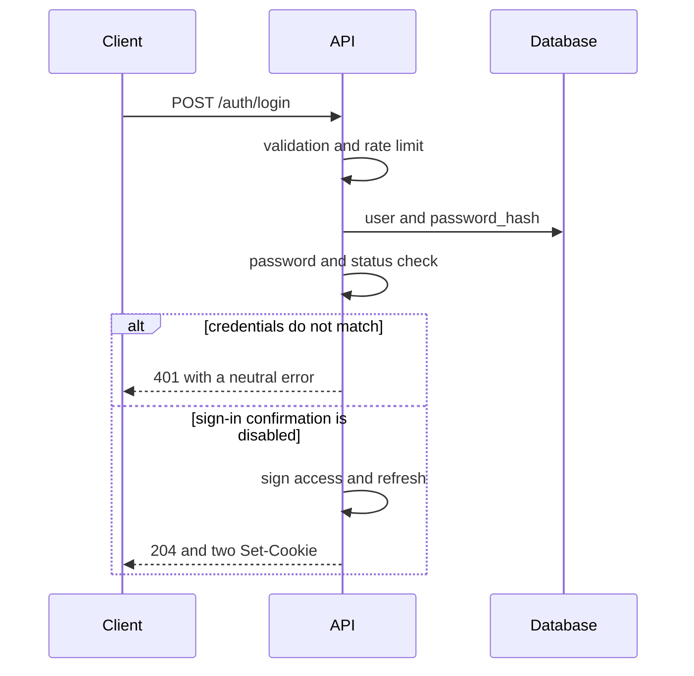
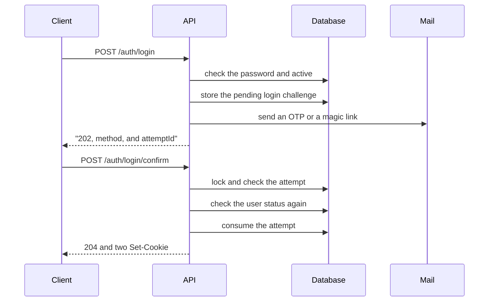
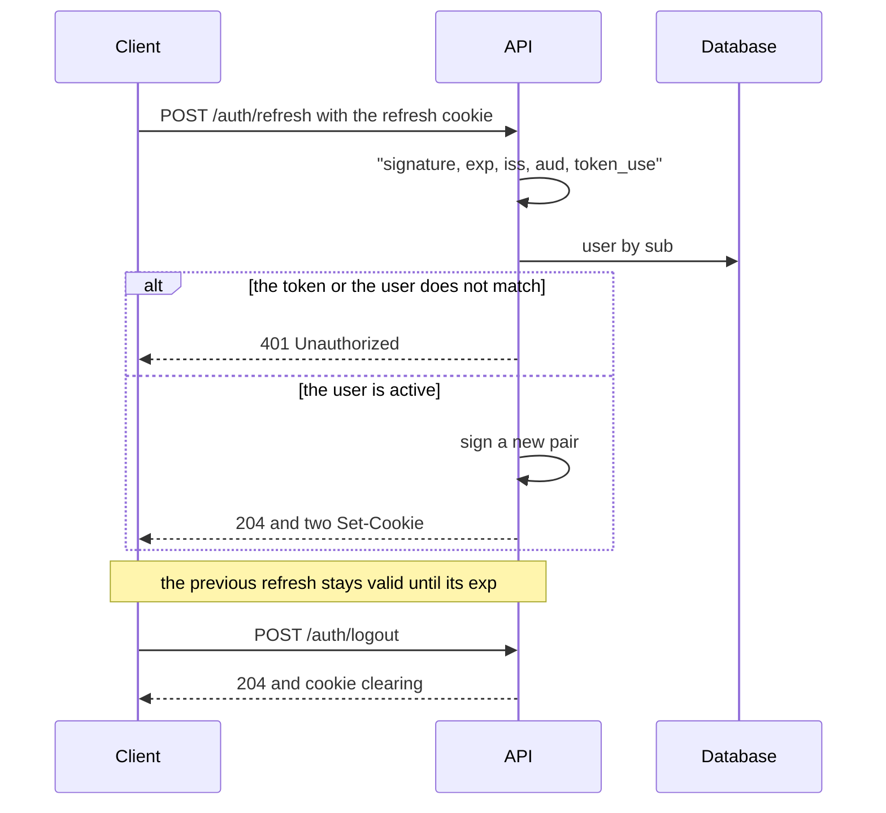

# Authentication

## Contents

- [Theory](#theory)
  - [Situation](#situation)
  - [Model](#model)
  - [Concepts and how they relate to the backend](#concepts-and-how-they-relate-to-the-backend)
  - [Responsibilities](#responsibilities)
    - [Example](#example)
    - [Common failures](#common-failures)
    - [Useful links](#useful-links)
  - [Review questions](#review-questions)
- [Practical assignment](#practical-assignment)
  - [1.1 General](#11-general)
  - [1.2 Scenarios](#12-scenarios-user-stories)
  - [1.3 Contract](#13-contract)
  - [1.4 Errors and constraints](#14-errors-and-constraints)
  - [1.5 Audit](#15-audit-and-logs)
  - [1.6 Non-functional requirements](#16-non-functional-requirements)

# Theory

## Situation

A guest sends an email and a password over HTTPS. One of these outcomes follows: the server sets the access cookie and the refresh cookie at once, the server first requires a code or a link from the email, the server returns a neutral rejection without revealing that the account exists, the server rejects an invalid format, the server limits the attempt rate, or the server reports that the database, token signing, or mail is unavailable.

A user with a refresh cookie can receive a new token pair, and sign-out clears the cookies. A separate frontend is not required. Every request can be sent from an HTTP client that supports cookies.

## Model

Direct sign-in involves the client, the API, and the database. The client submits an email and a password. The server itself checks the hash, the user status, and the confirmation setting. Only a user in the `active` state can receive tokens.



If sign-in confirmation is enabled, a correct password does not create a session yet. The server checks this user's previous unfinished attempt. A new email is forbidden for 60 seconds. After the pause, the previous attempt is replaced by a new one. The client does not choose between OTP and a magic link.



For OTP, the attempt is found by `attemptId`. The HMAC of the entered code is then compared with the stored value in constant time. A magic link contains the attempt identifier and a random secret. The server also finds the record first, and then compares the HMAC of the secret. The link passes the token in the URL fragment. The browser does not send that fragment to the web server, and it does not send it in `Referer`. The client page reads the fragment and sends the token in the POST body. An access log, and a mail scanner that uses an ordinary GET, therefore do not receive the secret or do not spend it.

Refresh runs without a password. It still requires a server-side check of the user. The signature and the claims confirm where the token came from. Reading the user by `sub` confirms that the account still exists and has the status `active`.



The server does not store the refresh JWT, a `jti`, a list of allowed or revoked tokens, or a session record. Rotation therefore issues a new pair, and it does not make the previous refresh single-use. If the old token is stolen, its reuse cannot be distinguished from an ordinary refresh. Logout deletes the cookies only in the browser that sent the request, and it does not revoke a copied token.

Access and refresh are signed with different HMAC keys, using the HS256 algorithm. Both tokens contain `sub`, `iss`, `aud`, `iat`, `exp`, and `token_use`. The `token_use` field equals `access` or `refresh`. The verification logic pins the allowed algorithm and the expected token type. A refresh token therefore cannot be used in place of an access token, even when it is sent in the wrong cookie by mistake.

Roles are not placed in the JWT, and they are not considered during verification. The token establishes identity. RBAC takes the current roles and assignments from server data. Removing a role takes effect without waiting for the 15-minute access token to end.

Authentication adds only the table of sign-in attempts. There is no table of refresh sessions.

| `login_challenges` | Description |
| --- | --- |
| `id` | attempt identifier; used as `attemptId` and included in the magic-link token |
| `user_id` | reference to the user; a partial unique index allows one unconsumed attempt per user |
| `method` | method chosen by the server: `otp` or `magic_link` |
| `secret_hash` | HMAC-SHA256 of the code or the random secret, with a separate application key |
| `last_sent_at` | time of the last secret generation; the 10-minute TTL and the 60-second resend pause are counted from it |
| `attempts` | number of incorrect OTP entries; after the fifth, the attempt is consumed |
| `consumed_at` | time of a successful confirmation, a replacement of the attempt, exhausted entries, or a change of the user status |
| `consumed_reason` | `confirmed`, `replaced`, `attempts_exhausted`, or `user_inactive`; equals `null` until the attempt is consumed |
| `created_at` | time the attempt was created |

### Normal form

`login_challenges` is in Boyce-Codd normal form (BCNF). The table does not store a computed `expires_at`. The lifetime is `last_sent_at` plus a fixed 10 minutes, so there is no anomaly from updating two timestamps at the same time.

Each following form includes the requirements of the previous one:

- **1NF:** each field holds one value. The code, the token, and the send history are not packed into an array. A resend replaces `secret_hash` and `last_sent_at`.
- **2NF:** the primary key consists of a single `id`, so there are no partial dependencies on part of the key.
- **3NF and BCNF:** `user_id`, `method`, the hash, the counter, and the timestamps describe only one attempt. The email, the password, and the status are not copied from `users`. They are read through the foreign key.
- **4NF:** one row has no independent lists of secrets or deliveries. Each attempt is a separate row.
- **5NF:** the attempt and the user are restored by an ordinary join on `user_id`. There are no further join dependencies.

A partial unique index on `user_id` for rows with `consumed_at IS NULL` states a business rule. It does not denormalize the table. A new attempt first consumes the previous one in the same transaction, and then takes the unique value that was freed.

## Concepts and how they relate to the backend

### Password sign-in and the neutral error

The password is sent to the server inside a protected TLS channel. HTTPS does not hide the password from the application itself, so the request body must not be logged, saved in a queue, or included in a trace. The server compares the password with the slow hash in `users.password_hash`, using the same library function that created the hash at registration.

A response that the email was not found would let someone collect a list of users. A missing email, a wrong password, and a status of `pending`, `blocked`, `deleting`, or `deleted` therefore produce the same status, the same code, and the same text. For a missing user, the server checks a dummy hash prepared in advance, so a noticeable timing difference does not become a second disclosure channel.

The dummy check does not guarantee absolutely identical timing. A database query, caches, and load still differ. The main protection is the neutral response, HTTPS, and the rate limit. A permanent account lock after several errors is not used, because an attacker could lock someone else's account.

### JWT and claim verification

A JWT consists of a header, a payload, and a signature. The payload is base64url-encoded, and it is not encrypted, so the cookie owner, or anyone who obtained the token, can read it. The password, the hash, the keys, the email, and the roles are not included.

The signature is verified only with HS256 chosen in advance. The server does not accept the algorithm from the token as a setting, and it does not switch to `none` or to another algorithm. Access and refresh use independent keys of at least 32 random bytes and different `token_use` values. This limits the damage if one key leaks, and it prevents the two types from being mixed.

`sub` holds the immutable user identifier. `iss` holds the expected issuer. `aud` holds the expected audience. `iat` holds the issue time. `exp` holds the end of the lifetime. The allowed clock skew is at most 30 seconds, and it does not extend the cookie. After the cryptographic check, the server reads the user by `sub`. A missing record, or a status of `pending`, `blocked`, `deleting`, or `deleted`, yields **401**.

JWT keys and the HMAC keys for attempts are loaded from protected configuration. If any required key is missing, empty, or shorter than 32 bytes, the application does not substitute a default, does not generate a new key on every startup, and does not pass the readiness check.

### Access, refresh, and stateless rotation

Access lasts 15 minutes and is sent on protected operations. Refresh lasts 30 days and is accepted only by `POST /auth/refresh`. On every successful refresh, both tokens are issued again. The new refresh token receives a new lifetime of 30 days from the moment of rotation.

That lifetime forms a sliding session. Because refresh state is not stored, a stolen token of an active user cannot be forcibly revoked before its `exp`. An attacker can also have time to exchange it for a new refresh token with a new lifetime. Blocking or deleting the user stops both the exchange and access, because access and refresh each require a read of the current user.

Reuse detection requires at least a hash of the current refresh token, or a token family, in a server session. The contract leaves this out on purpose. Changing the signing key revokes every token of that type at once, so it does not fit sign-out for one user.

### Email challenge

Sign-in confirmation is a second step after a correct password. It is not a replacement for the password. The server setting enables the step and chooses one method for new attempts: a six-digit OTP, or a magic link with a random secret of 32 bytes.

Both methods last 10 minutes. An OTP allows five entries. The fifth entry can still succeed. A fifth incorrect response returns a code error and consumes the attempt at the same time. A resend is allowed no sooner than 60 seconds. It replaces the previous secret, starts the TTL again, and resets the OTP counter.

HMAC makes the database value unrecoverable without a separate application key. Ordinary SHA-256 does not fit a six-digit OTP: all one million variants can be enumerated in advance. The HMAC comparison runs in constant time.

### Cookies, CORS, and CSRF

The default policy assumes one origin for the page and the API. Cookies have `HttpOnly`, `Secure`, and `SameSite=Strict`. They contain no `Domain`, so they stay host-only. Access is available on the path `/`. Refresh is available only on `/auth/refresh`. JavaScript does not read the tokens and does not move them into local storage.

Another origin does not always mean another site. For example, `app.example.com` and `api.example.com` differ by origin, and they are usually treated as same-site. For a trusted frontend origin, the server lists the exact address in CORS and enables credentials. The client uses `credentials: "include"`. The value `Access-Control-Allow-Origin: *` together with credentials is not allowed.

Any cross-origin deployment, including a same-site one, requires an exact `Origin` header and a custom header `X-CSRF-Protection: 1` for state-changing requests. The custom header triggers a CORS preflight, which the server allows only for a trusted origin. Otherwise a neighboring compromised subdomain of the same site could send the cookies even with `SameSite=Strict`. An unknown origin, or a missing header, is rejected with **403**.

If the frontend is also on another site, the cookies are additionally switched to `SameSite=None; Secure`. The checks of `Origin` and of the CSRF header stay the same. GET does not perform sign-in, refresh, logout, or any other state change.

XSS and CSRF are different. `HttpOnly` stops JavaScript from reading the token, but malicious code on a trusted page can still send requests on behalf of the user. Output escaping, a Content Security Policy, and the absence of secrets in JavaScript the page can reach are required.

### Protocols that do not transmit the password

SRP and OPAQUE are PAKE protocols. The client proves knowledge of the password through a special cryptographic exchange, and the server stores a verifier. They cannot be added only on the sign-in endpoint, because registration, the format of the server data, the client, and the recovery protocol all change. PAKE also does not remove the need for TLS.

WebAuthn uses a key pair and a server challenge. The private key stays in the authenticator. OAuth 2.0 with PKCE solves a different problem. The application receives the sign-in result from an external provider, and PKCE binds the authorization code to the client. Neither WebAuthn nor OAuth with PKCE is a hidden transmission of the password in the email-and-password contract.

### What happens at authorization

Authentication answers who sent the request, and it passes the verified `userId`. Authorization then takes the current roles from RBAC and decides whether the action is allowed. An invalid or missing session yields **401**. A valid session without the permission yields **403**.

A role from the JWT, the request body, or an arbitrary header does not take part in the decision. Logout does not change roles, and it does not delete the user. It only clears the cookies of the current client.

### Summary

| Concept | Meaning in authentication | What the implementation relies on |
| --- | --- | --- |
| Neutral error | does not reveal whether the account exists or what its status is | one response and a dummy hash check |
| Access JWT | a short confirmation of identity | HS256, `token_use=access`, a TTL of 15 minutes |
| Refresh JWT | a new pair without a password | HS256 with another key, a TTL of 30 days |
| Stateless refresh | the server stores neither a session nor revocation | a check of the token and of the current user |
| OTP | a second step of 6 digits | HMAC, a TTL of 10 minutes, at most 5 entries |
| Magic link | a second step with a random secret | HMAC, and activation only through POST |
| HttpOnly cookie | JavaScript does not read the JWT | `Secure`, `SameSite`, and a limited `Path` |
| RBAC | a permission check after sign-in | current roles on the server, rather than JWT claims |

## Responsibilities

| Client | Server |
| --- | --- |
| Sends the email and the password only over HTTPS | Normalizes the email, and checks the hash and the status |
| Stores cookies with the browser | Never returns a JWT in JSON |
| Shows the same sign-in error | Does not reveal whether the account exists or what its status is |
| On a **202** response, shows the required second step | Chooses OTP or a magic link itself |
| Sends the OTP or the link token through POST | Checks the TTL, the number of attempts, and the HMAC |
| Calls refresh after the access token expires | Checks the refresh token and the current user |
| After **401**, offers to sign in again | Does not turn a session error into **403** |
| Calls logout and removes the local interface state | Clears both cookies with the original attributes |

For another trusted origin, the client includes credentials and the CSRF header on state-changing requests, and the server returns CORS headers only for that origin. For another site, `SameSite` changes as well. CORS alone does not replace the authentication check or the CSRF protection.

## Example

The program issues an access token and a refresh token for the user `user-42`, with the same `iss` and `aud`, and with different keys and `token_use`. It then verifies both tokens and prints five lines in one order: the access type, a match on `sub`, the refusal to accept refresh as access, the access TTL, and the refresh TTL.

### Node.js

**Node.js 22 or newer, the jsonwebtoken library.** For HS256, each key contains at least 32 random bytes. In the application, the access key and the refresh key are different.

```sh
npm install jsonwebtoken
node jwt-demo.js
```

```javascript
const jwt = require('jsonwebtoken');

const accessKey = 'access-0123456789abcdef-0123456789';
const refreshKey = 'refresh-0123456789abcdef-01234567';
const now = Math.floor(Date.now() / 1000);

function issue(kind, key, ttl) {
  return jwt.sign({
    sub: 'user-42', iss: 'course-api', aud: 'course-web',
    iat: now, exp: now + ttl, token_use: kind,
  }, key, { algorithm: 'HS256' });
}

function read(token, key) {
  return jwt.verify(token, key, {
    algorithms: ['HS256'], issuer: 'course-api', audience: 'course-web',
  });
}

const access = read(issue('access', accessKey, 900), accessKey);
const refresh = read(issue('refresh', refreshKey, 2592000), refreshKey);
console.log(access.token_use);
console.log(access.sub === 'user-42');
console.log(refresh.token_use === 'access');
console.log(access.exp - access.iat);
console.log(refresh.exp - refresh.iat);
```

### .NET

**.NET 8 or newer, the System.IdentityModel.Tokens.Jwt package.** For HS256, each token type uses a separate key of at least 32 bytes. The application sets `ClockSkew` explicitly.

```sh
dotnet new console -o JwtDemo
cd JwtDemo
dotnet add package System.IdentityModel.Tokens.Jwt
dotnet run
```

```csharp
using System.IdentityModel.Tokens.Jwt;
using System.Security.Claims;
using System.Text;
using Microsoft.IdentityModel.Tokens;

var accessKey = "access-0123456789abcdef-0123456789";
var refreshKey = "refresh-0123456789abcdef-01234567";
var now = DateTimeOffset.UtcNow.ToUnixTimeSeconds();
var handler = new JwtSecurityTokenHandler { MapInboundClaims = false };

string Issue(string kind, string key, long ttl) =>
    handler.WriteToken(new JwtSecurityToken("course-api", "course-web",
        new[] { new Claim("sub", "user-42"), new Claim("token_use", kind),
            new Claim("iat", now.ToString(), ClaimValueTypes.Integer64) },
        expires: DateTimeOffset.FromUnixTimeSeconds(now + ttl).UtcDateTime,
        signingCredentials: new(new SymmetricSecurityKey(Encoding.UTF8.GetBytes(key)),
            SecurityAlgorithms.HmacSha256)));

ClaimsPrincipal Read(string token, string key) => handler.ValidateToken(token,
    new TokenValidationParameters { ValidIssuer = "course-api", ValidAudience = "course-web",
        IssuerSigningKey = new SymmetricSecurityKey(Encoding.UTF8.GetBytes(key)),
        ValidateIssuerSigningKey = true, ValidAlgorithms = new[] { SecurityAlgorithms.HmacSha256 },
        ClockSkew = TimeSpan.Zero },
    out _);

var access = Read(Issue("access", accessKey, 900), accessKey);
var refresh = Read(Issue("refresh", refreshKey, 2592000), refreshKey);
string Claim(ClaimsPrincipal p, string name) => p.FindFirst(name)!.Value;
Console.WriteLine(Claim(access, "token_use"));
Console.WriteLine((Claim(access, "sub") == "user-42").ToString().ToLowerInvariant());
Console.WriteLine((Claim(refresh, "token_use") == "access").ToString().ToLowerInvariant());
Console.WriteLine(long.Parse(Claim(access, "exp")) - long.Parse(Claim(access, "iat")));
Console.WriteLine(long.Parse(Claim(refresh, "exp")) - long.Parse(Claim(refresh, "iat")));
```

### Python

**Python 3.10 or newer, the PyJWT library.** An HS256 key contains at least 32 random bytes. Access and refresh are signed with different keys.

```sh
pip install PyJWT
python jwt_demo.py
```

```python
import time
import jwt

access_key = "access-0123456789abcdef-0123456789"
refresh_key = "refresh-0123456789abcdef-01234567"
now = int(time.time())


def issue(kind: str, key: str, ttl: int) -> str:
    claims = {"sub": "user-42", "iss": "course-api", "aud": "course-web",
              "iat": now, "exp": now + ttl, "token_use": kind}
    return jwt.encode(claims, key, algorithm="HS256")


def read(token: str, key: str) -> dict:
    return jwt.decode(token, key, algorithms=["HS256"],
                      issuer="course-api", audience="course-web")


access = read(issue("access", access_key, 900), access_key)
refresh = read(issue("refresh", refresh_key, 2592000), refresh_key)
print(access["token_use"])
print(str(access["sub"] == "user-42").lower())
print(str(refresh["token_use"] == "access").lower())
print(access["exp"] - access["iat"])
print(refresh["exp"] - refresh["iat"])
```

---

All three programs print `access`, `true`, `false`, `900`, and `2592000`. The third line confirms that a check of the expected `token_use` must reject a refresh token used in place of an access token. A correct signature alone is not enough for that.

## Common failures

| What you see | Where to look |
| --- | --- |
| The response for an unknown email is different | a missing user bypassed the neutral error or the dummy hash check |
| `pending` receives tokens | the current `users.status` is not checked before issuance |
| A blocked user continues to refresh | the user is not read by `sub` after the JWT check |
| Refresh is accepted as access | `token_use` is not checked, or one shared verification routine is used without the expected type |
| After a role is removed, the permission lasts 15 minutes | roles are read from the JWT instead of the current RBAC data |
| The JWT is readable in JavaScript | the cookie was created without `HttpOnly`, or the token was returned in JSON |
| The cookie does not arrive over HTTPS | the host, `Path`, `SameSite`, or the credentials and CORS settings do not match |
| A cross-site cookie does not arrive | `SameSite=None; Secure` is not set for the trusted cross-site frontend |
| An outside origin, including a neighboring same-site subdomain, can call refresh | the `Origin` and CSRF-header check is enabled only for cross-site, or it is missing |
| The OTP is visible in the database | the original code, or a fast hash without a key, was stored instead of an HMAC |
| A correct OTP succeeds after five errors | the fifth incorrect entry did not consume the attempt |
| An old email still works after resend | `secret_hash` and `last_sent_at` were not replaced |
| The link is spent when the email is opened | GET changes state instead of showing a page and then accepting POST |
| A stolen refresh token works after logout | this is a limit of the stateless scheme; clearing the cookie does not revoke the copy |
| An old refresh token works after rotation | the server does not store a token family, so reuse detection is impossible |
| After a restart, every JWT has stopped working unexpectedly | the key is generated at startup instead of being loaded from protected configuration |
| The application starts with a test key | a missing secret is replaced with a default value instead of failing readiness |
| After a mail failure, the new code is unknown and the old code is already wrong | the secret was replaced before SMTP; a retry is possible through resend after 60 seconds |
| The log contains a password or a JWT | the request body, `Cookie`, `Set-Cookie`, or an exception with the original data is logged |

## Useful links

### General

- [OWASP — Authentication Cheat Sheet](https://cheatsheetseries.owasp.org/cheatsheets/Authentication_Cheat_Sheet.html) — neutral errors, protection against guessing, and a repeated identity check.
- [OWASP — Password Storage Cheat Sheet](https://cheatsheetseries.owasp.org/cheatsheets/Password_Storage_Cheat_Sheet.html) — checking the password with the same slow algorithm that was used at registration.
- [OWASP — JSON Web Token Cheat Sheet](https://cheatsheetseries.owasp.org/cheatsheets/JSON_Web_Token_for_Java_Cheat_Sheet.html) — JWT threats, lifetime, and the limits of stateless revocation. The mechanisms apply beyond Java.
- [RFC 7519 — JSON Web Token](https://www.rfc-editor.org/rfc/rfc7519) — the JWT format and the registered claims `sub`, `aud`, `exp`, and `iat`.
- [RFC 8725 — JWT Best Current Practices](https://www.rfc-editor.org/rfc/rfc8725) — pinning the algorithm, checking the issuer and the audience, and separating token types.
- [MDN — Set-Cookie](https://developer.mozilla.org/en-US/docs/Web/HTTP/Reference/Headers/Set-Cookie) — the `HttpOnly`, `Secure`, `SameSite`, `Path`, and `Domain` attributes.
- [MDN — CORS](https://developer.mozilla.org/en-US/docs/Web/HTTP/Guides/CORS) — credentials, an exact allowed origin, and browser preflight requests.
- [OWASP — Cross-Site Request Forgery Prevention Cheat Sheet](https://cheatsheetseries.owasp.org/cheatsheets/Cross-Site_Request_Forgery_Prevention_Cheat_Sheet.html) — protecting cookie authentication through SameSite, Origin, and custom headers.
- [OWASP — Forgot Password Cheat Sheet](https://cheatsheetseries.owasp.org/cheatsheets/Forgot_Password_Cheat_Sheet.html) — rules for short OTPs and single-use links that apply to an email challenge.
- [W3C — Web Authentication](https://www.w3.org/TR/webauthn-3/) — a challenge and a key pair as an alternative to password sign-in.
- [RFC 9807 — OPAQUE](https://www.rfc-editor.org/rfc/rfc9807) — a standardized PAKE that requires a separate registration and sign-in protocol.

### By language

#### Node.js

**Node.js, NestJS.** On Express or Fastify, the authentication contract stays the same.

- [NestJS — Authentication](https://docs.nestjs.com/security/authentication) — connecting an identity check to routes.
- [NestJS — Cookies](https://docs.nestjs.com/techniques/cookies) — reading and setting cookies through the HTTP adapter.
- [jsonwebtoken](https://www.npmjs.com/package/jsonwebtoken) — signing and verifying the HS256 JWT from the example.
- [Node.js — crypto](https://nodejs.org/api/crypto.html) — HMAC, random bytes, and constant-time comparison of a secret.
- [NestJS — Configuration](https://docs.nestjs.com/techniques/configuration) — required keys, the issuer, the audience, cookies, and SMTP, with no default values.
- [NestJS — CORS](https://docs.nestjs.com/security/cors) — an exact list of trusted frontend origins, and credentials.
- [NestJS — OpenAPI](https://docs.nestjs.com/openapi/introduction) — a description of login, confirm, refresh, logout, and the error branches.
- [Prisma Migrate](https://www.prisma.io/docs/orm/prisma-migrate) or [TypeORM — Migrations](https://typeorm.io/docs/advanced-topics/migrations/) — creating `login_challenges` with a migration.

#### .NET

**.NET, ASP.NET Core.** A Minimal API and controllers use one authentication contract.

- [ASP.NET Core — JWT bearer authentication](https://learn.microsoft.com/en-us/aspnet/core/security/authentication/configure-jwt-bearer-authentication) — checking the signature, the issuer, the audience, and the JWT lifetime.
- [CookieOptions](https://learn.microsoft.com/en-us/dotnet/api/microsoft.aspnetcore.http.cookieoptions) — setting `HttpOnly`, `Secure`, `SameSite`, `Path`, and the cookie lifetime.
- [System.IdentityModel.Tokens.Jwt](https://www.nuget.org/packages/System.IdentityModel.Tokens.Jwt) — issuing and verifying the JWT from the example.
- [CryptographicOperations.FixedTimeEquals](https://learn.microsoft.com/en-us/dotnet/api/system.security.cryptography.cryptographicoperations.fixedtimeequals) — constant-time comparison of the email-challenge HMAC.
- [ASP.NET Core — Configuration](https://learn.microsoft.com/en-us/aspnet/core/fundamentals/configuration/) — loading keys and parameters from a protected environment.
- [ASP.NET Core — CORS](https://learn.microsoft.com/en-us/aspnet/core/security/cors) — allowing credentials only for trusted origins.
- [ASP.NET Core — OpenAPI](https://learn.microsoft.com/en-us/aspnet/core/fundamentals/openapi/overview) — a current specification of the authentication operations.
- [EF Core — Migrations](https://learn.microsoft.com/en-us/ef/core/managing-schemas/migrations/) — moving the attempts table between environments.

#### Python

**Python, FastAPI.** On Django or Flask, the authentication contract does not change.

- [FastAPI — OAuth2 with JWT](https://fastapi.tiangolo.com/tutorial/security/oauth2-jwt/) — creating and verifying a JWT. Delivery in this contract is replaced by HttpOnly cookies.
- [FastAPI — Response Cookies](https://fastapi.tiangolo.com/advanced/response-cookies/) — setting cookies on the response.
- [PyJWT](https://pyjwt.readthedocs.io/en/stable/) — HS256 and claim checks in the example.
- [Python — hmac](https://docs.python.org/3/library/hmac.html) — HMAC and `compare_digest` for an OTP and a magic link.
- [FastAPI — Settings](https://fastapi.tiangolo.com/advanced/settings/) — required keys, JWT parameters, cookies, and SMTP.
- [FastAPI — CORS](https://fastapi.tiangolo.com/tutorial/cors/) — exact origins, credentials, and allowed headers.
- [FastAPI — Metadata and Docs URLs](https://fastapi.tiangolo.com/tutorial/metadata/) — configuring the OpenAPI documentation created automatically.
- [Alembic — Tutorial](https://alembic.sqlalchemy.org/en/latest/tutorial.html) — a migration for `login_challenges`.

## Review questions

1. Why does the same response for an unknown email, a wrong password, and an inactive status reduce the risk of account enumeration, but not remove the rate limit?
2. Why do access and refresh use different keys and `token_use` when both tokens already have a valid signature?
3. Why does stateless rotation fail to detect reuse of an old refresh token, and what would the scheme need for reuse detection?
4. What happens after a user is blocked while the access token and the refresh token are still valid, if every check loads the user by `sub`?
5. Why does a magic link activate through POST, while opening the link with an ordinary GET does not change state?
6. How does cross-origin differ from cross-site, and when does a cookie actually require `SameSite=None`?
7. Why does `login_challenges` satisfy BCNF, and what anomaly would a separate `expires_at` field create if it always equaled `last_sent_at` plus 10 minutes?

# Practical assignment

User authentication functionality in the system.
A guest signs in with an email and a password, and then either receives access and refresh in HttpOnly cookies at once or first confirms sign-in by email. Access lasts 15 minutes. Refresh lasts 30 days. Refresh sessions are not stored on the server. Logout clears the cookies. Each token is accepted only for an existing user in the `active` state.

## 1) Authentication

### 1.1 General

**Purpose:** establish the user's identity from an email and a password, issue a JWT pair, and support refresh and logout.

**Users and roles:**

- a guest — performs sign-in and the email challenge;
- a user with a refresh cookie — refreshes the token pair;
- any client — can call an idempotent logout.

**Dependencies and related settings:**

- registration creates the user and a slow password hash, and it does not issue tokens;
- `LOGIN_EMAIL_CONFIRMATION_ENABLED` enables the second step for sign-in only;
- `LOGIN_EMAIL_CONFIRMATION_METHOD` has one value, `otp` or `magic_link`, which the server chooses;
- `JWT_ACCESS_SECRET` and `JWT_REFRESH_SECRET` contain different random values at least 32 bytes long;
- `LOGIN_CHALLENGE_HMAC_KEY` contains a separate random key at least 32 bytes long;
- `JWT_ISSUER` and `JWT_AUDIENCE` are required, and both issuance and verification use them the same way;
- SMTP and the address of the trusted frontend are set in the application configuration;
- the default cookie policy is host-only, `HttpOnly`, `Secure`, and `SameSite=Strict`, with no `Domain`.

Until a separate settings API exists, the flag and the sign-in confirmation method change in the application configuration. A change applies only to new sign-in requests. An attempt already created keeps its method, and it can be confirmed or sent again.

If any required key is missing, empty, or shorter than 32 bytes, the application exits at startup and does not pass the readiness check. A test value, a random key on every startup, and one shared key for access, refresh, and the email challenge are forbidden.

RBAC does not trust roles from the JWT. It reads the current assignments from server data. Authentication passes RBAC only the verified `userId`.

### 1.2 Scenarios (user stories)

1. **Sign-in without confirmation:** a user with the correct email and password, in the `active` state, receives two cookies.
2. **Sign-in with OTP:** after a correct password, the user receives an `attemptId`, enters a six-digit code, and only then receives the cookies.
3. **Sign-in with a magic link:** after a correct password, the user receives an email, opens a page, and confirms sign-in with a separate POST that carries the token.
4. **Resend:** the user waits 60 seconds, and then receives a new code or link. The previous secret stops working.
5. **Token refresh:** a valid refresh token and a current `active` status produce a new pair without a password.
6. **Sign-out:** the server clears both cookies, even when they are missing or already invalid.
7. **Access ends:** `pending`, `blocked`, `deleting`, `deleted`, and a missing user do not pass sign-in, access, or refresh.

### 1.3 Contract

#### 1.3.1 Sign-in request

| `POST /auth/login` | Checks and validation |
| --- | --- |
| `email: string` | Required, and a valid format. Leading and trailing spaces are removed, and letters are converted to lowercase |
| `password: string` | Required. Leading, trailing, and internal spaces are kept, and the value is not normalized |

**Logic and steps:**

1. The server checks the body format and the rate limit before the expensive hash check.
2. The server loads the user by the normalized email. If the record is missing, it checks the password against a dummy hash prepared in advance.
3. The server compares the password with `password_hash` using the library function.
4. For a missing user, a wrong password, and any status other than `active`, the server returns one neutral **401** error.
5. If sign-in confirmation is disabled, the server signs access and refresh, and then sets both cookies in one response.
6. If confirmation is enabled, the server checks the user's previous unfinished attempt. Until 60 seconds have passed since its `last_sent_at`, the server returns **429** with the remaining time, without creating an attempt and without sending an email.
7. After the pause, one transaction locks the user, then the previous attempt, checks `active` and the 60-second pause again, consumes the previous attempt, and creates a new attempt of the method chosen by the server. If the status has changed, the server returns a neutral **401** without an email. The attempt is committed before the call to SMTP.
8. The secret is passed only in the email. No JWT and no cookies are issued at this step.

If the attempt transaction is not committed, the email is not sent. The client receives **503** and can repeat sign-in. If SMTP does not accept the email after the commit, the attempt is kept. The **503** contains `confirmationRequired`, `method`, `attemptId`, and `retryAfterSeconds`, and it does not contain the secret. A retry goes through resend, or through a new login after the same 60-second pause. Both paths replace the secret and stay within the sending limit.

Both JWTs are created before the response is formed. If signing either token fails, the `Set-Cookie` headers are not sent and the server returns **503**. A successful response lost by the client does not create a server session. Direct sign-in can be repeated. An email challenge that was already consumed starts again from login.

**Responses:**

- **Direct success:** **204 No Content**, `Set-Cookie` for access and refresh, with no body.
- **Second step required:** **202 Accepted**, `confirmationRequired: true`, `method`, `attemptId`, `expiresInSeconds: 600`, `resendAfterSeconds: 60`.
- **Wrong credentials or status:** **401 Unauthorized** with the single code `invalid_credentials`.
- The JSON contains no password, hash, JWT, OTP, link token, keys, roles, or information about whether the account exists.

#### 1.3.2 Confirmation and resend

| Operation | Input and rules |
| --- | --- |
| `POST /auth/login/confirm` for OTP | `attemptId: string`, `code: string`; the code contains exactly 6 digits |
| `POST /auth/login/confirm` for a magic link | `token: string` in the form `attemptId.secret`; the random `secret` is 32 bytes before base64url encoding, and the email passes the token in the URL fragment |
| `POST /auth/login/resend` | `attemptId: string`; the method of the attempt does not change |

**Confirmation logic:**

1. The server loads `user_id` by the attempt identifier without making a decision, then locks the user and the attempt row in that order and rereads their state. An attempt that is not found receives **400**.
2. If `attempts` is already 5 and `consumed_reason` is `attempts_exhausted`, the server returns **429**. An attempt that is not found, is expired, was consumed successfully, was replaced, or was consumed as `user_inactive` receives one shared **400** response.
3. Expiry is `last_sent_at + 10 minutes`. An expired attempt does not increment `attempts`.
4. The server checks the user that is already locked, by `user_id`. If the user is missing or the status is not `active`, the server consumes the attempt with the reason `user_inactive` and returns the same **401 invalid_credentials** as on sign-in.
5. The server computes HMAC-SHA256 of the submitted secret and compares it with `secret_hash` in constant time.
6. On an incorrect OTP, `attempts` increases in the same transaction. The fifth entry is still checked. The fifth incorrect entry returns **400** and consumes the attempt with the reason `attempts_exhausted`. The next entry returns **429**.
7. On an incorrect magic link, the server returns **400**. The counter does not apply to the link.
8. On a match, the server signs both JWTs, consumes the attempt with the reason `confirmed`, commits the transaction, and sets two cookies.

If token signing fails, or the transaction commit fails, cookies are not sent and the server returns **503**. The rolled-back attempt can be confirmed again. If the response is lost after the commit, the attempt stays consumed and the user starts a new login.

**Resend logic:**

1. The server loads `user_id` by `attemptId`, locks the user, then the attempt, and accepts only an attempt of an active user. An expired TTL forbids confirmation, and it does not forbid resend. An attempt that is not found, was replaced, was confirmed, or was consumed as `user_inactive` receives **400**. An attempt consumed as `attempts_exhausted` receives **429**.
2. If fewer than 60 seconds have passed since `last_sent_at`, the server returns **429** and the number of seconds remaining.
3. The server creates a new secret of the same method, replaces `secret_hash`, sets a new `last_sent_at`, and resets `attempts`, in one transaction.
4. After the commit, the server sends the email. The old code or link no longer matches.
5. If SMTP does not accept the new email, the server returns **503**. The new hash stays stored. The old secret is not restored. The next send is possible after 60 seconds.

**Responses:**

- **Confirmation:** **204 No Content** and two cookies, with no body.
- **Resend:** **202 Accepted**, `method`, `attemptId`, `expiresInSeconds: 600`, `resendAfterSeconds: 60`.
- **Errors:** see section 1.4.
- The responses contain no JWT, password, hash, OTP, link token, or HMAC.

#### 1.3.3 JWT and cookies

| Claim | Access | Refresh |
| --- | --- | --- |
| `sub` | the user identifier | the same user identifier |
| `iss` | the value of `JWT_ISSUER` | the value of `JWT_ISSUER` |
| `aud` | the value of `JWT_AUDIENCE` | the value of `JWT_AUDIENCE` |
| `iat` | the server issue time | the server issue time |
| `exp` | `iat + 15 minutes` | `iat + 30 days` |
| `token_use` | `access` | `refresh` |

The signing algorithm is HS256 only. Access is signed with `JWT_ACCESS_SECRET`. Refresh is signed with `JWT_REFRESH_SECRET`. The payload contains no `jti`, roles, email, password, hash, or personal data. The full JWT is stored nowhere on the server.

| Cookie | Default attributes |
| --- | --- |
| `access_token` | `HttpOnly; Secure; SameSite=Strict; Path=/; Max-Age=900`, with no `Domain` |
| `refresh_token` | `HttpOnly; Secure; SameSite=Strict; Path=/auth/refresh; Max-Age=2592000`, with no `Domain` |

The cookie lifetime matches `exp`. The server does not return tokens in the body, in a header that JavaScript can read, or in a URL. Every operation works only over HTTPS. No exception is provided for an unprotected production environment.

By default, the frontend and the API have one origin. For another trusted origin, CORS lists the exact origin, allows credentials and the `X-CSRF-Protection` header, and the browser sends requests with `credentials: "include"`. Every POST from another origin is checked for the exact `Origin` and the header `X-CSRF-Protection: 1`, whether or not both origins belong to one site. If the origin is on another site, both auth cookies also receive `SameSite=None; Secure`. A rejected CSRF check returns **403** with the code `csrf_rejected`.

#### 1.3.4 Token refresh

| `POST /auth/refresh` | Checks and validation |
| --- | --- |
| Cookie `refresh_token` | Required. The JWT must have HS256, a valid signature, `iss`, `aud`, `iat`, `exp`, a non-empty `sub`, and `token_use=refresh` |

**Logic and steps:**

1. The refresh token is taken only from the cookie. A value from the body, the query, or another header is not accepted.
2. The format, the algorithm, the signature, and the claims are checked, with an allowed clock skew of at most 30 seconds.
3. The user is loaded by `sub` from the database.
4. If the user is missing, or has the status `pending`, `blocked`, `deleting`, or `deleted`, the server returns **401** and issues no cookies.
5. For an `active` user, a new access token is signed for 15 minutes and a new refresh token is signed for 30 days from the current moment.
6. Both cookies are set in one response. The previous refresh token is not stored and is not added to a denylist.

Rotation does not invalidate the refresh token that was used. Any copy of it stays cryptographically valid until its own `exp`. Reuse is not detected. A specific refresh token is not revoked by force.

If the database is unavailable, the server returns **503**, rather than **401**. If signing the new pair fails, the server returns **503** without `Set-Cookie`. The client's previous cookie stays usable for another attempt until its `exp`.

**Responses:**

- **Success:** **204 No Content** and a new cookie pair.
- **Invalid session:** **401 Unauthorized** with the code `invalid_session`.
- The response contains no JWT, `sub`, user status, roles, or keys.

#### 1.3.5 Sign-out

| `POST /auth/logout` | Rule |
| --- | --- |
| No body | The operation does not require a valid access token or a valid refresh token, and it always clears the cookies of the current client |

The server sends expired `access_token` and `refresh_token` cookies with the same `Path`, `Secure`, `SameSite`, and absent `Domain` that were used when the cookies were set. A cross-origin configuration applies the CSRF check. A cross-site configuration also keeps `SameSite=None`.

**Response:** **204 No Content**, whether or not the cookies are present. There is no body, no JWT, and no information about the user.

Logout does not write the refresh token to the database, and it does not revoke a copy on another device. After the cookies are cleared, the client removes the local interface state and goes to the sign-in form.

#### 1.3.6 Access check

**General rule:** every protected operation first calls one shared authentication check.

| Input | Checks and validation |
| --- | --- |
| Cookie `access_token` | HS256, signature, `iss`, `aud`, `iat`, `exp`, a non-empty `sub`, and `token_use=access` |

**Logic and steps:**

1. Access is checked with an allowed clock skew of at most 30 seconds.
2. The user is loaded by `sub`, selecting only `id` and `status`.
3. Only an existing user with the status `active` is accepted.
4. The check passes `userId` onward, and it does not pass role claims.

A missing cookie, an invalid or expired JWT, an unknown user, and the statuses `pending`, `blocked`, `deleting`, and `deleted` produce one response, **401 invalid_session**. An unavailable database produces **503**. On success there is no separate HTTP response. The request continues to RBAC and the handler.

### 1.4 Errors and constraints

- **400 Bad Request** — an invalid format of login, confirm, or resend; an incorrect or expired OTP or magic link; an attempt that was not found, was replaced, was already used successfully, or was consumed as `user_inactive`.
- **401 Unauthorized** — a neutral rejection for an unknown email, a wrong password, and a user who is not in the `active` state; an access token or a refresh token that is missing, invalid, or expired, has the wrong type, or refers to a missing or inactive user.
- **403 Forbidden** — a request from an untrusted origin, or a required CSRF check that did not pass; the response code `csrf_rejected` does not replace an RBAC decision.
- **429 Too Many Requests** — the sign-in rate limit was exceeded; a new email through login or resend was requested before 60 seconds had passed; the OTP has already used five entries.
- **503 Service Unavailable** — the database, SMTP, or the signing operation is unavailable; the partial-failure state is described with the matching operation.

A sign-in **401** has the same code `invalid_credentials`, the same text, and the same shape for an unknown email, a wrong password, `pending`, `blocked`, `deleting`, and `deleted`. A session error has the shared code `invalid_session` and does not report which JWT check or user check failed.

### 1.5 Audit and logs

Log the following:

- a successful and an unsuccessful login, both rate limits firing, and the result of the email challenge;
- creation, resend, successful confirmation, an incorrect entry, expiry, and exhaustion of an attempt;
- a successful and an unsuccessful refresh, logout, and a rejection by the access check;
- unavailability of the database, of SMTP, and of token signing;
- a rejection of the origin or of the CSRF check.

For a known user, the log stores `userId`, the event type, the challenge method, `attemptId`, the result, the time, and the request identifier. For an unknown email, an irreversible service identifier with a separate key is used, so attacks can be correlated without storing the address. A JWT reason is logged as the category `missing`, `malformed`, `signature`, `expired`, `claims`, `token_use`, or `user_inactive`. The caller receives a general error.

The log does not receive a plaintext email, a password, a password hash, an OTP, a magic-link token, an HMAC, a JWT, `Cookie`, `Set-Cookie`, keys, a full URL, the full request body, or the full headers.

### 1.6 Non-functional requirements

- `POST /auth/login` allows at most 30 requests from one IP per minute and at most 5 unsuccessful checks for one email-and-IP pair per 15 minutes. Refresh allows at most 30 requests from one IP per minute. OTP has 5 attempts. Resend has a pause of 60 seconds.
- Indexes cover lookup by the normalized email and the single unconsumed attempt by `user_id`. Confirmation runs in a transaction.
- Automated tests cover direct sign-in, both email methods, the fifth attempt, resend, logout, user statuses, and CSRF.
- The project's shared non-functional requirements — input validation, CORS, OpenAPI, structured logs, health checks, and test coverage of at least 80% — apply to these operations as well.
