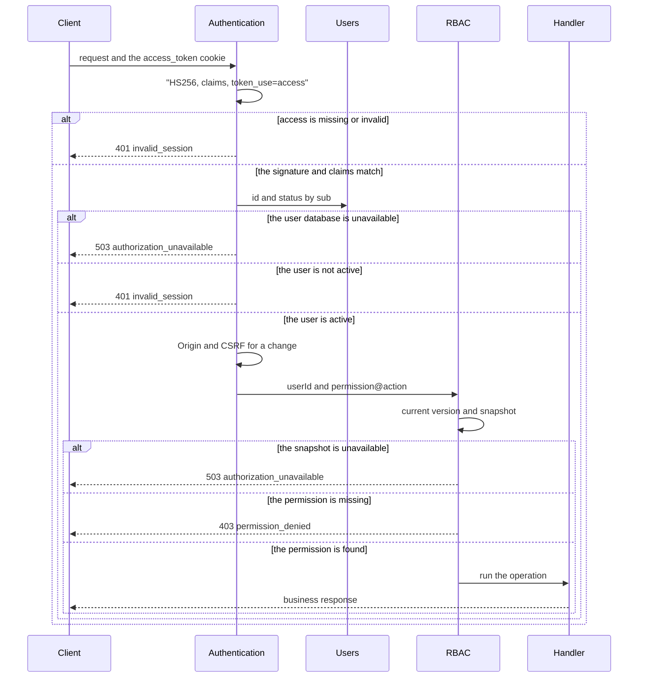
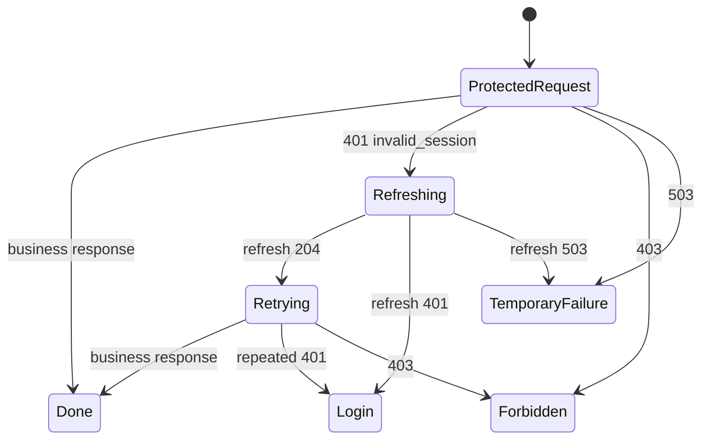
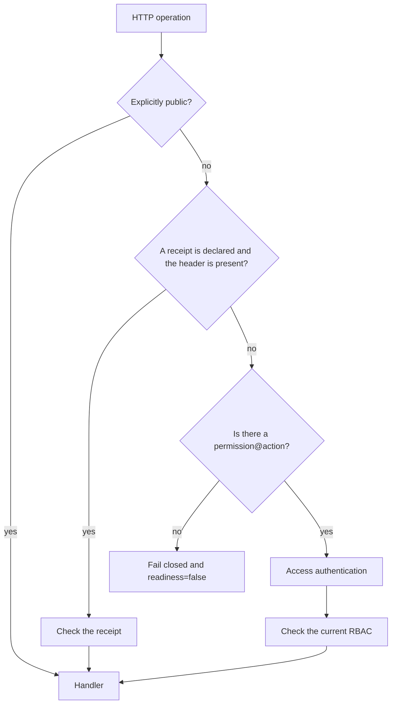

# Authorization

## Contents

- [Theory](#theory)
  - [Situation](#situation)
  - [Model](#model)
  - [Concepts and how they relate to the backend](#concepts-and-how-they-relate-to-the-backend)
  - [Responsibilities](#responsibilities)
  - [Common failures](#common-failures)
  - [Useful links](#useful-links)
  - [Review questions](#review-questions)
- [Practical assignment](#practical-assignment)
  - [1.1 General](#11-general)
  - [1.2 Scenarios (user stories)](#12-scenarios-user-stories)
  - [1.3 Contract](#13-contract)
  - [1.4 Errors and constraints](#14-errors-and-constraints)
  - [1.5 Audit and logs](#15-audit-and-logs)
  - [1.6 Non-functional requirements](#16-non-functional-requirements)

# Theory

## Situation

A user calls a protected operation with an access JWT in a cookie. One of the following outcomes follows: the identity is not established and the server returns **401**; the user is established but the action is forbidden, and the response is **403**; the current user data or RBAC is unavailable and the response is **503**; or the handler runs and returns its own result.

If the access token has expired, the client refreshes the token pair once and repeats the original request. A **403** response does not start a refresh, because a new pair confirms the same identity and adds no permissions.

## Model

A protected request involves the client, access-JWT authentication, the user database, RBAC, and the business handler. The order is fixed: the identity is established first, then the permission is checked, and only after that is the target resource read and the operation performed.

RBAC receives `userId` only after the token and the user status have both been checked. The required `permission` and `action` are set on the server by the handler. Values from the JWT, the body, the query, or an arbitrary header cannot weaken that requirement.

An expired access token is not refreshed inside the protected handler. The client receives **401**, calls the separate authentication endpoint, and repeats the original request at most once.

Several parallel requests can see an expired access token at the same time. The client gathers them around one refresh: the others wait for its result instead of rotating the refresh token on their own. After a successful refresh, each waiting request is repeated once.

Every HTTP operation is assigned in advance to one of three kinds. A public operation has an explicit mark and does not run the access check. A protected operation declares one `permission@action` pair. An operation that uses a receipt declares the header name. If that header is present, access and RBAC do not run, and the handler checks the receipt. A receipt can be combined with one pair: when the header is absent, the ordinary access and RBAC chain runs. The absence of any declaration is a configuration error and does not open the route.

Authorization adds no tables and does not change the existing schema. The user and the user's status are read from `users`. Roles, permissions, assignments, and the policy version are read from the normalized RBAC tables. The refresh JWT, `jti`, and the server session are still not stored.

## Concepts and how they relate to the backend

### Authentication before authorization

Authentication establishes the identity. The access token is taken only from the HttpOnly cookie `access_token` and is checked with a fixed HS256 algorithm, the access key, the expected `iss`, `aud`, `iat`, and `exp`, a non-empty `sub`, and `token_use=access`. The server then loads the user by `sub` and accepts only the status `active`.

Authorization receives an already verified `userId` and answers a different question: whether this user is allowed to meet the server requirement `permission@action`. If the order is reversed, a missing session starts to look like a missing role, and the client cannot tell whether a refresh is needed.

A public operation does not try to parse an access cookie that happens to be sent. A damaged cookie, for example, does not block another sign-in or a check of `/health`. The refresh endpoint also skips the access guard: it checks the refresh JWT separately, under the authentication contract.

### Separating 401, 403, and 503

**401 Unauthorized** means the server could not establish a current identity: the cookie is missing, the JWT is damaged or expired, the claims do not match, or the user was not found or has the status `pending`, `blocked`, `deleting`, or `deleted`. RBAC and the handler are not called after such a response.

**403 Forbidden** means an active user has already been established, but the request is forbidden. The cause is a missing current permission, a failed owner check, or a rejected CSRF check for a state-changing operation. Signing in again or refreshing does not change this result.

**503 Service Unavailable** means the decision cannot be made safely: the user database or the current RBAC snapshot is unavailable, or the route configuration failed its check. A dependency failure is not disguised as **401** or **403**. Otherwise a temporary failure would look like a change of identity or of permissions.

### A JWT establishes identity, not a role

A JWT signature proves that the claims were issued by a trusted server and have not been changed. It does not prove that the user is still active, so the user is loaded by `sub` on every request. Blocking or deletion stops new requests even before the 15 minutes run out.

A role, a permission, and an action in the JWT are not used. Otherwise a removed role would keep working until `exp`, and a policy change would require a new token pair. An access token may contain only the contractual identity claims. Unknown claims do not become a source of permissions.

A JWT is a bearer credential: anyone who obtains it can act as the user until it expires and until the current status is checked. `HttpOnly` reduces the risk of reading the token from JavaScript, but it does not replace HTTPS, XSS protection, or CSRF protection.

### Current RBAC and default deny

The handler sets the minimum pair, for example `reports@read` or `users@delete`. RBAC combines the permissions of all of the user's current roles, under the rules of the RBAC module. A matching role name, a hidden button, or a value from the client does not grant anything by itself.

Before the decision, the process compares the version of the local snapshot with `rbac_policy_state.version`. If the version has changed, the new snapshot is built in full and replaces the old one atomically. If loading fails, the old permissions are not used, and the request receives **503**.

A missing user in the snapshot, missing roles, an unknown permission, an unknown action, and the absence of a matching assignment all result in a denial. A route with no public mark, no `permission@action` pair, and no declared receipt does not become public: the configuration check clears readiness, and the request never reaches the handler.

### The target resource and additional rules

The general permission is checked before the target resource is read. A user without `reports@read` receives **403** for both an existing and a made-up `reportId`, so the existence of a record is not revealed by enumeration.

An additional `*_any` action does not replace the route's base pair. The handler checks it after the base permission and before the target is looked up. The declaration still contains one pair: a profile declares `users@read`, and `users@read_any` is checked for someone else's identifier.

After RBAC succeeds, the handler may load the resource. A missing record then yields **404**. The rule "only one's own record may be changed" requires comparing `userId` with the owner. A mismatch yields **403**, even when the general permission `profile@update` is present.

Authorization is checked at the start of the request. If the access token expires, or the user is blocked after the check has already succeeded, the running handler is not interrupted. Every later request sees the new state. A long-running operation decides for itself whether another check is required before a critical commit.

### Refresh on the client

The client reacts only to **401** with the code `invalid_session` from a protected operation. One shared promise, task, or coroutine performs `POST /auth/refresh`, and the other requests wait. A **204** success allows a single repeat with the new cookies.

A **401** from refresh means the client session is over: the local user state is cleared and the sign-in screen is shown. On **503** the state is not erased, because the token may still be valid. The client shows a temporary failure and allows the action to be tried again later, without an infinite loop.

A **403** response does not call refresh. An automatic refresh after every **403** creates extra load and does not change roles. A repeated **401** after a successful refresh also ends the cycle and sends the user to sign-in.

### Cookies, CORS, and CSRF

Authorization uses the authentication policy unchanged. By default the frontend and the API share one origin, `access_token` is a host-only cookie with `HttpOnly; Secure; SameSite=Strict; Path=/`, and refresh is available only at `/auth/refresh`. JavaScript sends cookies through the browser and does not read the JWT.

For another trusted origin, CORS lists the exact address, credentials are allowed, and the client sets `credentials: "include"`. Every state-changing operation from another origin checks the exact `Origin` and requires `X-CSRF-Protection: 1`, even when the frontend and the API remain same-site: `SameSite=Strict` does not protect against a compromised neighboring subdomain. If the origin is also cross-site, the cookies additionally receive `SameSite=None; Secure`.

CORS controls whether a browser page may read the response and send a credentialed request. RBAC controls the permission of a user who has already been established. Neither CORS nor hiding an interface element replaces server-side authorization.

### Summary

| Concept | Meaning in authorization | What the implementation relies on |
| --- | --- | --- |
| Authentication | establishes the active user | the access JWT and a read of `users` by `sub` |
| Authorization | decides whether the action is allowed | the current RBAC snapshot |
| **401** | the identity is not established | a refusal before RBAC |
| **403** | the identity is established and the request is forbidden | RBAC, ownership, or CSRF |
| **503** | a safe decision is temporarily impossible | fail closed, without the old snapshot |
| Public | an operation without the access guard | an explicit server mark |
| Receipt | access without a session, by a secret receipt | a declared header; without it, the route pair |
| `permission@action` | the handler's minimum requirement | the server configuration of the route |
| Single-flight refresh | one refresh for parallel **401** responses | coordination of requests on the client |

## Responsibilities

| Client | Server |
| --- | --- |
| Sends cookies with `credentials: "include"` when the origin differs | Takes the access token only from `access_token` |
| After **401**, performs one refresh and one repeat | Returns **401** before RBAC and the handler |
| After **403**, shows a refusal without a refresh | Returns **403** only after the identity is established |
| On **503**, offers a later retry | Does not use an unavailable or stale policy |
| May hide unavailable actions | Checks every operation independently of the interface |
| Does not send a role or a required permission | Takes `permission@action` from the handler |
| Repeats only a request rejected by the guard | Does not start business logic before the checks finish |
| For a cross-origin change, sends the CSRF header | Checks `Origin`, CSRF, and the current RBAC |

Refresh, JWT issuance, and clearing cookies belong to authentication. Authorization does not sign tokens, does not store sessions, and does not change roles.

## Common failures

| What you see | Where to look |
| --- | --- |
| A request without a cookie receives **403** | RBAC ran before authentication, or an authentication failure was turned into a permission denial |
| A user without the permission receives **401** | an RBAC refusal wrongly starts a refresh and mixes the two kinds of decision |
| A blocked user gets as far as RBAC | after the JWT signature, the current `users.status` is not read |
| A removed role stays in effect until the access `exp` | roles and permissions are taken from the JWT claims |
| The client can send a weaker permission | `permission` or `action` is read from the request instead of from the handler |
| A new route is open without configuration | the absence of public and of `permission@action` is treated as permission |
| Public login breaks because of an old cookie | the access guard runs for an operation with an explicit public mark |
| Any dependency error yields **401** | unavailability of the database or the snapshot is hidden under a session error instead of **503** |
| After a failed update, the old permissions are used | RBAC keeps working from a stale snapshot instead of failing closed |
| **403** reveals whether a record exists | the resource is read before the general permission check |
| A hidden button can still be called with an HTTP request | the interface is treated as the source of the decision instead of the server guard |
| One expired access token causes several refreshes | the client has no single-flight coordination for parallel **401** responses |
| A refresh loop starts after **403** | the client does not distinguish `invalid_session` from `permission_denied` |
| A request repeats forever after refresh | there is no limit of one repeat |
| A cross-origin change, including same-site, passes without a CSRF check | protection is turned on only together with `SameSite=None`, without an exact `Origin` and a custom header |
| CORS allows `*` together with cookies | the credentialed origin is configured as a wildcard instead of an exact list |
| JWTs or cookies appear in the log | request headers are logged in full |
| The handler changes data before the RBAC decision | the guard is attached after the business logic, or only inside some handlers |

## Useful links

### General

- [OWASP — Authorization Cheat Sheet](https://cheatsheetseries.owasp.org/cheatsheets/Authorization_Cheat_Sheet.html) — default deny, least privilege, and a check on every request.
- [OWASP — REST Security Cheat Sheet](https://cheatsheetseries.owasp.org/cheatsheets/REST_Security_Cheat_Sheet.html) — server-side verification of the access token and separation of HTTP statuses.
- [NIST — Role Based Access Control FAQ](https://csrc.nist.gov/projects/role-based-access-control/faqs) — the RBAC model of users, roles, permissions, and sessions.
- [RFC 9110 — HTTP Semantics](https://www.rfc-editor.org/rfc/rfc9110) — the normative meaning of **401**, **403**, **404**, and **503**.
- [RFC 8725 — JWT Best Current Practices](https://www.rfc-editor.org/rfc/rfc8725) — fixing the algorithm and mutually exclusive validation rules for different JWT types.
- [MDN — 401 Unauthorized](https://developer.mozilla.org/en-US/docs/Web/HTTP/Reference/Status/401) — the response when a current identity is not established.
- [MDN — 403 Forbidden](https://developer.mozilla.org/en-US/docs/Web/HTTP/Reference/Status/403) — the response to an established user who is forbidden to make the request.
- [MDN — CORS](https://developer.mozilla.org/en-US/docs/Web/HTTP/Guides/CORS) — credentialed requests, an exact origin, and preflight.
- [OWASP — Cross-Site Request Forgery Prevention Cheat Sheet](https://cheatsheetseries.owasp.org/cheatsheets/Cross-Site_Request_Forgery_Prevention_Cheat_Sheet.html) — `SameSite`, an `Origin` check, and a custom header for cookie authentication.
- [OpenAPI Specification — Security Scheme Object](https://spec.openapis.org/oas/latest.html#security-scheme-object) — describing cookie authentication and the requirements of protected operations.

### By language

#### Node.js

**Node.js, NestJS.** On Express or Fastify the order access, then user, then RBAC, then handler stays the same.

- [NestJS — Guards](https://docs.nestjs.com/guards) — a centralized check before the handler is called.
- [NestJS — Authentication](https://docs.nestjs.com/security/authentication) — establishing identity from a JWT.
- [NestJS — Authorization](https://docs.nestjs.com/security/authorization) — role-based and claims-based guards. Current permissions are loaded from RBAC under the contract.
- [NestJS — Custom decorators](https://docs.nestjs.com/custom-decorators) — server marks for public and for `permission@action`.
- [NestJS — CORS](https://docs.nestjs.com/security/cors) — exact trusted origins and credentials.
- [NestJS — OpenAPI security](https://docs.nestjs.com/openapi/security) — describing the cookie security scheme and protected operations.

#### .NET

**.NET, ASP.NET Core.** Minimal APIs and controllers use one middleware chain and policy-based authorization.

- [ASP.NET Core — Overview of authorization](https://learn.microsoft.com/en-us/aspnet/core/security/authorization/introduction) — separating authentication from authorization.
- [ASP.NET Core — Policy-based authorization](https://learn.microsoft.com/en-us/aspnet/core/security/authorization/policies) — requirements and handlers for `permission@action`.
- [ASP.NET Core — JWT bearer authentication](https://learn.microsoft.com/en-us/aspnet/core/security/authentication/configure-jwt-bearer-authentication) — validating the JWT before the authorization middleware.
- [ASP.NET Core — CORS](https://learn.microsoft.com/en-us/aspnet/core/security/cors) — middleware order, exact origins, and credentials.
- [ASP.NET Core — OpenAPI](https://learn.microsoft.com/en-us/aspnet/core/fundamentals/openapi/overview) — describing the security scheme and the responses of protected operations.

#### Python

**Python, FastAPI.** On Django or Flask the same dependency order and the same statuses are kept.

- [FastAPI — Dependencies](https://fastapi.tiangolo.com/tutorial/dependencies/) — running shared authentication and the permission check in sequence.
- [FastAPI — Security](https://fastapi.tiangolo.com/tutorial/security/) — building the user context before the handler.
- [FastAPI — OAuth2 scopes](https://fastapi.tiangolo.com/advanced/security/oauth2-scopes/) — declaring requirements. The current decision under the contract is made by server-side RBAC.
- [FastAPI — CORS](https://fastapi.tiangolo.com/tutorial/cors/) — credentials and an explicit origin list.
- [FastAPI — Metadata and Docs URLs](https://fastapi.tiangolo.com/tutorial/metadata/) — current OpenAPI documentation of operations and errors.

## Review questions

1. Why must an invalid access token end in **401** before RBAC, while a missing permission for an active user ends in **403**?
2. Why, after the JWT signature is checked, does every request load the user by `sub` and check the user's current status?
3. Why are roles from the access JWT a poor fit for a policy that must take effect immediately after a role is removed?
4. What happens if the policy version has changed but the new RBAC snapshot could not be loaded, and why must the old snapshot not keep being used?
5. Why is the target resource read after the general permission check, and in which case does **404** appear after that check?
6. How does a single-flight refresh prevent a rotation race when several **401** responses arrive at the same time?
7. How do CORS and CSRF differ from RBAC, and why does none of these mechanisms replace the others?

# Practical assignment

Request authorization for a user in the system.
Every protected operation first checks the access JWT and the user's current status, then applies RBAC, and only after that starts the handler. A missing session returns **401**, a missing permission for an established user returns **403**, and unavailability of the data needed for a safe decision returns **503**.

## 1) Authorization

### 1.1 General

**Purpose:** admit to protected operations only active users who hold the current permission, and do it in one place.

**Users and roles:**

- a guest calls only operations that are explicitly public;
- an authenticated user passes the access check and RBAC;
- an RBAC administrator passes the same chain with the permission `rbac@manage`.

**Dependencies and related settings:**

- authentication issues an access JWT for 15 minutes in the HttpOnly cookie `access_token`;
- the access token is checked under the authentication contract: HS256, the access key, `iss`, `aud`, `iat`, `exp`, `sub`, and `token_use=access`;
- the user database is the source of the current `status`;
- RBAC provides the current snapshot of roles, permissions, actions, assignments, and `version`;
- every HTTP operation has a public mark, one `permission@action` pair, a declared receipt, or a receipt together with one pair;
- the cookie and CORS policy matches authentication: same-origin, host-only, `Secure`, and `SameSite=Strict` by default.

Issuing and refreshing JWTs, the email challenge, and logout are performed by authentication. Authorization does not sign tokens, does not set cookies, does not check the password, and does not store a refresh token, `jti`, or a server session.

Roles and permissions from the JWT, the body, the query, and arbitrary headers are ignored. RBAC uses only current server data, under the role-management contract.

### 1.2 Scenarios (user stories)

1. **Allowed request:** the access token is valid, the user is `active`, and one of the current roles contains the required action. The handler runs.
2. **No session:** the access token is missing, damaged, expired, or has the wrong claims. The server returns **401** without calling RBAC.
3. **The user is no longer active:** the JWT is valid, but the user is missing or is `pending`, `blocked`, `deleting`, or `deleted`. The server returns **401**.
4. **No permission:** the identity is established, but there is no matching assignment. The server returns **403** without reading the target resource.
5. **The policy is unavailable:** the current snapshot cannot be obtained. The server returns **503** and does not use the old permissions.
6. **The access token has expired:** the client performs one refresh and, after success, repeats the request once.
7. **Public operation:** an explicit public mark skips access and RBAC. A stray invalid cookie does not change its contract.
8. **Owner check:** after general RBAC, the handler loads the resource and allows the action only for its owner.

### 1.3 Contract

#### 1.3.1 Protected operation

| Input | Source and rule |
| --- | --- |
| Cookie `access_token` | The only source of the access JWT. A value from `Authorization`, the body, the query, or another header is not accepted |
| `permission` | The normalized permission name from the handler's server configuration |
| `action` | The normalized action of the same handler |
| HTTP method and path | Used to select the operation's metadata, but they do not determine the permission from client data |

**Logic and steps:**

1. Find the server declaration of the operation. If it is explicitly public, go to the handler without parsing the access token or RBAC.
2. For a protected operation, take `access_token` from the cookie and check HS256, the signature, `iss`, `aud`, `iat`, `exp`, a non-empty `sub`, and `token_use=access`.
3. On any access error, return **401 invalid_session**. Do not call RBAC, read the resource, or call the handler.
4. Load only `id` and `status` from `users` by `sub`. Accept only an existing user with the status `active`. Return every other case as **401 invalid_session**.
5. For a state-changing operation from another origin, check the allowed `Origin` and the required CSRF header, regardless of the site boundary. After the identity is established, a refusal receives **403 csrf_rejected**.
6. Pass to RBAC only `userId`, `permission`, and `action` from the handler.
7. Compare the snapshot version with the policy version. On a mismatch, load the new snapshot in full and install it atomically.
8. If the current snapshot is unavailable, return **503 authorization_unavailable** and do not use the old one.
9. If no current role allows the action, return **403 permission_denied**.
10. Only after RBAC allows it, read the target resource, perform the ownership checks, and start the business logic.

The access token is checked at the start of the request. Expiry of `exp` during a handler that has already been admitted does not interrupt it. A user block or a policy change recorded after the corresponding check applies to later requests. A long-running critical operation repeats the check before commit when its own contract requires that.

If the user database is unavailable, return **503**, not **401**. If the user check succeeded but RBAC is unavailable, also return **503**. In both outcomes the handler does not start, and there are no partial business changes.

**Responses:**

- **Access allowed:** the status and the body are determined by the business handler.
- **Identity not established:** **401 Unauthorized**, code `invalid_session`.
- **Request forbidden:** **403 Forbidden**, code `permission_denied`, `ownership_denied`, or `csrf_rejected`.
- **Decision unavailable:** **503 Service Unavailable**, code `authorization_unavailable`.
- The authorization response contains no JWT, cookies, `sub`, user status, roles, required permission, internal version, or snapshot contents.

#### 1.3.2 Operation declarations

| Kind of operation | Required server declaration |
| --- | --- |
| Public | `public=true`. Access and RBAC do not run |
| Protected | exactly one `permission@action` pair. `public` is absent |
| By receipt | the header name. When it is present, access and RBAC do not run. One `permission@action` pair may sit beside it for a call without the header |

Registration, login, email confirm and resend, refresh, logout, and the minimal liveness check are marked public. Each of them applies its own checks, rate limit, and statuses. Readiness may be available only to internal infrastructure. The deletion status is not public: the `Deletion-Receipt` header opens the owner's branch, and without it the pair `users@delete` applies.

Every other operation is protected by default. At startup the application checks the declaration, and requirement names pass the RBAC format. `public=true` together with a pair or a receipt, and the absence of any declaration, clear readiness. If a request still reaches the process, it receives **503 authorization_unavailable**, and the handler does not start. A receipt together with one pair is allowed. If the declared header is present, the receipt is checked. If it is absent, the pair is required, and the request follows the ordinary chain.

A `permission` or `action` unknown to the current policy is not a client error and yields **403 permission_denied**. Adding an assignment in RBAC starts allowing later requests without a handler change and without a new JWT.

The client does not send the kind of operation, `permission`, or `action`. OpenAPI marks cookie security only on protected operations, but the documentation is not the source of the decision: the server metadata is checked independently.

#### 1.3.3 Refresh and repeating the request on the client

**General rule:** refresh starts only after **401 invalid_session** from a protected operation.

**Logic and steps:**

1. On the first **401 invalid_session**, pause the other requests that received the same error.
2. If a refresh is already running, join its result. Do not send a second `POST /auth/refresh`.
3. On **204** from refresh, repeat each paused request once with the new cookies.
4. If the repeat returns **401** again, do not refresh the tokens any further. Clear the local user state and show sign-in.
5. On **401** from refresh, perform the same cleanup and the same move to sign-in.
6. On **503** from refresh, do not clear the user state and do not create a loop. Show a temporary error and allow a manual retry later.
7. A **403** or **503** response from the original protected operation does not start a refresh.

A repeat is allowed because **401** was produced by the guard before the handler, and the original business operation had not started. A lost network response without a confirmed **401** is not repeated automatically. A streaming body, or any other body that cannot be reproduced, requires a new action from the user.

The client does not read the JWT and does not compute `exp`: an HttpOnly cookie is not available to JavaScript, and the server response is the source of the decision. When the origin differs, the original request, the refresh, and the repeat use `credentials: "include"`.

#### 1.3.4 Resource and ownership

**General rule:** the general `permission@action` check comes before the lookup of the target resource.

**Logic and steps:**

1. After RBAC, load the resource by its identifier.
2. If the resource is missing, return **404 Not Found**.
3. If the operation has an additional rule for the owner, the organization, or the state, check it against the established `userId` and the resource data.
4. On a mismatch, return **403 ownership_denied**.
5. Perform the read or the change only after both checks.

A user without the general permission receives **403 permission_denied** regardless of whether the identifier exists. A user with the general permission may receive **404**, because that user has already been admitted to look up this kind of resource.

The transaction and the state after a partial failure belong to the business operation. Authorization guarantees that the handler did not start before admission, but it does not replace the transaction of the change itself.

#### 1.3.5 Cookies, CORS, and CSRF

By default the frontend and the API share one origin. `access_token` remains a host-only cookie with `HttpOnly; Secure; SameSite=Strict; Path=/`. Authorization does not set it again.

For another trusted origin, the server returns a specific `Access-Control-Allow-Origin`, `Access-Control-Allow-Credentials: true`, and the required methods and headers. A wildcard `*` is forbidden for credentialed requests. The client uses `credentials: "include"`.

A protected state-changing operation from another origin, after a successful access check, accepts only an exact allowed `Origin` and `X-CSRF-Protection: 1`. This rule also applies to a same-site origin. If the frontend is on another site, authentication additionally sets cookies with `SameSite=None; Secure`. GET and HEAD do not change state.

A CORS preflight does not require the access cookie and responds only for an allowed origin, method, and set of headers. A successful preflight does not mean the business operation is allowed. The actual request still passes access, the user check, and RBAC.

#### 1.3.6 Partial failures

- If the access token is correct but loading the user failed, **503** is returned. RBAC and the handler do not start.
- If the user is established but the RBAC version or snapshot is unavailable, **503** is returned. The old snapshot is not used.
- If the audit record temporarily failed to reach an external system, the access decision does not change and the handler is not repeated. The error is written to the local structured log and affects monitoring of the log channel's readiness.
- If the business handler has started and then failed, its status is kept. Authorization does not turn a business failure into **401** or **403** and does not repeat the operation.
- If the required JWT keys are missing, or the initial RBAC snapshot was not loaded, the application does not pass readiness and does not accept protected requests.

### 1.4 Errors and constraints

- **400 Bad Request** — the business input failed validation after authorization succeeded. This is not a result of access or RBAC.
- **401 Unauthorized** — `access_token` is missing, damaged, expired, signed with the wrong key, or has the wrong claims or type. The user for `sub` is missing or is not `active`.
- **403 Forbidden** — the active user does not have the required permission, fails the ownership check, or did not meet the CSRF condition of a state-changing operation.
- **404 Not Found** — the resource was not found after RBAC succeeded.
- **429 Too Many Requests** — the rate limit of the protected business operation fired. Refresh does not start automatically.
- **503 Service Unavailable** — the user database, the current RBAC snapshot, or a correct route configuration is unavailable.

**401** never means a missing role, and **403** is never used for a missing, expired, or invalid session. Unavailability of a dependency is not presented as a change of permissions and always receives **503**.

The general permission is checked before the resource is read. Without the permission the response is therefore always **403**, and **404** is possible only after admission to look up the resource.

### 1.5 Audit and logs

Log the following:

- **401** with the category `missing`, `malformed`, `signature`, `expired`, `claims`, `token_use`, or `user_inactive`;
- **403** with the category `permission_denied`, `ownership_denied`, or `csrf_rejected`;
- **503** with the dependency category `users`, `rbac_version`, `rbac_snapshot`, or `route_configuration`;
- successful admission to critical operations;
- an operation discovered at startup without a correct declaration;
- a single-flight refresh and its outcome on the client, without the cookie contents.

For an RBAC decision, the log contains `requestId`, `actorUserId`, the operation name, the server `permission` and `action`, the policy version, and the result. The target resource identifier is added only after admission to read it. The full list of roles and permissions is not recorded.

The log does not receive a JWT, `Cookie`, `Set-Cookie`, keys, a password, a hash, an email challenge, the full request body, full headers, or sensitive resource data.

### 1.6 Non-functional requirements

- One chain, access, then the current user, then CSRF for a change, then RBAC, then the resource, then the handler, applies to every protected operation. Public routes are marked explicitly.
- An error or an incomplete configuration leads to **401**, **403**, or **503**, and never allows the request.
- Automated tests cover the check order, every cause of **401**, a **403** refusal, **503** unavailability, blocking a user, changing a role without a new JWT, and ownership.
- The project's shared non-functional requirements, input validation, CORS, OpenAPI, structured logs, health checks, and test coverage of at least 80%, apply to these operations as well.
