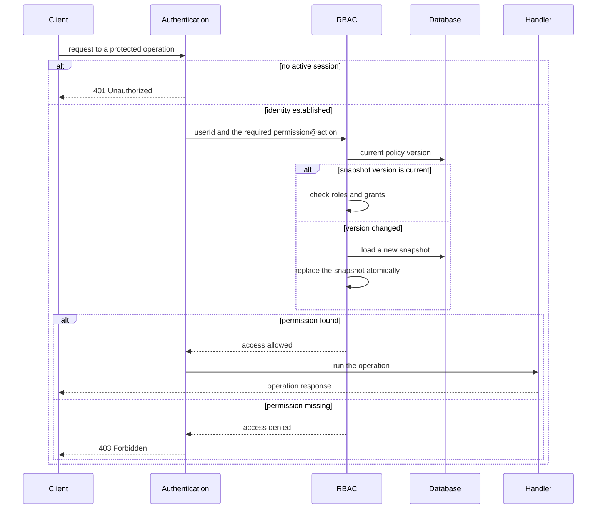
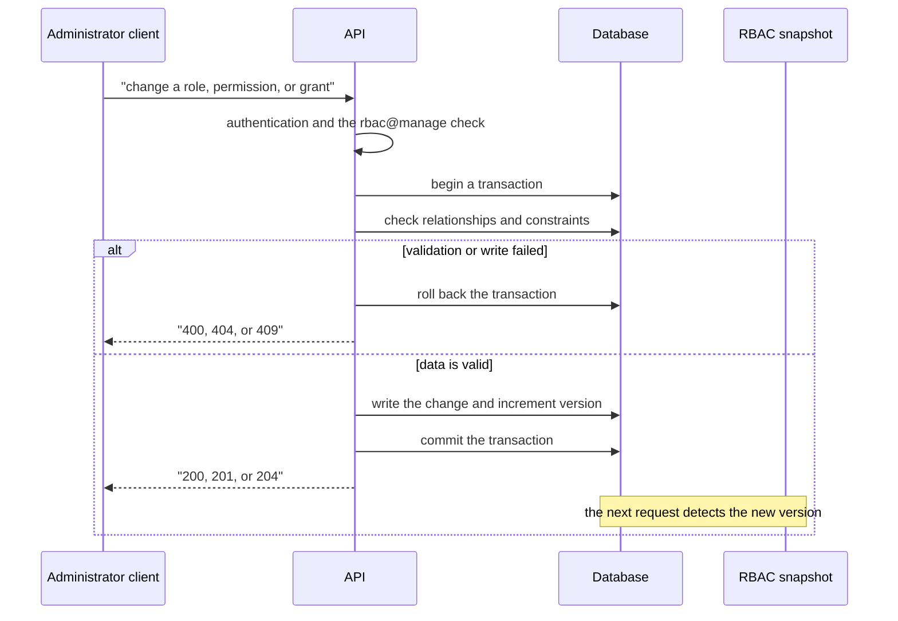
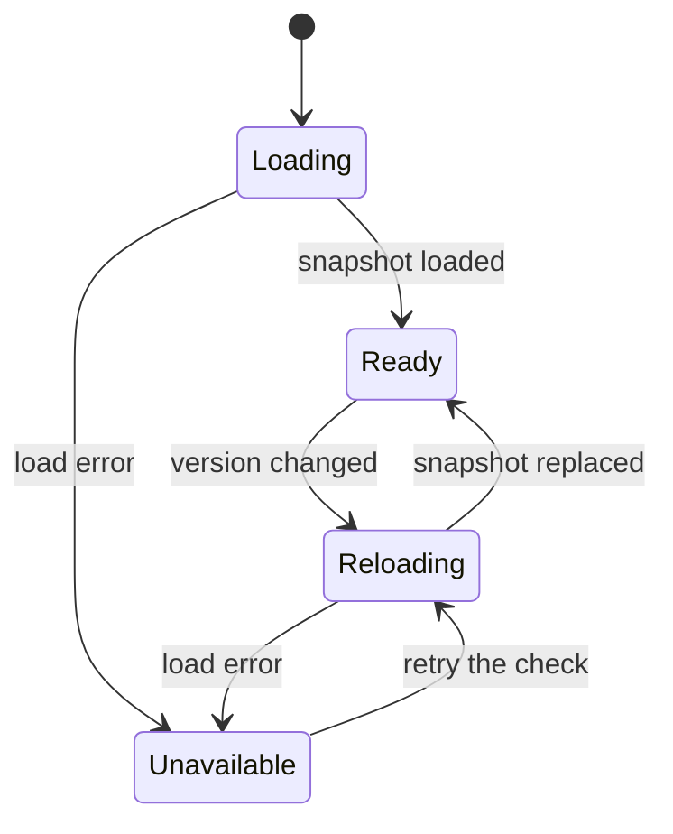

# RBAC

## Contents

- [Theory](#theory)
  - [Situation](#situation)
  - [Model](#model)
  - [Concepts and how they relate to the backend](#concepts-and-how-they-relate-to-the-backend)
  - [Responsibilities](#responsibilities)
  - [Example](#example)
  - [Common failures](#common-failures)
  - [Useful links](#useful-links)
  - [Review questions](#review-questions)
- [Practical assignment](#practical-assignment)
  - [1.1 General](#11-general)
  - [1.2 Scenarios](#12-scenarios-user-stories)
  - [1.3 Contract](#13-contract)
  - [1.4 Errors and constraints](#14-errors-and-constraints)
  - [1.5 Audit](#15-audit-and-logs)
  - [1.6 Non-functional requirements](#16-non-functional-requirements)

# Theory

## Situation

An authenticated user requests a protected operation, and the server matches the required permission against the user's roles. One of these outcomes follows: the handler runs, a request without an active session receives **401**, a user without the permission receives **403**, and an unavailable current access configuration yields **503**. An administrator separately creates roles and permissions, links them, and assigns roles to users. Invalid data, missing entities, conflicts, and an unsafe deletion receive **400**, **404**, or **409**.

A separate frontend is not required. Every request can be sent from an HTTP client.

## Model

The access check involves the client, authentication, RBAC, the database, and the handler of the protected operation. The client states what it wants to do, but the handler itself sets the required `permission` and `action`. Otherwise a user could substitute a weaker requirement.

Authentication first establishes the user's identity. RBAC receives the verified `userId`, takes the union of the permissions of every role assigned to that user, and allows the request only when the permission and the action match exactly.



The check runs before the target resource is read. A user without the permission receives **403** whether or not the requested record exists, and cannot enumerate identifiers from the difference between **403** and **404**.

A policy change runs in one transaction. The version number increases together with the roles, permissions, or grants. After a successful response, every new request sees that version first and reloads the snapshot when needed.



The snapshot is replaced as a whole. It is not patched in parts. If the new version fails to load, the old rules are not used: the protected operation receives **503**, and its handler does not start. The change is already saved in the database, so the administrative request does not need to be repeated.



A role groups permissions, but it does not describe a specific HTTP operation. For example, the own-profile handler requires `users@read`, the user-list handler requires `users@list`, and the deletion handler requires `users@delete`. If a user has several roles, a matching grant in at least one of them is enough. A missing role, permission, or action always means deny.

A possible set of fields (the schema can differ):

| `roles` | Description |
| --- | --- |
| `id` | role identifier |
| `name` | normalized unique name |
| `description` | optional description |
| `created_at` | creation time |
| `updated_at` | time of the last change |

| `permissions` | Description |
| --- | --- |
| `id` | permission identifier |
| `name` | normalized unique resource name, for example `users` |
| `description` | optional description |
| `created_at` | creation time |
| `updated_at` | time of the last change |

| `permission_actions` | Description |
| --- | --- |
| `id` | action identifier |
| `permission_id` | reference to `permissions.id` |
| `name` | an action, for example `read`, `update`, or `delete`; the pair `permission_id` + `name` is unique |

| `grants` | Description |
| --- | --- |
| `id` | grant identifier |
| `role_id` | reference to `roles.id` |
| `permission_id` | reference to `permissions.id`; the pair `role_id` + `permission_id` is unique |
| `all_actions` | flag for access to every current and future action of the permission |
| `created_at` | creation time |
| `updated_at` | time of the last change |

| `grant_actions` | Description |
| --- | --- |
| `grant_id` | reference to `grants.id` |
| `permission_action_id` | reference to `permission_actions.id`; together with `grant_id` it forms the primary key |

| `user_roles` | Description |
| --- | --- |
| `user_id` | reference to an existing user |
| `role_id` | reference to `roles.id`; together with `user_id` it forms the primary key |

| `rbac_policy_state` | Description |
| --- | --- |
| `id` | fixed identifier of the single row |
| `version` | monotonically increasing policy version |
| `updated_at` | time of the last policy change |

### Normal form

Every table in the schema is in Boyce-Codd normal form (BCNF) and does not need deliberate denormalization in the database.

Each successive form includes the requirements of the previous one:

- **1NF:** each cell holds one value. Action and role arrays from the API are split into rows of `permission_actions`, `grant_actions`, and `user_roles`, and are not stored in one text or JSON field.
- **2NF:** a non-key field depends on the whole key. The junction tables `grant_actions` and `user_roles` have no non-key fields, and the other tables use a simple `id` key.
- **3NF and BCNF:** descriptions and timestamps belong only to their own role, permission, or grant. The role name is not copied into `user_roles`, and the permission name and the action are not copied into `grants`, so a rename happens in one place.
- **4NF:** independent multivalued facts are separated. A user's roles are stored apart from a permission's actions. Combining the two lists would create extra rows and update anomalies.
- **5NF:** the "user-role", "role-permission", and "grant-action" relationships are restored by joining on foreign keys. There are no further join dependencies that would require these facts to be combined into one table.

The in-memory snapshot holds already joined data, so it looks denormalized, but it is not the source of truth. It can be deleted and rebuilt from the normalized tables. The policy version prevents use of that snapshot after the source rows change.

## Concepts and how they relate to the backend

### Authentication and authorization

Authentication answers the question "who sent the request." In this system it checks the access JWT from the cookie and passes `userId` onward. If the cookie is missing, or the token is damaged or expired, the server returns **401 Unauthorized** before calling RBAC.

Authorization answers a different question: "can this already known user perform this operation." RBAC decides after authentication. An active session without the required permission leads to **403 Forbidden**. Signing in again does not add permissions by itself.

Roles from the request body, query parameters, and unsigned headers are not used. Storing roles only inside the access JWT is also not enough for a dynamic policy: a removed role would stay in effect until the token expired. The JWT confirms identity, and the current roles and grants come from the current snapshot of server data.

### Roles, permissions, and grants

A role describes a job function, for example `admin`, `support`, or `user`. A permission names a resource, and an action specifies the operation on that resource. The pair `users@read` means reading users, whereas `users@delete` is a separate right.

A grant links one role to one permission. A non-empty action list opens only the listed operations. An empty list means every action of the permission, including actions added later. The database marks this case with `all_actions`, so missing rows are not confused with an incomplete write.

Permissions from several roles are combined. A user with the roles `viewer` and `editor` receives the sum of their grants, not the intersection. There are no direct "user-permission" grants: every permission passes through a role. Otherwise a centralized audit of roles would stop showing actual access.

### Default deny and least privilege

When no grant matches, the result is deny. This covers a new handler whose rule was forgotten, an unknown action, and a user with no roles. Opening an operation under an incomplete configuration is dangerous: an administrator's mistake becomes access for everyone.

Each handler is assigned the minimum `permission@action` pair it needs. Checking the single role `admin` by name quickly leads to scattered conditions in the code. Checking permissions leaves the composition of roles changeable: a role can be renamed, or its permissions redistributed, without changing the protected handlers.

The client may hide a button the user cannot use, but that is only a UI decision. The final check runs on the server for every request, because an HTTP request can be sent without the UI.

### Dynamic policy and cache

Reading several tables on every request returns a current result, but it creates repeated load. An in-memory snapshot speeds up the check when the application can tell the current copy from a stale one.

The policy version changes in the same transaction as the RBAC configuration. Each process compares the snapshot version with the database version before it decides. On a mismatch, the process first builds a new snapshot, checks its integrity, and only then replaces the old snapshot atomically. A partially loaded rule set never takes part in authorization.

The transaction also protects compound changes. For example, a permission update changes several actions and increments the version as one whole. If any constraint is violated, both the actions and the version roll back, so other processes do not try to load a state that does not exist.

The final answer "the user is allowed" cannot be cached without a binding to the version. After a role is removed, that result would keep access longer than the policy in the database.

### RBAC boundaries

RBAC describes vertical permissions well: who can view the list of all users, change settings, or delete records. One role is not enough for the rule "a user can change only their own profile." Here the decision depends on the relationship between the current `userId` and the resource owner, so an ownership check is required after the general permission check.

Expressing every relationship as a separate role increases the number of roles and complicates the configuration. For rules based on the owner, the organization, time, or the resource state, attribute or relationship checks are added to RBAC. Having `users@update` means permission to enter the update scenario. It does not cancel the `targetUserId` check.

### What authentication and protected operations will include

The authentication module will later issue the access JWT and the refresh JWT in cookies. RBAC does not check the password, does not create a session, and does not sign tokens. It receives an identity only after the access JWT check succeeds.

Protected operations declare the required permission and action on the server. A user's own profile requires `users@read`, the user list requires `users@list`, a change requires `users@update`, and deletion requires `users@delete`. A target that belongs to someone else adds the `*_any` action in the handler, after the base pair and before the record lookup. Field filtering and the data change itself stay the responsibility of the corresponding modules.

### Summary

| Concept | Meaning in RBAC | What the implementation relies on |
| --- | --- | --- |
| User | subject of the access check | verified `userId` from authentication |
| Role | a set of job permissions | the `user_roles` relationship |
| Permission | a protected resource | a unique name in `permissions` |
| Action | an operation on a resource | rows of `permission_actions` |
| Grant | a role's permissions on a permission | `grants` and `grant_actions` |
| Default deny | a missing match means denial | a server check of every request |
| Policy version | a sign that the snapshot is current | the transaction and `rbac_policy_state` |
| **401** | identity is not established | the authentication module |
| **403** | the identity is known, and the permission is missing | the RBAC decision |

## Responsibilities

| Client | Server |
| --- | --- |
| Sends the session cookie with the request | Checks the JWT and obtains `userId` |
| Requests a business operation | Sets the required `permission` and `action` itself |
| May hide unavailable UI elements | Checks the permission regardless of the UI |
| Shows sign-in after **401** | Does not call RBAC without an established identity |
| Shows an access denial after **403** | Does not reveal that the resource exists before the permission check |
| Sends RBAC administrative forms | Normalizes the data, checks relationships, and applies the transaction |
| After a successful change, may repeat the business request | Detects the new policy version without a restart |

A request from a browser on another origin passes a CORS check first. RBAC does not replace CORS: RBAC decides whether the user has permission for the operation, and CORS decides whether the browser may pass the response to a page from a specific origin. A hidden button, CORS, and RBAC solve different tasks.

## Example

The program checks access against the `users` catalog. The `user` role grants `read`, `update`, and `delete`. The `admin` role has an empty action set: under the contract, that means every action of the permission, including `list` and `delete_any`. The program then prints four decisions: the owner reads the profile, the owner does not get the list of all users, the union of roles grants `list`, and the empty set on `admin` opens `delete_any`.

### Node.js

**Node.js 22 or later, the standard `Map` and `Set`.** No external packages are required. In the application, a guard or another server interceptor calls the same function.

```sh
node rbac-demo.js
```

```javascript
const grants = new Map([
  ['user', new Map([['users', new Set(['read', 'update', 'delete'])]])],
  ['admin', new Map([['users', new Set()]])],
]);

function can(roles, permission, action) {
  return roles.some((role) => {
    const roleGrants = grants.get(role);
    if (!roleGrants?.has(permission)) return false;

    const actions = roleGrants.get(permission);
    return actions.size === 0 || actions.has(action);
  });
}

console.log(can(['user'], 'users', 'read'));
console.log(can(['user'], 'users', 'list'));
console.log(can(['user', 'admin'], 'users', 'list'));
console.log(can(['admin'], 'users', 'delete_any'));
```

### .NET

**.NET 8 or later, the standard `Dictionary` and `HashSet`.** No extra NuGet package is required. In ASP.NET Core the check is connected through an authorization handler.

```sh
dotnet new console -o RbacDemo
cd RbacDemo
dotnet run
```

```csharp
var grants = new Dictionary<string, Dictionary<string, HashSet<string>>>
{
    ["user"] = new() { ["users"] = new() { "read", "update", "delete" } },
    ["admin"] = new() { ["users"] = new() }
};

bool Can(IEnumerable<string> roles, string permission, string action)
{
    foreach (var role in roles)
    {
        if (grants.TryGetValue(role, out var roleGrants) &&
            roleGrants.TryGetValue(permission, out var actions) &&
            (actions.Count == 0 || actions.Contains(action)))
            return true;
    }

    return false;
}

Console.WriteLine(Can(new[] { "user" }, "users", "read").ToString().ToLowerInvariant());
Console.WriteLine(Can(new[] { "user" }, "users", "list").ToString().ToLowerInvariant());
Console.WriteLine(Can(new[] { "user", "admin" }, "users", "list").ToString().ToLowerInvariant());
Console.WriteLine(Can(new[] { "admin" }, "users", "delete_any").ToString().ToLowerInvariant());
```

### Python

**Python 3.10 or later, the standard `dict` and `set`.** No third-party package is required. In FastAPI the check can be written as a dependency.

```sh
python rbac_demo.py
```

```python
grants = {
    "user": {"users": {"read", "update", "delete"}},
    "admin": {"users": set()},
}


def can(roles: list[str], permission: str, action: str) -> bool:
    for role in roles:
        role_grants = grants.get(role, {})
        if permission not in role_grants:
            continue

        actions = role_grants[permission]
        if not actions or action in actions:
            return True
    return False


print(str(can(["user"], "users", "read")).lower())
print(str(can(["user"], "users", "list")).lower())
print(str(can(["user", "admin"], "users", "list")).lower())
print(str(can(["admin"], "users", "delete_any")).lower())
```

---

All three programs print `true`, `false`, `true`, and `true`. The second line is default deny: the `user` role does not have `list`. The third line shows the union of roles. The fourth line succeeds because of the empty set, which in the contract means every action of the permission, including actions added later.

## Common failures

| What you see | Where to look |
| --- | --- |
| An unauthenticated request receives **403** | RBAC ran before authentication. Identity must be established before the permission check |
| A user with an active session and no permission receives **401** | an RBAC denial was mixed up with an invalid session |
| An operation hidden in the UI can be called directly | the handler relies on the client and does not perform a server check |
| A new handler is available to everyone | a missing requirement is treated as allow instead of default deny |
| A user with two roles does not receive the second role's permission | the implementation stopped at the first role, or it looks for an intersection instead of a union |
| An empty action list allows nothing | the `all_actions` representation differs between the API, the database, and the check function |
| A removed role stays in effect until the JWT expires | roles are read only from the token, and not from the current policy snapshot |
| After a change, one process allows the request and another denies it | process caches do not compare a shared policy version |
| During a reload, some rules are already new and some are old | the snapshot is changed in place instead of a full load and an atomic replacement |
| On a load failure, the request proceeds under the old rules | the system keeps using a stale snapshot instead of **503** |
| Deleting a role silently removes it from every user | independent relationships are set to cascade instead of a delete restriction |
| A permission update left a grant on a deleted action | there is no reference check, or the changes were not made in one transaction |
| Two parallel creates produced the same names | uniqueness was checked only by an application query, and not by a database constraint |
| An administrator removed the last RBAC management permission | there is no check that a holder of `rbac@manage` remains after the change |
| Without the permission, an existing `userId` can be distinguished from a made-up one | the resource is looked up before authorization, and the **403** and **404** responses reveal the result |
| A JWT or a full user object ended up in the log | a cookie, a header, or the whole request body is logged instead of event identifiers |

## Useful links

### General

- [NIST — Role Based Access Control FAQ](https://csrc.nist.gov/projects/role-based-access-control/faqs): the basic RBAC model: users, roles, permissions, and the relationships between them.
- [OWASP — Authorization Cheat Sheet](https://cheatsheetseries.owasp.org/cheatsheets/Authorization_Cheat_Sheet.html): default deny, least privilege, and a server check of every request.
- [MDN — 401 Unauthorized](https://developer.mozilla.org/en-US/docs/Web/HTTP/Reference/Status/401): the response when valid authentication data is missing.
- [MDN — 403 Forbidden](https://developer.mozilla.org/en-US/docs/Web/HTTP/Reference/Status/403): the response to an authenticated client that lacks the required permission.
- [PostgreSQL — Constraints](https://www.postgresql.org/docs/current/ddl-constraints.html): uniqueness, foreign keys, and options for deleting related rows when PostgreSQL is used.
- [OpenAPI Specification](https://spec.openapis.org/oas/latest.html): a description of the administrative operations, request bodies, and RBAC responses, independent of the stack.

### By language

#### Node.js

**Node.js, NestJS.** On Express or Fastify the RBAC contract stays the same.

- [NestJS — Authorization](https://docs.nestjs.com/security/authorization): options for role-based and policy-based checks.
- [NestJS — Guards](https://docs.nestjs.com/guards): a server-side intercept of the request before the handler is called.
- [Prisma ORM — Many-to-many relations](https://www.prisma.io/docs/orm/prisma-schema/data-model/relations/many-to-many-relations): explicit junction tables for roles, permissions, and actions.
- [TypeORM — Transactions](https://typeorm.io/docs/advanced-topics/transactions/): an atomic change of the policy and its version.
- [Prisma ORM — Migrations](https://www.prisma.io/docs/orm/prisma-migrate): moving the RBAC schema between environments when Prisma is used.
- [TypeORM — Migrations](https://typeorm.io/docs/advanced-topics/migrations/): moving the RBAC schema between environments when TypeORM is used.
- [NestJS — OpenAPI](https://docs.nestjs.com/openapi/introduction): documenting the administrative API and its errors.

#### .NET

**.NET, ASP.NET Core.** Both a Minimal API and controllers can be used. The RBAC contract does not depend on that choice.

- [ASP.NET Core — Role-based authorization](https://learn.microsoft.com/en-us/aspnet/core/security/authorization/roles?view=aspnetcore-10.0): users with several roles, and declarative checks.
- [ASP.NET Core — Policy-based authorization](https://learn.microsoft.com/en-us/aspnet/core/security/authorization/policies?view=aspnetcore-10.0): requirements and handlers for the `permission@action` check.
- [EF Core — Many-to-many relationships](https://learn.microsoft.com/en-us/ef/core/modeling/relationships/many-to-many): mapping the junction tables of the RBAC schema.
- [EF Core — Transactions](https://learn.microsoft.com/en-us/ef/core/saving/transactions): a consistent write of the configuration and the policy version.
- [EF Core — Migrations](https://learn.microsoft.com/en-us/ef/core/managing-schemas/migrations/): versioning the database schema.
- [ASP.NET Core — OpenAPI overview](https://learn.microsoft.com/en-us/aspnet/core/fundamentals/openapi/overview?view=aspnetcore-10.0): generating the specification of the administrative operations.

#### Python

**Python, FastAPI.** On Django or Flask the RBAC contract stays the same.

- [FastAPI — Dependencies](https://fastapi.tiangolo.com/tutorial/dependencies/): a shared server check of the role and the permission before the handler.
- [FastAPI — OAuth2 scopes](https://fastapi.tiangolo.com/advanced/security/oauth2-scopes/): declarative security requirements. A dependency performs the actual check of the current policy.
- [SQLAlchemy — Many-to-many](https://docs.sqlalchemy.org/en/20/orm/basic_relationships.html#many-to-many): junction tables and an association object.
- [SQLAlchemy — Transactions](https://docs.sqlalchemy.org/en/20/orm/session_transaction.html): one transaction for the configuration and the version.
- [Alembic — Tutorial](https://alembic.sqlalchemy.org/en/latest/tutorial.html): RBAC schema migrations.
- [FastAPI — First Steps](https://fastapi.tiangolo.com/tutorial/first-steps/): creating operations and the automatic OpenAPI schema.

## Review questions

1. How does authentication differ from authorization, and why does a missing session yield **401** while a missing permission yields **403**?
2. How is the result computed for a user with several roles, and how does a grant of specific actions differ from a grant of every action?
3. What happens when no suitable rule exists, and why is default deny safer than default allow?
4. Why does the handler on the server set the required `permission` and `action`, and why must current roles not come only from the access JWT?
5. How do the policy version and the atomic snapshot replacement keep different processes from continuing under stale rules?
6. Why are actions and roles placed in separate rows, and which 1NF-5NF requirements does this schema satisfy?
7. Why is `users@update` alone not enough for the rule "a user changes only their own profile," and what additional check is required?

# Practical assignment

Role-based access control functionality in the system.
An authenticated user gains access to a protected operation only if at least one of that user's roles allows the required action. An administrator manages roles, permissions, grants, and user roles through the API. Changes apply without a restart, and a missing rule always means deny.

## 1) RBAC

### 1.1 General

**Purpose:** check and change user permissions centrally, through roles and permissions.

**Users and roles:**

- an authenticated user: the subject of the access check;
- an RBAC administrator: a user with the `rbac@manage` permission;
- one user can have zero, one, or several roles.

**Dependencies and related settings:**

- the authentication module checks the access JWT from the cookie and passes `userId`;
- the database stores users, roles, permissions, actions, and grants;
- the server stores the policy snapshot and its version so the policy can be updated without a restart;
- `RBAC_BOOTSTRAP_ADMIN_USER_ID` specifies an existing user to whom the initial load assigns the `admin` role.

The initial load runs once, and only for an empty RBAC configuration. It creates the `rbac` permission with the `manage` action, and the `users` permission with the actions `read`, `read_any`, `update`, `update_any`, `delete`, `delete_any`, and `list`. The `user` role receives `users@read`, `users@update`, and `users@delete`. The `admin` role receives `rbac@manage` and every action of `users`. The user from `RBAC_BOOTSTRAP_ADMIN_USER_ID` receives `admin`. Every already existing user who has no roles receives `user`. A repeated run does not reassign roles. The load has no public operation.

From then on, the `user` role is assigned in the same transaction in which registration moves the user to `active`, if that link does not exist yet. A `pending` user does not receive a role. RBAC chooses the set of permissions. The registration request does not. After at least one administrator exists, further assignments are changed through the API. An operation after which no user would still hold `rbac@manage` is forbidden.

The authentication module creates the session and the JWT. RBAC does not issue tokens and does not check the password.

Each protected operation sets `permission` and `action` in the handler's server configuration. The client does not choose these values.

### 1.2 Scenarios (user stories)

1. **Allowed operation:** the user has several roles, and at least one of them contains the required permission and action. The handler runs.
2. **Denied operation:** the user is authenticated, but no grant matches. The server returns **403** without calling the handler.
3. **Load at startup:** the application loads roles, actions, and grants from the database and becomes ready to accept protected requests.
4. **Dynamic update:** an administrator changes the policy, the version increases, and the following requests use the new state without a restart and without signing in again.
5. **Policy management:** an administrator creates, views, replaces, and deletes roles, permissions, and grants.
6. **Assigning roles to a user:** an administrator replaces the user's role list. An empty list removes every role and leaves protected operations denied.
7. **Default role:** the transition to `active` assigns the `user` role if it is not assigned yet. The user's own profile, a change to it, and a confirmed deletion become available without a separate assignment.

### 1.3 Contract

#### 1.3.1 Access check

| `authorize(userId, permission, action)` | Checks and validation |
| --- | --- |
| `userId: string` | Taken only from the context after the access JWT check. A value from the body, the query, or an arbitrary header is not accepted |
| `permission: string` | Set by the protected handler, normalized to lowercase, and present in the policy |
| `action: string` | Set by the protected handler, normalized to lowercase, and allowed for the permission |

**Logic and steps:**

1. Authenticate the request. If there is no active session, return **401** without calling RBAC.
2. Compare the local snapshot version with the policy version in the database.
3. If the versions differ, load a new snapshot in full, check the relationships, and replace the current snapshot atomically.
4. Find all of the user's roles by `userId`.
5. For each role, find the grant with the required permission.
6. Allow access if at least one grant covers every action or contains the required action.
7. If there is no match, return **403**. The handler does not run, and the target resource is not read.

Roles from the JWT do not take part in the decision. A change to grants takes effect on the next request without issuing a new token.

**Responses:**

- **Access allowed:** internal result `allowed`; the protected handler runs.
- **Access denied:** **403 Forbidden** with the standard error, and without a list of roles, permissions, or information about whether the target resource exists.
- **Current policy unavailable:** **503 Service Unavailable**; the handler does not run, and the old snapshot is not used.

RBAC responses contain no JWT, cookies, password, password hash, or internal snapshot contents.

#### 1.3.2 Role management

| Operation | Input and rules |
| --- | --- |
| `GET /admin/rbac/roles` | Return the list of roles |
| `POST /admin/rbac/roles` | `name: string`, `description?: string`; create a role |
| `PUT /admin/rbac/roles/{roleId}` | `name: string`, `description?: string`; fully replace the mutable fields |
| `DELETE /admin/rbac/roles/{roleId}` | Delete a role only when it has no permission grants and no assigned users |

`name` is trimmed and lowercased. From 1 to 64 characters are allowed, matching `^[a-z][a-z0-9._-]{0,63}$`. A database constraint enforces uniqueness of the normalized name. After trimming, `description` contains at most 500 characters. An empty string is stored as `null`.

The server generates the identifier. A role representation contains `id`, `name`, `description`, `createdAt`, and `updatedAt`.

**Logic and steps:**

1. Check the session and `rbac@manage`.
2. Validate the path and the request body.
3. Apply the change and the policy version increment in one transaction.
4. Turn a unique-constraint conflict into **409**, rather than an unhandled error.

**Responses:**

- **List:** **200 OK**, an array of roles.
- **Create:** **201 Created**, the created role.
- **Replace:** **200 OK**, the current role.
- **Delete:** **204 No Content**, with no body.
- **Errors:** see section 1.4.

Responses contain only the role fields. They do not contain user data, a JWT, cookies, or other secrets.

#### 1.3.3 Permission management

| Operation | Input and rules |
| --- | --- |
| `GET /admin/rbac/permissions` | Return permissions together with their allowed actions |
| `POST /admin/rbac/permissions` | `name: string`, `description?: string`, `actions: string[]`; create a permission |
| `PUT /admin/rbac/permissions/{permissionId}` | `name: string`, `description?: string`, `actions: string[]`; fully replace the mutable fields and the action set |
| `DELETE /admin/rbac/permissions/{permissionId}` | Delete a permission only when no role has a grant for it |

`name` and each action are normalized and checked by the same rules as a role name. After normalization, `actions` contains from 1 to 64 unique values. A repeated action in the array is a **400** error.

Deleting an action that belongs to a specific role grant returns **409**. For a grant of every action, deletion is allowed: after the change, that grant covers only the remaining actions. An action added later is included automatically in grants with the all-actions flag, and it is not included in grants with an explicit list.

The server generates the identifier. A permission representation contains `id`, `name`, `description`, the normalized `actions`, `createdAt`, and `updatedAt`.

**Logic and steps:**

1. Check the session and `rbac@manage`.
2. Validate the permission and the whole action set.
3. Check the references of existing grants.
4. Make sure the resulting policy leaves at least one user with `rbac@manage`.
5. Write the permission, the actions, and the new policy version in one transaction.

**Responses:**

- **List:** **200 OK**, an array of permissions with actions.
- **Create:** **201 Created**, the created permission.
- **Replace:** **200 OK**, the current permission.
- **Delete:** **204 No Content**, with no body.
- **Errors:** see section 1.4.

Responses contain no users, tokens, cookies, or application secrets.

#### 1.3.4 Permission grant management

| Operation | Input and rules |
| --- | --- |
| `GET /admin/rbac/grants` | Return the grants of roles |
| `POST /admin/rbac/grants` | `roleId: string`, `permissionId: string`, `actions?: string[]`; create a grant |
| `PUT /admin/rbac/grants/{grantId}` | `roleId: string`, `permissionId: string`, `actions?: string[]`; fully replace the grant |
| `DELETE /admin/rbac/grants/{grantId}` | Delete the grant |

The role and the permission must exist. One grant is allowed for a single `roleId` + `permissionId` pair. A missing or empty `actions` means every current and future action of that permission. A non-empty array contains only unique actions from `permission_actions`.

The API explicitly returns `allActions: true` and `actions: []` for a grant of every action. A limited grant returns `allActions: false` and a normalized non-empty `actions`.

The server generates the identifier. A grant representation contains `id`, `roleId`, `permissionId`, `allActions`, `actions`, `createdAt`, and `updatedAt`.

**Logic and steps:**

1. Check the session and `rbac@manage`.
2. Check that the role, the permission, and the listed actions exist.
3. Check uniqueness of the role and permission pair.
4. Write the grant, the selected actions, and the new policy version in one transaction.
5. Before commit, make sure the resulting policy still has at least one user with `rbac@manage`.

**Responses:**

- **List:** **200 OK**, an array of grants.
- **Create:** **201 Created**, the created grant.
- **Replace:** **200 OK**, the current grant.
- **Delete:** **204 No Content**, with no body.
- **Errors:** see section 1.4.

Responses contain no JWT, no cookies, and no user data except identifiers that belong directly to the operation.

#### 1.3.5 Assigning roles to a user

| Operation | Input and rules |
| --- | --- |
| `GET /admin/rbac/users/{userId}/roles` | Return the role identifiers of an existing user |
| `PUT /admin/rbac/users/{userId}/roles` | `roleIds: string[]`; fully replace the user's role list |

Every value in `roleIds` must exist and must not repeat. An empty array is allowed and removes every role. Deleting an unused role is a separate operation from section 1.3.2.

**Logic and steps:**

1. Check the session and `rbac@manage`.
2. Check that the user and all of the roles exist.
3. Replace the `user_roles` links and increment the policy version in one transaction.
4. Reject the change if, after it, no user keeps `rbac@manage`.

**Responses:**

- **Read:** **200 OK**, `userId` and `roleIds`.
- **Replace:** **200 OK**, `userId` and the current value of `roleIds`.
- **Errors:** see section 1.4.

The response contains no email, password, hash, JWT, cookies, or user profile fields.

#### 1.3.6 Policy consistency

**General rule:** the configuration in the database is the source of truth, and the snapshot is used only for reading.

**Logic and steps:**

1. At startup, load the policy and its `version`. The readiness check does not pass until the load succeeds.
2. Perform each administrative change together with `version + 1` in one transaction.
3. Before each access check, compare the snapshot version with the database version.
4. On a mismatch, build a new snapshot separately and replace the old one only after a complete successful load.
5. If the change transaction rolls back, leave the previous data and version in place.
6. If the change is committed but the new snapshot fails to load for a while, keep the change in the database and return **503** to protected operations until a successful reload. The administrative request does not need to be repeated.

A request that was in progress at the same time as the change commit may finish on the old version or the new one. Every request started after a successful response from the administrative operation uses the new version.

A direct change to the RBAC tables that bypasses the service is not supported unless it increments `rbac_policy_state.version` in the same transaction.

### 1.4 Errors and constraints

- **400 Bad Request:** an invalid identifier, name, description, or body; an empty set of permission actions; a repeated value in an array; an action that does not belong to the permission.
- **401 Unauthorized:** the access JWT is missing, invalid, or expired. The authentication module produces this response before RBAC.
- **403 Forbidden:** the user is authenticated but does not have the required permission and action.
- **404 Not Found:** the role, permission, grant, or user from the administrative operation was not found.
- **409 Conflict:** the role name or the permission name is already taken; the role and permission pair is already granted; the entity being deleted is in use; the action being deleted belongs to a specific grant; the change would leave the system with no user who has `rbac@manage`.
- **503 Service Unavailable:** the database or the current policy snapshot is unavailable. The protected handler does not run.

On a protected business operation, the permission check runs before the lookup of the target resource. A user without the permission receives **403**, and not **404**, even when the resource identifier does not exist. On administrative operations, **404** is returned only after a successful `rbac@manage` check.

### 1.5 Audit and logs

Log:

- creation, replacement, and deletion of roles, permissions, and grants;
- replacement of a user's roles;
- rejected administrative operations with the result **400**, **403**, **404**, **409**, or **503**;
- denials of ordinary access checks, with `actorUserId`, `permission`, `action`, and the operation identifier;
- a policy version change, a successful snapshot reload, and reload errors.

An administrative event stores `actorUserId`, the kind of operation, the entity type and identifier, the policy version, and the result. Values of `description`, the full request body, and the full snapshot are not logged.

The log does not receive a JWT, cookies, a password, a password hash, application secrets, or request headers in full.

### 1.6 Non-functional requirements

- The access check is applied centrally. Public operations are marked explicitly. An error or an incomplete configuration leads to a denial or to **503**, and does not grant access.
- Changes to related tables and to the policy version are atomic. Indexes cover user roles, grants, and unique names.
- Automated tests cover allow and deny, the union of roles, all actions and individual actions, transaction rollback, snapshot unavailability, and assignment of the `user` role on the transition to `active`.
- The project's general non-functional requirements (CORS, OpenAPI, structured logs, health checks, and test coverage of at least 80%) apply to these operations as well.
