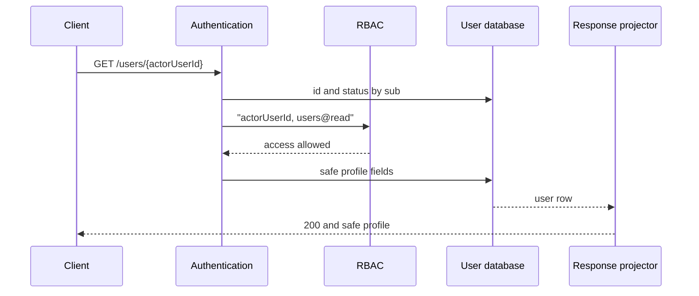
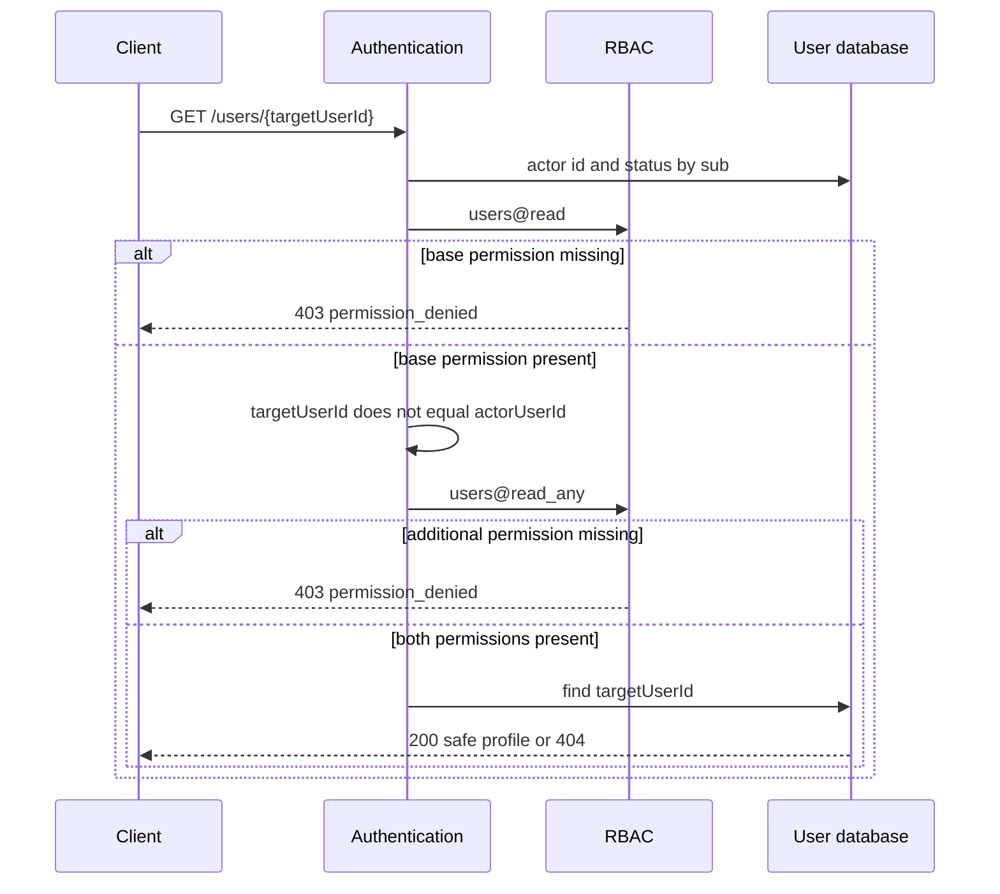
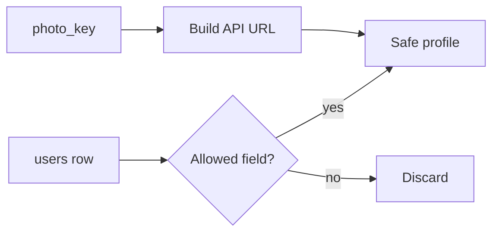

# Viewing user data

## Contents

- [Theory](#theory)
  - [Situation](#situation)
  - [Model](#model)
  - [Concepts and how they relate to the backend](#concepts-and-how-they-relate-to-the-backend)
  - [Responsibilities](#responsibilities)
  - [Common failures](#common-failures)
  - [Useful links](#useful-links)
  - [Review questions](#review-questions)
- [Practical assignment](#practical-assignment)
  - [1.1 General](#11-general)
  - [1.2 Scenarios (user stories)](#12-scenarios-user-stories)
  - [1.3 Contract](#13-contract)
  - [1.4 Errors and constraints](#14-errors-and-constraints)
  - [1.5 Audit and logs](#15-audit-and-logs)
  - [1.6 Non-functional requirements](#16-non-functional-requirements)

# Theory

## Situation

An active user requests their own profile or another user's profile with an access JWT in a cookie. One of the following outcomes follows: the server returns a safe representation of the profile, rejects an invalid session with **401**, denies access with **403**, reports a missing record or photo with **404**, limits the request rate with **429**, or returns **503** when current user data, RBAC, or file storage is unavailable.

A separate frontend is not required. Every request can be sent from an HTTP client that supports cookies.

## Model

Reading a profile involves the client, authentication, RBAC, the user database, and the response projector. The server first establishes the active user, then checks the base permission, and only after that decides whether the target record may be looked up. The client does not choose the permission and does not determine the response contents.

For the user's own profile, `users@read` is enough. `targetUserId` can be compared with the verified `actorUserId` without reading the target record.

Another user's profile requires the additional `users@read_any` after the base `users@read`. Both checks finish before the target lookup, so a user without the permission receives **403** for an existing identifier and for a made-up one.

The response projector uses a fixed allowlist. Even if a database query mistakenly received extra columns, only `id`, `email`, `displayName`, `photoUrl`, `status`, `createdAt`, and `updatedAt` are returned.

The photo is stored behind a separate boundary. The database holds an opaque `photo_key`, and `photoUrl` points to a protected API operation. A local path, a bucket name, an object key, a signed URL, and storage credentials do not enter the profile. The photo operation repeats the profile checks, obtains the object through the storage abstraction, and returns a normalized image.

The `users` table is extended with profile fields. Column names inside the database may differ, but the constraints and the public representation stay the same.

| `users` | Description |
| --- | --- |
| `id` | immutable user identifier and primary key |
| `email` | normalized email with a unique index; leading and trailing spaces are removed, and letters are lowercased |
| `password_hash` | slow password hash; never included in the profile |
| `display_name` | `null`, or a name after trimming leading and trailing Unicode whitespace and NFC normalization, from 1 to 80 code points |
| `photo_key` | `null`, or an opaque unique key of the normalized object in storage |
| `status` | `pending`, `active`, `blocked`, `deleting`, or `deleted`; the constraint is checked by the database |
| `created_at` | UTC creation time assigned by the database; it does not change after creation |
| `updated_at` | server time of the last change, in UTC |

### Normal form

The `users` table is in Boyce-Codd normal form (BCNF) and, under the stated dependencies, in fifth normal form (5NF).

Each successive form includes the requirements of the previous one:

- **1NF:** each field holds one value. The name, email, and the photo key are not mixed into JSON or a list. Several photos and a profile history are not stored in one cell.
- **2NF:** the primary key `id` is simple, so there is no partial dependency on part of the key. The unique `email` is an alternate key.
- **3NF and BCNF:** `display_name`, `photo_key`, `status`, and the timestamps describe the user identified by the key. The public `photoUrl` is not stored, because it is computed from `photo_key` and the API configuration. This removes a transitive dependency and a mismatch between the two addresses of one object.
- **4NF:** independent lists of roles, challenges, and files are not placed in `users`. They belong to separate tables or to external storage.
- **5NF:** a user row does not have to be split into several relations in order to restore the same profile information. Relationships with roles and challenges are restored through foreign keys and do not create an additional join dependency inside `users`.

`photo_key` is an internal reference, and the row does not store a copy of the public URL. If the API base address changes, every `photoUrl` is built again without a mass update of rows. A unique index prevents two profiles from accidentally referring to the same managed object.

## Concepts and how they relate to the backend

### Safe representation and default deny

The database entity and the HTTP representation serve different purposes. A `users` row is needed for sign-in, status, and relationships, so it contains fields the client does not need. A safe profile is created by an explicit projector with an allowlist, rather than by serializing an ORM entity.

A denylist is unreliable. A new internal field can appear in the response by accident after a migration. An allowlist keeps the previous contract until a field is added to the projector on purpose. `password_hash`, challenge secrets, JWTs, `photo_key`, roles, internal versions, and internal flags are not returned to the owner or to an administrator.

Email is returned in full and in normalized form. Masking is not applied, because the owner already knows that address, and viewing another user's profile already requires a separate `users@read_any`. Hiding part of the string would not replace access control, and it would make unambiguous identification of the account harder.

### IDOR, owner permission, and `*_any`

IDOR occurs when replacing an identifier in the URL grants access to someone else's object. A match between `targetUserId` and the verified `actorUserId` allows only the owner branch, and only after `users@read`. The identifier from the JWT determines the current user. A client parameter does not.

Another user's record requires `users@read_any`. The role name `admin` or `support` is not checked in the handler. RBAC makes the current decision from assignments in server data. A user can hold the matching permission through any role, and renaming a role does not change the operation contract.

The base permission and the additional permission are checked before the target is queried. After both checks, a missing user becomes an ordinary **404**. This order prevents a client without `users@read_any` from learning which identifiers exist.

### Chain of a protected operation

The access JWT is read from an HttpOnly cookie under the authentication rules: fixed HS256, correct `iss`, `aud`, `iat`, and `exp`, a non-empty `sub`, and `token_use=access`. The signature establishes the origin of the token, but the server still reads the current `id` and `status`.

Only `active` proceeds. `pending`, `blocked`, `deleting`, `deleted`, and a missing user receive the same **401 invalid_session**. The states `deleting` and `deleted` were added for asynchronous deletion. The first ends access immediately after the request is accepted. The second marks completed anonymization. Stateless access and refresh tokens are not revoked physically, but the required status check blocks their use.

After authentication, RBAC checks the current policy version. Unavailability of the user database or of the current snapshot returns **503**, and it does not return a false **401** or **403**. The target profile and the photo are read only after this chain finishes.

### Name validation

`displayName` allows `null` when no name is set. A non-empty value is trimmed at the edges, with Unicode whitespace included, and normalized to NFC. After normalization, 1 to 80 code points remain. Control characters in the ranges U+0000–U+001F and U+007F–U+009F are forbidden.

Internal spaces, letter case, diacritics, and characters from different scripts are preserved. The name is not checked against a "Latin letters only" expression, because that would exclude real names. On output, the string remains data. XSS protection is contextual escaping on the client, and ordinary punctuation is left in place on the server.

### Photo and the storage boundary

The profile does not accept an arbitrary external URL. Otherwise a user could substitute a tracking address, an unsafe scheme, or a resource whose lifecycle the system does not control. Uploading a photo belongs to profile editing, where the server checks the content, removes metadata, and stores a normalized object.

A read calls the storage interface by `photo_key`. Production uses an S3-compatible object store by default, suitable for several API instances. A local file system is allowed only in a single-process development environment, and it implements the same interface. The public contract does not change with the chosen backend.

`photoUrl` has the form `https://api.example.test/users/{id}/photo` and is not a direct bucket address. The operation checks the owner or `users@read_any` again, so knowing the URL does not open the object. For `deleting` and `deleted`, the projector returns `photoUrl: null`, and the image operation returns **404** without calling storage. The deletion worker may already have removed the object, while the internal key is still needed for an idempotent completion. The image response contains no original file name, no EXIF, and no internal storage headers.

### What changes with editing and deletion

Profile editing will manage `display_name`, email, and the photo, with separate rules for the owner and the administrator. A read writes nothing by itself and does not accept profile fields from the client.

Deletion will add an administrative transition from `pending`, `active`, or `blocked` to `deleting`, and for Self a transition from `active` to `deleting` after confirmation. After cleanup, the state becomes `deleted`. The user row is kept for referential integrity, but the email becomes a technical unique address, and the name and the photo are cleared. Viewing a deleted record with a sufficient permission still uses the same safe profile form and does not reveal the previous PII.

### Summary

| Concept | Meaning in profile viewing | What the implementation relies on |
| --- | --- | --- |
| Safe profile | seven fixed public fields | an allowlist response projector |
| Self | viewing the user's own `userId` | `users@read` and a comparison of identifiers |
| Any | viewing another user's `userId` | the additional `users@read_any` |
| IDOR | substitution of an identifier in the path | a server-side owner check before the target lookup |
| Current status | only `active` is admitted to the operation | a read of `users` after the JWT check |
| `deleting` | deletion is accepted, and access has already ended | a status check of every access token and refresh token |
| `deleted` | PII is anonymized | a retained technical row without the previous PII |
| `photoUrl` | a protected API address | the internal `photo_key` and the storage interface |

## Responsibilities

| Client | Server |
| --- | --- |
| Sends the cookie through the browser | Checks the access JWT and the current status |
| Passes the target `userId` | Takes `actorUserId` only from the verified `sub` |
| Does not send a role name or a permission | Checks `users@read` and, when needed, `users@read_any` |
| Shows the safe profile fields | Builds the response from a fixed allowlist |
| Handles `null` for the name and the photo | Returns the same canonical profile form |
| Loads `photoUrl` as a protected resource | Does not reveal the key, the path, or storage credentials |
| After **401**, starts one refresh under the authorization rules | Does not call RBAC or the handler for an invalid session |
| After **403**, shows a refusal without a refresh | Does not look up the target before the required permissions are checked |

For another trusted origin, the client sends cookies with `credentials: "include"`, and the server allows credentials only for the exact origin. Reading a profile does not change state and does not require a CSRF header, but it still passes through authentication and RBAC.

## Common failures

| What you see | Where to look |
| --- | --- |
| The user's own profile receives **403** | the base `users@read` assignment is missing, or the owner is checked by role by mistake |
| Another user's profile opens with only `users@read` | the additional `users@read_any` check is not performed |
| Without `users@read_any`, an existing id yields **403**, and a made-up id yields **404** | the target record is looked up before the additional permission |
| A blocked user reads a profile | after the JWT signature, the current `status` is not checked |
| A removed role stays in effect until access expires | permissions are read from the JWT instead of the current RBAC snapshot |
| `passwordHash` or `photoKey` appears in the JSON | the database entity is serialized instead of an allowlist projector |
| After a migration, a new internal field enters the response | filtering is built on a denylist |
| `photoUrl` points directly at a private bucket | the API boundary is broken, and a key or a signed storage address was exposed |
| The photo URL can bypass access to the profile | the image operation does not repeat `users@read` and `users@read_any` |
| One user is shown with two email variants | a read or a write bypassed normalization and the unique index |
| A name made only of spaces was stored as non-empty | the length was checked before Unicode whitespace was trimmed |
| Names that look the same are compared by different bytes | NFC normalization was not performed before saving |
| An unavailable database yields **401** | a dependency error is mixed with an invalid session instead of **503** |
| The log shows an email, a JWT, or an object key | the response body, cookies, or the whole user row is logged |

## Useful links

### General

- [OWASP API Security — Broken Object Level Authorization](https://owasp.org/API-Security/editions/2023/en/0xa1-broken-object-level-authorization/) — explains IDOR and BOLA, and the required access check for every object identifier.
- [OWASP API Security — Broken Object Property Level Authorization](https://owasp.org/API-Security/editions/2023/en/0xa3-broken-object-property-level-authorization/) — shows the risk of returning internal fields when a full entity is serialized.
- [OWASP — Authorization Cheat Sheet](https://cheatsheetseries.owasp.org/cheatsheets/Authorization_Cheat_Sheet.html) — supports default deny, least privilege, and a server-side check of every request.
- [RFC 9110 — HTTP Semantics](https://www.rfc-editor.org/rfc/rfc9110) — defines the meaning of the **401**, **403**, **404**, **429**, and **503** responses.
- [Unicode Standard Annex #15 — Unicode Normalization Forms](https://unicode.org/reports/tr15/) — specifies the NFC normalization used for `displayName`.
- [PostgreSQL — Constraints](https://www.postgresql.org/docs/current/ddl-constraints.html) — describes unique constraints and value checks when PostgreSQL is used.
- [Amazon S3 — Object keys](https://docs.aws.amazon.com/AmazonS3/latest/userguide/object-keys.html) — explains internal object keys, which must not become profile fields.
- [MinIO AIStor — Documentation](https://min.io/docs/minio/linux/index.html) — confirms the native S3 API for a portable boundary around a self-hosted object store.
- [OpenAPI Specification — Security Scheme Object](https://spec.openapis.org/oas/latest.html#security-scheme-object) — needed to describe cookie authentication of protected operations.

### By language

#### Node.js

**Node.js, NestJS.** On Express or Fastify the order access, then the current user, then RBAC, then the projector stays the same.

- [NestJS — Guards](https://docs.nestjs.com/guards) — connecting authentication and permission checks before the handler.
- [NestJS — Serialization](https://docs.nestjs.com/techniques/serialization) — separate response models and exclusion of internal fields from JSON.
- [NestJS — Streaming files](https://docs.nestjs.com/techniques/streaming-files) — returning a photo through a protected API operation.
- [AWS SDK for JavaScript — S3 examples](https://docs.aws.amazon.com/sdk-for-javascript/v3/developer-guide/javascript_s3_code_examples.html) — reading an object through an S3-compatible boundary.
- [NestJS — OpenAPI](https://docs.nestjs.com/openapi/introduction) — describing the safe profile, cookie security, and the operation responses.
- [Prisma Migrate](https://www.prisma.io/docs/orm/prisma-migrate) or [TypeORM — Migrations](https://typeorm.io/docs/advanced-topics/migrations/) — adding profile columns and constraints with a migration.

#### .NET

**.NET, ASP.NET Core.** A Minimal API and controllers use one profile contract.

- [ASP.NET Core — Policy-based authorization](https://learn.microsoft.com/en-us/aspnet/core/security/authorization/policies) — requirements for `users@read` and `users@read_any`.
- [System.Text.Json — Customize properties](https://learn.microsoft.com/en-us/dotnet/standard/serialization/system-text-json/customize-properties) — an explicit response model instead of serializing the database entity.
- [ASP.NET Core — File results](https://learn.microsoft.com/en-us/aspnet/core/web-api/action-return-types) — returning a typed file from a protected operation.
- [AWS SDK for .NET — S3](https://docs.aws.amazon.com/sdk-for-net/v3/developer-guide/csharp_s3_code_examples.html) — access to S3-compatible storage through a client.
- [ASP.NET Core — OpenAPI](https://learn.microsoft.com/en-us/aspnet/core/fundamentals/openapi/overview) — documenting the profile form and authorization responses.
- [EF Core — Migrations](https://learn.microsoft.com/en-us/ef/core/managing-schemas/migrations/) — moving `users` changes between environments.

#### Python

**Python, FastAPI.** On Django or Flask the same allowlist and the same check order are kept.

- [FastAPI — Dependencies](https://fastapi.tiangolo.com/tutorial/dependencies/) — authentication and the permission check in sequence.
- [FastAPI — Response Model](https://fastapi.tiangolo.com/tutorial/response-model/) — filtering the response by a declared safe model.
- [FastAPI — Custom Response](https://fastapi.tiangolo.com/advanced/custom-response/) — a streaming or file response for the photo.
- [Boto3 — S3](https://boto3.amazonaws.com/v1/documentation/api/latest/guide/s3-examples.html) — reading objects from S3-compatible storage.
- [FastAPI — Metadata and Docs URLs](https://fastapi.tiangolo.com/tutorial/metadata/) — publishing the current OpenAPI schema.
- [Alembic — Tutorial](https://alembic.sqlalchemy.org/en/latest/tutorial.html) — a migration of profile columns and indexes.

## Review questions

1. Why is an allowlist of fields safer than a denylist when the `users` table grows over time?
2. Why must `users@read_any` be checked before another user is looked up, and how does that order protect against IDOR?
3. Why is a correct access JWT signature not enough without reading the current `status`?
4. How does `photoUrl` differ from `photo_key`, and why must a direct address of a private bucket stay out of the profile?
5. Why is NFC useful for `displayName`, and why does it leave contextual escaping required on output?
6. How do the `deleting` and `deleted` states stop stateless access and refresh tokens from working without a physical revocation of the tokens?
7. Why does the absence of a stored `photoUrl` help the `users` table stay in BCNF?

# Practical assignment

Viewing user data in the system.
An active user with `users@read` receives a safe profile of that same user. Another user's profile additionally requires `users@read_any`, and both checks run before the target record is looked up. The response is always limited to seven canonical fields, and the photo is available only through a protected API boundary.

## 1) Viewing user data

### 1.1 General

**Purpose:** return the canonical user profile and the normalized photo, without internal or secret data.

**Users and roles:**

- an active user with `users@read` views that user's own profile;
- an active user with `users@read` and `users@read_any` views another user's profile;
- the role name takes no part in the decision, and permissions are taken from the current RBAC.

**Single catalog of permissions for working with users:**

| Permission | Purpose |
| --- | --- |
| `users@read` | reading the user's own profile |
| `users@read_any` | additional admission to another user's profile |
| `users@update` | changing the user's own profile |
| `users@update_any` | additional admission to changing another user, and to a direct email change by an administrator |
| `users@delete` | confirmed deletion of the user's own account |
| `users@delete_any` | additional admission for an administrator to delete another user |
| `users@list` | viewing the administrative list of users |

The `user` role receives `users@read`, `users@update`, and `users@delete` on the transition to `active`. The `*_any` actions and `list` are not included in that role.

**Dependencies and related settings:**

- authentication checks the access JWT from the cookie and accepts only an existing user with the status `active`;
- authorization applies the chain access, then the current user, then the current RBAC, then the target resource, then the handler;
- RBAC stores the actions `read`, `read_any`, `update`, `update_any`, `delete`, `delete_any`, and `list` of the `users` permission;
- `PUBLIC_API_BASE_URL` sets the HTTPS address from which `photoUrl` is built;
- photo storage implements a read by an opaque key and a delete; the key and the storage credentials are not returned to the client;
- production uses S3-compatible object storage, and a local file system is allowed only for one application instance in the development environment.

The canonical profile contains exactly `id`, a normalized `email`, `displayName`, `photoUrl`, `status`, `createdAt`, and `updatedAt`. Email in an allowed response is not masked. For `deleting` and `deleted`, `photoUrl` is `null`, even if the internal key is still being cleared. `password_hash`, challenge secrets, JWTs, roles, `photo_key`, internal versions, and internal fields are absent.

Allowed user statuses are `pending`, `active`, `blocked`, `deleting`, and `deleted`. Only `active` passes authentication. `deleting` means that asynchronous deletion has been accepted and the tokens have already stopped working. `deleted` means that cleanup and anonymization are complete.

Changing the name and the photo is performed by profile editing. Deleting objects and anonymization are performed by deletion. Viewing does not change the user row, the photo object, the JWT, or the RBAC configuration.

### 1.2 Scenarios (user stories)

1. **Own profile:** an active user with `users@read` requests that user's own `userId` and receives a safe profile.
2. **Another user's profile:** an active user with `users@read` and `users@read_any` requests another `userId` and receives the same set of fields.
3. **No base permission:** the request ends with **403** before any comparison with an existing record and before the target lookup.
4. **No additional permission:** another user's `userId` receives **403** before the target lookup, even if that user does not exist.
5. **Missing target:** a user with both required permissions receives **404** after the allowed lookup.
6. **Photo is set:** the client calls `photoUrl`, passes the same checks again, and receives a normalized image.
7. **No photo:** an allowed image request receives **404** without revealing the internal key.

### 1.3 Contract

#### 1.3.1 Getting the user profile

| `GET /users/{userId}` | Checks and validation |
| --- | --- |
| `userId: string` | From 1 to 128 ASCII characters. Letters, digits, `_`, and `-` are allowed. The value is compared with the verified `actorUserId` without conversion |
| Cookie `access_token` | Checked in full under the authentication contract. Only an `active` user is accepted |

**Logic and steps:**

1. Check the format of `userId`.
2. Check the access JWT, load the user by `sub`, and accept only `active`. On refusal, return **401** before RBAC.
3. Check the current `users@read`. If it is missing, return **403** without looking up the target user.
4. Compare `userId` with `actorUserId`.
5. If the identifiers differ, check the current `users@read_any`. If it is missing, return **403** without looking up the target.
6. After every required permission, select by `userId` only `id`, `email`, `display_name`, `photo_key`, `status`, `created_at`, and `updated_at`.
7. If the row is missing, return **404**.
8. Build the safe profile. When `photo_key = null`, or the status is `deleting` or `deleted`, return `photoUrl: null`. Otherwise build the protected API URL without the key itself.

**Responses:**

- **Success:** **200 OK** and `id`, `email`, `displayName`, `photoUrl`, `status`, `createdAt`, and `updatedAt`.
- `displayName` is `null` when no name is set. `photoUrl` is `null` when there is no photo, or when the status is `deleting` or `deleted`.
- `email` is returned in full, already normalized, and without masking.
- The response contains no password, `password_hash`, challenge, HMAC, JWT, cookies, roles, permissions, `photo_key`, local path, bucket address, or internal fields.

#### 1.3.2 Getting the profile photo

| `GET /users/{userId}/photo` | Checks and validation |
| --- | --- |
| `userId: string` | The same format and the same comparison as for getting the profile |
| Cookie `access_token` | The same chain that checks an active user |

**Logic and steps:**

1. Run authentication, the `users@read` check, the owner comparison, and, when needed, `users@read_any`, before the target lookup.
2. Load only `id`, `status`, and `photo_key` of the target user.
3. If the user or the photo is missing, or the status is `deleting` or `deleted`, return **404** without calling storage.
4. Read the object through the storage interface by the internal key.
5. Return the bytes of the normalized WebP with `Content-Type: image/webp`, `X-Content-Type-Options: nosniff`, and `Cache-Control: private, max-age=300`.

If the row contains a key but the object is missing, the operation returns **503**, because this is a consistency failure and not the "photo is not set" state. The event is sent to monitoring. The key, the path, the bucket name, the original file name, and the storage authorization headers do not enter the response.

#### 1.3.3 Canonical representation

| Field | Rule |
| --- | --- |
| `id: string` | immutable identifier |
| `email: string` | full normalized email; no leading or trailing spaces, and lowercase |
| `displayName: string \| null` | NFC, from 1 to 80 code points after trimming; no control characters |
| `photoUrl: string \| null` | HTTPS URL of the protected API operation; `null` when there is no photo, or the status is `deleting` or `deleted` |
| `status: string` | one of `pending`, `active`, `blocked`, `deleting`, or `deleted` |
| `createdAt: string` | UTC date-time in RFC 3339 format |
| `updatedAt: string` | UTC date-time in RFC 3339 format |

The same form is used for the user's own representation, another user's representation, and the administrative representation of a user. Fields are not added according to the role name. A user whose status is not `active` cannot be the caller, but a target with any of the five statuses is visible to the holder of the required permissions.

`displayName` is validated on write. `null` clears the name. The string is trimmed at the edges and normalized to NFC, after which it must contain from 1 to 80 code points and must not contain U+0000–U+001F or U+007F–U+009F. Viewing returns the stored value without correcting it again.

#### 1.3.4 Photo storage boundary

The application stores only an opaque object key in `users.photo_key`. The public `photoUrl` is computed from `PUBLIC_API_BASE_URL`, `userId`, and a fixed path. A client URL, a local path, and a bucket address are not written to the database.

The storage interface provides `read(key)` and `delete(key)`, with the unambiguous results `found`, `not_found`, and `unavailable`. Viewing uses only `read`. The implementation can be replaced without changing the HTTP contract or the profile schema.

A photo object is normalized WebP without animation and without metadata. The upload check, the conversion, the atomic change of `photo_key`, and cleanup of the old object are defined by profile editing.

### 1.4 Errors and constraints

- **400 Bad Request** — `userId` does not match the format.
- **401 Unauthorized** — access is missing, invalid, or expired, has the wrong claims, or refers to a missing user or a user who is not `active`.
- **403 Forbidden** — the active user does not have `users@read`; for another user's identifier, `users@read_any` is missing.
- **404 Not Found** — the target user was not found after every required check; the photo is not set, or it is unavailable for the status `deleting` or `deleted`.
- **429 Too Many Requests** — the configured limit for reading a profile or a photo was exceeded.
- **503 Service Unavailable** — the user database, the current RBAC snapshot, or storage is unavailable; the photo row and the photo object are inconsistent.

The base permission is checked before the resource is looked up. For another user's identifier, the additional `users@read_any` is also checked before the lookup. Only a user who is already admitted to read a target of this kind receives **404**.

### 1.5 Audit and logs

Log the following:

- a successful read of another user's profile and photo;
- a refusal of `users@read` or `users@read_any`;
- a **404** after an allowed lookup;
- a rate limit firing;
- unavailability of the database, RBAC, and storage;
- a mismatch between `photo_key` and the object.

An event contains `requestId`, `actorUserId`, the kind of operation, the `self` or `foreign` mark, `targetUserId` after admission to the lookup, the result, and the duration. For a refusal before the lookup, the operation path and the permission category are stored, without checking whether the target exists.

The log does not receive email, `displayName`, `photoUrl`, photo bytes, `photo_key`, a password, `password_hash`, a challenge, a JWT, `Cookie`, `Set-Cookie`, roles, the full profile, the full response body, or the request headers in full.

### 1.6 Non-functional requirements

- The user's own profile and photo allow at most 120 requests per user per minute, and another user's allow at most 60. The next request receives **429**.
- A database query selects only the safe profile fields, and a photo query selects `id`, `status`, and `photo_key`. Storage is read as a stream.
- Automated tests cover a Self profile and another user's profile, both permissions, the order of permissions before the lookup, all five statuses, and the protected photo.
- The project's shared non-functional requirements — input validation, CORS, OpenAPI, structured logs, health checks, and test coverage of at least 80% — apply to these operations as well.
