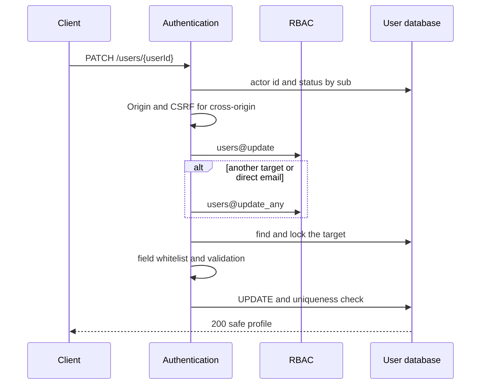
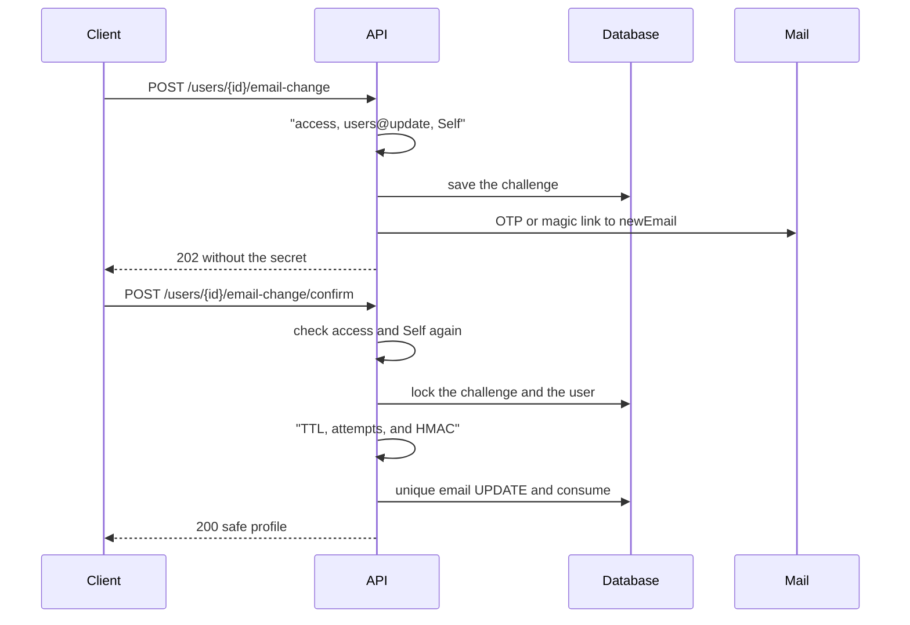
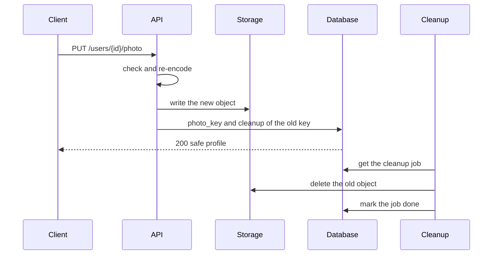
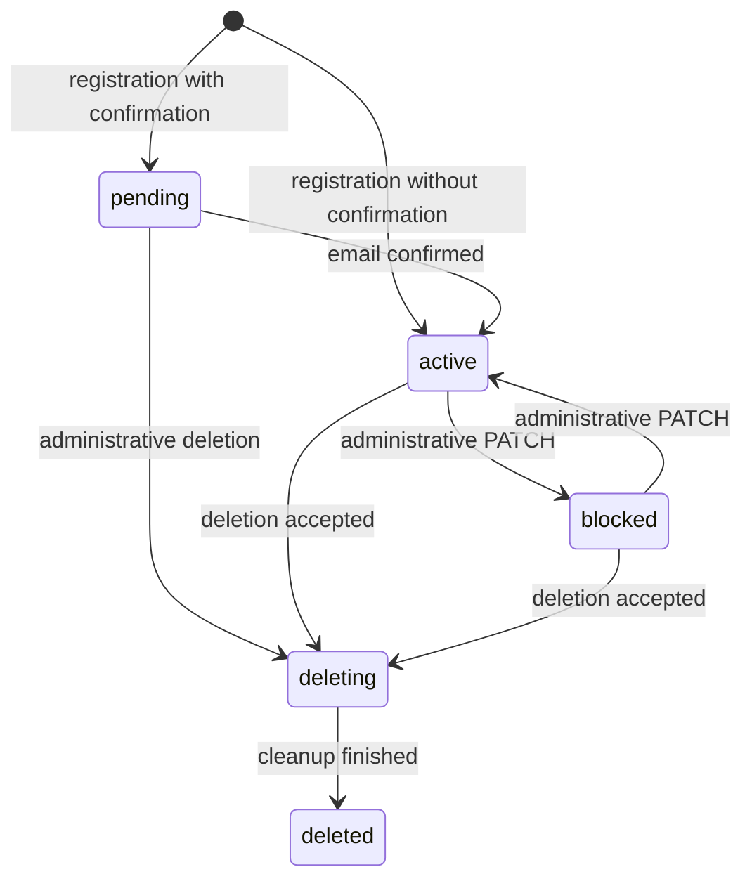

# Updating user data

## Contents

- [Theory](#theory)
  - [Situation](#situation)
  - [Model](#model)
  - [Concepts and how they relate to the backend](#concepts-and-how-they-relate-to-the-backend)
  - [Responsibilities](#responsibilities)
  - [Common failures](#common-failures)
  - [Useful links](#useful-links)
  - [Review questions](#review-questions)
- [Practical assignment](#practical-assignment)
  - [1.1 General](#11-general)
  - [1.2 Scenarios (user stories)](#12-scenarios-user-stories)
  - [1.3 Contract](#13-contract)
  - [1.4 Errors and constraints](#14-errors-and-constraints)
  - [1.5 Audit and logs](#15-audit-and-logs)
  - [1.6 Non-functional requirements](#16-non-functional-requirements)

# Theory

## Situation

An active user updates a display name or a photo, and confirms an email through a message. A holder of an administrative permission can update another user's profile and email directly. One of the following outcomes follows: the profile is updated atomically, an email challenge is created, the photo is replaced, the fields are rejected with **400**, the session is rejected with **401**, a permission or a field is forbidden with **403**, the target is not found with **404**, the state or the email conflicts and the response is **409**, the file is too large with **413**, the file type is not supported with **415**, **429** is returned, or a dependency is unavailable and **503** is returned.

A separate frontend is not required. Every request can be sent from an HTTP client that supports cookies and `multipart/form-data`.

## Model

An ordinary PATCH involves the client, authentication, RBAC, and the user database. The base `users@update` is checked before the target lookup. If `targetUserId` differs from the verified `actorUserId`, the additional `users@update_any` is also checked before the lookup. A direct email update always requires `users@update_any`, even when an administrator updates their own address.

Self does not send an email in the general PATCH. The server first creates a challenge for the new normalized address and sends the OTP or magic link that the server chose. Confirmation requires a current challenge and a current session of the same user at the same time.

A uniqueness check before the message is sent improves the response. It is not the final protection against a race. Another request can take the address after the check. The source of truth remains the unique index `users.email`. A conflict on the final `UPDATE` therefore becomes **409**, and the challenge is consumed with the reason `email_conflict`.

The photo is decoded and normalized before the link in the profile changes. The new object is written first, under a new opaque key. A transaction then changes `photo_key` and creates a cleanup job for the old object. The profile keeps the previous photo if the upload of the new object fails.

User status has its own lifecycle. An administrator PATCH controls only the transitions between `active` and `blocked`. `pending` ends through registration. `deleting` and `deleted` belong to the deletion process and are not set through PATCH.

Two tables are added for an email change and for reliable cleanup of objects. The `users` table keeps the profile schema from viewing user data.

| `users` | Description |
| --- | --- |
| `id` | immutable primary key |
| `email` | normalized email with a unique index |
| `password_hash` | a slow password hash, not part of the profile |
| `display_name` | `null` or an NFC string of 1 to 80 code points |
| `photo_key` | `null` or a unique opaque object key |
| `status` | `pending`, `active`, `blocked`, `deleting`, or `deleted` |
| `created_at` | UTC creation time, assigned by the database and immutable after insert |
| `updated_at` | time of the last change, in UTC |

| `email_change_challenges` | Description |
| --- | --- |
| `id` | challenge identifier |
| `user_id` | reference to `users.id`; a partial unique index allows one unconsumed challenge per user |
| `new_email` | normalized address that will be written after confirmation |
| `method` | `otp` or `magic_link`, chosen by the server at creation |
| `secret_hash` | HMAC-SHA256 of the OTP or of a random secret; the original value is not stored |
| `last_sent_at` | time of the last send; the 10-minute TTL and the 60-second pause are counted from it |
| `attempts` | number of wrong OTPs; the fifth wrong entry consumes the challenge |
| `consumed_at` | `null` until the challenge is consumed |
| `consumed_reason` | `confirmed`, `replaced`, `attempts_exhausted`, `email_conflict`, `admin_override`, or `user_inactive` |
| `created_at` | challenge creation time |

| `storage_cleanup_jobs` | Description |
| --- | --- |
| `id` | cleanup job identifier |
| `object_key` | internal object key; one key appears at most once |
| `reason` | `photo_replaced`, `photo_cleared`, or `orphan_upload` |
| `status` | `queued`, `succeeded`, or `failed` |
| `attempts` | number of handler runs |
| `next_attempt_at` | time of the next allowed run; at creation it equals the current time |
| `last_error_code` | category of the last failure, without a URL, access keys, or the response body |
| `created_at` | job creation time |
| `updated_at` | time of the last change to the job |

### Normal form

`users`, `email_change_challenges`, and `storage_cleanup_jobs` are in BCNF and, under the stated dependencies, in 5NF.

Each successive form includes the requirements of the previous one:

- **1NF:** the email, the secret hash, the object key, and the reason are separate atomic values. Send history and the list of old photos are not packed into arrays in one row. A resend replaces the current secret, and each object to delete receives its own cleanup job.
- **2NF:** `users`, `email_change_challenges`, and `storage_cleanup_jobs` have simple primary keys `id`, so there is no partial dependency on a composite key.
- **3NF and BCNF:** a challenge stores `user_id` and does not copy the user's current name, status, or old email. TTL is computed as `last_sent_at + 10 minutes`, so a separate dependent `expires_at` creates no update anomaly. A cleanup job describes one object and does not copy `users.photo_key`.
- **4NF:** independent challenges and cleanup objects are placed in separate rows and tables. Combining them with the user would produce the product of two independent lists.
- **5NF:** the user's links to challenges and to cleanup jobs are restored by keys, with no extra join dependency. The decomposition loses no facts and creates no false combinations.

`next_attempt_at` is not computed from `attempts` alone. The time of the last failure also affects it. It is stored scheduler state, and it is not a transitive copy of another field. A partial unique index on an unconsumed challenge is a constraint. It does not change the normal form.

## Concepts and how they relate to the backend

### PATCH and the field whitelist

PATCH updates only the fields the client lists. An empty body and an unknown field are rejected in full. Silently ignoring a typo would produce a false success. The fields `id`, `photoUrl`, `createdAt`, `updatedAt`, and `passwordHash`, together with roles and internal keys, are never available through a profile PATCH.

Self updates only `displayName`. The photo has separate operations, because file transfer and partial storage failures differ from JSON. Self email goes through a challenge. An administrator with `users@update_any` may send `displayName`, `email`, and `status`. That PATCH cannot set `pending`, `deleting`, or `deleted`.

The transaction locks the target row and updates only the columns that were sent. Parallel updates of different fields are kept. Two updates of one field apply in commit order, and the last committed value becomes current. The unique index resolves an email race on its own, apart from any preliminary check.

### Profile field normalization

Email is trimmed at the edges and lowercased. Tags of the form `user+tag@example.com` are kept. Dots and domains stay as written, with no rewrite under one provider's rules. Two different normalized values therefore count as different addresses, and one value is protected by the unique index.

`displayName: null` clears the name. The string is trimmed with Unicode whitespace in mind, normalized to NFC, and must then contain 1 to 80 code points. Control characters U+0000–U+001F and U+007F–U+009F are forbidden. Internal spaces, letter case, and script are kept.

Strings that look the same can differ in binary form because of composite and combining characters. NFC reduces canonically equivalent sequences to one form. It does not transliterate, and it does not protect output from XSS.

### Email challenge and a current session

An OTP contains exactly six digits. A magic link contains the challenge identifier and 32 random bytes before base64url encoding. Both methods last 10 minutes. The server chooses one method from configuration and stores it on the challenge.

The secret is stored as HMAC-SHA256 with a separate application key of at least 32 random bytes. Plain SHA-256 is a poor fit for a short OTP, because a million variants can be enumerated ahead of time. HMAC comparison runs in constant time.

An OTP allows five entries. The fifth entry can still succeed. A fifth wrong answer returns **400** and consumes the challenge at the same time, and the next request receives **429**. A magic link is single-use. The entry counter does not apply to it. Resend is allowed after 60 seconds. It replaces the secret, starts the TTL again, and resets `attempts`.

A challenge proves access to the new mailbox. It does not establish the user's identity. Confirm checks the access JWT again, the current `active` status, `users@update`, and a match of `userId` with `sub`. There is no confirmation that stands alone without a session. The message places the magic token in the URL fragment. That fragment is not sent to the server and is not placed in `Referer`. The client page reads the fragment and passes the token in the POST body. Opening the link with GET only shows the page.

### Email uniqueness and races

At initiation the server returns **409** when the new email is already in `users`. Challenges that different users start at the same time can pass this preliminary check, so the message does not reserve the address.

Confirm locks the challenge and the user, checks the secret, and then tries to change `users.email`. The unique index selects the single winner. On a conflict, the savepoint undoes only the failed `UPDATE`. The challenge is then marked `email_conflict`, and the transaction commits with **409**. A repeated confirm does not create an endless series of conflicts.

A direct administrative PATCH follows the same unique index. It consumes the target user's unconsumed email challenge with the reason `admin_override`, so a message issued earlier cannot undo a later administrative decision.

The JWT contains `sub` and does not contain the email, so a successful address change does not require a new token pair. Access and refresh continue to identify the same user. If deletion or blocking started at the same time, a repeated check of the row before commit prevents an update of an account that is already inactive.

### Photo validation and normalization

An upload accepts one JPEG, PNG, or WebP of at most 5 MiB. The HTTP `Content-Type`, the signature, and the result of a full decode must agree. SVG, GIF, AVIF, an animated image, several files, and extra multipart fields are rejected.

The decoded image is from 64×64 to 4096×4096 pixels. The server applies EXIF orientation, scales the image down proportionally to a 1024×1024 frame, removes EXIF, ICC comments, and other metadata, forbids animation, and encodes one WebP. The final object does not exceed 2 MiB. If the limit cannot be met, the request receives **400**.

The name extension and the declared MIME do not prove the contents. A full decode detects a damaged file, and re-encoding removes the original container and the metadata. The original name is not used as a path or a key. The new key contains at least 128 random bits and is generated by the server.

### Partial failures of storage and mail

The challenge is committed before the message is sent. If the transaction did not finish, the message is not sent and the client receives **503**. If SMTP rejected the message after the commit, the challenge stays current. The **503** response contains its identifier and the time until resend, and it contains neither the OTP nor the token.

The new photo object is written before the database change. If writing the object fails, the profile stays as it was. If the object was written and the profile transaction rolled back, the API tries to delete the new object. A periodic search for unconfirmed keys older than one hour picks up an object that the immediate delete missed.

After a successful transaction, the profile already points at the new object or at `null`. Failure to delete the previous object does not roll the profile back. `storage_cleanup_jobs` retries the delete up to five times, with a pause of one minute. Deleting an object counts as success when storage responds `not_found`, so a retry is safe and a separate lease is unnecessary.

### Status and a stateless JWT

An administrator PATCH moves only `active` to `blocked` and `blocked` to `active`. Repeating the same value is a successful no-op and does not change `updatedAt`. `pending` becomes active only through registration confirmation. Deletion sets `deleting` and `deleted`.

After the transition to `blocked`, later access and refresh requests receive **401**, because authentication reads the status every time. Signed stateless JWTs are not physically deleted. If the user is activated again before the old refresh `exp`, a copy of the token can pass the check again. Full revocation would require server sessions. The current authentication does not store them.

The transition `active` → `blocked` cannot leave the system without an active holder of `rbac@manage`. Once user statuses exist, this invariant treats only a user in the `active` state as a management holder, in every policy-change operation. The check runs in the same transaction under a shared lock on the policy state, so blocking, deletion, and assignment changes cannot disable the last administrators in parallel. A violation returns **409**. The status and the challenge stay unchanged.

### What happens on deletion

Deletion first moves the user to `deleting`, so editing stops at once. For Self the starting state is `active`. An administrator may accept deletion of a target in `pending`, `active`, or `blocked`. An asynchronous process then deletes the photo, clears the email challenge and PII, and sets `deleted`.

Profile operations do not start deletion and do not set these two statuses. Cleanup of an old photo applies only to replacing an object. It does not anonymize the rest of the user's data.

### Summary

| Concept | Meaning in a profile update | What the implementation relies on |
| --- | --- | --- |
| PATCH whitelist | only known fields change | separate Self and Admin sets |
| NFC | one canonical form of the name | Unicode normalization before the length check |
| Email challenge | Self confirms the new mailbox | a current session, HMAC, TTL, and attempts |
| Email uniqueness | one address belongs to one row | a unique index and conflict handling |
| `users@update_any` | another user's profile and a direct email | an additional check of current RBAC |
| Photo normalization | one safe format | decoding, limits, and re-encoding |
| Storage boundary | the profile stores no external URL | an opaque `photo_key` and a cleanup job |
| `blocked` | new requests are not authenticated | a read of the current status for access and refresh |

## Responsibilities

| Client | Server |
| --- | --- |
| Sends only the fields being updated | Rejects unknown and forbidden fields in full |
| For Self, does not place email in PATCH | Requires a challenge for a self email change |
| Stores `challengeId` and does not receive the secret from the API | Sends the OTP or magic link only to the new email |
| Confirms the email with a current cookie | Checks the active status, the permission, and the owner again |
| Uploads one allowed file | Checks the bytes, decodes the image, and re-encodes it |
| Does not build `photoUrl` | Generates the API URL from the internal `photo_key` |
| After **409**, reads the profile again | Turns a unique-index conflict into an ordinary response |
| After **503**, follows the rules of the specific operation | Keeps one unambiguous state for a safe retry |

When the frontend is placed on another origin, every state-changing request requires an exact allowed `Origin` and `X-CSRF-Protection: 1` after the access check, even when both origins belong to one site. For a cross-site placement, cookies also receive `SameSite=None; Secure`. CORS and CSRF do not replace `users@update` or `users@update_any`.

## Common failures

| What you see | Where to look |
| --- | --- |
| Self updates email with an ordinary PATCH | the field is not separated from the owner's allowed set |
| Admin updates email without `users@update_any` | a direct email is wrongly allowed by the base `users@update` alone |
| A missing target that belongs to someone else returns **404** without `users@update_any` | the resource is found before the additional permission |
| An unknown field receives **200** and does not change | PATCH silently ignores typos instead of **400** |
| Two users receive one email | uniqueness is checked by an application query, with no unique index |
| Confirm sometimes fails with an unhandled database error | the unique-email race is not turned into **409** |
| An old message updates the email after an admin PATCH | the administrative update did not consume the challenge |
| A magic link updates the email with an ordinary GET | a mail scanner can perform the update without an explicit POST |
| The link works without a current session | the challenge is treated as authentication on its own |
| The fifth wrong OTP does not consume the challenge | the counter and `consumed_reason` are updated non-atomically |
| After resend, the old secret still fits | `secret_hash` and `last_sent_at` are not replaced in one transaction |
| SMTP returned an error, and a repeated call creates a second active attempt | the partial unique index and the partial-failure contract are not followed |
| The last two administrators became `blocked` at the same time | the transitions are not serialized by a shared lock on the `rbac@manage` invariant |
| An SVG passes as a photo | only the extension or the client MIME is checked |
| A small file exhausts memory during decoding | decoded size is not limited, and there is no full safe decode |
| EXIF GPS coordinates remain in the photo | the original container is returned without re-encoding and metadata removal |
| After replacement, the number of old objects grows | the cleanup job is not created in the same transaction as the new `photo_key` |
| When deletion of the old object fails, the profile rolls back | external cleanup is included in the critical response after the commit |
| A blocked user continues to refresh | authentication does not read the current status by `sub` |
| The log contains the new email, an OTP, or file bytes | the request body, multipart, or the message secret is logged |

## Useful links

### General

- [RFC 5789 — PATCH Method for HTTP](https://www.rfc-editor.org/rfc/rfc5789) — defines a partial update of a resource and the requirements for handling PATCH.
- [OWASP — Input Validation Cheat Sheet](https://cheatsheetseries.owasp.org/cheatsheets/Input_Validation_Cheat_Sheet.html) — explains whitelists, and syntactic and semantic checks of fields.
- [OWASP — File Upload Cheat Sheet](https://cheatsheetseries.owasp.org/cheatsheets/File_Upload_Cheat_Sheet.html) — grounds checks of size and signature, decoding, new names, and separate storage.
- [OWASP — Forgot Password Cheat Sheet](https://cheatsheetseries.owasp.org/cheatsheets/Forgot_Password_Cheat_Sheet.html) — rules for one-time codes and links that apply to confirmation of a new email.
- [Unicode Standard Annex #15 — Unicode Normalization Forms](https://unicode.org/reports/tr15/) — the normative description of NFC for `displayName`.
- [PostgreSQL — Unique indexes](https://www.postgresql.org/docs/current/indexes-unique.html) — the final protection of email uniqueness under parallel requests.
- [PostgreSQL — Partial indexes](https://www.postgresql.org/docs/current/indexes-partial.html) — a limit of one unconsumed attempt through a conditional unique index.
- [Amazon S3 — Consistency model](https://docs.aws.amazon.com/AmazonS3/latest/userguide/Welcome.html#ConsistencyModel) — read and delete properties of objects outside the database boundary.
- [OpenAPI Specification — File Upload](https://spec.openapis.org/oas/latest.html#considerations-for-file-uploads) — describing `multipart/form-data` and binary fields with no tie to a server stack.

### By language

#### Node.js

**Node.js, NestJS.** On Express or Fastify, the rules for fields, the challenge, and storage stay the same.

- [NestJS — Validation](https://docs.nestjs.com/techniques/validation) — a whitelist of JSON fields and DTO validation.
- [NestJS — File upload](https://docs.nestjs.com/techniques/file-upload) — accepting one multipart file, and limits before the handler.
- [Node.js — `crypto`](https://nodejs.org/api/crypto.html) — random bytes, HMAC, and constant-time comparison of a secret.
- [Sharp](https://sharp.pixelplumbing.com/) — decoding, resizing, metadata removal, and WebP encoding.
- [Prisma — Transactions](https://www.prisma.io/docs/orm/prisma-client/queries/transactions) or [TypeORM — Transactions](https://typeorm.io/docs/advanced-topics/transactions/) — an atomic update of the user and the challenge.
- [NestJS — OpenAPI](https://docs.nestjs.com/openapi/introduction) — documenting PATCH, the email challenge, and multipart.
- [Prisma Migrate](https://www.prisma.io/docs/orm/prisma-migrate) or [TypeORM — Migrations](https://typeorm.io/docs/advanced-topics/migrations/) — creating the challenge, cleanup jobs, and indexes.

#### .NET

**.NET, ASP.NET Core.** Minimal APIs and controllers use the same rules for normalization and access.

- [ASP.NET Core — Model validation](https://learn.microsoft.com/en-us/aspnet/core/mvc/models/validation) — checking JSON models and field errors.
- [ASP.NET Core — Upload files](https://learn.microsoft.com/en-us/aspnet/core/mvc/models/file-uploads) — multipart, a streaming upload, and size limits.
- [.NET — Unicode normalization](https://learn.microsoft.com/en-us/dotnet/api/system.string.normalize) — NFC for `displayName`.
- [.NET — HMACSHA256](https://learn.microsoft.com/en-us/dotnet/api/system.security.cryptography.hmacsha256) — a non-recoverable representation of the OTP and the magic link.
- [ImageSharp](https://docs.sixlabors.com/) — decoding, resizing, and re-encoding the image.
- [EF Core — Transactions](https://learn.microsoft.com/en-us/ef/core/saving/transactions) — locking and an atomic update of related rows.
- [EF Core — Migrations](https://learn.microsoft.com/en-us/ef/core/managing-schemas/migrations/) — migrating tables and unique indexes.
- [ASP.NET Core — OpenAPI](https://learn.microsoft.com/en-us/aspnet/core/fundamentals/openapi/overview) — describing bodies, files, and response variants.

#### Python

**Python, FastAPI.** On Django or Flask the contract stays the same, and the processing libraries can be replaced.

- [FastAPI — Body Updates](https://fastapi.tiangolo.com/tutorial/body-updates/) — a partial update without overwriting fields that are absent.
- [FastAPI — Request Files](https://fastapi.tiangolo.com/tutorial/request-files/) — accepting `multipart/form-data` and a streamed file.
- [Python — `unicodedata`](https://docs.python.org/3/library/unicodedata.html) — NFC for `displayName`.
- [Python — `hmac`](https://docs.python.org/3/library/hmac.html) — HMAC and `compare_digest` for the challenge.
- [Pillow](https://pillow.readthedocs.io/en/stable/) — decoding, size checks, and WebP encoding.
- [SQLAlchemy — Transactions](https://docs.sqlalchemy.org/en/20/orm/session_transaction.html) — the transaction that changes the email and consumes the challenge.
- [Alembic — Tutorial](https://alembic.sqlalchemy.org/en/latest/tutorial.html) — migrations for the challenge, cleanup jobs, and indexes.
- [FastAPI — Metadata and Docs URLs](https://fastapi.tiangolo.com/tutorial/metadata/) — publishing the current OpenAPI schema.

## Review questions

1. Why must PATCH reject an unknown field in full, rather than silently removing it from the body?
2. Why does confirm of an email change require both a challenge and a current session of the same user?
3. Why does a preliminary email check not remove the need for a unique index on the final `UPDATE`?
4. What happens if SMTP does not accept the message after the challenge is committed, and why can the previous state not be rolled back unnoticed?
5. Why are a check of the extension and of `Content-Type` insufficient for a photo, and why is the image re-encoded?
6. How does a cleanup job keep the profile consistent if deletion of the old object fails for a while?
7. Why does the absence of `expires_at` help `email_change_challenges` meet BCNF?

# Practical assignment

Functionality for updating user data in the system.
Self updates the display name and the photo, and confirms a new email with an OTP or a magic link and a current session. An administrator with the additional `users@update_any` updates another user's profile and email through the general PATCH. Unique indexes, transactions, and cleanup jobs determine the result of parallel requests and of partial failures.

## 1) Updating user data

### 1.1 General

**Purpose:** safely update the allowed profile fields, the confirmed email, and the managed photo.

**Users and roles:**

- an active user with `users@update` updates their own `displayName` and photo, and starts and confirms their own email change;
- an active user with `users@update` and `users@update_any` updates another user's profile;
- a direct email update through PATCH always requires `users@update_any`, whether or not `actorUserId` and `targetUserId` match;
- a role name does not replace the permission check.

**Single catalog of permissions for working with users:**

| Permission | Purpose |
| --- | --- |
| `users@read` | reading one's own profile |
| `users@read_any` | additional access to another user's profile |
| `users@update` | updating one's own profile |
| `users@update_any` | additional access to updating another user and to a direct email change by an administrator |
| `users@delete` | confirmed deletion of one's own account |
| `users@delete_any` | additional access for an administrator to delete another user |
| `users@list` | viewing the administrative list of users |

**Dependencies and related settings:**

- the access JWT and cookies match authentication in full: access lasts 15 minutes, it sits in an HttpOnly cookie, and the server accepts only a current `active` user;
- the protected chain matches authorization: access → user → CSRF for a cross-origin update → current RBAC → target → update;
- the shared access-management invariant treats only an `active` user as a holder of `rbac@manage` and serializes assignment changes, blocking, and deletion;
- `EMAIL_CHANGE_METHOD` has one server value, `otp` or `magic_link`;
- `EMAIL_CHANGE_HMAC_KEY` holds a separate random value at least 32 bytes long;
- SMTP and the trusted frontend origin are set in application configuration;
- photo storage implements write and delete by opaque keys; production uses S3-compatible storage by default, and a local implementation is allowed only for one application instance in development;
- a background handler runs `storage_cleanup_jobs`: up to 5 attempts with a 1-minute pause, and `not_found` counts as success.

If the required HMAC key is missing, empty, or shorter than 32 bytes, the application does not pass readiness. The JWT key, the registration key, the login-challenge key, and the email-change key stay separate.

The canonical profile contains exactly `id`, the normalized `email`, `displayName`, `photoUrl`, `status`, `createdAt`, and `updatedAt`. Email is not masked. For `deleting` and `deleted`, the shared projector returns `photoUrl: null`, although edit operations do not succeed for those states. Responses contain no `password_hash`, challenge secrets, HMAC, JWT, cookies, `photo_key`, roles, or internal fields.

The allowed statuses are `pending`, `active`, `blocked`, `deleting`, and `deleted`. Only `active` authenticates. `deleting` and `deleted` are added for asynchronous deletion and are not set by edit operations.

### 1.2 Scenarios (user stories)

1. **Self updates the name:** the user sends only `displayName` and receives an updated safe profile.
2. **Self updates the photo:** the user uploads one allowed file, the server normalizes it, and the profile switches atomically to the new object.
3. **Self clears the photo:** the link is removed at once, and a background job cleans the object up reliably.
4. **Self updates email:** the server sends an OTP or a magic link to the new address, and confirm with the same active session updates the email atomically.
5. **Admin updates another user's profile:** after `users@update` and `users@update_any`, the general PATCH accepts `displayName`, a direct `email`, and an allowed `status`.
6. **Admin updates email directly:** a PATCH with `users@update_any` creates no message and consumes the target's previous self challenge.
7. **Parallel email:** the single `UPDATE` that passes the unique index succeeds, and the loser receives **409**.
8. **Partial failure:** the state of the user, the challenge, and the objects stays unambiguous, and the response names the request that can safely continue.

### 1.3 Contract

#### 1.3.1 Updating profile fields

| `PATCH /users/{userId}` | Checks and validation |
| --- | --- |
| `userId: string` | From 1 to 128 ASCII characters. Letters, digits, `_`, and `-` are allowed |
| `displayName: string \| null` | Allowed for Self and Admin. `null` clears the name, and a string is normalized and checked under the name rules |
| `email: string` | Allowed only when `users@update_any` is present. Normalized the same way as at registration |
| `status: string` | Allowed only when `users@update_any` is present. The resulting value is only `active` or `blocked` |

The body contains from one to three unique fields from the table. An empty body, a repeated key in JSON, an unknown field, and the fields `id`, `photoUrl`, `createdAt`, `updatedAt`, `password`, `passwordHash`, roles, or internal keys yield **400**. `email: null` and `status: null` are not allowed.

After Unicode whitespace is trimmed and NFC is applied, `displayName` contains 1 to 80 code points and contains neither U+0000–U+001F nor U+007F–U+009F. A string that is empty after trimming receives **400**. Clearing uses only `null`.

After edge spaces are removed and letters are lowercased, the email must have a valid format and must not exceed 254 characters. Tags `+tag` are kept. An address that matches the current one after normalization counts as a successful no-op.

**Logic and steps:**

1. Check the path format and the JSON before any database access.
2. Check access, the current `active` status, and, for a request from another origin, the exact `Origin` together with `X-CSRF-Protection: 1`, including a same-site placement.
3. Check the current `users@update` before the target lookup.
4. If `userId` differs from `actorUserId`, check `users@update_any` before the target lookup.
5. If the body contains `email` or `status`, check `users@update_any`, even for the caller's own target.
6. If `status = blocked` is requested, take the shared lock on the policy state first. Then find and lock the user row. A missing row receives **404**.
7. Allow an update only for a target in the `active` or `blocked` state. For `pending`, `deleting`, and `deleted`, return **409**.
8. Validate and normalize every value before writing.
9. Before the transition `active` → `blocked`, under the shared lock of the RBAC invariant, make sure that at least one other active user with `rbac@manage` remains after the transition. Otherwise return **409** with no changes.
10. In one `UPDATE`, change only the fields that were sent. Turn a conflict on the unique `users.email` into **409**.
11. On a direct email update, consume the target's unconsumed `email_change_challenges` row with the reason `admin_override` in the same transaction.
12. On a transition to `blocked`, consume unconsumed login challenges and email-change challenges with the reason `user_inactive`. Later access and refresh stop working because of the status check.
13. If every normalized value already matches, return the current profile without changing `updatedAt`. Otherwise set a new server `updatedAt`.

**Responses:**

- **Success:** **200 OK** and the canonical safe profile.
- **Errors:** see section 1.4.
- The response contains no password, hash, challenge, JWT, cookies, roles, `photo_key`, previous values, or internal fields.

#### 1.3.2 Initiation and resend of an email change

| Operation | Input data and rules |
| --- | --- |
| `POST /users/{userId}/email-change` | `newEmail: string`; Self only, with `users@update` |
| `POST /users/{userId}/email-change/resend` | `challengeId: string`; Self only, with `users@update`; the method and the address do not change |

`newEmail` is normalized under the same rules as a registration email. The current address, and an address already held by a `users` row, receive **409**. The server chooses the method from `EMAIL_CHANGE_METHOD`. The client does not send `method`.

**Initiation logic:**

1. Check access, the current `active` status, CSRF when it is required, and `users@update`.
2. Compare `userId` with `actorUserId`. Return a mismatch as **403** before the target row is looked up. Admin uses a direct PATCH.
3. Lock the user row, then the user's unconsumed challenge, in the shared lock order. Normalize `newEmail` and check the current state.
4. If an unconsumed challenge was created or sent less than 60 seconds ago, return **429** with the remaining time.
5. After the pause, in one transaction, consume the previous challenge as `replaced` and create a new one with the chosen method, a new HMAC, and `attempts = 0`.
6. Commit the transaction, then send the secret only to `newEmail`.

**Resend logic:**

1. Repeat the checks of access, `active`, CSRF, `users@update`, and Self. Lock the user, then the challenge by `challengeId` and `user_id`.
2. A challenge that is not found, was replaced, was already confirmed, or was consumed as `user_inactive` receives **400**. `attempts_exhausted` receives **429**. `admin_override` and `email_conflict` receive **409**.
3. If 60 seconds have not passed since `last_sent_at`, return **429** with the remaining time.
4. Create a new secret of the same method, replace `secret_hash`, update `last_sent_at`, and reset `attempts`, in one transaction.
5. After the commit, send the message. The previous OTP or token stops matching at once.

If the transaction is not committed, the message is not sent, the state does not change, and **503** is returned. If SMTP did not accept the message after the commit, the challenge is kept, and **503** contains `confirmationRequired: true`, `method`, `challengeId`, and `retryAfterSeconds`, but not the secret. A retry goes through resend after the shared pause of 60 seconds.

**Responses:**

- **Accepted:** **202 Accepted**, `confirmationRequired: true`, `method`, `challengeId`, `expiresInSeconds: 600`, `resendAfterSeconds: 60`.
- **SMTP unavailable after the commit:** **503 Service Unavailable** with the same safe fields and `retryAfterSeconds`.
- The JSON contains no OTP, link token, HMAC, current email, new email, JWT, or cookies.

#### 1.3.3 Confirming an email change

| `POST /users/{userId}/email-change/confirm` | Input data |
| --- | --- |
| OTP | `challengeId: string`, `code: string` of exactly 6 digits |
| Magic link | `token: string` in the form `challengeId.secret`, where secret is 32 random bytes before base64url; the message passes the token in the URL fragment |

The body contains exactly one variant. GET on the link does not change state. The client page extracts the token and sends a POST with a current cookie.

**Logic and steps:**

1. Check access, the current `active` status, CSRF, `users@update`, and a match of `userId` with `actorUserId`.
2. Lock the user, then find and lock the challenge, in the same order as initiation, resend, PATCH, and deletion.
3. Make sure the challenge belongs to the user and has the expected method. A challenge that is not found, was replaced, was already confirmed, or was consumed as `user_inactive` receives **400**. `attempts_exhausted` receives **429**. `admin_override` and `email_conflict` receive **409**.
4. Treat expiry as `last_sent_at + 10 minutes`. An expired challenge receives **400** without incrementing `attempts`.
5. Check again that the user is still `active`. If the status has changed, consume the challenge as `user_inactive` and return **401 invalid_session**.
6. Compute the HMAC-SHA256 of the secret and compare it in constant time.
7. For a wrong OTP, increment `attempts`. The fifth entry is checked. The fifth wrong entry receives **400** and `attempts_exhausted`. The next request receives **429**. A wrong magic link receives **400** with no counter.
8. On a match, try to change `users.email` and `updated_at` under the unique index.
9. On a unique conflict, roll back only the `UPDATE` to the savepoint, consume the challenge as `email_conflict`, commit that state, and return **409**.
10. On success, consume the challenge as `confirmed` in the same transaction and return the safe profile.

If the whole transaction rolled back, the challenge stays usable for a retry and **503** is returned. If the commit succeeded but the response was lost, the email is already changed. A retry receives the error of a consumed challenge, and a profile read returns the current value.

**Responses:**

- **Success:** **200 OK** and the canonical safe profile with the new normalized email.
- **Errors:** see section 1.4.
- The response contains no OTP, link token, HMAC, old email, JWT, cookies, or internal fields.

#### 1.3.4 Uploading a photo

| `PUT /users/{userId}/photo` | Checks and validation |
| --- | --- |
| `file` | exactly one multipart file; JPEG, PNG, or WebP; at most 5 MiB |
| Other multipart fields | forbidden |

Self requires `users@update`. Another user's `userId` also requires `users@update_any` before the target lookup. The target must have the status `active` or `blocked`. `pending`, `deleting`, and `deleted` receive **409**.

**File rules:**

1. Stop reading after 5 MiB and return **413**.
2. Match the declared MIME, the signature, and the decode result. An unsupported container receives **415**. Damaged contents receive **400**.
3. Accept exactly one non-animated frame from 64×64 to 4096×4096 pixels.
4. Apply EXIF orientation, keep the proportions, and scale down to a 1024×1024 frame without enlarging a small image.
5. Remove all metadata and re-encode one WebP of at most 2 MiB. Failure to meet the limit yields **400**.
6. Generate an opaque key from at least 128 random bits. Do not place the original name or `userId` in the key.

**Save logic:**

1. Run the protected chain and validate the file.
2. Write the normalized object under the new key. Until that write succeeds, the database does not change.
3. Lock the user, check the allowed status again, and start a transaction.
4. Replace `photo_key`, update `updated_at`, and, if there was an old key, create `storage_cleanup_jobs` with the reason `photo_replaced`.
5. Commit the transaction and return the new safe profile.

If the object upload fails, **503** is returned and the previous profile does not change. If the object was written but the transaction rolled back, the server tries to delete the new object. A periodic collector deletes a leftover unconfirmed object older than one hour. If the transaction succeeded, a later failure to delete the old object does not change the response. The cleanup job retries the delete up to five times, then moves to `failed`.

**Response:** **200 OK** and a safe profile with the new protected `photoUrl`. Bytes, the original name, metadata, the object key, the path, and storage credentials do not enter the JSON or the log.

#### 1.3.5 Clearing a photo

| `DELETE /users/{userId}/photo` | Rule |
| --- | --- |
| No body | Self requires `users@update`. Another user's target also requires `users@update_any` |

After the permission checks, the server locks the user row. For `pending`, `deleting`, and `deleted`, **409** is returned. If `photo_key` is already `null`, the operation returns **204** without changing `updatedAt`.

If a photo is set, one transaction sets `photo_key = null`, updates `updated_at`, and creates a cleanup job with the reason `photo_cleared`. After the commit, **204 No Content** is returned. Storage being unavailable does not restore the link. Background cleanup retries the delete up to five times, and `not_found` counts as success.

The response contains no body, previous `photoUrl`, object key, JWT, cookies, or internal data.

#### 1.3.6 Canonical profile and status boundaries

Every successful JSON response contains only:

- `id`;
- the full normalized `email`;
- `displayName: string | null`;
- a protected `photoUrl: string | null`;
- `status`;
- `createdAt`;
- `updatedAt`.

Self updates `displayName` through PATCH, the photo through separate operations, and email through a challenge. An Admin with `users@update_any` updates `displayName`, the normalized email, and `active`/`blocked` through PATCH, and the photo through the same file operations.

`pending` is managed by registration. `deleting` is set as soon as deletion is accepted, and `deleted` is set after anonymization. Editing these states does not bypass the process and does not cancel it.

The shared projector sets `photoUrl: null` for `deleting` and `deleted`, even when the deletion worker still needs the internal `photo_key`. Successful edit responses return only `active` or `blocked`.

### 1.4 Errors and constraints

- **400 Bad Request** — an invalid path, JSON, or multipart; an unknown or repeated field, an empty PATCH, several files, or an extra multipart part; an invalid `displayName` or email; an image that is damaged, animated, too small, too large after decoding, or unable to fit the final limit; an invalid challenge format, an invalid or expired secret, or a challenge that is not found, was replaced, was already confirmed, or was consumed as `user_inactive`.
- **401 Unauthorized** — access is missing, invalid, or expired, or it refers to a missing or inactive user; the status changed before the critical commit of confirm.
- **403 Forbidden** — `users@update` is missing; another user's target or a direct email is not allowed by `users@update_any`; Self sent `email` or `status` in the PATCH; the cross-origin CSRF check failed.
- **404 Not Found** — the target user was not found after every required permission.
- **409 Conflict** — the email is taken on the preliminary check or on the final check; on initiation of an email change the new address matches the current one; the target is `pending`, `deleting`, or `deleted`; the challenge was consumed with the reason `admin_override` or `email_conflict`; blocking would leave the system without an active user who has `rbac@manage`. An address match in an administrative PATCH stays a successful no-op and receives **200**.
- **413 Content Too Large** — the multipart file exceeds 5 MiB.
- **415 Unsupported Media Type** — the container is not JPEG, PNG, or WebP, or the declared MIME does not match a supported format.
- **429 Too Many Requests** — the update rate limit was exceeded; a message was requested before 60 seconds had passed; the OTP has already used five entries.
- **503 Service Unavailable** — the database, the current RBAC, SMTP, storage, or the transactional write is unavailable; the partial-failure state is described on the operation.

The base permission is checked before the user lookup. For another user's target, `users@update_any` is also checked before the lookup. A client without the permission therefore receives **403**, and **404** is possible only after admission to the target.

### 1.5 Audit and logs

Log the following:

- a successful PATCH and a rejected PATCH, with `actorUserId`, `targetUserId`, the field names, and the result;
- the transition `active` ↔ `blocked`;
- creation, resend, a wrong entry, expiry, a conflict, and successful confirmation of an email challenge;
- upload, replacement, and clearing of a photo, without the file contents and without the object key;
- creation, retry, and completion of storage cleanup;
- unique-index conflicts, the rate limit, and unavailability of dependencies.

Names of changed fields are recorded. Their previous and new values are not. For a challenge, the log keeps `challengeId`, the method, the event, and the result, and it does not keep the destination address. For cleanup, the ordinary log replaces the external object key with the internal job identifier. The key itself is available only to a handler with limited access.

The log does not receive an email, `displayName`, a photo, metadata, a local path, `photo_key`, a password, `password_hash`, an OTP, a magic-link token, an HMAC, a JWT, `Cookie`, `Set-Cookie`, application keys, a full URL, the full request body, multipart, or full headers.

### 1.6 Non-functional requirements

- PATCH and photo operations allow at most 30 state-changing requests from one user per hour. An email challenge has a resend pause of 60 seconds and at most 5 messages per user per hour. The next attempt receives **429**.
- Updates of a user row run in a transaction. The database enforces email uniqueness, and a conflict receives **409**. A partial unique index sets one unconsumed email challenge per user.
- The cleanup worker processes `queued` jobs whose `next_attempt_at` has arrived, retries a failure up to 5 times with a pause of 1 minute, and treats `not_found` as success. A periodic reconciliation deletes unconfirmed objects older than one hour and does not touch keys from `users.photo_key`.
- Automated tests cover the field whitelist, Self and Admin, the email race, the fifth OTP, photo replacement and clearing, cleanup, and protection of the last active `rbac@manage`.
- The project's shared non-functional requirements, input validation, CORS, OpenAPI, structured logs, health checks, and test coverage of at least 80%, apply to these operations as well.
