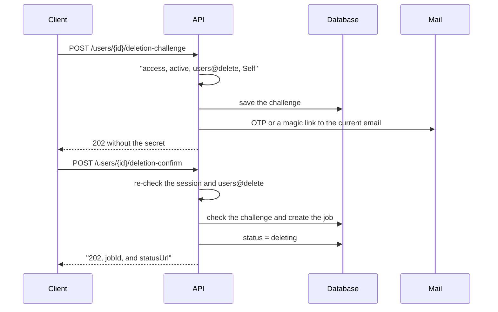
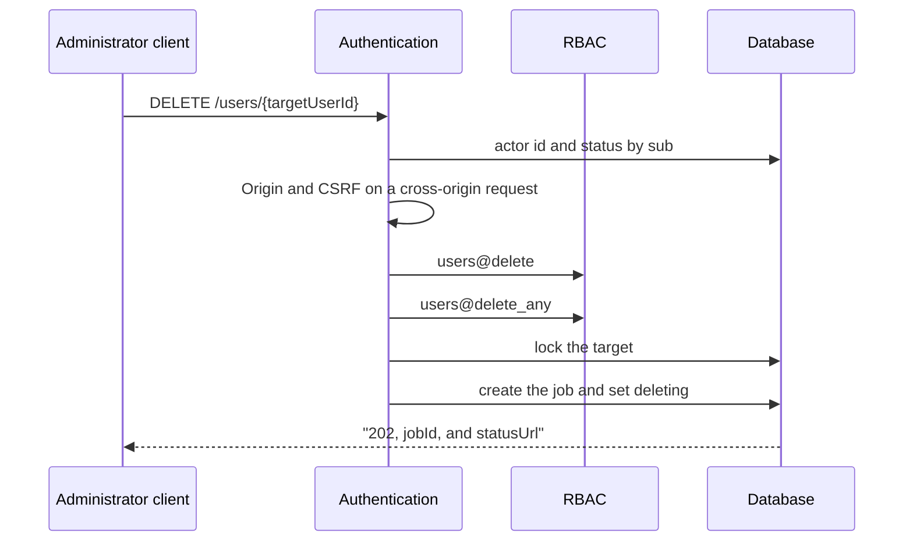
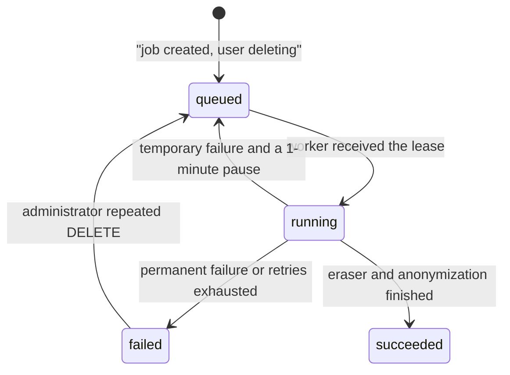
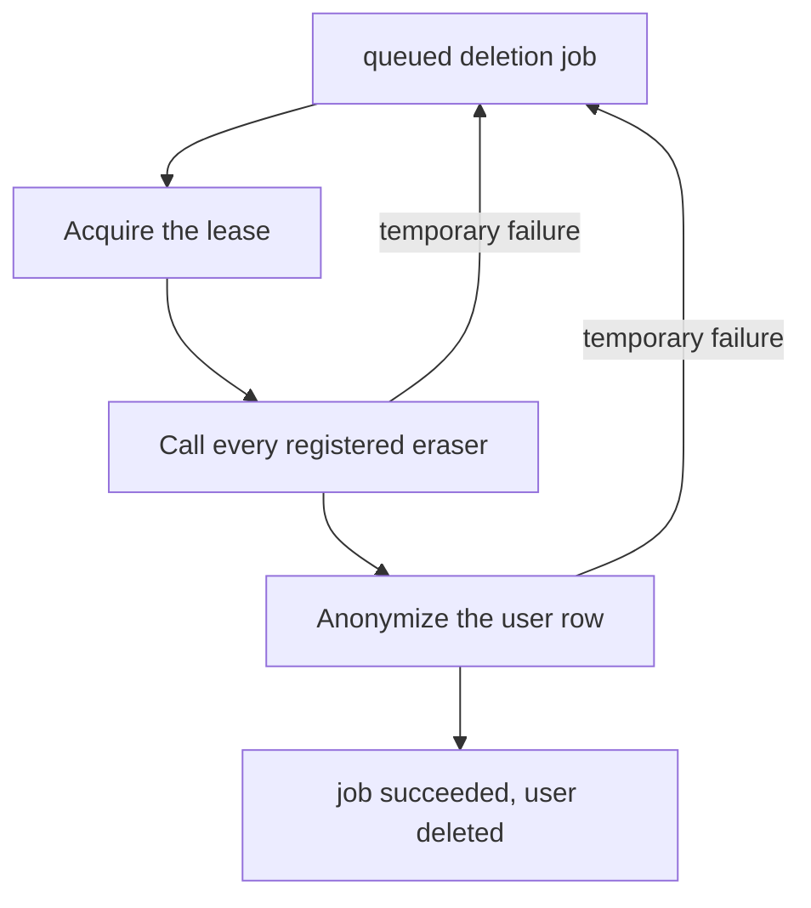

# Deleting a user

## Contents

- [Theory](#theory)
  - [Situation](#situation)
  - [Model](#model)
  - [Concepts and how they relate to the backend](#concepts-and-how-they-relate-to-the-backend)
  - [Responsibilities](#responsibilities)
  - [Common failures](#common-failures)
  - [Useful links](#useful-links)
  - [Review questions](#review-questions)
- [Practical assignment](#practical-assignment)
  - [1.1 General](#11-general)
  - [1.2 Scenarios](#12-scenarios-user-stories)
  - [1.3 Contract](#13-contract)
  - [1.4 Errors and constraints](#14-errors-and-constraints)
  - [1.5 Audit](#15-audit-and-logs)
  - [1.6 Non-functional requirements](#16-non-functional-requirements)

# Theory

## Situation

An active user requests deletion of that user's own account and first confirms the current email. An administrator starts deletion of another user without an email challenge. One of these outcomes follows. An asynchronous job is accepted with **202**. A minimal job status is returned with **200**. Input is rejected with **400**. The session is invalid with **401**. A permission or a direct self-delete is forbidden with **403**. The target or the job is not found with **404**. The operation identifier conflicts with **409**. **429** is returned. A dependency required before acceptance is unavailable, and **503** is returned. A storage or worker failure after **202** is reflected in the job state. It does not change the acceptance response that was already committed.

Deletion anonymizes the main user row. PII, password data, the challenge, roles, and files are cleared. The technical `id`, timestamps, and a minimal audit without PII are kept for referential integrity and as proof that the process completed.

## Model

Self-delete consists of email confirmation and acceptance of the job. The challenge follows the same rules as registration and login. The server chooses OTP or a magic link, stores only an HMAC, applies a TTL of 10 minutes, allows five OTP entries, and applies a resend pause of 60 seconds. Confirm also requires a valid session.

An administrator uses `DELETE /users/{userId}` for another user's target in the state `pending`, `active`, or `blocked`. The base permission `users@delete` and the additional permission `users@delete_any` are checked before the target lookup. This endpoint is forbidden for the actor's own identifier. Even an administrator goes through self-confirmation, so an administrative permission cannot bypass protection of that administrator's own account.

`status = deleting` is recorded in the same transaction as the job. From that moment, new access and refresh tokens stop working, because authentication accepts only `active`. Stateless JWTs stay cryptographically valid until `exp`. A mandatory read of the user by `sub` blocks them before expiry as well.

The job is stored in the database. Acceptance does not depend on an external message queue. The worker atomically acquires a lease, calls the idempotent erasers, and then runs finalization. A lost response after an external deletion causes the same erasers to run again. Absence of an object that was already deleted counts as success.

The main row is not deleted. Role assignments are removed in the acceptance transaction, together with the transition to `deleting`, so the RBAC policy immediately reflects the irreversible end of access. After external objects are cleared successfully, one final transaction replaces the email with the technical unique address `deleted.<32 hex>@example.invalid`. It clears `display_name`, `photo_key`, and `password_hash`, deletes the challenge, sets `deleted`, and finishes the job. The original email is released only when this transaction commits.

The process adds challenge tables and job tables. `password_hash` in `users` becomes nullable only for `deleted`. A database constraint rejects `null` for every other status.

| `users` | Description |
| --- | --- |
| `id` | retained opaque technical identifier |
| `email` | current normalized email, or a unique tombstone after anonymization |
| `password_hash` | slow hash before deletion, `null` only when the status is `deleted` |
| `display_name` | profile name, `null` after anonymization |
| `photo_key` | photo key, `null` after anonymization |
| `status` | `pending`, `active`, `blocked`, `deleting`, or `deleted` |
| `created_at` | retained immutable UTC time assigned by the database when the user is created |
| `updated_at` | time of the last transition or anonymization |

| `deletion_challenges` | Description |
| --- | --- |
| `id` | challenge identifier |
| `user_id` | reference to `users.id`; one unconsumed challenge per user |
| `method` | `otp` or `magic_link`, chosen by the server |
| `secret_hash` | HMAC-SHA256; the original OTP or token is not stored |
| `last_sent_at` | start of the 10-minute TTL and of the 60-second resend pause |
| `attempts` | number of incorrect OTP entries, maximum five |
| `consumed_at` | time the challenge was consumed |
| `consumed_reason` | `confirmed`, `replaced`, `attempts_exhausted`, `job_exists`, or `user_inactive` |
| `created_at` | creation time |

| `deletion_jobs` | Description |
| --- | --- |
| `id` | 32 lowercase hex characters from `Idempotency-Key`; also the opaque `jobId` |
| `user_id` | unique reference to the technical user row |
| `status` | `queued`, `running`, `succeeded`, or `failed` |
| `tombstone_email` | random unique address for the final anonymization |
| `attempts` | number of worker runs |
| `lease_until` | time until which the job is held, `null` outside a run |
| `next_attempt_at` | time before which a job in `queued` cannot be claimed; on the first run it equals the creation time |
| `last_error_code` | machine category without PII or external error text |
| `created_at` | acceptance time |
| `updated_at` | time of the last change |
| `finished_at` | time of success, otherwise `null` |

### Normal form

The tables `users`, `deletion_challenges`, and `deletion_jobs` are in BCNF and, under the stated dependencies, in 5NF.

Each successive form includes the requirements of the previous one:

- **1NF:** The email, the status, and the result code are atomic. The eraser list is not stored in the job row. The worker calls the application's current handler registry.
- **2NF:** All three tables have simple keys, so there is no partial dependency.
- **3NF and BCNF:** A challenge does not copy the user's email. A job does not copy `display_name`, `photo_key`, or the status of the `users` row. TTL is computed from `last_sent_at`, so there is no dependent `expires_at`.
- **4NF:** Independent challenges and jobs are moved out of `users`. Storing them in one row would create two independent multivalued sets.
- **5NF:** The user, the challenge, and the job are joined by keys, with no extra join dependency.

`tombstone_email` is stored on the job until the final transaction, so a worker retry uses the same value. It is not a copy of PII. It is not a computed field of the user row. After completion it matches `users.email`. The two rows still describe different facts: the result of one specific job, and the current technical state of the user. The transfer runs once, in a single final transaction. A completed job is immutable.

`next_attempt_at` depends on `attempts` and also on the time of the last failure. It stores scheduler state. It does not store a transitive copy of the counter.

## Concepts and how they relate to the backend

### Right to deletion and storage boundaries

GDPR Article 17 establishes the right to deletion of personal data. It also lists exceptions, for example a legal duty to retain data or the protection of legal claims. Product policy must define the applicable basis and the retention period before the technical process starts.

The technical contract chooses anonymization of the main row. The previous email, name, photo, password hash, challenge secrets, and related user information are deleted. The retained random `id` can no longer be matched to a person through PII. The log records the course of the process without an actor id, a target id, an email, an IP, a `jobId`, a reason, or data contents.

Acceptance of a deletion cannot leave the system without an active holder of `rbac@manage`. If that permission is assigned to the user being deleted, the self branch and the admin branch, under the shared lock of the RBAC invariant, check that another active holder remains before the job is created and before the transition to `deleting`. A violation returns **409**. The same transaction deletes the target's `user_roles` and increments `rbac_policy_state.version`. Later policy changes no longer treat a user in `deleting` as a holder of permissions. The same shared lock is used when an administrator blocks a user. Parallel operations cannot bypass the rule from RBAC.

Anonymization differs from hiding. Encryption with a retained key, base64, a plain hash of the email, and a transfer into an archive still leave a way to recover the data or to brute-force it. A tombstone is generated at random. It is not derived from the original email.

### Asynchronous deletion and HTTP 202

Files and data that belong to different modules cannot be deleted reliably inside one relational-database transaction. The API therefore accepts the work atomically, stops access, and returns **202 Accepted**. The worker finishes the cleanup later.

**202** means acceptance. It does not mean that cleanup succeeded. The client receives a `jobId` and checks a separate status endpoint. After the transition to `deleting`, Self presents the opaque receipt `jobId`, because the ordinary session is already invalid. An active Admin requests the status of another user's target with `users@delete` and `users@delete_any`. Both branches return `queued`, `running`, `succeeded`, or `failed`. They do not report which specific object caused the failure.

Storing the job in the database removes the dual-write between the user row and a broker. The worker selects a job in `queued`, or a job in `running` whose lease has expired, sets the lease, calls every eraser, and then runs finalization. A second worker does not take the same job while the lease is still valid. After a process crash, the lease expires, and the retry calls every eraser again. The erasers are idempotent, so data that is already cleared does not interfere.

### Idempotency and a jobId known to the client

The client creates an `Idempotency-Key` as 16 random bytes and sends 32 lowercase hex characters. The server uses that value as the `jobId`. The client therefore knows the status address before the request. A lost response after the transition to `deleting` does not leave the user without a way to learn the result.

A repeat of the same idempotency key for the same target returns the previous job, and no second process starts. A different key for a user who already has a job also returns the existing `jobId`. A repeat of the key for another target receives **409**, so one operation does not take on two meanings.

Idempotency also applies to an eraser. Deleting a missing file succeeds. Clearing a field that is already empty changes nothing. A repeated call after success returns `succeeded` again. If the external call completed and the response was lost, the retry must reach the same state. A separate step table is not required. Progress is not stored per eraser, because each handler can be called again safely.

### Immediate end of access

The acceptance transaction changes `users.status` to `deleting`. After the token signature, access and refresh checks in authentication load the current row and accept only `active`. The next request therefore returns **401** `invalid_session`.

The server also sends expired access and refresh cookies to the Self client. This clears the current browser. It is not revocation. A copied stateless JWT still exists physically until `exp`. Only the status check enforces the block. Administrative deletion cannot clear cookies on the target's devices. The same check stops those cookies from working.

A request that has already passed authorization at the same moment as deletion acceptance is not interrupted on its own. Critical operations that change the profile, the email, and data of other modules check the status again before commit, under their own contract.

### Self confirmation

The message is sent to the user's current normalized email. An OTP contains six digits. A magic link contains a `challengeId` and 32 random bytes. The server stores HMAC-SHA256 under a separate key of at least 32 random bytes and compares it in constant time.

Both methods last 10 minutes. The fifth OTP can still succeed. The fifth incorrect entry returns **400** and consumes the challenge. The next entry receives **429**. A resend after 60 seconds replaces the secret, starts the TTL again, and resets the counter.

Email confirmation does not replace the session. Confirm requires an active access token, `users@delete`, and a path that matches `sub`. The message places the magic token in the URL fragment. That fragment is not sent to the server, and it is not sent in `Referer`. The client page reads the token and sends it in the POST body. An ordinary GET only opens the page. POST creates the job. An administrator deletes another user directly. The administrator's own identifier always goes through the confirmed self-flow.

### Module cleanup contract

Every module that stores a user's data or files registers a handler, `eraseUserData(userId, deletionJobId)`. The handler contract is mandatory:

1. A repeated call with the same pair is safe and does not restore data that was already deleted.
2. PII, original files, derived files, secrets, and direct relationships owned by the module are deleted.
3. An allowed de-identified aggregate cannot be used to restore the user and does not contain the original identifier.
4. The result has one value, `succeeded`, `retryable_failure`, or `permanent_failure`, and a safe machine code.
5. An exception, a log entry, and the result do not contain the values being cleared, storage keys, the full `jobId`, or file contents.
6. `succeeded` is also returned when the data is already gone.

Part 2, file transformations, must register such an eraser before the first file is accepted. The eraser deletes source objects and result objects, and it clears or anonymizes records that belong to the module. The contract does not set the names of future tables, buckets, or fields. While transformation functionality is not installed and no data of this type exists, the handler is not registered.

The worker calls every registered eraser in order. Only after they succeed does it run the final anonymization transaction. A temporary failure of any eraser, or of finalization, returns the job to the queue. A permanent failure moves the job to `failed` and does not return the user to `active`.

### Anonymization and a unique email

The final transaction starts only after every eraser succeeds. It locks the policy state, the user, and the job. It checks that the status is `deleting`. It idempotently deletes the remaining role assignments and challenges. It clears PII and the password hash, moves the stored tombstone into `users.email`, sets `deleted`, and finishes the job. If the protective deletion of roles actually changed rows, the RBAC version is incremented in the same transaction.

The old email stays taken until cleanup finishes. After the tombstone commits, the unique index releases the address for a new registration. A concurrent registration before the commit receives **409**. After the commit, that registration creates a new row with no link to the deleted technical `id`.

Immediately after the transition to `deleting`, the canonical profile returns `photoUrl: null`, so the client is not sent to an object the worker may already have deleted. After the final anonymization, `displayName` also becomes `null`. The profile still has the fields `id`, `email`, `displayName`, `photoUrl`, `status`, `createdAt`, and `updatedAt`. An authorized administrator sees only the technical tombstone and `deleted`, not the previous PII. `password_hash`, challenge secrets, JWTs, and internal fields are never part of the profile.

### Errors and process recovery

If the acceptance transaction rolls back, the status and the challenge do not change, and the job is absent. The client receives **503** and repeats the request with the same key. If the commit succeeded, the status endpoint for the `jobId` known in advance shows the accepted state even when the HTTP response was lost.

A temporary failure after acceptance does not turn an already returned **202** into **503**. The worker stores a safe category and `next_attempt_at`. The status endpoint shows `queued` or `running`, or `failed` after retries are exhausted.

A temporary failure is retried up to five times, with a pause of one minute. After the fifth failure, the job becomes `failed`, the user stays `deleting`, and PII is not declared deleted. The administrator repeats `DELETE`. That moves the same job to `queued`, resets `attempts`, and sets `next_attempt_at` to the current time. A new job is not created, and a new tombstone is not created.

External data that was deleted successfully is not restored when a later eraser fails. The next run calls every handler again, and handlers that have already cleared their data return `succeeded`. The status `deleted` is set only after complete success.

### Summary

| Concept | Meaning in deletion | What the implementation relies on |
| --- | --- | --- |
| **202 Accepted** | the process is accepted, but it is not finished | a durable job and a status endpoint |
| `deleting` | access stops immediately | a status check of every access token and every refresh token |
| `deleted` | PII and files are cleared | final anonymization after every eraser |
| Idempotency | a repeat does not create a second process | a `jobId` known to the client and a unique `user_id` |
| Lease | one worker holds the job for a limited time | an atomic claim and a safe retry |
| Eraser | the cleanup boundary of a neighboring module | `eraseUserData(userId, deletionJobId)` |
| Tombstone email | keeps `NOT NULL` and uniqueness without PII | a random address in `example.invalid` |

## Responsibilities

| Client | Server |
| --- | --- |
| Self requests a message to the current email | Chooses OTP or a magic link and stores only an HMAC |
| Creates a random `Idempotency-Key` before confirm | Uses the key as a stable `jobId` |
| Sends confirm with a valid cookie | Checks `active`, `users@delete`, and the owner again |
| Admin deletes only another user's `userId`, and does so directly | Requires `users@delete` and `users@delete_any` before the lookup |
| After **202**, stops ordinary requests | Sets `deleting` immediately |
| Self checks the status by the receipt; Admin checks it after both permissions | Does not reveal PII or internal eraser errors |
| On `failed`, contacts an administrator | Does not return the user to `active` automatically |
| Does not list stores or related entities | Calls every registered idempotent eraser |

When the frontend is placed on another origin, initiation, resend, confirm, and the administrative DELETE require the exact allowed `Origin` and `X-CSRF-Protection: 1`, even when both origins belong to the same site. For a cross-site placement, cookies also receive `SameSite=None; Secure`. The Self branch of the status endpoint does not accept an auth cookie and checks the receipt. The Admin branch accepts an access cookie and repeats authentication and RBAC. GET does not change data and does not require a CSRF header.

## Common failures

| What you see | Where to look |
| --- | --- |
| Self is deleted by one DELETE without a message | the direct administrative path is not forbidden for the actor's own `userId` |
| A magic link starts deletion through an ordinary GET | a mail scanner can consume the secret without an explicit action |
| Confirm works after logout or a block | the challenge incorrectly replaces a valid session |
| After **202**, access still reads the profile | `deleting` is set after the response, or the status is not checked |
| A refresh for a user in `deleting` issues a new pair | the current row is not read by `sub` after the JWT check |
| Deletion is stuck with no job | the status and the enqueue of the work are written separately |
| A lost response left Self with no way to learn the jobId | the identifier is created by the server only after the request, and it is not known to the client in advance |
| A repeated confirm created a second process | there is no unique job per user, or there is no idempotency key |
| One key deletes two different targets | a repeat of `Idempotency-Key` does not check the previous meaning |
| Deletion accepted the last active holder of `rbac@manage` | the shared RBAC invariant is not checked before `deleting`, or parallel operations are not serialized |
| Two workers clear the same user at the same time | the lease and the atomic claim of the job are missing |
| A failure after a file deletion breaks the retry | `not_found` is incorrectly treated as a failure |
| The user became `deleted` before transformation cleanup | the final status is set before every registered eraser succeeds |
| An eraser error returned the user to `active` | the process violated the irreversible end of access |
| The old email stays taken after success | the final transaction did not set a random tombstone |
| The tombstone can be derived from the original email | a plain hash or an encoding is used instead of a random value |
| `password_hash` or `photo_key` remains in `deleted` | the final-anonymization constraint does not check every PII field |
| A new registration received the relationships of the old account | the old technical `id` was reused instead of a new row |
| Self sees another user's status through a random `jobId` | the receipt is not matched to the `user_id` from the path |
| Admin reads the status without both delete permissions | the administrative branch bypassed access and RBAC |
| The status endpoint reveals the email | the receipt contains more than the minimal state |
| The log contains an OTP, a JWT, the full `jobId`, or values being deleted | the request body, cookies, the receipt, or eraser data is logged |

## Useful links

### General

- [UK GDPR — Article 17](https://www.legislation.gov.uk/eur/2016/679/article/17/adopted/data.html) — the primary text of the right to deletion and of the exceptions listed in law.
- [UK GDPR — Article 5](https://www.legislation.gov.uk/eur/2016/679/article/5/adopted/data.html) — the principles of data minimization and of storage limitation for the profile and the audit.
- [ICO — Right to erasure](https://ico.org.uk/for-organisations/uk-gdpr-guidance-and-resources/individual-rights/individual-rights/right-to-erasure/) — a practical explanation of the boundaries of a request and of checking that it was carried out.
- [RFC 9110 — 202 Accepted](https://www.rfc-editor.org/rfc/rfc9110#name-202-accepted) — the meaning of the response for an asynchronous operation whose result is not yet complete.
- [OWASP — User Privacy Protection Cheat Sheet](https://cheatsheetseries.owasp.org/cheatsheets/User_Privacy_Protection_Cheat_Sheet.html) — minimization and protection of personal data.
- [OWASP — Logging Cheat Sheet](https://cheatsheetseries.owasp.org/cheatsheets/Logging_Cheat_Sheet.html) — keeping tokens, PII, and secrets out of process events.
- [PostgreSQL — Explicit Locking](https://www.postgresql.org/docs/current/explicit-locking.html) — row locks and `SKIP LOCKED` for a safe claim of jobs when PostgreSQL is used.
- [PostgreSQL — Constraints](https://www.postgresql.org/docs/current/ddl-constraints.html) — uniqueness of a user's job and of the tombstone, and checks of the final state.
- [Amazon S3 — DeleteObject](https://docs.aws.amazon.com/AmazonS3/latest/API/API_DeleteObject.html) — the behavior of deleting an object again at an S3-compatible boundary.
- [OpenAPI Specification — Responses](https://spec.openapis.org/oas/latest.html#responses-object) — a description of **202**, the status endpoint, and the error variants.

### By language

#### Node.js

**Node.js, NestJS.** On Express or Fastify, a durable job and an eraser keep the same contract.

- [NestJS — Queues](https://docs.nestjs.com/techniques/queues) — a worker, retries, and handling of long-running work; the source of truth remains the job in the database.
- [Node.js — `crypto.randomBytes`](https://nodejs.org/api/crypto.html#cryptorandombytessize-callback) — generation of a challenge, an idempotency key, and a random tombstone.
- [Node.js — `createHmac`](https://nodejs.org/api/crypto.html#cryptocreatehmacalgorithm-key-options) — an HMAC for the challenge without storing the original secret.
- [Prisma — Transactions](https://www.prisma.io/docs/orm/prisma-client/queries/transactions) or [TypeORM — Transactions](https://typeorm.io/docs/advanced-topics/transactions/) — atomic creation of the job, the status change, and the final anonymization.
- [NestJS — OpenAPI](https://docs.nestjs.com/openapi/introduction) — documentation of the challenge, **202**, and the status endpoint.
- [Prisma Migrate](https://www.prisma.io/docs/orm/prisma-migrate) or [TypeORM — Migrations](https://typeorm.io/docs/advanced-topics/migrations/) — creation of the deletion tables and the constraints.

#### .NET

**.NET, ASP.NET Core.** Minimal APIs and controllers use a shared hosted worker and a transactional service.

- [.NET — Background tasks with hosted services](https://learn.microsoft.com/en-us/aspnet/core/fundamentals/host/hosted-services) — a long-running worker and a correct process shutdown.
- [.NET — RandomNumberGenerator](https://learn.microsoft.com/en-us/dotnet/api/system.security.cryptography.randomnumbergenerator) — cryptographic bytes for keys and the tombstone.
- [.NET — HMACSHA256](https://learn.microsoft.com/en-us/dotnet/api/system.security.cryptography.hmacsha256) — storage of an irreversible representation of the OTP and the token.
- [EF Core — Transactions](https://learn.microsoft.com/en-us/ef/core/saving/transactions) — atomic acceptance and completion of a deletion.
- [EF Core — Concurrency](https://learn.microsoft.com/en-us/ef/core/saving/concurrency) — handling of competing workers and of user changes.
- [EF Core — Migrations](https://learn.microsoft.com/en-us/ef/core/managing-schemas/migrations/) — migration of the job tables and the challenge tables.
- [ASP.NET Core — OpenAPI](https://learn.microsoft.com/en-us/aspnet/core/fundamentals/openapi/overview) — a description of cookie protection and of asynchronous responses.

#### Python

**Python, FastAPI.** For Django or Flask, a durable job, a lease, and an idempotent eraser are kept.

- [Celery — Tasks](https://docs.celeryq.dev/en/stable/userguide/tasks.html) — repeatable background tasks and the idempotency requirements.
- [Python — `secrets`](https://docs.python.org/3/library/secrets.html) — cryptographic identifiers, the challenge, and the tombstone.
- [Python — `hmac`](https://docs.python.org/3/library/hmac.html) — HMAC and `compare_digest` for the confirmation secret.
- [SQLAlchemy — Transactions](https://docs.sqlalchemy.org/en/20/orm/session_transaction.html) — an atomic status change and the commit of the job.
- [SQLAlchemy — Versioning](https://docs.sqlalchemy.org/en/20/orm/versioning.html) — detection of competing changes while rows are processed.
- [Alembic — Tutorial](https://alembic.sqlalchemy.org/en/latest/tutorial.html) — migrations of the deletion tables and the constraints.
- [FastAPI — Metadata and Docs URLs](https://fastapi.tiangolo.com/tutorial/metadata/) — publication of the current OpenAPI document.

## Review questions

1. Why can **202 Accepted** not mean that PII has already been deleted, and what role does the status endpoint serve?
2. How does `status = deleting` block stateless access and refresh tokens when the JWTs themselves are not physically revoked?
3. Why does the client know the `jobId` before confirm is sent, and what happens if the successful response is lost?
4. Why must deletion of a missing file count as success when an eraser runs again?
5. How does a random tombstone differ from a hash of the original email with respect to recovery of PII?
6. What guarantees must an eraser of a future transformation module provide, without revealing that module's schema?
7. Why does the table `deletion_jobs` not store the list of erasers, and how does a repeated run use the idempotency of the handlers?

# Practical assignment

User deletion in the system.

Self confirms the current email and, with a valid session, starts asynchronous deletion. Admin starts deletion of another user directly. Acceptance immediately sets `deleting`, returns **202**, and returns a `jobId` known to the client. An idempotent worker clears PII and files, anonymizes the main row, and finishes that row with the status `deleted`.

## 1) Deleting a user

### 1.1 General

**Purpose:** irreversibly clear a user's personal data, with an immediate end of access, an observable status, and a safe retry.

**Users/roles:**

- an active user with `users@delete` initiates the challenge and confirms deletion of that user's own account;
- an active user with `users@delete` and `users@delete_any` directly starts deletion of another account;
- the actor's own `userId` cannot be deleted through the administrative endpoint, even with `users@delete_any`;
- Self receives the status after the session is lost, by the opaque receipt `jobId`;
- an active Admin receives the status of another user's target only with `users@delete` and `users@delete_any`.

**Single catalog of permissions for working with users:**

| Permission | Purpose |
| --- | --- |
| `users@read` | reading the user's own profile |
| `users@read_any` | additional grant to read another user's profile |
| `users@update` | changing the user's own profile |
| `users@update_any` | additional grant to change another user and to change an email directly as an administrator |
| `users@delete` | confirmed deletion of the user's own account |
| `users@delete_any` | additional grant for an administrator to delete another user |
| `users@list` | viewing the administrative list of users |

**Dependencies/related settings:**

- access, refresh, and cookies follow authentication; each token is accepted only for an existing user in `active`;
- the protected chain follows authorization and the current RBAC;
- the shared access-control invariant treats only an `active` user as a holder of `rbac@manage`, and it serializes assignment changes, blocking, and deletion;
- assigning a role to a user checks that user's status again under the shared lock and rejects `deleting` or `deleted`;
- `DELETION_CONFIRMATION_METHOD` has one value, `otp` or `magic_link`, and the server chooses it;
- `DELETION_CHALLENGE_HMAC_KEY` holds a separate random value of at least 32 bytes;
- SMTP sends the challenge to Self's current email;
- the worker claims durable jobs from the database, applies a lease, and calls the registered erasers;
- the profile store and future modules provide idempotent cleanup;
- `DELETION_WORKER_LEASE_SECONDS` defaults to 300, the maximum number of automatic runs is 5, and the pause between them is 1 minute.

If the key is missing, empty, or shorter than 32 bytes, the application does not pass readiness. The key is distinct from the JWT key, the registration key, the login key, and the email-change key.

The canonical profile in every user operation contains `id`, a normalized `email`, `displayName`, `photoUrl`, `status`, `createdAt`, and `updatedAt`. The email is not masked. While the status is `deleting`, `photoUrl` is already `null`. After anonymization, the email becomes a random tombstone, `displayName` is also `null`, and `status` is `deleted`. `password_hash`, challenge secrets, JWTs, object keys, and internal fields are not returned.

The statuses are `pending`, `active`, `blocked`, `deleting`, and `deleted`. Only `active` can authenticate. `deleting` is added as an immediate barrier for the duration of asynchronous cleanup. `deleted` is the completed anonymized state.

### 1.2 Scenarios (user stories)

1. **Self confirms deletion:** the server sends an OTP or a magic link to the current email, and confirm with an active session creates the job.
2. **Admin deletes another user:** a request with both permissions creates the job without a message.
3. **Access stops:** in the acceptance transaction the user becomes `deleting`, so the next access and refresh tokens receive **401**.
4. **The client tracks the process:** Self presents the `jobId` created in advance, and Admin passes both delete permissions. The response contains `queued`, `running`, `succeeded`, or `failed`.
5. **Repeat of the request:** the same process and the same `jobId` are returned, without a second deletion and without a second tombstone.
6. **Temporary failure:** the worker calls every idempotent eraser again, and the user stays `deleting`.
7. **Full success:** files and PII are cleared, the main row is anonymized, the old email is released, and the status becomes `deleted`.
8. **Permanent failure:** the job becomes `failed`, and an administrator moves that same job back to the queue with a repeated DELETE.

### 1.3 Contract

#### 1.3.1 Initiation and resend of self-confirmation

| Operation | Input data and rules |
| --- | --- |
| `POST /users/{userId}/deletion-challenge` | no body; Self only, with `users@delete` |
| `POST /users/{userId}/deletion-challenge/resend` | `challengeId: string`; Self only, with `users@delete` |

`userId` contains from 1 to 128 ASCII characters drawn from letters, digits, `_`, and `-`. The server chooses the method from `DELETION_CONFIRMATION_METHOD` and sends the message to the current email. The client does not send `method` or the address.

**Initiation logic:**

1. Check access, the current `active` status, CSRF for a request from another origin regardless of the site boundary, and `users@delete`.
2. Compare `userId` with `actorUserId`. Return a mismatch as **403** before the target lookup.
3. Lock the user, then that user's unconsumed deletion challenge and the existing deletion job, in one shared order. If a job already exists, return **409** and do not send a message.
4. If an unconsumed challenge was sent less than 60 seconds ago, return **429** with the remaining time.
5. After the pause, consume the previous challenge as `replaced` and create a new challenge of the chosen method with `attempts = 0`, in one transaction.
6. Commit the challenge, then send the secret to the current normalized email.

**Resend logic:**

1. Repeat the checks for access, `active`, CSRF, `users@delete`, and Self. Lock the user, then the challenge by `challengeId`.
2. A challenge that is missing, replaced, already confirmed, or consumed as `user_inactive` receives **400**. `attempts_exhausted` receives **429**. `job_exists` receives **409**.
3. If 60 seconds have not passed since `last_sent_at`, return **429**.
4. Create a new secret of the same method, replace the HMAC, update `last_sent_at`, and reset `attempts`, in one transaction.
5. After the commit, send the message. The previous secret no longer matches.

If the transaction is not committed, the message is not sent, and **503** is returned. If SMTP does not accept the message after the commit, the challenge is kept. **503** then contains `confirmationRequired`, `method`, `challengeId`, and `retryAfterSeconds`, but not the email and not the secret.

**Responses:**

- **Accepted:** **202 Accepted**, `confirmationRequired: true`, `method`, `challengeId`, `expiresInSeconds: 600`, `resendAfterSeconds: 60`.
- The JSON contains no OTP, token, HMAC, email, JWT, cookies, or profile data.

#### 1.3.2 Self confirmation and acceptance of deletion

| `POST /users/{userId}/deletion-confirm` | Input data |
| --- | --- |
| Header `Idempotency-Key` | exactly 32 lowercase hex characters, created by the client from 16 random bytes; the value becomes the `jobId` |
| OTP | `challengeId: string`, `code: string` of exactly 6 digits |
| Magic link | `token: string` in the format `challengeId.secret`; the secret is 32 random bytes before base64url; the message passes the token in the URL fragment |

The body contains exactly one secret variant. A GET of the magic link does not change state.

**Logic/steps:**

1. Check the path, `Idempotency-Key`, and the shape of the body.
2. Before a new business operation, check for an idempotent repeat. If this `jobId` already belongs to the same user, return it with **202** and do not check the challenge again. If the key belongs to another target, return **409**. This branch does not create a job and does not retry a job.
3. If no job with this key exists, check access, the current `active` status, CSRF, `users@delete`, and a match of `userId` to `actorUserId`.
4. Take the shared lock on the policy state, then lock the user and the challenge in the established order of transactional locks.
5. Check ownership, the method, consumption, and the TTL of `last_sent_at + 10 minutes`. A challenge that is missing, replaced, already confirmed, or consumed as `user_inactive` receives **400**. `attempts_exhausted` receives **429**. `job_exists` receives the existing job with **202**.
6. Check `active` again. On any other status, consume the challenge as `user_inactive` and return **401**.
7. Compare the HMAC in constant time. The fifth OTP is still checked. The fifth incorrect entry receives **400** and consumes the challenge. The next entry receives **429**. An incorrect magic link receives **400** and does not increment a counter.
8. If the user already has a job under another key, consume the challenge as `job_exists` and return the existing job with **202**.
9. If `rbac@manage` is assigned to the user, under the RBAC invariant lock already held, confirm that another active holder remains. Otherwise return **409**, with no job and with no status transition.
10. Create a `deletion_jobs` row with status `queued`, `attempts = 0`, and `next_attempt_at = now`, and generate one tombstone.
11. Set the user to `deleting`, delete that user's `user_roles`, increment `rbac_policy_state.version`, update `updated_at`, consume the challenge as `confirmed`, and consume the remaining login, email-change, and deletion challenges, in one transaction.
12. Commit the transaction, send the client expired access and refresh cookies with the original attributes, and return the receipt.

If the transaction rolled back, the user stays `active`, the challenge stays usable for a retry, the job is absent, and **503** is returned. After the commit, the `jobId` is already known to the client from the header, so a lost response does not block a status check.

**Response:** **202 Accepted**, `jobId`, `status`, `statusUrl`. `statusUrl` contains only the path `/users/{userId}/deletion-status`, with no receipt in the path or the query. Self sends the receipt later, and only in `Deletion-Receipt`. On the first acceptance, `status = queued`. On a repeat, the current status of the existing job is returned. The response contains no profile, email, challenge secret, JWT, tombstone, or internal fields.

#### 1.3.3 Administrative acceptance of deletion

| `DELETE /users/{userId}` | Checks/validation |
| --- | --- |
| `userId: string` | From 1 to 128 ASCII characters from letters, digits, `_`, and `-` |
| Header `Idempotency-Key` | 32 lowercase hex characters from 16 random bytes; the value becomes the `jobId` |
| Body | absent |

**Logic/steps:**

1. Check the path and the header.
2. Check access, the current `active` status, CSRF, and the base permission `users@delete`.
3. If `userId` matches `actorUserId`, return **403 Forbidden** with the code `self_confirmation_required`. The actor's own account is deleted only through the challenge.
4. Check `users@delete_any` before the target lookup.
5. If the `jobId` already belongs to another target, return **409**.
6. Take the shared lock on the policy state, then find and lock the target user. After both permissions, a missing target receives **404**.
7. After the user, lock the existing job if one exists, and return **202** with that job's `jobId`. For `failed`, move the same job to `queued`, set `next_attempt_at` to the current time, reset `attempts`, and clear the lease and `last_error_code`. Do not create a new tombstone.
8. If the target status is `active` or `blocked` and `rbac@manage` is assigned to that target, under the shared lock of the RBAC invariant confirm that another active holder remains. Otherwise return **409** with no changes.
9. If the target status is `pending`, `active`, or `blocked`, create the job and the tombstone with a `next_attempt_at` that is already due, set `deleting`, delete the target's `user_roles`, and increment `rbac_policy_state.version`, in one transaction.
10. If the status is `deleting` or `deleted` and no related job exists, return **503** and a consistency-violation event.
11. On the first acceptance, consume every challenge of the target.

**Response:** **202 Accepted**, `jobId`, the current `status`, and `statusUrl` with no receipt in the path or the query. No email challenge is created. The response contains no target profile, email, password hash, JWT, tombstone, actor roles, or internal fields.

#### 1.3.4 Deletion status

| `GET /users/{userId}/deletion-status` | Checks/validation |
| --- | --- |
| Self | The header `Deletion-Receipt` contains a `jobId` of 32 lowercase hex characters; an auth cookie and a body are not used |
| Admin | A valid access token, `users@delete`, and `users@delete_any`; `userId` must differ from `actorUserId`; the body is absent |

The operation is declared with the receipt `Deletion-Receipt`, together with the base permission pair `users@delete`. If the header is present, the Self branch runs, and the cookie is not read, even when a cookie is also sent. If the header is absent, the Admin branch runs: access and `users@delete`, then `users@delete_any`, before the target lookup. The operation is not marked public.

The Self branch stays available after the session is lost, because a user in `deleting` no longer authenticates. The server finds the job by the receipt and checks that `job.user_id` matches the `userId` from the path exactly. A mismatch and an unknown receipt receive the same **404**. The receipt allows only a read of the minimal status. It does not start the job, and it does not retry the job.

The Admin branch first checks access and the current `active` status in full, then checks `users@delete` and `users@delete_any`, before lookup of another user's target. The actor's own `userId` receives **403** and uses the Self branch. A missing target or a missing job, after both permissions, receives **404**.

**Responses:**

- **Found:** **200 OK**, `jobId`, `status`, `createdAt`, `updatedAt`, `finishedAt`.
- `status` has one value: `queued`, `running`, `succeeded`, or `failed`. `finishedAt` is set only for `succeeded`.
- **Not found:** **404 Not Found** for an unknown target, an unknown job, an invalid receipt, or a receipt that does not match the target, after the checks that apply.
- The response contains no `userId`, actor, email, name, photo, deletion reason, tombstone, external-service error, attempt count, PII, JWT, or internal fields.

The endpoint does not decide access to other data, and it does not allow a retry of the job. The rate limit, the randomness of the receipt, and the Admin check protect against bulk guessing. A successful lookup and an unsuccessful lookup reveal no user data.

#### 1.3.5 Worker and the mandatory eraser

The worker processes jobs in `queued`, and jobs in `running` whose lease has expired:

1. Atomically claim a job with status `queued` and `next_attempt_at <= now`, or a job in `running` with an expired lease. Set `running`, set `lease_until = now + 300 seconds`, clear `next_attempt_at`, and increment `attempts`.
2. Call each registered `eraseUserData(userId, deletionJobId)` in order.
3. If every eraser returned `succeeded`, run the final anonymization from section 1.3.6.
4. If any eraser returned `retryable_failure` and `attempts` is less than 5, store a safe code, return the job to `queued`, clear the lease, and set `next_attempt_at = now + 1 minute`.
5. If `attempts` has reached 5, or the result is `permanent_failure`, set the job to `failed` and clear the lease and `next_attempt_at`. The user stays `deleting`.
6. If the final transaction did not commit, treat that as `retryable_failure` with the same limit and the same pause. The original **202** does not change.

Every module that stores user data must register an eraser before it accepts such data. The interface accepts only `userId` and `deletionJobId`. It idempotently deletes the PII and objects owned by the module, and it returns `succeeded`, `retryable_failure`, or `permanent_failure` with a safe code. A repeated call after success returns `succeeded` again.

Part 2, transformations, must delete the source files and the result files, and must clear or anonymize its own records, through this interface. Concrete tables, fields, formats, and object locations are not specified here. Without a registered eraser, the transformation module does not pass readiness.

#### 1.3.6 Final anonymization

After every eraser succeeds, the worker runs one transaction:

1. Lock the policy state, then the user, then the job. The pair `job.status = succeeded` and `user.status = deleted` immediately counts as an internal idempotent success. Otherwise, `job.status = running` and `user.status = deleting` are required.
2. Check again that the profile photo is deleted or absent.
3. Physically delete the user's registration, login, email-change, and deletion challenges.
4. Idempotently delete the remaining `user_roles`. If rows were actually deleted, increment `rbac_policy_state.version`.
5. Set `email = tombstone_email`, `display_name = null`, `photo_key = null`, `password_hash = null`, `status = deleted`, and a new `updated_at`.
6. Set the job to `succeeded`, set `finished_at`, and clear the lease and `next_attempt_at`.

A database constraint allows `password_hash = null` only when `status = deleted`, and in that state it requires `display_name = null` and `photo_key = null`. A unique tombstone has the form `deleted.<32 lowercase hex>@example.invalid` and is not derived from the original email.

The old email is released after this transaction commits. The `users` row and its `id`, `created_at`, and `updated_at` are kept, so foreign keys do not become dangling references. A new registration of the previous email creates a new `id` and does not receive the old roles, files, or history.

A repeat of finalization for a row already `deleted` and a job already `succeeded` returns an internal success with no further changes. The status endpoint then returns `succeeded`.

### 1.4 Errors and constraints

- **400 Bad Request** — an invalid `userId`, `jobId`, `Idempotency-Key`, challenge body, OTP, or magic link; a challenge that is missing, expired, replaced, already confirmed, or consumed as `user_inactive`.
- **401 Unauthorized** — access is missing, invalid, or expired, or it refers to a user who is not in `active`; Self lost `active` before the job was accepted.
- **403 Forbidden** — `users@delete` is missing; an administrative target that belongs to another user lacks `users@delete_any`; a direct DELETE or an Admin status check is aimed at the actor's own user; the CSRF check did not pass.
- **404 Not Found** — the target user or the job is not found after the required permissions; the Self receipt is unknown or belongs to another target.
- **409 Conflict** — `Idempotency-Key` already belongs to another target; a challenge is initiated or resent after a job already exists; the deletion would leave the system without an active user who has `rbac@manage`.
- **429 Too Many Requests** — the rate limit is exceeded; resend ran before 60 seconds; the OTP has already used five entries.
- **503 Service Unavailable** — before acceptance, or while status is read, the database or the current RBAC is unavailable; SMTP is unavailable when the challenge is sent; the required eraser configuration is not ready; `deleting` or `deleted` is found without a job; the acceptance transaction did not commit. A failure of storage, of the worker, or of the final transaction after a committed **202** is reflected in the status of the existing job and does not change the acceptance response.

The base permission is checked before the target lookup. For an administrative deletion of another user, `users@delete_any` is also checked before the lookup. A client without that permission always receives **403**. **404** is possible only after access is granted.

A job with status `failed` does not mean a rollback. The user stays `deleting`. Access and refresh do not work. Automatic restoration of PII or of the status is forbidden.

### 1.5 Audit and logs

Log:

- creation, resend, an incorrect entry, expiry, and consumption of a deletion challenge;
- self or admin acceptance, an idempotent repeat, and a key conflict;
- the user's transition to `deleting` and the final `deleted`;
- claim, success, retry, and permanent failure of a job;
- an administrative retry of a `failed` job;
- a consistency violation and completion of anonymization.

An event contains the kind of operation, a safe result code, and the time. The log does not include `jobId`, `Idempotency-Key`, `Deletion-Receipt`, `actorUserId`, `targetUserId`, `email`, `displayName`, IP, reason, the tombstone, the OTP, the magic-link token, the HMAC, the JWT, cookies, storage keys, file contents, the full request body, or the full headers.

### 1.6 Non-functional requirements

- Creation of a deletion challenge allows at most 5 messages per user per hour. Resend has a pause of 60 seconds. The status endpoint allows 60 requests from one IP per minute. The next attempt receives **429**.
- The acceptance transaction atomically creates the job, sets `deleting`, deletes `user_roles`, increments the RBAC version, and consumes the challenge. The worker reads jobs from the database and does not depend on an external broker.
- Unique constraints cover `deletion_jobs.id`, one job per `user_id`, the tombstone, and one unconsumed challenge per user. The claim index covers `status, next_attempt_at, lease_until`.
- The worker holds the lease for 5 minutes, retries a temporary failure up to 5 times with a pause of 1 minute, and survives a process stop. Every eraser is idempotent. A missing object in storage counts as success.
- Readiness does not pass if a module stores user data and has no eraser.
- Automated tests cover Self and Admin, both status branches, the ban on a direct self-delete, protection of the last active holder of `rbac@manage`, loss of **202**, an eraser retry, `failed`, the tombstone, and a new registration of the old email.
- The project's general non-functional requirements — input validation, CORS, OpenAPI, structured logs, health checks, and test coverage of at least 80% — also apply to these operations.
