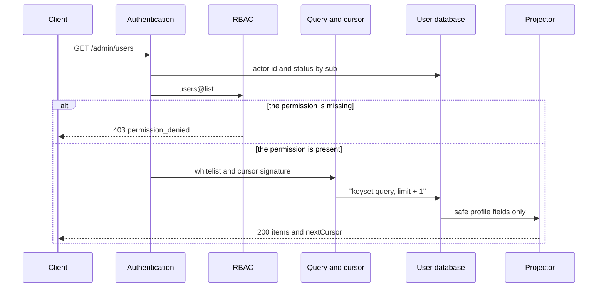
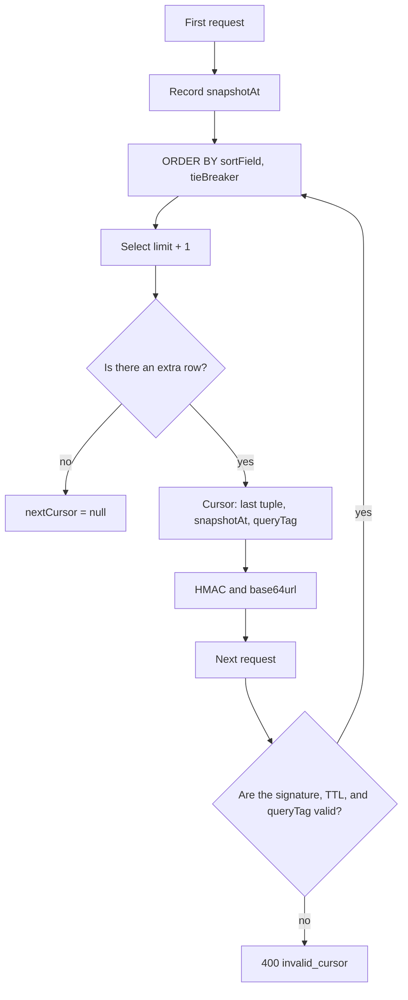

# Viewing the list of all users

## Contents

- [Theory](#theory)
  - [Situation](#situation)
  - [Model](#model)
  - [Concepts and how they relate to the backend](#concepts-and-how-they-relate-to-the-backend)
  - [Responsibilities](#responsibilities)
    - [Common failures](#common-failures)
  - [Useful links](#useful-links)
  - [Review questions](#review-questions)
- [Practical assignment](#practical-assignment)
  - [1.1 General](#11-general)
  - [1.2 Scenarios (user stories)](#12-scenarios-user-stories)
  - [1.3 Contract](#13-contract)
  - [1.4 Errors and constraints](#14-errors-and-constraints)
  - [1.5 Audit and logs](#15-audit-and-logs)
  - [1.6 Non-functional requirements](#16-non-functional-requirements)

# Theory

## Situation

An active user with an administrative permission requests `GET /admin/users`. One of the following outcomes follows. The server returns a page of canonical profiles and the next cursor. It rejects the parameters or the cursor with **400**. It reports an invalid session with **401**. It forbids a request without `users@list` with **403**. It applies a rate limit with **429**. It returns **503** when the database, the current RBAC, or the cursor verification key is unavailable.

The user list has no separate "extended" user object. Each item contains the same safe profile as a single-user view: `id`, `email`, `displayName`, `photoUrl`, `status`, `createdAt`, `updatedAt`.

## Model

The request involves the client, authentication, RBAC, the query validator, the user database, and the response projector. The `users@list` check finishes before the search is built and before the first row is read. The permission grants access to the whole administrative set, so `users@read_any` is not called for each row.



The first page records `snapshotAt` from the database clock before the selection. That same page already applies the strict condition `created_at < snapshotAt`. The same database assigns `users.created_at`. The client and the process clock do not set it. Clock skew would otherwise break the boundary. Every page excludes users on the boundary and after it, so concurrent registrations do not appear in the middle of the walk. Sorting is allowed only by the immutable fields `createdAt` and `id`. A second immutable component is added to the chosen field. That component makes the order total.



A cursor contains the format version, the key identifier, the sort, the direction, `snapshotAt`, the last composite value, and a keyed `queryTag` of the normalized query parameters. The payload contains no email, `displayName`, or status. HMAC-SHA256 with a separate key protects the cursor against change. It does not encrypt the cursor, so PII is not placed there.

Keyset pagination does not use a page number or a large `OFFSET`. For the direction `desc`, the next selection takes tuples less than the last one. For `asc`, it takes tuples greater than the last one. The query requests `limit + 1`. The extra row determines `nextCursor`, and it is not returned in `items`.

Search and a filter can change whether a row belongs to the set between HTTP requests. The contract guarantees an immutable order, exclusion of new rows after `snapshotAt`, and no repeats caused by an equal sort value. A historical snapshot of mutable fields is not created. For an administrative walk with a changing `status`, the client starts a new walk when the current complete set is needed after bulk changes.

The user list uses the existing `users` table and adds only indexes. There are no new columns and no new tables.

| `users` | Role in the user list |
| --- | --- |
| `id` | public field, exact-value search, and tie-breaker |
| `email` | public field and prefix search on the normalized string |
| `password_hash` | not selected and not returned |
| `display_name` | public nullable field and prefix search after NFC and `lower` |
| `photo_key` | used only to build a protected `photoUrl` outside the statuses `deleting` and `deleted`, and not returned itself |
| `status` | public field and an exact filter on the five values |
| `created_at` | public field, immutable sort, and snapshot boundary |
| `updated_at` | public field, but not a sort |

| Index | Purpose |
| --- | --- |
| `users_pkey (id)` | primary key, exact search, and sort by `id` |
| `users_list_created_id_idx (created_at, id)` | default sort and composite cursor |
| `users_list_status_created_id_idx (status, created_at, id)` | status filter with the default sort |
| `users_list_status_id_created_idx (status, id, created_at)` | status filter with a sort by `id` |
| `users_list_email_prefix_idx (email text_pattern_ops)` | normalized literal email prefix, with no wildcard |
| `users_list_name_prefix_idx (lower(normalize(display_name, NFC)) text_pattern_ops) WHERE display_name IS NOT NULL` | literal name prefix; the query expression matches the index |

### Normal form

Adding indexes does not change the functional dependencies of the data. `users` remains in BCNF and 5NF.

Each following form includes the requirements of the previous one:

- **1NF:** profile fields hold one value each. The user list is not stored in one JSON cell. A query builds it from rows.
- **2NF:** the primary key `id` is simple, so there is no partial dependency. `email` remains an alternate unique key.
- **3NF and BCNF:** `display_name`, `photo_key`, `status`, and the timestamps depend on the user key. The public `photoUrl` is computed and does not duplicate the internal key in the table.
- **4NF:** roles, challenges, deletion jobs, and files sit behind separate relations or boundaries. Independent lists are not crossed inside `users`.
- **5NF:** relationships with other entities are restored by keys. The profile needs no further decomposition to remove spurious combinations.

A functional index stores an internal representation of the value inside the index structure. It does not become a new attribute of the HTTP profile or a source of truth. The query expression matches the index expression exactly. The Unicode version is fixed by the database version. After that version changes, a migration rebuilds the index. A change to `display_name` updates the index in the same database transaction, so there is no separate update anomaly.

## Concepts and how they relate to the backend

### List permission and least privilege

`users@list` is a standalone administrative permission. It is checked after a valid access token and a current `active` status, and before the expensive search is parsed. The role name `admin` does not take part in the handler. The permission can be assigned to any role through RBAC.

`users@read` and `users@read_any` apply to `GET /users/{userId}`. The user list does not run a hundred `read_any` checks. An explicit `users@list` already allows the page to be returned. A missing permission returns **403** before the query to `users`, so the count and the composition of the rows are not disclosed.

Authentication and cookies do not change. The access token is taken only from the HttpOnly cookie. The signature and the claims are checked. The database then confirms `active`. `pending`, `blocked`, `deleting`, `deleted`, and a missing actor receive **401**. Target rows in the user list may have any of the five statuses.

### Cursor pagination and total order

Offset pagination forces the database to skip more and more rows, and it can shift pages when rows are inserted. Keyset pagination continues after the last sort tuple and uses an index range.

`createdAt` alone is not enough. Several users can be created in the same unit of time. The pair `(createdAt, id)` creates a total order. A sort by `id` uses `(id, createdAt)`. The second component unifies the cursor format, although a unique `id` already rules out equality.

Both fields are immutable after creation. `snapshotAt` excludes rows created after the first request, and it is applied the same way on every page. A cursor lasts 15 minutes. After it expires, the client starts the walk again, so a long-lived receipt does not freeze the old set.

### Cursor integrity

A cursor is encoded as base64url, but that encoding is not protection. The server signs the payload with HMAC-SHA256 and a separate key of at least 32 random bytes. It compares the signature in constant time.

`queryTag` is an HMAC of the canonical `limit`, `searchBy`, normalized `q`, `status`, `sort`, and `order`, with the domain prefix `users-list-query`. A change to at least one parameter, together with the old cursor, returns **400 invalid_cursor**. The separate prefix `users-list-cursor` signs the payload with the same key, so the two HMAC purposes do not mix. The payload version allows an outdated format to be rejected after an incompatible change.

A cursor contains no PII. The value of `q` is normalized first, and then it enters only the keyed `queryTag`. Plain SHA-256 is not used, because a short email or prefix could be checked offline against a dictionary. The signature confirms the origin of the cursor. It does not grant access. Every following request passes access and `users@list` again.

The payload contains a non-secret `kid`. New cursors are signed with the active key. Every previous key that still signs an unexpired cursor is kept for that cursor's TTL plus 30 seconds of allowed clock skew. The old key is then removed. An unknown `kid` receives the generic **400 invalid_cursor**. It does not trigger a search for another key.

### Search and filter whitelist

The query accepts only `cursor`, `limit`, `searchBy`, `q`, `status`, `sort`, and `order`. An unknown or repeated parameter receives **400**. The client does not send a column name, an SQL fragment, a comparison operator, or an arbitrary direction.

`searchBy=id` performs an exact comparison. `searchBy=email` performs a literal prefix of at least three characters on the normalized email. `%`, `_`, and other characters do not gain wildcard meaning. `searchBy=displayName` trims the string and converts it to NFC. The database then compares a literal prefix through `lower(normalize(display_name, NFC))` and `lower` of the same `q`. This is not a full Unicode case fold. `casefold()` exists only in PostgreSQL 18 and is not used here, so `ß` does not become `ss`. Length is counted on `q` after trimming and NFC, and it is at least three code points.

`searchBy` and `q` are present together, or both are absent. A search across all fields at once is not performed. That OR makes index behavior less predictable and makes the meaning of a short string ambiguous.

The `status` filter accepts exactly one value: `pending`, `active`, `blocked`, `deleting`, or `deleted`. Sort allows only `createdAt` and `id`. The direction is `asc` or `desc`. The defaults are `createdAt desc`.

### Canonical profile and email

Each page item contains exactly `id`, the normalized `email`, `displayName`, `photoUrl`, `status`, `createdAt`, and `updatedAt`. `lastLoginAt`, roles, block reasons, challenge markers, and deletion data are not added.

The email is returned in full and is not masked. The choice is definite. `users@list` is separate privileged access, and an administrative search by email must distinguish similar accounts. Masking would not replace RBAC, and it could make two addresses indistinguishable.

PII is minimized by a strict `users@list`, small pages, a rate limit, audit, and a ban on selecting extra columns. An allowed field is not distorted. `password_hash`, challenge secrets, JWTs, cookies, `photo_key`, the tombstone job, roles, and internal fields are not selected.

`photoUrl` is built without a call to storage and points to a protected profile operation. `users@list` by itself does not return the object bytes. Loading the URL applies the photo-read rules. This keeps the permissions independent and does not create N+1 requests to file storage while the page is built.

### Search, indexes, and the query plan

Parameters are passed into the query as values. They are not concatenated with SQL. The server chooses the sort field and the order from two small whitelists. This closes SQL injection through column names and operators.

The default query uses `users_list_created_id_idx`. A status filter uses one of the indexes with `status` first. An email prefix uses `users_list_email_prefix_idx`. A name prefix uses `users_list_name_prefix_idx` with the same `lower(normalize(..., NFC))` as the query condition. A search of one or two code points is forbidden. Substring search, fuzzy search, and an OR across several fields at once are absent.

The API requests `limit + 1` rows and does not compute `totalCount`. An exact total size would need a separate query that can be heavy, and it would go stale quickly as users register and are deleted. `nextCursor = null` marks the end of the walk with no ambiguity.

### Deletion statuses in the administrative user list

`deleting` appears immediately after a deletion **202**, so the user list shows that access has already stopped, before file cleanup finishes. In this state, `photoUrl` is already `null`, so the page does not refer to an object the worker may have deleted. `deleted` means successful anonymization. The email has already been replaced by a random tombstone. The name and the photo are cleared.

The user list does not reveal deletion-job progress. A separate status endpoint by `jobId` exists for that. The filter `status=deleting` helps an operator find technical rows. It does not replace job monitoring, and it does not show the cause of a failure.

### Summary

| Concept | Meaning in the user list | What the implementation relies on |
| --- | --- | --- |
| `users@list` | access to the whole administrative set | one current RBAC check before the query |
| Safe profile | the same seven fields on every row | an allowlist projector |
| Keyset pagination | continuation after the last tuple | a range query in place of `OFFSET` |
| Tie-breaker | a total order for equal times | the immutable `id` |
| `snapshotAt` | new rows do not enter the current walk | the strict condition `created_at < snapshotAt` |
| Signed cursor | the client does not change the boundary or the parameters | HMAC, TTL, version, and a keyed query tag |
| Whitelist | fixed search, filter, and sort | server-side choices, with no SQL from the client |
| Full email | unambiguous administrative identification | a separate privileged `users@list` |

## Responsibilities

| Client | Server |
| --- | --- |
| Sends only documented query parameters | Rejects unknown and repeated parameters |
| Stores the cursor as an opaque string | Checks the HMAC, the TTL, the version, `kid`, and the query tag |
| Does not change filters between pages | Binds the cursor to the normalized query |
| Ends the walk after `nextCursor: null` | Requests `limit + 1` and builds the next cursor |
| Does not send SQL, an arbitrary field name, or an operator | Chooses search and sort from the whitelist |
| Protects the list screen as PII | Checks `users@list` on every request |
| Does not expect `totalCount` | Returns only the page and the cursor |
| Requests the photo separately | Does not perform N+1 storage calls |

The user-list request uses GET and does not change state, so a CSRF header is not required. For another trusted origin, the client sends cookies with `credentials: "include"`, and the server allows credentials only for an exact origin.

## Common failures

| What you see | Where to look |
| --- | --- |
| A request with no session receives **403** | RBAC ran before authentication |
| A user with `users@read_any` receives the user list without `users@list` | a single-record permission wrongly replaces the administrative permission |
| Without `users@list`, the database runs a heavy search | the permission is checked after the query is built |
| One page contains `passwordHash` or `photoKey` | the user list serializes the entity in place of the safe projector |
| The email is sometimes masked and sometimes full | there is no single decision; the contract requires the full normalized address |
| `lastLoginAt` appeared only in the user list | the canonical safe profile was extended with an internal field |
| A user repeats between pages that share the same time | the cursor does not contain the immutable `id` tie-breaker |
| New registrations appear in the middle of an `asc` walk | the cursor does not store and does not apply `snapshotAt` |
| An existing row disappeared past `snapshotAt` | `created_at` is assigned by the application clock, and the boundary by the database clock |
| An old cursor works with a different filter | `queryTag` is missing, or it is not checked |
| The cursor can be changed by hand | the payload is encoded, but it is not protected by HMAC |
| The sought email can be guessed from `queryTag` | plain SHA-256 is used in place of a keyed HMAC |
| The cursor reveals an email in the access log | sort or search PII is placed in the payload |
| `%` in `q` returns almost the whole table | the user prefix is passed as an SQL wildcard |
| The server accepts `sort=password_hash` | the column name is taken from the query with no whitelist |
| A short page always ends the walk | the query does not use `limit + 1` for an exact `hasMore` |
| A large page number becomes slower | the query uses `OFFSET` in place of a keyset range |
| A storage request runs for every row | `photoUrl` is built from the row data rather than by loading the object |
| A deleted profile shows the old email | the user list reads an archive or a cache from before final anonymization |
| The log contains `q` or a full cursor | search PII and the full URL are logged |

## Useful links

### General

- [PostgreSQL — LIMIT and OFFSET](https://www.postgresql.org/docs/current/queries-limit.html) — why a predictable `ORDER BY` is required, and the drawbacks of large offsets.
- [PostgreSQL — Row constructor comparison](https://www.postgresql.org/docs/current/functions-comparisons.html#ROW-WISE-COMPARISON) — a composite comparison of `(sort_value, id)` for keyset pagination.
- [PostgreSQL — Multicolumn indexes](https://www.postgresql.org/docs/current/indexes-multicolumn.html) — index column order for a filter and a sort.
- [PostgreSQL — String Functions and Operators](https://www.postgresql.org/docs/current/functions-string.html) — `normalize` and `lower` in the name-search index expression. `casefold()` on that page belongs to PostgreSQL 18 and is not used in the index.
- [RFC 2104 — HMAC](https://www.rfc-editor.org/rfc/rfc2104) — the mechanism that checks cursor integrity with a separate secret key.
- [RFC 4648 — Base64url](https://www.rfc-editor.org/rfc/rfc4648#section-5) — URL-safe encoding of a binary cursor, with no promise of confidentiality.
- [OWASP — Secrets Management Cheat Sheet](https://cheatsheetseries.owasp.org/cheatsheets/Secrets_Management_Cheat_Sheet.html) — storing and rotating cursor-signing keys outside the code and the logs.
- [Unicode Standard — Default Case Algorithms](https://www.unicode.org/versions/latest/core-spec/chapter-3/#G33992) — the full case fold that the user-list search deliberately does not use: the index calls the database `lower`.
- [OWASP API Security — Broken Object Property Level Authorization](https://owasp.org/API-Security/editions/2023/en/0xa3-broken-object-property-level-authorization/) — the risk of returning extra properties in user-list items.
- [OWASP — Authorization Cheat Sheet](https://cheatsheetseries.owasp.org/cheatsheets/Authorization_Cheat_Sheet.html) — least privilege and a server-side check of `users@list`.
- [OpenAPI Specification — Parameter Object](https://spec.openapis.org/oas/latest.html#parameter-object) — a description of the allowed query parameters, enums, and the bounds of `limit`.

### By language

#### Node.js

**Node.js, NestJS.** On Express or Fastify, the whitelist and the keyset query keep the same contract.

- [NestJS — Controllers](https://docs.nestjs.com/controllers) — declaring and reading the query parameters of an operation.
- [NestJS — Validation](https://docs.nestjs.com/techniques/validation) — converting `limit` and rejecting unknown values.
- [Node.js — `crypto.createHmac`](https://nodejs.org/api/crypto.html#cryptocreatehmacalgorithm-key-options) — signing the cursor and building the keyed query tag.
- [Prisma — Pagination](https://www.prisma.io/docs/orm/prisma-client/queries/pagination) — the cursor approach, and how it differs from offset pagination.
- [TypeORM — Select Query Builder](https://typeorm.io/docs/query-builder/select-query-builder) — parameterized filters and a composite range predicate.
- [NestJS — OpenAPI types and parameters](https://docs.nestjs.com/openapi/types-and-parameters) — documenting query enums and bounds.
- [Prisma Migrate](https://www.prisma.io/docs/orm/prisma-migrate) or [TypeORM — Indices](https://typeorm.io/docs/advanced-topics/indices/) — creating composite and functional indexes.

#### .NET

**.NET, ASP.NET Core.** Minimal APIs and controllers use one parameter whitelist and a LINQ query.

- [ASP.NET Core — Model binding](https://learn.microsoft.com/en-us/aspnet/core/mvc/models/model-binding) — typed reading of query parameters.
- [EF Core — Efficient pagination](https://learn.microsoft.com/en-us/ef/core/querying/pagination) — keyset pagination and a unique composite order.
- [.NET — HMACSHA256](https://learn.microsoft.com/en-us/dotnet/api/system.security.cryptography.hmacsha256) — an HMAC for the cursor.
- [.NET — Base64UrlEncoder](https://learn.microsoft.com/en-us/dotnet/api/microsoft.identitymodel.tokens.base64urlencoder) — URL-safe encoding of the payload and the signature.
- [EF Core — Indexes](https://learn.microsoft.com/en-us/ef/core/modeling/indexes) — composite indexes for a filter and an order.
- [ASP.NET Core — OpenAPI](https://learn.microsoft.com/en-us/aspnet/core/fundamentals/openapi/overview) — a description of the security scheme, the query, and the responses.
- [EF Core — Migrations](https://learn.microsoft.com/en-us/ef/core/managing-schemas/migrations/) — moving the new indexes between environments.

#### Python

**Python, FastAPI.** For Django or Flask, the same normalization, cursor, and parameterized query remain.

- [FastAPI — Query Parameters](https://fastapi.tiangolo.com/tutorial/query-params/) — typed query parameters and default values.
- [Pydantic — Validators](https://docs.pydantic.dev/latest/concepts/validators/) — a joint check of `searchBy` and `q`.
- [Python — `hmac`](https://docs.python.org/3/library/hmac.html) — HMAC and `compare_digest` for the cursor.
- [Python — `base64`](https://docs.python.org/3/library/base64.html) — base64url encoding of the payload.
- [SQLAlchemy — SELECT](https://docs.sqlalchemy.org/en/20/tutorial/data_select.html) — a parameterized range query and a composite order.
- [Alembic — Tutorial](https://alembic.sqlalchemy.org/en/latest/tutorial.html) — migrations of composite and functional indexes.
- [FastAPI — Metadata and Docs URLs](https://fastapi.tiangolo.com/tutorial/metadata/) — current OpenAPI documentation.

## Review questions

1. Why is `createdAt` alone not enough for stable cursor pagination, and why is `id` added?
2. How does keyset pagination differ from `OFFSET` in cost and in behavior when new rows appear?
3. Why does a cursor contain `snapshotAt`, `queryTag`, `kid`, a version, and an HMAC at the same time?
4. Why is `users@list` checked once before the query, and why is `users@read_any` not applied to each row?
5. Why is a full email allowed only with a separate privileged permission, and how does masking differ from access control?
6. What happens to the current walk if an existing user's status changes between pages?
7. Why does the functional index `lower(normalize(display_name, NFC))` not violate the normal forms of the `users` table?

# Practical assignment

Functionality for viewing the list of all users in the system.
An active user with `users@list` receives pages of canonical safe profiles through `GET /admin/users`. Search, filter, and sort are limited by a whitelist. The page size has a fixed default and a fixed maximum. A signed composite cursor binds the immutable order to the parameters of the first request.

## 1) Viewing the list of all users

### 1.1 General

**Purpose:** return stable pages of safe profiles to a privileged user, with limited search and filtering.

**Users and roles:**

- an active user with `users@list` receives the user list;
- an active user without `users@list` receives **403**;
- the role name `admin` is not checked, and the current RBAC makes the decision;
- the statuses of the target users do not limit presence in the user list.

**Unified catalog of permissions for working with users:**

| Permission | Purpose |
| --- | --- |
| `users@read` | reading one's own profile |
| `users@read_any` | additional access to another user's profile |
| `users@update` | changing one's own profile |
| `users@update_any` | additional access to change another user, and for an administrator to change an email directly |
| `users@delete` | confirmed deletion of one's own account |
| `users@delete_any` | additional access for an administrator to delete another user |
| `users@list` | viewing the administrative user list |

**Dependencies and related settings:**

- the access JWT and the cookies match authentication in full; only an existing actor with the status `active` proceeds to RBAC;
- `users@list` is checked against the current policy version before the user query;
- `USER_LIST_CURSOR_ACTIVE_KEY_ID` selects the active `kid`, and `USER_LIST_CURSOR_HMAC_KEYS` holds a key ring of separate random values at least 32 bytes long;
- the default `limit` is 20, and the maximum is 100;
- a cursor lasts 15 minutes and carries `snapshotAt`;
- `users.created_at` is assigned by the database UTC clock and does not change after creation;
- `PUBLIC_API_BASE_URL` builds a protected `photoUrl` without reading storage.

If the active `kid` is missing, any cursor key is empty or shorter than 32 bytes, or two `kid` values repeat, the application does not pass readiness. The keys are distinct from the JWT keys and the challenge keys. They are not stored in the code and are not returned to the client. On rotation, the previous key is kept for at least 15 minutes and 30 seconds, and then it is removed.

A canonical item contains exactly `id`, the normalized `email`, `displayName`, `photoUrl`, `status`, `createdAt`, and `updatedAt`. The email is returned in full and is never masked on this endpoint. `password_hash`, challenge secrets, JWTs, cookies, roles, `photo_key`, the deletion job, and internal fields are absent.

The statuses are the shared set `pending`, `active`, `blocked`, `deleting`, and `deleted`. Only `active` authenticates as an actor. All five values are allowed in items. `deleting` means accepted cleanup and always has `photoUrl: null`. `deleted` means completed anonymization, with a tombstone email and an empty name and photo.

### 1.2 Scenarios (user stories)

1. **First page:** a client with no cursor receives up to 20 users in the order `createdAt desc, id desc`.
2. **Next page:** the client sends `nextCursor` and the unchanged parameters, and receives the continuation with no repeats for the same creation time.
3. **Limited search:** the client chooses exactly one field, `id`, `email`, or `displayName`. An email prefix and a name prefix contain at least three characters.
4. **Status filter:** the client chooses one of the five canonical states.
5. **Allowed sort:** the client chooses `createdAt` or `id`, and a direction of `asc` or `desc`.
6. **Invalid cursor:** a changed signature, an expired TTL, or mismatched parameters receive **400**.
7. **No permission:** the request receives **403** before search, sort, and the read of users.
8. **End of the walk:** the last page returns `nextCursor: null`. A separate `totalCount` is not computed.

### 1.3 Contract

#### 1.3.1 Getting the user list

| `GET /admin/users` | Rule |
| --- | --- |
| `cursor` | absent on the first page; on later pages, an opaque string issued by the server |
| `limit` | an integer from 1 to 100; 20 when absent |
| `searchBy` | absent together with `q`, or one of `id`, `email`, or `displayName` |
| `q` | present only together with `searchBy`; the format depends on the chosen field |
| `status` | when present, one of `pending`, `active`, `blocked`, `deleting`, or `deleted` |
| `sort` | `createdAt` or `id`; `createdAt` when absent |
| `order` | `asc` or `desc`; `desc` when absent |

Other query parameters, and a repeat of one parameter, receive **400**. When a cursor is sent, `limit`, `searchBy`, `q`, `status`, `sort`, and `order` must match the first page after normalization.

**Search validation:**

- `searchBy=id` — `q` contains from 1 to 128 ASCII characters drawn from letters, digits, `_`, and `-`; the comparison is exact;
- `searchBy=email` — after trimming and lowercase conversion, `q` contains from 3 to 254 visible ASCII characters, with no spaces and no control characters; the match is a literal prefix, and an SQL wildcard is not interpreted;
- `searchBy=displayName` — after trimming and NFC, `q` contains from 3 to 80 code points, with no U+0000–U+001F and no U+007F–U+009F; the database compares a literal prefix through `lower(normalize(display_name, NFC))`;
- an empty `q`, a `q` without `searchBy`, and a `searchBy` without `q` receive **400**.

**Logic and steps:**

1. Check the access JWT, load the user by `sub`, and accept only `active`. On rejection, return **401** before RBAC.
2. Check the current `users@list`. If it is missing, return **403** before search validation and the query to `users`.
3. Reject unknown, repeated, and invalid query parameters.
4. On the first page, take `snapshotAt` from the database UTC clock before the selection, and normalize the query.
5. On the next page, check the cursor format, `kid`, HMAC, version, TTL, and `queryTag`.
6. Build only the server variant of the parameterized keyset query, and the condition `created_at < snapshotAt`.
7. Select `limit + 1` rows, and only `id`, `email`, `display_name`, `photo_key`, `status`, `created_at`, and `updated_at`.
8. Pass at most `limit` rows through the safe projector.
9. If an extra row exists, sign the cursor from the last returned item. Otherwise, return `nextCursor: null`.

The database query has a timeout of 2 seconds. When the timeout expires, the response is **503**, and a partial page is not returned. No SQL fragment, arbitrary column name, or operator from the client is inserted into the query.

**Response:**

- **200 OK:** `items: SafeProfile[]`, `nextCursor: string | null`.
- `items` contains from 0 to `limit` elements.
- An empty first page or an empty next page is allowed and returns `nextCursor: null`.
- `totalCount`, a page number, and a previous cursor are not returned.

#### 1.3.2 Composite cursor

The payload contains:

| Field | Value |
| --- | --- |
| `v` | format version `1` |
| `kid` | identifier of the key that signed the cursor |
| `sort` | `createdAt` or `id` |
| `order` | `asc` or `desc` |
| `snapshotAt` | RFC 3339 UTC from the database clock before the first selection |
| `lastSortValue` | the last value of the chosen immutable field |
| `lastTieBreaker` | `id` when `sort` is `createdAt`, and `createdAt` when `sort` is `id` |
| `queryTag` | an HMAC of the canonical query set, including `limit`, with a separate domain prefix |
| `issuedAt` | the server UTC time of the first page, unchanged until the end of the walk |
| `expiresAt` | `issuedAt + 15 minutes`, unchanged until the end of the walk |

The payload is serialized in canonical order, encoded as base64url, and signed with HMAC-SHA256 by the key selected for `kid` from `USER_LIST_CURSOR_HMAC_KEYS`. The final string has the format `payload.signature`. The signature is compared in constant time. The domain prefixes `users-list-query` and `users-list-cursor` are used for `queryTag` and for the signature.

Each following page keeps the original `issuedAt` and `expiresAt`, so fast requests do not extend the walk without limit. Invalid base64url, an unknown version or `kid`, an invalid signature, a future `issuedAt`, a mismatched fifteen-minute interval, an expired `expiresAt`, an illegal field value, and a mismatched `queryTag` all yield the same **400 invalid_cursor**, with no detail.

For `createdAt desc`, the next page uses:

```text
(created_at, id) < (:lastCreatedAt, :lastId)
```

For `createdAt asc`, the comparison uses `>`. For a sort by `id`, the tuple order changes to `(id, created_at)`. In both cases, `ORDER BY` lists the same fields and the same direction.

A cursor contains no email, `displayName`, status, roles, JWT, signing key, or SQL. It does not replace access. Every request passes authentication and `users@list` again.

#### 1.3.3 Safe list item

| Field | Rule |
| --- | --- |
| `id: string` | immutable identifier |
| `email: string` | the full normalized email, with no masking |
| `displayName: string \| null` | the stored NFC string, or `null` |
| `photoUrl: string \| null` | a protected HTTPS API URL; `null` when there is no photo, and for `deleting` or `deleted` |
| `status: string` | `pending`, `active`, `blocked`, `deleting`, or `deleted` |
| `createdAt: string` | RFC 3339 UTC |
| `updatedAt: string` | RFC 3339 UTC |

The projector is fixed and does not depend on the role or the search field. For `deleting`, `photoUrl` equals `null`. For `deleted`, the email is a random tombstone, and `displayName` and `photoUrl` equal `null`. For the other statuses, the current allowed values are returned.

The email is not masked for any parameter. A user without the permission does not receive even a masked list. A user with `users@list` receives the full field. Items contain no `password_hash`, challenge secrets, JWTs, cookies, `photo_key`, roles, login timestamps, status reasons, deletion job, or internal flags.

Building `photoUrl` does not call file storage. The bytes themselves are obtained by a separate protected photo-view operation, and that operation may require its own permissions.

#### 1.3.4 Races and changes between pages

`createdAt` and `id` are immutable, so a row already returned does not move relative to the cursor. The strict `snapshotAt` boundary excludes users created at the moment the boundary was fixed, or later, for both sort directions. Those rows enter a new walk.

A change to `email`, `displayName`, or `status` does not change the sort position. If a row no longer matches the search or the filter before the next page, it is not returned. If it starts to match after its position has been passed, it appears only in a new walk. A cursor does not promise a historical MVCC snapshot between HTTP requests.

Deletion does not remove the main row. `deleting` and then `deleted` change the filter, but `id` and `createdAt` remain. A client that needs the resulting set after a series of changes starts the first page with no cursor.

### 1.4 Errors and constraints

- **400 Bad Request** — an unknown or repeated query parameter; `limit` outside 1–100; invalid `searchBy`, `q`, `status`, `sort`, or `order`; a cursor that is damaged or expired, or that has a wrong signature, `kid`, version, or query tag.
- **401 Unauthorized** — the access token is missing, invalid, or expired, or it refers to a missing or inactive actor.
- **403 Forbidden** — the active actor does not have the current `users@list`.
- **429 Too Many Requests** — the user-list rate limit is exceeded.
- **503 Service Unavailable** — the database, the current RBAC snapshot, or the HMAC operation is unavailable; the database query exceeded 2 seconds; the cursor key is not ready.

**404 Not Found** is not used for the user list. A correct request with no matches returns **200** and an empty `items`. A failure on one row does not turn the page into a partial response. When a dependency is unavailable, the response is **503** with no items.

### 1.5 Audit and logs

Log:

- a successful request, with `actorUserId`, the normalized names of the parameters that were used, the page size, the `hasNext` flag, and the duration;
- **401**, **403**, **400 invalid_cursor**, **429**, and **503**, by a safe category;
- a database timeout, and use of a plan that crossed the monitoring threshold;
- a readiness failure caused by the cursor key or by RBAC.

The values of `q`, the cursor, an email, `displayName`, `photoUrl`, the composition of `items`, and the full URL are not logged. Search analytics keep only `searchBy`, whether `status` is present, `sort`, `order`, `limit`, and an irreversible short-lived request id.

The log does not include row PII, a password, `password_hash`, a challenge, a JWT, `Cookie`, `Set-Cookie`, the HMAC key, the cursor payload, roles, the full response body, or full headers.

### 1.6 Non-functional requirements

- The endpoint allows at most 60 requests per actor per minute and 120 requests per IP per minute. The first limit that is exceeded receives **429**. A `limit` greater than 100 is rejected. It is not truncated.
- The database runs a keyset range on a composite index, selects `limit + 1`, and does not compute `totalCount`. Building the page does not call photo storage.
- A cursor lasts 15 minutes and is bound to the query of the first page. Search is parameterized. The characters `%` and `_` do not gain wildcard meaning.
- Automated tests cover an empty page, equal `createdAt` values, both sort directions, search and filter, the cursor signature, the TTL, a query-tag mismatch, and all five statuses in items.
- The project's general non-functional requirements apply to this operation as well: input validation, CORS, OpenAPI, structured logs, health checks, and test coverage of at least 80%.
