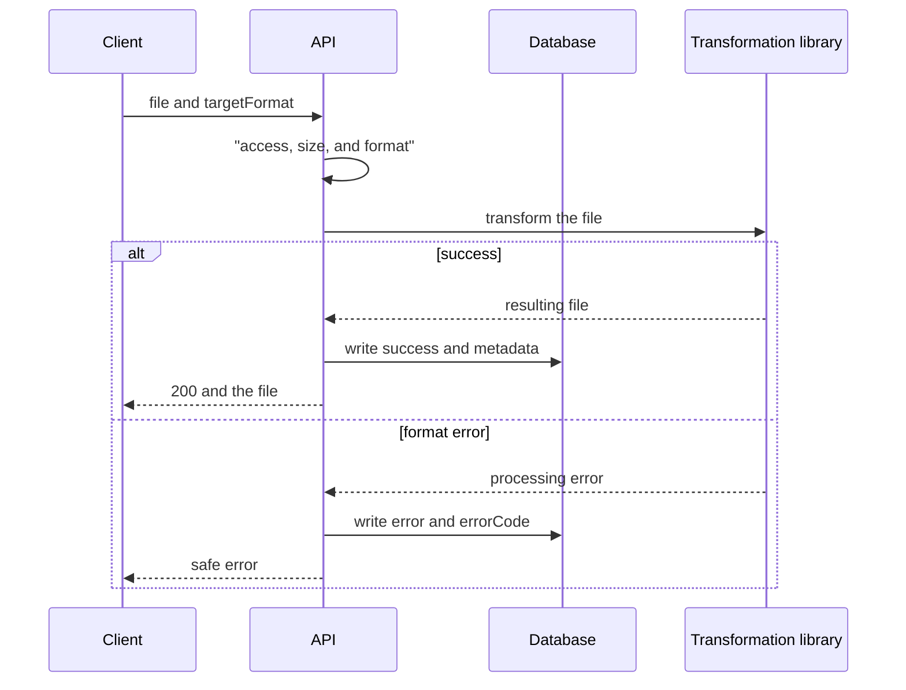
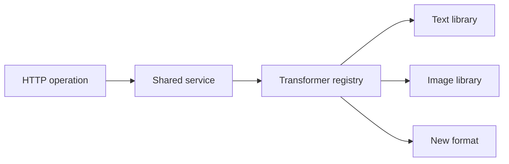

# Shared requirements for file transformation

## Contents

- [Theory](#theory)
  - [Situation](#situation)
  - [Model](#model)
  - [Concepts and how they relate to the backend](#concepts-and-how-they-relate-to-the-backend)
  - [Responsibilities](#responsibilities)
  - [Common failures](#common-failures)
  - [Useful links](#useful-links)
  - [Review questions](#review-questions)
- [Practical assignment](#practical-assignment)
  - [1.1 General](#11-general)
  - [1.2 Scenarios](#12-scenarios-user-stories)
  - [1.3 Contract](#13-contract)
  - [1.4 Errors and constraints](#14-errors-and-constraints)
  - [1.5 Audit](#15-audit-and-logs)
  - [1.6 Non-functional requirements](#16-non-functional-requirements)

# Theory

## Situation

An active user sends a file and chooses the target format. The server checks access and the input. It passes the file to a suitable library, returns the result, and stores the operation metadata in history.

One of these outcomes follows: the file is transformed successfully, the input is rejected, the library cannot process the content, a limit is exceeded, or a required dependency is temporarily unavailable.

A separate frontend is not required. Requests can be sent from an HTTP client that supports cookies and `multipart/form-data`.

## Model

The HTTP layer does not contain algorithms for specific formats. It runs the shared checks and selects a registered transformer by the source and target formats.

Each transformation type implements one shared interface. The implementation calls a suitable library: a CSV parser, an XML/YAML serializer, Sharp, ImageSharp, Pillow, or another agreed tool.

History contains process metadata, but not file contents.

| `transformations` | Description |
| --- | --- |
| `id` | operation identifier |
| `user_id` | operation owner |
| `type` | `file` or `image` |
| `source_format` | determined source format |
| `target_format` | selected target format |
| `status` | `success` or `error` |
| `input_size` | input file size in bytes |
| `output_size` | result size on success, otherwise `null` |
| `duration_ms` | processing duration |
| `error_code` | safe error code, otherwise `null` |
| `created_at` | start time in UTC |
| `completed_at` | completion time; set for every recorded attempt |

### Normal form

The `transformations` table is in BCNF.

- **1NF:** each field holds one value; file bytes and stage lists are not stored in the row.
- **2NF:** the primary key `id` is simple, so there are no partial dependencies.
- **3NF and BCNF:** formats, sizes, and status describe one operation and depend on its key. The user's email is not copied.
- **4NF:** independent stored files and audit events are not combined into one row.
- **5NF:** the user and the operation join on `user_id`; there are no further join dependencies.

## Concepts and how they relate to the backend

### Transformer interface

A transformer receives an input stream, parameters, and an output stream. The controller does not depend on which library does the work. Adding a new format means a new implementation and registration of the pair, not a change to every existing branch.

An abstract class is allowed, but not required. An interface and composition are usually enough: the library is connected through an adapter, and the shared service handles access, history, and errors.

### Libraries, not custom parsers

CSV, YAML, XML, JPEG, PNG, and SVG have many edge cases. A custom parser or codec easily fails on quotes, Unicode, entities, color profiles, and corrupt data.

A supported library for the chosen language is used. The application sets limits and safe settings for it, then maps its errors to the HTTP statuses in the contract.

### Stream processing

A stream avoids loading an entire large file into one buffer and supports backpressure. Some libraries still build a full document or image model, so the size limit stays mandatory.

The result is fully formed in a temporary area first. The client does not receive a partial file if the library ends with an error.

### History and audit

History is a user-facing feature. It shows the format, the status, the sizes, and the duration. Audit is a technical log of requests and errors.

After an attempt finishes, `success` or `error` is stored. If the history write fails, the API returns **503**, and the temporary result is deleted.

### Temporary and permanent storage

Without `save=true`, the result exists only until the response completes. Temporary files are not available at a public URL and are deleted on success, on error, or on timeout.

Permanent storage is connected through a separate interface. A local disk is suitable for single-instance development, and production uses S3-compatible storage or another agreed store.

### User deletion

The transformation module registers a handler for user-data deletion. The handler deletes stored files and history records. A repeated call is safe: an object that is already absent counts as deleted.

### Summary

| Concept | Meaning | Implementation |
| --- | --- | --- |
| Interface | one call for different transformers | service/adapter |
| Registry | library selection by format pair | `source + target` |
| Stream | bounded memory use | stream and backpressure |
| History | metadata of each attempt | `transformations` |
| Temporary file | a complete result before the response | a private temporary area |
| Storage adapter | a backend change without an API change | local or S3-compatible |

## Responsibilities

| Client | Server |
| --- | --- |
| Sends one file and the parameters | Checks access, `transformations@convert`, the format, and the size |
| Chooses a published direction | Selects a registered library |
| Receives the file or a clear error | Does not reveal the library stack trace |
| Requests history separately | Stores metadata for every attempt |
| Explicitly chooses permanent storage | Deletes the temporary result by default |

## Common failures

| What you see | Where to look |
| --- | --- |
| A new format required a controller change | library selection is not extracted into the registry |
| A large file exhausted memory | the stream was replaced by reading the whole file with no limit |
| The client received a truncated result | the response started before the transformation finished |
| A successful transformation is missing from history | the result was returned without the required metadata record |
| History contains file contents | metadata is mixed with user data |
| Temporary files remain after an error | cleanup does not run for every branch |
| The response shows a library message | the exception was not mapped to a safe code |

## Useful links

### General

- [OWASP — File Upload Cheat Sheet](https://cheatsheetseries.owasp.org/cheatsheets/File_Upload_Cheat_Sheet.html) — file checks, limits, and safe storage.
- [MDN — MIME types](https://developer.mozilla.org/en-US/docs/Web/HTTP/Guides/MIME_types) — a correct `Content-Type` for the input and the result.
- [Refactoring Guru — Strategy](https://refactoring.guru/design-patterns/strategy) — choosing an independent transformation implementation.
- [PostgreSQL — Transactions](https://www.postgresql.org/docs/current/tutorial-transactions.html) — a consistent history write.

### By language

#### Node.js

**Node.js, NestJS.** On Express or Fastify the contract does not change.

- [Node.js — Streams](https://nodejs.org/api/stream.html) — streams and backpressure.
- [NestJS — File upload](https://docs.nestjs.com/techniques/file-upload) — accepting a multipart file.
- [NestJS — Providers](https://docs.nestjs.com/providers) — registration of transformation services.
- [NestJS — OpenAPI](https://docs.nestjs.com/openapi/introduction) — description of file operations.
- [Prisma Migrate](https://www.prisma.io/docs/orm/prisma-migrate) — history migration.

#### .NET

**.NET, ASP.NET Core.** Minimal API and controllers use the same service.

- [.NET — Stream](https://learn.microsoft.com/en-us/dotnet/api/system.io.stream) — streaming input and output.
- [ASP.NET Core — Upload files](https://learn.microsoft.com/en-us/aspnet/core/mvc/models/file-uploads) — accepting files and limits.
- [.NET — Dependency injection](https://learn.microsoft.com/en-us/dotnet/core/extensions/dependency-injection) — registration of implementations.
- [ASP.NET Core — OpenAPI](https://learn.microsoft.com/en-us/aspnet/core/fundamentals/openapi/overview) — API documentation.
- [EF Core — Migrations](https://learn.microsoft.com/en-us/ef/core/managing-schemas/migrations/) — moving the schema.

#### Python

**Python, FastAPI.** On Django or Flask the shared contract stays the same.

- [Python — `io`](https://docs.python.org/3/library/io.html) — streaming interfaces.
- [FastAPI — Request Files](https://fastapi.tiangolo.com/tutorial/request-files/) — multipart files.
- [FastAPI — Dependencies](https://fastapi.tiangolo.com/tutorial/dependencies/) — connecting services and access.
- [FastAPI — Metadata and Docs URLs](https://fastapi.tiangolo.com/tutorial/metadata/) — OpenAPI.
- [Alembic — Tutorial](https://alembic.sqlalchemy.org/en/latest/tutorial.html) — history migration.

## Review questions

1. Why is transformation of a specific format better hidden behind a shared interface?
2. Which errors arise when CSV, XML, or an image codec is implemented from scratch?
3. Why does stream processing not remove the input file limit?
4. How does user-facing history differ from a technical audit?
5. Why is the result formed in full before the HTTP response starts?
6. What happens to temporary data after an error or a timeout?
7. Why does the `transformations` table satisfy BCNF?

# Practical assignment

Shared file transformation process functionality in the system.
An active user starts a supported transformation. The server calls a library through the shared interface, returns the complete result, and stores safe metadata for the operation.

## 1) Shared requirements for file transformation

### 1.1 General

**Purpose:** define the shared interface, the history, and the file lifecycle rules for every transformation.

**Users and roles:** an active user with the `transformations` permission. The role name is not checked.

| Action | Operation |
| --- | --- |
| `convert` | `POST /api/convert`, `POST /api/images/convert`, and both direction lists |
| `history` | the user's own history |
| `history_any` | a specified user's history; checked before the target lookup |
| `download` | download of the user's own result |
| `download_any` | download of a specified user's result; checked before the target lookup |

On first installation, while the `transformations` permission does not exist, the module creates these actions. The `user` role receives `convert`, `history`, and `download`. The `admin` role, if it exists, receives every action. A repeated run does not restore removed assignments. If the `user` role is missing, the module does not pass readiness.

**Dependencies and related settings:**

- the access JWT, cookies, and the authorization chain match authentication and RBAC;
- specific pairs and limits are set by the text and image requirements;
- one transformer is registered for each direction;
- the temporary area is not publicly available;
- the storage backend is set by the application configuration.

A transformer uses a library for the chosen language. The practical contract does not require writing a parser or a codec from scratch.

### 1.2 Scenarios (user stories)

1. **Success:** the library transforms the file, the server stores `success`, and the client receives the result.
2. **Error:** the server stores `error` and a safe code, and temporary data is deleted.
3. **New pair:** a new implementation is registered without changing the contracts of pairs that already work.
4. **History:** the user later receives metadata for text and image operations in one list.
5. **Save:** with an explicit flag, the attempt stays `success`, receives a key and `storageStatus=pending`; the HTTP response does not wait for object storage.
6. **User deletion:** the handler deletes that user's stored files and history.

### 1.3 Contract

#### 1.3.1 Transformer interface

A transformer receives:

- an input stream;
- validated parameters;
- an output stream.

It returns the actual `contentType`, extension, and size, or a safe error code. It does not check the JWT, does not build the HTTP response, and does not write history.

#### 1.3.2 Shared sequence

1. Check the access JWT and the current `active` status.
2. For a state-changing request from another origin, check `Origin` and CSRF.
3. Check the `permission@action` pair for this operation. On denial, return **403** before the file is parsed.
4. Check multipart, the size, and the parameters of the specific operation.
5. Determine the source format and find the registered pair.
6. Call the library and build a temporary result.
7. On success, write `success`, the sizes, and the duration, and return the file.
8. On error, write `error` and a safe `errorCode`, and return the status from section 1.4.
9. Delete temporary data on every outcome.

If the history write fails, the result is not returned. Temporary data is deleted, and **503** is returned.

#### 1.3.3 History

Only the fields of the `transformations` table are written to history. Content, parsed data, the JWT, cookies, temporary paths, and library messages are not stored.

#### 1.3.4 Temporary data and storage

The original name is not used as a path. The server generates the temporary name.

Without saving, the result is deleted after the response. When `save=true`, the server assigns a key and keeps a copy for a background write under the rules of `2.4`, without delaying delivery of the transformed file.

The user-deletion handler first deletes objects that belong to the user, then history rows. A missing object or row counts as already deleted.

### 1.4 Errors and constraints

- **400 Bad Request** — a file or a parameter is missing, the structure is damaged, or the parameters are invalid.
- **401 Unauthorized** — the session is missing or invalid, or the user is not `active`.
- **403 Forbidden** — the declared `transformations` permission is missing, or the cross-origin CSRF check did not pass.
- **413 Content Too Large** — the input limit or the result limit is exceeded.
- **415 Unsupported Media Type** — the format or the direction is not supported.
- **503 Service Unavailable** — the history database, the temporary area, or a required dependency is unavailable.
- **504 Gateway Timeout** — the library did not finish within the configured time.

The library message and a partial result are not returned to the client.

### 1.5 Audit and logs

Log `requestId`, `transformationId`, `userId`, the type, the formats, the sizes, the result, a safe `errorCode`, and the duration.

The log does not include content, parsed values, the original name, the temporary path, the JWT, cookies, the multipart body, or the library stack trace.

### 1.6 Non-functional requirements

- The size limits and the timeout of the specific format apply. The result is returned only in full.
- A call to a resource-intensive library does not block acceptance of other requests: the call is moved to a separate thread or pool, but the HTTP response waits until the transformation finishes. A job queue is not used for the transformation itself.
- The history index covers `user_id, created_at, id`.
- Tests cover library selection, success, error, timeout, history, and cleanup of temporary files.
- The project's general non-functional requirements and test coverage of at least 80% apply to every transformation.
