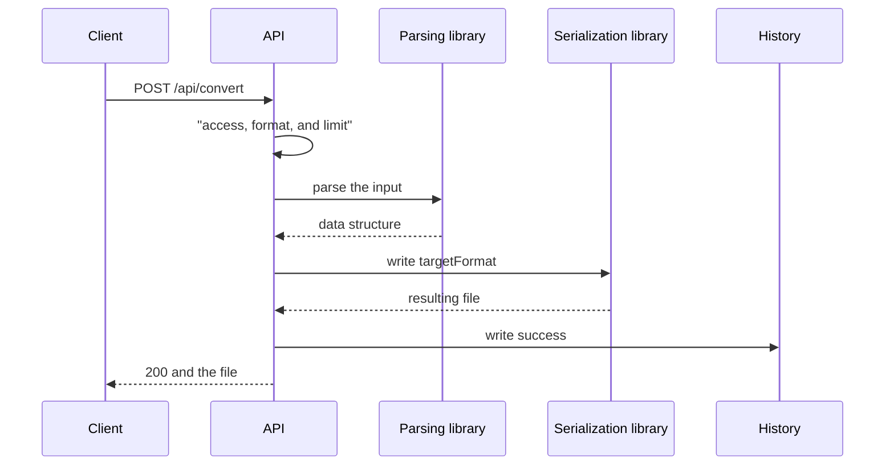
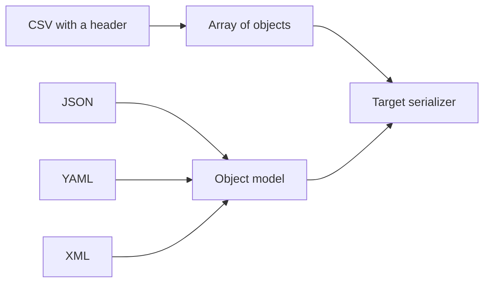

# Transforming text formats

## Contents

- [Theory](#theory)
  - [Situation](#situation)
  - [Model](#model)
  - [Concepts and how they relate to the backend](#concepts-and-how-they-relate-to-the-backend)
  - [Responsibilities](#responsibilities)
  - [Example](#example)
  - [Common failures](#common-failures)
  - [Useful links](#useful-links)
  - [Review questions](#review-questions)
- [Practical assignment](#practical-assignment)
  - [1.1 General](#11-general)
  - [1.2 Scenarios](#12-scenarios-user-stories)
  - [1.3 Contract](#13-contract)
  - [1.4 Errors and constraints](#14-errors-and-constraints)
  - [1.5 Audit](#15-audit-and-logs)
  - [1.6 Non-functional requirements](#16-non-functional-requirements)

# Theory

## Situation

An active user uploads a CSV, JSON, XML, or YAML file and selects another text format. The server checks the file, calls a parsing and serialization library, stores the operation metadata, and returns the transformed file.

One of these outcomes follows: a successful transformation, a syntax or structure error, an unsupported format, a limit exceeded, a timeout, or a temporary dependency error.

A separate frontend is not required. A request can be sent from an HTTP client with cookies and `multipart/form-data`.

## Model

Text libraries use different representations, so the service maps the parse result to a common data structure. CSV uses a table. JSON, YAML, and XML use an object model.



CSV uses an array of objects: the first row holds the column names, and the other rows hold the values. This makes CSV → JSON/YAML unambiguous and defines the shape that JSON/YAML must have for the reverse transformation.



The history file uses the `transformations` table from the shared requirements. No additional tables are created.

## Concepts and how they relate to the backend

### Ready-made libraries

A CSV parser handles quoted fields, line breaks, and escaped quotes. An XML parser checks that the markup is well-formed. A YAML library distinguishes strings, numbers, booleans, and `null`.

These rules should not be implemented by hand. The application chooses the library, applies a safe configuration, enforces the limits, and maps exceptions to an HTTP response.

### Source format

The extension `.csv`, `.json`, `.xml`, `.yaml`, or `.yml` declares the format. The server also checks that the matching library can parse the content in full.

The client `Content-Type` is an additional check. It does not replace parsing. JSON is also valid YAML, so a guess based only on the first characters is unreliable.

### CSV

The first CSV row is required and contains non-empty, unique column names. Each record has the same number of fields. CSV values stay strings. Turning `001` into a number is forbidden.

CSV → JSON/YAML returns an array of objects. JSON/YAML → CSV accepts an array of flat objects with the same set of keys. A nested object or array cannot be written into one CSV cell without ambiguity, so the server rejects it.

CSV ↔ XML uses the structure `rows → row → field`, where the column name is stored in the `name` attribute.

### JSON and YAML

JSON follows RFC 8259. Duplicate keys, `NaN`, `Infinity`, and data after the root value are rejected.

YAML is loaded with the library's safe method. Custom tags and construction of arbitrary objects are disabled. JSON ↔ YAML preserves the data. It does not preserve comments or the original formatting.

### XML

XML is processed without a DTD, external entities, or network access. This blocks XXE.

For XML → JSON/YAML, attributes receive the `@` prefix, text receives `#text`, and repeated elements become an array. The reverse transformation uses the same convention. Tests and the API documentation establish that convention.

### Encoding and limits

The input and the result use UTF-8. A BOM is allowed only at the start. An invalid encoding receives **400**.

The limit of each input format is set in configuration. The default is 10 MiB. The result does not exceed 50 MiB. The transformation timeout is 30 seconds.

CSV is processed as a stream when the selected library supports it. For JSON, XML, and YAML, the input limit protects operations that need the full structure in memory.

### History

A successful operation stores the source format, the target format, the sizes, and the duration. An error stores a safe `errorCode`. It does not store a document fragment or the text of the library exception.

### Summary

| Concept | Meaning | Implementation |
| --- | --- | --- |
| CSV header | result field names | first row |
| Common model | link among JSON, YAML, and XML | library structures |
| Safe YAML | object creation disabled | safe loader |
| Safe XML | external entities disabled | parser settings |
| UTF-8 | a single encoding | decoder with validation |

## Responsibilities

| Client | Server |
| --- | --- |
| Sends a file with the correct extension | Checks it with the selected library |
| Selects one of the published targets | Checks the direction |
| Does not expect comments to be preserved | Stores the data and omits the formatting |
| Receives a file or a safe error | Does not reveal the content or a stack trace |
| Requests the list of formats | Builds it from the registered pairs |

## Example

The program transforms a CSV with the columns `name` and `age`, and one record, into JSON. All three variants print `[{"name":"Anna","age":"30"}]`. The age value stays a string, as it is represented in the CSV.

### Node.js

**Node.js 22 or later, the `csv-parse` library.** A ready-made CSV parser is used, with the first row as the header.

```sh
npm install csv-parse
node csv-to-json.js
```

```javascript
const { parse } = require('csv-parse/sync');

const input = 'name,age\nAnna,30\n';
const rows = parse(input, {
  columns: true,
  skip_empty_lines: true,
});

console.log(JSON.stringify(rows));
```

### .NET

**.NET 8 or later, the CsvHelper package.** The library reads CSV with the invariant culture. The standard JSON serializer builds the result.

```sh
dotnet new console -o CsvToJson
cd CsvToJson
dotnet add package CsvHelper
dotnet run
```

```csharp
using System.Globalization;
using System.Text.Encodings.Web;
using System.Text.Json;
using CsvHelper;

using var reader = new StringReader("name,age\nAnna,30\n");
using var csv = new CsvReader(reader, CultureInfo.InvariantCulture);
var rows = csv.GetRecords<dynamic>()
    .Select(row => ((IDictionary<string, object>)row)
        .ToDictionary(item => item.Key, item => item.Value?.ToString()))
    .ToList();
var options = new JsonSerializerOptions {
    Encoder = JavaScriptEncoder.UnsafeRelaxedJsonEscaping
};

Console.WriteLine(JsonSerializer.Serialize(rows, options));
```

### Python

**Python 3.10 or later, the standard `csv` and `json` modules.** No extra package is required for CSV.

```sh
python csv_to_json.py
```

```python
import csv
import io
import json

source = io.StringIO("name,age\nAnna,30\n")
rows = list(csv.DictReader(source))

print(json.dumps(
    rows,
    ensure_ascii=False,
    separators=(",", ":"),
))
```

---

The libraries parse the CSV. Application code only sets clear parameters and serializes the resulting structure.

## Common failures

| What you see | Where to look |
| --- | --- |
| A field that contains a comma split into two | CSV is parsed with `split` instead of a library |
| `001` became `1` | automatic CSV type detection is enabled |
| `[object Object]` appeared in the CSV | a nested structure was not rejected |
| YAML created an application object | an unsafe loader is used |
| XML calls an external URL | DTD and external entities are not disabled |
| JSON is detected as YAML | the format is guessed without the extension |
| The client received part of the result | the response started before serialization finished |
| The error shows a document fragment | a library exception was returned to the client |

## Useful links

### General

- [RFC 8259 — JSON](https://www.rfc-editor.org/rfc/rfc8259) — JSON syntax and encoding.
- [RFC 4180 — CSV](https://www.rfc-editor.org/rfc/rfc4180) — quoted fields and CSV lines.
- [W3C — XML 1.0](https://www.w3.org/TR/xml/) — rules for well-formed XML.
- [YAML 1.2.2](https://yaml.org/spec/1.2.2/) — the YAML data model.
- [OWASP — XXE Prevention](https://cheatsheetseries.owasp.org/cheatsheets/XML_External_Entity_Prevention_Cheat_Sheet.html) — a safe XML configuration.

### By language

#### Node.js

**Node.js, NestJS.** On Express or Fastify the contract stays the same.

- [csv-parse](https://csv.js.org/parse/) — CSV from the example.
- [fast-xml-parser](https://github.com/NaturalIntelligence/fast-xml-parser) — XML.
- [yaml](https://eemeli.org/yaml/) — YAML 1.2.
- [NestJS — File upload](https://docs.nestjs.com/techniques/file-upload) — multipart.
- [NestJS — OpenAPI](https://docs.nestjs.com/openapi/introduction) — API documentation.

#### .NET

**.NET, ASP.NET Core.** The contract is the same for a Minimal API and for controllers.

- [CsvHelper](https://joshclose.github.io/CsvHelper/) — CSV from the example.
- [System.Text.Json](https://learn.microsoft.com/en-us/dotnet/api/system.text.json) — JSON.
- [XmlReaderSettings](https://learn.microsoft.com/en-us/dotnet/api/system.xml.xmlreadersettings) — safe XML.
- [YamlDotNet](https://github.com/aaubry/YamlDotNet) — YAML.
- [ASP.NET Core — Upload files](https://learn.microsoft.com/en-us/aspnet/core/mvc/models/file-uploads) — multipart.

#### Python

**Python, FastAPI.** On Django or Flask the contract stays the same.

- [Python — `csv`](https://docs.python.org/3/library/csv.html) — CSV from the example.
- [Python — `json`](https://docs.python.org/3/library/json.html) — JSON.
- [defusedxml](https://pypi.org/project/defusedxml/) — safe XML.
- [PyYAML](https://pyyaml.org/wiki/PyYAMLDocumentation) — safe YAML.
- [FastAPI — Request Files](https://fastapi.tiangolo.com/tutorial/request-files/) — multipart.

## Review questions

1. Why can CSV not be parsed correctly with an ordinary `split` on a comma?
2. Why must CSV values stay strings, with no automatic type detection?
3. What constraints are required when a nested structure is transformed into CSV?
4. How does a safe YAML loader differ from a regular one?
5. Why must an XML parser not load a DTD or external entities?
6. Why does the extension select the parser when the content is still checked?
7. What data is stored in the history when a library returns an error?

# Practical assignment

Text-file transformation functionality in the system.
An active user transforms CSV, JSON, XML, and YAML in any of the twelve directions. Ready-made libraries perform parsing and serialization. The server checks access, limits, errors, and history.

## 1) Transforming text formats

### 1.1 General

**Purpose:** transform a text file between CSV, JSON, XML, and YAML.

**Users and roles:** an active user with `transformations@convert`.

**Dependencies and related settings:**

- the shared process and history are defined in `2.0`;
- the limit of each input format is set in configuration, and the default is 10 MiB;
- the maximum result is 50 MiB;
- the timeout is 30 seconds;
- the encoding is UTF-8, and a leading BOM is allowed.

### 1.2 Scenarios (user stories)

1. **CSV → JSON/XML/YAML:** the header and the rows become a table of objects.
2. **JSON → CSV/XML/YAML:** the library parses the JSON and checks the shape for the target.
3. **XML → CSV/JSON/YAML:** a safe XML parser builds the structure.
4. **YAML → CSV/JSON/XML:** a safe loader builds the structure.
5. **List of directions:** the client receives four source formats and three targets for each.

### 1.3 Contract

#### 1.3.1 File transformation

| `POST /api/convert` | Checks and validation |
| --- | --- |
| `file: binary` | One non-empty `.csv`, `.json`, `.xml`, `.yaml`, or `.yml` |
| `targetFormat: string` | `csv`, `json`, `xml`, or `yaml`, different from the source |
| `save: string` | Optional `true` or `false`, rules from `2.4` |
| Other fields | forbidden |

All twelve directions between different formats are supported.

**Logic and steps:**

1. Check the access JWT and the `active` status.
2. Check `transformations@convert`. If it is missing, return **403** before the file is parsed.
3. Check multipart, the extension, the MIME type, and the limit.
4. Parse the file with the library of the declared format.
5. Check that the structure fits the target.
6. Serialize the result with the library of the target format.
7. Write `success` and return the file. On error, write `error`.

**Responses:**

- **200 OK:** a file with the correct `Content-Type` and `Content-Disposition: attachment; filename="converted.<ext>"`.
- **Errors:** see section 1.4.
- The response includes no source content, internal paths, JWT, cookies, or stack trace.

#### 1.3.2 Representation rules

- CSV has a required header. Values stay strings.
- CSV → JSON/YAML creates an array of objects.
- JSON/YAML → CSV accepts an array of flat objects with the same keys.
- CSV ↔ XML uses `rows`, `row`, and `field name`.
- JSON ↔ YAML preserves data types. It does not preserve comments or formatting.
- XML ↔ JSON/YAML uses the `@attribute` convention, `#text`, and an array for repeated elements.

#### 1.3.3 List of directions

| `GET /api/convert/formats` | Checks |
| --- | --- |
| Cookie `access_token` | a valid `active` user |
| RBAC | `transformations@convert` |

**200 OK:**

```json
[
  {"source":"csv","target":["json","xml","yaml"]},
  {"source":"json","target":["csv","xml","yaml"]},
  {"source":"xml","target":["csv","json","yaml"]},
  {"source":"yaml","target":["csv","json","xml"]}
]
```

### 1.4 Errors and constraints

- **400 Bad Request** — the file is empty, the syntax or the encoding is invalid, the parameters are invalid, or the structure does not fit the target.
- **401 Unauthorized** — the session is missing or invalid, or the user is not `active`.
- **403 Forbidden** — `transformations@convert` is missing, or the CSRF check for a state-changing request failed.
- **413 Content Too Large** — the input or the result exceeded the limit.
- **415 Unsupported Media Type** — the source or the target is not supported, or the content does not match the extension.
- **503 Service Unavailable** — history or the temporary area is unavailable.
- **504 Gateway Timeout** — processing did not finish within 30 seconds.

### 1.5 Audit and logs

Log: `userId`, `transformationId`, `sourceFormat`, `targetFormat`, the sizes, the result, a safe code, and the duration.

Do not log the content, parsed data, the original name, the temporary path, the JWT, cookies, or the multipart body.

### 1.6 Non-functional requirements

- Use supported libraries. A custom parser is not acceptable. XML is processed without a DTD or external entities. YAML uses a safe loader.
- Tests cover 12 directions, CSV quotes, Unicode, library errors, limits, and timeout.
- The project's general non-functional requirements are mandatory. Test coverage of at least 80% is mandatory.
