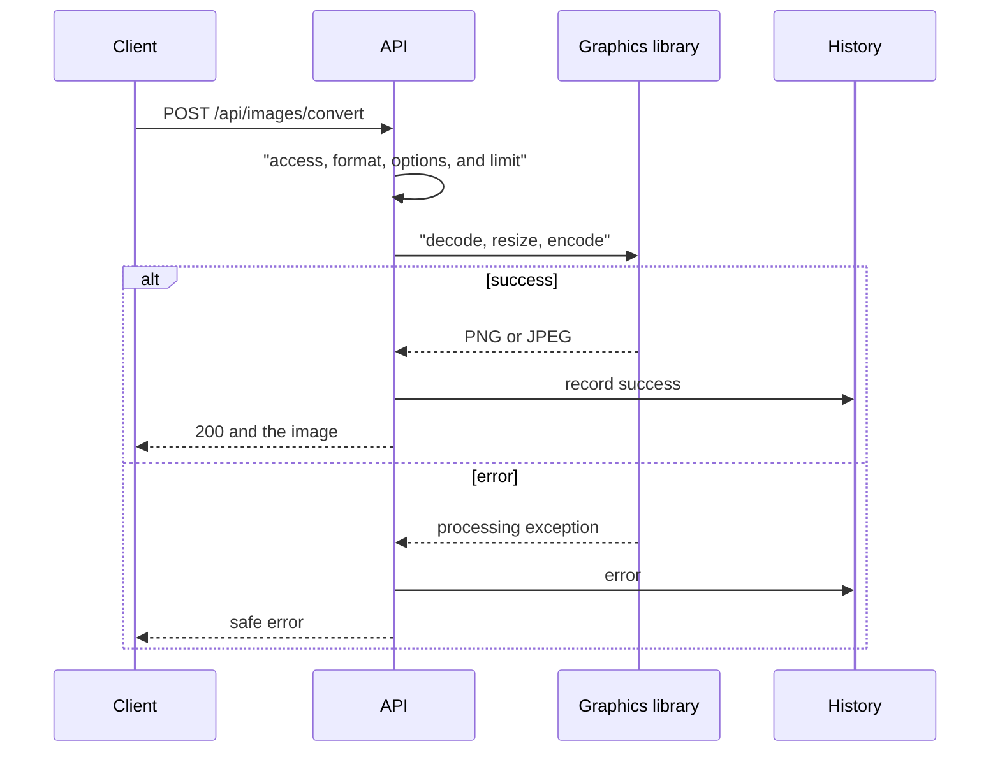
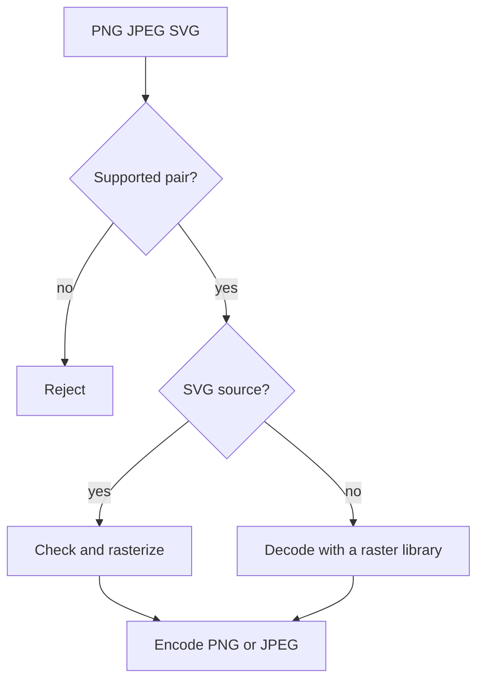

# Transforming images

## Contents

- [Theory](#theory)
  - [Situation](#situation)
  - [Model](#model)
  - [Concepts and how they relate to the backend](#concepts-and-how-they-relate-to-the-backend)
  - [Responsibilities](#responsibilities)
  - [Example](#example)
  - [Common failures](#common-failures)
  - [Useful links](#useful-links)
  - [Review questions](#review-questions)
- [Practical assignment](#practical-assignment)
  - [1.1 General](#11-general)
  - [1.2 Scenarios (user stories)](#12-scenarios-user-stories)
  - [1.3 Contract](#13-contract)
  - [1.4 Errors and constraints](#14-errors-and-constraints)
  - [1.5 Audit and logs](#15-audit-and-logs)
  - [1.6 Non-functional requirements](#16-non-functional-requirements)

# Theory

## Situation

An active user uploads a PNG, JPEG, or SVG and chooses a supported result. The server checks the file and the parameters, calls a graphics library, stores the operation metadata, and returns the finished image.

One of the following outcomes follows: the transformation is completed, the direction is not supported, the file is damaged, the SVG is unsafe, the size or the processing time is exceeded, or a required dependency is unavailable.

PNG/JPEG → SVG is not supported. Encoding a raster file into an SVG container does not turn pixels into vector objects.

## Model

The API does not process pixels itself. PNG and JPEG go to a raster library. SVG goes to a rasterization library after a safe XML check.



The direction determines the available parameters.



The `transformations` table from the common requirements receives `type=image`. No additional tables are needed.

## Concepts and how they relate to the backend

### Image libraries

Sharp, ImageSharp, and Pillow can decode PNG/JPEG, account for dimensions, change the format, and encode the result. For SVG, resvg, Svg.Skia, CairoSVG, or an equivalent is used.

The application does not implement PNG, JPEG, or SVG itself. It sets the allowed dimensions, quality, background, and timeout on the library, then maps exceptions to contract errors.

### Raster and vector

PNG and JPEG store pixels. SVG stores geometric commands. SVG can be rasterized at a given size. The reverse transformation requires separate vectorization and is outside this assignment.

JPEG does not support transparency. For PNG/SVG → JPEG, transparent areas are flattened onto a background, white by default. PNG preserves alpha.

### Format check

The extension and `Content-Type` are checked together with the signature and the decode result. Renaming a damaged file to `.png` does not make it a PNG.

Before a large buffer is allocated, the library must receive limits on width, height, and pixel count. This protects against a decompression bomb.

### Safe SVG

SVG is an XML document and can contain scripts, external links, and other active constructs. Before rasterization, a DTD, external entities, `script`, `foreignObject`, event handlers, and external resources are forbidden.

The rasterizer runs without network access. SVG itself is never returned as the target format, so the client receives only PNG or JPEG.

### Dimensions and quality

For SVG → raster, `width` and `height` set the final size. If both are absent, the intrinsic size of the SVG is used. If there is no intrinsic size, 1024×1024 is used. A single size keeps the aspect ratio.

Each side of the result is at most 4096 pixels, and the total pixel count is at most 16,777,216. JPEG quality accepts an integer from 1 to 100. The default is 85.

### Metadata

EXIF orientation is applied before JPEG encoding. The output file is created anew, without EXIF, GPS, or the original name.

### History and storage

History contains the formats, the file sizes, the status, the duration, and a safe code. Pixels and SVG markup are not stored.

Without `save=true`, the temporary result is deleted after the response. The storage adapter from `2.4` performs permanent storage.

### Summary

| Concept | Meaning | Implementation |
| --- | --- | --- |
| Decode | check and read the raster | graphics library |
| Rasterize | SVG becomes pixels | SVG renderer |
| Pixel limit | memory protection | width × height |
| Quality | JPEG setting | library encoder |
| Background | JPEG transparency replacement | `#RRGGBB` |
| Re-encode | a new safe file | metadata removal |

## Responsibilities

| Client | Server |
| --- | --- |
| Sends one file and options | Checks the fields and the direction |
| Chooses PNG or JPEG | Calls the matching library |
| Does not request raster → SVG | Rejects vectorization |
| Sets an allowed size | Checks the sides and the pixels |
| Receives the finished file | Removes metadata and temporary data |

## Example

Each program creates an in-memory 2×1 PNG with semi-transparent red, transforms it with the library into a JPEG with a white background, and saves `output.jpeg`. The program then prints `jpeg 2x1`.

### Node.js

**Node.js 22 or later, the Sharp library.** The same package decodes PNG, flattens alpha onto the background, and encodes JPEG.

```sh
npm install sharp
node png-to-jpeg.js
```

```javascript
const sharp = require('sharp');

async function main() {
  const png = await sharp({
    create: {
      width: 2, height: 1, channels: 4,
      background: { r: 255, g: 0, b: 0, alpha: 0.5 },
    },
  }).png().toBuffer();

  const info = await sharp(png)
    .flatten({ background: '#ffffff' })
    .jpeg({ quality: 85 })
    .toFile('output.jpeg');

  console.log(`${info.format} ${info.width}x${info.height}`);
}

main();
```

### .NET

**.NET 8 or later, the SixLabors.ImageSharp package.** The library creates a PNG, loads it, and encodes JPEG.

```sh
dotnet new console -o PngToJpeg
cd PngToJpeg
dotnet add package SixLabors.ImageSharp
dotnet run
```

```csharp
using SixLabors.ImageSharp;
using SixLabors.ImageSharp.Formats.Jpeg;
using SixLabors.ImageSharp.PixelFormats;
using SixLabors.ImageSharp.Processing;

using var source = new Image<Rgba32>(2, 1, new Rgba32(255, 0, 0, 128));
using var png = new MemoryStream();
await source.SaveAsPngAsync(png);
png.Position = 0;

using var image = await Image.LoadAsync<Rgba32>(png);
image.Mutate(context => context.BackgroundColor(Color.White));
await image.SaveAsJpegAsync(
    "output.jpeg",
    new JpegEncoder { Quality = 85 });

Console.WriteLine($"jpeg {image.Width}x{image.Height}");
```

### Python

**Python 3.10 or later, the Pillow library.** The PNG is created in memory. Pillow then flattens alpha and saves the JPEG.

```sh
pip install Pillow
python png_to_jpeg.py
```

```python
import io
from PIL import Image

source = Image.new("RGBA", (2, 1), (255, 0, 0, 128))
png = io.BytesIO()
source.save(png, format="PNG")
png.seek(0)

image = Image.open(png).convert("RGBA")
result = Image.new("RGB", image.size, "white")
result.paste(image, mask=image.getchannel("A"))
result.save("output.jpeg", format="JPEG", quality=85)

print(f"jpeg {result.width}x{result.height}")
```

---

The example performs a real transformation with the library. Application code only passes the settings. A ready-made encoder produces the JPEG.

## Common failures

| What you see | Where to look |
| --- | --- |
| PNG → SVG appeared in the list | an extension change is incorrectly treated as vectorization |
| A small file exhausted memory | there is no pixel limit before decoding |
| SVG loaded an external URL | the rasterizer has network access, or the check was skipped |
| JPEG is rotated incorrectly | EXIF orientation was not applied |
| Transparency turned black | no background was set before JPEG |
| `quality` affects PNG | parameters are not limited by the direction |
| GPS coordinates remained in the response | the source file was returned without a re-encode |
| The client received part of a JPEG | the response was opened before the library finished |

## Useful links

### General

- [OWASP — File Upload Cheat Sheet](https://cheatsheetseries.owasp.org/cheatsheets/File_Upload_Cheat_Sheet.html): checks of content and limits.
- [OWASP — XXE Prevention](https://cheatsheetseries.owasp.org/cheatsheets/XML_External_Entity_Prevention_Cheat_Sheet.html): safe SVG/XML.
- [W3C — SVG 2](https://www.w3.org/TR/SVG2/): dimensions and `viewBox`.
- [MDN — Image file type guide](https://developer.mozilla.org/en-US/docs/Web/Media/Guides/Formats/Image_types): properties of PNG, JPEG, and SVG.

### By language

#### Node.js

**Node.js, NestJS.** On Express or Fastify the contract stays the same.

- [Sharp](https://sharp.pixelplumbing.com/): PNG/JPEG from the example.
- [resvg-js](https://github.com/thx/resvg-js): SVG → raster.
- [NestJS — File upload](https://docs.nestjs.com/techniques/file-upload): multipart.
- [NestJS — OpenAPI](https://docs.nestjs.com/openapi/introduction): operation documentation.

#### .NET

**.NET, ASP.NET Core.** The contract is the same for Minimal API and controllers.

- [ImageSharp](https://docs.sixlabors.com/): PNG/JPEG from the example.
- [Svg.Skia](https://github.com/wieslawsoltes/Svg.Skia): SVG → raster.
- [ASP.NET Core — Upload files](https://learn.microsoft.com/en-us/aspnet/core/mvc/models/file-uploads): multipart.
- [ASP.NET Core — OpenAPI](https://learn.microsoft.com/en-us/aspnet/core/fundamentals/openapi/overview): documentation.

#### Python

**Python, FastAPI.** On Django or Flask the contract stays the same.

- [Pillow](https://pillow.readthedocs.io/en/stable/): PNG/JPEG from the example.
- [CairoSVG](https://cairosvg.org/documentation/): SVG → raster.
- [defusedxml](https://pypi.org/project/defusedxml/): safe SVG/XML.
- [FastAPI — Request Files](https://fastapi.tiangolo.com/tutorial/request-files/): multipart.

## Review questions

1. Why is PNG/JPEG → SVG not an ordinary format transformation?
2. Why use a library instead of decoding the image in application code?
3. How does a file-size limit differ from a pixel-count limit?
4. Which SVG features are forbidden before rasterization?
5. Why must transparency be handled explicitly before JPEG?
6. Why apply EXIF orientation and re-encode the result?
7. Which metadata is stored in history when the library fails?

# Practical assignment

Image transformation functionality in the system.
An active user transforms PNG to JPEG, JPEG to PNG, and SVG to PNG or JPEG. Ready-made graphics libraries perform decoding, rasterization, and encoding. The server sets the safe parameters and the limits.

## 1) Transforming images

### 1.1 General

**Purpose:** transform a supported image into PNG or JPEG.

**Users and roles:** an active user with `transformations@convert`.

**Dependencies and related settings:**

- the common process and history are defined in `2.0`;
- the input limit is set separately for PNG, JPEG, and SVG, and the default is 10 MiB;
- the maximum side of the result is 4096, and the maximum is 16,777,216 pixels;
- the default JPEG quality is 85;
- the default background is `#ffffff`;
- the timeout is 30 seconds.

### 1.2 Scenarios (user stories)

1. **PNG → JPEG:** the library flattens alpha onto the background and encodes JPEG.
2. **JPEG → PNG:** the library decodes JPEG and encodes PNG.
3. **SVG → PNG:** a safe SVG is rasterized into PNG.
4. **SVG → JPEG:** the SVG is rasterized and receives a background.
5. **List of directions:** the client receives only four pairs.

PNG/JPEG → SVG and a transformation of a format into itself are not supported.

### 1.3 Contract

#### 1.3.1 Image transformation

| `POST /api/images/convert` | Checks and validation |
| --- | --- |
| `file: binary` | One non-empty PNG, JPEG, or SVG |
| `targetFormat: string` | `png` or `jpeg` |
| `options: string` | An optional JSON object |
| `save: string` | Optional `true` or `false`, rules from `2.4` |
| Other fields | forbidden |

The pairs `png→jpeg`, `jpeg→png`, `svg→png`, and `svg→jpeg` are supported.

**Logic and steps:**

1. Check the access JWT and the status `active`.
2. Check `transformations@convert`. If it is missing, return **403** before the file is parsed.
3. Check multipart, the extension, the MIME type, and the limit.
4. Check the direction and `options`.
5. Pass the file and the parameters to the selected library.
6. Check the final dimensions and build a temporary result.
7. Record `success` and return the file. On an error, record `error`.

**Responses:**

- **200 OK:** `image/png` or `image/jpeg`, `Content-Disposition: attachment; filename="converted.<ext>"`, `X-Content-Type-Options: nosniff`.
- **Errors:** see section 1.4.
- The response has no original name, SVG text, EXIF, internal paths, JWT, or cookies.

#### 1.3.2 Parameters

| Field | Rule |
| --- | --- |
| `quality` | Integer 1–100, JPEG only, default 85 |
| `width` | Integer 1–4096, SVG only |
| `height` | Integer 1–4096, SVG only |
| `background` | `#RRGGBB`, JPEG only, default `#ffffff` |

If no sizes are passed for an SVG, the intrinsic size is used. If that size is absent, 1024×1024 is used. A single size keeps the aspect ratio. Unknown or inapplicable fields produce **400**.

#### 1.3.3 SVG safety

SVG is parsed without a DTD, external entities, or network access. `script`, `foreignObject`, event handlers, and external resources are forbidden.

The result is always PNG or JPEG. The original SVG is not returned directly.

#### 1.3.4 List of directions

| `GET /api/images/convert/formats` | Checks |
| --- | --- |
| Cookie `access_token` | a valid user with status `active` |
| RBAC | `transformations@convert` |

**200 OK:**

```json
[
  {"source":"png","target":["jpeg"]},
  {"source":"jpeg","target":["png"]},
  {"source":"svg","target":["png","jpeg"]}
]
```

### 1.4 Errors and constraints

- **400 Bad Request:** the file is damaged, options are invalid, the SVG is unsafe, or the dimensions are not allowed.
- **401 Unauthorized:** the session is missing or invalid, or the user is not `active`.
- **403 Forbidden:** `transformations@convert` is missing, or the CSRF check of a state-changing request failed.
- **413 Content Too Large:** the input or the result exceeded the limit.
- **415 Unsupported Media Type:** the format or the direction is not supported.
- **503 Service Unavailable:** history, the temporary area, or the library is unavailable.
- **504 Gateway Timeout:** processing did not finish within 30 seconds.

### 1.5 Audit and logs

Log: `userId`, `transformationId`, the formats, the input size and the result size, the final dimensions, the result, a safe code, and the duration.

Do not log bytes, SVG/XML, EXIF, the original name, the temporary path, the JWT, cookies, or the multipart body.

### 1.6 Non-functional requirements

- Use supported libraries, and not custom codecs. The SVG renderer has no network access. The result is re-encoded without the source metadata.
- Tests cover the four pairs, alpha, EXIF, dimensions, a dangerous SVG, limits, and timeout.
- The project's general non-functional requirements and test coverage of at least 80% are required.
