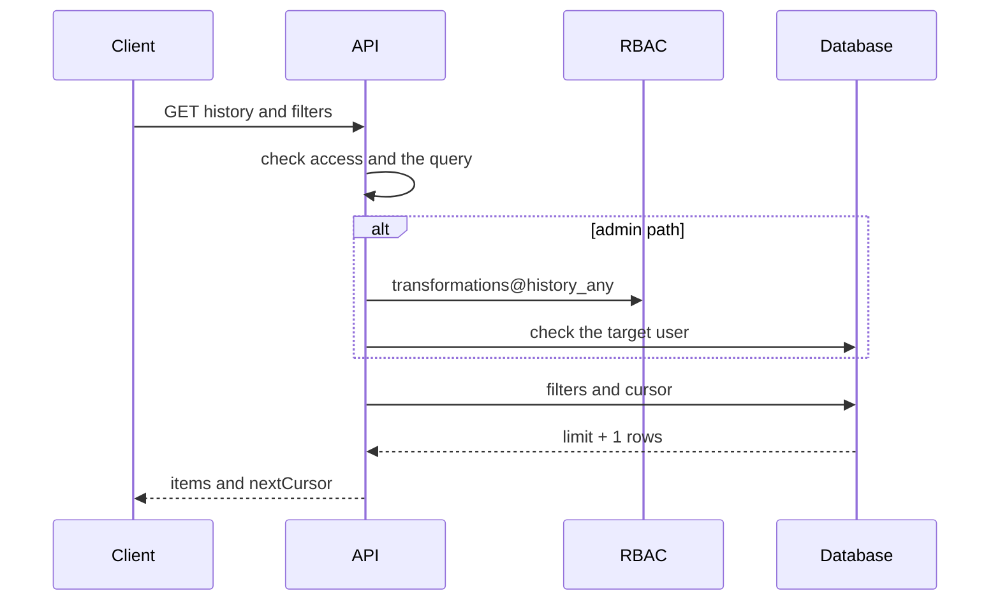
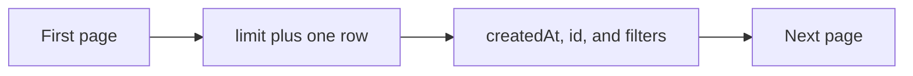

# Viewing a user's file-transformation history

## Contents

- [Theory](#theory)
  - [Situation](#situation)
  - [Model](#model)
  - [Concepts and how they relate to the backend](#concepts-and-how-they-relate-to-the-backend)
  - [Responsibilities](#responsibilities)
  - [Common failures](#common-failures)
  - [Useful links](#useful-links)
  - [Review questions](#review-questions)
- [Practical assignment](#practical-assignment)
  - [1.1 General](#11-general)
  - [1.2 Scenarios](#12-scenarios-user-stories)
  - [1.3 Contract](#13-contract)
  - [1.4 Errors and constraints](#14-errors-and-constraints)
  - [1.5 Audit](#15-audit-and-logs)
  - [1.6 Non-functional requirements](#16-non-functional-requirements)

# Theory

## Situation

An active user requests the user's own history of text and image transformations. A user with the administrator permission can view the history of a specified user.

One of these outcomes follows: the server returns a page of metadata, rejects a filter or a cursor, forbids another user's history, reports a missing user, limits the rate, or returns a temporary database error.

File contents, email, and profile fields are not part of the history. A separate frontend is not required. Requests can be sent from an HTTP client with cookies.

## Model

Self receives `userId` from the verified access JWT. An administrator operation checks `transformations@history_any` first, then looks up the target user.

History is sorted by `created_at DESC, id DESC`. The cursor contains the last sort pair of the next page.

The API reads the `transformations` table from the general requirements. No additional tables are created.

## Concepts and how they relate to the backend

### Cursor pagination

Offset forces the database to skip more and more rows. A cursor starts the query after the last `created_at, id` pair. The query uses the composite index and does not depend on the page number.

`created_at` can match for several operations, so one timestamp is not enough. `id` makes the order unambiguous.

The cursor encodes the version, the last timestamp, `id`, and the canonical filter set, together with `limit`, through base64url. After decoding, the server checks the shape, the types, and a match of the set with the current query. A different filter or a different `limit` receives **400**. Traversal starts over. The cursor does not grant permissions. The Self filter on `user_id` and RBAC run again on every request.

New operations appear before pages that were already viewed. They do not enter the current continuation. They become visible after a request for a new first page.

### Filters

The type, the source format, the target format, the result, and the period can be used as filters. Values are checked against the published formats.

The period is set in UTC. `createdAtFrom` is inclusive. `createdAtTo` is exclusive. An invalid date order receives **400**. The filter set is fixed in the cursor of the first page and does not change on continuation.

### Self and Admin

The Self endpoint does not accept `userId`. The owner always comes from `sub`. This rules out access to another user's history through query substitution. The operation declares `transformations@history` and checks it before the history is read.

The Admin endpoint requires `transformations@history_any`. The permission is checked before the target lookup. A client without the permission receives **403** regardless of whether `userId` exists.

### Item shape

An item contains only operation metadata: formats, status, sizes, duration, a safe code, and the time. `durationMs` can be stored at completion or computed from the timestamps. The public contract does not change either way.

After storage is connected, `storageStatus`, `hasStoredFile`, and `fileExpiresAt` are added. The internal object key is not returned.

### Retention

The history lifetime comes from configuration. The default is 90 days. Background cleanup deletes old records in small batches.

If a record has a stored file, the object is deleted through the storage adapter first. The history record is deleted after that. The user-deletion handler uses the same order and does not wait for retention.

### Summary

| Concept | Meaning | Implementation |
| --- | --- | --- |
| Cursor | position of the next page and its filters | `created_at + id + query` |
| Self | own records only | `user_id` from `sub` |
| Admin | another user's history | `history_any` |
| Filter | a restriction on the list | allowed query fields |
| Retention | a limited history lifetime | background cleanup |

## Responsibilities

| Client | Server |
| --- | --- |
| Sends filters and the cursor | Checks their format |
| For Self, does not send `userId` | Takes the owner from the access JWT |
| Stores the cursor as an opaque string | Applies a stable sort |
| Shows metadata only | Does not return contents or PII |
| Starts a new selection without a cursor | Shows new operations on the first page |

## Common failures

| What you see | Where to look |
| --- | --- |
| Records repeat between pages | The cursor uses only time, without `id` |
| Self sees another user's record | `user_id` was accepted from the query |
| User existence can be checked without the admin permission | The target is looked up before RBAC |
| A large page slows the API | limit is not capped |
| An email appeared in an item | The user profile was joined without need |
| An error contains a file fragment | A library message was stored in the history |
| Old records are not deleted | The retention job is not running |

## Useful links

### General

- [PostgreSQL — Multicolumn indexes](https://www.postgresql.org/docs/current/indexes-multicolumn.html) — an index for `user_id, created_at, id`.
- [OWASP — Authorization Cheat Sheet](https://cheatsheetseries.owasp.org/cheatsheets/Authorization_Cheat_Sheet.html) — the Self/Admin check.
- [MDN — URLSearchParams](https://developer.mozilla.org/en-US/docs/Web/API/URLSearchParams) — passing filters from the client.

### By language

#### Node.js

**Node.js, NestJS.** On Express or Fastify, the pagination contract does not change.

- [Prisma — Pagination](https://www.prisma.io/docs/orm/prisma-client/queries/pagination) — cursor pagination.
- [NestJS — Controllers](https://docs.nestjs.com/controllers) — query parameters.
- [NestJS — OpenAPI](https://docs.nestjs.com/openapi/introduction) — a description of the filters and the page.

#### .NET

**.NET, ASP.NET Core.** A Minimal API and controllers return one page shape.

- [EF Core — Efficient querying](https://learn.microsoft.com/en-us/ef/core/performance/efficient-querying) — keyset pagination.
- [ASP.NET Core — Model validation](https://learn.microsoft.com/en-us/aspnet/core/mvc/models/validation) — query validation.
- [ASP.NET Core — OpenAPI](https://learn.microsoft.com/en-us/aspnet/core/fundamentals/openapi/overview) — a description of the response.

#### Python

**Python, FastAPI.** For Django or Flask, the cursor rules stay the same.

- [SQLAlchemy — SELECT](https://docs.sqlalchemy.org/en/20/core/selectable.html) — filters and sorting.
- [FastAPI — Query Parameters](https://fastapi.tiangolo.com/tutorial/query-params/) — query validation.
- [FastAPI — Metadata and Docs URLs](https://fastapi.tiangolo.com/tutorial/metadata/) — OpenAPI.

## Review questions

1. Why does the cursor use both `created_at` and `id`?
2. How does cursor pagination differ from offset on large pages?
3. Why does the Self endpoint not accept `userId`?
4. Why is the administrator permission checked before the user lookup?
5. Which data belongs in a history item, and which data belongs only to the audit?
6. How do new operations behave when pagination that has already started continues?
7. In what order are a stored file and a history record deleted?

# Practical assignment

Functionality for viewing a user's transformation history in the system.

An active user receives pages of the user's own history, and a holder of the administrator permission receives the history of a specified user. The response contains metadata without file contents or PII.

## 1) Viewing transformation history

### 1.1 General

**Purpose:** return a page of completed text and image transformations.

**Users and roles:**

- Self with `transformations@history` — own history after authentication;
- Admin with `transformations@history_any` — the history of a specified user.

**Dependencies and related settings:**

- the `transformations` table is defined in `2.0`;
- the default page size is 20, and the maximum is 100;
- sorting is always `created_at DESC, id DESC`;
- the default retention period is 90 days.

### 1.2 Scenarios (user stories)

1. **Self:** the user receives a page of the user's own operations.
2. **Continuation:** `nextCursor` opens the next page.
3. **Admin:** after the permission check, the target's history is returned.
4. **Filters:** type, formats, status, and period restrict the list.
5. **Empty page:** a valid request with no results returns an empty array.

### 1.3 Contract

#### 1.3.1 Query parameters

| Parameter | Rule |
| --- | --- |
| `cursor: string` | optional position of the next page |
| `limit: integer` | 1–100, 20 by default |
| `type: string` | `file` or `image` |
| `sourceFormat: string` | a supported source format |
| `targetFormat: string` | a supported target format |
| `status: string` | `success` or `error` |
| `createdAtFrom: date-time` | inclusive UTC bound |
| `createdAtTo: date-time` | exclusive UTC bound |

Every filter is optional. When a cursor is present, `limit` and every filter must match the canonical set inside the cursor. A different set receives **400** and requires a new first page.

#### 1.3.2 Own history

| `GET /api/transformations/history` | Checks |
| --- | --- |
| Cookie `access_token` | current user is `active` |
| RBAC | `transformations@history` |

**Logic and steps:**

1. Check access and the query.
2. Check `transformations@history`. If it is missing, return **403** before the history is read.
3. Take `userId` from `sub`.
4. Apply the filters and the condition after the cursor.
5. Select `limit + 1` rows in a fixed order.
6. Return at most `limit`. If a continuation exists, build `nextCursor` with the same filter set.

#### 1.3.3 History of a specified user

| `GET /admin/users/{userId}/transformations/history` | Checks |
| --- | --- |
| Cookie `access_token` | current user is `active` |
| RBAC | `transformations@history_any` |

The permission is checked before the target lookup. After admission, a missing user receives **404**. The other filters and pagination match Self.

#### 1.3.4 Response shape

**200 OK:**

- `items: TransformationHistoryItem[]`;
- `nextCursor: string | null`.

`TransformationHistoryItem` contains:

- `id`;
- `type`;
- `sourceFormat`;
- `targetFormat`;
- `status`;
- `inputSize`;
- `outputSize: number | null`;
- `durationMs: number`;
- `errorCode: string | null`;
- `createdAt`;
- `storageStatus: "not_requested" | "pending" | "available" | "error"`;
- `hasStoredFile`;
- `fileExpiresAt: date-time | null`.

Until saving from `2.4` is implemented, every record returns `storageStatus=not_requested`, `hasStoredFile=false`, and `fileExpiresAt=null`. The storage fields appear in the schema together with `2.4`.

The response contains no `userId`, email, file name, contents, temporary path, or storage key.

#### 1.3.5 Cursor and retention

The cursor encodes the version, `createdAt`, the `id` of the last record, and the canonical set of `limit`, `type`, `sourceFormat`, `targetFormat`, `status`, `createdAtFrom`, and `createdAtTo`, through base64url. A missing filter is encoded explicitly. After decoding, the version, the time format, the identifier, and a match of the set with the current query are checked. An invalid cursor and a set mismatch receive **400**.

Cleanup deletes records older than the configured period. When a stored object exists, its deletion is called first. A missing object counts as cleanup that is already done.

### 1.4 Errors and constraints

- **400 Bad Request** — the query, the period, or the cursor is invalid.
- **401 Unauthorized** — the session is missing or invalid, or the user is not `active`.
- **403 Forbidden** — own history was called without `transformations@history`, or the admin path was called without `transformations@history_any`.
- **404 Not Found** — the target user of the admin path was not found after the permission check.
- **429 Too Many Requests** — the rate limit for reading history was exceeded.
- **503 Service Unavailable** — the database or RBAC is unavailable.

### 1.5 Audit and logs

Log `actorUserId`, Self/Admin, `targetUserId` for an allowed admin request, filter categories, limit, the item count, the result, and the duration.

Do not log the full cursor, file contents, email, file names, the storage key, a JWT, cookies, or the full response.

### 1.6 Non-functional requirements

- Pagination is required. Offset is not used. The index covers `user_id, created_at, id`. The query selects only the response fields and `limit + 1`.
- A history read allows at most 60 requests per user per minute. The next request receives **429**.
- Retention deletes records older than the configured period in small batches. When an object exists, its deletion is called first.
- Tests cover Self/Admin, the same `createdAt`, the cursor, filters, an empty page, and retention.
- The project's general non-functional requirements and test coverage of at least 80% are required.
