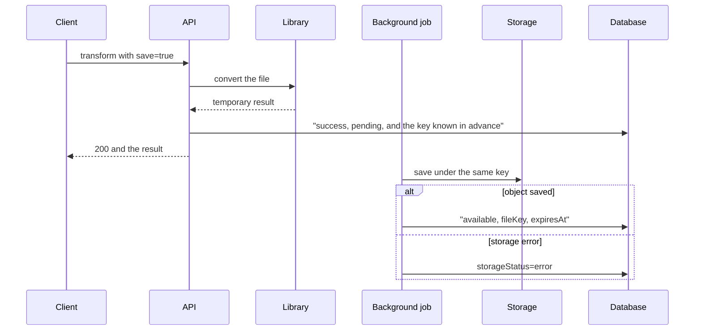
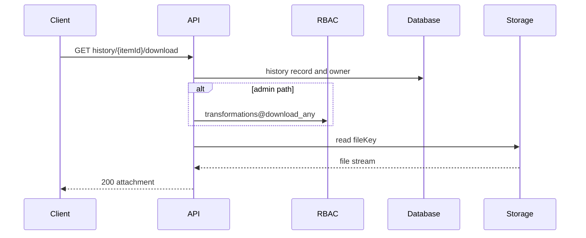

# Saving transformation results to storage

## Contents

- [Theory](#theory)
  - [Situation](#situation)
  - [Model](#model)
  - [Concepts and how they relate to the backend](#concepts-and-how-they-relate-to-the-backend)
  - [Responsibilities](#responsibilities)
  - [Common failures](#common-failures)
  - [Useful links](#useful-links)
  - [Review questions](#review-questions)
- [Practical assignment](#practical-assignment)
  - [1.1 General](#11-general)
  - [1.2 Scenarios (user stories)](#12-scenarios-user-stories)
  - [1.3 Contract](#13-contract)
  - [1.4 Errors and constraints](#14-errors-and-constraints)
  - [1.5 Audit and logs](#15-audit-and-logs)
  - [1.6 Non-functional requirements](#16-non-functional-requirements)

# Theory

## Situation

A user can add `save=true` to a transformation. After the result is ready, the server marks the history as `pending`, returns the transformed file immediately, and a background job writes the object to storage. Without the flag, the result is only returned to the client and is deleted after the response.

The saved file stays available for download until the retention period ends. Self downloads only its own result. Admin downloads the specified user's result after a separate permission check.

## Model

The transformation library first creates a finished temporary file. With `save=true`, the server immediately assigns a random key, saves a copy in an internal temporary area, and marks the history as `pending`. The HTTP response does not wait for object storage. The queue is the history rows with the status `pending`.

Download goes through the API. The client does not receive a direct storage address.

The `transformations` schema gains optional fields:

| Field | Description |
| --- | --- |
| `storage_status` | `not_requested`, `pending`, `available`, or `error` |
| `stored_file_key` | the internal random key of the result, otherwise `null` |
| `stored_file_until` | the retention period, otherwise `null` |
| `storage_error_code` | a safe code for a background-job error, otherwise `null` |

### Normal form

The table stays in BCNF. The storage fields describe the same operation and depend on its `id`.

- **1NF:** the status, the key, the retention period, and the error code are atomic values.
- **2NF:** the primary key is simple.
- **3NF and BCNF:** the storage key and the retention period belong to only one transformation. The bucket address is not copied.
- **4NF:** several file versions are not stored in one row. The contract has one result.
- **5NF:** further decomposition is not required for the one-to-one relationship.

## Concepts and how they relate to the backend

### Storage adapter

Business logic uses the operations `save`, `read`, and `delete`. A local file system and S3-compatible storage implement one interface.

A local disk fits development of a single instance. Production usually uses object storage that every API instance can reach.

### Private key

The server generates the key from a random value. The key contains no email, `userId`, or original name. The bucket and the credentials are in configuration.

Even a random key does not count as a permission. The API always checks the access JWT and the owner of the record.

### Background save

`save=true` means the server accepted the request to save. A successful transformation response does not wait for object storage. The client already receives the file, and the history shows `pending`.

The key is assigned before the response to the client. The background job writes the object under that key, so a repeat is idempotent and does not create a second file. After the write, the state becomes `available`, or `error` on a permanent failure. `available` enables download. On `error`, the user can repeat the transformation. A separate wait endpoint is not needed. Ordinary history returns the state.

### Partial failures

If the object write fails temporarily, the row stays `pending`, and the next attempt writes the same key. The transformation status itself stays `success`. The transformed file was already returned to the client.

If the object is written but the history update fails, the repeat writes the same key again and brings the row to `available`.

If the temporary copy cannot be saved, the transformation response is still **200**, and the history immediately receives `storage_status=error`.

### Download and IDOR

A Self request selects the history row by `itemId` and the current `userId` together. Another user's id and a missing id return the same **404**.

The Admin endpoint requires `transformations@download_any` before lookup of the target user. Knowing the URL or `itemId` does not bypass the check.

### Retention period

Configuration sets the retention period. The default is 90 days. The background job deletes the object first, then clears the storage fields of the history record. Retention from `2.3` deletes the history row itself.

A missing object counts as already deleted. Cleanup is idempotent and can be repeated safely after a failure.

### Summary

| Concept | Meaning | Implementation |
| --- | --- | --- |
| `save` | an explicit user choice | multipart boolean |
| `pending` | the file is still being saved | a history row as the queue |
| Storage adapter | a change of backend | `save/read/delete` |
| Private key | an internal reference | a random value |
| Ownership | protection against IDOR | item + current user |
| Retention period | the result's retention period | `stored_file_until` |

## Responsibilities

| Client | Server |
| --- | --- |
| Passes `save=true` explicitly | Does not save the result by default |
| Downloads through the API | Does not return a direct storage URL |
| Uses a history item | Checks the owner and the admin permission |
| Removes the download button on **404** | Deletes expired objects |
| Shows `pending`, `available`, or `error` | Updates the state of the background write |

## Common failures

| What you see | Where to look |
| --- | --- |
| `save=false` created an object | the default value was handled incorrectly |
| `pending` never completes | the background job did not process the queue |
| The response shows the file key | the internal history model was serialized directly |
| Another user's item is downloaded | the record is looked up without an owner constraint |
| The file is available after the retention period | download does not check the retention period |
| History is deleted and the object remains | cleanup deletes the database before storage |
| A storage failure turned the transformation into an error | the transformation status and the save status were mixed up |
| Unavailable storage breaks `save=false` | the adapter is called without the flag |

## Useful links

### General

- [OWASP — File Upload Cheat Sheet](https://cheatsheetseries.owasp.org/cheatsheets/File_Upload_Cheat_Sheet.html) — private storage and safe names.
- [OWASP — Authorization Cheat Sheet](https://cheatsheetseries.owasp.org/cheatsheets/Authorization_Cheat_Sheet.html) — an owner check.
- [Amazon S3 — Object keys](https://docs.aws.amazon.com/AmazonS3/latest/userguide/object-keys.html) — internal object keys.
- [Amazon S3 — Data consistency](https://docs.aws.amazon.com/AmazonS3/latest/userguide/Welcome.html#ConsistencyModel) — behavior of storage operations.

### By language

#### Node.js

**Node.js, NestJS.** On Express or Fastify the storage contract does not change.

- [AWS SDK for JavaScript — S3 examples](https://docs.aws.amazon.com/sdk-for-javascript/v3/developer-guide/javascript_s3_code_examples.html) — writing, reading, and deleting.
- [NestJS — Streaming files](https://docs.nestjs.com/techniques/streaming-files) — a streaming download.
- [NestJS — Task scheduling](https://docs.nestjs.com/techniques/task-scheduling) — retention-period cleanup.
- [NestJS — OpenAPI](https://docs.nestjs.com/openapi/introduction) — documentation of `save` and download.

#### .NET

**.NET, ASP.NET Core.** The contract is the same for a Minimal API and for controllers.

- [AWS SDK for .NET — S3](https://docs.aws.amazon.com/sdk-for-net/v3/developer-guide/csharp_s3_code_examples.html) — object operations.
- [ASP.NET Core — Action return types](https://learn.microsoft.com/en-us/aspnet/core/web-api/action-return-types) — a file response.
- [.NET — Worker services](https://learn.microsoft.com/en-us/dotnet/core/extensions/workers) — background cleanup.
- [ASP.NET Core — OpenAPI](https://learn.microsoft.com/en-us/aspnet/core/fundamentals/openapi/overview) — API documentation.

#### Python

**Python, FastAPI.** On Django or Flask the file lifecycle stays the same.

- [Boto3 — S3 examples](https://boto3.amazonaws.com/v1/documentation/api/latest/guide/s3-examples.html) — working with objects.
- [FastAPI — Custom Response](https://fastapi.tiangolo.com/advanced/custom-response/) — a streaming download.
- [Python — `asyncio`](https://docs.python.org/3/library/asyncio.html) — a background cleanup job.
- [FastAPI — Metadata and Docs URLs](https://fastapi.tiangolo.com/tutorial/metadata/) — OpenAPI.

## Review questions

1. Why must `save=false` not access permanent storage?
2. Why is the storage key hidden even when the value is random?
3. Why does `save=true` return the result before the background write finishes?
4. How does the transformation status differ from `storageStatus`?
5. How does the owner check protect a download from IDOR?
6. Why does cleanup delete the object first, and then the record or the reference?
7. Why do two storage fields not violate BCNF for the `transformations` table?

# Practical assignment

Functionality for saving transformation results in the system.
The user explicitly chooses background saving of the result. The transformed file is returned immediately, and the save state is shown in history. The saved object stays private, is downloaded only through the API, and is deleted after the retention period.

## 1) Saving transformation results

### 1.1 General

**Purpose:** save a successful result and provide a protected download.

**Users and roles:**

- Self with `transformations@convert` saves the result, and with `transformations@download` downloads only its own;
- Admin with `transformations@download_any` downloads the result of the specified user.

**Dependencies and related settings:**

- transformations and history are defined in `2.0`–`2.3`;
- `save` defaults to `false`;
- the storage backend is set by configuration;
- only a successful result is saved, and it is already limited by the transformation limit;
- the default retention period is 90 days.

### 1.2 Scenarios (user stories)

1. **Without saving:** the result is returned and deleted after the response.
2. **With saving:** the result is returned immediately, history receives `pending`, and a background job writes the object.
3. **Self download:** the owner receives the saved file.
4. **Admin download:** after the permission check, the specified user's file is returned.
5. **Expiration:** the object is deleted, and download returns **404**.
6. **Storage failure:** the transformation stays successful, and history receives `storageStatus=error`.

### 1.3 Contract

#### 1.3.1 Save flag

| Operations | Additional multipart field |
| --- | --- |
| `POST /api/convert` | `save: string`, optional, `true` or `false` |
| `POST /api/images/convert` | the same |

A missing `save` equals `false`. Any other value receives **400**.

**Logic for `save=false`:**

1. Run the ordinary transformation.
2. Record `success` without a storage key.
3. Return the result and clear the temporary file.

**Logic for `save=true`:**

1. Run the ordinary transformation.
2. Generate a random `stored_file_key` and save a copy of the result in the internal temporary area under that key.
3. Record `success`, `storage_status=pending`, and the key.
4. Return the file without waiting for object storage.
5. The background job reads rows with `storage_status=pending`, writes the object under the already known key, and sets `available` with `stored_file_until`.

If the copy for saving cannot be created, the file is still returned, and history receives `storage_status=error`. If storage is temporarily unavailable, the row stays `pending`, and the job repeats the write under the same key. A permanent failure or the loss of the temporary copy sets the save to `error`. A repeated write under the same key is idempotent and does not create a second object.

A successful response contains `X-Transformation-Id` and `X-Save-Status: not_requested|pending|error`. The final state is read from history. A separate jobs table is not needed. The queue is the history rows with the status `pending`.

#### 1.3.2 Own download

| `GET /api/transformations/history/{itemId}/download` | Checks |
| --- | --- |
| Cookie `access_token` | a current user with status `active` |
| RBAC | `transformations@download` before the record lookup |

Absence of `transformations@download` returns **403** before the lookup. After the check passes, the record is selected by `itemId` and the current `userId`. Another user's result, a missing result, an unsaved result, an erroneous result, or an expired result receives **404**. The `pending` state receives **409 Conflict** with the code `file_not_ready`.

On success, the server reads the object as a stream and returns **200**, the contractual `Content-Type`, `Content-Disposition: attachment; filename="converted.<ext>"`, and `X-Content-Type-Options: nosniff`.

If history contains a key but storage does not find the object, the response is **503** and an inconsistency event is created.

#### 1.3.3 Administrative download

| `GET /admin/users/{userId}/transformations/history/{itemId}/download` | Checks |
| --- | --- |
| Cookie `access_token` | a current user with status `active` |
| RBAC | `transformations@download_any` |

The permission is checked before the user lookup. After the check passes, a missing user or a missing item receives **404**. The other rules match Self.

#### 1.3.4 History extension

A history item receives:

- `storageStatus: "not_requested" | "pending" | "available" | "error"`;
- `hasStoredFile: boolean`;
- `fileExpiresAt: date-time | null`.

`hasStoredFile=true` only for `available`. The storage key, the local path, the bucket, and the internal error code are not included in the response.

#### 1.3.5 Retention period and user deletion

The background job selects expired records in small batches. For a saved result, it calls `delete(key)` first, then clears the storage fields. `not_found` counts as a successful deletion. The user-deletion handler performs the same actions immediately for all of that user's records.

### 1.4 Errors and constraints

- **400 Bad Request** — `save` is not `true` or `false`.
- **401 Unauthorized** — the session is missing or invalid, or the user is not `active`.
- **403 Forbidden** — own download is called without `transformations@download`, admin download is called without `transformations@download_any`, or the POST CSRF check fails.
- **404 Not Found** — the user, the item, or the saved file is unavailable after the permission check.
- **409 Conflict** — the save still has the state `pending`.
- **503 Service Unavailable** — the database is unavailable during a download operation, or history points to a missing object.

Unavailability of permanent storage does not affect `save=false` and does not delay a successful response for `save=true`. The error becomes visible in history.

### 1.5 Audit and logs

Log: `userId`, `transformationId`, the action `save`, `download`, or `delete`, the size, the result, and the duration.

The content, the original name, the storage key, the path, the bucket, credentials, the JWT, cookies, and the full storage response are not logged.

### 1.6 Non-functional requirements

- The storage adapter supports `save`, `read`, and `delete`. Files are private and unavailable through a direct public link.
- The background write reads `storage_status=pending` and writes the object under the key saved in advance. Cleanup and the eraser treat `not_found` as success.
- An index covers `storage_status` and `stored_file_until`.
- Tests cover `save=false/true`, the transitions `pending/available/error`, a repeated write under the same key, Self/Admin download, IDOR, and expiration.
- The project's general non-functional requirements and test coverage of at least 80% are mandatory.
