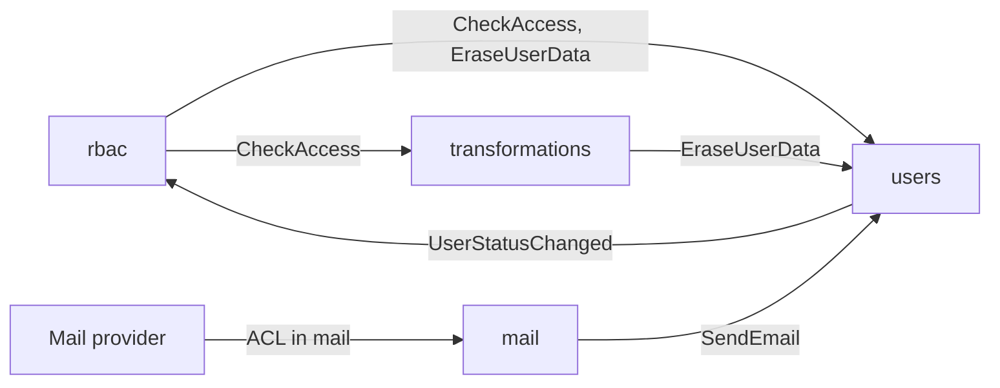
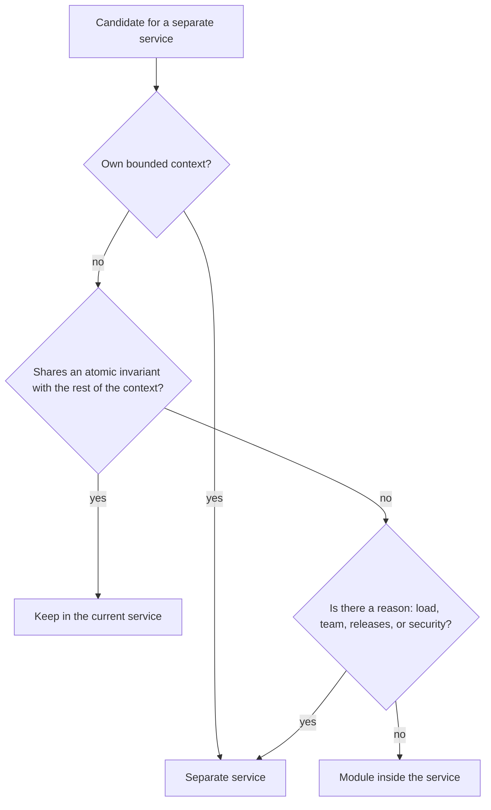
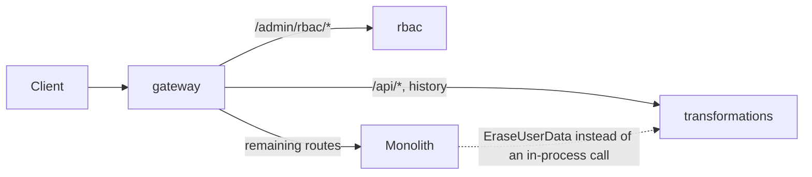
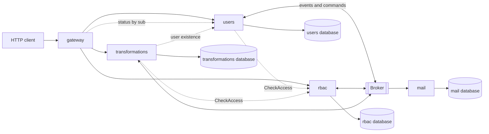

# Decomposition into microservices

## Contents

- [What decomposition into microservices is](#what-decomposition-into-microservices-is)
- [Subdomains](#subdomains)
- [Bounded context and ubiquitous language](#bounded-context-and-ubiquitous-language)
- [Data ownership](#data-ownership)
- [Invariants as a service boundary](#invariants-as-a-service-boundary)
- [Service coupling](#service-coupling)
- [Service size](#service-size)
- [Transition from a monolith](#transition-from-a-monolith)
- [Reference decomposition of the system](#reference-decomposition-of-the-system)
- [Comparison](#comparison)
- [How to choose](#how-to-choose)
- [How this shows up in the system](#how-this-shows-up-in-the-system)
- [Common mistakes](#common-mistakes)
- [Useful links](#useful-links)
- [Review questions](#review-questions)

## What decomposition into microservices is

Decomposition into microservices splits a system into independently deployable services. Each service owns its data and its rules. With well-chosen boundaries, a typical change touches one service and ships without coordination with its neighbors.

The system built in this course is a set of services behind one gateway: registration, sign-in, RBAC, profile management, deletion, the user list, file transformation, history, and storage. For the client it is one HTTP API. Inside, several services each hold their own data. Every other topic depends on the boundaries: which calls go over the network, where a saga is required, and what the gateway checks.

| Approach | Examples | When it fits |
| --- | --- | --- |
| By business capability | accounts, access control, and file transformation | the main approach: business capabilities change less often than technologies |
| By DDD subdomain | core, supporting, and generic parts of the domain | when the decision is where to invest and what to replace with a ready-made solution |
| By non-functional requirements | an image-processing service | a part with a special load, security need, or release cycle |
| By technical layer | "database service", "validation service" | a poor fit: every change passes through every layer service |

## Subdomains

A domain is the problem area a product solves. A subdomain is a part of the domain with its own rules and its own experts. DDD distinguishes three kinds of subdomain:

- **core** is the reason the product exists. The model here needs the most care.
- **supporting** is required by the product, but it does not set the product apart from competitors.
- **generic** is a problem the industry has already solved. A ready-made solution is the better choice.

| Subdomain | Functionality | Kind | Consequence |
| --- | --- | --- | --- |
| File transformation | text and image transformations, history, and storage | core | its own model and independent scaling |
| Accounts and profile | registration, profile, deletion, and the user list | supporting | a custom implementation for the product's rules |
| Access control | RBAC and authorization | supporting | one source of decisions for every service |
| Sign-in | password, OTP, magic link, and tokens | generic | products often hand it to an external IdP over OpenID Connect |
| Sending mail | emails with an OTP and a magic link | generic | a thin adapter to SMTP or a mail provider |

The kind of subdomain does not define a service directly. It shows where the model must be precise and where an adapter to an outside solution is enough. Sign-in is a generic task. The course implements it itself, so sign-in stays next to the account.

## Bounded context and ubiquitous language

A bounded context is a boundary inside which the model and the terms are unambiguous. The ubiquitous language is the vocabulary of the context. It is the same in conversation, in documentation, and in code. One word means different things in different contexts. That is normal.

| Context | What "user" means | Data required |
| --- | --- | --- |
| `users` | account and profile | email, password hash, status, name, and photo |
| `rbac` | subject of assignments | `userId`, roles, and a status replica |
| `transformations` | owner of the history and the files | `userId` only |
| `mail` | recipient of a message | the address from the command, with nothing stored |

Each context stores only what its rules need. `transformations` does not copy the email. That leaves less personal data and less work at deletion.

A context map describes the relationships between contexts. An upstream context sets the contract. A downstream context follows it. An anti-corruption layer (ACL) is a translation layer. It protects the context's model from a foreign API.

An arrow runs from the context that sets the contract to the context that depends on it. The receiver sets a command contract. The publisher sets an event contract. That is why `EraseUserData` and `SendEmail` point toward `users`, and `UserStatusChanged` points away from it. `users` and `rbac` depend on each other, but through different mechanisms. `users` calls `CheckAccess`. `rbac` learns statuses from events and does not call `users`.

## Data ownership

Each service is the only one that reads and writes its tables. The others receive data through its API or through events. The barrier is technical. The service has its own database user, with rights only to its own objects. Without that barrier, outside code eventually bypasses the API.

Giving up a shared database removes some of the usual guarantees of a relational database:

- A `JOIN` of data from different services is impossible. The data is assembled through an API or a read model from `0.4 Согласованность данных.md` (Data consistency).
- There is no `FOREIGN KEY` between databases. `transformations.user_id` is an opaque reference. The database does not guarantee that the user exists.
- `ON DELETE CASCADE` does not reach the neighbors. The `EraseUserData` command deletes their data.
- There is no shared transaction. A rule that spans two services runs as a saga.

Object storage is infrastructure in the same sense as PostgreSQL. `users` owns the photo bucket. `transformations` owns the results bucket. There is no separate file service. Each owner writes, serves, and deletes its own objects.

A copy of another service's data is allowed only as a read replica. The owner's events update it. The owner remains the source of truth. `rbac` stores a replica of user statuses and uses it to check whether the user who receives role assignments exists.

## Invariants as a service boundary

An invariant is a rule that holds after every operation. Inside one database, a transaction and constraints enforce it. Services share no transaction, so an atomic rule stays inside one service. An aggregate is a group of data that changes together in one transaction. An aggregate is not split across services.

| Invariant | If everything were in one database | In the reference decomposition |
| --- | --- | --- |
| one email, one account | `UNIQUE` in the `users` table | `UNIQUE` in the `users` database, inside the service |
| `PATCH /users/{userId}` changes `email`, `status`, and `displayName` together | one `UPDATE` | one `UPDATE` in `users`, so the profile is not split off |
| an active user has the `user` role | the same transaction as activation | the `UserStatusChanged` event; the role appears with a delay |
| an active holder of `rbac@manage` remains | a shared lock on the policy | a reservation in `rbac` and a saga |

The first two rules set the boundary. The account and the profile live in one service. Splitting them turns one `PATCH` into two writes in different databases. A failure between the writes leaves a new email with the old name, even though `PATCH` promises to change the submitted fields together.

The other two rules cross the boundary between `users` and `rbac`. Merging the services would move all of RBAC into `users`, even though other services also check access. The first of these two rules therefore holds with a delay. The second runs as a saga with a reservation. The details are in `0.4 Согласованность данных.md` (Data consistency). The cost of the decision is known in advance. After activation there is a short window when the user still has no role.

## Service coupling

Coupling shows how much a change or a failure of one service affects another. Cohesion shows how much the functions inside a service belong to one task. The goal is weak coupling between services and strong cohesion inside a service.

| Kind of coupling | Sign | How to weaken it |
| --- | --- | --- |
| Temporal | the service does not respond until a neighbor responds | an event instead of a call, a replica, and a cache |
| Data | two services read one table | data ownership and access through the API |
| Deployment | services ship only together | compatible contracts from `0.7 Контракты и тестирование.md` (Contracts and testing) |
| Model | a shared package of domain classes | a separate model in each context; the contract stays shared |
| Implementation | the consumer knows internal codes and tables | a public API with no internal details |

The Common Closure Principle says that things which change for one reason live together. The check is simple: how many services a typical task touches. If most tasks change two services at once, the boundary is a poor one.

Shared code is acceptable when it contains no business rules: logging setup, telemetry, and an HTTP client. A shared package with a `User` class or a list of statuses forces every service to update on each change of the model.

Mutual synchronous calls between two services are a sign of poor boundaries. Neither service works without the other. In the reference decomposition, one direction is replaced by an event. `rbac` does not call `users` and keeps working when `users` is unavailable.

## Service size

Service size is not measured in lines of code. A service covers one bounded context or part of one, belongs to one team, ships on its own, and enforces its own invariants.

| Sign | Too small | Too large |
| --- | --- | --- |
| Calls | one user operation passes through a chain of three or four services | parts of the service barely call each other |
| Data | an aggregate is split; a saga is required where a transaction would have been enough | one database holds data with different storage requirements |
| Changes | one task requires shipping several services | several teams get in each other's way in one repository |
| Load | scaling does nothing: the bottleneck is in the neighbors | a heavy part scales only together with the whole service |

When in doubt, the larger service is chosen. Splitting a service is easier than gathering back functionality that has been spread across several services.

The diagram answers when to extract a service. A context of its own becomes a service, and rules on the boundary with neighbors run as events and sagas. A part of a context with no concrete reason stays a module inside the service.

## Transition from a monolith

The strangler fig is a gradual replacement of a monolith. A facade intercepts requests and switches them to new services one route at a time. The client does not notice the move, because the external contract does not change. The gateway plays the role of the facade.

The diagram shows transformations and RBAC already moved. The monolith still serves the rest. The in-process call that cleans up a user's data is replaced by a command, because the transformations module no longer lives in the monolith.

The order for moving a monolith with the same functionality:

1. Place the gateway in front of the monolith and point every route at the monolith.
2. Extract first the module with the fewest incoming dependencies and with clear data ownership. Only user deletion depends on `transformations`. The module itself calls only the access check and, on administrative routes, user lookup.
3. Move the module's tables into its database: an initial copy, then synchronization until the switch. After the switch, the monolith does not access these tables.
4. Replace in-process calls with network calls or messages.
5. Repeat for `rbac` and `mail`. The remainder of the monolith becomes the `users` service.

The facade, the synchronization, and the ACL between the old code and the new code are transitional architecture. They disappear after the move. This is a deliberate price for a system that works at every step.

## Reference decomposition of the system

The examples throughout the course theory rest on one decomposition. Practice may refine it. The reasoning stays the same.

Only the gateway is public. Solid arrows from the gateway are proxying of external requests. Dotted arrows are internal synchronous calls. Links with the broker are events and commands. Loading JWKS from `users` is not shown. Keys are cached and are fetched again only for an unknown `kid`.

| Service | Functionality | Owns | Messages |
| --- | --- | --- | --- |
| `gateway` | a single entry point, routes, and an access check | route configuration; the JWKS cache is not a source of truth | takes no part in message exchange |
| `users` | registration, sign-in, profile, deletion, and the user list | accounts, the challenge, the profile, the photo bucket, and the deletion process | publishes `UserStatusChanged`, sends `SendEmail` and `EraseUserData`, and accepts `UserDataErased` |
| `rbac` | roles, permissions, and access decisions | roles, permissions, assignments, the policy version, and a status replica | publishes `PolicyChanged`, accepts `UserStatusChanged` and `EraseUserData`, and replies with `UserDataErased` |
| `mail` | sending mail | only an inbox of processed commands, with no message text | accepts `SendEmail` |
| `transformations` | transformations, history, and storage of results | the history and the results bucket | accepts `EraseUserData` and replies with `UserDataErased` |

Rejected options also show the line of reasoning:

- **A separate `identity` for sign-in and email.** It cuts the atomic `PATCH` and registration. It is justified when sign-in is handed to an external IdP. Credentials then live at the provider, and the status and the profile live in `users`.
- **A separate `storage`.** It gathers retention and S3 keys in one place, but it adds a network hop to every photo and every result and must know the ownership rules of two contexts.
- **A separate image service.** CPU load justifies it. At first an isolated processing pool inside `transformations` replaces it; that pool is the one in `0.6 Отказоустойчивость.md` (Fault tolerance). A separate service is needed only when the pool is not enough.

## Comparison

| Storage option | Isolation | Cost | Fits |
| --- | --- | --- | --- |
| Shared tables | none: any module writes to any table | minimal | a monolith, not microservices |
| Separate tables in a shared database | a convention and rights on the tables | low | the transitional stage of a strangler fig |
| Schema per service | its own schema and a user with rights only to that schema | low | small systems on a shared DBMS server |
| Database per service | a separate database and a separate user | medium | the default option in the course |
| Server per service | a separate DBMS instance | high | high load or a special kind of storage |

## How to choose

1. Start from the bounded context: one context, one service. In the course these are `users`, `rbac`, `transformations`, and `mail`. The gateway is infrastructure with no model of its own.
2. Keep an atomic invariant inside one service. Choose a saga only when a merge would pull in a whole context, as with RBAC.
3. Split a context further only for a concrete reason: load, team, release cycle, or security requirements.
4. When in doubt, choose the larger service.
5. Store data as database per service. Schema per service is acceptable on a shared server. Shared tables are not.
6. Move an existing monolith route by route through the gateway, starting with the module that has the fewest incoming dependencies.

## How this shows up in the system

**Registration.** The account, the challenge, and the unique email live in `users`, so the `UNIQUE` check and the creation of `pending` stay one transaction. `rbac` assigns the `user` role after the `UserStatusChanged` event. The message goes to `mail` by the `SendEmail` command.

**RBAC.** Only `rbac` stores roles, permissions, and assignments. When roles are assigned, the user's existence is checked against the status replica, not against a foreign key to another service's table.

**Authentication.** Sign-in, the challenge, and token issuance live in `users`, next to the password hash and the status. If sign-in moves to an external IdP, only this service changes.

**Authorization.** `rbac` makes the permission decision. The service that owns the resource checks ownership. The boundary follows the data. `rbac` does not know whose profile or file it is.

**Viewing user data.** The canonical profile is assembled inside `users` with no network calls. The email, the status, the name, and the photo belong to one context.

**Changing user data.** An atomic `PATCH` of the fields `email`, `status`, and `displayName` is the main argument against a separate profile service. An administrator's block also reserves the `rbac@manage` invariant in `rbac`.

**Deleting a user.** Each service deletes only its own data on the `EraseUserData` command. The orchestrator in `users` stores the process state in its own database, so the process survives a restart.

**Viewing the list of all users.** Search and sorting run on a table of the single `users` service, so a read model from several sources is not required.

**Image transformation.** Heavy processing is a candidate for extraction by load. While a separate pool inside `transformations` isolates it, the service boundary does not change.

**Viewing a user's file transformation history.** The history is stored in the `transformations` database. The owner is recorded as an opaque `userId`. The email and the name are not copied for the history.

**Saving transformation results to storage.** The results bucket belongs to `transformations`. This service writes, serves, and deletes the objects, including cleanup on `EraseUserData`.

## Common mistakes

| What you see | Cause and fix |
| --- | --- |
| Services ship only together | a distributed monolith: a shared database or a shared domain library; assign the data and the model to one service |
| One user operation calls four services in a chain | the services are too small, or an aggregate is split; merge the services or replace some calls with events |
| Most tasks change two services at once | things that change together are split apart; revisit the boundaries by the Common Closure Principle |
| A profile `PATCH` changed the email but not the name | an atomic operation is split across two services; keep the fields of one invariant in one service |
| A service reads a neighbor's tables directly | there is no ownership barrier; give the service a database user with rights only to its own schema |
| Assigning a role to a user who does not exist succeeds | there is no foreign key between databases; check existence against the replica or through the owner's API |
| A "validation service" is called from every request | a split by technical layer; validation rules live in the service that owns the data |
| `transformations` stores the user's email | the context copies personal data it does not need; store only `userId` |
| Files remain in a shared bucket after the user is deleted | the bucket has no owner; a bucket belongs to one service, which deletes its own objects |
| The `domain-models` package is updated in every service at once | a shared domain model; each context has its own model, and the published contract stays shared |
| The monolith move goes ahead as a "big bang" and never finishes | a full rewrite instead of a strangler fig; switch routes one at a time through the gateway |
| The `mail` service checks permissions and reads the profile | a generic service received business logic; the `SendEmail` command carries everything the message needs |
| A change to a table structure breaks a neighboring service | neighbors depend on the schema, not on the API; publish the contract and keep the schema private |

## Useful links

### General

- [Martin Fowler — Bounded Context](https://martinfowler.com/bliki/BoundedContext.html) — why a single model of the whole system does not work, and how it is divided into contexts.
- [microservices.io — Decompose by business capability](https://microservices.io/patterns/decomposition/decompose-by-business-capability.html) — decomposition by business capability and the Common Closure Principle.
- [microservices.io — Decompose by subdomain](https://microservices.io/patterns/decomposition/decompose-by-subdomain.html) — the core, supporting, and generic subdomains.
- [microservices.io — Database per service](https://microservices.io/patterns/data/database-per-service.html) — private tables, a schema per service, and a server per service.
- [Microsoft — Use domain analysis to model microservices](https://learn.microsoft.com/en-us/azure/architecture/microservices/model/domain-analysis) — domain analysis, the bounded context, and the context map.
- [Microsoft — Identify microservice boundaries](https://learn.microsoft.com/en-us/azure/architecture/microservices/model/microservice-boundaries) — from aggregates to services, and criteria for checking boundaries.
- [Martin Fowler — Monolith First](https://martinfowler.com/bliki/MonolithFirst.html) — why boundaries are easier to find in a monolith, and why to start with large services.
- [Martin Fowler — Strangler Fig](https://martinfowler.com/bliki/StranglerFigApplication.html) — gradual replacement of a legacy system.
- [Microsoft — Strangler Fig pattern](https://learn.microsoft.com/en-us/azure/architecture/patterns/strangler-fig) — the facade, the phases of the move, and extracting the domain database.

### By language

#### Node.js

- [NestJS — Workspaces](https://docs.nestjs.com/cli/monorepo) — several service applications and shared technical libraries in one repository.

#### .NET

- [Microsoft — Data sovereignty per microservice](https://learn.microsoft.com/en-us/dotnet/architecture/microservices/architect-microservice-container-applications/data-sovereignty-per-microservice) — data ownership and the tie between a microservice and a bounded context.
- [GitHub — dotnet/eShop](https://github.com/dotnet/eShop) — a reference .NET application made of several services.

#### Python

- [Cosmic Python — Aggregates and Consistency Boundaries](https://www.cosmicpython.com/book/chapter_07_aggregate.html) — the aggregate as a consistency boundary.

## Review questions

1. Why is a split by technical layers considered an anti-pattern, while a split by business capability is not?
2. How does a bounded context differ from a service, and why does "user" mean different things in `users`, `rbac`, and `transformations`?
3. Why are the account and the profile not split into two services in the reference decomposition?
4. What happens to the foreign key `transformations.user_id` when the history and the users end up in different databases, and what replaces its guarantees?
5. How is an invariant handled when it spans the data of two services, for example "an active holder of `rbac@manage` remains"?
6. Why is the larger service chosen when in doubt?
7. How is an existing monolith moved to microservices without stopping the clients' work?
