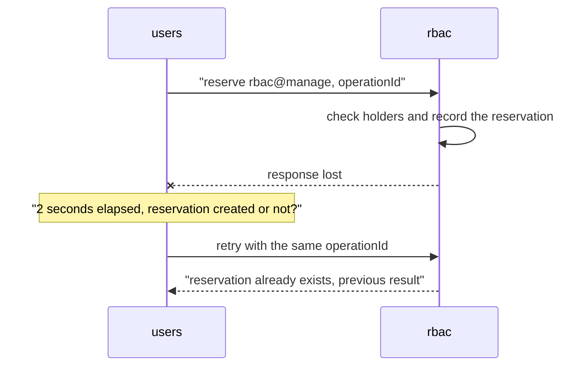
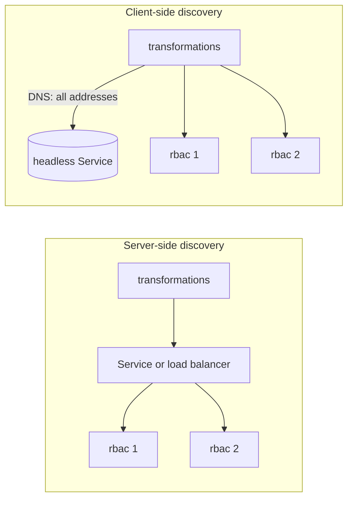
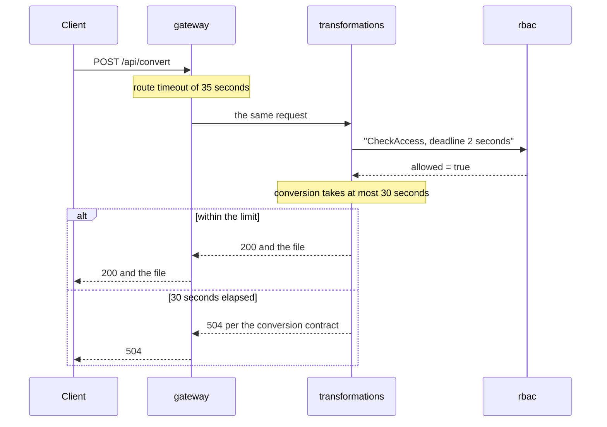
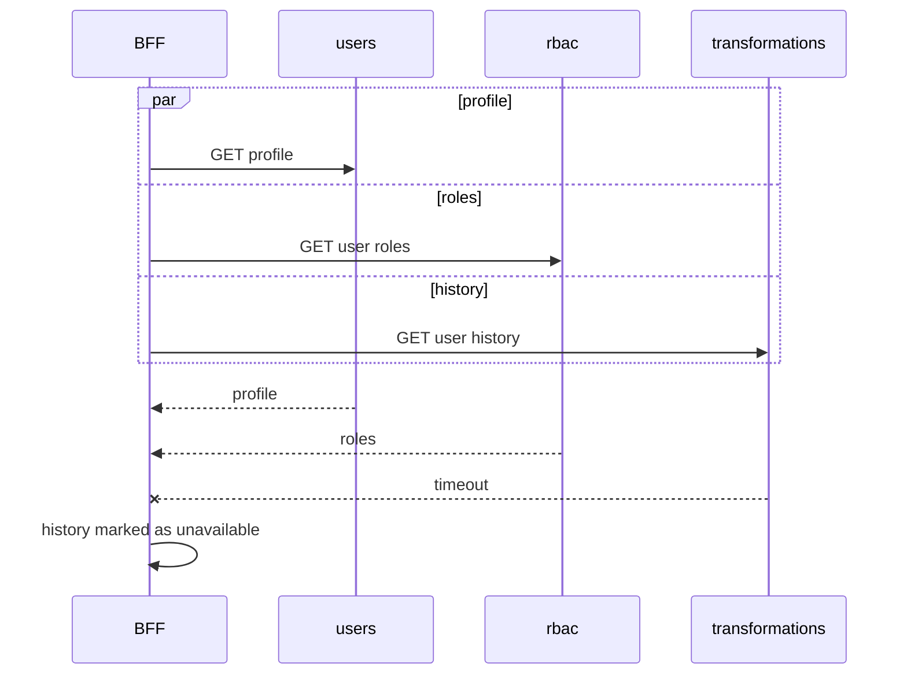

# Synchronous communication

## Contents

- [What synchronous communication is](#what-synchronous-communication-is)
- [A network call is not a function call](#a-network-call-is-not-a-function-call)
- [Internal HTTP API](#internal-http-api)
- [gRPC and Protocol Buffers](#grpc-and-protocol-buffers)
- [Service discovery and load balancing](#service-discovery-and-load-balancing)
- [Timeouts and deadlines](#timeouts-and-deadlines)
- [Chains and fan-out](#chains-and-fan-out)
- [API composition](#api-composition)
- [Context propagation](#context-propagation)
- [Comparison](#comparison)
- [How to choose](#how-to-choose)
- [How this shows up in the system](#how-this-shows-up-in-the-system)
- [Common mistakes](#common-mistakes)
- [Useful links](#useful-links)
- [Review questions](#review-questions)

## What synchronous communication is

Synchronous communication is a call in which a service sends a request to another service and waits for the response before continuing. It is the familiar request-response model. The call runs between processes and over the network.

In the course system, the gateway, the access check `CheckAccess` in `rbac`, and reservation of the `rbac@manage` invariant run synchronously. The gateway proxies external requests and checks the user's status in `users`. Everything that can wait goes out as messages: email, data deletion, and role assignment. That is covered in `0.3 Асинхронное взаимодействие.md` (Asynchronous communication).

| Protocol | Examples | When it fits |
| --- | --- | --- |
| HTTP with JSON | an external API, gateway requests to services | the default: clear to every stack, readable in logs, and described by OpenAPI |
| gRPC | `CheckAccess` in `rbac` | frequent internal calls with a strict contract and deadlines |
| GraphQL | an aggregating API for different clients | the client needs a flexible selection from several sources |

## A network call is not a function call

A function call inside a process either returns a result or throws an exception. A network call adds a third outcome. The response did not arrive, and it is unknown whether the server did the work. A timeout is not a server error. It is a lack of information about the result.

The fallacies of distributed computing are eight false assumptions: the network is reliable, latency is zero, bandwidth is infinite, the network is secure, the topology does not change, there is one administrator, transport cost is zero, and the network is homogeneous. In microservices, each of them proves false at some point.



The reservation in `rbac` was created, but `users` did not learn about it. A retry is safe only because the request carries an operation identifier and `rbac` recognizes the retry. A mutating internal call is therefore either idempotent or not retried automatically. Idempotent means a retry does not change the result of the first execution.

## Internal HTTP API

An internal API is the same kind of contract as an external API. It is described in OpenAPI, checked with tests, and changed in a compatible way, as in `0.7 Контракты и тестирование.md` (Contracts and testing). Internal routes live under a separate prefix, for example `/internal/`. The gateway does not publish them outside.

Errors are returned as Problem Details (RFC 9457): `application/problem+json` with the fields `type`, `title`, `status`, and, when needed, `detail`. The `type` field is a stable identifier of the error kind. Calling code decides from it.

```json
{
  "type": "https://errors.example.test/rbac/policy-unavailable",
  "title": "Access policy is unavailable",
  "status": 503
}
```

A neighbor's response is not forwarded to the client unchanged. The calling service translates it into its own contract. Internal names, addresses, and exception texts stay in the logs.

| Dependency response | Client response | Why |
| --- | --- | --- |
| `rbac`: access denied | **403** | the decision is final, and a retry changes nothing |
| `rbac`: timeout or **503** | **503** | a decision is impossible, and the request does not run |
| `users` at the gateway: status is not `active` | **401** | the identity is not established |
| an unexpected **500** from a neighbor | **503** without the neighbor's details | the client does not need the internal structure of the system |

A dependency failure is not masked as **401** or **403**. A temporary failure would otherwise look to the client like a lost session or lost permissions.

## gRPC and Protocol Buffers

gRPC is an RPC framework over HTTP/2. The contract is described in a `.proto` file. A client and a server are generated from it for each stack. Messages travel in the binary Protocol Buffers format. A call supports a deadline, cancellation, and streaming.

```proto
syntax = "proto3";

package rbac.v1;

service AccessService {
  rpc CheckAccess(CheckAccessRequest) returns (CheckAccessResponse);
}

message CheckAccessRequest {
  string user_id = 1;
  string permission = 2;
  string action = 3;
}

message CheckAccessResponse {
  bool allowed = 1;
  int64 policy_version = 2;
}
```

The field number is part of the wire format. The field name can be renamed. The number cannot change. `policy_version` makes it possible to record in the log which policy version made the decision.

A denial is an ordinary response, `allowed = false`. It is not an error. The calling service can then tell a decision apart from a failure:

| `CheckAccess` result | Meaning | Client response |
| --- | --- | --- |
| `OK`, `allowed = true` | allowed | the handler runs |
| `OK`, `allowed = false` | denied, including an unknown permission | **403** |
| `UNAVAILABLE` | `rbac` is unavailable | **503**, and the handler does not run |
| `DEADLINE_EXCEEDED` | the response missed the deadline | **503**, a retry only within the time budget |

For a mutating operation, `DEADLINE_EXCEEDED` is possible even after successful execution. It is the same unknown outcome as an HTTP timeout. A browser does not call gRPC directly without gRPC-Web. The external API therefore stays HTTP with JSON.

## Service discovery and load balancing

Service instances appear and disappear. Their IP addresses change. Calling code therefore addresses a name, not an address. In Compose, the service name is a DNS name on the project network: `http://rbac:8080`. In Kubernetes, a Service name resolves to a stable address. A headless Service resolves to the addresses of all pods.



In the server-side variant, the client knows one address, and the infrastructure distributes the calls. In the client-side variant, the client obtains the instance addresses and chooses where to send the call.

HTTP/2 multiplexes all calls on one long-lived connection. An L4 load balancer distributes connections, not calls, so all gRPC calls from one client go to one instance. gRPC needs client-side load balancing (`round_robin` over a headless Service) or an L7 proxy that sees individual calls.

## Timeouts and deadlines

A timeout is how long a call may last. A deadline is the moment after which the response is no longer needed. gRPC sends a deadline passed into a nested call as the remaining timeout, so clock skew between servers does not affect it. A deadline is not propagated by itself. In .NET, `EnableCallContextPropagation` is enabled. In Node.js, the incoming call is passed in the `parent` option. In Python, `timeout` is set from `context.time_remaining()`.

Client defaults are unsuitable as a policy. HTTPX waits 5 seconds. `HttpClient` in .NET waits 100 seconds. gRPC has no default deadline. The timeout is therefore set explicitly. An internal call in the course system is limited to 2 seconds per attempt.

```ts
const response = await fetch(`${RBAC_URL}/internal/reservations`, {
  method: "POST",
  headers: { "content-type": "application/json", "idempotency-key": operationId },
  body: JSON.stringify({ userId, permission: "rbac@manage" }),
  signal: AbortSignal.timeout(2_000),
});
```

Without `signal`, the request waits as long as the Node.js defaults allow. The `idempotency-key` makes a retry after a timeout safe.

The external timeout is always longer than the internal timeout. File conversion under the contract lasts no longer than 30 seconds. The transformations route timeout on the gateway is 35 seconds.



The internal limit is shorter than the external limit, so the client receives the service's response, not a cutoff at the gateway. In the reverse order, the gateway returns **504** while the service is still working, and the result is lost. When the caller stops waiting, the callee must stop too. `CancellationToken`, `AbortSignal`, and the gRPC context are passed into every nested call.

## Chains and fan-out

The availability of a sequential chain is the product of the availability of its links. Three services at 99.9% availability each yield about 99.7%. Latencies add up, and the tail of the distribution grows. The more calls a request contains, the more likely one of them lands in a slow p99.

Fan-out is a parallel call to several services. Total time equals the slowest branch. The load grows, and the latency tail becomes more noticeable.

N+1 is a separate request for each item in a list. Over the network it costs more than in a database. Each extra call costs a network hop, serialization, and a slot in the connection pool. A list of 50 items with a neighbor call for each item is 50 network requests. The remedies are a batch request with an array of identifiers, a data replica, or data kept by the owner.

In the reference system, a chain inside a request is no deeper than two hops: gateway → service → `rbac`. A longer chain is a sign of poor boundaries from `0.1 Декомпозиция на микросервисы.md` (Decomposition into microservices).

## API composition

API composition fulfills a request by calling the owner services and assembling the response in memory. The assembler is, in the general case, a gateway, a BFF, or a separate service. In this course the assembler is the BFF. The gateway from `0.5 API Gateway и безопасность.md` (API Gateway and security) does not assemble responses.

If an administrator's client needs one page with a user's profile, roles, and history, the BFF calls three existing endpoints in parallel:



For each part, whether it is required is decided in advance. Without the profile, the page is meaningless, and the request ends in an error. Without the history, the page is still useful, and that part is marked unavailable.

Composition does not fit filtering and sorting across data from several services. "Users with the `admin` role, sorted by email, with a cursor" would require loading everything and joining it in memory. Such requests use a read model from `0.4 Согласованность данных.md` (Data consistency).

## Context propagation

| What is passed | How | Why |
| --- | --- | --- |
| trace context | the `traceparent` header | one trace for the whole request across every service |
| user identity | an access token in `Authorization: Bearer` from the gateway, and `user_id` in the body of a nested call | the service knows on whose behalf the request runs; other ways are in `0.5 API Gateway и безопасность.md` (API Gateway and security) |
| operation key | `Idempotency-Key` | a retry of an internal call is recognized as a retry |
| remaining time | a gRPC deadline or a call timeout | a nested call does not wait longer than the external call |

The client's `Cookie`, hop-by-hop headers such as `Connection`, and any `X-User-*` that arrived from outside do not travel past the gateway. The gateway passes the access token to a service as `Authorization: Bearer`, and the service does not forward it to neighbors. `CheckAccess` receives `user_id` in the request body. OpenTelemetry auto-instrumentation adds `traceparent` to outgoing calls if it is loaded before the HTTP client.

## Comparison

| Approach | Waiting | Contract | Fits |
| --- | --- | --- | --- |
| HTTP with JSON | the caller waits for the response | OpenAPI, Problem Details | an external API, simple internal requests |
| gRPC | the caller waits, and the deadline is set explicitly | a `.proto` file with code generation | frequent internal calls, `CheckAccess` |
| GraphQL | the caller waits, and the server assembles the graph | a GraphQL schema | a flexible selection for different clients |
| Messages through a broker | the sender does not wait for the receiver | an event or command schema | side effects and long-running processes |

## How to choose

1. The default is HTTP with JSON and OpenAPI. It is clear to every stack in the course, and it is readable in logs.
2. gRPC is for frequent internal calls with a strict contract. `CheckAccess` runs on every protected request.
3. A synchronous call is used only when the response is needed for the client's response. Email, data deletion, and role assignment go out as messages.
4. Every call gets an explicit timeout. A nested timeout is shorter than the external timeout.
5. A chain is no deeper than two internal hops. A deeper chain requires a review of the boundaries.
6. Filtering and sorting across data from several services go through a read model, not through composition.

## How this shows up in the system

**Authentication.** The gateway checks the access token signature against JWKS from `users`. It does not request the keys on every request. The keys are cached, and a new request goes out only for an unknown `kid`.

**Authorization.** A protected request takes two synchronous steps. The gateway checks the status in `users`, and the service calls `CheckAccess` in `rbac`. A timeout or a failure of either step yields **503**, not **401** or **403**.

**Changing user data.** An administrative block synchronously reserves the `rbac@manage` invariant. A lost response is retried safely with the same operation identifier.

**Deleting a user.** Accepting a deletion synchronously reserves the same invariant. The rest of the work goes through messages. The client receives **202** without waiting for `rbac` and `transformations`.

**Viewing the list of all users.** The page is built with one request to the `users` database. A list item is a canonical profile without roles, so there is no `rbac` call for each row.

**General requirements for file transformation.** The route timeout on the gateway is 35 seconds, longer than the 30 seconds of conversion. The client receives **504** from the service under the conversion contract, not a cutoff at the gateway.

**Viewing a user's file transformation history.** The administrative path first calls `CheckAccess` with `transformations@history_any`, then asks `users` synchronously whether the target exists. A missing user receives **404**. The call is justified. The operation is rare, and `users` is already required for every request through the gateway.

**Saving transformation results to storage.** An administrative download repeats the history order with `transformations@download_any`. The file is streamed through the gateway, so the download route timeout accounts for the size of the result.

## Common mistakes

| What you see | Cause and fix |
| --- | --- |
| A request hangs for a minute when `rbac` is overloaded | the call has no timeout; set 2 seconds and an explicit gRPC deadline |
| The client receives a gateway **504**, although conversion finishes within 30 seconds | the route timeout is shorter than the service timeout; the external limit is longer than the internal limit |
| A retry after a timeout created a second reservation | a mutating call has no operation identifier; pass `Idempotency-Key` and recognize the retry |
| All gRPC calls go to one `rbac` instance | HTTP/2 behind an L4 load balancer; client-side `round_robin` over a headless Service, or an L7 proxy |
| A temporary `rbac` failure turned into **403** | a failure was treated as a denial; a failure is **503**, and a denial is only the response `allowed = false` |
| The client sees the exception text of a neighboring service | the dependency response was passed through unchanged; translate it into the caller's contract and Problem Details |
| A page of 50 rows makes 50 calls to a neighbor | N+1 over the network; a batch request, a replica, or data kept by the owner |
| The service is slow, although every neighbor is fast | a long sequential chain; parallel calls, fewer hops, and events instead of calls |
| An external client called an internal endpoint | the gateway routes `/internal/`; do not publish internal paths, and check the calling service |
| After a container restart, the service cannot find a neighbor | the address is an IP; address the service by name in Compose DNS or Kubernetes |
| The server continues after the client gives up | cancellation is not passed on; pass `CancellationToken`, `AbortSignal`, or the gRPC context |
| Each service has its own `trace_id` for one request | `traceparent` is not passed; load the HTTP client instrumentation before the first call |
| A service forwards the client's cookie to a neighbor | external credentials travel inward; pass the verified identity |

## Useful links

### General

- [Wikipedia — Fallacies of distributed computing](https://en.wikipedia.org/wiki/Fallacies_of_distributed_computing) — eight false assumptions about the network.
- [RFC 9457 — Problem Details for HTTP APIs](https://www.rfc-editor.org/rfc/rfc9457.html) — a single error format for HTTP APIs.
- [OpenAPI Initiative — OpenAPI Specification](https://spec.openapis.org/oas/latest.html) — a description of a service's HTTP contract.
- [gRPC — Introduction to gRPC](https://grpc.io/docs/what-is-grpc/introduction/) — services, Protobuf messages, and code generation.
- [gRPC — Deadlines](https://grpc.io/docs/guides/deadlines/) — deadlines on the client and the server, and how they propagate.
- [gRPC — Status Codes](https://grpc.io/docs/guides/status-codes/) — the values of `UNAVAILABLE`, `DEADLINE_EXCEEDED`, and `PERMISSION_DENIED`.
- [Protocol Buffers — Language Guide (proto 3)](https://protobuf.dev/programming-guides/proto3/) — `.proto` syntax and field numbers.
- [microservices.io — Server-side service discovery](https://microservices.io/patterns/server-side-discovery.html) — discovery through a router.
- [microservices.io — Client-side service discovery](https://microservices.io/patterns/client-side-discovery.html) — discovery and load balancing on the client side.
- [Kubernetes — gRPC Load Balancing on Kubernetes without Tears](https://kubernetes.io/blog/2018/11/07/grpc-load-balancing-on-kubernetes-without-tears/) — why L4 load balancing does not distribute gRPC calls.
- [Kubernetes — DNS for Services and Pods](https://kubernetes.io/docs/concepts/services-networking/dns-pod-service/) — service names and headless Service.
- [Docker — Networking in Compose](https://docs.docker.com/compose/how-tos/networking/) — addressing services by name in Compose.
- [microservices.io — API Composition](https://microservices.io/patterns/data/api-composition.html) — assembling a response from several services, and its limits.
- [Google Research — The Tail at Scale](https://research.google/pubs/the-tail-at-scale/) — why the latency tail grows with the number of services called.

### By language

#### Node.js

- [NestJS — gRPC](https://docs.nestjs.com/microservices/grpc) — a gRPC server and client in NestJS.
- [NestJS — HTTP client](https://docs.nestjs.com/techniques/http-module) — an HTTP client with base addresses, timeouts, and named clients.

#### .NET

- [Microsoft — Reliable gRPC services with deadlines and cancellation](https://learn.microsoft.com/en-us/aspnet/core/grpc/deadlines-cancellation) — deadlines, cancellation, and `EnableCallContextPropagation`.
- [Microsoft — gRPC client-side load balancing](https://learn.microsoft.com/en-us/aspnet/core/grpc/loadbalancing) — the `dns` resolver and the `round_robin` balancer.
- [Microsoft — Use the IHttpClientFactory](https://learn.microsoft.com/en-us/dotnet/core/extensions/httpclient-factory) — named clients and connection management.

#### Python

- [gRPC — Python Quick start](https://grpc.io/docs/languages/python/quickstart/) — code generation from `.proto` and calling a service.
- [HTTPX — Timeouts](https://www.python-httpx.org/advanced/timeouts/) — connect, read, write, and pool timeouts.

## Review questions

1. Why does a timeout on a network call not mean that the server did not do the work, and how is a retry made safe?
2. How does a denial of `allowed = false` differ from the status `UNAVAILABLE`, and what response does the client receive in each case?
3. Why must the transformations route timeout on the gateway be longer than 30 seconds?
4. What happens to the distribution of gRPC calls behind an L4 load balancer, and how is that fixed?
5. Why are a dependency's errors translated into the caller's own contract instead of being passed through to the client?
6. How does API composition differ from a read model, and when does composition not fit?
7. Which headers are passed into internal calls, and which headers stop at the gateway?
