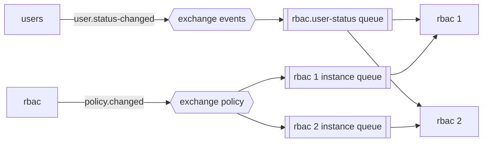
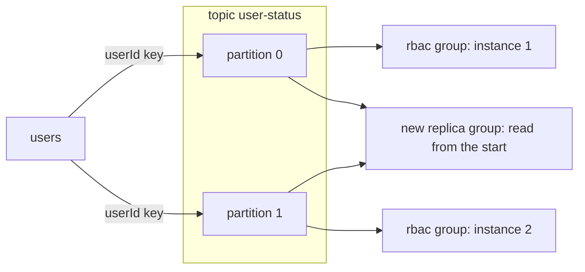
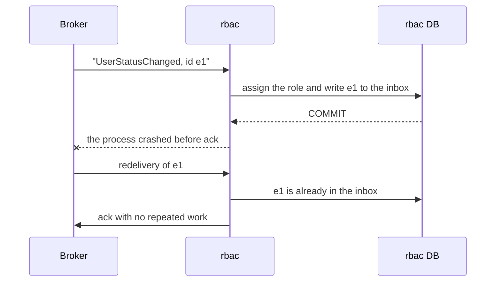
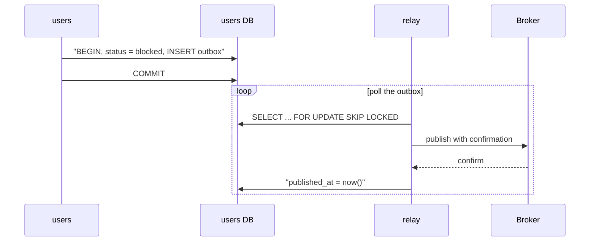

# Asynchronous communication

## Contents

- [What asynchronous communication is](#what-asynchronous-communication-is)
- [Commands and events](#commands-and-events)
- [Queue and log](#queue-and-log)
- [Delivery guarantees](#delivery-guarantees)
- [Message order](#message-order)
- [Retries and DLQ](#retries-and-dlq)
- [Transactional outbox](#transactional-outbox)
- [Inbox and the idempotent consumer](#inbox-and-the-idempotent-consumer)
- [Message envelope](#message-envelope)
- [Comparison](#comparison)
- [How to choose](#how-to-choose)
- [How this shows up in the system](#how-this-shows-up-in-the-system)
- [Common mistakes](#common-mistakes)
- [Useful links](#useful-links)
- [Review questions](#review-questions)

## What asynchronous communication is

Asynchronous communication is an exchange of messages through a broker. The sender does not wait for the receiver to process the message. The broker stores the message and delivers it when the receiver is ready. The receiver does not have to be available at send time.

In the course system, messages carry emails, assignment of the `user` role after activation, deletion of user data in neighboring services, and changes to the access policy. Broker structure, delivery guarantees, and ways to avoid losing or duplicating a message are covered here.

| Message type | Example | When it fits |
| --- | --- | --- |
| Command | `SendEmail`, `EraseUserData` | the sender wants a specific receiver to perform an action |
| Event | `UserStatusChanged`, `PolicyChanged` | the data owner reports a fact that has already happened, and any number of subscribers is allowed |
| Reply | `UserDataErased` | the receiver of a command reports the result to the sender |

## Commands and events

| Property | Command | Event |
| --- | --- | --- |
| meaning | a request to perform an action | a fact that has already happened |
| name | an action verb: `SendEmail` | past tense: `UserStatusChanged` |
| receivers | one logical receiver | zero or many subscribers |
| schema owner | the receiver | the publisher |
| reply | possible: `UserDataErased` | not expected |

An event is a passive-aggressive command when the publisher actually waits for a specific action afterward. If `users` waits for neighboring services to delete the user's data, that is the `EraseUserData` command with a reply. It is not a "user deleted" event.

An event has two kinds. An event notification carries only an identifier. The subscriber asks the publisher for details when needed. Event-carried state transfer carries the changed state. The subscriber keeps its own copy and does not call the publisher. `UserStatusChanged`, with the fields `userId`, `status`, and `version`, is the second kind. `rbac` updates the status replica and does not call `users`.

## Queue and log

RabbitMQ is a queue broker. The publisher sends a message to an exchange. The exchange places a copy in each matching queue, using the bindings and the routing key. After the consumer acknowledges the message, the queue deletes it.



The `rbac` instances keep the status replica in a shared database. They therefore read one queue, `rbac.user-status`, and divide the messages among themselves. These are competing consumers. The policy snapshot lives in the memory of each instance, so every instance needs `PolicyChanged`. Each instance has its own exclusive queue, and that queue disappears with the instance.

Kafka is a distributed log. A topic is divided into partitions. Messages are appended to the end of a partition and kept for a set retention period, whether or not they are read. The consumer commits the offset of what it has read. Kafka stores that offset for the consumer group. A consumer group divides the partitions among instances. Different groups read the same topic independently.



Messages for one `userId` land in one partition. The `rbac` group divides the partitions among instances. The new replica's group reads both partitions independently of that group. A message that has been read is not deleted. A new subscriber therefore rereads the log from the start (replay) and builds its own replica.

## Delivery guarantees

| Guarantee | How it is achieved | Risk |
| --- | --- | --- |
| at-most-once | acknowledgment before processing, or an automatic ack | the message is lost if the handler fails |
| at-least-once | acknowledgment after processing and the commit | the message can arrive again |
| exactly-once | Kafka transactions inside Kafka | side effects outside the broker are still repeated |

The default is at-least-once, together with an idempotent handler. The publisher enables broker acknowledgments (publisher confirms in RabbitMQ, and `acks=all` in Kafka) so that it knows the message is stored. The consumer acknowledges the message only after its own transaction commits.



A failure between the commit and the acknowledgment is a normal at-least-once case. The repeat is safe only because of the inbox. The reverse order, acknowledge and then process, yields at-most-once. A handler that crashes loses the message permanently.

## Message order

RabbitMQ keeps order inside a queue for a single consumer. Competing consumers and redeliveries break that order. Kafka guarantees order inside a partition, so the partition key is the entity identifier. All events for one `userId` follow one another.

Even ordered transport does not prevent reordering. The outbox relay publishes in batches, and a repeat arrives later than the next message. A state event therefore carries `version`, and the subscriber applies only a newer version. A `blocked` event with version 7 that arrives after an `active` event with version 8 changes nothing. That upsert is shown in `0.4 Согласованность данных.md` (Data consistency).

## Retries and DLQ

A transient error is fixed by a later retry. The database is unavailable, or a neighbor responds **503**. A permanent error is not fixed by a retry. The schema version is unknown, or the format is broken. Such a message goes straight to a dead letter queue (DLQ).

An immediate return of the message to the queue creates a hot loop. The message comes back thousands of times per second. In the course system, a message is delivered at most 5 times, with a pause of 1 minute between deliveries. It then goes to the DLQ.

- In RabbitMQ, a message goes to a dead letter exchange on a reject without requeue, on TTL expiry, on queue overflow, or when the delivery limit of a quorum queue is exceeded. From version 4.0, that limit defaults to 20 deliveries. From version 4.3, quorum queues support a delayed retry with a linear pause. In older versions, the pause is a cycle through a DLX and a queue with a TTL.
- Kafka has no acknowledgment of a single message. A retry uses separate topics for retries and for the DLQ. Otherwise one bad message stops the whole partition.

A poison message is a message that always crashes the handler. Without an attempt limit, it occupies the consumer forever. A DLQ is not a trash can. A non-empty DLQ raises an alert. The messages are inspected and, after a fix, sent again.

A TTL limits how long a message lives. The code in `SendEmail` is valid for 10 minutes. A queue TTL is counted from publication and ignores time spent in the outbox. After a broker failure, the command can enter the queue with a code that is already invalid. The command therefore carries an absolute deadline in the headers, `expiresAt`, the moment the challenge expires. The relay sets the message TTL to the time remaining until that moment. Before sending, `mail` checks the deadline and sends an expired command to the DLX with no email.

## Transactional outbox

A dual write is a database write and a send to the broker as two independent actions. A failure between them loses the event, or publishes an event about a transaction that rolled back. An outbox writes the message to a table in the same transaction as the data. A separate relay delivers the message to the broker.

```sql
CREATE TABLE outbox (
  id           uuid PRIMARY KEY,
  type         text NOT NULL,
  subject      text NOT NULL,
  payload      jsonb NOT NULL,
  headers      jsonb NOT NULL DEFAULT '{}',
  created_at   timestamptz NOT NULL DEFAULT now(),
  published_at timestamptz
);

SELECT id, type, subject, payload, headers
FROM outbox
WHERE published_at IS NULL
ORDER BY created_at
LIMIT 100
FOR UPDATE SKIP LOCKED;
```

`FOR UPDATE SKIP LOCKED` lets several relay instances work in parallel. One instance skips the rows another instance has locked. The outbox row `id` becomes the message `id`. The consumer recognizes a repeat by that `id`. The `headers` column stores the message headers. Those headers hold the `traceparent` of the original request, and `expiresAt` as well for `SendEmail`.



If the relay crashes after the broker acknowledgment and before the write of `published_at`, the message is sent again. An outbox guarantees at least once, not exactly once. A background cleanup deletes published rows.

A polling relay works with any database. The alternative is CDC (change data capture). Debezium reads the PostgreSQL transaction log (WAL) and publishes outbox rows without polling. The delay is lower, but another piece of infrastructure appears.

## Inbox and the idempotent consumer

An inbox is a table of processed messages with the primary key `(consumer, message_id)`. The handler inserts the message `id` in the same transaction as the useful work. A redelivery hits a key conflict, and the message is acknowledged with no repeated work.

Natural idempotency is simpler than an inbox. "Assign the `user` role if it is missing" can run any number of times through `INSERT ... ON CONFLICT DO NOTHING`. An inbox is required for effects that a repeat would accumulate.

An effect outside the database cannot join the database transaction. `mail` cannot roll back SMTP:

- writing the `id` to the inbox before sending loses the email if the process fails after the write;
- sending and then writing sends the email again if the process fails between the steps.

`mail` chooses the second order. An email with the same code that arrives twice is safer than a lost code.

## Message envelope

CloudEvents is a standard for describing an event. The required attributes are `specversion`, `id`, `source`, and `type`. The optional attributes are `subject`, `time`, and `datacontenttype`. A single envelope makes it possible to route, trace, and drop duplicates without parsing the body.

```json
{
  "specversion": "1.0",
  "id": "0f9b2c7e-3c55-4a8e-9d0e-6b1f7f2a4c11",
  "source": "/users",
  "type": "UserStatusChanged",
  "subject": "2b8f4a0e-7d1c-4c3a-9a51-3e6f0b7d9c20",
  "time": "2026-10-27T11:12:13Z",
  "datacontenttype": "application/json",
  "data": {
    "userId": "2b8f4a0e-7d1c-4c3a-9a51-3e6f0b7d9c20",
    "status": "blocked",
    "version": 8
  }
}
```

The tracing context `traceparent` travels in the message headers. The service writes it to the `headers` column of the outbox row in the same transaction. The relay copies it into the message headers. The consumer reads it and starts the consumer span. Message processing then joins the same trace as the original HTTP request, even though the relay publishes the message.

A message carries a minimum of data. `UserStatusChanged` does not contain an email. `SendEmail` contains an address and a one-time code when those are required, so the body of this command is not written to logs or to span attributes. Access to its queue and to its DLQ is restricted.

`users` encrypts the `SendEmail` body with a key that only `users` and `mail` hold. The address and the code are not in the clear in the outbox row, in the broker, or in the DLQ. The `users` database still stores the code only as an HMAC, as the practical work requires.

## Comparison

| Option | Model | Rereading | Order | Fits |
| --- | --- | --- | --- | --- |
| Job table in the database | rows with a status and a lease in the service database | no | set by the selection query | background work inside one service |
| RabbitMQ | an exchange, queues, and acknowledgments | no: the message is deleted after an ack | inside a queue | commands and events of moderate volume |
| Kafka | a log with partitions and an offset | yes, within retention | inside a partition | event streams, replay, and high volume |

## How to choose

1. Background work inside one service stays in a job table. A broker is not needed for it.
2. Between services, RabbitMQ is the default: commands and events of moderate volume, routing, and a DLX.
3. Kafka is chosen when replay is needed: building a new replica from the start of the log, analytics, and a large event stream.
4. The mode is always at-least-once: a manual acknowledgment after the commit, and an idempotent handler.
5. Publication goes only through an outbox. A polling relay is enough. CDC is for high load.
6. A command is sent when the sender expects an action. An event is sent when the sender reports a fact.

## How this shows up in the system

**Registration.** In one transaction, `users` creates `pending`, a challenge, and an outbox row with the `SendEmail` command. The response to the client does not wait for SMTP. If the mail server temporarily refuses the email, `mail` retries delivery until `expiresAt`, and registration is already complete. This is a deliberate difference from the monolith practical work. There, an email that is not accepted produces **503**. Here, registration, sign-in, an email change, and deletion respond without waiting for mail. The user requests a resend after 60 seconds for an email that never went out.

**Authentication.** The sign-in OTP and the magic link are the same `SendEmail` command, with `expiresAt` 10 minutes after the code is issued. An expired command goes to the DLX without being sent, even if it spent that time in the outbox.

**RBAC.** Every policy change publishes a `PolicyChanged` event with a new `version` through the `rbac` outbox. Each `rbac` instance receives the event from its own queue and rebuilds the in-memory snapshot ahead of time. Before a decision, the instance still checks the version. The event speeds up the update. The check guarantees it.

**User data change.** A block publishes `UserStatusChanged` with the status `blocked`. `rbac` updates the status replica and closes the `rbac@manage` reservation. The gateway sees `blocked` on the next status check in `users`. The email for an address change is sent as a `SendEmail` command.

**User deletion.** The orchestrator in `users` sends `EraseUserData` to `rbac` and `transformations` and waits for `UserDataErased` replies. The command carries `userId` and `jobId`. A repeat of the same pair is safe. A participant that no longer has the data replies `succeeded`. A participant reports a transient failure with the reply `retryable_failure`, and the orchestrator counts the attempts: 5, with a pause of 1 minute. The job then moves to `failed`, as in `0.4 Согласованность данных.md` (Data consistency). Broker redelivery and the DLQ apply to failures of the handler itself. The process crashed before the acknowledgment, or the message cannot be parsed.

**Saving transformation results to storage.** Background saving stays inside `transformations`, so history rows with the status `pending` serve as the queue. A broker is needed only if the work must be handed to another service.

## Common mistakes

| What is visible | Cause and fix |
| --- | --- |
| The message disappeared after the handler crashed | Automatic acknowledgment. In the NestJS RabbitMQ transport the default is `noAck: true`. A manual ack follows the commit. |
| The event was published, and the transaction rolled back | Publication happened before `COMMIT`. Publication goes only through an outbox. |
| The data was saved, and there is no event | Publication happened after `COMMIT` without an outbox, and the process crashed between the steps. An outbox records the event in the same transaction. |
| The role was assigned twice, or the email was sent twice | Redelivery has no idempotency. An inbox, or `ON CONFLICT DO NOTHING`, handles the repeat. |
| One message returns to the queue without end | A poison message has no attempt limit. A delivery limit and a DLQ stop it. |
| The queue runs one message thousands of times per second | A transient error returns the message at once. A delayed retry uses a pause of 1 minute. |
| Thousands of messages sit in the DLQ, and nothing reports them | There is no alert. A metric of DLQ length, inspection, and a resend are required. |
| The user received an email with an expired code | `SendEmail` has no deadline, or the TTL was counted from publication after a long wait in the outbox. An absolute `expiresAt` and a deadline check in `mail` are required. |
| In the replica, `blocked` changed back to `active` | The events arrived out of order. Only a newer `version` is applied. |
| One Kafka consumer is overloaded, and the others are idle | The key is skewed, or there are fewer partitions than instances. The key is `userId`, and there are enough partitions. |
| A Kafka consumer lost a message on failure | The offset was committed before processing. The offset is committed after processing. |
| `users` waits for the data to be deleted, but nothing performs the deletion | An event was used as a command. An explicit `EraseUserData` command includes a reply. |
| An OTP is visible in the logs and the traces | The `SendEmail` body is written in full. Command payloads stay out of the log and out of span attributes. |
| An OTP is visible in outbox rows and in the DLQ | The `SendEmail` body is stored in the clear. The body is encrypted with a key held by `users` and `mail`. |
| The handler crashes on a new field of the event | Deserialization is strict. A tolerant reader is used, as in `0.7 Контракты и тестирование.md` (Contracts and testing). |

## Useful links

### General

- [Martin Fowler — What do you mean by “Event-Driven”?](https://martinfowler.com/articles/201701-event-driven.html) — event notification, event-carried state transfer, and the passive-aggressive command.
- [RabbitMQ — AMQP 0-9-1 Model Explained](https://www.rabbitmq.com/tutorials/amqp-concepts) — an exchange, a binding, a routing key, and queues.
- [RabbitMQ — Consumer Acknowledgements and Publisher Confirms](https://www.rabbitmq.com/docs/confirms) — manual acknowledgment, prefetch, and publisher confirms.
- [RabbitMQ — Dead Letter Exchanges](https://www.rabbitmq.com/docs/dlx) — causes of dead lettering, and delayed retries.
- [RabbitMQ — Quorum Queues](https://www.rabbitmq.com/docs/quorum-queues) — the delivery limit, and handling of a poison message.
- [RabbitMQ — Time-to-Live and Expiration](https://www.rabbitmq.com/docs/ttl) — the lifetime of messages and queues.
- [Apache Kafka — Introduction](https://kafka.apache.org/intro) — a topic, partitions, the key, and order inside a partition.
- [Apache Kafka — Design](https://kafka.apache.org/44/design/design/#message-delivery-semantics) — the at-most-once, at-least-once, and exactly-once guarantees.
- [microservices.io — Transactional outbox](https://microservices.io/patterns/data/transactional-outbox.html) — an atomic write of the data and the message.
- [microservices.io — Idempotent Consumer](https://microservices.io/patterns/communication-style/idempotent-consumer.html) — a table of processed messages.
- [Debezium — Outbox Event Router](https://debezium.io/documentation/reference/stable/transformations/outbox-event-router.html) — publishing an outbox from the transaction log.
- [CloudEvents — Specification](https://github.com/cloudevents/spec/blob/main/cloudevents/spec.md) — required and optional attributes of the envelope.
- [CloudEvents — Distributed Tracing extension](https://github.com/cloudevents/spec/blob/main/cloudevents/extensions/distributed-tracing.md) — `traceparent` in an event, and its relation to protocol headers.
- [OpenTelemetry — Semantic conventions for messaging spans](https://opentelemetry.io/docs/specs/semconv/messaging/messaging-spans/) — spans of the publisher and the consumer.
- [PostgreSQL — SELECT](https://www.postgresql.org/docs/current/sql-select.html) — `FOR UPDATE SKIP LOCKED` for parallel relays.

### By language

#### Node.js

- [NestJS — RabbitMQ](https://docs.nestjs.com/microservices/rabbitmq) — the RabbitMQ transport, `noAck`, and manual acknowledgment.
- [NestJS — Kafka](https://docs.nestjs.com/microservices/kafka) — the Kafka transport and consumer groups.

#### .NET

- [RabbitMQ — .NET/C# Client API Guide](https://www.rabbitmq.com/client-libraries/dotnet-api-guide) — connecting, publishing, and consuming from .NET.
- [Confluent — .NET Client for Apache Kafka](https://docs.confluent.io/kafka-clients/dotnet/current/overview.html) — committing the offset after processing, and the idempotent producer.

#### Python

- [aio-pika — Documentation](https://docs.aio-pika.com/) — an asynchronous RabbitMQ client with publisher confirms.
- [Confluent — Python Client for Apache Kafka](https://docs.confluent.io/kafka-clients/python/current/overview.html) — a Kafka producer and consumer.
- [Cosmic Python — Event-Driven Architecture: Using Events to Integrate Microservices](https://www.cosmicpython.com/book/chapter_11_external_events.html) — external events between services.

## Review questions

1. How does a command differ from an event, and why is the deletion of user data in neighboring services a command?
2. Why does the consumer acknowledge a message only after the transaction commits, and what happens in the reverse order?
3. How does the Kafka log differ from a RabbitMQ queue, and when is replay needed?
4. What happens if `users` sends an event to the broker after `COMMIT` without an outbox?
5. How does a subscriber protect itself from events that arrive out of order?
6. Why does a message need an attempt limit and a DLQ, and why is an immediate return to the queue harmful?
7. Why does `mail` send the email first and then write the `id` to the inbox?
