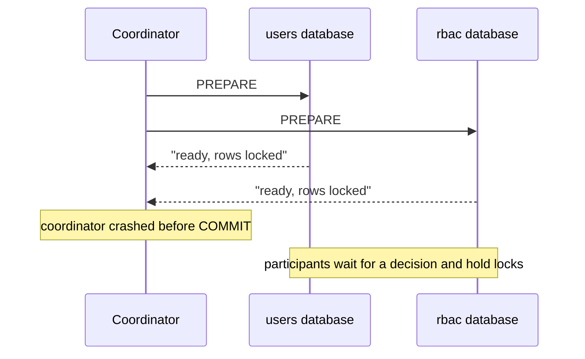
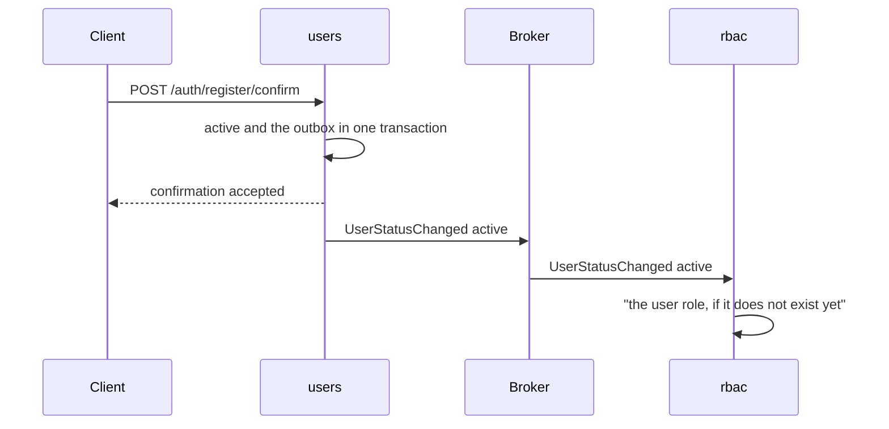
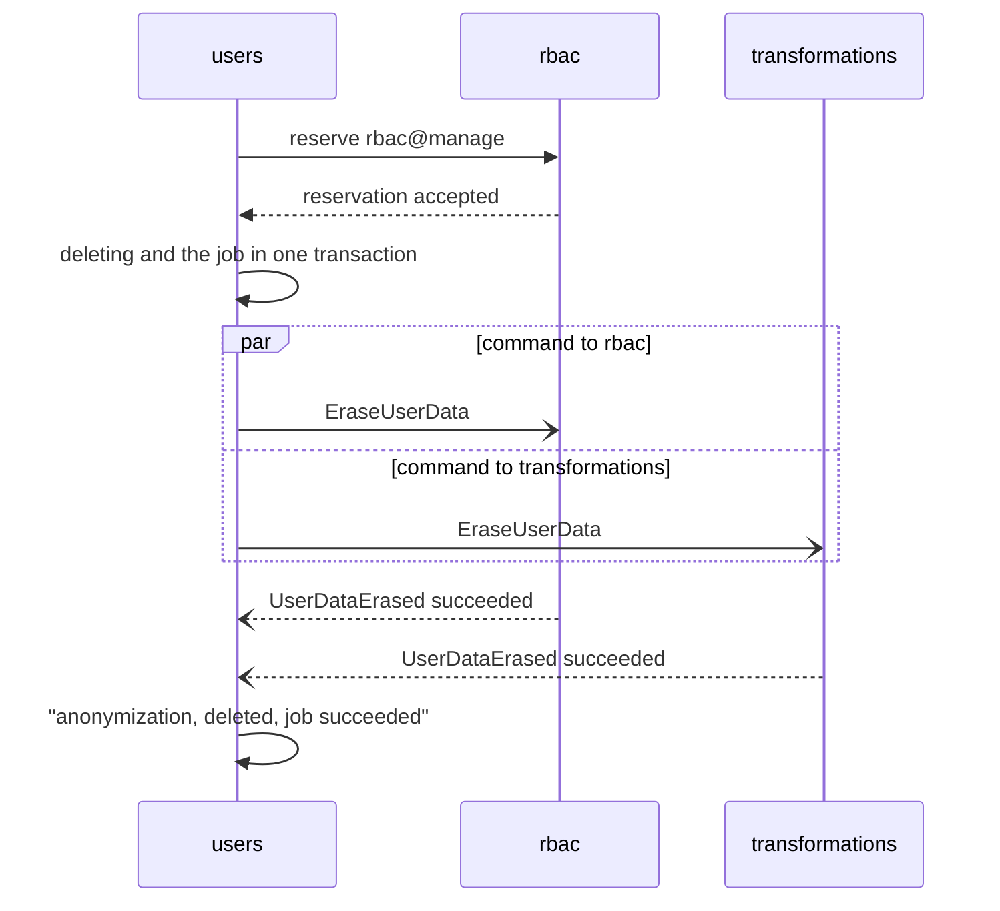
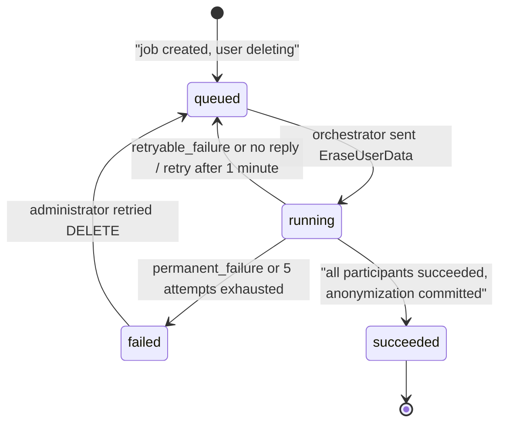

# Data consistency

## Contents

- [What data consistency is](#what-data-consistency-is)
- [Why there is no shared transaction](#why-there-is-no-shared-transaction)
- [Saga](#saga)
- [Choreography and orchestration](#choreography-and-orchestration)
- [Orchestrator state](#orchestrator-state)
- [Compensations and isolation](#compensations-and-isolation)
- [Data replicas](#data-replicas)
- [Queries across several services](#queries-across-several-services)
- [What the user sees](#what-the-user-sees)
- [Comparison](#comparison)
- [How to choose](#how-to-choose)
- [How this shows up in the system](#how-this-shows-up-in-the-system)
- [Common mistakes](#common-mistakes)
- [Useful links](#useful-links)
- [Review questions](#review-questions)

## What data consistency is

Data consistency is the property that each part of the system sees data that does not break that part's rules. Inside one database, transactions and constraints provide it. There is no shared transaction between services. Data in different services converges through messages, over time.

The topic applies to every process that touches several services: activation with the `user` role, a block with the `rbac@manage` invariant, user deletion, and the status replica in `rbac`.

| Model | Examples | When it fits |
| --- | --- | --- |
| Strict (transaction) | a unique email, a profile `PATCH` inside `users` | an invariant inside one service |
| Read-your-writes | the author sees the changed profile at once | the user checks the result of the user's own action |
| Eventual consistency | the status replica in `rbac`, the `user` role after activation | another service's data, where a delay is acceptable |

## Why there is no shared transaction

Two-phase commit (2PC) is a distributed transaction protocol. The coordinator asks the participants to prepare. Each participant writes the work into a temporary state and holds locks. If every participant is ready, the coordinator orders a commit.



A participant that answered "ready" cannot commit the work on its own, and cannot roll it back. It waits for the coordinator. While the coordinator is unavailable, the locked rows stay unavailable to other requests.

Microservices do not use 2PC. A broker, SMTP, and object storage do not take part in it. Transaction availability equals the product of the participants' availability. Locks last for the network round trips. PostgreSQL supports `PREPARE TRANSACTION`. That mechanism serves an external transaction manager. It does not replace a design without a shared transaction.

The CAP theorem applies during a network partition. The system chooses between consistency (refuse) and availability (respond, possibly with stale data). PACELC adds a case with no partition. The choice is then between latency and consistency.

The course system makes both choices. When `users` is unavailable, `rbac` keeps deciding from the status replica. That choice is availability. When `users` is unavailable, the gateway responds with **503**. That choice is consistency, because a block must take effect on the next request.

## Saga

A saga is a sequence of local transactions in different services. Each step commits at once and starts the next step with a message. If a step is impossible, compensating transactions undo the steps already completed.

| Step kind | Meaning | Example from user deletion |
| --- | --- | --- |
| compensable | a new transaction can undo it | a reservation of the `rbac@manage` invariant in `rbac` |
| pivot | the point of no return; no undo after it | `deleting` and the deletion job in one `users` transaction |
| retryable | runs after the pivot, is idempotent, and repeats until success | `EraseUserData` in neighboring services and the final anonymization |

Step order puts only checks and compensable steps before the pivot. Deleted data cannot be restored. `EraseUserData` therefore runs after the point of no return, when an undo is no longer needed.

## Choreography and orchestration

Choreography is a saga with no center. Each service reacts to an event and publishes its own. Assigning the `user` role after activation is a one-step choreography.



`users` does not know who subscribed to the event. It does not wait for `rbac`. The response goes to the client before the role is assigned.

Orchestration is a saga with a coordinator. The orchestrator stores the process state, sends commands to the participants, and accepts their replies. `users` orchestrates user deletion.



The reservation is a synchronous compensable step. The move to `deleting` is the pivot. The commands and the anonymization are retryable steps. Choreography is simpler. A process with several participants, retries, and a status for the client is not visible as a whole in it. Its logic is spread across the subscribers.

## Orchestrator state

The orchestrator stores state in its own database, in the deletion job: the status, the attempt count, `next_attempt_at`, and a safe code for the last error. A process restart does not lose the saga. Any `users` instance continues it from the saved step.

Inside one process, cleanup handlers can run in order. Progress for each handler does not need storage. Between services, replies arrive as messages at different times. The orchestrator records each participant's result. It moves on when every participant has replied `succeeded`.



The client sees these states on the deletion status endpoint. Participant replies drive the transitions. A timeout detects a missing reply. A reply that arrives after a retry is applied idempotently. The participant result for the same `jobId` is recorded once.

## Compensations and isolation

A compensation is a new business transaction. It is not a rollback. It does not restore a snapshot of a past state, because other operations may have changed the data in the meantime. A compensation can fail too. It is therefore idempotent and is repeated.

A saga has no isolation. Other operations see the intermediate states. Countermeasures against anomalies:

- **semantic lock** — a flag "operation in progress" that other operations respect;
- **commutative updates** — changes whose result does not depend on order;
- **pessimistic view** — risky and irreversible steps are placed after all checks;
- **reread value** — before a change, a check that the data has not changed;
- **version file** — a log of operations on a record, used to apply them in the correct order.

The `deleting` status is a semantic lock. Sign-in and profile changes are refused for the user while deletion is in progress.

The invariant "an active holder of `rbac@manage` must remain" requires a reservation. The status lives in `users`, and the assignments live in `rbac`:

1. `users` records an intent with an operation identifier in its own database and asks `rbac` to reserve the user's exit from the set of holders.
2. `rbac` atomically checks that another active holder will remain, counting holders already reserved as inactive. If not, `users` closes the intent and returns **409**. The status does not change.
3. In one transaction, `users` commits `blocked` or `deleting`, closes the intent, and publishes `UserStatusChanged` through the outbox.
4. `rbac` receives the event, updates the replica, and closes the reservation.
5. If step 3 did not succeed, `users` cancels the reservation. Background reconciliation cancels unfinished intents older than the request timeout that remain after a `users` failure, together with the reservation.

Two parallel requests to block the last two administrators no longer both succeed. The first reservation is accepted. The second sees the first user as already inactive and receives a refusal.

A reservation is not released by timeout. Until an event or a cancellation arrives, `rbac` treats the user as inactive. Otherwise, after a broker failure, `blocked` is already committed and the event is not yet delivered, and a second reservation would pass against a stale replica.

## Data replicas

A replica is a local copy of another service's data for reads. The owner's events update it. `rbac` stores user statuses and uses them to check the invariant and the user's existence when assigning roles. An event can arrive again and out of order. The replica therefore applies only a newer version:

```sql
INSERT INTO user_status_replica (user_id, status, version)
VALUES ($1, $2, $3)
ON CONFLICT (user_id) DO UPDATE
SET status = EXCLUDED.status, version = EXCLUDED.version
WHERE user_status_replica.version < EXCLUDED.version;
```

A repeat of the same event and a stale event do not change the row. The upsert is idempotent without an inbox.

A new replica needs an initial load. Subscription to events comes first, then a snapshot from the owner or a reread of the Kafka log. Events that arrive during the load are applied with the same version check. Overlap between the snapshot and the events is therefore safe.

A replica always lags by the delivery time. Security decisions use the owner's data. The gateway checks the status by `sub` in `users`, not in the replica. Secrets, password hashes, and extra personal data are not replicated.

## Queries across several services

| Approach | How it works | Cost | Fits |
| --- | --- | --- | --- |
| API composition | call the owners and combine the responses in memory | latency and availability of every owner | a lookup by identifier, small responses |
| Read model | a separate table that the owners' events update | update lag and synchronization code | search, filters, sorting, and a cursor over data from several services |

In the reference system, the user list is built from the `users` table. A read model is not needed. It is needed if a filter touches `rbac` data, for example "users with the `admin` role". Then `users`, or a separate read service, keeps a copy of the assignments. Events from `rbac` update that copy.

## What the user sees

**A window without a role.** After registration confirmation, the user is already `active`. The `user` role appears when `rbac` processes the event. The first protected request in this window receives **403**. The window equals the event delivery time. It is usually shorter than a second. If the contract requires the very first request to see the role, confirmation waits for the `rbac` reply. Registration then depends on the availability of `rbac` again.

**Read-your-writes.** A profile `PATCH` returns the new canonical representation from the owner, `users`. A read from the replica immediately after the write is not valid. The replica may not have updated yet.

**A long process.** Deletion returns **202** and `jobId`. Saga progress is visible on the status endpoint. The client does not wait for a reply from every participant.

## Comparison

| Approach | Coordination | Isolation | Fits |
| --- | --- | --- | --- |
| 2PC | a coordinator with prepare and commit phases | full, at the cost of locks | databases under one transaction manager, not microservices |
| Choreography saga | events with no center | none; countermeasures are required | short reactions to a fact, with no compensations |
| Orchestration saga | an orchestrator with saved state | none; countermeasures are required | processes with several participants, retries, and a status for the client |

## How to choose

1. The boundaries come first. If a rule requires a transaction across two services, the data may need to live in one service, as in `0.1 Декомпозиция на микросервисы.md` (Decomposition into microservices).
2. A short reaction to a fact, with no rollback, is choreography: the `user` role after activation.
3. A process with several participants, retries, and a status for the client is orchestration: user deletion.
4. Irreversible steps come after the pivot and after all checks.
5. A cross-boundary invariant is protected by a reservation with a semantic lock. Only the owner's event or an explicit cancellation closes it.
6. Another service's data for reads stays in a replica with `version`. Data for security decisions is requested from the owner.
7. 2PC is not used between microservices.

## How this shows up in the system

**Registration.** Confirmation sets the user to `active` and publishes `UserStatusChanged`. `rbac` assigns the `user` role later. The window without a role is the cost of having no shared transaction between `users` and `rbac`.

**RBAC.** Role assignment checks that the user exists, using the status replica. `EraseUserData` removes the assignments and marks the user deleted in the replica. A later assignment based on stale data is rejected.

**Authorization.** The gateway checks the status by `sub` at the owner, synchronously. The replica in `rbac` can lag. A request from a blocked user stops earlier, at the gateway.

**Changing user data.** An administrator block goes through a reservation in `rbac`, then `blocked` in `users`, then an event that closes the reservation. A parallel block of the last two administrators receives **409** on the second reservation.

**User deletion.** Orchestration runs in `users`. The reservation is the compensable step. `deleting` with the job is the pivot. `EraseUserData` and anonymization are the retryable steps. The client sees the job states `queued`, `running`, `succeeded`, and `failed` on the status endpoint.

**Viewing the list of all users.** Search uses the `users` table. A read model is not needed. It appears only if the list is filtered by `rbac` data.

**Saving transformation results in storage.** `EraseUserData` in `transformations` deletes the results and the history. Until the command is processed, they still exist. The owner can no longer request them. The gateway rejects a user in `deleting`.

## Common mistakes

| What is visible | Cause and fix |
| --- | --- |
| Services hang when the transaction coordinator is unavailable | 2PC holds locks until the coordinator decides; a saga replaces it |
| Deletion stopped in the middle, and no one knows | saga state lives only in memory; durable job state and an alert on `failed` |
| The orchestrator waits forever for a participant reply | no reply timeout; a missing reply counts as a temporary failure, and the command is retried |
| A compensation restored an old value over another change | compensation as a rollback to a snapshot; a business action compensates, using the current state |
| Both of the last administrators are blocked | the invariant was checked with no reservation; a reservation with a semantic lock in `rbac` |
| The `rbac@manage` reservation remained after a `users` failure | the intent was not recorded before the call to `rbac`; the intent is recorded in `users`, and background reconciliation cancels unfinished reservations |
| Both of the last administrators are blocked, even though a reservation existed | the reservation was released by timeout while the `blocked` event was delayed; only an event or an explicit cancellation closes the reservation |
| An email was sent, and the operation was canceled later | an irreversible step before the pivot; irreversible actions come after all checks |
| The replica shows an old status after a series of changes | events were applied with no order check; an upsert applies only a newer `version` |
| A new replica is empty for old users | no initial load; subscription comes first, then a snapshot from the owner or a log replay |
| The user does not see the change immediately after a save | the response was read from a replica; the new state comes from the owner |
| The first request after registration confirmation received **403** | the role is assigned by an event with a delay; the contract allows for the window, or confirmation waits for `rbac` |
| Access was allowed from a stale status replica | a security decision on eventual consistency; the status by `sub` is checked at the owner |
| Events looped between services | choreography with no process owner; a complex process moves to orchestration |

## Useful links

### General

- [microservices.io — Saga](https://microservices.io/patterns/data/saga.html) — choreography, orchestration, and the absence of isolation.
- [Microsoft — Saga Design Pattern](https://learn.microsoft.com/en-us/azure/architecture/patterns/saga) — compensable, pivot, and retryable steps, and anomaly countermeasures.
- [Microsoft — Compensating Transaction Pattern](https://learn.microsoft.com/en-us/azure/architecture/patterns/compensating-transaction) — why a compensation is not a rollback.
- [Hector Garcia-Molina, Kenneth Salem — Sagas](https://www.cs.cornell.edu/andru/cs711/2002fa/reading/sagas.pdf) — the original 1987 paper on sagas.
- [microservices.io — CQRS](https://microservices.io/patterns/data/cqrs.html) — a read model from the events of several services.
- [Microsoft — Data considerations for microservices](https://learn.microsoft.com/en-us/azure/architecture/microservices/design/data-considerations) — data ownership, consistency, and replicas.
- [Werner Vogels — Eventually Consistent](https://www.allthingsdistributed.com/2008/12/eventually_consistent.html) — consistency models, including read-your-writes.
- [Jepsen — Consistency](https://jepsen.io/consistency) — a catalog of consistency models.
- [Wikipedia — CAP theorem](https://en.wikipedia.org/wiki/CAP_theorem) — the choice between consistency and availability during a network partition.
- [Wikipedia — PACELC design principle](https://en.wikipedia.org/wiki/PACELC_design_principle) — the choice between latency and consistency without a partition.
- [PostgreSQL — PREPARE TRANSACTION](https://www.postgresql.org/docs/current/sql-prepare-transaction.html) — the first phase of 2PC and its purpose.

### By language

#### Node.js

- [NestJS — CQRS](https://docs.nestjs.com/recipes/cqrs) — commands, events, and sagas in NestJS, including durable sagas.
- [Temporal — TypeScript SDK developer guide](https://docs.temporal.io/develop/typescript) — orchestration of long-running processes with saved state.

#### .NET

- [Microsoft — Implementing event-based communication between microservices](https://learn.microsoft.com/en-us/dotnet/architecture/microservices/multi-container-microservice-net-applications/integration-event-based-microservice-communications) — integration events and eventual consistency in .NET.
- [Temporal — .NET SDK developer guide](https://docs.temporal.io/develop/dotnet) — orchestration of long-running processes on .NET.

#### Python

- [Cosmic Python — Command-Query Responsibility Segregation (CQRS)](https://www.cosmicpython.com/book/chapter_12_cqrs.html) — a read model updated by events.
- [Temporal — Python SDK developer guide](https://docs.temporal.io/develop/python) — orchestration of long-running processes in Python.

## Review questions

1. Why can a 2PC participant not decide alone after the "ready" reply, and why is that dangerous for microservices?
2. How does a saga pivot step differ from a compensable step and a retryable step, and where is it in user deletion?
3. When is choreography the right choice, and when is orchestration?
4. Why is a compensation not a rollback to a past snapshot?
5. How does a reservation in `rbac` stop two parallel requests from blocking the last two administrators?
6. What happens to the status replica if events arrive out of order, and how is that prevented?
7. Why is **403** possible after registration confirmation, and what does removing it cost?
