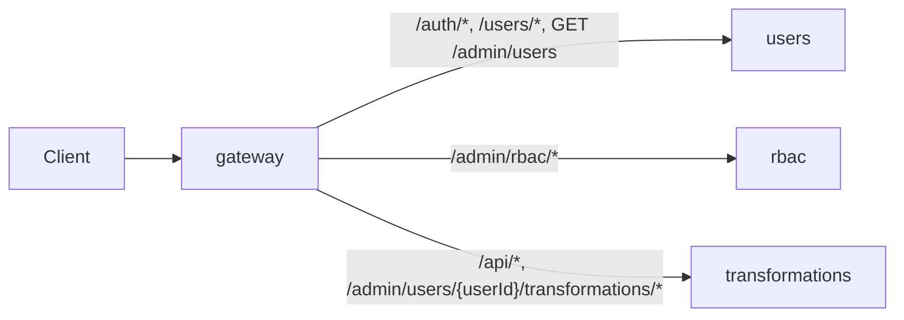
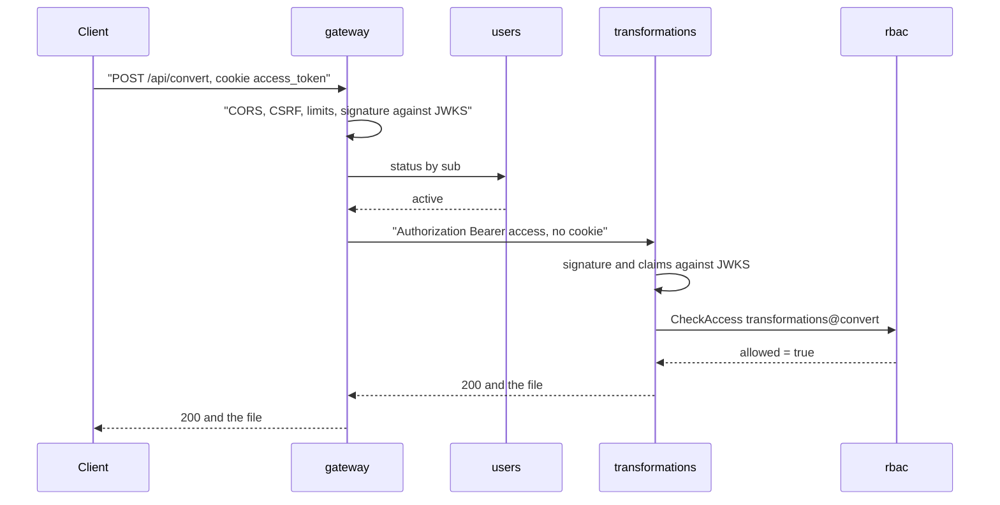
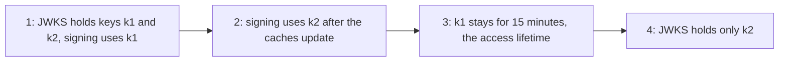

# API gateway and security

## Contents

- [What an API gateway is](#what-an-api-gateway-is)
- [Gateway responsibilities](#gateway-responsibilities)
- [What is not in the gateway](#what-is-not-in-the-gateway)
- [Backend for Frontend](#backend-for-frontend)
- [Where to verify the access JWT](#where-to-verify-the-access-jwt)
- [Asymmetric signatures and JWKS](#asymmetric-signatures-and-jwks)
- [User identity inside the system](#user-identity-inside-the-system)
- [Service-to-service authentication](#service-to-service-authentication)
- [Distributed authorization](#distributed-authorization)
- [Cookies, CORS, and CSRF on the gateway](#cookies-cors-and-csrf-on-the-gateway)
- [Comparison](#comparison)
- [How to choose](#how-to-choose)
- [How this shows up in the system](#how-this-shows-up-in-the-system)
- [Common mistakes](#common-mistakes)
- [Useful links](#useful-links)
- [Review questions](#review-questions)

## What an API gateway is

An API gateway is the only public entry point into the system. It is a reverse proxy. It accepts external requests, applies shared policies, and routes requests to the right services. To the client, the system looks like one API.

The gateway of the course system publishes the entire external HTTP API. Services are not reachable from outside. By design, the gateway is a middleware pipeline placed in a separate process. Every request passes the same shared checks before it reaches a service.

| Kind | Examples | When it fits |
| --- | --- | --- |
| Edge gateway | Envoy, NGINX, Traefik, Kong, and YARP | one entry point for all clients |
| Backend for Frontend | a separate gateway for the web client and the mobile client | clients have different data needs |
| Ingress or Gateway API | a Kubernetes ingress controller | external traffic into the cluster |
| Service mesh | Istio, Linkerd | traffic between services: mTLS, retries, and telemetry |

## Gateway responsibilities

| Task | In the course system |
| --- | --- |
| routing | path templates of the external API lead to the right service |
| TLS | the gateway accepts HTTPS, and traffic then stays on the internal network |
| CORS and CSRF | checked once at the entry |
| limits | a body that is too large returns **413** before the service, and rate limiting returns **429** |
| timeouts and failures | each route has its own timeout, and transformations allow 35 seconds; a service timeout returns **504**, and an unavailable service returns **503** |
| authentication | the access signature is checked against JWKS, and the status is checked by `sub` in `users` |
| headers | external `X-User-*` headers are removed, and `traceparent` is added |



The route is chosen by the most specific template. `/admin/users/{userId}/transformations/history` begins like an administrative users path, but it leads to `transformations`. The path does not have to match the service name. The client sees a single API. The route map is an internal concern of the gateway.

The gateway is a single point of failure. It runs as several instances. It stores no state between requests, except caches with a limited lifetime.

## What is not in the gateway

- business rules and access to service databases;
- checks of the resource owner and of `*_any` actions: the gateway does not know whose profile or file it is;
- assembly of a response for one screen, which is the job of a BFF;
- mapping of domain errors: the services themselves respond in the format of the external contract.

A gateway with business logic becomes a monolith in the middle. Every change to a service then requires a gateway release.

## Backend for Frontend

A Backend for Frontend (BFF) is a gateway for a specific client type. It gathers data for that client's screens, simplifies the response shape, and holds the session in a cookie. The web application and the mobile application get different BFFs, because their needs diverge.

The course has one web client and one gateway. A BFF is needed with a second client type, or for assembly of an administrative page from several services, as in `0.2 Синхронное взаимодействие.md` (Synchronous communication).

## Where to verify the access JWT

A check only on the gateway assumes that the internal network is trusted. Zero trust assumes the opposite. Any internal component can be compromised, and a request can be directed around the gateway. The gateway therefore rejects invalid tokens early and cheaply. The service checks the signature and the claims again.



**401** is returned before the call to `rbac`. **403** is returned after the permission decision. **503** is returned when any check fails. The status code tells the client what to do: refresh the session, abandon the action, or retry later.

## Asymmetric signatures and JWKS

When a single process verifies the token, HS256 is enough. Only that process knows the secret. In the course system, the gateway and several services verify the access token. With HS256, the secret would have to be given to every verifier. Anyone who knows the secret can also issue a token. A compromised `transformations` would issue an administrator token.

An asymmetric signature separates issuance from verification. `users` signs the access token with an ES256 private key. Verifiers receive only the public keys from JWKS, a JSON key set defined by RFC 7517. The `kid` header in the token indicates which key signed it.

```ts
import { createRemoteJWKSet, jwtVerify } from "jose";

const jwks = createRemoteJWKSet(new URL("http://users:8080/.well-known/jwks.json"));

export async function verifyAccess(token: string): Promise<string> {
  const { payload } = await jwtVerify(token, jwks, {
    algorithms: ["ES256"],
    issuer: "course-api",
    audience: "course-web",
  });
  if (payload.token_use !== "access" || typeof payload.sub !== "string") {
    throw new Error("invalid_session");
  }
  return payload.sub;
}
```

The verifier fixes the algorithm. The token does not. `algorithms: ['ES256']` rejects `none` and rejects an attempt to present the public key as an HS256 secret. `createRemoteJWKSet` caches the keys. On an unknown `kid`, it loads them again no more often than the pause between loads allows. Besides the signature, `iss`, `aud`, `sub`, and `token_use` are checked. A refresh token cannot be presented in place of an access token.

Only `users` verifies the refresh token, so HS256 with its own secret is enough for it. The access signing key is changed without a wave of **401** responses:



The new key is published before any signing uses it. The old key is removed no earlier than the access tokens signed with it expire.

## User identity inside the system

| Method | How it works | Risk |
| --- | --- | --- |
| forwarding the access token | the gateway passes the same JWT in `Authorization: Bearer` | a token with a shared `aud` passes through every service |
| a gateway header | the gateway passes the verified `X-User-Id` | without mTLS, anyone who can reach the service can forge the header |
| an internal token | the gateway exchanges the access token for a short-lived token for a specific service (RFC 8693) | another issuance of tokens, and a separate key set |

In the reference, the gateway forwards the access token as a Bearer token, and the service verifies it. The gateway removes any `X-User-*` that arrived from outside, regardless of the chosen method.

## Service-to-service authentication

User identity answers "on whose behalf the request is made." Service identity answers "who is calling." The second is required so that the internal `rbac` API accepts calls only from `users` and `transformations`.

- **mTLS.** Both sides present certificates. The service identity is recorded in the certificate, for example as a SPIFFE ID. A service mesh usually issues and renews the certificates.
- **Client credentials** (RFC 6749). The service obtains its own token with the `aud` of the service it calls.
- **Network rules.** Internal ports are not reachable from outside. The database and the broker are reachable only by their own services.

Each service is granted minimal permissions: its own database user, its own broker user, and access only to its own bucket.

## Distributed authorization

A policy enforcement point (PEP) is the place where the decision is applied: the service handler. A policy decision point (PDP) is the component that decides: `rbac`.

| Option | How it works | Cost |
| --- | --- | --- |
| synchronous `CheckAccess` | the service asks `rbac` on every protected request | latency, and a dependency on the availability of `rbac` |
| a local snapshot | the service keeps a policy snapshot and rebuilds it on `PolicyChanged` | the decision can lag by the event delivery time |
| permissions in the JWT | roles and permissions sit in the claims | a removed role stays in effect until `exp` |

The decision follows the current policy. A removed role stops taking effect on the next request. The reference therefore uses synchronous `CheckAccess`. A local snapshot is acceptable only if the contract explicitly allows a delay in applying policy changes.

The gateway checks the `active` status by `sub` in `users` on every protected request. A block takes effect on the next request. A short status cache, reset on `UserStatusChanged`, reduces the load. It also changes "on the next request" into "after the event is delivered." Such a cache is acceptable only if the practical assignment sets a limit on the delay, and every gateway instance receives the event from its own queue. The reference keeps no status cache.

The owner check and the `*_any` actions stay in the service that owns the resource. They run after `CheckAccess` for the base permission and before the lookup of the target. Any failure of the PDP or of the status check returns **503** and never an allow.

## Cookies, CORS, and CSRF on the gateway

By default, the frontend and the gateway run on the same origin. Host-only cookies belong to the gateway's domain and keep the attributes `HttpOnly; Secure; SameSite=Strict`.

- The gateway reads `access_token` and passes it to the service as `Authorization: Bearer`. The `Cookie` header does not enter the internal network.
- The refresh cookie with `Path=/auth/refresh` reaches only the refresh route in `users`.
- The gateway forwards `Set-Cookie` from `users` responses on sign-in, refresh, and sign-out to the client unchanged.
- CORS and the `Origin` check with `X-CSRF-Protection: 1` run on the gateway. The browser does not call the services directly.

## Comparison

| Where identity is checked | Protection | Cost | Suitable for |
| --- | --- | --- | --- |
| the gateway only | the perimeter | an internal component acts under any name | a prototype on an isolated network |
| the gateway and every service | zero trust for user identity | a repeated signature check in the services | the default option in the course |
| a mesh with mTLS and the services | user identity and service identity | mesh infrastructure | many services and teams, and audit requirements |

## How to choose

1. One gateway serves the system. A BFF is added with a second client type.
2. The access token is signed asymmetrically, with ES256 and `kid`. Services receive only the public keys.
3. The access token is verified on the gateway and in the service. The verifier fixes the algorithm, `iss`, `aud`, and `token_use`.
4. The permission decision comes from synchronous `CheckAccess`. The owner is checked in the service that owns the resource.
5. Any check failure becomes **503**, not an allow.
6. External `X-User-*` headers are always removed on the gateway.
7. mTLS and a service mesh are added as the number of services and the audit requirements grow.

## How this shows up in the system

**Registration.** The route is public. The gateway does not require an access token, but it applies rate limiting by IP.

**Authentication.** `users` signs the access token with an ES256 key and publishes JWKS at an internal address. The refresh token is signed with HS256 and is verified only in `users`. The gateway forwards the refresh cookie only to the `/auth/refresh` route.

**Authorization.** The gateway checks the signature and the status. The service checks the signature, `CheckAccess`, and the owner. A failure of `users` or `rbac` returns **503**, not **401** or **403**.

**Viewing user data.** `users` performs the check of the caller's own profile or of the `users@read_any` permission. The gateway does not know whose profile was requested.

**Changing user data.** `PATCH` and a photo upload change state, so for another origin the gateway checks `Origin` and `X-CSRF-Protection`. For the photo upload route, the gateway sets its own body limit for a file of up to 5 MiB from the upload contract. A file that is too large therefore receives **413** before it is passed to `users`.

**General requirements for file transformation.** The gateway rejects a body larger than the shared limit before the body is passed to the service. It waits for a response for no more than 35 seconds. `transformations` checks the limit of a specific format, 10 MiB by default.

**Saving transformation results in storage.** The download is streamed through the gateway. A direct bucket address is not issued to the client. `transformations` checks the owner of the result.

## Common mistakes

| What is visible | Cause and fix |
| --- | --- |
| A service is reachable from outside, bypassing the gateway | the service port is published; only the gateway is open to the outside |
| An external client sent `X-User-Id` and received another user's data | the gateway lets external identity headers through; `X-User-*` is removed at the entry |
| A compromised service issued an administrator token | every verifier shares one HS256 secret; ES256 and JWKS are used |
| A token with `alg: none` or HS256 on the public key was accepted | the algorithm is taken from the token; the verifier pins `algorithms: ['ES256']` |
| After a key change, every request receives **401** | signing with the new key started before publication in JWKS; the key is published first, and signing follows |
| The gateway loads JWKS on every request | there is no key cache; keys are cached and loaded again only for an unknown `kid` |
| A blocked user continues to work | the status is taken from a cache with no reset; the check is synchronous, or the cache resets on `UserStatusChanged` |
| A failure of `rbac` opened access for everyone | fail open; any check failure returns **503** |
| The gateway checks who owns the profile | a resource rule sits on the gateway; the owner check lives in the owning service |
| The browser does not see the body of a **401** error | CORS is configured on the service, not on the gateway; CORS runs once at the entry |
| A service received the client's cookie | the gateway proxies the `Cookie` header; the access token is passed as a Bearer token |
| Permissions remained after a role was removed | roles are written into the JWT; decisions follow only the current `rbac` policy |
| The gateway became a bottleneck | there is one instance, or state is kept in memory; several instances run with no state |

## Useful links

### General

- [microservices.io — API Gateway / Backends for Frontends](https://microservices.io/patterns/apigateway.html) — the gateway as a single entry point, and the BFF option.
- [Sam Newman — Backends For Frontends](https://samnewman.io/patterns/architectural/bff/) — a gateway for a specific client type.
- [Microsoft — Gateway Routing pattern](https://learn.microsoft.com/en-us/azure/architecture/patterns/gateway-routing) — routing requests to services.
- [Microsoft — Gateway Offloading Pattern](https://learn.microsoft.com/en-us/azure/architecture/patterns/gateway-offloading) — which shared tasks to move onto the gateway.
- [RFC 7517 — JSON Web Key (JWK)](https://www.rfc-editor.org/rfc/rfc7517.html) — the JWKS format and the `kid` parameter.
- [RFC 8725 — JSON Web Token Best Current Practices](https://www.rfc-editor.org/rfc/rfc8725.html) — a fixed algorithm, and checks of `iss` and `aud`.
- [RFC 8693 — OAuth 2.0 Token Exchange](https://www.rfc-editor.org/rfc/rfc8693.html) — exchange of a token for an internal token with a narrow `aud`.
- [RFC 6749 — Client Credentials Grant](https://www.rfc-editor.org/rfc/rfc6749.html#section-4.4) — a service's own token for service-to-service calls.
- [OWASP — Microservices Security Cheat Sheet](https://cheatsheetseries.owasp.org/cheatsheets/Microservices_Security_Cheat_Sheet.html) — checks on the gateway and in the services, and passing identity.
- [NIST — SP 800-207, Zero Trust Architecture](https://csrc.nist.gov/pubs/sp/800/207/final) — why the internal network is not treated as trusted.
- [SPIFFE — Overview](https://spiffe.io/docs/latest/spiffe-about/overview/) — service identity for mTLS.
- [Open Policy Agent — Documentation](https://www.openpolicyagent.org/docs) — an external PDP with policies as code.
- [Envoy — Documentation](https://www.envoyproxy.io/docs/envoy/latest/) — a proxy for the gateway and for a service mesh.
- [Traefik — Proxy Documentation](https://doc.traefik.io/traefik/) — a gateway that routes by container labels.

### By language

#### Node.js

- [GitHub — panva/jose](https://github.com/panva/jose) — JWT, JWS, and JWKS. `createRemoteJWKSet` caches the keys.
- [NestJS — Authentication](https://docs.nestjs.com/security/authentication) — a guard that checks the JWT.

#### .NET

- [Microsoft — Overview of YARP](https://learn.microsoft.com/en-us/aspnet/core/fundamentals/servers/yarp/yarp-overview) — a reverse proxy on ASP.NET Core for the gateway.
- [Microsoft — Configure JWT bearer authentication in ASP.NET Core](https://learn.microsoft.com/en-us/aspnet/core/security/authentication/configure-jwt-bearer-authentication) — JWT verification against public keys.
- [Microsoft — Rate limiting middleware in ASP.NET Core](https://learn.microsoft.com/en-us/aspnet/core/performance/rate-limit) — rate limiting on the gateway.

#### Python

- [PyJWT — Usage Examples](https://pyjwt.readthedocs.io/en/stable/usage.html#retrieve-rsa-signing-keys-from-a-jwks-endpoint) — `PyJWKClient` and key selection by `kid`.

## Review questions

1. Why does the gateway not check whether a profile belongs to the user, and where is that check performed?
2. Why is a shared HS256 secret dangerous when the gateway and several services verify the access token?
3. Why can the refresh token be signed with HS256, while the access token cannot?
4. How is the access signing key changed without a wave of **401** responses?
5. What happens if the gateway lets an external `X-User-Id` header through?
6. How does synchronous `CheckAccess` differ from a local policy snapshot, and why does the reference design choose the first?
7. Why does the service check the access signature again if the gateway has already checked it?
