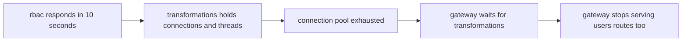
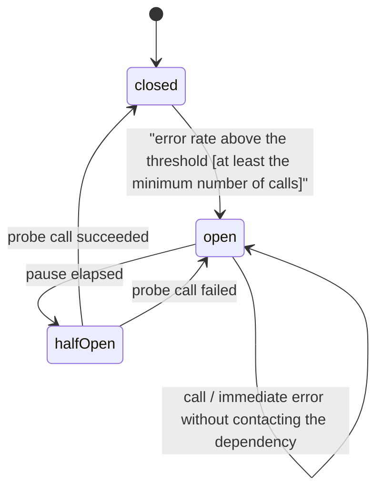
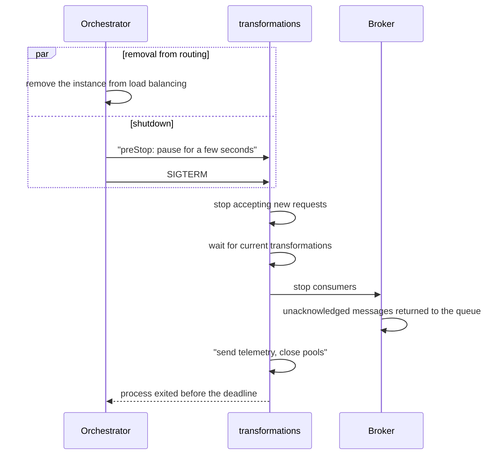

# Fault tolerance

## Contents

- [What fault tolerance is](#what-fault-tolerance-is)
- [Failure types](#failure-types)
- [Cascading failure](#cascading-failure)
- [Timeouts](#timeouts)
- [Retries with a pause and jitter](#retries-with-a-pause-and-jitter)
- [Circuit breaker](#circuit-breaker)
- [Bulkhead](#bulkhead)
- [Overload](#overload)
- [Degradation and fail closed](#degradation-and-fail-closed)
- [Health checks](#health-checks)
- [Graceful shutdown](#graceful-shutdown)
- [Comparison](#comparison)
- [How to choose](#how-to-choose)
- [How this shows up in the system](#how-this-shows-up-in-the-system)
- [Common mistakes](#common-mistakes)
- [Useful links](#useful-links)
- [Review questions](#review-questions)

## What fault tolerance is

Fault tolerance is the ability of a system to keep working, fully or in part, when some of its parts fail. In microservices, partial failure is a normal state. One instance restarts. A dependency responds slowly.

Every synchronous call from `0.2 Синхронное взаимодействие.md` (Synchronous communication) and every consumer from `0.3 Асинхронное взаимодействие.md` (Asynchronous communication) must survive a neighbor's failure. Only an idempotent operation may be retried. A retry does not change the result of the first run. A failure is seen in metrics and alerts: the error rate, latency, and queue length.

| Pattern group | Examples | When it fits |
| --- | --- | --- |
| Call protection | timeout, retry with jitter, and circuit breaker | every synchronous dependency |
| Resource isolation | bulkhead, separate connection pools | heavy work next to light work |
| Load management | rate limiting, load shedding, and a queue | spikes and overload |
| Instance lifecycle | health checks, graceful shutdown | startup, rollout, and shutdown of every service |

## Failure types

A pattern is chosen for a specific kind of failure. The first step is to see how the failure looks to the caller.

| Failure type | Example | How to detect it |
| --- | --- | --- |
| process crash | the `rbac` container restarts | a connection error, a liveness probe |
| slow response | `users` responds in 5 seconds instead of 50 ms | a timeout, a rising p99 |
| error response | a neighbor returns **500** | the response status, the error rate |
| overload | more requests arrive than the service can handle | **429**, **503**, and queue length |
| network partition | `transformations` cannot see `rbac`, and the others can | connection errors on some clients |
| infrastructure failure | the broker is unavailable, and HTTP still works | publish errors, growth of the outbox table |

## Cascading failure

A cascading failure is the spread of one service's failure to the others. A slow neighbor is more dangerous than a crashed one. A crashed neighbor returns an error at once. A slow one holds the callers' threads, connections, and memory.



Without limits, a slow `rbac` stops the whole gateway, even though `users` is healthy. Timeouts, a circuit breaker, and resource isolation break the chain.

## Timeouts

A timeout limits how long the caller is willing to wait. The value comes from the dependency's latency distribution: p99 plus a margin, not a larger number "just in case". A timeout that is too long holds resources. A timeout that is too short causes false failures.

In the course system, the timeout of an internal call is 2 seconds per attempt. The gRPC deadline covers retries as well, so `CheckAccess` as a whole fits in 2 seconds. The outer limit is always greater than the inner one. The transformations route on the gateway waits 35 seconds. A transformation takes no more than 30 seconds. A gateway that does not get a response from the service returns **504**. When the service is unavailable, it returns **503**.

## Retries with a pause and jitter

A retry repairs a short-lived failure: an instance restart, a lost packet, or **503** during a rollout. Only transient errors are retried: a timeout, **503**, and `UNAVAILABLE`. A retry does not fix **400**, **403**, or **409**.

The pause grows exponentially and includes a random part. Full jitter chooses the pause at random from zero up to the exponential bound. In the course system, an idempotent call is retried at most twice. The first pause is random, up to 100 ms. The second is up to 200 ms. Without the random part, clients that received an error at the same time retry at the same time and overload the recovered service again.

Retries multiply across layers. If the gateway, the service, and the service's client each make three attempts, the downstream dependency receives up to 27 calls for one user request. Only the level closest to the dependency retries. The gateway does not retry requests. The `Retry-After` header in **429** and **503** responses says when a retry makes sense.

```csharp
builder.Services
    .AddHttpClient<RbacClient>(client => client.BaseAddress = new Uri("http://rbac:8080"))
    .AddStandardResilienceHandler(options =>
    {
        options.AttemptTimeout.Timeout = TimeSpan.FromSeconds(2);
        options.Retry.MaxRetryAttempts = 2;
        options.Retry.Delay = TimeSpan.FromMilliseconds(100);
        options.Retry.DisableForUnsafeHttpMethods();
    });
```

The standard .NET pipeline retries every HTTP method by default, including `POST`. `DisableForUnsafeHttpMethods()` disables retries of `POST`, `PUT`, `PATCH`, and `DELETE`. A mutating call is retried only with an idempotency key. With an exponential pause, Polly computes jitter by the decorrelated jitter formula, not full jitter. The pauses come out near 100 ms and 200 ms, not strictly up to those bounds.

## Circuit breaker

A circuit breaker is a fuse on a dependency. When the error rate exceeds the threshold, it stops letting calls through and returns an error at once. After a pause, it lets probe calls through. It closes or opens again based on their result.



In the `open` state, the caller spends neither time nor connections on a dependency known to be down. The dependency gets a pause in which to recover. The defaults of the standard .NET pipeline are 10% errors over 30 seconds, a minimum of 100 calls, and a pause of 5 seconds.

The order of strategies in the pipeline matters. The standard .NET pipeline, from the outside in, is a concurrency limit, a total timeout, a retry, a circuit breaker, and an attempt timeout. The total timeout bounds all retries together. The breaker sees each attempt separately.

## Bulkhead

A bulkhead isolates resources by kind of work, like the compartments of a ship. A breach in one compartment does not sink the others. Each dependency has its own connection pool. Heavy work has its own concurrency limit.

Image transformation loads the CPU harder than text transformation. With a shared pool, a spike of images takes every slot. Text transformations and health probes wait. A separate limit on concurrent image transformations keeps the rest served. A request above the limit receives **503** with `Retry-After` instead of waiting forever.

## Overload

Rate limiting caps the request rate of one client. The gateway returns **429** according to the limits of the public routes. Load shedding drops some requests when the service itself is overloaded. **503** with `Retry-After` is better than a slow response to everyone.

Queue-based load leveling smooths spikes with a queue. `EraseUserData` commands are processed at the speed of the consumers. Prefetch limits how many messages are in progress at once. A queue fits work that does not need an immediate response to the client.

## Degradation and fail closed

Degradation means working without an optional part. The profile is returned even when the photo store is unavailable. `photoUrl` is a link, and the file itself is requested by a separate call. The administrative page from `0.2 Синхронное взаимодействие.md` (Synchronous communication) shows the profile without history when `transformations` did not respond.

Security checks do not degrade. When `CheckAccess` or the status check fails, the request receives **503**. Allowing access "temporarily, while `rbac` is down" would hand the system to any user. The rule is fail closed. When a check cannot be made, the request is denied.

Every fallback is counted as a metric. Degradation without an alert hides a failure for weeks.

## Health checks

| Probe | What it checks | What the orchestrator does on failure |
| --- | --- | --- |
| liveness | the process is alive and not stuck | restarts the container |
| readiness | the service is ready to serve: the database, configuration, and the policy snapshot | removes the instance from routing without restarting it |
| startup | a long startup has finished | defers liveness while startup is still in progress |

Liveness does not check dependencies. If liveness checks the database, a brief database failure restarts every instance of every service at once. That is a cascading failure of the system's own making. Readiness checks the dependencies.

`/health/ready` of an `rbac` instance does not pass until the policy snapshot is loaded. `/health/ready` of the gateway does not pass until JWKS is loaded. A message consumer is ready when it is connected to the broker.

## Graceful shutdown

Graceful shutdown is a stop that does not lose work in progress. The orchestrator sends SIGTERM and waits for the termination period. In Kubernetes the default is 30 seconds. After that, it sends SIGKILL.



Removal from routing and shutdown run in parallel. Routing does not update at once. The instance therefore still accepts requests for a few seconds. The preStop hook supplies that pause. Only then does the instance stop accepting new requests. If acceptance closes at once, requests already routed to the instance get a connection error.

The termination period is longer than the longest request plus the preStop pause. A transformation lasts up to 30 seconds, so the default period of 30 seconds is too short for `transformations`. SIGKILL cuts off the last requests. The broker itself returns messages the consumer did not acknowledge. Another instance takes a job whose lease has expired.

## Comparison

| Pattern | What it protects against | Cost | Fits |
| --- | --- | --- | --- |
| timeout | waiting forever | false failures when the value is too small | every network call |
| retry with jitter | short-lived failures | extra load on the neighbor | reads and idempotent writes |
| circuit breaker | a cascading failure and useless calls | fast failures while the dependency recovers | a synchronous dependency that can go down entirely |
| bulkhead | one kind of work taking all resources | some resources sit idle | heavy work next to light work |
| rate limiting | overload by one client | rejection of some of that client's requests | a public entry point |
| load shedding | overload of the whole system | rejection of some requests during a spike | a service at the limit of its capacity |
| queue | load spikes | a processing delay | work with no immediate response |

## How to choose

1. A timeout is set on every call from the dependency's p99 plus a margin. In the course system, it is 2 seconds per attempt.
2. Only idempotent operations are retried, at one level, no more than twice, with a pause and jitter.
3. A circuit breaker is placed on every synchronous dependency. An open breaker returns a fast **503**.
4. Heavy work is isolated. Image transformations stay separate from text transformations.
5. Security checks stay fail closed. Only optional parts of the response are degraded.
6. Liveness stays free of dependencies. Readiness includes the dependencies.
7. The graceful shutdown period is longer than the longest request.

## How this shows up in the system

**Registration.** A failure of `mail` or SMTP does not stop registration. The `SendEmail` command waits in the queue until its `expiresAt`, 10 minutes from when the code is issued. After that, the user requests the email again. A broker failure does the same. Outbox rows accumulate in the `users` database and are sent after recovery. Commands whose `expiresAt` has passed no longer send the email.

**Authentication.** The gateway keeps JWKS in a cache, so a short restart of `users` does not break signature checks. The status check does not pass, and the request receives **503**.

**Authorization.** `CheckAccess` is protected by a timeout of 2 seconds and a circuit breaker. An open breaker returns **503** at once. Permission is never granted on a failure.

**RBAC.** Readiness of an `rbac` instance does not pass until the policy snapshot is loaded, so traffic does not reach an instance that cannot make a decision.

**General requirements for file transformation.** The graceful shutdown period of `transformations` is longer than 30 seconds. Otherwise a rollout cuts transformations off in the middle.

**Image transformation.** A separate limit on concurrent image transformations keeps them from taking the resources of text transformations and probes.

**User deletion.** The orchestrator retries a temporary failure of a participant with a pause of 1 minute, for at most 5 attempts in total. The job then moves to `failed` and waits for an administrator to retry it by hand. Stopping a `users` instance in the middle of the saga does not lose the saga. The state is stored in the database.

**Saving transformation results to storage.** An unavailable store does not break the transformation. The result has already been returned to the client. The history row stays `pending` and is filled in later.

## Common mistakes

| What is visible | Cause and fix |
| --- | --- |
| A slow `rbac` stopped the gateway and every service | no timeouts and no breaker, so resources wait; a timeout of 2 seconds and a breaker on the dependency |
| A short failure of a neighbor turned into a flood of requests | retries at every level with no pause; retry at one level with jitter |
| A retried `POST` created a duplicate | the standard .NET pipeline retries every method; `DisableForUnsafeHttpMethods()` or an idempotency key |
| Clients retry at the same time and take the service down again | a pause with no random part; full jitter |
| The breaker stays open even though the neighbor has long been healthy | no probe calls; half-open after the pause |
| A database failure restarted every instance | liveness checks dependencies; dependencies belong only in readiness |
| Traffic reached an instance before the policy was loaded | readiness does not include the snapshot; ready only after the load |
| A rollout cut transformations off in the middle | the default termination period is 30 seconds; make it longer than the longest request |
| During a rollout, some requests get a connection error | acceptance closes at once on SIGTERM, before routing updates; a preStop pause before acceptance closes |
| Messages are lost after a consumer stops | an ack before processing; acknowledge after the commit, and unacknowledged messages return on their own |
| Images blocked text transformations | a shared pool; a separate concurrency limit for images |
| On an `rbac` failure, access is allowed "temporarily" | a fallback that grants access; fail closed and **503** |
| A fallback hid a failure for weeks | degradation with no metric; count the activations and raise an alert |
| The service responds slowly to everyone instead of rejecting some | no load shedding; **503** with `Retry-After` past the capacity limit |

## Useful links

### General

- [Microsoft — Circuit Breaker Pattern](https://learn.microsoft.com/en-us/azure/architecture/patterns/circuit-breaker) — the closed, open, and half-open states.
- [Martin Fowler — Circuit Breaker](https://martinfowler.com/bliki/CircuitBreaker.html) — the original description of the pattern.
- [Microsoft — Bulkhead Pattern](https://learn.microsoft.com/en-us/azure/architecture/patterns/bulkhead) — isolation of resources by kind of work.
- [Microsoft — Retry pattern](https://learn.microsoft.com/en-us/azure/architecture/patterns/retry) — when a retry is appropriate.
- [AWS — Timeouts, retries, and backoff with jitter](https://aws.amazon.com/builders-library/timeouts-retries-and-backoff-with-jitter/) — choosing timeouts, and how retries multiply across layers.
- [AWS Architecture Blog — Exponential Backoff And Jitter](https://aws.amazon.com/blogs/architecture/exponential-backoff-and-jitter/) — full jitter and a comparison of pause strategies.
- [Google SRE — Handling Overload](https://sre.google/sre-book/handling-overload/) — shedding load and a retry budget.
- [Google SRE — Addressing Cascading Failures](https://sre.google/sre-book/addressing-cascading-failures/) — how overload spreads through the system.
- [Microsoft — Queue-Based Load Leveling Pattern](https://learn.microsoft.com/en-us/azure/architecture/patterns/queue-based-load-leveling) — a queue as a buffer for spikes.
- [Microsoft — Health Endpoint Monitoring Pattern](https://learn.microsoft.com/en-us/azure/architecture/patterns/health-endpoint-monitoring) — what to check in a health endpoint.
- [Kubernetes — Configure Liveness, Readiness and Startup Probes](https://kubernetes.io/docs/tasks/configure-pod-container/configure-liveness-readiness-startup-probes/) — the three kinds of probes and their consequences.
- [Kubernetes — Pod Lifecycle](https://kubernetes.io/docs/concepts/workloads/pods/pod-lifecycle/#pod-termination) — SIGTERM, the termination period, and SIGKILL.
- [RFC 9110 — Retry-After](https://www.rfc-editor.org/rfc/rfc9110.html#name-retry-after) — the pause before a retry for **429** and **503**.

### By language

#### Node.js

- [GitHub — connor4312/cockatiel](https://github.com/connor4312/cockatiel) — retries, a circuit breaker, timeouts, and a bulkhead for Node.js.
- [NestJS — Health checks (Terminus)](https://docs.nestjs.com/recipes/terminus) — liveness and readiness endpoints.
- [NestJS — Lifecycle Events](https://docs.nestjs.com/fundamentals/lifecycle-events) — `enableShutdownHooks` and shutdown on a signal.

#### .NET

- [Microsoft — Build resilient HTTP apps](https://learn.microsoft.com/en-us/dotnet/core/resilience/http-resilience) — the standard resilience pipeline and its defaults.
- [Polly — Documentation](https://www.pollydocs.org/) — resilience strategies for .NET.
- [Microsoft — Health checks in ASP.NET Core](https://learn.microsoft.com/en-us/aspnet/core/host-and-deploy/health-checks) — separate live and ready checks.

#### Python

- [Tenacity — Documentation](https://tenacity.readthedocs.io/) — retries with an exponential pause and jitter.
- [FastAPI — Lifespan Events](https://fastapi.tiangolo.com/advanced/events/) — actions on application startup and shutdown.

## Review questions

1. Why is a slow dependency more dangerous than a crashed one, and which patterns break the cascade?
2. Why may a call be retried at only one level, and only for idempotent operations?
3. Why does the pause between retries need a random part?
4. How does the half-open state differ from closed and open?
5. Why does liveness not check the database, while readiness does?
6. What happens during a rollout of `transformations` if the graceful shutdown period stays at 30 seconds?
7. Why, when `rbac` fails, must a request not be "temporarily allowed"?
