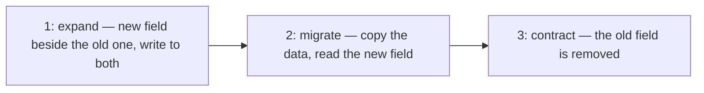
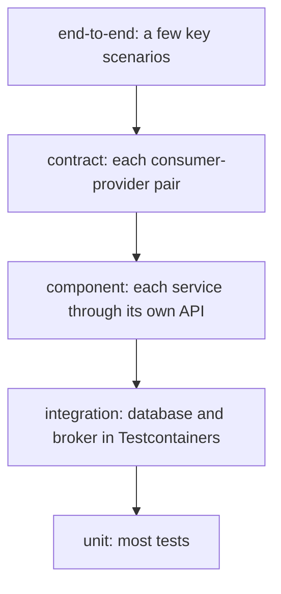
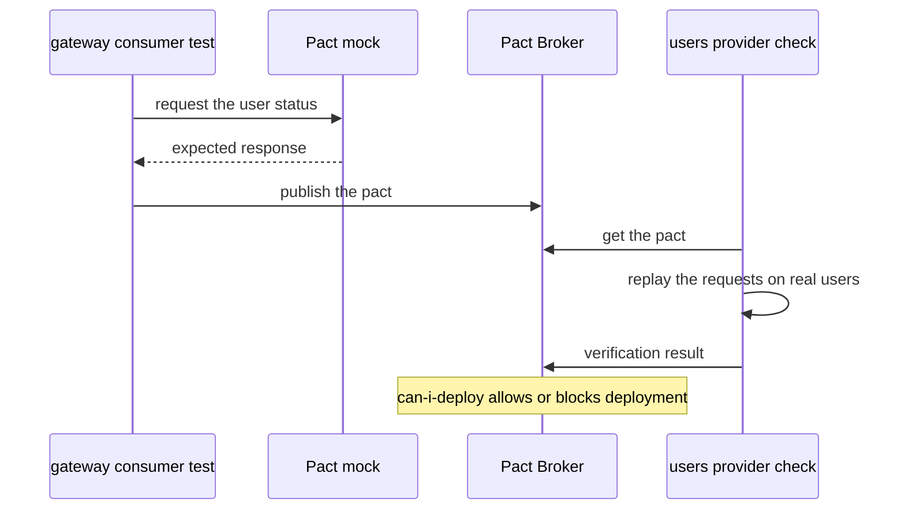

# Contracts and testing

## Contents

- [What a service contract is](#what-a-service-contract-is)
- [Change compatibility](#change-compatibility)
- [Versioning](#versioning)
- [Protobuf evolution](#protobuf-evolution)
- [Expand and contract](#expand-and-contract)
- [The test pyramid](#the-test-pyramid)
- [Consumer-driven contracts](#consumer-driven-contracts)
- [Integration tests with Testcontainers](#integration-tests-with-testcontainers)
- [Tests of asynchronous scenarios](#tests-of-asynchronous-scenarios)
- [Comparison](#comparison)
- [How to choose](#how-to-choose)
- [How this shows up in the system](#how-this-shows-up-in-the-system)
- [Common mistakes](#common-mistakes)
- [Useful links](#useful-links)
- [Review questions](#review-questions)

## What a service contract is

A service contract is everything its consumers rely on: the shape of requests and responses, error codes, the schemas of events and commands, their meaning, and the guarantees of idempotency, order, and deadlines. A service deploys on its own while every change keeps the contract for consumers that are already running.

The external contract of the course system is its HTTP API behind the gateway. Internal contracts appeared with the service boundaries: `CheckAccess`, the `rbac@manage` reservation, JWKS, `UserStatusChanged`, `PolicyChanged`, `SendEmail`, `EraseUserData`, and `UserDataErased`. The same requirements apply to them as to the external API: a description, checks, and compatible changes.

| Contract kind | Format | When it fits |
| --- | --- | --- |
| HTTP API | OpenAPI | the external API and internal HTTP calls |
| gRPC | `.proto` | `CheckAccess` and other frequent internal calls |
| Messages | AsyncAPI and JSON Schema | events and commands through a broker |

## Change compatibility

Backward compatibility means a new provider version works with old consumers. Forward compatibility means an old consumer survives data from a new version, for example unknown fields. During a rolling update, old and new instances run at the same time, so both are required.

| Change | Compatible | Why |
| --- | --- | --- |
| add an optional field to a response or an event | yes, if the consumer is a tolerant reader | old code does not read the new field |
| add an optional query parameter | yes | old clients do not send it |
| make a parameter required | no | old clients receive **400** |
| delete or rename a field | no | consumers read the old name |
| change the type of a field | no | deserialization breaks |
| add a value to an enumeration | with care | a strict consumer fails on an unknown value |
| change the meaning of a field or a code | no, even when the shape stays the same | consumers decide from the old meaning |

A tolerant reader reads only the fields it needs, ignores unknown fields, and does not fail on new enumeration values. An unknown value receives a safe interpretation. If `UserStatusChanged` gains a new status, `rbac` treats it as inactive. That stays compatible and follows fail closed.

## Versioning

The external API lives without a version number while changes stay compatible. A breaking change is published as a new path version, for example `/v2/...`, beside the old one. The old version is marked deprecated ahead of time:

```http
Deprecation: @1782863999
Sunset: Thu, 31 Dec 2026 23:59:59 GMT
Link: <https://docs.example.test/deprecations/v1>; rel="deprecation"
```

`Deprecation` (RFC 9745) states the deprecation time. Here that time is June 30, 2026. `Sunset` (RFC 8594) states the date after which the resource stops responding. The link points to a description of the transition.

Internal APIs change without version numbers through expand and contract. Every consumer is known and is updated in turn. The `rbac.v1` package in `.proto` changes to `rbac.v2` only for a change that cannot be made compatible. A breaking change to an event is published as a new event type in parallel with the old one, until subscribers switch. Shared technical libraries follow Semantic Versioning. A breaking change increments MAJOR.

## Protobuf evolution

The field number identifies the field in the binary format. Changing the number is the same as deleting the field and creating a new one. The number of a deleted field must not be reused. An old client would read another field's data in it.

```proto
message CheckAccessResponse {
  reserved 3;
  reserved "reason_text";
  bool allowed = 1;
  int64 policy_version = 2;
  string decision_id = 4;
}
```

The field `reason_text` with number 3 is deleted. The number and the name are reserved. The new field received number 4. A proto3 parser keeps unknown fields, so an old consumer survives a response from the new version.

## Expand and contract

Expand and contract (parallel change) is a breaking change in three compatible steps. It fits database columns, API fields, and event fields.



Each step is a separate deployment. Old and new instances run between the steps, so no deployment breaks its neighbors or requires the services to deploy together. The schema migration runs before the code that uses it. The old column is deleted after the last instance stops reading it.

Renaming the `photo_key` column in the `users` database works as follows. Add a new column and write to both. Copy the values and read the new column. Stop writing the old column and delete it. The external API stays the same at every step.

## The test pyramid

| Level | What it checks | Dependencies |
| --- | --- | --- |
| unit | the rules of one module | stubs |
| integration | code together with a real database and broker | Testcontainers |
| component | one whole service through its API | neighbors replaced by stubs |
| contract | compatibility of a consumer and a provider | Pact, without a joint run |
| end-to-end | a scenario through the gateway and every service | the whole system in Compose |



The higher the level, the slower and more brittle the test, and the fewer such tests there are. An end-to-end test does not replace contract tests. It checks one path at one set of versions. It does not check the compatibility of each pair.

## Consumer-driven contracts

A consumer-driven contract is a contract the consumer defines. It describes only the requests and fields the consumer actually uses. The provider checks that it meets the expectations of all of its consumers.



The consumer test runs against the mock and records the interactions in a pact. The provider replays them on the real service after preparing the required data state. Pact Broker stores the contracts and the verification results. `can-i-deploy` reports whether a version is compatible with the versions in the environment.

Pact also checks messages. A message pact describes an event or a command with no tie to a broker. The provider changes anything the consumers do not use. A breaking change is found before deployment.

## Integration tests with Testcontainers

Testcontainers starts real PostgreSQL, RabbitMQ, or Kafka in Docker for the duration of the test. The versions are the same as in the environment.

A database stub does not check SQL, `UNIQUE` constraints, `ON CONFLICT`, transactions, or `FOR UPDATE SKIP LOCKED`. A broker stub does not check acknowledgments, redelivery, or DLX. Outbox, inbox, and replicas break in exactly these places.

Starting a container takes seconds, so the container is reused for the test suite, and the data is cleared between tests.

## Tests of asynchronous scenarios

The result of an asynchronous scenario does not appear at once. The test polls the state until the test timeout, in place of a fixed `sleep`. A short `sleep` causes random failures. A long `sleep` slows the suite.

Required checks of asynchronous code:

- **double delivery** — the same message twice produces one effect;
- **broken order** — an event with `version` 8, then 7, leaves the state at version 8;
- **outbox** — a rolled-back transaction leaves no outbox row, and a committed transaction leaves exactly one;
- **sagas** — `retryable_failure` leads to a retry, `permanent_failure` leads to `failed`, and a lost response leads to a retry on timeout;
- **poison message** — after the attempt limit, the message ends up in the DLQ.

## Comparison

| Approach | What it catches | Cost | Fits |
| --- | --- | --- | --- |
| schema compatibility check | breaking changes in OpenAPI, `.proto`, and JSON Schema | it does not see what a particular consumer uses | every contract, automatically in CI |
| consumer-driven contracts | changes that break real consumers | tests for each pair and a contract broker | HTTP and messages between services |
| end-to-end | errors in assembling the whole system | slow, brittle, and the cause is hard to find | a few key scenarios |

## How to choose

1. Every contract has a machine-readable description: OpenAPI, `.proto`, and a message schema.
2. Contracts change in a compatible way. A breaking change goes through expand and contract, or a new version is published beside the old one.
3. Consumers are tolerant readers. Unknown fields are ignored. Unknown values receive a safe interpretation.
4. The test base is unit tests and integration tests with Testcontainers. Contract tests cover each pair of services. End-to-end tests cover a few scenarios through the gateway.
5. Asynchronous scenarios are checked with a wait that has a timeout, with double delivery, and with broken order.
6. A deployment is allowed only when the version is compatible with the versions in the environment.

## How this shows up in the system

**Registration.** The scenario of confirmation followed by the `user` role is checked by waiting with a timeout. The role appears after the event is delivered. The confirmation response does not include the role.

**Authentication.** JWKS is the contract of `users` with the gateway and the services: the key format, `kid`, and the rotation order. A test checks that a new key appears in JWKS before the first token signed with that key.

**Authorization.** `CheckAccess` is described in `.proto` with the package `rbac.v1`. Deleted fields are reserved. A denial remains the response `allowed = false`, and not an error status.

**RBAC.** `PolicyChanged` and `UserStatusChanged` are the published language of the contexts. A new user status does not break `rbac`. An unknown status counts as inactive.

**Viewing user data.** The canonical user profile is part of the external contract. A new field in the response is compatible. Renaming `displayName` is not. Schema changes in the `users` database go through expand and contract and stay invisible outside.

**User deletion.** Every saga participant implements `EraseUserData` and `UserDataErased`. The contract test of each participant checks a repeat of the same `userId` and `jobId` pair and all three results: `succeeded`, `retryable_failure`, and `permanent_failure`.

**Shared requirements for file transformation.** The external contract of the transformations is checked end to end through the gateway. Requests from an HTTP client receive the responses and codes described in the contract.

## Common mistakes

| What shows up | Cause and fix |
| --- | --- |
| A consumer crashed after the provider deployment | an incompatible change with no check; a contract test and `can-i-deploy` before deployment |
| A consumer crashes on a new field | strict deserialization; a tolerant reader |
| `rbac` crashed on a new status value | an unknown enumeration value is treated as an error; treat it as an inactive status |
| The old and new Protobuf fields got mixed up | a field number was reused; `reserved` for deleted numbers and names |
| A database migration broke running instances | the column was deleted in the same deployment as the code; expand and contract |
| Services deploy only as a batch | contracts change in an incompatible way; compatible changes and independent deployments |
| Tests are green, and SQL fails in the environment | the database in tests is replaced by a stub; Testcontainers with the same PostgreSQL version |
| An asynchronous scenario test sometimes passes and sometimes fails | a fixed `sleep`; poll the result until the timeout |
| A duplicate message created a second record only in production | double delivery was not tested; a test with a repeated delivery |
| End-to-end tests run for an hour and fail at random | too many scenarios go through the whole system; move the checks into contract and component tests |
| Clients learned about an API version removal on the removal day | no deprecation signals; `Deprecation`, `Sunset`, and a link to the description ahead of time |
| A message contract exists only in the publisher code | no schema; AsyncAPI or JSON Schema next to the code |

## Useful links

### General

- [OpenAPI Initiative — OpenAPI Specification](https://spec.openapis.org/oas/latest.html) — a machine-readable HTTP contract.
- [AsyncAPI Initiative — Documentation](https://www.asyncapi.com/docs) — a description of channels, events, and commands.
- [JSON Schema — Specification](https://json-schema.org/specification) — a schema for message bodies.
- [Protocol Buffers — Updating A Message Type](https://protobuf.dev/programming-guides/proto3/#updating) — compatible changes to `.proto`.
- [Protocol Buffers — Proto Best Practices](https://protobuf.dev/best-practices/dos-donts/) — what must not be done with fields and their numbers.
- [Google — AIP-180: Backwards compatibility](https://google.aip.dev/180) — which API changes count as breaking.
- [Martin Fowler — Tolerant Reader](https://martinfowler.com/bliki/TolerantReader.html) — a consumer that new fields do not break.
- [Martin Fowler — Parallel Change](https://martinfowler.com/bliki/ParallelChange.html) — the expand, migrate, and contract steps.
- [Ian Robinson — Consumer-Driven Contracts: A Service Evolution Pattern](https://martinfowler.com/articles/consumerDrivenContracts.html) — the original description of the approach.
- [Ham Vocke — The Practical Test Pyramid](https://martinfowler.com/articles/practical-test-pyramid.html) — test levels and how they relate.
- [Toby Clemson — Testing Strategies in a Microservice Architecture](https://martinfowler.com/articles/microservice-testing/) — component, contract, and end-to-end tests of services.
- [Pact — How Pact works](https://docs.pact.io/getting_started/how_pact_works) — the consumer test, provider verification, and message pacts.
- [Pact — Can I Deploy](https://docs.pact.io/pact_broker/can_i_deploy) — a compatibility check before deployment.
- [Testcontainers — Getting Started](https://testcontainers.com/getting-started/) — real dependencies in containers for tests.
- [RFC 9745 — The Deprecation HTTP Response Header Field](https://www.rfc-editor.org/rfc/rfc9745.html) — a signal that a resource is deprecated.
- [RFC 8594 — The Sunset HTTP Header Field](https://www.rfc-editor.org/rfc/rfc8594.html) — the date after which a resource stops responding.
- [Semantic Versioning — Semantic Versioning 2.0.0](https://semver.org/) — versions of packages and shared libraries.

### By language

#### Node.js

- [Pact — JavaScript](https://docs.pact.io/implementation_guides/javascript) — Pact for Node.js.
- [Testcontainers — Testcontainers for NodeJS](https://node.testcontainers.org/) — PostgreSQL and RabbitMQ containers in tests.

#### .NET

- [Pact — .NET](https://docs.pact.io/implementation_guides/net) — Pact for .NET.
- [Testcontainers — Testcontainers for .NET](https://dotnet.testcontainers.org/) — dependency containers in xUnit tests.
- [Microsoft — Integration tests in ASP.NET Core](https://learn.microsoft.com/en-us/aspnet/core/test/integration-tests) — a component test of a service through `WebApplicationFactory`.

#### Python

- [Pact — Python](https://docs.pact.io/implementation_guides/python) — Pact for Python.
- [Testcontainers — testcontainers-python](https://testcontainers-python.readthedocs.io/) — dependency containers in pytest.

## Review questions

1. How does backward compatibility differ from forward compatibility, and why does a rolling update need both?
2. Why can adding a value to an enumeration break a consumer, and how is that avoided?
3. How is a column in the `users` database renamed without stopping the running instances?
4. Why is the number of a deleted Protobuf field marked `reserved`?
5. How does a consumer-driven contract differ from an end-to-end test?
6. Why do integration tests use real PostgreSQL in a container, and not a stub?
7. How is an asynchronous scenario checked without a fixed `sleep`?
