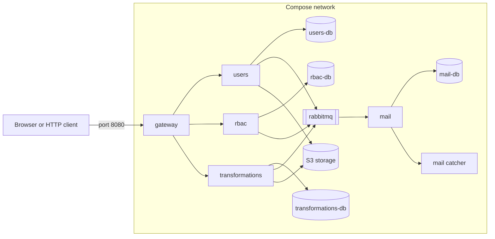
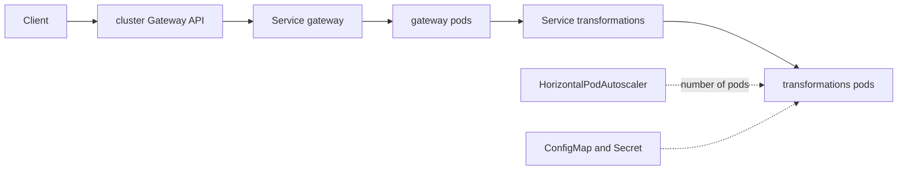
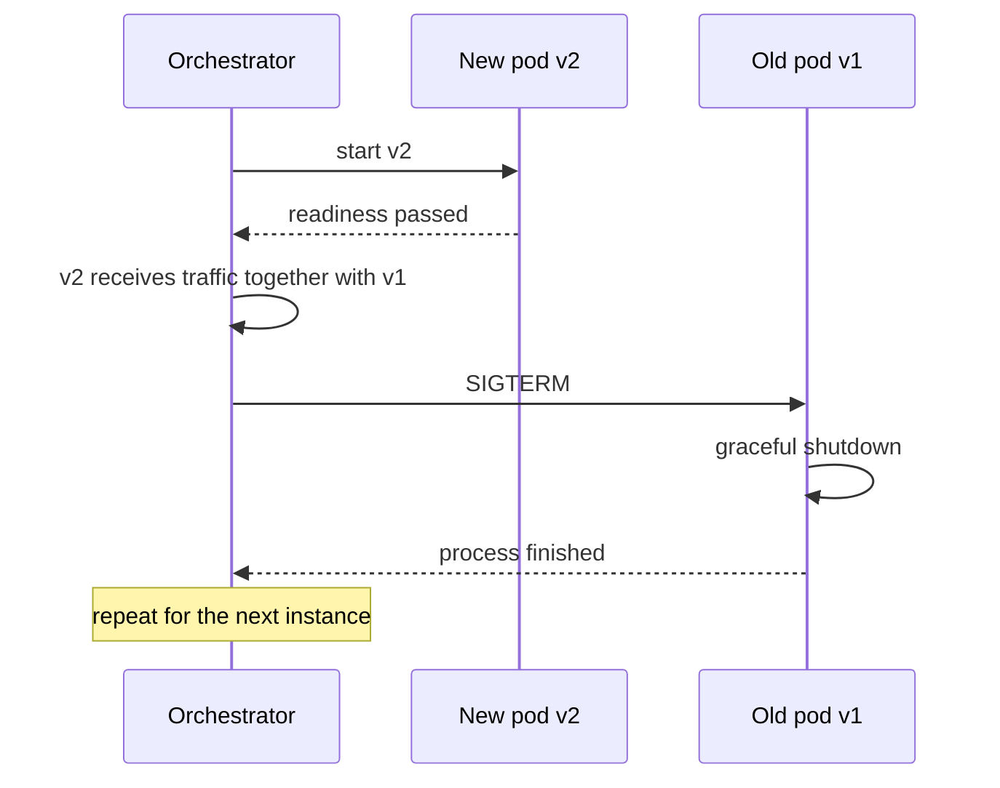

# Containerization and deployment

## Contents

- [What containerization and deployment are](#what-containerization-and-deployment-are)
- [Image and container](#image-and-container)
- [Configuration and secrets](#configuration-and-secrets)
- [Local system in Compose](#local-system-in-compose)
- [Kubernetes: core objects](#kubernetes-core-objects)
- [Independent build and deployment](#independent-build-and-deployment)
- [Deployment strategies](#deployment-strategies)
- [Service mesh](#service-mesh)
- [Comparison](#comparison)
- [How to choose](#how-to-choose)
- [How this shows up in the system](#how-this-shows-up-in-the-system)
- [Common mistakes](#common-mistakes)
- [Useful links](#useful-links)
- [Review questions](#review-questions)

## What containerization and deployment are

Containerization packs a service, together with its runtime, into an immutable image that starts the same way on any machine. Deployment starts images of the required version in the required number, updates them without downtime, and recovers after failures.

The course system consists of five applications, four databases, a broker, storage, and auxiliary services. Without containers, the system cannot be started with one command. Without independent deployment, the main point of microservices is lost. Applications do not store state in process memory, so each one can run in several instances.

| Environment | Examples | When it fits |
| --- | --- | --- |
| Docker Compose | `docker compose up` on a developer machine | local development and a check of the whole system |
| Kubernetes | a managed cluster in the cloud | production with several instances and automatic recovery |
| Managed containers | Cloud Run, Azure Container Apps, Amazon ECS | production without cluster management |
| Local stack orchestration | Aspire | development with a telemetry dashboard and dependency startup |

## Image and container

An image is an immutable set of filesystem layers and a start command. A container is a running process from an image, with its own filesystem and network. One container runs one service process. Logs go to stdout, not into files inside the container.

```dockerfile
FROM node:22-alpine AS build
WORKDIR /app
COPY package*.json ./
RUN npm ci
COPY . .
RUN npm run build && npm prune --omit=dev

FROM node:22-alpine
WORKDIR /app
ENV NODE_ENV=production
COPY --from=build /app/node_modules ./node_modules
COPY --from=build /app/dist ./dist
USER node
EXPOSE 8080
CMD ["node", "--import", "./dist/instrumentation.js", "dist/main.js"]
```

A multi-stage build builds the code in the first stage and copies only the result and the runtime dependencies into the final image. The compiler, the source files, and the dev dependencies do not reach production. `USER node` starts the process without root privileges. `--import` loads the OpenTelemetry instrumentation before the application code. Otherwise the instrumentation does not attach to the HTTP server and the drivers in time.

The `COPY` order matters for the layer cache. Dependencies are installed before the source is copied, and they are not reinstalled on every code change. `.dockerignore` excludes `node_modules`, `.git`, and local secrets from the build context. The image is tagged with the commit SHA, not with `latest`. The tag identifies exactly which code is running.

## Configuration and secrets

Configuration is everything that changes between environments: database and broker addresses, timeouts, and limits. It is passed at startup, and the image stays the same for every environment. The service checks the configuration at start and does not become ready until the configuration is complete.

Secrets go into neither the image nor the repository. Environment variables leak easily into logs and child processes, so secrets are mounted as files. Compose places them in `/run/secrets/`. Kubernetes places them in a volume from a Secret. A Secret in Kubernetes is stored in etcd without encryption by default, so storage encryption or an external secret manager is turned on.

Secrets in the course system are assigned to owners:

- The ES256 private key for access, the HS256 secret for refresh, and the HMAC key for challenge belong only to `users`.
- The encryption key for the `SendEmail` body belongs only to `users` and `mail`.
- Each service has its own database passwords and broker credentials.
- Bucket access keys belong only to the bucket owner.

## Local system in Compose

One command, `docker compose up`, starts the whole system: the gateway, four domain services, a database for each service, RabbitMQ, S3-compatible storage, a mail catcher, and the OpenTelemetry Collector.



Only the gateway publishes a port on the host. The other containers reach each other by name inside the Compose network. Each database runs in a separate container. That shows that a service has no access to another service's data. In production, service databases can live on one DBMS server as separate databases with separate users.

```yaml
services:
  gateway:
    image: registry.example.test/course/gateway:3f9c2ab
    ports:
      - "8080:8080"
    depends_on:
      users:
        condition: service_healthy

  users:
    image: registry.example.test/course/users:3f9c2ab
    environment:
      DATABASE_URL: postgres://users@users-db:5432/users
    depends_on:
      users-db:
        condition: service_healthy
    healthcheck:
      test: ["CMD", "wget", "-qO-", "http://localhost:8080/health/ready"]
      interval: 5s
      retries: 12

  transformations:
    image: registry.example.test/course/transformations:3f9c2ab
    stop_grace_period: 40s
```

`depends_on` with `condition: service_healthy` starts a service after the dependency has passed the healthcheck. Start order does not cancel connection retries. The database can restart after the service has started. By default, Compose waits 10 seconds for a container to stop, so `transformations` gets a `stop_grace_period` longer than a 30-second transformation.

## Kubernetes: core objects

| Object | Purpose | In the course system |
| --- | --- | --- |
| Pod | one or more containers with a shared network | an instance of `rbac` |
| Deployment | the desired number of pods and a version update | several instances of `transformations` |
| Service | a stable name and address for a set of pods | a call to `rbac` by name |
| Gateway API or Ingress | external entry into the cluster | the route to `gateway` |
| ConfigMap and Secret | configuration and secrets | the broker address, the access signing key |
| probes | liveness, readiness, and startup | `/health/live` and `/health/ready` |
| requests and limits | guaranteed and maximum resources | a CPU limit for image transformations |
| HorizontalPodAutoscaler | the number of pods by load | scaling `transformations` by CPU |



The Kubernetes Gateway API is the entry object of the cluster, and the course system's `gateway` is the application behind it. In a small system, an ingress controller takes on part of the gateway's tasks, but the JWKS check and the status check stay in the application. Service discovery by DNS and probes are covered in `0.2 Синхронное взаимодействие.md` (Synchronous communication) and `0.6 Отказоустойчивость.md` (Fault tolerance).

## Independent build and deployment

Each service has its own pipeline: tests, an image build, publication to the registry with a SHA tag, deployment to the test environment, a contract compatibility check, and deployment to production. A change to `rbac` does not rebuild or deploy `users`.

The image is built once and passes through every environment without a rebuild (build once, deploy many). Environments differ only in configuration, so production receives exactly the code that was checked in the test environment.

A monorepo stores all services together. Shared tools and a search across the repository are easier, but pipelines run for changed paths, and the temptation to deploy everything together is stronger. A separate repository per service makes ownership explicit, but changes that affect several services become harder. Independent deployment matters more than the choice of repository.

A database migration runs as a separate step before deployment of the code that uses it. Breaking schema changes go through expand and contract from `0.7 Контракты и тестирование.md` (Contracts and testing). Automatic synchronization of the schema with the models is not enabled in production.

## Deployment strategies



A rolling update replaces instances one at a time. During the deployment, v1 and v2 run at the same time, so the contracts and the database schema are compatible in both directions. Readiness does not send traffic to a pod that is not ready. Graceful shutdown does not cut off the old pod's requests.

Blue-green keeps two full environments and switches traffic all at once. A rollback is the reverse switch. Canary sends a small part of the traffic to the new version and expands that part while error and latency metrics stay normal. Recreate stops the old version before starting the new one, and it is acceptable only where downtime does not matter.

## Service mesh

A service mesh is a layer of proxies next to each service (sidecar) or on each node. The proxies take on mTLS, retries, timeouts, traffic splitting for canary, and telemetry, without changing the service code. Istio and Linkerd are common implementations.

The cost of a mesh is another complex piece of infrastructure, resources for the proxies, and difficult debugging. Mesh retries stack with retries in code and multiply the load, as described in `0.6 Отказоустойчивость.md` (Fault tolerance). The training system does not need a mesh. Libraries in the services perform the same functions.

## Comparison

| Strategy | Downtime | Rollback | Requirements | Suitable for |
| --- | --- | --- | --- | --- |
| recreate | yes | a new deployment of the old version | none | a local environment, acceptable downtime |
| rolling update | no | a reverse update | version compatibility, readiness, graceful shutdown | the default option |
| blue-green | no | an instant switch back | double the resources, a compatible database | critical releases with a fast rollback |
| canary | no | a return of traffic to the old version | metrics and an automatic decision rule | risky changes with noticeable traffic |

## How to choose

1. The system is started locally in Compose with one command. Only the gateway port is published to the outside.
2. The image is built multi-stage, without root, and tagged with the commit SHA.
3. Configuration is passed at startup, and secrets are passed as files. The image is the same for every environment.
4. Each service keeps a separate pipeline. Services are not deployed in a batch.
5. The default is a rolling update. Canary is for risky changes when traffic is sufficient.
6. The stop timeout is longer than the longest request.
7. A service mesh is not added while libraries in the services are enough.

## How this shows up in the system

**Authentication.** The ES256 private key is mounted as a secret only into `users`. The other services receive the public keys through JWKS. A key change is a new secret version and rotation by `kid`, not a rebuild of the image.

**Authorization.** The `rbac` readiness check does not pass until the policy snapshot is loaded. In Kubernetes, a pod that is not ready receives no traffic, so services do not receive decisions from an instance that is not ready. In Compose, a healthcheck does not cut off traffic. It only sets the start order through `depends_on`.

**Registration.** In the local system, mail goes to the mail catcher. `mail` knows nothing about the environment. Only the SMTP address in the configuration changes.

**User deletion.** Stopping a `users` instance during deployment does not interrupt the saga. The state is in the database, and the commands are in the broker. The new instance continues from the saved step.

**General requirements for file transformation.** The `stop_grace_period` in Compose and the termination period in Kubernetes are longer than 30 seconds. Otherwise the deployment cuts off the transformations.

**Image transformation.** CPU requests and limits, and scaling by load, make it possible to add instances of `transformations` without touching the other services.

**Saving transformation results to storage.** Locally, results are written to S3-compatible storage in Compose. The adapter is the same as in production. Only the address and the keys change.

## Common mistakes

| What you see | Cause and fix |
| --- | --- |
| The image is a gigabyte and builds slowly | build tools are in the final image; a multi-stage build and `.dockerignore` |
| A secret is visible in the image history | the secret was passed through `ENV` or copied into a layer; secrets only at startup |
| The process in the container runs as root | there is no `USER`; the process runs as an unprivileged user |
| The wrong code is running in production | a mutable `latest` tag; a tag by commit SHA |
| The service crashes at start, and the database is not ready yet | `depends_on` without a condition; `condition: service_healthy` and connection retries |
| A service database is reachable from the host | the database port is published; only the gateway is open to the outside |
| Stopping Compose cuts off transformations | the stop timeout is 10 seconds by default; a `stop_grace_period` longer than 30 seconds |
| After the v2 deployment, requests to v1 fail | incompatible changes during a rolling update; expand and contract |
| Logs disappear when the container restarts | logs are written to a file inside the container; logs go to stdout |
| The same code behaves differently across environments | the image is rebuilt for each environment; build once, configuration from the environment |
| A pod is evicted for lack of memory | requests and limits are missing or set too low; they are set from measured usage |
| Kubernetes secrets are read from etcd in plaintext | storage encryption is not enabled; encryption at rest or an external secret manager |
| Deploying one service requires deploying the others | a shared pipeline and a shared version tag; a separate pipeline and image for each service |

## Useful links

### General

- [Docker — Building best practices](https://docs.docker.com/build/building/best-practices/) — layer cache, `.dockerignore`, and an unprivileged user.
- [Docker — Multi-stage builds](https://docs.docker.com/build/building/multi-stage/) — separating the build from the final image.
- [Docker — Compose file reference](https://docs.docker.com/reference/compose-file/) — services, networks, volumes, secrets, and `stop_grace_period`.
- [Docker — Control startup and shutdown order in Compose](https://docs.docker.com/compose/how-tos/startup-order/) — `depends_on` and `service_healthy`.
- [Docker — Manage secrets securely in Docker Compose](https://docs.docker.com/compose/how-tos/use-secrets/) — secrets as files in `/run/secrets`.
- [The Twelve-Factor App — Configuration](https://12factor.net/ru/config) — configuration in the environment, not in the code.
- [The Twelve-Factor App — Build, release, run](https://12factor.net/ru/build-release-run) — one image for every environment.
- [The Twelve-Factor App — Logs](https://12factor.net/ru/logs) — logs as a stream to stdout.
- [Kubernetes — Deployments](https://kubernetes.io/docs/concepts/workloads/controllers/deployment/) — replicas and rolling update.
- [Kubernetes — Service](https://kubernetes.io/docs/concepts/services-networking/service/) — a stable name for a set of pods.
- [Kubernetes — Gateway API](https://kubernetes.io/docs/concepts/services-networking/gateway/) — external entry into the cluster.
- [Kubernetes — Secrets](https://kubernetes.io/docs/concepts/configuration/secret/) — storing secrets and the warning about encryption.
- [Kubernetes — Resource Management for Pods and Containers](https://kubernetes.io/docs/concepts/configuration/manage-resources-containers/) — requests and limits.
- [Kubernetes — Horizontal Pod Autoscaling](https://kubernetes.io/docs/concepts/workloads/autoscaling/horizontal-pod-autoscale/) — scaling by load.
- [Martin Fowler — Blue Green Deployment](https://martinfowler.com/bliki/BlueGreenDeployment.html) — two environments and a traffic switch.
- [Martin Fowler — Canary Release](https://martinfowler.com/bliki/CanaryRelease.html) — a gradual shift of traffic to the new version.
- [Linkerd — What is a service mesh?](https://linkerd.io/what-is-a-service-mesh/) — what a mesh provides and what it costs.

### By language

#### Node.js

- [Docker — Node.js language-specific guide](https://docs.docker.com/guides/nodejs/) — an image, Compose, and tests for a Node.js application.
- [GitHub — nodejs/docker-node Best Practices](https://github.com/nodejs/docker-node/blob/main/docs/BestPractices.md) — the `node` user, signals, and `NODE_ENV` in the image.

#### .NET

- [Microsoft — Containerize an app with Docker tutorial](https://learn.microsoft.com/en-us/dotnet/core/docker/build-container) — a Dockerfile for a .NET application.
- [Microsoft — Containerize an app with dotnet publish](https://learn.microsoft.com/en-us/dotnet/core/containers/sdk-publish) — an image without a Dockerfile, produced by the SDK.
- [Microsoft — What is Aspire?](https://learn.microsoft.com/en-us/dotnet/aspire/get-started/aspire-overview) — a local run of several services with telemetry.

#### Python

- [FastAPI — FastAPI in Containers - Docker](https://fastapi.tiangolo.com/deployment/docker/) — an image for a FastAPI application.
- [Docker — Python language-specific guide](https://docs.docker.com/guides/python/) — an image, Compose, and tests for a Python application.

## Review questions

1. Why is a multi-stage build used, and what must not enter the final image?
2. Why is an image tagged with the commit SHA, and not with `latest`?
3. Why are secrets mounted as files, and not passed as environment variables or placed in the image?
4. What happens when `transformations` is stopped in Compose if `stop_grace_period` is not set?
5. Why does `depends_on` with `service_healthy` not cancel retries of the connection to the database?
6. How does a rolling update differ from blue-green, and what is required of the contracts during a rolling update?
7. When is a service mesh justified, and why is it not needed for the training system?
