# Backend for Frontend Developers — Master Reference

**Track:** Node.js / TypeScript / JavaScript Fullstack  
**Included source files:** `0.0`, `0.1`, `0.2`, `0.3`, `0.4`, `0.5`, `0.6`  
**Goal:** Learn backend concepts as a frontend developer and build a monolithic HTTP API with PostgreSQL, access control, background tasks, middleware, and observability.

---

## Table of Contents

1. [Course Overview](#1-course-overview)
2. [Databases](#2-databases)
3. [UML Diagrams](#3-uml-diagrams)
4. [Backend Architectures](#4-backend-architectures)
5. [Idempotency](#5-idempotency)
6. [Middleware](#6-middleware)
7. [Observability](#7-observability)
8. [Integrated Learning Path](#8-integrated-learning-path)
9. [Final Interview / Exam Checklist](#9-final-interview--exam-checklist)

---

# 1. Course Overview

## 1.1 What This Course Is About

This course is for **Frontend developers** who want to grow their backend skills and become **T-shaped engineers**:

- broad knowledge across many areas,
- deep expertise in one main area.

The course is designed to build on your existing frontend knowledge while teaching you how backend systems really work.

---

## 1.2 Assignment Rules

The assignment is the same for all participants, but any part of it may be adjusted with mentor approval.

By the end of the course, you should build a backend service.

---

## 1.3 Tools

You may use any tools, including AI tools, at every stage of implementation.

However:

- you must be able to explain and justify every technical decision,
- you must defend your choices during intermediate and final reviews,
- if you use tools different from the recommended ones, they must be approved by your mentor.

AI can help you, but you still need to understand:

- why you chose a framework,
- why you chose a database schema,
- why you chose an architecture,
- why your background tasks are designed a certain way,
- why your middleware order is correct,
- why your telemetry is useful.

---

## 1.4 Mentors

Each participant gets a mentor based on skill level and location.

The mentor:

- collects your development status weekly,
- provides theoretical and technical consultations,
- reviews progress,
- helps adjust the assignment if needed.

To schedule a meeting:

- contact your mentor,
- choose a time through the calendar.

If you are in the same office as your mentor, you can also ask questions offline without scheduling.

---

## 1.5 Final Result

By the end of the course, you should build a backend service with these characteristics:

- it is a **monolithic HTTP API**,
- it uses a **relational database**,
- it includes **access control** for operations,
- it includes **background tasks**,
- no separate frontend is required,
- all scenarios are triggered from an HTTP client.

---

## 1.6 Functional Scope

The service should support:

### User Management

- user registration,
- email confirmation if required,
- login with access and refresh cookies,
- role and permission management,
- authorization for protected operations,
- reading and updating a user profile,
- deleting an account.

### Admin Features

- managing the list of users,
- managing roles,
- managing other users’ profiles.

### File and Image Transformation

The same service should also:

- transform text files,
- transform images,
- return operation history,
- optionally save results to object storage.

---

## 1.7 Recommended Node.js / TypeScript Starting Point

### NestJS Monolith Boilerplate

A boilerplate for starting a new monolithic project with NestJS.

It contains basic modules and connections.

Repository:

```text
https://github.com/pavel-skripko-innowise/nestjs-monolith-boilerplate
```

---

## 1.8 Practical Node.js / TypeScript Stack for This Course

A good focused stack for this course is:

| Area              | Recommended Option                                                  |
| ----------------- | ------------------------------------------------------------------- |
| Runtime           | Node.js 26 LTS (from 2026-10-28)                                                         |
| Language          | TypeScript 5.x (boilerplate); 7.x is the current major                                                          |
| API framework     | NestJS 11 (boilerplate); 12 is current and ESM-only                                                              |
| HTTP layer        | Express 5 or Fastify 5 through NestJS                                   |
| Database          | PostgreSQL 18                                                          |
| ORM / query layer | TypeORM 0.3 (boilerplate) or Prisma 7                                                   |
| Migrations        | Prisma Migrate or TypeORM migrations                                |
| Validation        | `class-validator` + `class-transformer` in NestJS, or Zod           |
| Auth              | JWT access/refresh cookies, `passport-jwt` if using NestJS/Passport |
| Background jobs   | Database-backed jobs, or BullMQ 6 with Redis                          |
| Object storage    | S3-compatible storage using AWS SDK v3                              |
| Logging           | Pino 10, `nestjs-pino`, or NestJS Logger with structured logs          |
| Observability     | OpenTelemetry SDK + OTLP Collector                                  |
| Testing           | Jest 30 (boilerplate) or Vitest, Supertest                                           |

Versions checked on 2026-10-26. Check the release notes before you start, because these change:

- Node.js: 26 becomes LTS on 2026-10-28. Node 24 is in maintenance until 2028-04-30, and Node 22 until 2027-04-30. Node 20 reached end-of-life on 2026-04-30.
- NestJS: the boilerplate uses 11. NestJS 12 is the current major and ships ESM-only packages. The OpenTelemetry NestJS instrumentation does not support it yet (see 7.13).
- TypeORM: the boilerplate uses 0.3. TypeORM 1.x is the current release line.
- Prisma: 7 is the current stable major. Prisma 8 is still a release candidate.
- TypeScript: the boilerplate uses 5.x. TypeScript 7 is the current major. It does not load `@types` packages automatically, so set `"types": ["node"]` in `tsconfig.json`.
- Express 5, Fastify 5, Pino 10 and BullMQ 6 are the current majors.
- PostgreSQL 18 is the current stable major. PostgreSQL 19 is in beta and release-candidate testing.

Important: keep the stack simple enough to explain every part.

---

# 2. Databases

## 2.1 What Is a Database?

A **database** is an organized collection of data.

A **DBMS**, or Database Management System, is the program that:

- stores data,
- executes queries,
- checks constraints,
- manages concurrent access.

Example:

- PostgreSQL is a DBMS.
- `myapp` inside PostgreSQL is a database.

---

## 2.2 Types of Databases

| Type                                           | Examples                  | Good Fit                                                                           |
| ---------------------------------------------- | ------------------------- | ---------------------------------------------------------------------------------- |
| Relational: tables, schema, relationships, SQL | PostgreSQL, MySQL, SQLite | Business data with relationships and transactions: users, roles, operation history |
| Document: JSON-like documents                  | MongoDB                   | Objects read as a whole without complex relationships                              |
| Key-value                                      | Redis, Memcached          | Caches, rate-limit counters, data with TTL                                         |
| Search engines                                 | Elasticsearch             | Full-text search; source of truth usually remains in the main database             |
| Graph                                          | Neo4j                     | Deep relationships: recommendations, routes                                        |

---

## 2.3 OLTP vs OLAP

| Term | Meaning                                          | Example                  |
| ---- | ------------------------------------------------ | ------------------------ |
| OLTP | Many short operations on individual rows         | Login, creating an order |
| OLAP | Rare heavy analytical queries over large volumes | Reports, aggregations    |

PostgreSQL is mainly used for OLTP workloads.

---

## 2.4 Default Choice for Business Data

A relational database is usually the default choice for business data.

Other database types are added when a relational database handles a task poorly.

PostgreSQL can also handle some non-relational tasks using extensions:

- `jsonb` for JSON-like data,
- full-text search,
- PostGIS for geographic data,
- `pgvector` for vector data.

---

## 2.5 Relational Model

In a relational database:

- data is stored in tables,
- a row represents one object,
- a column represents one property with a fixed type,
- row order is not guaranteed unless you use `ORDER BY`.

Without `ORDER BY`, the DBMS may return rows in any order.

---

## 2.6 Common PostgreSQL Column Types

| Data       | PostgreSQL Type                                 | Why                                                                                                            |
| ---------- | ----------------------------------------------- | -------------------------------------------------------------------------------------------------------------- |
| Identifier | `uuid` or `bigint GENERATED ALWAYS AS IDENTITY` | UUID can be created before insertion and does not reveal record count                                          |
| String     | `text`                                          | `varchar(n)` has similar performance and only limits length                                                    |
| Money      | `numeric(12, 2)`                                | `real` and `double precision` can cause rounding errors                                                        |
| Timestamp  | `timestamptz`                                   | Stored as UTC; plain `timestamp` does not know time zone                                                       |
| Document   | `jsonb`                                         | For data without stable structure; fields used for filtering or relationships should often be separate columns |

---

## 2.7 NULL Semantics

`NULL` means the value is unknown.

Important:

```sql
value = NULL
```

does not work as expected.

Use:

```sql
value IS NULL
```

Comparing with `NULL` returns `NULL`, not `true` or `false`.

---

## 2.8 Keys, Constraints, and Relationships

### Primary Key

A `PRIMARY KEY` uniquely identifies a row.

Properties:

- unique,
- cannot be `NULL`,
- one per table.

---

### Natural Key vs Surrogate Key

A **natural key** has meaning outside the system.

Example:

```text
email
```

But natural keys can change.

Therefore, a **surrogate key** is often used as the primary key:

```text
id
```

For email, you can add a unique constraint instead:

```sql
UNIQUE (email)
```

---

### Composite Key

A composite key consists of multiple columns.

Example:

```sql
PRIMARY KEY (user_id, role_id)
```

---

### Foreign Key

A `FOREIGN KEY` references a primary or unique key in another table.

The DBMS will not allow a reference to a nonexistent row.

---

## 2.9 Constraints

Constraints are enforced by the database itself.

They cannot be bypassed by:

- parallel requests,
- another client,
- application-level mistakes.

| Constraint    | Guarantee                                                                                    |
| ------------- | -------------------------------------------------------------------------------------------- |
| `NOT NULL`    | Value is required                                                                            |
| `UNIQUE`      | Value cannot repeat; `SELECT` before `INSERT` alone does not protect against race conditions |
| `CHECK`       | Value satisfies a condition, for example `status IN ('active', 'blocked')`                   |
| `FOREIGN KEY` | Reference points to an existing row                                                          |

---

## 2.10 What Happens When a Parent Row Is Deleted?

| Action     | Behavior                                 |
| ---------- | ---------------------------------------- |
| `RESTRICT` | Prevents deletion while references exist |
| `CASCADE`  | Deletes dependent rows automatically     |
| `SET NULL` | Sets the referencing column to `NULL`    |

Use `CASCADE` when the child cannot exist without the parent.

Example:

- email confirmation challenges belong to a user,
- if the user is deleted, those challenges can also be deleted.

Use `RESTRICT` for independent entities.

Example:

- a role should not be deleted while it is assigned to users.

---

## 2.11 Relationship Types

| Relationship | Implementation                       | Example                        |
| ------------ | ------------------------------------ | ------------------------------ |
| One-to-one   | Foreign key with `UNIQUE`            | `user_settings.user_id`        |
| One-to-many  | Foreign key on the “many” side       | `transformations.user_id`      |
| Many-to-many | Junction table with two foreign keys | `user_roles(user_id, role_id)` |

---

## 2.12 Example ER Diagram

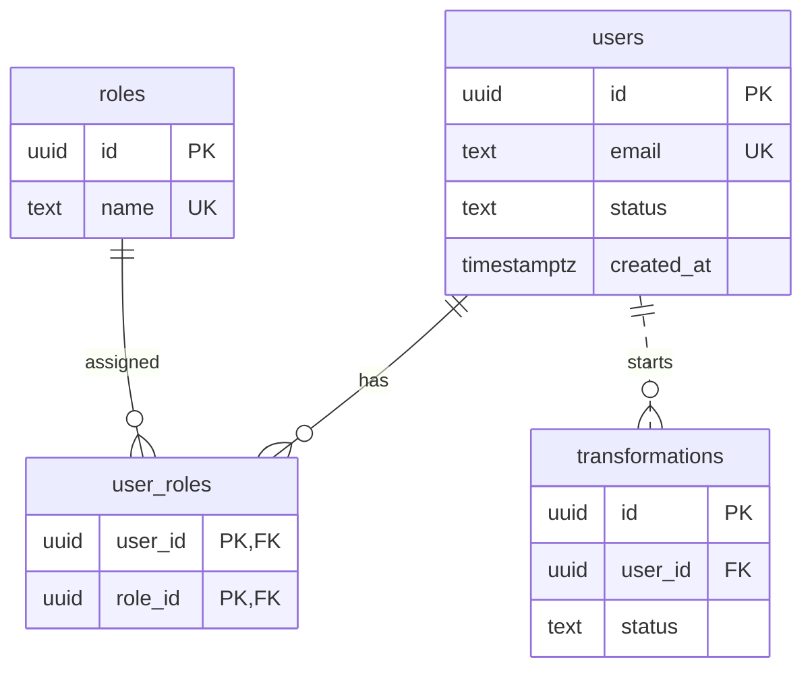

Line endings:

- `||` means exactly one.
- `|o` means zero or one.
- `}o` means zero or many.

Solid line:

- foreign key is part of the child table’s primary key.

Dotted line:

- child table has its own `id`.

---

## 2.13 SQL Command Groups

| Group | Commands                               | Purpose                                 |
| ----- | -------------------------------------- | --------------------------------------- |
| DDL   | `CREATE`, `ALTER`, `DROP`              | Structure: tables, indexes, constraints |
| DML   | `SELECT`, `INSERT`, `UPDATE`, `DELETE` | Data                                    |
| TCL   | `BEGIN`, `COMMIT`, `ROLLBACK`          | Transactions                            |

---

## 2.14 Example Schema

```sql
CREATE TABLE users (
  id         uuid PRIMARY KEY DEFAULT gen_random_uuid(),
  email      text NOT NULL UNIQUE,
  status     text NOT NULL CHECK (status IN ('pending', 'active', 'blocked', 'deleting', 'deleted')),
  created_at timestamptz NOT NULL DEFAULT now()
);

CREATE TABLE user_roles (
  user_id uuid REFERENCES users (id) ON DELETE CASCADE,
  role_id uuid REFERENCES roles (id) ON DELETE RESTRICT,
  PRIMARY KEY (user_id, role_id)
);
```

---

## 2.15 Example Query

```sql
SELECT r.name, count(*) AS users_count
FROM roles r
JOIN user_roles ur ON ur.role_id = r.id
JOIN users u ON u.id = ur.user_id
WHERE u.status = 'active'
GROUP BY r.name
HAVING count(*) >= 2
ORDER BY users_count DESC;
```

---

## 2.16 Logical Order of SQL Execution

The logical execution order is:

```text
FROM / JOIN
WHERE
GROUP BY
HAVING
SELECT
ORDER BY
LIMIT
```

Important consequences:

- `WHERE` cannot see aggregate values.
- `HAVING` filters groups after aggregation.

---

## 2.17 JOIN Types

| JOIN         | Result                                                                   |
| ------------ | ------------------------------------------------------------------------ |
| `INNER JOIN` | Only rows that have matching rows in both tables                         |
| `LEFT JOIN`  | All rows from the left table; if no match, right-side columns are `NULL` |
| `FULL JOIN`  | All rows from both tables                                                |

Example: find users without roles.

```sql
SELECT u.id
FROM users u
LEFT JOIN user_roles ur ON ur.user_id = u.id
WHERE ur.user_id IS NULL;
```

---

## 2.18 Normalization

Normalization removes duplication that causes anomalies.

Bad example:

```text
user_roles_flat(user_id, role_name, email)
```

Primary key:

```text
(user_id, role_name)
```

Problem: email is repeated for every role of the same user.

---

## 2.19 Anomalies in a Denormalized Table

### Update Anomaly

If a user changes email, you must update every row containing that user.

If you miss one row, old data remains.

---

### Insert Anomaly

You cannot save a user without a role if `role_name` is part of the primary key.

---

### Delete Anomaly

Removing the user’s last role may also delete the user’s email.

---

## 2.20 Functional Dependency

```text
A → B
```

means the value of `A` uniquely determines the value of `B`.

Example:

```text
user_id → email
```

---

## 2.21 Normal Forms

Each normal form includes the requirements of the previous one.

| Form | Requirement                                              | Violation Example                                                            | Fix                                               |
| ---- | -------------------------------------------------------- | ---------------------------------------------------------------------------- | ------------------------------------------------- |
| 1NF  | Each cell contains one value                             | `users.roles = 'admin,editor'`                                               | Use separate rows in `user_roles`                 |
| 2NF  | Non-key column depends on the whole composite key        | `email` depends only on `user_id`                                            | Store email in `users`                            |
| 3NF  | Non-key column does not depend on another non-key column | `transformations(id, user_id, user_email)` where `id → user_id → user_email` | Read email from `users` via `JOIN`                |
| BCNF | Every determinant is a key                               | See mentoring example below                                                  | Split table according to the violating dependency |
| 4NF  | Do not mix independent multi-valued facts                | `user_facts(user_id, role_id, phone)`                                        | Use `user_roles` and `user_phones` separately     |

---

## 2.22 BCNF Example

Table:

```text
mentoring(student, topic, mentor)
```

Rules:

- For each student and topic, there is one mentor.
- Each mentor teaches one topic.

Dependency:

```text
mentor → topic
```

Possible keys:

```text
(student, topic)
(student, mentor)
```

This table can satisfy 3NF because all columns are part of keys.

But it violates BCNF because `mentor` determines `topic`, while `mentor` alone is not a key.

If the mentor changes topic, you must update rows for all their students.

Fix:

```text
mentor_topics(mentor, topic)
student_mentors(student, mentor)
```

---

## 2.23 Practical Normalization Guidance

In practice, schemas are usually normalized to 3NF or BCNF.

If every candidate key of a table is a single column, then every table in 3NF is also in BCNF.

---

## 2.24 Denormalization

Denormalization is intentional duplication for read performance.

Example:

- store the number of users on a role row.

But every copy needs a synchronization mechanism.

Important distinction:

A price stored in an order is not denormalization.

It is a historical fact. It should not change when the product price changes later.

---

## 2.25 Transactions and ACID

A transaction groups several operations.

Either all operations are applied, or none are applied.

Example:

```sql
BEGIN;

DELETE FROM user_roles WHERE user_id = $1;

INSERT INTO user_roles (user_id, role_id)
VALUES ($1, $2), ($1, $3);

COMMIT;
```

If any command fails, the roles remain unchanged.

---

## 2.26 ACID Properties

| Property    | Meaning                                                                         |
| ----------- | ------------------------------------------------------------------------------- |
| Atomicity   | The transaction applies completely or not at all                                |
| Consistency | After the transaction, all schema constraints are satisfied                     |
| Isolation   | Concurrent transactions affect each other only according to the isolation level |
| Durability  | Committed data survives server failure                                          |

---

## 2.27 Isolation Levels in PostgreSQL

PostgreSQL default:

```text
Read Committed
```

In Read Committed:

- reading the same row again inside the same transaction may return a different value.

Higher levels:

- `Repeatable Read`
- `Serializable`

They work with a snapshot of the data.

If a serialization conflict happens, PostgreSQL aborts the transaction with error `40001` (`serialization_failure`). The application must retry the whole transaction from `BEGIN`, not only the failed statement.

---

## 2.28 Lost Update Problem

Example:

Two transactions read:

```text
attempts = 3
```

Both write:

```text
attempts = 4
```

One update is lost.

Fix with atomic update:

```sql
UPDATE table
SET attempts = attempts + 1;
```

Or use:

```sql
SELECT ... FOR UPDATE;
```

---

## 2.29 Indexes

An index helps find rows without scanning the whole table.

Trade-off:

- reads become faster,
- inserts and updates become slower.

`PRIMARY KEY` and `UNIQUE` automatically create indexes.

Foreign keys are not automatically indexed in PostgreSQL.

So you should manually add indexes for foreign key columns when needed.

Example:

```sql
CREATE INDEX transformations_user_id_idx
ON transformations (user_id);
```

---

## 2.30 B-Tree Indexes

B-tree is the default index type.

It supports:

```sql
=
<
>
ORDER BY
```

---

## 2.31 Composite Indexes

A composite index works from left to right.

Example:

```sql
CREATE INDEX transformations_user_created_idx
ON transformations (user_id, created_at DESC, id DESC);
```

This helps queries that filter by:

```text
user_id
```

and sort by:

```text
created_at
```

within that user.

But it does not help much for queries filtering only by:

```text
created_at
```

---

## 2.32 Partial Index Example

```sql
CREATE UNIQUE INDEX deletion_challenges_one_unconsumed_idx
ON deletion_challenges (user_id)
WHERE consumed_at IS NULL;
```

This expresses the rule:

```text
A user cannot have more than one unconsumed deletion challenge (consumed_at is NULL).
```

---

## 2.33 Query Analysis

Use:

```sql
EXPLAIN ANALYZE
```

to see the query plan.

Common terms:

| Plan Item    | Meaning         |
| ------------ | --------------- |
| `Seq Scan`   | Full table scan |
| `Index Scan` | Index is used   |

An index may not be used if:

- the column is wrapped in a function,
- a `LIKE` pattern starts with `%`.

---

## 2.34 Working with a Database from Node.js / TypeScript Code

### ORM

An ORM maps tables to classes or objects and builds parameterized queries.

Common Node.js / TypeScript options:

- Prisma,
- TypeORM,
- Drizzle,
- Kysely.

The course boilerplate uses TypeORM 0.3, so TypeORM is the default ORM for this course. Prisma 7 is the other common choice. Section 2.40 shows both.

During development, inspect the generated SQL in the query log.

---

## 2.35 Migrations

Migrations are schema change files stored in the repository.

The database keeps track of applied migrations.

This ensures all environments converge to the same schema.

Important:

Do not enable automatic model synchronization in production.

Example:

```text
TypeORM synchronize
```

It can delete columns together with data.

Use migrations instead.

The boilerplate defines these npm scripts for TypeORM migrations. They work the same in PowerShell:

```powershell
npm run migration:generate
npm run migration:run
npm run migration:revert
```

---

## 2.36 N+1 Query Problem

N+1 means:

- one query to get a list,
- then one query for each item.

Example:

```text
1 query for users
+ 20 queries for roles of 20 users
= 21 queries
```

Fix by loading related data in one query:

- `JOIN`,
- `WHERE user_id = ANY($1)`,
- Prisma `include`,
- TypeORM `relations`.

---

## 2.37 Connection Pooling

Creating a new PostgreSQL connection is expensive.

A connection pool keeps several open connections and gives them to queries.

Important:

The total pool size of all application instances should not exceed the database `max_connections`.

In Node.js:

- `pg` has a built-in `Pool`,
- Prisma manages connection pooling,
- TypeORM uses the underlying driver pool.

---

## 2.38 SQL Injection Protection

Pass values as parameters.

Bad:

```ts
await client.query(`SELECT id FROM users WHERE email = '${email}'`);
```

Good:

```ts
await client.query("SELECT id FROM users WHERE email = $1", [email]);
```

ORMs parameterize queries automatically, but raw SQL inside an ORM still requires parameters.

---

## 2.39 Avoid SELECT \*

`SELECT *` can read unnecessary fields.

It may return sensitive data such as:

```text
password_hash
```

Always list columns explicitly or map entities to safe response DTOs.

Good TypeScript practice:

```ts
type UserResponse = {
  id: string;
  email: string;
  status: string;
  createdAt: Date;
};
```

Do not return the database entity directly.

---

## 2.40 TypeScript / Node.js Database Notes

### Use DTOs and Entities Separately

- Entity: database shape.
- DTO: API input/output shape.

Example:

```ts
class UserEntity {
  id: string;
  email: string;
  passwordHash: string;
  status: string;
}

class UserResponseDto {
  id: string;
  email: string;
  status: string;
}
```

Never expose `passwordHash`.

---

### Use Transactions Explicitly

With Prisma:

```ts
await prisma.$transaction(async (tx) => {
  await tx.userRole.deleteMany({ where: { userId } });
  await tx.userRole.createMany({ data: roles });
});
```

With TypeORM:

```ts
await dataSource.transaction(async (manager) => {
  await manager.delete(UserRole, { userId });
  await manager.insert(UserRole, roles);
});
```

---

### Handle Unique Conflicts

Unique constraint errors should usually become:

```text
409 Conflict
```

For example:

- duplicate email,
- duplicate role name,
- duplicate role-permission link.

Check the error code, not the message text:

- PostgreSQL reports a unique violation as SQLSTATE `23505`.
- Prisma reports it as `P2002`.
- TypeORM wraps the driver error in `QueryFailedError`. Its `driverError.code` is `23505`.

---

## 2.41 Typical Database Mistakes

| Problem                                 | Cause / Fix                                                                                    |
| --------------------------------------- | ---------------------------------------------------------------------------------------------- |
| Roles stored as `'admin,editor'`        | Violates 1NF; use a junction table                                                             |
| Two users with the same email           | Uniqueness checked only by `SELECT` before `INSERT`; use `UNIQUE` and return `409` on conflict |
| List slows down as table grows          | Missing index for filtering and sorting                                                        |
| Slow `JOIN` on foreign key              | PostgreSQL does not automatically index foreign keys                                           |
| `0.1 + 0.2` gives `0.30000000000000004` | Money stored as floating point; use `numeric`                                                  |
| Time shifts by several hours            | Used `timestamp` without time zone; use `timestamptz`                                          |
| `password_hash` appears in API response | Used `SELECT *` or returned entire ORM entity                                                  |
| Page with 20 items requires 21 queries  | N+1 problem                                                                                    |
| Attempt counter misses invalid input    | Lost update; use atomic `UPDATE`                                                               |
| Server schema differs from local schema | Schema changed manually instead of using migrations                                            |

---

## 2.42 Useful Database Links

### General

- [PostgreSQL Tutorial](https://www.postgresql.org/docs/current/tutorial.html)

- [PostgreSQL Constraints](https://www.postgresql.org/docs/current/ddl-constraints.html)

- [PostgreSQL Transaction Isolation](https://www.postgresql.org/docs/current/transaction-iso.html)

- [PostgreSQL Indexes](https://www.postgresql.org/docs/current/indexes.html)

- [Use The Index, Luke](https://use-the-index-luke.com/)

- [Wikipedia: Database Normalization](https://en.wikipedia.org/wiki/Database_normalization)

- [OWASP SQL Injection Prevention Cheat Sheet](https://cheatsheetseries.owasp.org/cheatsheets/SQL_Injection_Prevention_Cheat_Sheet.html)

- [Mermaid ER Diagrams](https://mermaid.js.org/syntax/entityRelationshipDiagram.html)

---

### Node.js / TypeScript

- [Prisma Relational Data Modeling](https://www.prisma.io/docs/orm/data-modeling/relational-databases)

- [Prisma Migrations](https://www.prisma.io/docs/orm/migrations/how-migrations-work)

- [TypeORM Migrations](https://typeorm.io/docs/migrations/why/)

- [node-postgres Queries](https://node-postgres.com/features/queries)

---

## 2.43 Database Theory Questions

1. Why are users, roles, and operation history stored in a relational database, while rate-limit counters fit a key-value store?
2. What anomalies appear in `user_roles_flat(user_id, role_name, email)` and which normal form is violated?
3. How does 3NF differ from BCNF, and what does a table in 3NF but not BCNF look like?
4. Why does checking with `SELECT` before `INSERT` not protect against two users with the same email?
5. How do you avoid losing an invalid code-entry attempt when two parallel requests arrive for the same email confirmation challenge?
6. Why does an index on `(user_id, created_at)` speed up one user’s history but not search by date only?
7. How do you detect an N+1 problem and load related data with one query?
8. Why should database entities not be returned directly from a NestJS controller?

---

## 2.44 Practice

Use a local PostgreSQL 18 server and `psql`. Run the SQL in a scratch database, not the one the course app uses.

1. Create `user_roles (user_id uuid, role_id uuid, PRIMARY KEY (user_id, role_id))` and insert the same pair twice. Expected result: the second `INSERT` fails with SQLSTATE `23505` (`unique_violation`).
2. Create `deletion_challenges (id serial PRIMARY KEY, user_id uuid NOT NULL, consumed_at timestamptz)` with the partial unique index from 2.32. Insert two unconsumed rows for one user: the second insert fails with `23505`. Set `consumed_at = now()` on the first row and insert again: the insert succeeds.
3. Reproduce a lost update. Create a row with `attempts = 3`. In two `psql` sessions, run `BEGIN` and `SELECT attempts` (both read 3). Then in both sessions run `UPDATE ... SET attempts = 4` and `COMMIT`. Expected result: the final value is 4, not 5. Repeat with `SET attempts = attempts + 1` in both sessions. Expected result: the final value is 5.
4. Check the history index. Insert 100 000 rows into `transformations`, run `ANALYZE transformations`, then run `EXPLAIN ANALYZE` on the history query with `WHERE user_id = $1 ORDER BY created_at DESC, id DESC LIMIT 20`. Expected result: the plan uses `transformations_user_created_idx` (an Index Scan or Bitmap Index Scan), not a `Seq Scan`.
5. In a scratch script, call `dataSource.transaction` that inserts a user and then throws an error. Expected result: after the call, the user does not exist, because the transaction was rolled back.

---

# 3. UML Diagrams

## 3.1 What Is UML?

UML stands for **Unified Modeling Language**.

It is a graphical language for describing:

- system structure,
- system behavior.

Current relevant version:

```text
UML 2.5.1
```

UML 2.5.1 (December 2017) is the latest version published by the OMG (Object Management Group), the standards body behind UML.

Each diagram shows one aspect of a system:

- what parts it consists of,
- how parts interact,
- how object state changes.

In backend work, UML is usually used as a sketch:

- agree on scenarios,
- discuss data,
- define module boundaries,
- document decisions.

Fully formal UML models with code generation are rare.

---

## 3.2 Structural vs Behavioral Diagrams

| Structural         | Behavioral            |
| ------------------ | --------------------- |
| Class diagram      | Use case diagram      |
| Component diagram  | Activity diagram      |
| Deployment diagram | State machine diagram |
| Package diagram    | Sequence diagram      |
| Object diagram     |                       |

Most useful for backend:

- class diagram,
- component diagram,
- deployment diagram,
- use case diagram,
- activity diagram,
- state diagram,
- sequence diagram.

This course does not use package and object diagrams. A package diagram groups elements, for example modules, and shows the dependencies between the groups. An object diagram shows concrete instances and their values at one moment.

Database table schemas are usually represented with ER diagrams, not UML class diagrams. An ER diagram is not part of UML; its notation is in section 2.12.

---

## 3.3 Choosing the Right Diagram

| Question                                                                      | Diagram            | Mermaid Support                                           |
| ----------------------------------------------------------------------------- | ------------------ | --------------------------------------------------------- |
| Who uses the system and what goals do they achieve?                           | Use case diagram   | Beta type `usecase-beta`; or approximate with `flowchart` |
| What classes and interfaces does a module contain?                            | Class diagram      | `classDiagram`                                            |
| How does a request pass between client, API, database, and external services? | Sequence diagram   | `sequenceDiagram`                                         |
| What statuses does an entity have and what transitions are allowed?           | State diagram      | `stateDiagram-v2`                                         |
| What steps and branches exist in a process?                                   | Activity diagram   | No activity type; approximate with `flowchart`            |
| What parts make up the system and what interfaces connect them?               | Component diagram  | Approximate with `flowchart`                              |
| Where is everything deployed?                                                 | Deployment diagram | Approximate with `flowchart`                              |

Mermaid has no stable use case or activity diagram type. Two beta types come close: `usecase-beta` (Mermaid 12.0 and later) and `swimlane-beta` (Mermaid 11.16 and later; flowchart-style syntax whose top-level subgraphs become lanes). Beta syntax can change, and a viewer that bundles an older Mermaid cannot render it. The examples in this section use plain `flowchart`.

---

## 3.4 General UML Notation

### Stereotypes

Stereotypes clarify the kind of element.

Examples:

```text
«interface»
«include»
```

In Mermaid:

```text
<<interface>>
```

---

### Multiplicity

| Notation | Meaning                     |
| -------- | --------------------------- |
| `1`      | Exactly one                 |
| `0..1`   | Zero or one                 |
| `*`      | Any number (same as `0..*`) |
| `1..*`   | One or more                 |

---

### Visibility

| Symbol | Meaning   |
| ------ | --------- |
| `+`    | public    |
| `-`    | private   |
| `#`    | protected |
| `~`    | package   |

---

## 3.5 Use Case Diagram

A use case diagram shows:

- who interacts with the system,
- what goals they achieve.

It does not show implementation details.

---

### Use Case Elements

| Element         | Notation                                                                   | Meaning                                                                                                          |
| --------------- | -------------------------------------------------------------------------- | ---------------------------------------------------------------------------------------------------------------- |
| Actor           | Stick figure                                                               | External role: a person or another system                                                                        |
| Use case        | Oval                                                                       | Actor’s goal, described with a verb, for example “Convert File”                                                  |
| System boundary | Rectangle around the ovals                                                 | Shows what belongs to the system                                                                                 |
| `include`       | Dashed arrow labeled «include», from the base use case to the included one | Included use case always executes                                                                                |
| `extend`        | Dashed arrow labeled «extend», from the extension to the base use case     | Extension executes only under a condition                                                                        |
| Generalization  | Solid line with a hollow triangle at the general element                   | One actor or use case is a specialization of another; for example, an administrator can do everything a user can |

---

### Include and Extend Direction

Important:

- `include` goes from the base use case to the included use case.
- `extend` goes from the extending use case to the base use case.

---

### Mermaid Approximation

Mermaid has no stable use case diagram, so this example uses `flowchart`. Each actor is drawn as a rectangle and each use case as a rounded shape. The system boundary is a `subgraph`.

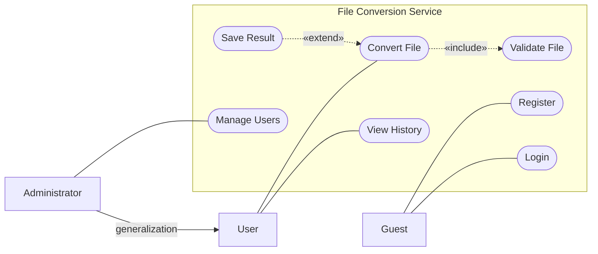

Explanation:

- File conversion always includes file validation.
- Saving to storage extends conversion only when `save=true`.
- Administrator is a specialization of User: an administrator can do everything a user can, so the diagram does not repeat Convert File and View History for the administrator.

---

## 3.6 Class Diagram

A class diagram shows:

- classes,
- interfaces,
- fields,
- methods,
- relationships.

A class is drawn as a rectangle with three sections:

```text
Name
Attributes
Operations
```

Attribute syntax:

```text
visibility name: type
```

Operation syntax:

```text
visibility name(parameters): returnType
```

The Mermaid examples in this section write the return type after the parentheses, separated by a space: `+activate() void`.

---

## 3.7 Class Diagram Relationships

| Relationship   | Meaning                                         | Notation                                      | Mermaid |
| -------------- | ----------------------------------------------- | --------------------------------------------- | ------- |
| Association    | Long-term connection between objects            | Solid line                                    | `-->`   |
| Aggregation    | Whole and parts, but parts can exist separately | Hollow diamond at the whole                   | `o--`   |
| Composition    | Parts cannot exist without the whole            | Filled diamond at the whole                   | `*--`   |
| Generalization | Inheritance, “is a”                             | Solid line, hollow triangle at the parent     | `<\|--` |
| Realization    | Class implements interface                      | Dashed line, hollow triangle at the interface | `<\|..` |
| Dependency     | Temporary usage                                 | Dashed arrow                                  | `..>`   |

In Mermaid, write the symbol on the side of the whole, parent or interface: `Whole *-- Part`, `Parent <|-- Child`, `Interface <|.. Class`. The arrow `-->` also draws an arrowhead that shows the direction of navigation (which class holds a reference to the other); `--` is a plain line.

---

## 3.8 Class Diagram Example

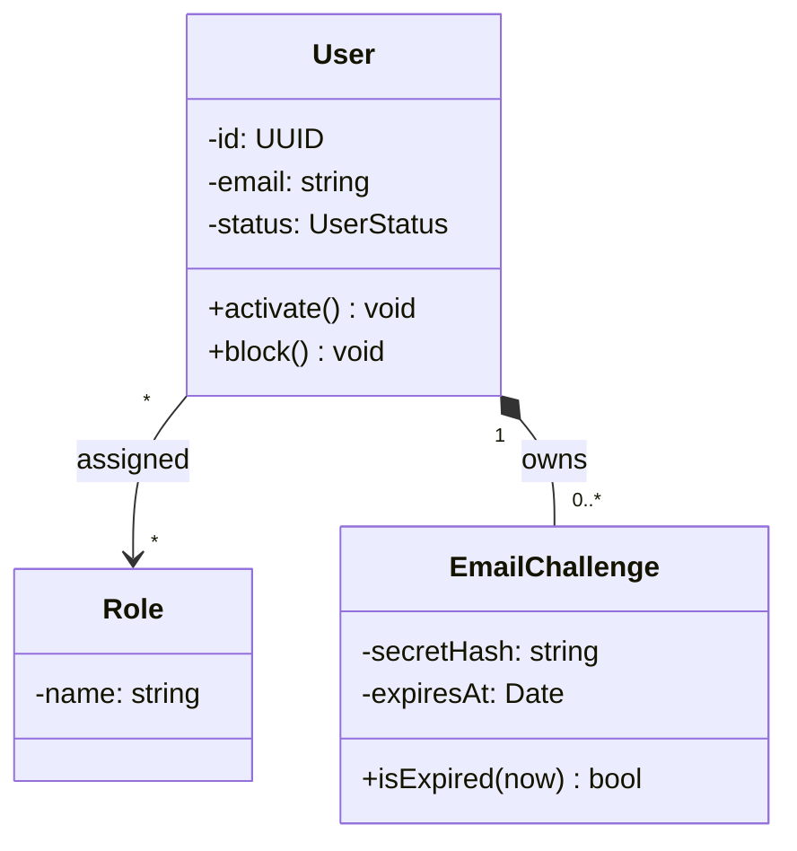

Explanation:

- An email challenge is a record for one email confirmation: the server emails the user a one-time code or link, stores only a hash of the secret and an expiry time, and consumes the challenge (marks it as used) after a successful confirmation.
- Email confirmation challenges do not exist without a user.
- That is composition.
- A role exists independently from a user.
- That is association.

---

## 3.9 Transformer Class Diagram Example

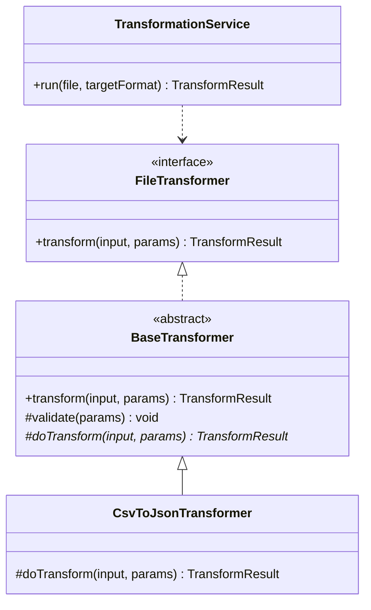

`BaseTransformer` implements `transform`: it validates the parameters and calls the abstract `doTransform`, so each format implements only `doTransform`. In Mermaid, a `*` after an operation marks it as abstract.

TypeScript mapping:

| UML Concept    | TypeScript       |
| -------------- | ---------------- |
| Generalization | `extends`        |
| Realization    | `implements`     |
| Abstract class | `abstract class` |
| Interface      | `interface`      |

Example:

```ts
// Minimal types so that the example compiles.
type TransformParams = Record<string, unknown>;
type TransformResult = { ok: boolean };

interface FileTransformer {
  transform(input: Buffer, params: TransformParams): TransformResult;
}

abstract class BaseTransformer implements FileTransformer {
  transform(input: Buffer, params: TransformParams): TransformResult {
    this.validate(params);
    return this.doTransform(input, params);
  }

  protected validate(params: TransformParams): void {
    // validation
  }

  protected abstract doTransform(
    input: Buffer,
    params: TransformParams,
  ): TransformResult;
}

class CsvToJsonTransformer extends BaseTransformer {
  protected doTransform(
    input: Buffer,
    params: TransformParams,
  ): TransformResult {
    return { ok: true };
  }
}
```

---

## 3.10 Sequence Diagram

A sequence diagram shows message exchange over time.

Time flows from top to bottom.

Each participant has a vertical lifeline.

---

### Sequence Diagram Elements

| Element              | Notation                         | Meaning                                                                  | Mermaid                          |
| -------------------- | -------------------------------- | ------------------------------------------------------------------------ | -------------------------------- |
| Synchronous message  | Solid line, filled arrowhead     | Sender waits for response                                                | `A->>B: text`                    |
| Response             | Dashed line                      | Return message                                                           | `B-->>A: text`                   |
| Asynchronous message | Open arrowhead                   | Sender does not wait                                                     | `A-)B: text`                     |
| Fragment             | Frame around part of the diagram | `alt` chooses a branch, `opt` is an optional part, `loop` repeats a part | `alt condition ... else ... end` |

---

### Sequence Diagram Example

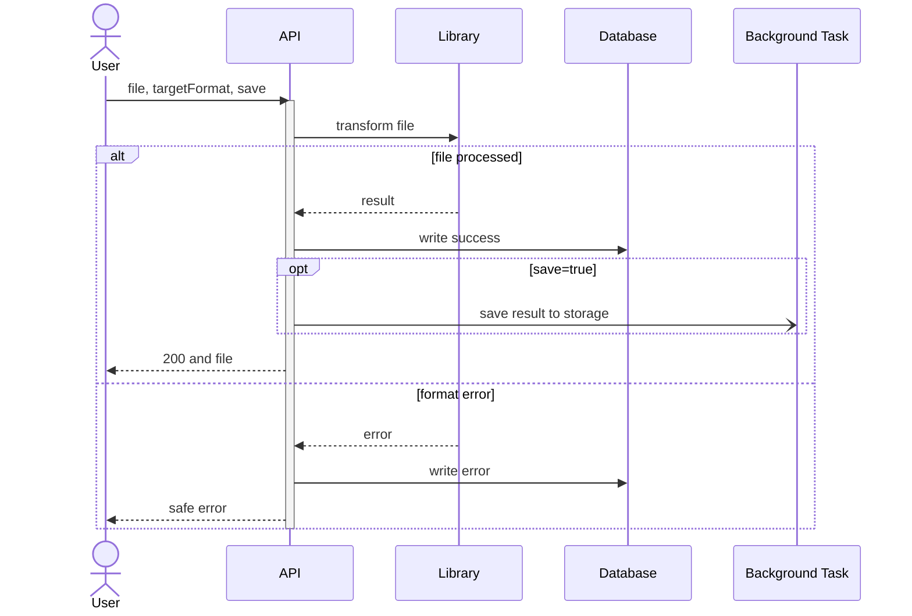

Explanation:

- The API waits synchronously for the library.
- The API waits for the history record.
- Saving to storage is asynchronous.
- The user response does not wait for storage saving.

---

## 3.11 State Diagram

A state diagram shows:

- what states an object can be in,
- what events move it between states.

Transition label format:

```text
event [condition] / action
```

UML calls these the trigger, the guard and the effect. In Mermaid, `[*]` marks the start (initial state) and the end (final state).

---

### User Lifecycle State Diagram

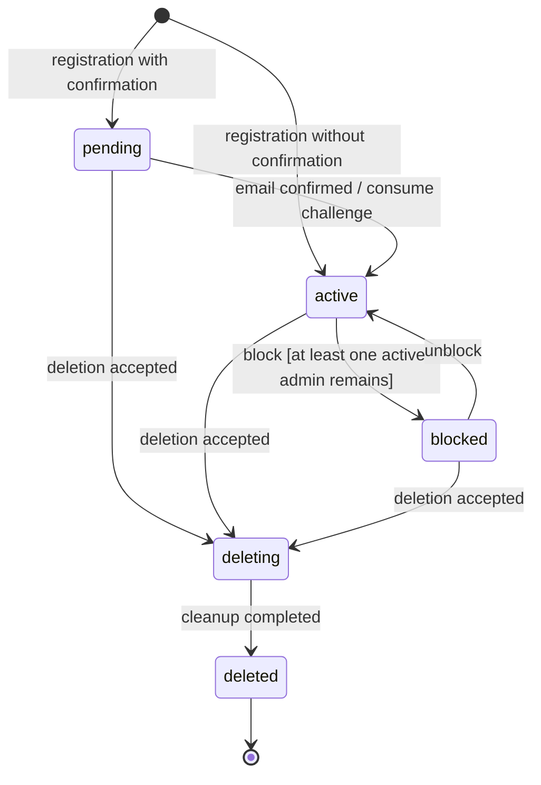

Important:

If a transition is not on the diagram, the server should not perform it.

Example:

There is no transition from `deleted` to `active`.

Therefore, such an API request should return:

```text
409 Conflict
```

[RFC 9110, section 15.5.10](https://www.rfc-editor.org/rfc/rfc9110.html#name-409-conflict) says `409` means that the request could not be completed because of a conflict with the current state of the target resource.

An arrow is allowed only for its own event. `pending` to `active` is on the diagram, but its event is the email confirmation. A request that sets the status to `active` for a `pending` user is rejected unless it is that confirmation.

A UI state machine (for example, one built with XState) ignores an event that has no transition from the current state. A backend cannot ignore it, because the client is waiting for a result.

---

## 3.12 Activity Diagram

An activity diagram shows process steps:

- actions,
- branches,
- merges,
- parallel flows.

Unlike sequence diagrams:

- activity diagrams focus on steps,
- sequence diagrams focus on participants and messages.

Notation:

| Element     | Notation                                                                            |
| ----------- | ----------------------------------------------------------------------------------- |
| Start / end | Filled circle / circle with a smaller filled circle inside                          |
| Action      | Rounded rectangle                                                                   |
| Decision    | Diamond; each outgoing arrow has a condition                                        |
| Merge       | Diamond that brings alternative branches back into one flow                         |
| Fork / join | Thick bar: a fork splits one flow into parallel flows, a join waits for all of them |
| Swimlane    | Lane that shows who performs each action                                            |

Mermaid has no activity diagram type, so `flowchart` is only an approximation:

- a decision is a `{}` diamond, and start and end are circles;
- a fork or join bar is the node shape `A@{ shape: fork }` (Mermaid 11.3 and later);
- swimlanes can be approximated with `subgraph`, or with the beta `swimlane-beta` type.

---

### File Conversion Process

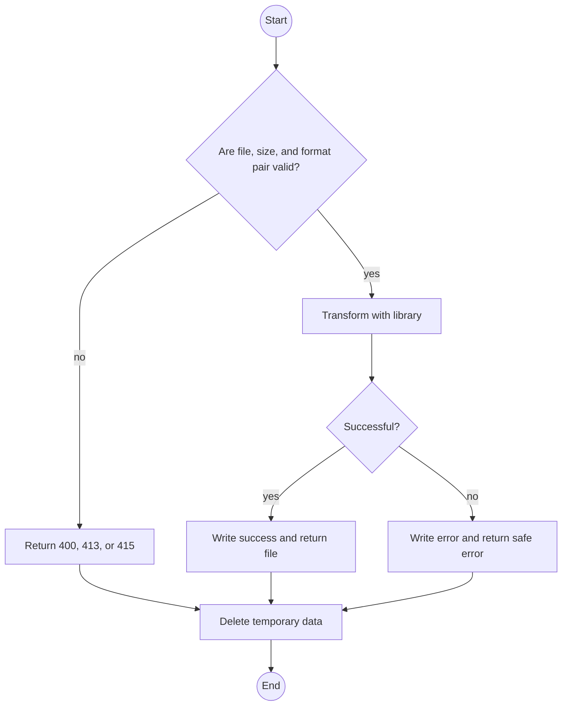

`Check` and `Ok` are decisions. The three branches meet in `Clean`: UML would join them in a merge diamond, while the flowchart draws the arrows straight into the node. The example has no parallel flows and no swimlanes.

---

## 3.13 Component Diagram

A component diagram shows large parts of the system and their interfaces.

Interface concepts:

- provided interface: lollipop,
- required interface: socket.

A component can be replaced by another implementation of the same interface.

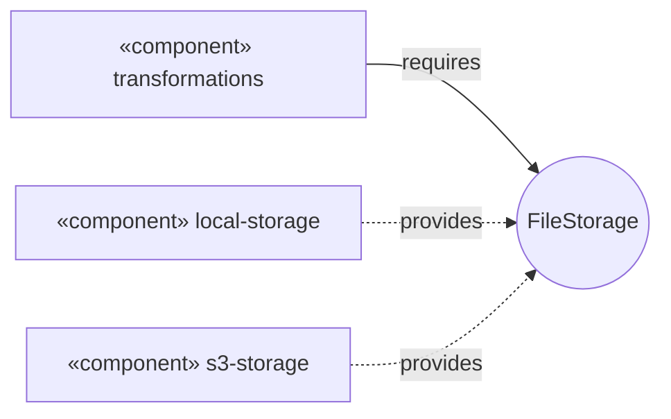

In this approximation the interface is a circle, and the arrows labeled `requires` and `provides` stand in for the socket and the lollipop.

Explanation:

The transformation module depends only on the storage interface.

Therefore, local disk storage and S3 storage can be connected without changing transformation code.

TypeScript example. The interface has the three operations of the course's storage adapter: `save`, `read` and `delete`. Downloads go through the API, so no method returns a URL.

```ts
import { Readable } from "node:stream";

interface FileStorage {
  save(key: string, data: Buffer): Promise<void>;
  read(key: string): Promise<Readable>;
  delete(key: string): Promise<void>;
}

// Method bodies are omitted: only the types matter here.
class LocalFileStorage implements FileStorage {
  async save(key: string, data: Buffer): Promise<void> {}
  async read(key: string): Promise<Readable> {
    return Readable.from([]);
  }
  async delete(key: string): Promise<void> {}
}

class S3FileStorage implements FileStorage {
  async save(key: string, data: Buffer): Promise<void> {}
  async read(key: string): Promise<Readable> {
    return Readable.from([]);
  }
  async delete(key: string): Promise<void> {}
}
```

---

## 3.14 Deployment Diagram

A deployment diagram shows:

- servers,
- containers,
- artifacts,
- network connections.

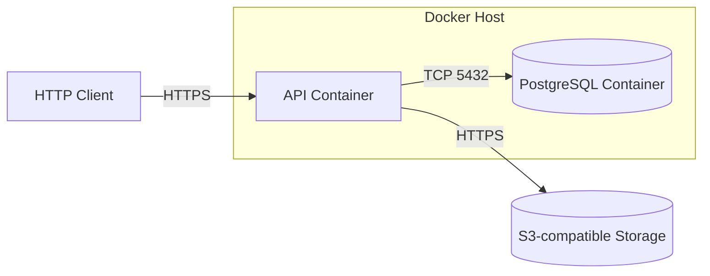

---

## 3.15 Diagrams as Code

Text diagrams can be stored in the repository next to code.

Benefits:

- changes are visible in code review,
- diagram history is visible in Git.

| Tool     | Notes                                                                                                                                                                      |
| -------- | -------------------------------------------------------------------------------------------------------------------------------------------------------------------------- |
| Mermaid  | Rendered by GitHub, Notion, Obsidian; supports sequence, class, state, ER, flowchart; has no stable UML use case, component, deployment or activity diagram type (see 3.3) |
| PlantUML | Many UML diagram types, including use case, component, deployment and activity; needs a renderer: a PlantUML server, a browser editor or an IDE plugin                     |
| draw.io  | Manual drawing; `.drawio` files can be stored in repository                                                                                                                |

---

## 3.16 Typical UML Mistakes

| Mistake                                             | Correct Approach                                                           |
| --------------------------------------------------- | -------------------------------------------------------------------------- |
| Inheritance triangle placed on child                | Triangle always points to parent or interface                              |
| Composition and aggregation chosen randomly         | Part deleted with whole = composition; part lives separately = aggregation |
| Response drawn with solid line                      | Response should be dashed; async message uses open arrow                   |
| One diagram contains all scenarios and classes      | One diagram should answer one question                                     |
| Use case named “Click button”                       | Use case should be actor goal, for example “Convert File”                  |
| `include` arrow points from included use case       | `include` goes from base to included; `extend` goes from extension to base |
| Code allows a transition missing from state diagram | Code checks should match state diagram                                     |

---

## 3.17 Useful UML Links

- [OMG UML 2.5.1 Specification](https://www.omg.org/spec/UML/2.5.1/) — the official specification.
- [UML Diagrams Reference](https://www.uml-diagrams.org/) — reference for diagram kinds and notation.
- [Martin Fowler: UML Distilled](https://martinfowler.com/books/uml.html) — practical use of UML.
- [Mermaid Sequence Diagrams](https://mermaid.js.org/syntax/sequenceDiagram.html) — participants, messages, fragments.
- [Mermaid Class Diagrams](https://mermaid.js.org/syntax/classDiagram.html) — classes, relationships, multiplicity.
- [Mermaid State Diagrams](https://mermaid.js.org/syntax/stateDiagram.html) — states and transitions.
- [Mermaid Flowcharts](https://mermaid.js.org/syntax/flowchart.html) — shapes used to approximate diagrams that Mermaid lacks.
- [Mermaid Use Case Diagrams](https://mermaid.js.org/syntax/usecase.html) — the beta `usecase-beta` type, Mermaid 12.0 and later.
- [Mermaid Swimlanes](https://mermaid.js.org/syntax/swimlanes.html) — the beta `swimlane-beta` type, Mermaid 11.16 and later.
- [Mermaid Live Editor](https://mermaid.live/) — check a diagram in the browser.
- [PlantUML](https://plantuml.com/) — many UML diagram types in text format, including use case, component, deployment and activity diagrams.

---

## 3.18 UML Theory Questions

1. How do structural diagrams differ from behavioral diagrams? Give two examples of each.
2. How do you distinguish aggregation from composition? Which one describes the relationship between a user and email confirmation challenges?
3. How does a synchronous message differ from an asynchronous message? Why is saving a result to storage asynchronous in the sequence diagram?
4. How does a user state diagram help determine which API requests should return `409`?
5. What is the difference between `include` and `extend`, and which direction do their arrows point?
6. When would you use an activity diagram instead of a sequence diagram?
7. Why is a database schema usually drawn as an ER diagram instead of a class diagram?
8. How would you express a TypeScript interface and implementation relationship in a class diagram?

---

## 3.19 Practice

Use the course project. Draw each diagram as a `mermaid` block in a Markdown file in your repository. Paste it into the [Mermaid Live Editor](https://mermaid.live/) or open the file in your Markdown viewer, and fix every syntax error before you compare it with the expected result.

1. **Use cases.** Draw one use case diagram for registration, login and file conversion. Actors: Guest, User, Administrator.

   Expected result: every use case is an actor goal with a verb (Register, Log In, Convert File, View History), not a button click. A step that always runs is an `include` of its base use case (Convert File includes Validate File). A step that runs only under a condition is an `extend` of its base use case (Save Result extends Convert File when `save=true`; Confirm Email extends Register when confirmation is enabled). `include` arrows start at the base use case and `extend` arrows start at the extension. Administrator is a generalization of User, so shared use cases are not drawn twice.

2. **Registration sequence.** Draw the sequence diagram of `POST /auth/register` with email confirmation enabled, followed by `POST /auth/register/confirm`. Participants: Client, API, Database, Mail server.

   Expected result: the API saves the user as `pending` together with a challenge, then asks the mail server to send the code or link. The `202` response contains no code or link. The confirm request makes the user `active` and consumes the challenge. Requests are solid lines with filled arrows and responses are dashed lines. An `alt` frame shows the case without confirmation: `201` and the user is `active` at once.

3. **User lifecycle.** Draw the state diagram of the statuses `pending`, `active`, `blocked`, `deleting` and `deleted`. Then write a test that, as an administrator, sends `PATCH /users/{userId}` with `status: "active"` and with `status: "blocked"` for a user in each of the five statuses (10 cases; create the users directly in the test database).

   Expected result: two cases succeed (`active` to `blocked`, `blocked` to `active`). Two repeat the current status and change nothing (`200`). Six return `409` and leave the status unchanged. `pending` with `status: "active"` is one of the six: the arrow exists on the diagram, but its event is the email confirmation, not a PATCH. Blocking the last active administrator also returns `409`, because the condition on the `block` arrow is false.

4. **Storage components.** Draw the component diagram for `transformations`, `local-storage` and `s3-storage`, connected through a `FileStorage` interface. Then write the interface and two implementing classes in TypeScript.

   Expected result: `transformations` requires `FileStorage`, both storage components provide it, and there is no arrow from `transformations` to either storage component. The interface has `save`, `read` and `delete`. The TypeScript has one `interface` and two classes with `implements`, and `npx tsc --noEmit` passes. Switching from local disk to S3 changes only the line that chooses the implementation, not the code of `transformations`.

---

# 4. Backend Architectures

## 4.1 Two Levels of Architecture

Architecture exists at two levels.

### System Level

Defines how many independently deployed parts the system has.

Examples:

- monolith,
- microservices,
- SOA,
- serverless.

---

### Application Level

Defines how code is organized inside one deployable part.

Examples:

- modules,
- layers,
- ports and adapters.

---

## 4.2 Architecture in This Course

The course project is a monolith.

Code is divided into modules by business function:

```text
auth
users
rbac
transformations
storage
```

Each module is divided into layers.

---

## 4.3 Monolith

A monolith is one application that:

- is built as one artifact,
- runs as one process,
- uses one database.

Modules call each other through normal function calls, not over the network.

---

### Monolith Pros and Cons

| Pros                                                 | Cons                                                 |
| ---------------------------------------------------- | ---------------------------------------------------- |
| One repository, one build, one deployment            | Any change requires rebuilding the whole application |
| Calls between modules are fast and reliable          | Without clear boundaries, code becomes tangled       |
| One transaction can cover data from multiple modules | An error in one module can stop the whole process    |
| Easy to run locally                                  | A heavily loaded part cannot be scaled separately    |

---

## 4.4 Monolith Scaling

A monolith can scale horizontally.

Multiple identical instances run behind a load balancer.

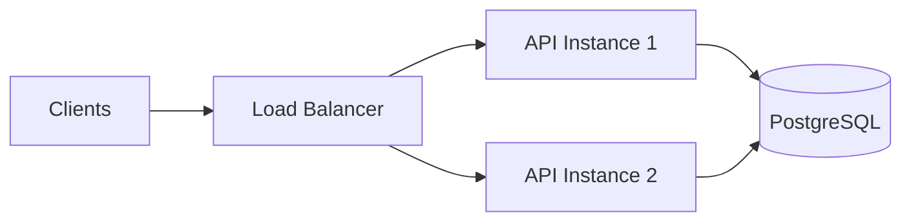

This only works if an instance does not store state:

- in process memory,
- on local disk.

In this course, this is solved by:

- JWT without server-side sessions,
- object storage instead of local disk in production.

---

## 4.5 When to Use a Monolith

A monolith is suitable for:

- MVPs,
- small teams,
- most projects at the beginning.

---

## 4.6 Modular Monolith

A modular monolith has:

- one process,
- one deployment,
- code divided into modules by business function.

Rules:

1. A module exposes only its public API to other modules.
   - In NestJS, this means providers from `exports`.
2. A module owns its own tables.
   - Other modules access data only through the module API.
3. Dependencies point in one direction.
   - No circular dependencies.
4. Shared code without business logic is separated.
   - Configuration.
   - Logging.
   - Infrastructure.

---

### Modular Monolith Example

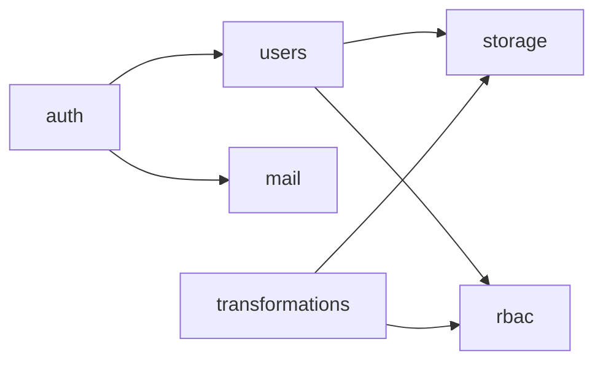

Arrow means:

```text
calls public API
```

If `users` and `rbac` call each other mutually, that is a sign of bad boundaries.

Fix by:

- extracting shared logic into another module,
- or replacing direct calls with events.

---

## 4.7 Moving from Modular Monolith to Services

When load or team size grows, a module can be extracted into a separate service.

Starting modular makes extraction cheaper:

- in-process calls can be replaced by network calls,
- table ownership is already separated.

---

## 4.8 Microservices

A microservice architecture consists of small services.

Each service:

- owns one business function,
- deploys independently,
- has its own database.

Communication happens through:

- HTTP,
- gRPC,
- message broker.

Clients usually call an API Gateway.

Gateway responsibilities may include:

- routing,
- token validation,
- rate limiting.

---

### Microservice Example

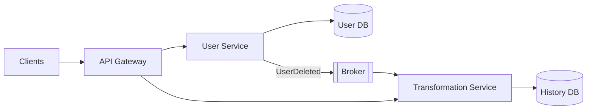

When a user is deleted:

1. User service publishes `UserDeleted`.
2. Transformation service receives the event.
3. Transformation service deletes its history.

There is no shared transaction between services.

---

## 4.9 Microservice Pros and Cons

| Pros                                       | Cons                                        |
| ------------------------------------------ | ------------------------------------------- |
| Services scale and deploy independently    | Network calls are slower and may fail       |
| Failure of one service may not stop others | Data consistency is delayed                 |
| Each team can have its own release cycle   | Requires orchestration, tracing, monitoring |
| Each service can use a different stack     | Debugging is harder than in one process     |

---

## 4.10 Saga

A saga is an operation composed of local transactions in different services.

If a step fails, compensation actions undo previous steps.

Example:

1. Payment is taken.
2. Booking fails.
3. Payment is refunded.

---

## 4.11 Distributed Monolith

A distributed monolith is a bad situation where services:

- must be deployed together,
- or share one database.

It combines the disadvantages of monoliths and microservices.

---

## 4.12 Conway’s Law

System structure tends to reflect organizational communication structure.

Microservices become useful when several independent teams work on the system.

---

## 4.13 When to Use Microservices

Microservices are suitable for:

- large systems,
- parts with very different load,
- multiple independent teams.

---

## 4.14 SOA

SOA stands for Service-Oriented Architecture.

It is a predecessor of microservices.

In SOA:

- services are large,
- examples: clients, invoices, warehouse,
- services are reused by different applications,
- integration is done through an Enterprise Service Bus, or ESB.

The ESB handles:

- routing,
- format conversion,
- often business logic.

Communication often uses SOAP.

---

## 4.15 SOA vs Microservices

The main difference is where integration logic lives.

| Architecture  | Integration Logic             |
| ------------- | ----------------------------- |
| SOA           | In the enterprise service bus |
| Microservices | In the services themselves    |

Microservices follow the principle:

```text
smart endpoints, dumb pipes
```

Meaning:

- business logic lives in services,
- brokers only deliver messages.

The bus in SOA becomes a bottleneck, because every message passes through it.

SOA is rarely chosen for new projects.

It is mostly useful for integrating legacy enterprise systems.

---

## 4.16 Serverless

In serverless architecture, code is written as functions.

The cloud provider runs these functions in response to events.

Examples of events:

- HTTP request,
- file upload,
- queue message,
- schedule.

Providers:

- AWS Lambda,
- Azure Functions,
- Yandex Cloud Functions.

The provider manages:

- servers,
- scaling.

You pay for the number of invocations and their execution time, not for idle servers.

This model is called FaaS:

```text
Function as a Service
```

---

## 4.17 Serverless Pros and Cons

| Pros                                    | Cons                                             |
| --------------------------------------- | ------------------------------------------------ |
| No servers to configure                 | Cold start after idle                            |
| Automatic scaling                       | Execution time limits; AWS Lambda has 15 minutes |
| Can be cheaper for rare calls           | Usually more expensive under constant high load  |
| Fast deployment of individual functions | Vendor lock-in and harder local debugging        |

---

## 4.18 Serverless State and Database Connections

A function does not keep state between invocations.

If many parallel function instances each open their own database connection, they can exhaust PostgreSQL `max_connections`.

Fix:

Place a pool between functions and database.

Examples:

- PgBouncer,
- Amazon RDS Proxy.

---

## 4.19 When to Use Serverless

Serverless is good for:

- webhooks,
- processing uploaded files,
- scheduled tasks,
- rare traffic spikes.

---

## 4.20 Events and CQRS

### Events

A component publishes an event.

Example:

```text
UserDeleted
```

Subscribers react independently.

The sender:

- does not know receivers,
- does not wait for result.

Events can be used:

- inside a monolith for background tasks,
- between services.

---

## 4.21 At-Least-Once Delivery

Brokers usually deliver messages at least once.

Therefore, handlers must be idempotent.

A repeated delivery should not change the result.

---

## 4.22 Transactional Outbox

If you write data to the database and then send an event, a failure between steps can lose the event.

Transactional outbox solves this:

1. Save data.
2. Save event in an outbox table.
3. Do both in the same database transaction.
4. A separate process delivers the event to the broker.

This is also why deletion jobs can be stored in the database.

---

## 4.23 CQRS

CQRS stands for Command Query Responsibility Segregation.

It separates:

- write model,
- read model.

Commands:

- change state,
- validate rules.

Queries:

- read data in a convenient form,
- do not change state.

In a simple version, both models use the same database.

A separate read store is needed only when:

- read and write load differ strongly,
- read data shape differs strongly.

For ordinary CRUD, CQRS only adds code.

CQRS is a module pattern, not a deployment style.

It can be used inside a monolith.

---

## 4.24 Application Layers

| Layer          | Responsibility                              | NestJS Example                    |
| -------------- | ------------------------------------------- | --------------------------------- |
| Presentation   | HTTP routes, DTOs, validation, status codes | `UsersController`                 |
| Business logic | Use cases, rules, transactions              | `UsersService`                    |
| Data access    | SQL or ORM                                  | TypeORM repository, Prisma Client |

Dependencies should point only downward.

Important rules:

- controller should not access database directly,
- service should not know about HTTP,
- service should not choose HTTP status codes,
- service should not read cookies.

Because of this:

- a service can be called from a controller,
- a service can be called from a background task,
- a service can be tested without HTTP.

---

## 4.25 Practical NestJS Module Structure

A good module structure:

```text
src/modules/users/
  users.module.ts
  users.controller.ts
  users.service.ts
  users.repository.ts
  dto/
    create-user.dto.ts
    update-user.dto.ts
    user-response.dto.ts
  entities/
    user.entity.ts
```

Or with Prisma, where `users.repository.ts` wraps the Prisma client:

```text
src/modules/users/
  users.module.ts
  users.controller.ts
  users.service.ts
  users.repository.ts
  dto/
  types/
```

Important idea:

- controller handles HTTP,
- service handles business rules,
- repository or Prisma client handles data access.

---

## 4.26 Ports and Adapters

Hexagonal architecture develops the same idea.

In the center is the core with business use cases.

The core declares interfaces called ports.

Examples of ports:

- storage,
- mail,
- database.

Infrastructure implements those ports with adapters.

The core should not import:

- storage SDK,
- ORM,
- mail provider SDK.

---

### Hexagonal Example

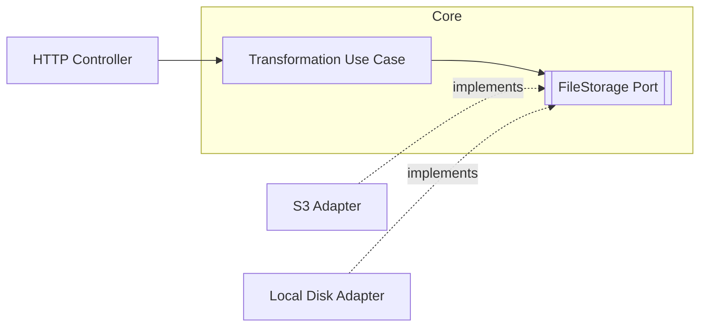

The concrete adapter is injected using dependency injection.

In NestJS, this is done with providers and injection tokens.

Example:

```ts
export const FILE_STORAGE = Symbol("FILE_STORAGE");

export interface FileStorage {
  put(key: string, data: Buffer): Promise<void>;
  delete(key: string): Promise<void>;
}

@Injectable()
export class TransformationService {
  constructor(
    @Inject(FILE_STORAGE)
    private readonly storage: FileStorage,
  ) {}
}
```

Then provide either local storage or S3 storage:

```ts
{
  provide: FILE_STORAGE,
  useClass: S3FileStorage,
}
```

---

## 4.27 How Much Architecture Is Needed?

For simple CRUD, full hexagonal architecture may be excessive.

A practical compromise:

- use layers inside modules,
- use interfaces only at boundaries with external systems.

Examples of external boundaries:

- object storage,
- mail service,
- file converters.

---

## 4.28 Architecture Style Comparison

| Style            | Deployment                            | Data                                  | Complexity | Good For                     |
| ---------------- | ------------------------------------- | ------------------------------------- | ---------- | ---------------------------- |
| Monolith         | One application                       | One database                          | Low        | MVP, small teams             |
| Modular monolith | One application with isolated modules | One database, tables owned by modules | Low        | Most new projects            |
| Microservices    | Many services                         | Each service has its own database     | High       | Large systems, several teams |
| SOA              | Large services and bus                | Often shared databases                | High       | Legacy integration           |
| Serverless       | Individual functions                  | External database and storage         | Medium     | Event-driven and uneven load |

---

## 4.29 How to Choose an Architecture

Start with a modular monolith.

It gives:

- fast development,
- clear boundaries,
- a path toward services if needed.

Extract a module into a separate service only when there is a concrete reason:

- its load grows independently,
- a separate team works on it,
- it needs an independent release cycle.

Use serverless for episodic tasks around the main system:

- webhooks,
- file processing,
- scheduled jobs.

Use CQRS only where reads and writes diverge significantly.

---

## 4.30 Typical Architecture Mistakes

| Symptom                                                 | Cause / Fix                                                        |
| ------------------------------------------------------- | ------------------------------------------------------------------ |
| Business logic cannot be tested without HTTP request    | Logic is in controller; move it to service                         |
| One module executes SQL against another module’s tables | Data should be accessed through the owning module’s public API     |
| Modules import each other in a circle                   | Bad boundaries; extract shared part or replace call with event     |
| Microservices deployed only together                    | Distributed monolith; shared database or tightly coupled contracts |
| Failure of one service stops a chain                    | Missing timeouts; some calls should be replaced by events          |
| Second API instance behaves differently from first      | State stored in process memory; move state to database or cache    |
| Repeated event delivery performs action twice           | Handler is not idempotent                                          |
| Serverless functions exhaust database connections       | Each function opens its own connection; use a pool                 |

---

## 4.31 Useful Architecture Links

### General

- [Martin Fowler: Microservices](https://martinfowler.com/articles/microservices.html)

- [Martin Fowler: MonolithFirst](https://martinfowler.com/bliki/MonolithFirst.html)

- [Martin Fowler: Serverless Architectures](https://martinfowler.com/articles/serverless.html)

- [Martin Fowler: CQRS](https://martinfowler.com/bliki/CQRS.html)

- [microservices.io Patterns](https://microservices.io/patterns/)

- [Alistair Cockburn: Hexagonal Architecture](https://alistair.cockburn.us/hexagonal-architecture)

- [The Twelve-Factor App](https://12factor.net/)

---

### Node.js / NestJS

- [NestJS Modules](https://docs.nestjs.com/modules)

- [NestJS Custom Providers](https://docs.nestjs.com/fundamentals/custom-providers)

- [NestJS Microservices](https://docs.nestjs.com/microservices/basics)

---

## 4.32 Architecture Theory Questions

1. Why can a monolith scale horizontally, and what prevents a second instance from working correctly?
2. How does a modular monolith differ from a normal monolith, and what rules prevent modules from becoming tangled?
3. Why does each microservice have its own database, and how can data be coordinated without a shared transaction?
4. What happens if a broker delivers an event again and the handler is not idempotent?
5. In which tasks is serverless cheaper than a constantly running server, and in which tasks is it more expensive?
6. How does CQRS differ from splitting into microservices, and is a separate read database required?
7. Why in hexagonal architecture does the storage interface belong to the core, while the S3 implementation belongs to an adapter?
8. In NestJS, why should a controller not call Prisma or TypeORM directly?

---

## 4.33 Practice

Use the course project, or the boilerplate with the course modules added.

1. List the modules (`auth`, `users`, `rbac`, `transformations`, `storage`, `deletion`) and the tables each one owns. Expected result: every table has exactly one owning module.
2. Search the code for another module's table name. In PowerShell: `Get-ChildItem -Recurse src -Filter *.ts | Select-String 'transformations'`. Expected result: matches appear only in the owning module, or in calls to its public service.
3. Add a `FileStorage` port with `LocalFileStorage` and `S3FileStorage` adapters, injected through a symbol token. Expected result: `TransformationService` compiles without importing `@aws-sdk/client-s3`, and only the S3 adapter file imports it.
4. Switch the provider from `S3FileStorage` to `LocalFileStorage` and run the tests. Expected result: the tests pass and `TransformationService` is unchanged.
5. Simulate serverless connection use: start 20 scripts that each open a `pg` pool of 10 connections and run 10 concurrent queries, against a server with the default `max_connections` of 100. Expected result: about 100 connections are open, and the next connection fails with `FATAL: sorry, too many clients already`.

---

# 5. Idempotency

## 5.1 What Is Idempotency?

An operation is idempotent if repeating it does not change the result beyond the first successful execution.

In math:

```text
f(f(x)) = f(x)
```

Examples:

```text
abs(-3) = 3
abs(abs(-3)) = 3
```

So absolute value is idempotent.

Assignment is idempotent:

```ts
name = "Anna";
```

Repeating it gives the same result.

But increment is not idempotent:

```ts
attempts = attempts + 1;
```

Every call increases the value.

---

## 5.2 Idempotency Is About Effect, Not Exact Response Bytes

Idempotency refers to the client’s intended effect on server state.

It does not mean every observable side effect must be identical.

Allowed changes on repeat:

- logs,
- rate-limit counters,
- `updated_at` timestamps.

RFC 9110 focuses on effect on the resource, not accidental side observations.

---

## 5.3 Same HTTP Status Is a Stronger Guarantee

An idempotent operation does not have to return the same status code every time.

Example:

First:

```http
DELETE /items/123
```

Response:

```text
204 No Content
```

Second:

```http
DELETE /items/123
```

Response:

```text
404 Not Found
```

The state is still the same:

```text
The object does not exist.
```

If a client needs the exact same response body or job ID, you need a stronger contract, such as stored idempotent responses.

---

## 5.4 Unique Constraints Are Not Full HTTP Idempotency

A unique constraint protects an invariant.

Example:

```text
One user per email.
```

But it does not automatically make registration fully idempotent from the client’s perspective.

Scenario:

1. Client sends registration.
2. Server creates user.
3. Response is lost.
4. Client repeats registration.
5. Unique constraint blocks duplicate.
6. Server returns `409 Conflict`.

The state is safe, but the client does not recover the original `201` response or user ID.

---

## 5.5 Safe vs Idempotent HTTP Methods

RFC 9110 separates two properties.

| Property                               | Meaning                                                  | Methods                           |
| -------------------------------------- | -------------------------------------------------------- | --------------------------------- |
| Safe                                   | Client does not intend to change state                   | `GET`, `HEAD`, `OPTIONS`, `TRACE` |
| Idempotent                             | Repeating the request has the same effect as one request | Safe methods plus `PUT`, `DELETE` |
| Neither safe nor idempotent by default | Repeats may accumulate effects                           | `POST`, `PATCH`                   |

A safe method is always idempotent.

`PATCH` is defined in RFC 5789. That RFC says `PATCH` is neither safe nor idempotent.

But an idempotent method is not necessarily safe.

`PUT` and `DELETE` change data, but repetition does not increase the change.

---

## 5.6 Method Semantics

Examples:

| Operation                                    | Suitable Method   | Reason                                  |
| -------------------------------------------- | ----------------- | --------------------------------------- |
| Read data                                    | `GET`             | Safe                                    |
| Replace full resource                        | `PUT`             | Idempotent                              |
| Delete resource                              | `DELETE`          | Idempotent                              |
| Create new resource with server-generated ID | `POST`            | Repeat usually creates another resource |
| Partial update with absolute values          | Sometimes `PATCH` | May be effectively idempotent           |
| Partial update with array append             | `PATCH`           | Often not idempotent                    |

---

## 5.7 PATCH and Idempotency

`PATCH` is not idempotent in general.

Example of a non-idempotent patch. This is a JSON Patch document (RFC 6902, media type `application/json-patch+json`), so the body is an array of operations:

```json
[
  {
    "op": "add",
    "path": "/tags/-",
    "value": "new-tag"
  }
]
```

Each repeat adds another tag.

But replacing a field with an absolute value can be effectively idempotent. This body is a JSON Merge Patch (RFC 7396, media type `application/merge-patch+json`):

```json
{
  "displayName": "Anna"
}
```

Repeated request leaves the same value.

---

## 5.8 Retry Rules

Automatic retry is safe only for:

- idempotent methods,
- `POST` requests with an idempotency key.

Automatic retry is dangerous for:

- `POST` without idempotency key,
- `PATCH` operations that accumulate changes.

Example:

Blind retry of:

```http
POST /api/convert
```

can create a second history record.

---

## 5.9 Example: Assigning a Name

| Call                     | Before | After  |
| ------------------------ | ------ | ------ |
| First request            | `Ivan` | `Anna` |
| Second identical request | `Anna` | `Anna` |

State after one call and two calls is the same.

Operation is idempotent.

---

## 5.10 Example: Creating a Transformation

Client sends the same CSV twice to:

```http
POST /api/convert
```

| Call   | History                        |
| ------ | ------------------------------ |
| First  | One row `t1`, status `success` |
| Second | Rows `t1` and `t2`             |

A second operation appears.

This is not a bug.

Each transformation is a separate fact that the user sees in history.

This is why the method is `POST`.

Repeat should create a new attempt, not silently return the previous file.

---

## 5.11 Example: Deleting an Object from Storage

A background cleanup task calls delete by key.

In S3-compatible storage, deleting an object that is already missing is often considered successful.

If absence were treated as an error, a worker could get stuck in a loop:

1. Delete object.
2. Crash after actual deletion but before marking task complete.
3. Retry.
4. Object missing.
5. Worker treats it as failure.
6. Worker retries forever.

Correct behavior:

```text
Object already missing = success.
```

---

## 5.12 Example: Reading a List

```http
GET /admin/users
```

does not create users.

It does not move cursors.

But data may change between calls.

For example, a new user may register.

Safety of `GET` does not freeze the database.

Stable cursor pagination gives two guarantees:

- a repeat of a page with the same cursor does not duplicate rows, even when rows share a `createdAt` value. The query orders by `createdAt` and `id`.
- rows inserted after the snapshot point do not appear in the middle of the traversal. The query uses a snapshot (`snapshotAt`) that is fixed when the first page is requested.

---

## 5.13 Example: Logout

```http
POST /auth/logout
```

clears cookies of the current client.

It returns:

```text
204 No Content
```

regardless of whether cookies were present.

Second logout leaves the browser without a session and again returns:

```text
204
```

From the current client’s perspective, logout is idempotent.

However:

If a refresh JWT was copied to another device, logout does not revoke it.

This is a limit of the stateless JWT design: the server keeps no session record that logout could delete. It is not a violation of idempotency for this request.

---

## 5.14 Why Requests Repeat

Requests repeat for many reasons.

Typical case:

1. Client sends request.
2. Server processes it.
3. Response is lost.
4. Client repeats request.

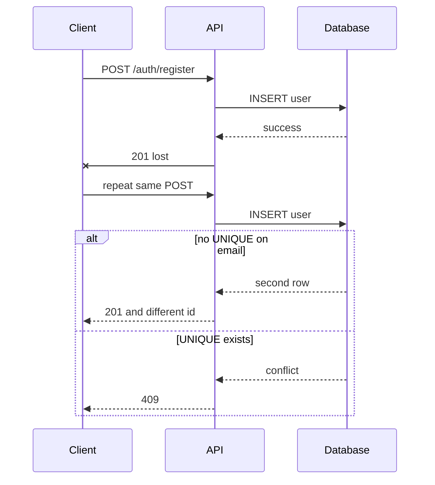

Other reasons:

- user clicks “Submit” twice,
- HTTP client retries after timeout,
- proxy retries request,
- load balancer closes connection during instance switchover,
- message broker delivers a message more than once,
- worker restarts a job after lease expiration.

---

## 5.15 How to Make an Operation Idempotent

You can combine multiple techniques.

---

## 5.16 Use Correct HTTP Method Semantics

| Operation              | Method   |
| ---------------------- | -------- |
| Read                   | `GET`    |
| Replace whole resource | `PUT`    |
| Delete                 | `DELETE` |
| Create new fact        | `POST`   |

Example:

Replacing a user’s role list:

```http
PUT /admin/rbac/users/{userId}/roles
```

Two identical arrays produce the same result.

Creating a role remains:

```http
POST /admin/rbac/roles
```

because the server generates the identifier.

---

## 5.17 Use Natural Keys

A repeat can be recognized by the meaning of the operation.

Example:

A user has at most one deletion job, in any status.

A second deletion request for the same user returns the existing job ID.

This works even if the client sends a different `Idempotency-Key` header.

---

## 5.18 Use Unique Constraints

Unique constraints turn parallel insert races into database conflicts.

Examples:

```sql
UNIQUE (users.email)
UNIQUE (role_id, permission_id)
```

Partial unique index:

```sql
CREATE UNIQUE INDEX deletion_challenges_one_open_idx
ON deletion_challenges (user_id)
WHERE consumed_at IS NULL;
```

Application code should convert conflict into:

```text
409 Conflict
```

This protects invariants.

For safe retry after timeout, you may also need stored responses.

---

## 5.19 Treat “Already Done” as Success

Examples:

- deleting missing file = success,
- clearing already empty field = success,
- finalizing already succeeded job = success.

This is important for background cleanup and deletion workers.

---

## 5.20 Use Conditional Writes

Conditional writes make state transitions atomic.

Example:

```sql
UPDATE jobs
SET status = 'processing'
WHERE id = $1
  AND status = 'queued';
```

Only one worker can successfully claim the job.

Another pattern:

```sql
INSERT INTO deletion_jobs (id, user_id, status)
VALUES ($1, $2, 'queued')
ON CONFLICT (user_id) DO NOTHING;
```

If a row already exists, repeat does not create a second job.

The API can return the existing job ID.

---

## 5.21 Idempotency Key

When there is no natural key, or the client must know the ID before receiving the response, the client can send an idempotency key.

Example from Stripe:

- client sends `Idempotency-Key`,
- server stores status and body of the first request,
- on repeat, server returns stored result,
- server does not execute the operation again.

The key is generated by the client.

It should be random enough to avoid collisions.

Do not use email or personal data in keys.

Node.js example:

```ts
import { randomBytes } from "node:crypto";

const idempotencyKey = randomBytes(16).toString("hex");
```

This produces 32 lowercase hex characters.

---

## 5.22 Idempotency Key in Deletion Flow

Client creates:

```text
16 random bytes
```

and sends them as:

```text
32 lowercase hex characters
```

in the header:

```http
Idempotency-Key
```

Server uses this value as the job ID.

This lets the client know the status endpoint even if the original `202 Accepted` response is lost.

---

## 5.23 Deletion Retry Rules

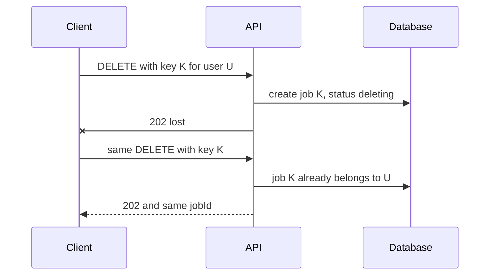

Rules:

| Repeat Situation                       | Result                                                    |
| -------------------------------------- | --------------------------------------------------------- |
| Same key and same target               | Return existing job, `202`, no second process             |
| Different key but user already has job | Return existing job because natural key is one per target |
| Same key but different target          | Return `409 Conflict`                                     |

---

## 5.24 Idempotency Key Validation Rules

The key must be checked together with request intent.

Otherwise, a repeat with a different body could silently perform a different operation.

If validation fails before side effects begin:

- the key is not burned,
- client can correct request and reuse key.

After side effects begin:

- repeat must return the original outcome.

---

## 5.25 Do GET and DELETE Need Idempotency Keys?

Usually no.

RFC 9110, section 9.2.2, lists `DELETE` and the safe methods (including `GET`) as idempotent.

Exception:

A long-running `DELETE` that returns:

```text
202 Accepted
```

and starts background processing may need a stable job ID.

Then an idempotency key is useful.

---

## 5.26 Background Task Retries

Brokers and queues usually provide at-least-once delivery.

Therefore, handlers must be idempotent.

If a handler creates an object or consumes a resource on every call, it can perform the action twice.

Fix:

- make each step idempotent,
- store progress in database,
- use leases.

Node.js ecosystem note:

If you use BullMQ:

- use stable job IDs when possible,
- make processors idempotent,
- be careful with retries,
- store job progress in PostgreSQL if correctness matters.

Example:

```ts
await queue.add(
  "delete-user",
  { userId },
  {
    jobId: `delete-user-${userId}`,
    attempts: 5,
    backoff: {
      type: "exponential",
      delay: 1000,
    },
  },
);
```

BullMQ 6 rejects a custom job ID that contains a colon (`Custom Id cannot contain :`), so the example uses a hyphen.

But remember: BullMQ job ID alone does not replace database-level correctness.

---

## 5.27 Deletion Worker Example

Worker flow:

1. Atomically take a lease on the job.
2. Call all registered erasers.
3. Run finalization.
4. Mark job completed.

While lease is active, another worker does not start the same job.

If the process crashes, lease expires and the job can be taken again.

Retry is safe because:

- missing storage object is considered deleted,
- eraser repeated after success returns success,
- empty user data erasure returns success,
- final transaction sees already completed job and already deleted user status and succeeds internally.

---

## 5.28 Cleanup Retention Example

Cleanup may do:

1. Delete storage object.
2. Clear history record fields.

If the process crashes between steps, retry should:

1. Call delete again.
2. Continue clearing fields.

This requires treating missing object as success.

---

## 5.29 Transactional Outbox for Events

If you write data and then publish an event, a crash between steps can lose the event.

Transactional outbox:

1. Write business data.
2. Write event to outbox table.
3. Commit both in one transaction.
4. Separate process publishes event.

The publisher must also tolerate repeated delivery.

Use:

- unique event ID,
- idempotent event handlers.

---

## 5.30 Idempotency in the Course System

Idempotency is not a separate module.

It is a property of specific operations.

Some operations are intentionally idempotent.

Others are intentionally not.

---

## 5.31 Registration

Endpoint:

```http
POST /auth/register
```

Creates a user, so it is not idempotent by method.

Unique constraint on normalized email prevents duplicate users.

If the first `201` is lost, repeat returns:

```text
409 Conflict
```

This is acceptable for registration because login and email confirmation use email address, not the lost user ID.

---

## 5.32 Authentication

Login, confirm, and refresh are `POST` operations with new effects:

- sending email,
- consuming challenge,
- issuing new cookies.

They should not be blindly retried.

Logout is different.

It always clears cookies for the current client and returns:

```text
204
```

Repeat is safe.

---

## 5.33 RBAC

Role and permission replacement uses `PUT`.

Examples:

```http
PUT /admin/rbac/roles/{roleId}
PUT /admin/rbac/users/{userId}/roles
```

Repeat with same body leaves policy unchanged.

Creating a role or granting permission uses `POST`.

On unique conflict, return:

```text
409
```

This prevents duplicate role-permission links.

---

## 5.34 Profile Updates

Repeated `PATCH` with same `displayName` leaves the same name.

But repeated profile photo upload creates a new storage object with a new random key.

File bytes may be the same, but the operation is not idempotent.

A partial unique index for open email challenges prevents parallel duplicate challenges after SMTP failure.

---

## 5.35 Account Deletion

This is a central idempotency example.

Deletion acceptance is idempotent at two levels:

1. Client `Idempotency-Key` matches job ID.
2. There is at most one deletion job per user.

The `202` response can be lost and requested again.

Worker, erasers, and finalization are idempotent.

Otherwise, retry after a file was already deleted would stop cleanup.

If admin repeats deletion when status is `failed`, it should not create a new job.

It should return the same job and put it back into queue.

---

## 5.36 Lists and History

Endpoints like:

```http
GET /admin/users
GET /history
```

do not create entities.

Same parameters do not create side effects.

Cursor pagination with `id` avoids duplicated pages.

This is a property of safe reads and stable pagination, not a write idempotency key.

---

## 5.37 File and Image Transformation

Endpoints:

```http
POST /api/convert
POST /api/images/convert
```

are intentionally not idempotent.

Each call is a new attempt with its own history row.

Making them idempotent with `PUT` would hide repeated attempts.

Users would not see failed attempts or separate conversion attempts.

---

## 5.38 Storage

Downloading via:

```http
GET
```

returns the same object while it exists and retention has not expired.

Background saving when `save=true` must survive retries without creating a second object with a different key.

The key should be linked to the history row in advance.

Cleanup jobs and account-deletion steps must treat a missing object as success.

Otherwise account deletion cannot complete correctly.

---

## 5.39 Architecture and Idempotency

If you run several API instances behind a load balancer, you cannot store “already done” in process memory.

Store it in:

- PostgreSQL,
- job table,
- idempotency key table,
- lease table.

Otherwise a retry may hit another instance and execute again.

---

## 5.40 Operation Idempotency Summary

| Operation                              |            Idempotent? | How It Is Ensured                       |
| -------------------------------------- | ---------------------: | --------------------------------------- |
| `PUT` role or role list                |                    Yes | Full replacement semantics              |
| `POST` registration, grant, conversion |      No as HTTP method | `UNIQUE` only protects invariant        |
| `POST /auth/logout`                    | Yes for current client | Always clears cookies and returns `204` |
| `DELETE` account deletion acceptance   |                    Yes | Idempotency key plus one job per user   |
| Deletion worker and erasers            |                    Yes | Missing object equals success, lease    |
| `GET` lists, history, file             |     Yes as HTTP method | No write; cursor stabilizes pagination  |
| Retention cleanup                      |                    Yes | Repeat delete object                    |

---

## 5.41 Typical Idempotency Mistakes

| Problem                                                     | Cause / Fix                                                                         |
| ----------------------------------------------------------- | ----------------------------------------------------------------------------------- |
| Two users with same email after repeated registration       | Missing `UNIQUE`; uniqueness checked only by `SELECT` before `INSERT`               |
| Repeated deletion confirmation creates second job           | Missing unique job per user or key not used as job ID                               |
| Deletion key from request A applied to user B               | Repeat with different intent not rejected with `409`                                |
| Worker endlessly repeats file deletion                      | Missing object treated as error instead of success                                  |
| Two history rows for one repeated conversion                | Expected behavior for `POST`; error would be hiding attempts by forcing idempotency |
| Automatic HTTP retry after login timeout sends second email | Retry enabled for non-idempotent `POST` without key                                 |
| Second API instance executes background task again          | “Already done” stored in process memory instead of database                         |
| Same `createdAt` duplicates user across pages               | Cursor missing `id`; pagination issue confused with idempotency                     |
| Repeated photo PATCH leaves old object in bucket            | New key saved but old object not deleted; upload itself not idempotent              |
| Second logout returns `401`                                 | Logout should return `204` without requiring active session                         |

---

## 5.42 Useful Idempotency Links

### General

- [RFC 9110: Idempotent Methods](https://www.rfc-editor.org/rfc/rfc9110.html#name-idempotent-methods)

- [RFC 9110: Safe Methods](https://www.rfc-editor.org/rfc/rfc9110.html#name-safe-methods)

- [MDN: Idempotent](https://developer.mozilla.org/en-US/docs/Glossary/Idempotent)

- [Stripe: Idempotent Requests](https://docs.stripe.com/api/idempotent_requests)

- [IETF Idempotency-Key HTTP Header (Internet-Draft, not an RFC)](https://datatracker.ietf.org/doc/draft-ietf-httpapi-idempotency-key-header/)

- [Microsoft Retry Pattern](https://learn.microsoft.com/en-us/azure/architecture/patterns/retry)

- [Amazon S3 DeleteObject](https://docs.aws.amazon.com/AmazonS3/latest/API/API_DeleteObject.html)

- [PostgreSQL `INSERT ... ON CONFLICT`](https://www.postgresql.org/docs/current/sql-insert.html#SQL-ON-CONFLICT)

---

### Node.js / NestJS

Express and Fastify behave the same here. The key, the unique constraint and the job ID rules do not depend on the HTTP adapter.

- [Prisma Constraints and Indexes](https://www.prisma.io/docs/orm/prisma-schema/data-model/indexes)

- [node-postgres Queries](https://node-postgres.com/features/queries)

- [NestJS Exception Filters](https://docs.nestjs.com/exception-filters)

---

## 5.43 Idempotency Theory Questions

1. How does method idempotency differ from method safety, and why can a repeated `GET` return different data?
2. Why can a second `DELETE` return `404` and still be idempotent?
3. Why does a unique email constraint not make registration fully idempotent for a client that lost the first `201`?
4. Why does user deletion need both an `Idempotency-Key` and a unique job per user?
5. Why should file conversion not be made idempotent with `PUT`, and what would history lose?
6. What happens if a deletion eraser treats a missing storage object as an error?
7. Why is automatic retry safe for `PUT` role but dangerous for `POST` login without an idempotency key?
8. In Node.js, why should idempotency state not be stored in an in-memory `Map`?

---

## 5.44 Practice

Use the course API endpoints from sections 5.31 to 5.37. In PowerShell, use `curl.exe` instead of `curl`.

1. Call the account-deletion endpoint twice with two different `Idempotency-Key` values. Expected result: both responses are `202` with the same `jobId`, and the database has one deletion job for the user.
2. Simulate a lost `202`: send the deletion request with a key, ignore the response, then send the same request with the same key. Expected result: the second response has the same `jobId`.
3. Call `POST /auth/logout` twice. Expected result: both return `204`. The second call does not return `401`.
4. Send the same file-conversion request twice with the same `Idempotency-Key` and body. Expected result: one history row, and both responses return the same resource ID. Then send the same key with a different body. Expected result: `409 Conflict`.
5. Page through `GET /admin/users` with a cursor, and create a user between the first and second page. Expected result: the new user does not appear in later pages, and no user appears twice.

---

# 6. Middleware

## 6.1 What Is Middleware?

Middleware is a component that stands between the HTTP server and the specific endpoint handler.

It receives the request and response, can perform common work, pass control to the next component, and process the response on the way back.

This is not a NestJS-only idea.

The same concept exists in:

- Express,
- Fastify,
- NestJS,
- API gateways.

Names and APIs differ, but the model is the same:

```text
request passes through small layers before reaching the business handler
```

---

## 6.2 Middleware Chain Visualization

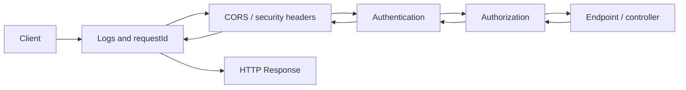

---

## 6.3 Short-Circuiting Middleware

Middleware does not have to pass the request further.

Examples:

- CORS can answer a preflight `OPTIONS` request,
- rate limiter can return `429`,
- token check can return `401`.

Such a component is called **short-circuiting**.

It ends the chain.

---

## 6.4 Why Middleware Matters

Without a common pipeline, controllers quickly repeat the same code:

- create correlation ID,
- record timing,
- check origin,
- parse token,
- build unified JSON errors.

This creates:

- inconsistent rules across endpoints,
- expensive security changes,
- duplicated code.

Middleware extracts cross-cutting tasks into one place.

Examples:

- unified logs,
- metrics,
- tracing,
- `X-Request-Id`,
- uncaught exception handling without leaking stack traces,
- CORS,
- HTTPS redirect,
- security headers,
- rate limiting,
- cookie or bearer token parsing,
- compression,
- caching,
- static file serving,
- technical API boundary checks.

The benefit is not only fewer lines of code.

The order and policy become visible in one application startup file.

This is especially important for authorization:

1. establish identity,
2. check permissions,
3. execute business logic.

---

## 6.5 Middleware Does Not Replace Application Layers

Middleware should not contain:

- SQL logic for a specific use case,
- user creation,
- decisions whether a specific resource can be edited.

Those decisions belong to:

- handler,
- service,
- guard or policy.

---

## 6.6 How the Chain Works

Simplified middleware pseudocode:

```ts
async function middleware(request, response, next) {
  // code before next()
  await next();
  // code after next()
}
```

Code before `next()` runs in registration order.

Code after `next()` runs in reverse order.

This is why an outer middleware is convenient for:

- measuring total request time,
- catching exceptions from any inner layer.

---

## 6.7 Middleware Sequence Example

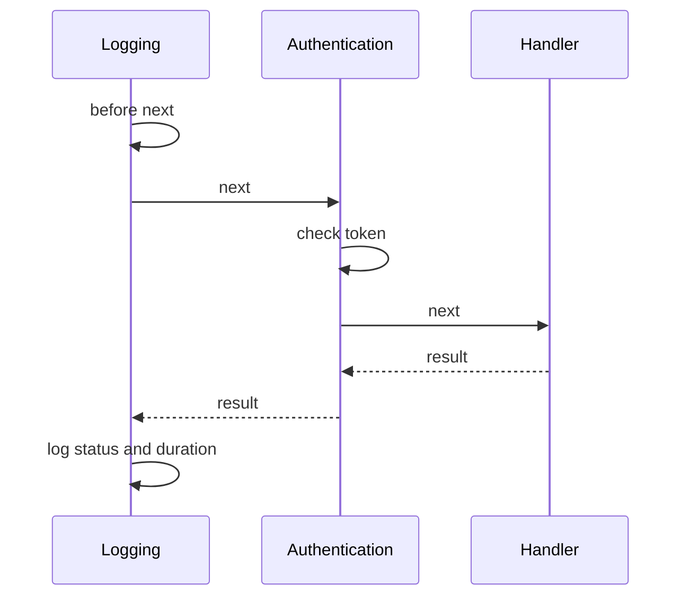

If authentication returns `401` and does not call `next`, the handler is not executed.

But the outer logging layer still sees the final status.

If the handler throws, Express passes the error to the next error-handling middleware. That middleware has four arguments and is registered after the routes (section 6.10). If an async handler rejects, Express 5 passes the rejection to the same middleware. In NestJS, an exception filter handles the error instead.

---

## 6.8 What Belongs in Middleware?

A good middleware candidate has three properties:

1. the rule applies to many endpoints,
2. it depends on the HTTP boundary,
3. it does not require knowledge of a specific business action.

| Task                                  | Where It Usually Belongs               | Why                                                 |
| ------------------------------------- | -------------------------------------- | --------------------------------------------------- |
| `X-Request-Id`, timing, access log    | middleware                             | Needed for every request, including 404 and 401     |
| CORS, HTTPS, security headers         | platform middleware                    | Applied before business code and often before route |
| Uncaught exceptions → Problem Details (RFC 9457) | error-handling middleware (Express) or exception filter (NestJS)    | One safe error shape for the whole API              |
| Token signature validation            | middleware or framework authentication | Establishes identity for later layers               |
| Role required for endpoint            | NestJS guard                           | Rule knows which handler is selected                |
| DTO validation                        | NestJS pipe (for example `ValidationPipe`)          | Depends on the input model of a specific operation  |
| Modify user or write to DB            | handler/service                        | Business operation, not transport policy            |

Simple rule:

If a component needs metadata about the selected route, such as `@Roles('admin')`, in NestJS it is usually a **guard**, not ordinary middleware.

---

## 6.9 Order Matters

The chain is a program.

Changing the order of two lines changes the result.

Basic order for an API:

1. Request ID, first, so that every later step can log it and return it in the response.
2. HTTPS redirect, static files, technical headers.
3. CORS — before authentication and authorization, so the browser receives headers even on rejection.
4. Routing, if the framework requires an explicit step.
5. Authentication — establishes user identity.
6. Authorization — decides whether the selected endpoint is allowed for the established user.
7. Endpoint, controller, or handler.

Error handling is not a fixed position in this list. Express error middleware is registered after the routes it should handle (section 6.10). NestJS exception filters are not middleware and are not positional.

The exact scheme depends on the framework and task.

For example:

- global rate limit can be placed before routing,
- endpoint-specific rate limit may be placed after routing.

Do not copy middleware order from another project without understanding dependencies.

---

## 6.10 Express Middleware Example

Although the course may use NestJS, understanding Express middleware is useful because NestJS often runs on Express.

Request ID middleware:

```ts
import { randomUUID } from "node:crypto";
import type { NextFunction, Request, Response } from "express";
import pino from "pino";

const logger = pino();
const UUID_PATTERN = /^[0-9a-f]{8}-[0-9a-f]{4}-[0-9a-f]{4}-[0-9a-f]{4}-[0-9a-f]{12}$/i;

declare global {
  namespace Express {
    interface Request {
      id: string;
    }
  }
}

export function requestId(req: Request, res: Response, next: NextFunction) {
  const incoming = req.get("x-request-id");
  const id = incoming !== undefined && UUID_PATTERN.test(incoming) ? incoming : randomUUID();

  req.id = id;
  res.setHeader("x-request-id", id);

  const startedAt = process.hrtime.bigint();

  res.on("finish", () => {
    const elapsedMs = Number(process.hrtime.bigint() - startedAt) / 1_000_000;

    logger.info(
      {
        requestId: id,
        method: req.method,
        path: req.originalUrl,
        statusCode: res.statusCode,
        elapsedMs,
      },
      "request finished",
    );
  });

  next();
}
```

A client-supplied `X-Request-Id` is reused only if it is a UUID. Otherwise the middleware generates a new one.

Basic Express pipeline:

```ts
import express from "express";
import type { NextFunction, Request, Response } from "express";
import cors from "cors";
import helmet from "helmet";

const app = express();

app.use(requestId);
app.use(helmet());
app.use(cors());
app.use(express.json());

app.get("/health", (req, res) => {
  res.json({ status: "ok" });
});

app.use((req, res) => {
  res.status(404).type("application/problem+json").json({
    type: "about:blank",
    title: "Not Found",
    status: 404,
  });
});

app.use((error: unknown, req: Request, res: Response, next: NextFunction) => {
  logger.error({ err: error, requestId: req.id }, "unhandled error");

  res.status(500).type("application/problem+json").json({
    type: "about:blank",
    title: "Internal Server Error",
    status: 500,
  });
});
```

Important:

- The Express error-handling middleware must have four arguments, and it must be registered after the routes it should handle.
- The request-ID middleware is registered first, so every later log line and error response can use the ID.
- Errors are returned as RFC 9457 Problem Details (`application/problem+json`). Never return a stack trace in a production response. Log it on the server instead.
- NestJS exception filters are not middleware and are not positional. They do not depend on their place in the chain.

---

## 6.11 NestJS Middleware

NestJS can use Express or Fastify middleware at the HTTP boundary, but it also adds its own mechanisms.

Simplified incoming request order:

```text
middleware
guards
interceptors
pipes
controller
```

After the result, interceptors can process the response on the way back.

Exception filters form the response when an exception happens.

---

## 6.12 NestJS Request Lifecycle

| Step              | Purpose                                                  |
| ----------------- | -------------------------------------------------------- |
| Middleware        | HTTP-level cross-cutting work                            |
| Guards            | Authorization and route access decisions                 |
| Interceptors      | Wrap handler execution, transform response, add metadata |
| Pipes             | Validation and transformation of input data              |
| Controller        | HTTP endpoint handler                                    |
| Exception filters | Convert errors into HTTP responses                       |

Important:

Middleware does not know which handler will be called.

Guards do.

Therefore:

- token parsing can be middleware,
- role checks should usually be guards.

---

## 6.13 NestJS Request ID Middleware Example

```ts
// request-id.middleware.ts
import { Injectable, NestMiddleware } from "@nestjs/common";
import { randomUUID } from "node:crypto";
import type { NextFunction, Request, Response } from "express";
import pino from "pino";

const logger = pino();
const UUID_PATTERN = /^[0-9a-f]{8}-[0-9a-f]{4}-[0-9a-f]{4}-[0-9a-f]{4}-[0-9a-f]{12}$/i;

@Injectable()
export class RequestIdMiddleware implements NestMiddleware {
  use(req: Request, res: Response, next: NextFunction) {
    const incoming = req.headers["x-request-id"];
    const requestId =
      typeof incoming === "string" && UUID_PATTERN.test(incoming) ? incoming : randomUUID();

    res.setHeader("x-request-id", requestId);

    res.on("finish", () => {
      logger.info(
        {
          requestId,
          method: req.method,
          path: req.originalUrl,
          statusCode: res.statusCode,
        },
        "request finished",
      );
    });

    next();
  }
}
```

With the Fastify adapter, the request object is the raw Node.js request. Use `req.url` instead of `req.originalUrl` there. `req.headers` works with both adapters.

If you do not call `next()`, the controller will not receive the request.

---

## 6.14 Registering NestJS Middleware

```ts
// app.module.ts
import {
  MiddlewareConsumer,
  Module,
  NestModule,
  RequestMethod,
} from "@nestjs/common";
import { RequestIdMiddleware } from "./common/request-id.middleware";

@Module({})
export class AppModule implements NestModule {
  configure(consumer: MiddlewareConsumer) {
    consumer
      .apply(RequestIdMiddleware)
      .forRoutes({ path: "*path", method: RequestMethod.ALL });
  }
}
```

You can also register a simple function globally:

```ts
app.use((req, res, next) => {
  // logic
  next();
});
```

Module-bound middleware through `MiddlewareConsumer` is convenient when the rule applies only to a specific controller or route group.

---

## 6.15 Middleware Is Not a Guard

You can check bearer token format and attach a user to `req` before the controller.

But middleware does not know which handler will be called and does not read handler decorators.

Therefore, a rule like:

```text
GET /users requires admin role
```

should be expressed with a guard, not with path checks inside middleware.

Example guard skeleton:

```ts
// roles.guard.ts
import { CanActivate, ExecutionContext, Injectable } from "@nestjs/common";
import { Reflector } from "@nestjs/core";

@Injectable()
export class RolesGuard implements CanActivate {
  constructor(private readonly reflector: Reflector) {}

  canActivate(context: ExecutionContext): boolean {
    const roles =
      this.reflector.getAllAndOverride<string[]>("roles", [
        context.getHandler(),
        context.getClass(),
      ]) ?? [];

    const request = context
      .switchToHttp()
      .getRequest<{ user?: { roles: string[] } }>();

    return (
      roles.length === 0 ||
      roles.some((role) => request.user?.roles.includes(role))
    );
  }
}
```

Controller usage:

```ts
import { Controller, Get, SetMetadata, UseGuards } from "@nestjs/common";

@Controller("users")
@UseGuards(RolesGuard)
export class UsersController {
  @Get()
  @SetMetadata("roles", ["admin"])
  findAll() {
    // service call
  }
}
```

For a real JWT flow, you often use Passport strategy and `AuthGuard('jwt')`.

Then `RolesGuard` runs after it.

---

## 6.16 Useful Node.js Middleware Libraries

| Concern          | Library / Approach                             |
| ---------------- | ---------------------------------------------- |
| Security headers | `helmet`                                       |
| CORS             | `cors`                                         |
| JSON parsing     | `express.json()`                               |
| Cookies          | `cookie-parser`                                |
| Rate limiting    | `express-rate-limit` or `@nestjs/throttler`    |
| Request ID       | custom middleware                              |
| Logging          | `pino`, `pino-http`, `nestjs-pino`             |
| Validation       | `class-validator`, `class-transformer`, or Zod |
| Compression      | `compression`                                  |

Use these carefully and understand what each one does.

---

## 6.17 Debugging and Testing Middleware

First make the pipeline observable.

Log:

- method,
- path,
- status,
- duration,
- request ID.

Do not log:

- `Authorization` header,
- `Cookie`,
- `Set-Cookie`,
- password body,
- JWT itself.

One `X-Request-Id` in the response allows linking client response with server logs.

Minimum middleware checks:

1. request to existing and nonexistent route receives `X-Request-Id`;
2. endpoint that throws exception returns unified safe JSON error, not stack trace;
3. preflight `OPTIONS` receives correct CORS response;
4. protected route without token returns `401` before handler;
5. user without permission receives `403` after identity is established;
6. handler is not called when middleware/guard finished the request.

In NestJS, test with:

- `@nestjs/testing`,
- `app.getHttpServer()`,
- `supertest`.

For middleware order, do not test internal calls just for the sake of calls.

Test observable contract:

- status,
- headers,
- body,
- absence of side effect.

---

## 6.18 Typical Middleware Mistakes

| Symptom                                          | Cause / Fix                                                                         |
| ------------------------------------------------ | ----------------------------------------------------------------------------------- |
| Controller is not called and request hangs       | Middleware did not call `next()` and did not send response                          |
| Browser cannot see error body for `401`          | CORS placed after authentication/authorization; put CORS earlier                    |
| Protected endpoint sees empty user               | Authentication did not run or ran after authorization                               |
| Error from handler returns stack trace           | No error-handling middleware or exception filter, or a development error page enabled in production |
| Logs do not contain `404` and `401`              | Logging is inside controller instead of outer pipeline                              |
| In NestJS, permissions are checked by `req.path` | Middleware does not know handler metadata; move rule to guard                       |
| Two middlewares create different JSON errors     | Make one exception handler/filter responsible for error format                      |
| Middleware reads huge file body completely       | Memory and streaming limits violated; set parser/upload limits                      |

---

## 6.19 Useful Middleware Links

### General

- [MDN Middleware](https://developer.mozilla.org/en-US/docs/Glossary/Middleware)

- [OWASP REST Security Cheat Sheet](https://cheatsheetseries.owasp.org/cheatsheets/REST_Security_Cheat_Sheet.html)

---

### Node.js / NestJS

- [NestJS Middleware](https://docs.nestjs.com/middleware)

- [NestJS Request Lifecycle](https://docs.nestjs.com/faq/request-lifecycle)

- [NestJS Guards](https://docs.nestjs.com/guards)

- [NestJS Exception Filters](https://docs.nestjs.com/exception-filters)

---

## 6.20 Middleware Theory Questions

1. Why should whole-request logging stand before controller and route-specific middleware?
2. What happens if middleware calls `next()` twice or does not call it at all?
3. Why is CORS usually placed before authentication and authorization?
4. In NestJS, how does middleware differ from guard, pipe, and interceptor?
5. What data must not be written to middleware logs and why?
6. Where should you implement “user can edit only their own profile”, and why is this not global middleware?
7. Why can middleware not reliably use `@Roles()` metadata in NestJS?
8. Why should error response formatting be owned by one exception handler/filter?

---

## 6.21 Practice

Use the course app on `localhost:3000`. In PowerShell, use `curl.exe` instead of `curl`.

1. Send `curl.exe -i -H "X-Request-Id: not-a-uuid" http://localhost:3000/health`. Expected result: the `x-request-id` response header is a new UUID, not `not-a-uuid`.
2. Send a valid UUID in `X-Request-Id`, for example `11111111-2222-4333-8444-555555555555`. Expected result: the same value comes back in the response header.
3. Add a route that throws an error, then call it. Expected result: status `500`, `Content-Type: application/problem+json`, and a body with no `stack` field.
4. Move the error handler above the routes and repeat task 3. Expected result: your handler no longer receives the error. Express's default handler answers instead, and outside production it shows the stack trace. This is the order rule from section 6.10.
5. In NestJS, throw `NotFoundException` from a handler and read the body. Expected result: the default body is JSON with `statusCode` and `message`, not a Problem Details body. Add an exception filter that returns `application/problem+json`, then check again.

---

# 7. Observability

## 7.1 What Is Observability?

Observability is the ability to understand the internal state of a running system from the telemetry it produces:

- logs,
- metrics,
- traces.

It answers not only:

```text
Did the service fall over?
```

but also:

```text
Why did POST /orders start taking 4 seconds, and in which part of the system did that happen?
```

A local debugger is good while you can repeat the error on your machine.

In production:

- request passes through load balancer, API, database, cache, queue, other services,
- there are multiple application instances,
- the client response may already be lost.

Observability gives a common picture without attaching a debugger to a live process.

---

## 7.2 How Telemetry Helps Debugging

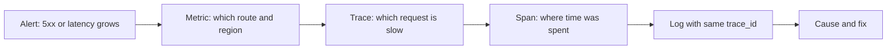

Example:

- p95 latency of `POST /orders` increased.
- Metric says problem only in `eu-west`.
- Trace shows 2.7 seconds in outgoing payment call.
- Correlated log reveals external provider response code.

Without trace, you would have to match scattered logs from all services by time.

---

## 7.3 Observability Does Not Replace Other Practices

Observability does not replace:

- tests,
- health checks,
- alerts,
- SLO.

Tests prevent known errors.

Telemetry helps discover unknown errors:

- dependency degradation,
- rare race conditions,
- problematic client behavior,
- load growth.

---

## 7.4 Signals and Shared Context

The three main signals complement each other.

| Signal  | What It Stores               | Question It Answers                | Example                             |
| ------- | ---------------------------- | ---------------------------------- | ----------------------------------- |
| Logs    | Event with details           | What happened at a specific place? | payment declined, orderId           |
| Metrics | Numeric series over time     | How often, how long, how much?     | p95 latency, 5xx rate, queue length |
| Traces  | Tree of work for one request | Where exactly was resource spent?  | API → PostgreSQL → payments         |

---

## 7.5 Traces and Spans

A trace describes the path of one operation.

It consists of spans:

- incoming HTTP request,
- SQL query,
- an outgoing HTTP call, for example with `fetch`,
- application code segment.

All spans of one path have the same:

```text
trace_id
```

Each span has its own:

```text
span_id
```

and parent.

This context links telemetry from one service to another.

---

## 7.6 Resource Attributes

Resource attributes describe the process, not an individual request.

Examples:

```text
service.name
service.version
deployment.environment.name
cloud.region
```

Names follow the OpenTelemetry semantic conventions. `deployment.environment` is deprecated; use `deployment.environment.name`. `cloud.region` is still a development-stage convention.

They are required for filtering and for preventing two applications from appearing as one service on a dashboard.

---

## 7.7 Span and Metric Attributes

Span or metric attributes describe the operation.

Examples:

```text
http.route
http.response.status_code
payment.type
```

Their values should be limited.

Good:

```text
http.route = /orders/{id}
```

Bad:

```text
url.path = /orders/8f1c...
```

The bad example creates millions of time series and is dangerous as a metric label.

The names above are the stable OpenTelemetry HTTP attributes. The older names `http.method`, `http.status_code` and `http.target` are deprecated.

---

## 7.8 Do Not Put Secrets in Telemetry

Do not write to telemetry:

- password,
- JWT,
- cookie,
- card number,
- email,
- full request body.

Even if backend telemetry is protected, this expands access surface to personal data.

---

## 7.9 OpenTelemetry and Collector

OpenTelemetry, or OTel, is an open standard for:

- API,
- SDK,
- semantic conventions,
- OTLP protocol.

Application code is instrumented once, and backend can be replaced:

- Jaeger,
- Tempo,
- Prometheus,
- Grafana,
- cloud APM,
- another OTLP-compatible service.

Typical scheme:

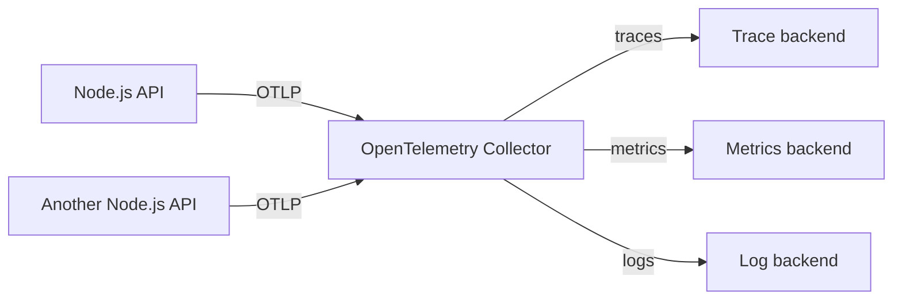

SDK in the application creates and batches telemetry.

Collector:

- receives OTLP,
- limits memory,
- batches,
- filters or enriches data if needed,
- sends data to backend.

In production, usually send data first to Collector, not directly from every application to vendor endpoint.

Then changing backend requires changing one Collector configuration, not all services.

---

## 7.10 OTLP Endpoint Notes

```text
OTEL_EXPORTER_OTLP_ENDPOINT=http://collector:4318
```

means the base OTLP/HTTP endpoint.

The SDK builds:

```text
/v1/traces
/v1/metrics
/v1/logs
```

Port `4317` is usually used for OTLP/gRPC.

Do not mix them.

Do not add `/v1/traces` to a gRPC endpoint.

---

## 7.11 Quick Local Collector

To verify the SDK, you can print all accepted signals to the Collector log (`docker logs`).

Create `otel-collector-config.yaml`:

```yaml
receivers:
  otlp:
    protocols:
      grpc:
        endpoint: 0.0.0.0:4317
      http:
        endpoint: 0.0.0.0:4318

processors:
  memory_limiter:
    check_interval: 1s
    limit_mib: 256
  batch: {}

exporters:
  debug:
    verbosity: detailed

service:
  pipelines:
    traces:
      receivers: [otlp]
      processors: [memory_limiter, batch]
      exporters: [debug]
    metrics:
      receivers: [otlp]
      processors: [memory_limiter, batch]
      exporters: [debug]
    logs:
      receivers: [otlp]
      processors: [memory_limiter, batch]
      exporters: [debug]
```

Run:

```bash
docker run --rm -p 4317:4317 -p 4318:4318 \
  -v "${PWD}/otel-collector-config.yaml:/etc/otelcol/config.yaml" \
  otel/opentelemetry-collector:0.163.2
```

In PowerShell:

```powershell
docker run --rm -p 4317:4317 -p 4318:4318 `
  -v "${PWD}/otel-collector-config.yaml:/etc/otelcol/config.yaml" `
  otel/opentelemetry-collector:0.163.2
```

Set application endpoint:

```bash
export OTEL_EXPORTER_OTLP_ENDPOINT=http://localhost:4318
```

For PowerShell:

```powershell
$env:OTEL_EXPORTER_OTLP_ENDPOINT = 'http://localhost:4318'
```

The `debug` configuration is not a monitoring system.

It only proves that the application really exports data.

Later replace the Collector exporter with a real production backend.

---

## 7.12 Node.js / NestJS OpenTelemetry Packages

Requires Node.js 22.15 or newer. Versions checked on 2026-10-26: `@opentelemetry/sdk-node` 0.300.0 (OpenTelemetry JS 3.x), `@opentelemetry/auto-instrumentations-node` 0.82.0, `@opentelemetry/api` 1.10.0 and `@opentelemetry/sdk-metrics` 3.0.0.

Install (one line, works in bash and PowerShell):

```bash
npm i @opentelemetry/api @opentelemetry/sdk-node @opentelemetry/sdk-metrics @opentelemetry/auto-instrumentations-node @opentelemetry/exporter-trace-otlp-http @opentelemetry/exporter-metrics-otlp-http
```

---

## 7.13 Create `src/instrumentation.ts`

```ts
import { metrics } from "@opentelemetry/api";
import { getNodeAutoInstrumentations } from "@opentelemetry/auto-instrumentations-node";
import { OTLPMetricExporter } from "@opentelemetry/exporter-metrics-otlp-http";
import { OTLPTraceExporter } from "@opentelemetry/exporter-trace-otlp-http";
import { PeriodicExportingMetricReader } from "@opentelemetry/sdk-metrics";
import { NodeSDK } from "@opentelemetry/sdk-node";

export const otelSdk = new NodeSDK({
  serviceName: "orders-api",
  traceExporter: new OTLPTraceExporter(),
  metricReaders: [
    new PeriodicExportingMetricReader({
      exporter: new OTLPMetricExporter(),
    }),
  ],
  instrumentations: [getNodeAutoInstrumentations()],
});

otelSdk.start();

export const ordersMeter = metrics.getMeter("orders-api");

export const quotesCalculated = ordersMeter.createCounter(
  "pricing.quotes.calculated",
);
```

`OTLPTraceExporter` and `OTLPMetricExporter` read the base endpoint from:

```text
OTEL_EXPORTER_OTLP_ENDPOINT
```

The SDK adds `/v1/traces` and `/v1/metrics` to this base URL.

Auto-instrumentations create spans for:

- HTTP,
- fetch,
- common database drivers,
- Nest core where supported.

This course uses NestJS 11 (the boilerplate). Keep it on 11 unless your mentor agrees to move. `@opentelemetry/instrumentation-nestjs-core` 0.71.0 supports `@nestjs/core` below 12. On NestJS 12.2.0 (tested), no `Create Nest App`, controller or handler spans appear. The HTTP span is still created, but it has no `http.route` unless the ESM hook is loaded (see 7.14). Section 7.15 shows how to add the business span by hand.

---

## 7.14 Load Instrumentation Before NestJS

Node instrumentation must load before:

- `@nestjs/core`,
- Express/Fastify,
- `pg`,
- other libraries.

It patches them at import time.

Therefore, run the compiled NestJS application through preload instead of importing the SDK after `NestFactory.create()`.

For an ESM build (NestJS 12 is ESM-only):

```json
{
  "scripts": {
    "start:prod": "node --experimental-loader=@opentelemetry/instrumentation/hook.mjs --import ./dist/instrumentation.js dist/main.js"
  }
}
```

Without the loader hook, Express is not patched in an ESM app. The server span is then named `GET` and has no `http.route` (tested).

For CommonJS (the course boilerplate):

```json
{
  "scripts": {
    "start:prod": "node --require ./dist/instrumentation.js dist/main.js"
  }
}
```

For graceful shutdown, call:

```ts
await otelSdk.shutdown();
```

after stopping NestJS, so the last batch is sent.

---

## 7.15 Add Manual Span in a Provider

Auto-instrumentation shows controller and SQL/HTTP calls, but it does not know your business method boundaries.

Explicit span gives that boundary.

```ts
import { Injectable } from "@nestjs/common";
import { SpanStatusCode, trace } from "@opentelemetry/api";
import { quotesCalculated } from "./instrumentation";

const tracer = trace.getTracer("orders-api");

@Injectable()
export class PricingService {
  async quote(cart: { items: unknown[]; currency: string }) {
    return tracer.startActiveSpan("PricingService.quote", async (span) => {
      try {
        span.setAttribute("cart.items_count", cart.items.length);
        span.setAttribute("order.currency", cart.currency);

        const total = await this.calculate(cart);

        quotesCalculated.add(1, {
          "order.currency": cart.currency,
        });

        return total;
      } catch (error) {
        span.recordException(error as Error);
        span.setStatus({ code: SpanStatusCode.ERROR });
        throw error;
      } finally {
        span.end();
      }
    });
  }

  private async calculate(cart: { items: unknown[] }) {
    return cart.items.length * 100;
  }
}
```

`startActiveSpan()` makes the span current, so child HTTP and database spans are nested correctly.

`finally` is required.

A span not ended on error creates a distorted trace.

---

## 7.16 Structured Logging in Node.js

OpenTelemetry is not enough alone.

You also need structured logs.

Good options:

- Pino,
- `nestjs-pino`,
- Winston, though Pino is often better for performance.

Log example:

```ts
logger.info(
  {
    orderId,
    currency,
    userId,
  },
  "Order created",
);
```

Avoid:

```text
Order created for user email@example.com with token ...
```

Use structured fields and redaction.

Pino redaction example:

```ts
const logger = pino({
  redact: {
    paths: [
      "req.headers.authorization",
      "req.headers.cookie",
      "*.password",
      "*.token",
    ],
    censor: "[REDACTED]",
  },
});
```

If possible, include:

- `trace_id`,
- `span_id`,
- `requestId`.

This lets you move from log to trace.

---

## 7.17 Context Propagation

For HTTP, OpenTelemetry uses W3C Trace Context by default.

Client sends a header like:

```text
traceparent: 00-<trace-id>-<parent-span-id>-01
```

Server continues the same trace and creates a child span.

Node HTTP auto-instrumentation usually does this automatically when the SDK is loaded early enough.

Do not generate a new `trace_id` in every service.

Do not replace `traceparent` with your own `X-Request-Id`.

You can keep your own request ID for UX or search, but it is a different identifier.

Add it as:

- span attribute,
- structured log field,

after validating format.

Do not use it instead of standardized trace context.

---

## 7.18 Queues and Asynchronous Context

A queue does not have a nested synchronous call.

Producer should write context into message headers.

Consumer extracts it and starts a consumer span.

Then worker work is linked to the original HTTP request.

For fan-out, use span links rather than choosing one arbitrary parent.

---

## 7.19 What to Measure

Start with user outcome, not number of graphs.

| Goal                     | Signal          | Example                                      |
| ------------------------ | --------------- | -------------------------------------------- |
| API availability         | counter + alert | 5xx rate by `http.route`                     |
| API speed                | histogram       | p50/p95/p99 latency by route                 |
| Saturation               | gauge/histogram | job queue length, connection pool, GC pauses |
| Business outcome         | counter         | successful orders by currency/channel        |
| Individual failure cause | trace + logs    | trace with exception and payment log         |

---

## 7.20 Practical Telemetry Rules

1. Metrics should have limited attributes.

Good labels:

```text
route
status class
currency from dictionary
```

Bad labels:

```text
user ID
order ID
URL with ID
random UUID
error text
```

2. Do not sample every trace without evaluating traffic and cost.

Start with parent-based sampling and a small fraction of successful requests.

Keep errors and slow requests according to backend/Collector rules.

3. Errors should be visible in all signals.

- HTTP 5xx increases metric.
- Server span has error status and exception.
- Log contains exception and trace context.

4. Set `service.name` explicitly and stably.

Pass version and environment as resource attributes.

Do not add hostname to `service.name`.

Hostname is an instance attribute.

5. Define owners for dashboards, SLO, and alerts.

Telemetry that nobody watches and that causes no action is unnecessary load.

---

## 7.21 Typical Observability Mistakes

| Symptom                                              | Cause                                                 | Fix                                                                       |
| ---------------------------------------------------- | ----------------------------------------------------- | ------------------------------------------------------------------------- |
| No NestJS spans in backend                           | SDK imported after Nest/driver                        | Preload through `--import` / `--require` before `main.js`                 |
| HTTP spans exist, but business time is one big block | Auto-instrumentation does not know provider           | Add one manual span around meaningful operation                           |
| Two services have different traces for one request   | Gateway removes `traceparent` or new trace is created | Pass W3C headers and do not manually generate trace ID                    |
| Backend overloaded or expensive                      | Metric attributes have millions of values             | Keep only low-cardinality labels                                          |
| Tokens or addresses visible in trace                 | Full request body/headers recorded                    | Allowlist safe attributes, redact before export                           |
| Last data disappears when process exits              | SDK does not have time to send batch                  | Graceful shutdown and `otelSdk.shutdown()`                                |
| Data exists locally but not in production            | Endpoint/protocol/network differ                      | Check `OTEL_EXPORTER_OTLP_ENDPOINT`, port `4318` for HTTP, Collector logs |
| Logs cannot be linked to traces                      | Missing trace context in logs                         | Use OTel logging integration or add `trace_id`/`span_id`                  |

---

## 7.22 Useful Observability Links

### General

- [OpenTelemetry Documentation](https://opentelemetry.io/docs/)

- [OTLP Exporter Configuration](https://opentelemetry.io/docs/languages/sdk-configuration/otlp-exporter/)

- [W3C Trace Context](https://www.w3.org/TR/trace-context/)

- [OpenTelemetry Collector in Docker](https://opentelemetry.io/docs/collector/install/docker/)

---

### Node.js / NestJS

- [NestJS OpenTelemetry](https://docs.nestjs.com/observability/opentelemetry)

- [OpenTelemetry JavaScript](https://opentelemetry.io/docs/languages/js/)

- [OpenTelemetry JS Auto-Instrumentations](https://github.com/open-telemetry/opentelemetry-js-contrib/tree/main/packages/auto-instrumentations-node)

---

## 7.23 Observability Theory Questions

1. Why can p95 latency growth not be diagnosed using logs only?
2. How does `trace_id` differ from `span_id`, and why should a service not create a new trace on every hop?
3. Why is `order.id` dangerous as a metric attribute but may be acceptable as a structured log field?
4. Why must the NestJS Node SDK be loaded before importing `@nestjs/core` and database drivers?
5. Why does application SDK usually send data to Collector instead of directly to backend?
6. What must be done with a manual span when an exception happens and why?
7. Why should JWT, cookies, and passwords never appear in telemetry?
8. How do logs, metrics, and traces work together during an incident?

---

## 7.24 Practice

Run the Collector with the debug config from 7.11 and the app with the preload from 7.14. In PowerShell, set variables with `$env:NAME = 'value'`.

1. Call `GET /health`. Expected result: the Collector log has a server span for the request, with `http.response.status_code` 200 and `url.path` `/health`.
2. Start the app without `--require` and call `GET /health` again. Expected result: no span for the request appears in the Collector log.
3. Add a manual span to a service method that throws. Expected result: the span status is `ERROR` and the span has an exception event. The client still gets a Problem Details response (section 6.10).
4. Log in with a known password, then search the Collector log and the app log for the password and the refresh cookie value. Expected result: neither value appears.
5. Start the app with `$env:OTEL_RESOURCE_ATTRIBUTES = 'deployment.environment.name=local'`. Expected result: the resource attributes in the Collector log include `deployment.environment.name` with the value `local`.

---

# 8. Integrated Learning Path

This is the recommended order for learning the material as a frontend developer moving into backend.

---

## Step 1: Understand the Final System

From `0.0`:

You are building:

```text
monolithic HTTP API
+ PostgreSQL
+ auth
+ RBAC
+ background tasks
+ file/image transformation
+ object storage
```

Do not start with microservices.

Start with a clean modular monolith.

---

## Step 2: Learn Data First

From `0.1`:

Backend correctness starts with the database.

Focus on:

- tables,
- keys,
- constraints,
- relationships,
- normalization,
- transactions,
- indexes,
- migrations,
- N+1,
- SQL injection prevention.

Important mindset:

The database is not just storage.

It is your safety net.

---

## Step 3: Model the System Visually

From `0.2`:

Use UML and Mermaid to think before coding.

Most useful diagrams:

- ER diagram for database,
- sequence diagram for request flow,
- state diagram for user lifecycle,
- class diagram for module design,
- component diagram for adapters.

---

## Step 4: Choose the Right Architecture

From `0.3`:

Use:

```text
modular monolith
```

for this course.

Organize code by business modules:

```text
auth
users
rbac
transformations
storage
```

Use layers:

```text
controller → service → repository / Prisma
```

Use interfaces at external boundaries:

```text
storage
mail
transformers
```

---

## Step 5: Build the Request Pipeline

From `0.5`:

Middleware handles cross-cutting concerns.

Learn:

- request ID,
- logging,
- CORS,
- security headers,
- authentication,
- authorization,
- error handling,
- NestJS middleware/guard/interceptor/pipe/filter differences.

Important order:

```text
request ID (first)
CORS
authentication
authorization
handler
```

Error handling is not a fixed step in this list. Express error middleware is registered after the routes it should handle, and NestJS exception filters are not positional (section 6.9).

---

## Step 6: Make the System Safe Under Retries

From `0.4`:

Assume requests and jobs repeat.

Learn:

- safe vs idempotent HTTP methods,
- unique constraints,
- idempotency keys,
- conditional writes,
- background job leases,
- “already done = success”,
- transactional outbox.

This is critical for:

- registration,
- deletion,
- background cleanup,
- file transformation history,
- storage operations.

---

## Step 7: Make the System Observable

From `0.6`:

Production systems fail in ways you cannot reproduce locally.

Learn:

- logs,
- metrics,
- traces,
- OpenTelemetry,
- request ID,
- trace context,
- structured logging,
- safe telemetry attributes.

Important rule:

Telemetry should help answer:

```text
What happened?
Where did it happen?
Why did it happen?
Which request/user/job is related?
```

without exposing secrets.

---

# 9. Final Interview / Exam Checklist

You should be able to answer these confidently.

---

## Course and Architecture

1. What is the final service you are building?
2. Why use a monolith instead of microservices for this course?
3. What is a modular monolith?
4. What rules prevent modules from becoming tangled?
5. What is the difference between system-level architecture and application-level architecture?
6. What are layers, and why should controllers not access the database directly?
7. What are ports and adapters?
8. When is hexagonal architecture overkill?
9. What is a distributed monolith?
10. What is Conway’s Law?

---

## Databases

1. Why choose PostgreSQL for users, roles, and history?
2. Why is `UNIQUE` better than checking with `SELECT` before `INSERT`?
3. What is the difference between `INNER JOIN` and `LEFT JOIN`?
4. What are 1NF, 2NF, 3NF, and BCNF?
5. What are ACID properties?
6. What is a lost update and how do you prevent it?
7. What is N+1 and how do you fix it in Prisma or TypeORM?
8. Why should you not use `SELECT *`?
9. Why are migrations better than manually changing schema?
10. Why should `passwordHash` never appear in an API response?

---

## UML

1. What is the difference between structural and behavioral diagrams?
2. How do you distinguish aggregation from composition?
3. What is the difference between synchronous and asynchronous messages?
4. How does a state diagram help decide when to return `409`?
5. What is the difference between `include` and `extend`?
6. When would you use an activity diagram instead of a sequence diagram?
7. Why is a database schema usually an ER diagram, not a class diagram?

---

## HTTP and Idempotency

1. What is the difference between safe and idempotent HTTP methods?
2. Why is `GET` safe?
3. Why is `PUT` idempotent?
4. Why is `POST` usually not idempotent?
5. Why can `DELETE` return `404` and still be idempotent?
6. Why does `UNIQUE` not make registration fully idempotent?
7. What is an idempotency key?
8. Why should deletion use both idempotency key and one job per user?
9. Why should missing object deletion be treated as success?
10. Why should idempotency state not be stored in process memory?

---

## Middleware

1. What is middleware?
2. What is short-circuiting middleware?
3. Why does middleware order matter?
4. Why should CORS usually come before authentication?
5. Why should authentication come before authorization?
6. In NestJS, what is the difference between middleware, guard, interceptor, pipe, and exception filter?
7. Why is a role check usually a guard, not middleware?
8. Why should error formatting be centralized?
9. What sensitive data must not be logged?
10. Why must Express error middleware have four arguments?

---

## Observability

1. What are logs, metrics, and traces?
2. What question does each telemetry signal answer?
3. What is `trace_id`?
4. What is `span_id`?
5. Why should all services continue the same trace?
6. Why is high-cardinality metric labeling dangerous?
7. Why should Node OpenTelemetry SDK load before NestJS?
8. Why use OpenTelemetry Collector?
9. What should happen to a manual span when an error occurs?
10. How do you connect logs to traces?

---

## Practical Node.js / TypeScript Backend Rules

1. Never trust client input.
2. Validate DTOs.
3. Separate entities and response DTOs.
4. Use database constraints.
5. Use transactions for multi-step writes.
6. Use parameterized queries.
7. Use migrations.
8. Keep business logic in services.
9. Keep HTTP details out of services.
10. Make background jobs idempotent.
11. Store important state in PostgreSQL, not process memory.
12. Log structured data, not secrets.
13. Add request IDs.
14. Use OpenTelemetry for traces and metrics.
15. Design every operation assuming it may be repeated.
16. Return errors as RFC 9457 Problem Details (`application/problem+json`), never with a stack trace.
17. Use stable cursor pagination: order by `createdAt` and `id`, and use a snapshot.

---

## Final Mental Model

As a frontend developer learning backend, your main mental shift is this:

Frontend often focuses on:

```text
user interaction
rendering
local state
API responses
```

Backend must focus on:

```text
data integrity
concurrency
security
retries
background processing
failure recovery
clear system boundaries
observability
```

If you can explain:

- how data is stored safely,
- how requests are authorized,
- how operations survive retries,
- how background jobs finish correctly,
- how the system can be observed in production,

then you are building the right backend mindset.
