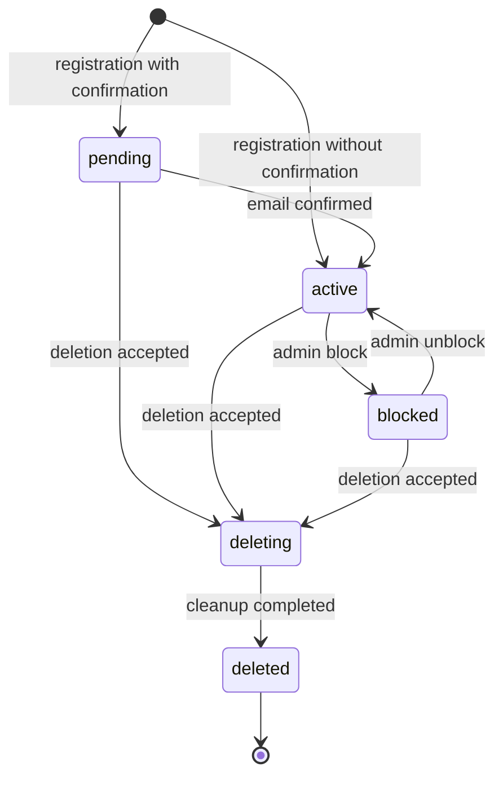
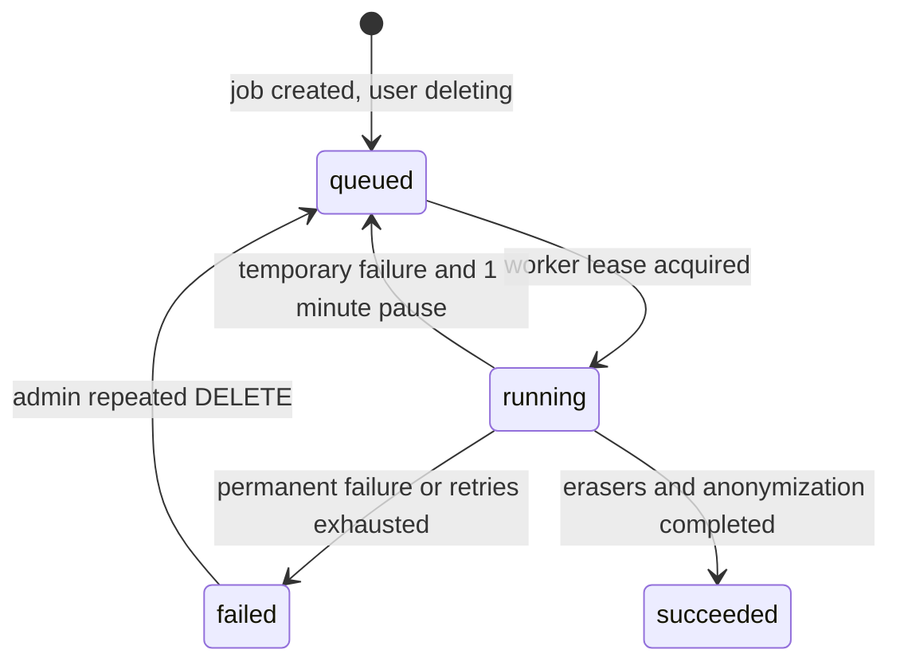

# Module 1: User, Authentication, Authorization, RBAC, Profile, Editing, Deletion, and User List

**Track:** Node.js / TypeScript / JavaScript Fullstack  
**Included source files:** `1.0`, `1.1`, `1.2`, `1.3`, `1.4`, `1.5`, `1.6`, `1.7`

This module describes the full user identity and access domain of the backend service:

```text
Registration
→ Authentication
→ Authorization
→ RBAC
→ Viewing profile
→ Editing profile
→ Deleting user
→ Admin user list
```

The final system is a monolithic HTTP API with:

- PostgreSQL,
- cookie-based JWT authentication,
- role-based access control,
- protected user operations,
- background jobs,
- object storage for user photos.

---

## Table of Contents

1. [Unified Module Rules](#1-unified-module-rules)
2. [1.0 Registration](#2-10-registration)
3. [1.1 RBAC](#3-11-rbac)
4. [1.2 Authentication](#4-12-authentication)
5. [1.3 Authorization](#5-13-authorization)
6. [1.4 Viewing User Data](#6-14-viewing-user-data)
7. [1.5 Editing User Data](#7-15-editing-user-data)
8. [1.6 Deleting User](#8-16-deleting-user)
9. [1.7 Viewing List of All Users](#9-17-viewing-list-of-all-users)
10. [Cross-Module Integration](#10-cross-module-integration)
11. [Final Study Checklist](#11-final-study-checklist)

---

# 1. Unified Module Rules

These rules are shared by all Module 1 operations.

---

## 1.1 User Statuses

Canonical user statuses:

```text
pending
active
blocked
deleting
deleted
```

Rules:

| Status     | Meaning                                            |
| ---------- | -------------------------------------------------- |
| `pending`  | Registered but not confirmed yet                   |
| `active`   | Can authenticate and use the system                |
| `blocked`  | Cannot authenticate, but profile data still exists |
| `deleting` | Deletion accepted; access is immediately stopped   |
| `deleted`  | PII anonymized; technical row remains              |

Only:

```text
active
```

can authenticate.

All other statuses cause:

```text
401 invalid_session
```

when used with access or refresh JWT.

---

## 1.2 User Lifecycle



Important:

- `pending`, `deleting`, and `deleted` are not managed by profile editing PATCH.
- Editing can only move between:
  ```text
  active ↔ blocked
  ```
- Deletion moves user to:
  ```text
  deleting
  ```
  immediately.
- Final anonymization moves user to:
  ```text
  deleted
  ```

---

## 1.3 Safe Profile

The canonical safe profile always contains exactly these fields:

```ts
{
  id: string;
  email: string;
  displayName: string | null;
  photoUrl: string | null;
  status: string;
  createdAt: string;
  updatedAt: string;
}
```

Rules:

- Email is returned fully and normalized.
- Email is not masked.
- `displayName` may be `null`.
- `photoUrl` is a protected API URL, not a direct storage URL.
- For `deleting` and `deleted`, `photoUrl` is always `null`.
- Never return:
  ```text
  password_hash
  challenge secrets
  JWT
  cookies
  roles
  photo_key
  deletion job internals
  internal flags
  ```

---

## 1.4 User Permission Catalog

| Permission         | Purpose                                                                |
| ------------------ | ---------------------------------------------------------------------- |
| `users@read`       | Read own profile                                                       |
| `users@read_any`   | Additional access to another user’s profile                            |
| `users@update`     | Update own profile                                                     |
| `users@update_any` | Additional access to update another user and direct admin email change |
| `users@delete`     | Confirmed deletion of own account                                      |
| `users@delete_any` | Additional access to delete another user                               |
| `users@list`       | View admin user list                                                   |

Role `user` receives:

```text
users@read
users@update
users@delete
```

when becoming active.

Role `user` does not receive:

```text
*_any
users@list
```

RBAC management uses:

```text
rbac@manage
```

---

## 1.5 Unified Protected Request Pipeline

For protected operations:

```text
HTTP request
↓
Middleware
  request ID
  logging
  CORS
  body parsing
↓
Authentication
  read access_token cookie
  validate JWT
  read user by sub
  require status active
↓
CSRF check for cross-origin state-changing requests
  exact Origin
  X-CSRF-Protection: 1
↓
RBAC
  compare policy version
  load snapshot if needed
  check permission@action
  default deny
↓
Target resource lookup
  only after permission
↓
Ownership / *_any check
  if required
↓
Business handler
↓
Safe response projector
```

Important order:

```text
Authentication before RBAC
RBAC before target lookup
Target lookup before ownership result
```

---

## 1.6 Unified Error Semantics

| Status | Meaning                                            |
| ------ | -------------------------------------------------- |
| `400`  | Invalid input                                      |
| `401`  | Missing/invalid session or user not active         |
| `403`  | Authenticated but denied                           |
| `404`  | Not found after permission allows search           |
| `409`  | Conflict                                           |
| `413`  | File too large                                     |
| `415`  | Unsupported media type                             |
| `429`  | Rate limit or attempt limit                        |
| `503`  | Dependency unavailable or safe decision impossible |

Important:

```text
401 never means missing permission.
403 never means missing session.
Dependency failure uses 503, not 401 or 403.
```

---

# 2. 1.0 Registration

## 2.1 Purpose

Registration allows a guest to create an account using:

```text
email
password
```

Depending on server configuration:

- account becomes active immediately, or
- account stays pending until email confirmation.

Email confirmation can be:

```text
OTP
magic link
```

The server chooses the method, not the client.

---

## 2.2 Registration Without Confirmation

Flow:

```text
POST /auth/register
→ validate fields
→ hash password
→ create active user
→ return safe response
```

No session is created.

Registration never issues JWT tokens.

---

## 2.3 Registration With Confirmation

Flow:

```text
POST /auth/register
→ create pending user
→ create confirmation challenge
→ send email
→ return confirmation metadata

POST /auth/register/confirm
→ validate OTP/token
→ activate user
→ consume challenge
```

Email is considered occupied as soon as the pending user exists.

---

## 2.4 Email Rules

Before saving and comparing email:

- trim surrounding whitespace,
- convert to lowercase.

Example:

```text
User@Example.COM
```

becomes:

```text
user@example.com
```

Important:

```text
user+tag@example.com
```

is a different email address.

Email uniqueness must be enforced by a database unique index.

Do not rely only on:

```sql
SELECT ...
INSERT ...
```

That does not protect against race conditions.

---

## 2.5 Password Rules

Password policy:

- required,
- surrounding whitespace preserved,
- minimum 8 characters,
- at least one letter from any alphabet,
- at least one digit,
- too-long passwords rejected.

Store only a slow one-way hash.

Recommended:

```text
Argon2id
```

Fallback:

```text
bcrypt with cost >= 12
```

Do not use:

```text
MD5
SHA-1
plain SHA-256 without salt/iterations
CRC32
custom homemade hashing
```

---

## 2.6 Confirmation Challenge Rules

Registration challenge:

| Rule                  | Value       |
| --------------------- | ----------- |
| OTP length            | 6 digits    |
| TTL                   | 10 minutes  |
| OTP attempts          | 5           |
| Resend pause          | 60 seconds  |
| Secret storage        | HMAC-SHA256 |
| Magic link activation | POST only   |

The fifth OTP attempt can still succeed.

The fifth failed OTP attempt consumes the challenge.

Resend:

- replaces secret,
- restarts TTL,
- resets OTP counter.

---

## 2.7 Registration Endpoints

### POST `/auth/register`

Request:

```ts
{
  email: string;
  password: string;
}
```

Responses:

Confirmation disabled:

```json
{
  "id": "string",
  "email": "string",
  "status": "active"
}
```

Status:

```text
201 Created
```

Confirmation enabled:

```json
{
  "confirmationRequired": true,
  "method": "otp",
  "attemptId": "string",
  "expiresInSeconds": 600,
  "resendAfterSeconds": 60
}
```

Status:

```text
202 Accepted
```

---

### POST `/auth/register/confirm`

For OTP:

```ts
{
  attemptId: string;
  code: string;
}
```

For magic link:

```ts
{
  token: string;
}
```

Success:

```json
{
  "id": "string",
  "email": "string",
  "status": "active"
}
```

Status:

```text
200 OK
```

---

### POST `/auth/register/resend`

Request:

```ts
{
  email: string;
}
```

Success:

```json
{
  "confirmationRequired": true,
  "method": "otp",
  "attemptId": "string",
  "expiresInSeconds": 600,
  "resendAfterSeconds": 60
}
```

Status:

```text
202 Accepted
```

---

## 2.8 Registration Errors

| Status | Meaning                                                  |
| ------ | -------------------------------------------------------- |
| `400`  | Invalid email                                            |
| `400`  | Invalid password                                         |
| `400`  | Invalid/expired code/token or missing/consumed challenge |
| `409`  | Email already registered                                 |
| `429`  | Too many attempts, resend too early, or rate limit       |
| `503`  | Email sending failed                                     |

A neutral response instead of `409` is allowed if API should not reveal whether email exists.

Default behavior is explicit `409`.

---

## 2.9 Registration Audit

Log:

- registration attempts,
- success/failure,
- sending OTP/magic link,
- confirmation success/failure.

Do not log:

```text
password
password_hash
OTP
magic link token
full request body
```

---

# 3. 1.1 RBAC

## 3.1 Purpose

RBAC answers:

```text
May this authenticated user perform this protected operation?
```

It uses:

```text
user → roles → permissions → actions
```

RBAC does not authenticate the user.

It receives verified:

```text
userId
```

from authentication.

---

## 3.2 RBAC Decision Flow

```text
Authentication establishes userId
↓
Handler declares permission@action
↓
RBAC checks current policy snapshot
↓
Allowed → handler executes
Denied → 403
Snapshot unavailable → 503
```

RBAC check happens before reading target resource.

Therefore, user without permission gets:

```text
403
```

whether target exists or not.

This prevents ID enumeration.

---

## 3.3 Roles, Permissions, Actions, Grants

### Role

Examples:

```text
admin
support
user
```

Role describes a working function.

---

### Permission

Example:

```text
users
```

Permission names a protected resource.

---

### Action

Examples:

```text
read
read_any
update
update_any
delete
delete_any
list
```

Permission-action pair:

```text
users@read
users@delete
users@list
```

---

### Grant

Grant connects:

```text
role + permission
```

A grant may allow:

```text
all actions
```

or a specific list.

Empty action list means:

```text
all current and future actions of that permission
```

Stored with explicit flag:

```text
all_actions
```

---

## 3.4 Combining Roles

A user may have zero, one, or many roles.

Permissions from all roles are combined.

Use union, not intersection.

Example:

```text
user has roles viewer and editor
```

The user receives the union of their grants.

---

## 3.5 Default Deny

If no matching grant exists:

```text
deny
```

This applies to:

- new handler with missing rule,
- unknown action,
- user without roles,
- unavailable policy snapshot.

Never open access when configuration is incomplete.

---

## 3.6 RBAC Database Tables

Possible tables:

```text
roles
permissions
permission_actions
grants
grant_actions
user_roles
rbac_policy_state
```

Important fields:

### roles

```text
id
name
description
created_at
updated_at
```

### permissions

```text
id
name
description
created_at
updated_at
```

### permission_actions

```text
id
permission_id
name
```

Unique:

```text
(permission_id, name)
```

### grants

```text
id
role_id
permission_id
all_actions
created_at
updated_at
```

Unique:

```text
(role_id, permission_id)
```

### grant_actions

```text
grant_id
permission_action_id
```

Primary key:

```text
(grant_id, permission_action_id)
```

### user_roles

```text
user_id
role_id
```

Primary key:

```text
(user_id, role_id)
```

### rbac_policy_state

```text
id
version
updated_at
```

---

## 3.7 Dynamic Policy Snapshot

Reading several tables on every request is expensive.

Use an in-memory snapshot.

But before every decision:

```text
compare snapshot version with database version
```

If versions differ:

1. Build new snapshot fully.
2. Validate integrity.
3. Atomically replace old snapshot.

If new snapshot cannot load:

```text
do not use old snapshot
return 503
```

Do not cache final allow decisions without policy version.

---

## 3.8 RBAC Node.js Example

```ts
const grants = new Map([
  ['user', new Map([['users', new Set(['read', 'update', 'delete'])]])],
  ['admin', new Map([['users', new Set()]])],
]);

function can(roles: string[], permission: string, action: string): boolean {
  return roles.some((role) => {
    const roleGrants = grants.get(role);

    if (!roleGrants?.has(permission)) {
      return false;
    }

    const actions = roleGrants.get(permission);

    return actions.size === 0 || actions.has(action);
  });
}

console.log(can(['user'], 'users', 'read'));
console.log(can(['user'], 'users', 'list'));
console.log(can(['user', 'admin'], 'users', 'list'));
console.log(can(['admin'], 'users', 'delete_any'));
```

Output:

```text
true
false
true
true
```

Explanation:

- `user` can read.
- `user` cannot list.
- Union of roles grants `list` through `admin`.
- Empty action set for `admin` means all actions.

---

## 3.9 RBAC Practical Assignment Summary

### Bootstrap

Bootstrap runs once when RBAC configuration is empty.

Creates:

Permission:

```text
rbac
```

Action:

```text
manage
```

Permission:

```text
users
```

Actions:

```text
read
read_any
update
update_any
delete
delete_any
list
```

Role:

```text
user
```

Gets:

```text
users@read
users@update
users@delete
```

Role:

```text
admin
```

Gets:

```text
rbac@manage
users all actions
```

User from:

```text
RBAC_BOOTSTRAP_ADMIN_USER_ID
```

gets role:

```text
admin
```

Existing users without roles get:

```text
user
```

Bootstrap has no public API endpoint.

---

### Role Assignment on Active Registration

When registration makes user `active`:

```text
assign role user
```

in same transaction if RBAC is connected and role not assigned.

Pending users do not get role.

---

## 3.10 RBAC Admin Endpoints

### Roles

```text
GET /admin/rbac/roles
POST /admin/rbac/roles
PUT /admin/rbac/roles/{roleId}
DELETE /admin/rbac/roles/{roleId}
```

Role name:

```text
trim
lowercase
1..64
pattern ^[a-z][a-z0-9._-]{0,63}$
```

Description:

```text
max 500 after trim
empty string becomes null
```

Delete role only if:

- no grants,
- no assigned users.

---

### Permissions

```text
GET /admin/rbac/permissions
POST /admin/rbac/permissions
PUT /admin/rbac/permissions/{permissionId}
DELETE /admin/rbac/permissions/{permissionId}
```

Rules:

- actions 1..64 unique,
- duplicate action in array gives `400`,
- deleting action used by specific grant gives `409`,
- deleting action allowed for `all_actions` grants.

---

### Grants

```text
GET /admin/rbac/grants
POST /admin/rbac/grants
PUT /admin/rbac/grants/{grantId}
DELETE /admin/rbac/grants/{grantId}
```

Representation:

All actions:

```json
{
  "allActions": true,
  "actions": []
}
```

Limited actions:

```json
{
  "allActions": false,
  "actions": ["read", "update"]
}
```

---

### User Roles

```text
GET /admin/rbac/users/{userId}/roles
PUT /admin/rbac/users/{userId}/roles
```

Body:

```ts
{
  roleIds: string[];
}
```

Rules:

- all role IDs must exist,
- no duplicates,
- empty array removes all roles,
- change and policy version update in one transaction,
- reject if no user would keep `rbac@manage`.

---

## 3.11 RBAC Errors

| Status | Meaning                                                                          |
| ------ | -------------------------------------------------------------------------------- |
| `400`  | Invalid ID/name/description/body/actions                                         |
| `401`  | Missing/invalid/expired access JWT                                               |
| `403`  | Authenticated user lacks required permission/action                              |
| `404`  | Role/permission/grant/user not found                                             |
| `409`  | Name taken, pair already granted, entity in use, would remove last `rbac@manage` |
| `503`  | Database or policy snapshot unavailable                                          |

---

# 4. 1.2 Authentication

## 4.1 Purpose

Authentication answers:

```text
Who sent this request?
```

User proves identity with:

```text
email
password
```

After success, server issues:

```text
access JWT
refresh JWT
```

Both are stored in HttpOnly cookies.

---

## 4.2 Direct Login

Flow:

```text
POST /auth/login
→ validate
→ rate limit
→ find user
→ verify password
→ check status active
→ sign access/refresh
→ set cookies
```

Only active users get tokens.

---

## 4.3 Login With Email Confirmation

If enabled:

```text
correct password alone does not create session
```

Flow:

```text
POST /auth/login
→ verify password and active
→ create login challenge
→ send OTP or magic link
→ return 202

POST /auth/login/confirm
→ validate OTP/token
→ re-check user status
→ consume challenge
→ sign tokens
→ set cookies
```

Server chooses method:

```text
otp
magic_link
```

---

## 4.4 Neutral Login Error

Login must not reveal whether:

- email exists,
- password is wrong,
- user is pending,
- user is blocked,
- user is deleting,
- user is deleted.

All these cases return same:

```text
401 invalid_credentials
```

For nonexistent user, compare password against dummy hash to reduce timing differences.

Do not permanently lock accounts after failed attempts.

That would allow attackers to lock other users out.

---

## 4.5 JWT Rules

Algorithm:

```text
HS256 only
```

Do not allow algorithm from token.

Do not allow:

```text
none
```

Access and refresh use different HMAC keys.

Each key must contain at least 32 random bytes.

Required claims:

| Claim       | Meaning               |
| ----------- | --------------------- |
| `sub`       | User ID               |
| `iss`       | Expected issuer       |
| `aud`       | Expected audience     |
| `iat`       | Issued at             |
| `exp`       | Expiration            |
| `token_use` | `access` or `refresh` |

Access:

```text
token_use = access
TTL = 15 minutes
```

Refresh:

```text
token_use = refresh
TTL = 30 days
```

Clock skew allowed:

```text
maximum 30 seconds
```

Do not put into JWT payload:

```text
password
password_hash
secret keys
email
roles
personal data
```

Roles are not stored in JWT.

JWT establishes identity.

RBAC reads current roles from server data.

---

## 4.6 Stateless Refresh Limitations

Server does not store:

```text
refresh JWT
jti
allowed token list
revoked token list
server session
```

Rotation issues new pair.

But old refresh remains valid until its own `exp`.

Logout clears cookies only for current browser.

It does not revoke copied refresh token.

Blocking or deleting user stops future access because every access/refresh checks current user status.

---

## 4.7 Login Challenge Rules

| Rule                  | Value              |
| --------------------- | ------------------ |
| TTL                   | 10 minutes         |
| OTP attempts          | 5                  |
| Resend pause          | 60 seconds         |
| Secret storage        | HMAC-SHA256        |
| Magic link token      | `attemptId.secret` |
| Magic link activation | POST only          |

Magic link token is sent in URL fragment.

Fragment is not sent to server automatically and is not included in `Referer`.

Client page reads fragment and sends token by POST.

---

## 4.8 Cookies

Default cookie policy:

```text
HttpOnly
Secure
SameSite=Strict
host-only
no Domain
```

Access cookie:

```text
Path=/
Max-Age=900
```

Refresh cookie:

```text
Path=/auth/refresh
Max-Age=2592000
```

JavaScript must not read tokens.

Do not move tokens into localStorage.

---

## 4.9 CORS and CSRF

Default assumption:

```text
frontend and API have same origin
```

For another trusted origin:

- exact origin in CORS,
- credentials allowed,
- client uses `credentials: "include"`.

Never use:

```text
Access-Control-Allow-Origin: *
```

with credentials.

Any cross-origin state-changing request must check:

```text
Origin
X-CSRF-Protection: 1
```

This applies even if both origins are same-site.

If frontend is on another site, cookies additionally use:

```text
SameSite=None; Secure
```

GET must not perform login, refresh, logout, or other state changes.

---

## 4.10 Authentication Endpoints

### POST `/auth/login`

Body:

```ts
{
  email: string;
  password: string;
}
```

Direct success:

```text
204 No Content
Set-Cookie access_token
Set-Cookie refresh_token
```

Second step required:

```json
{
  "confirmationRequired": true,
  "method": "otp",
  "attemptId": "string",
  "expiresInSeconds": 600,
  "resendAfterSeconds": 60
}
```

Status:

```text
202 Accepted
```

Invalid credentials/status:

```text
401 invalid_credentials
```

---

### POST `/auth/login/confirm`

OTP:

```ts
{
  attemptId: string;
  code: string;
}
```

Magic link:

```ts
{
  token: string;
}
```

Token format:

```text
attemptId.secret
```

Success:

```text
204 No Content
```

---

### POST `/auth/login/resend`

Body:

```ts
{
  attemptId: string;
}
```

Success:

```json
{
  "method": "otp",
  "attemptId": "string",
  "expiresInSeconds": 600,
  "resendAfterSeconds": 60
}
```

Status:

```text
202 Accepted
```

---

### POST `/auth/refresh`

Input:

```text
refresh_token cookie only
```

Success:

```text
204 No Content
```

Invalid session:

```text
401 invalid_session
```

Database unavailable:

```text
503 Service Unavailable
```

---

### POST `/auth/logout`

No body.

Does not require valid access or refresh.

Always clears cookies of current client.

Response:

```text
204 No Content
```

---

## 4.11 Authentication Errors

| Status | Meaning                                                                                                     |
| ------ | ----------------------------------------------------------------------------------------------------------- |
| `400`  | Invalid login/confirm/resend format; invalid/expired OTP or magic link; missing/replaced/consumed challenge |
| `401`  | Neutral invalid credentials; invalid session                                                                |
| `403`  | Untrusted origin or CSRF check failed                                                                       |
| `429`  | Login rate limit; resend too early; OTP attempts exhausted                                                  |
| `503`  | Database, SMTP, or signing unavailable                                                                      |

Session error uses common code:

```text
invalid_session
```

Do not reveal which JWT/user check failed.

---

# 5. 1.3 Authorization

## 5.1 Purpose

Authorization answers:

```text
May this already-authenticated active user perform this operation?
```

Fixed order:

```text
access JWT
→ active user
→ CSRF for state-changing requests
→ RBAC
→ target resource
→ handler
```

---

## 5.2 Separation of 401, 403, and 503

### 401 Unauthorized

Identity could not be established.

Causes:

```text
missing cookie
invalid JWT
expired JWT
wrong claims
unknown user
user pending
user blocked
user deleting
user deleted
```

RBAC and handler are not called.

---

### 403 Forbidden

Identity established but request denied.

Causes:

```text
missing permission
ownership check failed
CSRF rejected
```

Refresh will not help.

---

### 503 Service Unavailable

Safe decision cannot be made.

Causes:

```text
users database unavailable
RBAC snapshot unavailable
route configuration invalid
```

Dependency failure must not be disguised as `401` or `403`.

---

## 5.3 JWT Establishes Identity, Not Role

JWT signature proves claims were issued by trusted server.

It does not prove:

```text
user still exists
user is active
user still has role
```

Therefore every request reads user by `sub`.

Roles are not taken from JWT.

---

## 5.4 Operation Declarations

Every HTTP operation must be explicitly declared as one of:

| Type                | Meaning                                                    |
| ------------------- | ---------------------------------------------------------- |
| Public              | No access check                                            |
| Protected           | Exactly one `permission@action`                            |
| Receipt             | Access by secret receipt header                            |
| Receipt + Protected | Receipt branch; otherwise normal `permission@action` chain |

Missing declaration is configuration error.

It must not make route public.

It should fail readiness and return `503` if request still reaches process.

Public operations include:

```text
registration
login
email confirm/resend
refresh
logout
minimal liveness
```

Readiness may be internal-only.

Deletion status example:

```text
Deletion-Receipt header opens owner branch
without header, users@delete applies
```

---

## 5.5 Target Resource and Ownership

General permission check happens before reading target resource.

If user lacks permission:

```text
403
```

even if target ID does not exist.

Additional `*_any` action does not replace base route permission.

Handler checks it after base permission and before target lookup.

Example:

```text
profile route declares users@read
for another user's profile, handler also checks users@read_any
```

After RBAC allows:

1. Load resource.
2. If missing, return `404`.
3. Check ownership or additional rule.
4. If ownership fails, return `403`.
5. Execute business logic.

---

## 5.6 Client Refresh Rules

Client refresh rules:

- refresh only after `401 invalid_session`,
- never after `403`,
- one shared refresh operation for parallel requests,
- after successful refresh, repeat each failed request once,
- if repeated request gets `401`, go to login,
- if refresh gets `503`, do not clear user state.

---

## 5.7 Authorization Errors

| Status | Meaning                                                                    |
| ------ | -------------------------------------------------------------------------- |
| `400`  | Business input validation failed after successful authorization            |
| `401`  | Missing/invalid/expired access, wrong claims/type, user missing/not active |
| `403`  | Missing permission, ownership failure, CSRF failure                        |
| `404`  | Resource missing after successful RBAC                                     |
| `429`  | Rate limit of protected business operation                                 |
| `503`  | Users DB, RBAC snapshot, or route configuration unavailable                |

Important:

```text
401 never means missing role
403 never means missing/invalid session
dependency unavailability always uses 503
```

---

# 6. 1.4 Viewing User Data

## 6.1 Purpose

Return:

```text
safe profile
profile photo
```

without exposing internal or secret data.

---

## 6.2 Viewing Own Profile

Own profile requires:

```text
users@read
```

Compare:

```text
targetUserId === actorUserId
```

This can be done without reading target record.

---

## 6.3 Viewing Another User’s Profile

Foreign profile requires:

```text
users@read
users@read_any
```

Both checks happen before target lookup.

Therefore, user without `users@read_any` receives `403` for both existing and fake IDs.

---

## 6.4 Safe Profile Projector

Use allow-list projector.

Even if database query accidentally selects more columns, only allowed fields leave API.

Allowed fields:

```ts
{
  id: string;
  email: string;
  displayName: string | null;
  photoUrl: string | null;
  status: string;
  createdAt: string;
  updatedAt: string;
}
```

Do not serialize ORM entity directly.

Allow-list is safer than deny-list.

---

## 6.5 Display Name Rules

`displayName` may be:

```ts
string | null;
```

If not null:

- trim surrounding Unicode whitespace,
- normalize to NFC,
- length after normalization: 1 to 80 code points,
- forbid control characters:
  - U+0000–U+001F,
  - U+007F–U+009F.

Do not validate as “Latin letters only”.

That would reject real names.

XSS protection is done by contextual escaping on output/client, not by removing normal punctuation on server.

---

## 6.6 Photo Boundary

Database stores only:

```text
photo_key
```

Public `photoUrl` is computed from:

```text
PUBLIC_API_BASE_URL
userId
fixed path
```

Example:

```text
https://api.example.test/users/{id}/photo
```

Photo endpoint repeats profile permission checks.

Knowing URL does not open object.

For:

```text
deleting
deleted
```

projector returns:

```text
photoUrl: null
```

Photo endpoint returns:

```text
404
```

without accessing storage.

Photo response must not include:

```text
original file name
EXIF
storage internal headers
bucket name
object key
storage credentials
```

---

## 6.7 Viewing Endpoints

### GET `/users/{userId}`

Path:

```ts
userId: string;
```

Rules:

```text
1..128 ASCII characters
letters, digits, _, -
```

Logic:

1. Validate `userId` format.
2. Validate access JWT and get user by `sub`.
3. Accept only `active`.
4. Check current `users@read`.
5. If missing, return `403` before target search.
6. Compare `userId` with `actorUserId`.
7. If different, check current `users@read_any`.
8. If missing, return `403` before target search.
9. Select only safe profile fields.
10. If missing, return `404`.
11. Build safe profile.

Success:

```json
{
  "id": "string",
  "email": "string",
  "displayName": "string or null",
  "photoUrl": "string or null",
  "status": "active",
  "createdAt": "RFC 3339 UTC date-time",
  "updatedAt": "RFC 3339 UTC date-time"
}
```

---

### GET `/users/{userId}/photo`

Same access chain.

Logic:

1. Authenticate.
2. Check `users@read`.
3. Compare owner.
4. If foreign, check `users@read_any`.
5. All before target lookup.
6. Select only:
   ```text
   id
   status
   photo_key
   ```
7. If user/photo missing or status `deleting`/`deleted`, return `404` without storage call.
8. Read object through storage interface by internal key.
9. Return normalized WebP bytes.

Headers:

```http
Content-Type: image/webp
X-Content-Type-Options: nosniff
Cache-Control: private, max-age=300
```

If row has key but object missing:

```text
503 Service Unavailable
```

This is consistency violation, not “no photo”.

---

## 6.8 Viewing Errors

| Status | Meaning                                                                              |
| ------ | ------------------------------------------------------------------------------------ |
| `400`  | Invalid `userId` format                                                              |
| `401`  | Access missing/invalid/expired/wrong claims/user missing/not active                  |
| `403`  | Missing `users@read` or missing `users@read_any` for foreign user                    |
| `404`  | Target not found after all checks; photo missing or unavailable for deleting/deleted |
| `429`  | Rate limit exceeded                                                                  |
| `503`  | Users DB, RBAC snapshot, or storage unavailable; photo key/object inconsistency      |

---

# 7. 1.5 Editing User Data

## 7.1 Purpose

Safely change:

```text
displayName
photo
email
status
```

with different rules for self and admin.

---

## 7.2 Editing Roles

| Actor                         | Allowed Changes                                      |
| ----------------------------- | ---------------------------------------------------- |
| Self                          | `displayName`, photo, email through challenge        |
| Admin with `users@update_any` | `displayName`, direct email, `status` active/blocked |

Important:

Self never sends email in normal PATCH.

Self email change always goes through email challenge.

Direct email change always requires:

```text
users@update_any
```

even when admin changes their own email.

---

## 7.3 PATCH `/users/{userId}`

### Allowed Fields

| Field         | Self | Admin with `users@update_any` |
| ------------- | ---: | ----------------------------: |
| `displayName` |  Yes |                           Yes |
| `email`       |   No |                           Yes |
| `status`      |   No |                           Yes |

Body may contain one to three unique fields.

Invalid body cases:

```text
empty body
unknown field
duplicate JSON key
id
photoUrl
createdAt
updatedAt
password
passwordHash
roles
internal keys
email: null
status: null
```

All give:

```text
400
```

---

### displayName Rules

Allowed values:

```ts
string | null;
```

`null` clears name.

String rules:

- trim Unicode whitespace,
- normalize NFC,
- after normalization: 1 to 80 code points,
- no U+0000–U+001F,
- no U+007F–U+009F.

Empty string after trim gives:

```text
400
```

To clear name, use:

```json
{
  "displayName": null
}
```

---

### email Rules

Email is normalized:

```text
trim
lowercase
```

Rules:

- valid format,
- max 254 characters,
- `+tag` preserved,
- points and domains are not rewritten by provider-specific rules.

If normalized email equals current email:

```text
successful no-op
```

Direct email change requires:

```text
users@update_any
```

---

### status Rules

Admin may set only:

```text
active
blocked
```

Cannot set through PATCH:

```text
pending
deleting
deleted
```

Repeated same status is successful no-op and does not change `updatedAt`.

---

## 7.4 PATCH Logic

1. Validate path and JSON before database.
2. Validate access JWT and current `active`.
3. For cross-origin state-changing request, check exact `Origin` and `X-CSRF-Protection: 1`.
4. Check `users@update` before target search.
5. If target differs from actor, check `users@update_any` before target search.
6. If body contains `email` or `status`, check `users@update_any`, even for own target.
7. If changing to `blocked`, take common RBAC invariant lock first.
8. Find and lock target user row.
9. If missing, return `404`.
10. Allow edit only for target in `active` or `blocked`.
11. For `pending`, `deleting`, `deleted`, return `409`.
12. Validate and normalize all values before write.
13. Before `active → blocked`, under RBAC invariant lock, ensure another active user keeps `rbac@manage`.
14. If invariant fails, return `409`.
15. Update only sent fields in one `UPDATE`.
16. Unique email conflict becomes `409`.
17. Direct admin email change consumes target’s open email challenge with reason `admin_override`.
18. Transition to `blocked` consumes open login and email-change challenges with reason `user_inactive`.
19. If all normalized values already match, return current profile without changing `updatedAt`.
20. Otherwise set new `updatedAt`.

Success response:

```text
200 OK
```

with canonical safe profile.

---

## 7.5 Email Change Challenge

Self email change flow:

```text
POST /users/{userId}/email-change
→ create challenge
→ send OTP or magic link to new email
→ confirm with active session
→ atomic email update
```

Challenge proves access to new mailbox.

It does not replace session.

Confirm requires both:

```text
valid challenge
valid active session of same user
```

---

## 7.6 Email Challenge Rules

| Rule                  | Value                           |
| --------------------- | ------------------------------- |
| Server method         | `otp` or `magic_link`           |
| OTP length            | 6 digits                        |
| Magic link secret     | 32 random bytes                 |
| TTL                   | 10 minutes                      |
| OTP attempts          | 5                               |
| Resend pause          | 60 seconds                      |
| Secret storage        | HMAC-SHA256                     |
| HMAC key              | separate random key >= 32 bytes |
| Magic link activation | POST only                       |

The fifth OTP attempt can succeed.

The fifth failed OTP attempt consumes challenge.

Next request receives:

```text
429
```

Magic link has no attempt counter.

Resend:

- replaces secret,
- updates `last_sent_at`,
- restarts TTL,
- resets `attempts`.

---

## 7.7 Email Challenge Endpoints

### POST `/users/{userId}/email-change`

Body:

```ts
{
  newEmail: string;
}
```

Only self with:

```text
users@update
```

Rules:

- access active,
- CSRF if cross-origin,
- compare `userId` with `actorUserId`,
- mismatch gives `403` before target search,
- normalize `newEmail`,
- current email gives `409`,
- already occupied email gives `409`,
- if open challenge sent less than 60 seconds ago, return `429`,
- after pause, consume old challenge as `replaced`,
- create new challenge,
- commit,
- send email.

Success:

```json
{
  "confirmationRequired": true,
  "method": "otp",
  "challengeId": "string",
  "expiresInSeconds": 600,
  "resendAfterSeconds": 60
}
```

Status:

```text
202 Accepted
```

---

### POST `/users/{userId}/email-change/resend`

Body:

```ts
{
  challengeId: string;
}
```

Rules:

- only self,
- same method,
- missing/replaced/confirmed/user_inactive challenge gives `400`,
- attempts exhausted gives `429`,
- admin_override/email_conflict gives `409`,
- if less than 60 seconds since last send, return `429`,
- replace secret and update timing in one transaction,
- commit then send email.

Success:

```json
{
  "confirmationRequired": true,
  "method": "otp",
  "challengeId": "string",
  "expiresInSeconds": 600,
  "resendAfterSeconds": 60
}
```

Status:

```text
202 Accepted
```

---

### POST `/users/{userId}/email-change/confirm`

For OTP:

```ts
{
  challengeId: string;
  code: string;
}
```

For magic link:

```ts
{
  token: string;
}
```

Token format:

```text
challengeId.secret
```

Logic:

1. Check access, active, CSRF, `users@update`, self.
2. Lock user, then challenge.
3. Validate challenge ownership/method/state.
4. Missing/replaced/confirmed/user_inactive challenge gives `400`.
5. Attempts exhausted gives `429`.
6. admin_override/email_conflict gives `409`.
7. Check TTL:
   ```text
   last_sent_at + 10 minutes
   ```
8. Expired challenge gives `400` without increasing attempts.
9. Re-check user still active.
10. If not active, consume challenge as `user_inactive` and return `401 invalid_session`.
11. Compare HMAC in constant time.
12. Wrong OTP increases attempts.
13. Fifth wrong OTP consumes challenge and returns `400`.
14. Next request returns `429`.
15. Wrong magic link returns `400`.
16. On success, attempt to update `users.email` under unique index.
17. On unique conflict, rollback only email update, consume challenge as `email_conflict`, commit that state, return `409`.
18. On success, consume challenge as `confirmed` and return safe profile.

Success:

```text
200 OK
```

with canonical safe profile containing new normalized email.

---

## 7.8 Email Uniqueness and Races

Pre-check before sending email improves UX but is not final protection.

Another request can occupy the address after pre-check.

Source of truth is unique index:

```sql
UNIQUE (users.email)
```

Final `UPDATE` conflict becomes:

```text
409
```

Challenge is consumed with reason:

```text
email_conflict
```

Email is not reserved by sending a letter.

---

## 7.9 Photo Upload

### PUT `/users/{userId}/photo`

Request:

```text
multipart/form-data
```

Rules:

- exactly one file,
- JPEG, PNG, or WebP,
- max 5 MiB,
- no extra multipart fields.

Permissions:

- self requires `users@update`,
- foreign target additionally requires `users@update_any` before target search.

Target status must be:

```text
active
blocked
```

For:

```text
pending
deleting
deleted
```

return:

```text
409
```

---

### Photo Validation

Server must validate actual bytes, not just extension or client MIME.

Rules:

1. Stop reading after 5 MiB and return `413`.
2. Compare declared MIME, signature, and full decoding result.
3. Unsupported container gives `415`.
4. Corrupted content gives `400`.
5. Accept exactly one non-animated frame.
6. Decoded size must be between:
   ```text
   64×64
   4096×4096
   ```
7. Apply EXIF orientation.
8. Preserve aspect ratio.
9. Resize into:
   ```text
   1024×1024
   ```
   without upscaling small images.
10. Remove all metadata.
11. Re-encode one WebP.
12. Final object max 2 MiB.
13. If final limit cannot be met, return `400`.
14. Generate opaque key with at least 128 random bits.
15. Do not include original file name or user ID in key.

---

### Photo Save Logic

1. Validate access and file.
2. Write normalized object under new key.
3. Do not change database before object write succeeds.
4. Lock user row.
5. Re-check allowed status.
6. Begin transaction.
7. Replace `photo_key`.
8. Update `updated_at`.
9. If old key existed, create storage cleanup job with reason:
   ```text
   photo_replaced
   ```
10. Commit.
11. Return new safe profile.

Failure rules:

- If object write fails, return `503`; profile unchanged.
- If object written but profile transaction rolls back, server tries to delete new object.
- Orphan sweep deletes unconfirmed objects older than 1 hour.
- If transaction succeeds, later old-object deletion failure does not change response.
- Cleanup job retries old object deletion.

Success:

```text
200 OK
```

with safe profile and new protected `photoUrl`.

---

## 7.10 Photo Clearing

### DELETE `/users/{userId}/photo`

No body.

Permissions:

- self requires `users@update`,
- foreign target additionally requires `users@update_any`.

Rules:

- lock user row,
- for `pending`, `deleting`, `deleted`, return `409`,
- if `photo_key` already null, return `204` without changing `updatedAt`,
- otherwise one transaction:
  - set `photo_key = null`,
  - update `updated_at`,
  - create cleanup job with reason:
    ```text
    photo_cleared
    ```
- after commit return:
  ```text
  204 No Content
  ```

Storage unavailability does not restore photo link.

Cleanup retries.

`not_found` is success.

---

## 7.11 Storage Cleanup Jobs

Table:

```text
storage_cleanup_jobs
```

Fields:

| Field             | Description                                           |
| ----------------- | ----------------------------------------------------- |
| `id`              | Cleanup job ID                                        |
| `object_key`      | Internal object key; unique at most once              |
| `reason`          | `photo_replaced`, `photo_cleared`, or `orphan_upload` |
| `status`          | `queued`, `succeeded`, or `failed`                    |
| `attempts`        | Number of attempts                                    |
| `next_attempt_at` | Earliest next attempt                                 |
| `last_error_code` | Safe machine category                                 |
| `created_at`      | Creation time                                         |
| `updated_at`      | Last update time                                      |

Worker rules:

- process queued jobs whose `next_attempt_at` has arrived,
- retry temporary failure up to 5 times,
- pause 1 minute between attempts,
- storage `not_found` counts as success,
- after 5 failures job becomes `failed`.

---

## 7.12 Status Editing and RBAC Invariant

PATCH admin can only move:

```text
active → blocked
blocked → active
```

Before blocking, system must ensure at least one other active user keeps:

```text
rbac@manage
```

This check happens under common RBAC invariant lock.

If invariant fails:

```text
409
```

No status change happens.

After user becomes blocked:

- next access and refresh get `401`,
- JWTs are not physically revoked,
- status check blocks them.

If user is unblocked before old refresh expires, copied refresh may work again.

Full revocation would require server sessions, which this system does not store.

---

## 7.13 Editing Database Tables

### users

| Field           | Description                                           |
| --------------- | ----------------------------------------------------- |
| `id`            | Immutable primary key                                 |
| `email`         | Normalized unique email                               |
| `password_hash` | Slow hash; never in profile                           |
| `display_name`  | Null or NFC string 1..80 code points                  |
| `photo_key`     | Null or unique opaque object key                      |
| `status`        | `pending`, `active`, `blocked`, `deleting`, `deleted` |
| `created_at`    | UTC creation time, immutable                          |
| `updated_at`    | Last update time                                      |

### email_change_challenges

| Field             | Description                                                                                        |
| ----------------- | -------------------------------------------------------------------------------------------------- |
| `id`              | Challenge ID                                                                                       |
| `user_id`         | Reference to user; one open challenge per user                                                     |
| `new_email`       | Normalized target email                                                                            |
| `method`          | `otp` or `magic_link`                                                                              |
| `secret_hash`     | HMAC-SHA256                                                                                        |
| `last_sent_at`    | Start of TTL and resend pause                                                                      |
| `attempts`        | Failed OTP count                                                                                   |
| `consumed_at`     | Time consumed                                                                                      |
| `consumed_reason` | `confirmed`, `replaced`, `attempts_exhausted`, `email_conflict`, `admin_override`, `user_inactive` |
| `created_at`      | Creation time                                                                                      |

TTL is computed as:

```text
last_sent_at + 10 minutes
```

Do not store dependent `expires_at`.

---

## 7.14 Editing Errors

| Status | Meaning                                                                                                                                                                                             |
| ------ | --------------------------------------------------------------------------------------------------------------------------------------------------------------------------------------------------- |
| `400`  | Invalid path/JSON/multipart; unknown/duplicate field; empty PATCH; invalid displayName/email; invalid image; invalid challenge secret/format; expired/replaced/confirmed/user_inactive challenge    |
| `401`  | Access missing/invalid/expired/user missing/not active; user status changed before confirm commit                                                                                                   |
| `403`  | Missing `users@update`; missing `users@update_any`; self sent email/status in PATCH; CSRF failed                                                                                                    |
| `404`  | Target user not found after permissions                                                                                                                                                             |
| `409`  | Email occupied; new email equals current for self initiation; target pending/deleting/deleted; challenge consumed as admin_override/email_conflict; blocking would remove last active `rbac@manage` |
| `413`  | File exceeds 5 MiB                                                                                                                                                                                  |
| `415`  | Unsupported image container or MIME mismatch                                                                                                                                                        |
| `429`  | Rate limit; resend too early; OTP attempts exhausted                                                                                                                                                |
| `503`  | Database/RBAC/SMTP/storage/transaction unavailable                                                                                                                                                  |

Important:

Direct admin PATCH with same normalized email remains successful no-op and returns `200`.

---

## 7.15 Editing Audit

Log:

- successful and rejected PATCH,
- active/blocked transitions,
- email challenge creation/resend/wrong input/expiry/conflict/success,
- photo upload/replacement/clearing,
- storage cleanup creation/retry/completion,
- unique conflicts,
- rate limits,
- dependency unavailability.

Do not log:

```text
email
displayName
photo bytes
metadata
local path
photo_key
password
password_hash
OTP
magic-link token
HMAC
JWT
Cookie
Set-Cookie
application keys
full URL
full request body
multipart
full headers
```

Field names may be logged.

Old and new field values must not be logged.

---

## 7.16 Editing Non-Functional Requirements

- PATCH and photo operations allow max 30 mutating requests per user per hour.
- Email challenge resend pause 60 seconds.
- Email challenge allows max 5 emails per user per hour.
- User row changes are transactional.
- Email uniqueness enforced by database.
- One open email challenge per user enforced by partial unique index.
- Cleanup worker retries up to 5 times with 1 minute pause.
- `not_found` is success for object deletion.
- Orphan sweep deletes unconfirmed objects older than 1 hour.
- Tests cover:
  - field whitelist,
  - self/admin,
  - email race,
  - fifth OTP,
  - photo replace/clear,
  - cleanup,
  - last active `rbac@manage` protection.

---

# 8. 1.6 Deleting User

## 8.1 Purpose

Irreversibly clean user personal data with:

- immediate access termination,
- observable job status,
- safe retry,
- anonymized technical row.

Deletion chooses anonymization, not physical deletion of the main user row.

PII is removed.

Technical `id`, timestamps, and minimal audit remain for referential integrity.

---

## 8.2 Deletion Actors

| Actor | Flow                                                  |
| ----- | ----------------------------------------------------- |
| Self  | Must confirm current email, then create deletion job  |
| Admin | Directly deletes another user without email challenge |

Self uses:

```text
users@delete
```

Admin uses:

```text
users@delete
users@delete_any
```

Admin endpoint cannot delete own user.

Own user must go through self-confirmed flow.

---

## 8.3 Self Deletion Flow

```text
POST /users/{userId}/deletion-challenge
→ send OTP or magic link to current email

POST /users/{userId}/deletion-confirm
→ validate active session
→ validate challenge
→ create deletion job
→ set status deleting
→ return 202 with jobId
```

Confirm requires:

```text
valid active session
users@delete
challenge
```

Challenge alone is not enough.

---

## 8.4 Admin Deletion Flow

```text
DELETE /users/{userId}
→ validate access active
→ validate users@delete
→ validate users@delete_any
→ create deletion job
→ set status deleting
→ return 202 with jobId
```

Admin deletion does not send email.

Admin target may be:

```text
pending
active
blocked
```

---

## 8.5 Immediate Access Termination

Acceptance transaction sets:

```text
users.status = deleting
```

From this moment:

- new access and refresh stop working,
- authentication accepts only `active`,
- stateless JWTs remain cryptographically valid until `exp`,
- mandatory user status check blocks them.

Server also sends expired access and refresh cookies to self client.

This clears current browser but is not revocation.

---

## 8.6 Deletion Job States

```text
queued
running
succeeded
failed
```

State diagram:



Important:

`failed` does not rollback.

User remains:

```text
deleting
```

Access remains blocked.

Automatic PII restoration is forbidden.

---

## 8.7 Idempotency-Key and jobId

Client creates:

```text
16 random bytes
```

and sends:

```text
32 lowercase hex
```

as:

```http
Idempotency-Key
```

Server uses this value as:

```text
jobId
```

So client knows status endpoint before receiving response.

Repeat rules:

| Situation                                    | Result                                        |
| -------------------------------------------- | --------------------------------------------- |
| Same key, same target                        | Return existing job, `202`, no second process |
| Different key, same target with existing job | Return existing job                           |
| Same key, different target                   | `409 Conflict`                                |

---

## 8.8 Deletion Endpoints

### POST `/users/{userId}/deletion-challenge`

No body.

Only self with:

```text
users@delete
```

Logic:

1. Check access, active, CSRF, `users@delete`.
2. Compare `userId` with `actorUserId`.
3. Mismatch gives `403` before target search.
4. Lock user, then open deletion challenge, then existing deletion job in common order.
5. If job already exists, return `409` and do not send email.
6. If open challenge sent less than 60 seconds ago, return `429`.
7. After pause, consume old challenge as `replaced`.
8. Create new challenge in one transaction.
9. Commit.
10. Send secret to current normalized email.

Success:

```json
{
  "confirmationRequired": true,
  "method": "otp",
  "challengeId": "string",
  "expiresInSeconds": 600,
  "resendAfterSeconds": 60
}
```

Status:

```text
202 Accepted
```

---

### POST `/users/{userId}/deletion-challenge/resend`

Body:

```ts
{
  challengeId: string;
}
```

Rules similar to email change resend:

- self only,
- missing/replaced/confirmed/user_inactive challenge gives `400`,
- attempts exhausted gives `429`,
- job_exists gives `409`,
- if less than 60 seconds, return `429`,
- replace secret and timing in one transaction,
- commit then send email.

Success:

```json
{
  "confirmationRequired": true,
  "method": "otp",
  "challengeId": "string",
  "expiresInSeconds": 600,
  "resendAfterSeconds": 60
}
```

Status:

```text
202 Accepted
```

---

### POST `/users/{userId}/deletion-confirm`

Header:

```http
Idempotency-Key: 32 lowercase hex
```

Body contains exactly one secret variant.

OTP:

```ts
{
  challengeId: string;
  code: string;
}
```

Magic link:

```ts
{
  token: string;
}
```

Token format:

```text
challengeId.secret
```

Magic token is delivered in URL fragment; client sends it by POST.

GET does not change state.

Logic:

1. Validate path, `Idempotency-Key`, body shape.
2. Check idempotent repeat before new business operation:
   - if `jobId` already belongs to same user, return existing job with `202`,
   - if key belongs to another target, return `409`.
3. If no job with this key, check access, active, CSRF, `users@delete`, self.
4. Take common RBAC invariant lock.
5. Lock user and challenge in established order.
6. Validate challenge ownership/method/state/TTL.
7. Missing/replaced/confirmed/user_inactive challenge gives `400`.
8. Attempts exhausted gives `429`.
9. If job exists with another key, consume challenge as `job_exists` and return existing job with `202`.
10. Re-check user active.
11. If not active, consume challenge as `user_inactive` and return `401`.
12. Compare HMAC in constant time.
13. Fifth OTP may succeed; fifth wrong OTP consumes challenge and returns `400`; next gets `429`.
14. Wrong magic link returns `400`.
15. If user has `rbac@manage`, ensure another active holder remains.
16. If not, return `409`.
17. Create deletion job:
    ```text
    status = queued
    attempts = 0
    next_attempt_at = now
    tombstone generated
    ```
18. Set user:
    ```text
    status = deleting
    ```
19. Delete user roles.
20. Increase RBAC policy version.
21. Update `updated_at`.
22. Consume deletion challenge as `confirmed`.
23. Consume other login/email-change/deletion challenges.
24. Commit.
25. Send expired cookies to self client.
26. Return receipt.

Success:

```json
{
  "jobId": "string",
  "status": "queued",
  "statusUrl": "/users/{userId}/deletion-status"
}
```

Status:

```text
202 Accepted
```

`statusUrl` does not contain receipt in path or query.

Self later sends receipt only in:

```http
Deletion-Receipt
```

If transaction rolls back:

- user remains active,
- challenge can be retried,
- job absent,
- return `503`.

If response lost after commit, client already knows `jobId` from header.

---

### DELETE `/users/{userId}`

Header:

```http
Idempotency-Key: 32 lowercase hex
```

No body.

Logic:

1. Validate path and header.
2. Check access, active, CSRF, base `users@delete`.
3. If `userId` equals `actorUserId`, return:
   ```text
   403 self_confirmation_required
   ```
4. Check `users@delete_any` before target search.
5. If `jobId` already belongs to another target, return `409`.
6. Take common RBAC invariant lock.
7. Find and lock target user.
8. If missing after permissions, return `404`.
9. Lock existing job if present.
10. If job exists, return existing job with `202`.
11. If existing job is `failed`, move same job to `queued`, reset attempts, set `next_attempt_at = now`, clear lease and last error; do not create new tombstone.
12. If target is `active` or `blocked` and has `rbac@manage`, ensure another active holder remains.
13. If not, return `409`.
14. If target is `pending`, `active`, or `blocked`, create job and tombstone, set `deleting`, delete target roles, increase RBAC version in one transaction.
15. If target is `deleting` or `deleted` but no related job exists, return `503` and consistency violation event.
16. Consume all target challenges on first acceptance.

Success:

```json
{
  "jobId": "string",
  "status": "queued",
  "statusUrl": "/users/{userId}/deletion-status"
}
```

Status:

```text
202 Accepted
```

No email challenge is created.

---

### GET `/users/{userId}/deletion-status`

This operation is declared as receipt plus base pair:

```text
Deletion-Receipt
users@delete
```

If header present:

```text
Self branch
```

If header absent:

```text
Admin branch
```

#### Self Branch

Self sends:

```http
Deletion-Receipt: jobId
```

No auth cookie is used.

Rules:

- find job by receipt,
- check exact match between `job.user_id` and path `userId`,
- mismatch and unknown receipt both give `404`,
- receipt only reads minimal status,
- receipt cannot start or repeat job.

#### Admin Branch

Admin must have:

```text
access active
users@delete
users@delete_any
```

Rules:

- `userId` must differ from `actorUserId`,
- own `userId` gets `403` and should use self branch,
- missing target or job after permissions gives `404`.

Success response:

```json
{
  "jobId": "string",
  "status": "queued",
  "createdAt": "RFC 3339 UTC",
  "updatedAt": "RFC 3339 UTC",
  "finishedAt": "RFC 3339 UTC or null"
}
```

`status` values:

```text
queued
running
succeeded
failed
```

`finishedAt` only for:

```text
succeeded
```

Response must not include:

```text
userId
actor
email
name
photo
deletion reason
tombstone
external error
attempt count
PII
JWT
internal fields
```

---

## 8.9 Deletion Worker

Worker processes:

```text
queued jobs
running jobs with expired lease
```

Steps:

1. Atomically claim job:
   - set `running`,
   - set `lease_until = now + 300 seconds`,
   - clear `next_attempt_at`,
   - increment `attempts`.
2. Call each registered eraser:
   ```ts
   eraseUserData(userId, deletionJobId);
   ```
3. If all erasers return `succeeded`, run final anonymization.
4. If any eraser returns `retryable_failure` and attempts < 5:
   - save safe error code,
   - return job to `queued`,
   - clear lease,
   - set `next_attempt_at = now + 1 minute`.
5. If attempts reached 5 or result is `permanent_failure`:
   - set job `failed`,
   - clear lease and `next_attempt_at`,
   - user remains `deleting`.
6. If final transaction fails, treat as `retryable_failure` with same limits.
7. Original `202` acceptance response never changes after commit.

---

## 8.10 Eraser Contract

Every module that stores user data or files must register:

```ts
eraseUserData(userId: string, deletionJobId: string)
```

Eraser must:

- be idempotent,
- safely repeat with same pair,
- delete PII, source/derived files, secrets, direct links owned by module,
- allow anonymized aggregate only if it cannot restore user,
- return one result:
  ```text
  succeeded
  retryable_failure
  permanent_failure
  ```
- include safe machine code,
- not include cleaned values, storage keys, full jobId, file contents in logs/errors.

`not_found` object is success.

Transformation module must register eraser before accepting first user file.

---

## 8.11 Final Anonymization

After all erasers succeed, worker runs one transaction.

Steps:

1. Lock policy state, user, then job.
2. If pair already:
   ```text
   job.status = succeeded
   user.status = deleted
   ```
   return internal idempotent success.
3. Otherwise require:
   ```text
   job.status = running
   user.status = deleting
   ```
4. Ensure profile photo deleted or missing.
5. Physically delete:
   - registration challenges,
   - login challenges,
   - email-change challenges,
   - deletion challenges.
6. Idempotently delete remaining user roles.
7. If role rows actually deleted, increase RBAC policy version.
8. Set:
   ```text
   email = tombstone_email
   display_name = null
   photo_key = null
   password_hash = null
   status = deleted
   updated_at = now
   ```
9. Set job:
   ```text
   status = succeeded
   finished_at = now
   lease_until = null
   next_attempt_at = null
   ```

Database constraints:

```text
password_hash may be null only when status = deleted
display_name must be null when deleted
photo_key must be null when deleted
```

Tombstone format:

```text
deleted.<32 lowercase hex>@example.invalid
```

Tombstone is random.

It must not be derived from original email.

Old email is freed only after this transaction commits.

New registration with old email creates new user ID and does not inherit old roles/files/history.

Repeat finalization for already deleted/succeeded returns internal success.

Status endpoint then returns:

```text
succeeded
```

---

## 8.12 Deletion Database Tables

### deletion_challenges

| Field             | Description                                                                  |
| ----------------- | ---------------------------------------------------------------------------- |
| `id`              | Challenge ID                                                                 |
| `user_id`         | User reference; one open challenge per user                                  |
| `method`          | `otp` or `magic_link`                                                        |
| `secret_hash`     | HMAC-SHA256                                                                  |
| `last_sent_at`    | TTL/resend start                                                             |
| `attempts`        | Failed OTP count                                                             |
| `consumed_at`     | Consumed time                                                                |
| `consumed_reason` | `confirmed`, `replaced`, `attempts_exhausted`, `job_exists`, `user_inactive` |
| `created_at`      | Creation time                                                                |

### deletion_jobs

| Field             | Description                                       |
| ----------------- | ------------------------------------------------- |
| `id`              | 32 lowercase hex from Idempotency-Key; also jobId |
| `user_id`         | Unique reference to user                          |
| `status`          | `queued`, `running`, `succeeded`, `failed`        |
| `tombstone_email` | Random unique tombstone                           |
| `attempts`        | Worker attempts                                   |
| `lease_until`     | Lease expiry, null when not running               |
| `next_attempt_at` | Earliest queued pickup time                       |
| `last_error_code` | Safe machine category                             |
| `created_at`      | Acceptance time                                   |
| `updated_at`      | Last change                                       |
| `finished_at`     | Success time, otherwise null                      |

---

## 8.13 Deletion Errors

| Status | Meaning                                                                                                                                                                                 |
| ------ | --------------------------------------------------------------------------------------------------------------------------------------------------------------------------------------- |
| `400`  | Invalid userId/jobId/Idempotency-Key/challenge body/OTP/magic link; challenge missing/expired/replaced/confirmed/user_inactive                                                          |
| `401`  | Access missing/invalid/expired/user not active; self lost active before job acceptance                                                                                                  |
| `403`  | Missing `users@delete`; missing `users@delete_any`; self target on admin endpoint; CSRF failed                                                                                          |
| `404`  | Target or job not found after permissions; self receipt unknown or mismatched                                                                                                           |
| `409`  | Key belongs to another target; challenge initiated/resend after job exists; deletion would remove last active `rbac@manage`                                                             |
| `429`  | Rate limit; resend too early; OTP attempts exhausted                                                                                                                                    |
| `503`  | Database/RBAC unavailable before acceptance or status read; SMTP unavailable for challenge; eraser config not ready; deleting/deleted without job; acceptance transaction not committed |

Failure after accepted `202` is reflected in existing job status, not by changing acceptance response.

---

## 8.14 Deletion Audit

Log:

- challenge creation/resend/wrong input/expiry/consumption,
- self/admin acceptance,
- idempotent repeat,
- key conflict,
- transition to deleting,
- final deleted,
- job claim/success/retry/permanent failure,
- admin retry of failed job,
- consistency violations,
- anonymization completion.

Do not log:

```text
jobId
Idempotency-Key
Deletion-Receipt
actorUserId
targetUserId
email
displayName
IP
reason
tombstone
OTP
magic-link token
HMAC
JWT
cookies
storage keys
file contents
full request body
full headers
```

---

## 8.15 Deletion Non-Functional Requirements

- Deletion challenge allows max 5 emails per user per hour.
- Resend pause 60 seconds.
- Status endpoint allows max 60 requests per IP per minute.
- Acceptance transaction atomically:
  - creates job,
  - sets deleting,
  - deletes user roles,
  - increases RBAC version,
  - consumes challenges.
- Worker reads jobs from database; no external broker required.
- Unique constraints cover:
  - `deletion_jobs.id`,
  - one job per user,
  - tombstone,
  - one open challenge per user.
- Claim index covers:
  ```text
  status, next_attempt_at, lease_until
  ```
- Worker lease 5 minutes.
- Temporary failure retries up to 5 times with 1 minute pause.
- Every eraser must be idempotent.
- Missing storage object is success.
- Readiness fails if module stores user data without eraser.
- Tests cover:
  - self/admin,
  - both status branches,
  - direct self-delete prohibition,
  - last active `rbac@manage`,
  - lost 202,
  - eraser repeat,
  - failed job,
  - tombstone,
  - re-registration with old email.

---

# 9. 1.7 Viewing List of All Users

## 9.1 Purpose

Return privileged user stable pages of safe profiles with limited search/filter/sort.

Endpoint:

```http
GET /admin/users
```

Requires:

```text
users@list
```

This is a separate administrative permission.

It is checked once before query.

It does not call `users@read_any` for every row.

---

## 9.2 List Item Shape

Each item uses the same safe profile:

```ts
{
  id: string;
  email: string;
  displayName: string | null;
  photoUrl: string | null;
  status: string;
  createdAt: string;
  updatedAt: string;
}
```

There is no extended admin user object.

Email is full and unmasked.

`photoUrl` is computed without reading storage.

For:

```text
deleting
```

`photoUrl` is already `null`.

For:

```text
deleted
```

email is random tombstone, `displayName` and `photoUrl` are `null`.

---

## 9.3 Query Parameters

Only these query parameters are allowed:

```text
cursor
limit
searchBy
q
status
sort
order
```

Unknown or repeated parameter gives:

```text
400
```

Client cannot pass:

```text
column name
SQL fragment
comparison operator
arbitrary direction
```

---

### limit

```text
integer
1..100
default 20
```

Values above 100 are rejected, not truncated.

---

### searchBy and q

`searchBy` and `q` must be present together or both absent.

Allowed `searchBy`:

```text
id
email
displayName
```

Rules:

#### searchBy=id

`q`:

```text
1..128 ASCII characters
letters, digits, _, -
exact comparison
```

#### searchBy=email

`q`:

```text
trim
lowercase
3..254 visible ASCII characters
no spaces/control chars
literal prefix
```

SQL wildcards are not interpreted.

`%` and `_` have no special meaning.

#### searchBy=displayName

`q`:

```text
trim
NFC
3..80 code points
no U+0000–U+001F
no U+007F–U+009F
```

Database compares literal prefix using:

```sql
lower(normalize(display_name, NFC))
```

and lower of normalized `q`.

This is not full Unicode case folding.

`ß` does not become `ss`.

---

### status

Optional exact filter:

```text
pending
active
blocked
deleting
deleted
```

---

### sort

Allowed:

```text
createdAt
id
```

Default:

```text
createdAt
```

---

### order

Allowed:

```text
asc
desc
```

Default:

```text
desc
```

---

## 9.4 Keyset Pagination

List uses keyset pagination, not offset pagination.

No page number.

No large `OFFSET`.

Rules:

- sort only by immutable fields,
- add tie-breaker for full order,
- request `limit + 1`,
- extra row determines `nextCursor`,
- extra row is not returned in `items`,
- `nextCursor = null` means end of traversal,
- no `totalCount`.

Default order:

```text
createdAt desc, id desc
```

For `createdAt` sort, tie-breaker is:

```text
id
```

For `id` sort, tie-breaker is:

```text
createdAt
```

For `createdAt desc`:

```sql
(created_at, id) < (:lastCreatedAt, :lastId)
```

For `createdAt asc`:

```sql
(created_at, id) > (:lastCreatedAt, :lastId)
```

For `id` sort tuple changes to:

```text
(id, created_at)
```

`ORDER BY` must list same fields and same direction.

---

## 9.5 snapshotAt

First page fixes:

```text
snapshotAt
```

from database UTC clock before selecting rows.

All pages apply strict:

```sql
created_at < snapshotAt
```

This excludes users created at or after first page boundary.

Parallel registrations do not appear in middle of traversal.

`users.created_at` is assigned by database clock, not application clock or client.

---

## 9.6 Cursor

Cursor is opaque signed string.

It is not encrypted.

Do not put PII into cursor.

Cursor payload contains:

| Field            | Value                                            |
| ---------------- | ------------------------------------------------ |
| `v`              | Format version, currently `1`                    |
| `kid`            | Key ID used to sign cursor                       |
| `sort`           | `createdAt` or `id`                              |
| `order`          | `asc` or `desc`                                  |
| `snapshotAt`     | RFC 3339 UTC from DB clock before first page     |
| `lastSortValue`  | Last value of selected immutable field           |
| `lastTieBreaker` | `id` for createdAt sort, `createdAt` for id sort |
| `queryTag`       | HMAC of canonical query parameters               |
| `issuedAt`       | Server UTC time of first page                    |
| `expiresAt`      | `issuedAt + 15 minutes`                          |

Cursor TTL:

```text
15 minutes
```

Fast repeated requests do not extend traversal.

Each next page keeps original `issuedAt` and `expiresAt`.

---

### Cursor Signature

Payload is serialized canonically, encoded base64url, then signed:

```text
HMAC-SHA256
```

Final format:

```text
payload.signature
```

Signature is compared in constant time.

Domain prefixes:

```text
users-list-query
users-list-cursor
```

`queryTag` is HMAC of canonical:

```text
limit
searchBy
normalized q
status
sort
order
```

If any parameter changes with old cursor:

```text
400 invalid_cursor
```

Unknown `kid` gives same general:

```text
400 invalid_cursor
```

Do not reveal which check failed.

---

### Cursor Keys

Configuration:

```text
USER_LIST_CURSOR_ACTIVE_KEY_ID
USER_LIST_CURSOR_HMAC_KEYS
```

Rules:

- active `kid` selects signing key,
- key ring contains separate random values,
- each key at least 32 bytes,
- duplicate `kid` fails readiness,
- missing/empty/short key fails readiness,
- cursor keys must not equal JWT or challenge keys,
- keys are not in code,
- keys are not returned to client,
- during rotation, previous key kept at least:
  ```text
  15 minutes 30 seconds
  ```
  then removed.

---

## 9.7 List Logic

1. Check access JWT.
2. Read user by `sub`.
3. Accept only `active`.
4. If fail, return `401` before RBAC.
5. Check current `users@list`.
6. If missing, return `403` before search/query.
7. Reject unknown/repeated/invalid query parameters.
8. First page:
   - get `snapshotAt` from DB UTC clock,
   - normalize query.
9. Next page:
   - validate cursor format,
   - validate `kid`,
   - validate HMAC,
   - validate version,
   - validate TTL,
   - validate `queryTag`.
10. Build only server-side parameterized keyset query.
11. Apply:
    ```sql
    created_at < snapshotAt
    ```
12. Select:
    ```text
    limit + 1
    ```
    rows.
13. Select only:
    ```text
    id
    email
    display_name
    photo_key
    status
    created_at
    updated_at
    ```
14. Project max `limit` rows through safe projector.
15. If extra row exists, sign cursor from last returned row.
16. Otherwise return:
    ```json
    {
      "nextCursor": null
    }
    ```

Database timeout:

```text
2 seconds
```

Timeout gives:

```text
503
```

Not partial page.

No client SQL fragment, column name, or operator is inserted into query.

---

## 9.8 List Response

Success:

```json
{
  "items": [],
  "nextCursor": null
}
```

Rules:

- `items` contains 0 to `limit` safe profiles,
- empty page is valid,
- no `totalCount`,
- no page number,
- no previous cursor.

---

## 9.9 List Indexes

Suggested indexes:

| Index                                                                                                              | Purpose                            |
| ------------------------------------------------------------------------------------------------------------------ | ---------------------------------- |
| `users_pkey (id)`                                                                                                  | Primary key, exact search, id sort |
| `users_list_created_id_idx (created_at, id)`                                                                       | Default sort and composite cursor  |
| `users_list_status_created_id_idx (status, created_at, id)`                                                        | Status filter with default sort    |
| `users_list_status_id_created_idx (status, id, created_at)`                                                        | Status filter with id sort         |
| `users_list_email_prefix_idx (email text_pattern_ops)`                                                             | Normalized literal email prefix    |
| `users_list_name_prefix_idx (lower(normalize(display_name, NFC)) text_pattern_ops) WHERE display_name IS NOT NULL` | Literal display name prefix        |

Functional index does not create new HTTP profile attribute.

Query expression must exactly match index expression.

Unicode version is fixed by database version.

If database changes, rebuild index via migration.

---

## 9.10 Races and Changes Between Pages

`createdAt` and `id` are immutable.

Already returned row does not move relative to cursor.

`snapshotAt` excludes rows created after first request.

Changes to:

```text
email
displayName
status
```

do not change sort position.

If row stops matching search/filter before next page, it is not returned.

If row starts matching after its position passed, it appears only in new traversal.

Cursor does not promise historical MVCC snapshot between HTTP requests.

Deletion does not remove main row.

`deleting` and `deleted` change filter but preserve:

```text
id
createdAt
```

Client needing final consistent set after many changes starts new traversal without cursor.

---

## 9.11 List Errors

| Status | Meaning                                                                                                                                   |
| ------ | ----------------------------------------------------------------------------------------------------------------------------------------- |
| `400`  | Unknown/repeated query parameter; invalid limit/searchBy/q/status/sort/order; cursor damaged/expired/wrong signature/kid/version/queryTag |
| `401`  | Access missing/invalid/expired/user missing/not active                                                                                    |
| `403`  | Active actor lacks current `users@list`                                                                                                   |
| `429`  | Rate limit exceeded                                                                                                                       |
| `503`  | Database, RBAC snapshot, HMAC operation unavailable; DB timeout; cursor key not ready                                                     |

`404` is not used for list.

Correct query with no matches returns:

```text
200
```

with empty `items`.

Single row error does not create partial response.

Dependency failure returns:

```text
503
```

without items.

---

## 9.12 List Audit

Log:

- successful request with actor ID, used parameter names, page size, `hasNext`, duration,
- `401`, `403`, `400 invalid_cursor`, `429`, `503` by safe category,
- database timeout,
- bad query plan threshold,
- readiness failures due to cursor key or RBAC.

Do not log:

```text
q
cursor
email
displayName
photoUrl
items content
full URL
PII
password
password_hash
challenge
JWT
Cookie
Set-Cookie
HMAC key
cursor payload
roles
full response body
full headers
```

For search analytics store only:

```text
searchBy
status presence
sort
order
limit
short-lived irreversible request ID
```

---

## 9.13 List Non-Functional Requirements

- Endpoint allows max 60 requests per actor per minute.
- Endpoint allows max 120 requests per IP per minute.
- `limit > 100` rejected.
- Database uses keyset range with composite index.
- Query selects `limit + 1`.
- No `totalCount`.
- Page building does not call photo storage.
- Cursor TTL 15 minutes.
- Cursor tied to first-page query.
- Search parameterized; `%` and `_` not wildcard.
- Tests cover:
  - empty page,
  - same `createdAt`,
  - both sort directions,
  - search/filter,
  - cursor signature,
  - TTL,
  - query tag mismatch,
  - all five statuses in items.

---

# 10. Cross-Module Integration

## 10.1 Module Endpoint Summary

### Public Auth

```text
POST /auth/register
POST /auth/register/confirm
POST /auth/register/resend
POST /auth/login
POST /auth/login/confirm
POST /auth/login/resend
POST /auth/refresh
POST /auth/logout
```

### Profile

```text
GET /users/{userId}
GET /users/{userId}/photo
PATCH /users/{userId}
PUT /users/{userId}/photo
DELETE /users/{userId}/photo
POST /users/{userId}/email-change
POST /users/{userId}/email-change/resend
POST /users/{userId}/email-change/confirm
```

### Deletion

```text
POST /users/{userId}/deletion-challenge
POST /users/{userId}/deletion-challenge/resend
POST /users/{userId}/deletion-confirm
DELETE /users/{userId}
GET /users/{userId}/deletion-status
```

### Admin

```text
GET /admin/users
GET /admin/rbac/roles
POST /admin/rbac/roles
PUT /admin/rbac/roles/{roleId}
DELETE /admin/rbac/roles/{roleId}
GET /admin/rbac/permissions
POST /admin/rbac/permissions
PUT /admin/rbac/permissions/{permissionId}
DELETE /admin/rbac/permissions/{permissionId}
GET /admin/rbac/grants
POST /admin/rbac/grants
PUT /admin/rbac/grants/{grantId}
DELETE /admin/rbac/grants/{grantId}
GET /admin/rbac/users/{userId}/roles
PUT /admin/rbac/users/{userId}/roles
```

---

## 10.2 Permission Usage Map

| Operation                    | Base Permission | Additional         |
| ---------------------------- | --------------- | ------------------ |
| View own profile             | `users@read`    | None               |
| View foreign profile         | `users@read`    | `users@read_any`   |
| Update own displayName/photo | `users@update`  | None               |
| Update foreign profile/photo | `users@update`  | `users@update_any` |
| Direct email change          | `users@update`  | `users@update_any` |
| Self email change            | `users@update`  | Challenge          |
| Self deletion                | `users@delete`  | Email challenge    |
| Admin deletion               | `users@delete`  | `users@delete_any` |
| User list                    | `users@list`    | None               |
| RBAC management              | `rbac@manage`   | None               |

---

## 10.3 Background Jobs in Module 1

Module 1 background jobs:

| Job                 | Trigger                              | Purpose                           |
| ------------------- | ------------------------------------ | --------------------------------- |
| Storage cleanup job | Photo replaced/cleared/orphan upload | Delete old photo object           |
| Deletion job        | Self/admin deletion acceptance       | Erase user data and anonymize row |

Both must be idempotent.

Both must treat missing object as success.

Both must survive process restart.

---

## 10.4 Idempotency in Module 1

| Operation                 |            Idempotent? | Mechanism                                   |
| ------------------------- | ---------------------: | ------------------------------------------- |
| `PUT` role replacement    |                    Yes | Full replacement semantics                  |
| `PUT` user roles          |                    Yes | Full replacement semantics                  |
| `POST` registration       |           No as method | Unique email protects invariant only        |
| `POST` login              |                     No | New session/challenge effects               |
| `POST /auth/logout`       | Yes for current client | Always clears cookies and returns `204`     |
| Self deletion acceptance  |                    Yes | Client key becomes jobId + one job per user |
| Admin deletion acceptance |                    Yes | Client key becomes jobId + one job per user |
| Deletion worker           |                    Yes | Lease + missing object success              |
| Photo cleanup             |                    Yes | Missing object success                      |
| `GET` profile/list/photo  |          Yes as method | No write; cursor stabilizes list traversal  |

---

## 10.5 Safe Data Boundaries

Never expose:

```text
password_hash
OTP
magic link token
HMAC
JWT
cookies
photo_key
storage credentials
deletion tombstone
challenge secrets
internal policy snapshot
roles unless admin RBAC contract explicitly returns them
```

Always use:

```text
safe projector
allow-list response DTO
explicit serialization
```

---

# 11. Final Study Checklist

You should be able to answer these confidently.

---

## Registration

1. Why is slow hash with unique salt better than fast SHA-256?
2. Why is OTP stored as HMAC and looked up by challenge ID?
3. Why is magic link activation POST, not GET?
4. Why does pending user still occupy email?
5. Why is unique index better than SELECT before INSERT?

---

## RBAC

1. Difference between authentication and authorization?
2. Why missing session gives `401`, missing permission gives `403`?
3. How are multiple roles combined?
4. What does empty action list mean?
5. Why default deny safer than default allow?
6. Why not read roles from JWT?
7. Why policy version and atomic snapshot replacement matter?

---

## Authentication

1. Why neutral login error matters?
2. Why access and refresh use different keys and `token_use`?
3. Why stateless refresh cannot detect reuse?
4. What happens to valid tokens after user blocked?
5. Why magic link uses fragment and POST?
6. Difference between cross-origin and cross-site?
7. When is `SameSite=None` required?

---

## Authorization

1. Why authentication must run before RBAC?
2. Why RBAC must run before target lookup?
3. Why dependency failure gives `503`, not `401` or `403`?
4. Why operation declarations must be explicit?
5. Why client refresh only after `401 invalid_session`?
6. Why `403` never triggers refresh?

---

## Viewing Profile

1. Why allow-list projector safer than deny-list?
2. Why check `users@read_any` before foreign target lookup?
3. Why valid JWT signature is not enough without current status?
4. Difference between `photoUrl` and `photo_key`?
5. Why NFC useful for displayName but not XSS protection?

---

## Editing Profile

1. Why PATCH must reject unknown field instead of ignoring it?
2. Why self email change needs both challenge and active session?
3. Why pre-check email uniqueness is not enough?
4. Why image must be decoded and re-encoded?
5. Why cleanup job exists for old photo deletion?
6. Why blocking must protect last active `rbac@manage`?

---

## Deleting User

1. Why `202 Accepted` does not mean PII already deleted?
2. How does `deleting` block stateless JWTs?
3. Why client knows jobId before sending confirm?
4. Why missing file deletion is success?
5. Difference between random tombstone and email hash?
6. Why eraser must be idempotent?
7. Why final anonymization uses tombstone instead of deleting row?

---

## User List

1. Why `createdAt` alone is not enough for cursor pagination?
2. Why keyset pagination better than OFFSET?
3. Why cursor contains snapshotAt, queryTag, kid, version, HMAC?
4. Why `users@list` checked once before query?
5. Why full email is allowed only with privileged list permission?
6. Why mutable field changes do not move cursor position?
7. Why functional display name index does not violate normalization?

---

## Final Mental Model

Frontend thinking often focuses on:

```text
user interaction
rendering
local state
API responses
```

Backend thinking must focus on:

```text
data integrity
concurrency
security
retries
background processing
failure recovery
clear boundaries
observability
```

If you can explain:

- how a user becomes active,
- how login issues cookies,
- how every protected request is authorized,
- how RBAC changes take effect without restart,
- how profile editing avoids races,
- how deletion anonymizes data safely,
- how admin list remains stable and secure,

then you understand Module 1.
