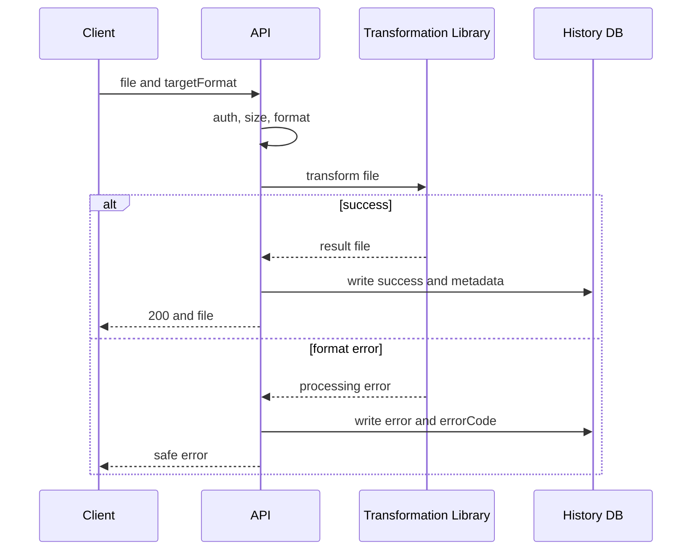
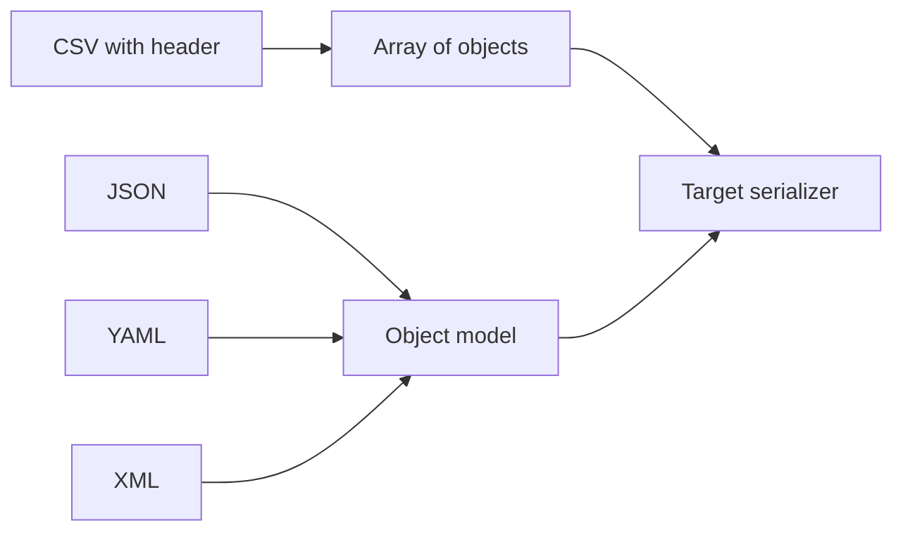
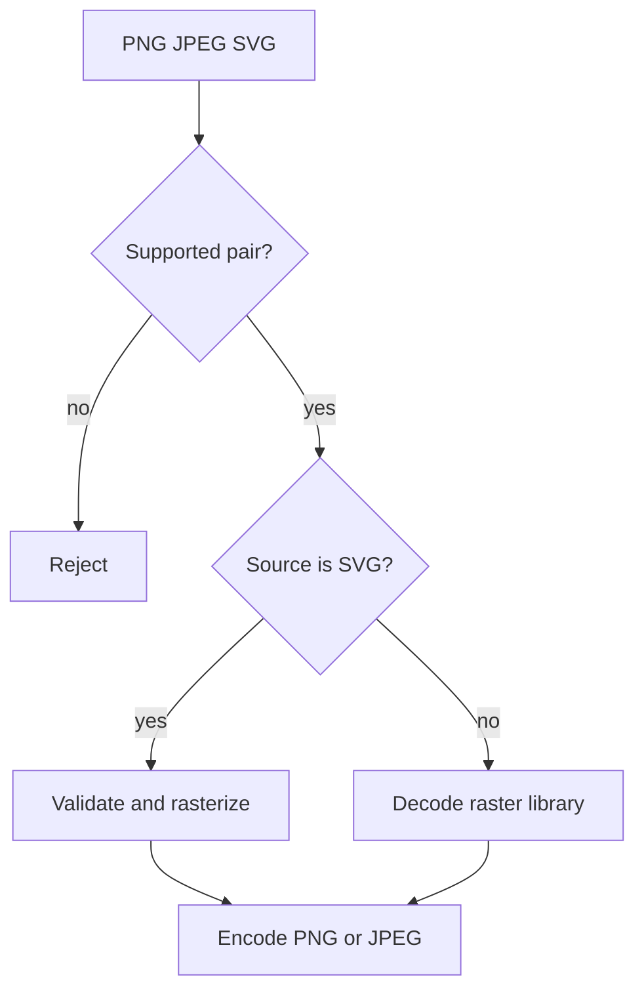

Below is the **complete new Markdown reference for Module 2**.

It includes all five files:

- `2.0 General File Transformation Requirements`
- `2.1 Text Format Transformation`
- `2.2 Image Transformation`
- `2.3 Viewing Transformation History`
- `2.4 Saving Transformation Results to Storage`

It is focused on the **Node.js / TypeScript / NestJS / PostgreSQL / Prisma / TypeORM** route.

Suggested file name:

```text
module-2-file-transformations-node-ts-reference.md
```

---

# Module 2: File Transformation — Node.js/TypeScript Master Reference

**Track:** Node.js / TypeScript / JavaScript Fullstack  
**Included source files:** `2.0`, `2.1`, `2.2`, `2.3`, `2.4`  
**Module status:** Complete, no pending files

This module describes the file and image transformation part of the backend service:

```text
Text transformation
Image transformation
Transformation history
Optional storage saving
Protected download
Retention and user deletion cleanup
```

The module builds on Module 1:

- authentication,
- authorization,
- RBAC,
- safe profile rules,
- user deletion eraser.

---

## Table of Contents

1. [Module Overview](#1-module-overview)
2. [2.0 General File Transformation Requirements](#2-20-general-file-transformation-requirements)
3. [2.1 Text Format Transformation](#3-21-text-format-transformation)
4. [2.2 Image Transformation](#4-22-image-transformation)
5. [2.3 Viewing Transformation History](#5-23-viewing-transformation-history)
6. [2.4 Saving Transformation Results to Storage](#6-24-saving-transformation-results-to-storage)
7. [Cross-Module Integration](#7-cross-module-integration)
8. [Final Study Checklist](#8-final-study-checklist)

---

# 1. Module Overview

## 1.1 What This Module Does

An active user can:

- transform text files,
- transform images,
- view transformation history,
- optionally save successful results,
- download saved results until retention expires.

The server does not implement codecs or parsers manually.

It uses supported libraries and is responsible for:

- authentication,
- authorization,
- validation,
- limits,
- safe errors,
- history metadata,
- temporary file lifecycle,
- storage lifecycle.

---

## 1.2 Main Endpoints

| Endpoint                                                              | Purpose                              | Required Permission            |
| --------------------------------------------------------------------- | ------------------------------------ | ------------------------------ |
| `POST /api/convert`                                                   | Transform text file                  | `transformations@convert`      |
| `GET /api/convert/formats`                                            | List supported text directions       | `transformations@convert`      |
| `POST /api/images/convert`                                            | Transform image                      | `transformations@convert`      |
| `GET /api/images/convert/formats`                                     | List supported image directions      | `transformations@convert`      |
| `GET /api/transformations/history`                                    | Own history                          | `transformations@history`      |
| `GET /admin/users/{userId}/transformations/history`                   | Another user’s history               | `transformations@history_any`  |
| `GET /api/transformations/history/{itemId}/download`                  | Download own saved result            | `transformations@download`     |
| `GET /admin/users/{userId}/transformations/history/{itemId}/download` | Download another user’s saved result | `transformations@download_any` |

---

## 1.3 Transformation Permission Catalog

| Permission                     | Purpose                                             |
| ------------------------------ | --------------------------------------------------- |
| `transformations@convert`      | Start text or image transformation and list formats |
| `transformations@history`      | View own history                                    |
| `transformations@history_any`  | View another user’s history                         |
| `transformations@download`     | Download own saved result                           |
| `transformations@download_any` | Download another user’s saved result                |

During first installation, if the `transformations` permission does not exist yet, the module creates these actions.

Role assignment:

| Role                  | Receives                         |
| --------------------- | -------------------------------- |
| `user`                | `convert`, `history`, `download` |
| `admin`, if it exists | all actions                      |

Repeated bootstrap does not restore removed grants.

If role `user` does not exist, module readiness fails.

---

## 1.4 Core Lifecycle

```text
Client sends file + target format
↓
Authentication checks active user
↓
CSRF check for cross-origin mutating request
↓
RBAC checks transformations@convert
↓
Validate multipart, size, extension, parameters
↓
Choose registered transformer by source + target
↓
Call library
↓
Create complete temporary result
↓
Write history success or error
↓
Return result or safe error
↓
Delete temporary data
```

Important:

The client never receives a partial file.

The result must be fully produced before the HTTP response starts.

---

## 1.5 Main Database Table

Table:

```text
transformations
```

Possible fields:

| Field                | Description                                         |
| -------------------- | --------------------------------------------------- |
| `id`                 | Transformation ID                                   |
| `user_id`            | Owner                                               |
| `type`               | `file` or `image`                                   |
| `source_format`      | Detected source format                              |
| `target_format`      | Requested target format                             |
| `status`             | `success` or `error`                                |
| `input_size`         | Input size in bytes                                 |
| `output_size`        | Output size if success, otherwise `null`            |
| `duration_ms`        | Processing duration                                 |
| `error_code`         | Safe error code if error, otherwise `null`          |
| `created_at`         | UTC start time                                      |
| `completed_at`       | UTC completion time; set for every recorded attempt |
| `storage_status`     | `not_requested`, `pending`, `available`, or `error` |
| `stored_file_key`    | Internal random storage key, otherwise `null`       |
| `stored_file_until`  | Retention expiry, otherwise `null`                  |
| `storage_error_code` | Safe storage error code, otherwise `null`           |

The table is in BCNF.

Important:

History stores metadata only.

It does not store:

```text
file content
parsed data
original file name
temporary path
storage credentials
JWT
cookies
library stack traces
```

---

# 2. 2.0 General File Transformation Requirements

## 2.1 Purpose

Define the common rules for all transformations:

- interface,
- registry,
- history,
- temporary files,
- permanent storage,
- errors,
- user deletion cleanup.

---

## 2.2 Situation

An active user sends a file and chooses a target format.

The server:

- checks access,
- validates input,
- passes the file to a suitable library,
- returns the result,
- stores operation metadata in history.

Possible outcomes:

```text
success
invalid input
library processing error
limit exceeded
dependency unavailable
timeout
```

No separate frontend is needed.

Requests can be sent from an HTTP client with cookies and `multipart/form-data`.

---

## 2.3 Model

The HTTP layer does not contain format-specific algorithms.

It performs common checks and selects a registered transformer by:

```text
source format + target format
```



---

## 2.4 Transformer Registry

Each transformation type implements one common interface.

Inside the implementation, it calls the appropriate library:

```text
CSV parser
XML/YAML serializer
Sharp
resvg-js
other approved tool
```

Conceptual TypeScript interface:

```ts
interface TransformResult {
  contentType: string;
  extension: string;
  size: number;
}

interface FileTransformer {
  transform(
    input: NodeJS.ReadableStream,
    params: TransformParams,
    output: NodeJS.WritableStream,
  ): Promise<TransformResult>;
}
```

The transformer:

- receives input stream,
- receives validated parameters,
- writes to output stream,
- returns content type, extension, and size,
- or returns a safe error code.

The transformer must not:

- check JWT,
- create HTTP responses,
- write history,
- know about storage credentials.

---

## 2.5 Use Libraries, Not Custom Parsers

CSV, YAML, XML, JPEG, PNG, and SVG have many edge cases.

A custom parser or codec can easily fail on:

```text
quoted CSV fields
Unicode
XML entities
color profiles
corrupted data
image orientation
```

Use supported libraries.

The application is responsible for:

```text
library selection
safe configuration
limits
timeout
mapping library errors to HTTP errors
```

---

## 2.6 Streaming

Streaming helps avoid loading a whole large file into one buffer.

It can support backpressure.

But some libraries still need a full document or image model in memory.

Therefore size limits remain mandatory.

Important:

The result is first fully created in a temporary private area.

The client does not receive a partial file if the library fails.

---

## 2.7 History and Audit

History is a user-visible feature.

It contains:

```text
format
status
sizes
duration
safe error code
```

Audit is a technical log.

It is not shown to users.

After each attempt, history stores either:

```text
success
error
```

If history cannot be written:

- the result is not returned,
- temporary data is deleted,
- API returns `503`.

---

## 2.8 Temporary and Permanent Storage

Without:

```text
save=true
```

the result exists only until response completion.

Temporary files:

- are not public,
- are not served by URL,
- are deleted on success, error, or timeout.

Permanent storage is connected through a separate storage interface.

Local disk is acceptable only for single-process development.

Production should use object storage, usually S3-compatible.

---

## 2.9 User Deletion

The transformations module must register an eraser:

```ts
eraseUserData(userId: string, deletionJobId: string): Promise<EraseResult>
```

It must:

- delete saved files,
- delete or anonymize transformation history,
- be idempotent,
- treat missing object as success.

This is required before the module accepts the first user file.

---

## 2.10 General Processing Order

1. Check access JWT.
2. Require user status `active`.
3. For cross-origin mutating request, check `Origin` and CSRF.
4. Check required `transformations@...` permission.
5. If permission missing, return `403` before parsing file.
6. Validate multipart, size, and operation parameters.
7. Detect source format.
8. Find registered source/target pair.
9. Call library.
10. Create temporary result.
11. On success:
    - write history `success`,
    - return file.
12. On error:
    - write history `error`,
    - return safe status.
13. Delete temporary data for every outcome.
14. If history write fails:
    - do not return result,
    - delete temporary data,
    - return `503`.

---

## 2.11 General Errors

| Status | Meaning                                                         |
| ------ | --------------------------------------------------------------- |
| `400`  | Missing file/parameter, corrupted structure, invalid parameters |
| `401`  | Missing/invalid session or user not `active`                    |
| `403`  | Missing required `transformations` permission or CSRF failed    |
| `413`  | Input or output exceeds limit                                   |
| `415`  | Unsupported format or direction                                 |
| `503`  | History DB, temporary area, or required dependency unavailable  |
| `504`  | Library did not finish before timeout                           |

Library messages and partial results are not returned to the client.

---

## 2.12 General Audit

Log:

```text
requestId
transformationId
userId
type
formats
sizes
result
safe errorCode
duration
```

Do not log:

```text
file content
parsed values
original file name
temporary path
JWT
cookies
multipart body
library stack trace
```

---

## 2.13 General Non-Functional Requirements

- Apply format-specific size limits and timeout.
- Return result only as a complete file.
- Heavy library call should not block the whole event loop.
  - Move it to a separate thread or pool if needed.
  - But HTTP response still waits for transformation completion.
- Do not use a separate job queue for the conversion itself.
- History index should cover:
  ```text
  user_id, created_at, id
  ```
- Tests cover:
  - transformer selection,
  - success,
  - error,
  - timeout,
  - history,
  - temporary file cleanup.
- General project requirements and at least 80% test coverage apply.

---

## 2.14 Typical General Mistakes

| Symptom                                           | Cause / Fix                                     |
| ------------------------------------------------- | ----------------------------------------------- |
| Adding a new format requires changing controllers | Use registry/interface                          |
| Large file exhausts memory                        | Missing stream limits or full-file read         |
| Client receives truncated result                  | Response started before transformation finished |
| Successful conversion missing from history        | Metadata write skipped                          |
| File content appears in history                   | Metadata mixed with user data                   |
| Temporary files remain after error                | Cleanup missing in some branches                |
| Library error message exposed                     | Use safe error code                             |

---

# 3. 2.1 Text Format Transformation

## 3.1 Purpose

Transform text files between:

```text
CSV
JSON
XML
YAML
```

All twelve directions between different formats are supported.

Same-format conversion is not supported.

---

## 3.2 Situation

An active user uploads:

```text
CSV
JSON
XML
YAML
```

and chooses another text format.

The server:

- validates file,
- calls parsing library,
- calls serialization library,
- saves operation metadata,
- returns converted file.

Possible outcomes:

```text
success
syntax error
structural error
unsupported format
limit exceeded
timeout
temporary dependency error
```

---

## 3.3 Model

Text libraries work with different internal representations.

The service brings parsed result to a common data structure.



History uses the same `transformations` table.

No additional tables are required.

---

## 3.4 Supported Directions

```text
csv → json
csv → xml
csv → yaml

json → csv
json → xml
json → yaml

xml → csv
xml → json
xml → yaml

yaml → csv
yaml → json
yaml → xml
```

---

## 3.5 Text Contract

### POST `/api/convert`

Multipart fields:

| Field          | Rule                                                      |
| -------------- | --------------------------------------------------------- |
| `file`         | One non-empty `.csv`, `.json`, `.xml`, `.yaml`, or `.yml` |
| `targetFormat` | `csv`, `json`, `xml`, or `yaml`; must differ from source  |
| `save`         | Optional `true` or `false`; rules from `2.4`              |
| Other fields   | Forbidden                                                 |

Logic:

1. Check access JWT and `active`.
2. Check `transformations@convert`.
3. If missing, return `403` before parsing file.
4. Check multipart, extension, MIME, and limit.
5. Parse file using library for declared format.
6. Check whether structure is suitable for target.
7. Serialize result using target library.
8. Write history `success` and return file.
9. On error, write history `error`.

Success response:

```text
200 OK
```

Headers:

```http
Content-Type: correct target MIME
Content-Disposition: attachment; filename="converted.<ext>"
```

Response must not contain:

```text
original content
internal paths
JWT
cookies
stack trace
```

---

## 3.6 CSV Rules

CSV must have a header.

The first line contains:

```text
non-empty
unique
column names
```

Every record must have the same number of fields.

CSV values remain strings.

Do not automatically convert:

```text
001 → 1
"true" → boolean
```

### CSV → JSON/YAML

Result is an array of objects.

Example:

```csv
name,age
Anna,30
```

becomes:

```json
[
  {
    "name": "Anna",
    "age": "30"
  }
]
```

### JSON/YAML → CSV

Accepted structure:

```text
array of flat objects
same keys in every object
```

Nested object or array cannot be unambiguously written into one CSV cell.

Therefore nested values are rejected.

### CSV ↔ XML

Use structure:

```text
rows → row → field name
```

Column name is stored in attribute `name`.

---

## 3.7 JSON Rules

JSON must follow RFC 8259.

Reject:

```text
duplicate object keys
NaN
Infinity
trailing data after root value
```

---

## 3.8 YAML Rules

Use safe loader.

Disable:

```text
user tags
arbitrary object creation
```

JSON ↔ YAML preserves data.

It does not preserve:

```text
comments
original formatting
```

---

## 3.9 XML Rules

XML must be processed safely.

Disable:

```text
DTD
external entities
network access
```

This protects against XXE.

### XML ↔ JSON/YAML Convention

Attributes:

```text
@attribute
```

Text:

```text
#text
```

Repeated elements:

```text
array
```

This convention must be fixed by tests and API documentation.

---

## 3.10 Encoding and Limits

Encoding:

```text
UTF-8
```

BOM is allowed only at the beginning.

Invalid encoding gives:

```text
400
```

Default limits:

| Limit                 | Default    |
| --------------------- | ---------- |
| Input size per format | 10 MiB     |
| Output size           | 50 MiB     |
| Timeout               | 30 seconds |

CSV can be streamed if library supports it.

For JSON, XML, and YAML, input limit protects operations that need full structure in memory.

---

## 3.11 Text Formats Endpoint

### GET `/api/convert/formats`

Requires:

```text
active user
transformations@convert
```

Response:

```json
[
  { "source": "csv", "target": ["json", "xml", "yaml"] },
  { "source": "json", "target": ["csv", "xml", "yaml"] },
  { "source": "xml", "target": ["csv", "json", "yaml"] },
  { "source": "yaml", "target": ["csv", "json", "xml"] }
]
```

---

## 3.12 Node.js CSV Example

```ts
import { parse } from 'csv-parse/sync';

const input = 'name,age\nAnna,30\n';

const rows = parse(input, {
  columns: true,
  skip_empty_lines: true,
});

console.log(JSON.stringify(rows));
```

Output:

```json
[{ "name": "Anna", "age": "30" }]
```

Important:

`age` remains a string because CSV values are strings.

---

## 3.13 Recommended Node.js Libraries

| Format | Library           |
| ------ | ----------------- |
| CSV    | `csv-parse`       |
| XML    | `fast-xml-parser` |
| YAML   | `yaml`            |
| JSON   | built-in `JSON`   |

Use secure configuration.

For XML:

- disable external entities,
- disable DTD,
- disable network access.

For YAML:

- use safe schema/loader.

---

## 3.14 Text Transformation Errors

| Status | Meaning                                                                              |
| ------ | ------------------------------------------------------------------------------------ |
| `400`  | Empty file, invalid syntax/encoding, invalid params, structure unsuitable for target |
| `401`  | Missing/invalid session or user not `active`                                         |
| `403`  | Missing `transformations@convert` or CSRF failed                                     |
| `413`  | Input or output exceeds limit                                                        |
| `415`  | Unsupported source/target or content does not match extension                        |
| `503`  | History or temporary area unavailable                                                |
| `504`  | Processing exceeded timeout                                                          |

---

## 3.15 Text Audit

Log:

```text
userId
transformationId
sourceFormat
targetFormat
sizes
result
safe errorCode
duration
```

Do not log:

```text
content
parsed data
original file name
temporary path
JWT
cookies
multipart body
```

---

## 3.16 Text Non-Functional Requirements

- Use supported libraries, not custom parsers.
- XML must be safe.
- YAML must use safe loader.
- Tests cover:
  - all 12 directions,
  - CSV quotes,
  - Unicode,
  - library errors,
  - limits,
  - timeout.
- General project NFRs and at least 80% coverage apply.

---

## 3.17 Typical Text Mistakes

| Symptom                           | Cause / Fix                                    |
| --------------------------------- | ---------------------------------------------- |
| Field with comma splits into two  | CSV parsed by `split`, not library             |
| `001` becomes `1`                 | Automatic type inference enabled               |
| `[object Object]` appears in CSV  | Nested structure not rejected                  |
| YAML creates application objects  | Unsafe loader                                  |
| XML loads external URL            | DTD/entities not disabled                      |
| JSON detected as YAML by guessing | Use extension and actual parsing               |
| Client receives partial result    | Response started before serialization finished |
| Error reveals document fragment   | Library exception exposed                      |

---

# 4. 2.2 Image Transformation

## 4.1 Purpose

Transform images into:

```text
PNG
JPEG
```

Supported sources:

```text
PNG
JPEG
SVG
```

Supported directions:

```text
png → jpeg
jpeg → png
svg → png
svg → jpeg
```

Not supported:

```text
png → svg
jpeg → svg
same-format conversion
```

PNG/JPEG to SVG is not supported because encoding pixels into an SVG container does not create vector objects.

---

## 4.2 Situation

An active user uploads:

```text
PNG
JPEG
SVG
```

and chooses supported output.

The server:

- validates file and parameters,
- calls graphics library,
- saves operation metadata,
- returns resulting image.

Possible outcomes:

```text
success
unsupported direction
corrupted file
unsafe SVG
size exceeded
processing timeout
dependency unavailable
```

---

## 4.3 Model

The API does not process pixels itself.

PNG and JPEG are passed to a raster library.

SVG is passed to a rasterization library after safe XML validation.



History uses the same `transformations` table with:

```text
type = image
```

No additional tables are needed.

---

## 4.4 Image Contract

### POST `/api/images/convert`

Multipart fields:

| Field          | Rule                                         |
| -------------- | -------------------------------------------- |
| `file`         | One non-empty PNG, JPEG, or SVG              |
| `targetFormat` | `png` or `jpeg`                              |
| `options`      | Optional JSON object as string               |
| `save`         | Optional `true` or `false`; rules from `2.4` |
| Other fields   | Forbidden                                    |

Logic:

1. Check access JWT and `active`.
2. Check `transformations@convert`.
3. If missing, return `403` before parsing file.
4. Check multipart, extension, MIME, and limit.
5. Check direction and options.
6. Pass file and params to chosen library.
7. Check final dimensions.
8. Create temporary result.
9. Write history `success` and return file.
10. On error, write history `error`.

Success response:

```text
200 OK
```

Headers:

```http
Content-Type: image/png or image/jpeg
Content-Disposition: attachment; filename="converted.<ext>"
X-Content-Type-Options: nosniff
```

Response must not contain:

```text
original file name
SVG text
EXIF
internal paths
JWT
cookies
```

---

## 4.5 Image Options

| Field        | Rule                                        |
| ------------ | ------------------------------------------- |
| `quality`    | Integer 1–100, only for JPEG, default 85    |
| `width`      | Integer 1–4096, only for SVG                |
| `height`     | Integer 1–4096, only for SVG                |
| `background` | `#RRGGBB`, only for JPEG, default `#ffffff` |

Unknown or inapplicable option gives:

```text
400
```

For SVG:

- if neither width nor height given, use intrinsic SVG size,
- if no intrinsic size, use `1024×1024`,
- if one dimension given, preserve aspect ratio.

Every output side must not exceed:

```text
4096 pixels
```

Total pixel count must not exceed:

```text
16,777,216
```

---

## 4.6 Raster vs Vector

PNG and JPEG store pixels.

SVG stores geometric commands.

SVG can be rasterized to a given size.

The reverse operation, vectorization, is not part of this assignment.

JPEG does not support transparency.

For:

```text
PNG → JPEG
SVG → JPEG
```

transparent areas are flattened with background.

Default background:

```text
#ffffff
```

PNG preserves alpha.

---

## 4.7 Format Validation

Extension and `Content-Type` are checked together with:

```text
file signature
decoding result
```

Renaming a corrupted file to `.png` does not make it PNG.

Before allocating large buffers, the library must receive limits for:

```text
width
height
pixel count
```

This protects against decompression bombs.

---

## 4.8 Safe SVG

SVG is XML.

It can contain:

```text
scripts
external links
event handlers
foreignObject
external resources
```

Before rasterization, forbid:

```text
DTD
external entities
script
foreignObject
event handlers
external resources
```

The rasterizer must run without network access.

SVG is never returned as target format.

Client receives only:

```text
PNG
JPEG
```

---

## 4.9 Metadata Rules

Apply EXIF orientation before encoding JPEG.

Output file is created anew without:

```text
EXIF
GPS
original file name
```

---

## 4.10 Image Formats Endpoint

### GET `/api/images/convert/formats`

Requires:

```text
active user
transformations@convert
```

Response:

```json
[
  { "source": "png", "target": ["jpeg"] },
  { "source": "jpeg", "target": ["png"] },
  { "source": "svg", "target": ["png", "jpeg"] }
]
```

---

## 4.11 Node.js Sharp Example

```ts
import sharp from 'sharp';

async function main() {
  const png = await sharp({
    create: {
      width: 2,
      height: 1,
      channels: 4,
      background: { r: 255, g: 0, b: 0, alpha: 0.5 },
    },
  })
    .png()
    .toBuffer();

  const info = await sharp(png)
    .flatten({ background: '#ffffff' })
    .jpeg({ quality: 85 })
    .toFile('output.jpeg');

  console.log(`${info.format} ${info.width}x${info.height}`);
}

main();
```

This creates a 2×1 PNG with semi-transparent red, flattens alpha with white background, and encodes JPEG.

---

## 4.12 Recommended Node.js Libraries

| Purpose                | Library    |
| ---------------------- | ---------- |
| PNG/JPEG decode/encode | `sharp`    |
| SVG rasterization      | `resvg-js` |

---

## 4.13 Image Transformation Errors

| Status | Meaning                                                         |
| ------ | --------------------------------------------------------------- |
| `400`  | Corrupted file, invalid options, unsafe SVG, invalid dimensions |
| `401`  | Missing/invalid session or user not `active`                    |
| `403`  | Missing `transformations@convert` or CSRF failed                |
| `413`  | Input or result exceeds limit                                   |
| `415`  | Unsupported format or direction                                 |
| `503`  | History, temporary area, or library unavailable                 |
| `504`  | Processing did not finish within 30 seconds                     |

---

## 4.14 Image Audit

Log:

```text
userId
transformationId
formats
input size
output size
final dimensions
result
safe errorCode
duration
```

Do not log:

```text
image bytes
SVG/XML content
EXIF
original file name
temporary path
JWT
cookies
multipart body
```

---

## 4.15 Image Non-Functional Requirements

- Use supported graphics libraries.
- SVG renderer must have no network access.
- Result must be re-encoded without original metadata.
- Tests cover:
  - all four directions,
  - alpha,
  - EXIF orientation,
  - dimensions,
  - dangerous SVG,
  - limits,
  - timeout.
- General project NFRs and at least 80% coverage apply.

---

## 4.16 Typical Image Mistakes

| Symptom                      | Cause / Fix                                  |
| ---------------------------- | -------------------------------------------- |
| PNG → SVG appears in list    | Extension change is not vectorization        |
| Small file exhausts memory   | Missing pixel limit before decode            |
| SVG loads external URL       | Rasterizer has network or validation missing |
| JPEG rotated incorrectly     | EXIF orientation not applied                 |
| Transparency becomes black   | Background not set before JPEG               |
| `quality` affects PNG        | Options not limited by direction             |
| GPS coordinates remain       | Original file returned without re-encode     |
| Client receives partial JPEG | Response started before library finished     |

---

# 5. 2.3 Viewing Transformation History

## 5.1 Purpose

Return pages of completed text and image transformations.

History contains metadata only.

It does not contain:

```text
file content
email
profile fields
```

---

## 5.2 Situation

An active user requests their own history.

A user with admin permission may request another user’s history.

Possible outcomes:

```text
page returned
invalid filter/cursor rejected
foreign history forbidden
target user not found
rate limit
temporary database error
```

---

## 5.3 History Endpoints

### Own History

```http
GET /api/transformations/history
```

Requires:

```text
active user
transformations@history
```

The `userId` is taken from verified JWT `sub`.

The endpoint does not accept `userId`.

This prevents access to another user’s history by changing query parameters.

---

### Admin History

```http
GET /admin/users/{userId}/transformations/history
```

Requires:

```text
active user
transformations@history_any
```

Permission is checked before searching target user.

Without permission, client receives:

```text
403
```

regardless of whether target user exists.

After permission, missing target user gives:

```text
404
```

---

## 5.4 Query Parameters

| Parameter       | Rule                        |
| --------------- | --------------------------- |
| `cursor`        | Optional next page position |
| `limit`         | Integer 1–100, default 20   |
| `type`          | `file` or `image`           |
| `sourceFormat`  | Supported source format     |
| `targetFormat`  | Supported target format     |
| `status`        | `success` or `error`        |
| `createdAtFrom` | Inclusive UTC boundary      |
| `createdAtTo`   | Exclusive UTC boundary      |

All filters are optional.

If cursor exists, current `limit` and all filters must match the canonical set encoded inside cursor.

Different set gives:

```text
400
```

Client must start a new first page.

---

## 5.5 Sorting and Cursor Pagination

Sorting is always:

```text
created_at DESC, id DESC
```

Offset pagination is not used.

Cursor pagination starts after the last pair:

```text
created_at, id
```

Reason:

`created_at` can be identical for multiple operations.

`id` makes order unambiguous.

Cursor encodes:

```text
version
last createdAt
last id
canonical filter set
limit
```

Encoding:

```text
base64url
```

Cursor does not give rights.

Authentication and RBAC are checked again on every request.

New operations appear before already viewed pages.

They will not appear in current continuation.

They become visible when client requests a new first page.

---

## 5.6 History Response

Success:

```json
{
  "items": [],
  "nextCursor": null
}
```

Each item contains:

```ts
{
  id: string;
  type: 'file' | 'image';
  sourceFormat: string;
  targetFormat: string;
  status: 'success' | 'error';
  inputSize: number;
  outputSize: number | null;
  durationMs: number;
  errorCode: string | null;
  createdAt: string;
  storageStatus: 'not_requested' | 'pending' | 'available' | 'error';
  hasStoredFile: boolean;
  fileExpiresAt: string | null;
}
```

Before storage feature is implemented:

```json
{
  "storageStatus": "not_requested",
  "hasStoredFile": false,
  "fileExpiresAt": null
}
```

Response must not contain:

```text
userId
email
file name
content
temporary path
storage key
```

---

## 5.7 Retention

Default retention:

```text
90 days
```

Configurable.

Background cleanup deletes old records in small batches.

If a record has stored file:

1. Delete storage object first.
2. Then clear/delete history record.

Missing object is treated as already deleted.

User deletion eraser uses same order immediately, without waiting for retention.

---

## 5.8 History Errors

| Status | Meaning                                                                                              |
| ------ | ---------------------------------------------------------------------------------------------------- |
| `400`  | Invalid query, period, or cursor                                                                     |
| `401`  | Missing/invalid session or user not `active`                                                         |
| `403`  | Own history without `transformations@history` or admin history without `transformations@history_any` |
| `404`  | Admin target user not found after permission check                                                   |
| `429`  | History read rate limit exceeded                                                                     |
| `503`  | Database or RBAC unavailable                                                                         |

---

## 5.9 History Audit

Log:

```text
actorUserId
self/admin flag
targetUserId for allowed admin request
filter categories
limit
number of items
result
duration
```

Do not log:

```text
full cursor
file content
email
file names
storage key
JWT
cookies
full response
```

---

## 5.10 History Non-Functional Requirements

- Pagination is mandatory.
- Offset is not used.
- Index covers:
  ```text
  user_id, created_at, id
  ```
- Query selects only response fields and `limit + 1`.
- History read allows max 60 requests per user per minute.
- Next request receives `429`.
- Retention deletes old records in small batches.
- Stored object deletion happens before history row deletion.
- Tests cover:
  - self/admin,
  - identical `createdAt`,
  - cursor,
  - filters,
  - empty page,
  - retention.
- General project NFRs and at least 80% coverage apply.

---

## 5.11 Typical History Mistakes

| Symptom                                      | Cause / Fix                       |
| -------------------------------------------- | --------------------------------- |
| Records repeat between pages                 | Cursor missing `id` tie-breaker   |
| Self sees foreign record                     | `userId` accepted from query      |
| Can check user existence without admin right | Target searched before RBAC       |
| Large pages slow API                         | Missing limit                     |
| Email appears in item                        | Profile joined unnecessarily      |
| Error contains file fragment                 | Library message stored in history |
| Old records not deleted                      | Retention job not running         |

---

# 6. 2.4 Saving Transformation Results to Storage

## 6.1 Purpose

Allow user to explicitly save successful transformation result.

Saved file:

- is private,
- is downloaded only through API,
- is deleted after retention.

---

## 6.2 Situation

User can add:

```text
save=true
```

to transformation request.

Then:

1. Server marks history storage status as `pending`.
2. Server returns converted file immediately.
3. Background task writes object to storage.

Without flag:

```text
result is returned only to client
temporary result is deleted after response
```

Saved file can be downloaded until retention expires.

Self downloads only own result.

Admin downloads result of specified user after separate permission.

---

## 6.3 Save Flag

Applies to:

```text
POST /api/convert
POST /api/images/convert
```

Additional multipart field:

```ts
save?: string
```

Rules:

- missing `save` equals `false`,
- allowed values:
  ```text
  true
  false
  ```
- any other value gives:
  ```text
  400
  ```

---

## 6.4 Logic for save=false

1. Perform normal transformation.
2. Write history `success` without storage key.
3. Return result.
4. Delete temporary file.

Permanent storage is not touched.

---

## 6.5 Logic for save=true

1. Perform normal transformation.
2. Generate random:
   ```text
   stored_file_key
   ```
3. Save copy of result in internal temporary area under this key.
4. Write history:
   ```text
   status = success
   storage_status = pending
   stored_file_key = key
   ```
5. Return file immediately.
6. Do not wait for object storage.

Background task:

1. Reads rows where:
   ```text
   storage_status = pending
   ```
2. Writes object using already known key.
3. Sets:
   ```text
   storage_status = available
   stored_file_until = expiry
   ```

Important:

The key is assigned before response.

Background task writes object by the same key.

Repeat does not create a second file.

---

## 6.6 Partial Storage Failures

If temporary storage copy cannot be created:

- transformed file is still returned,
- history receives:
  ```text
  storage_status = error
  ```

If object storage is temporarily unavailable:

- row remains:
  ```text
  pending
  ```
- task retries writing same key.

Permanent failure or missing temporary copy:

```text
storage_status = error
```

Transformation status remains:

```text
success
```

because converted file was already returned to client.

Transformation status and storage status are separate.

---

## 6.7 Save Response Headers

Successful transformation response includes:

```http
X-Transformation-Id: <id>
X-Save-Status: not_requested | pending | error
```

Final storage state is read from history.

No separate waiting endpoint is needed.

No separate jobs table is needed.

The queue is history rows with:

```text
storage_status = pending
```

---

## 6.8 Self Download

### GET `/api/transformations/history/{itemId}/download`

Checks:

```text
active user
transformations@download
```

Permission is checked before record search.

Without permission:

```text
403
```

After permission:

Record is selected by:

```text
itemId + current userId
```

Foreign, missing, unsaved, error, or expired result gives:

```text
404
```

State:

```text
pending
```

gives:

```text
409 Conflict
```

with code:

```text
file_not_ready
```

Success response:

```text
200 OK
```

Headers:

```http
Content-Type: correct contract type
Content-Disposition: attachment; filename="converted.<ext>"
X-Content-Type-Options: nosniff
```

File is streamed.

If history has key but storage object is missing:

```text
503
```

This is inconsistency, not normal absence.

Create mismatch monitoring event.

---

## 6.9 Admin Download

### GET `/admin/users/{userId}/transformations/history/{itemId}/download`

Checks:

```text
active user
transformations@download_any
```

Permission is checked before searching target user.

After permission:

- missing user gives `404`,
- missing item gives `404`,
- other rules are same as self download.

---

## 6.10 History Item Extension

History item receives:

```ts
storageStatus: 'not_requested' | 'pending' | 'available' | 'error';
hasStoredFile: boolean;
fileExpiresAt: string | null;
```

Rules:

```text
hasStoredFile = true
```

only when:

```text
storageStatus = available
```

Do not expose:

```text
storage key
local path
bucket
internal error code
```

---

## 6.11 Retention and User Deletion

Background retention task:

1. Selects expired saved results in small batches.
2. Calls:
   ```ts
   delete key;
   ```
3. Then clears storage fields in history.

Missing object:

```text
not_found
```

is successful deletion.

User deletion eraser performs same actions immediately for all user records.

---

## 6.12 Storage Adapter

Business logic uses:

```ts
save(key, data);
read(key);
delete key;
```

Local filesystem and S3-compatible storage implement the same interface.

Local disk is suitable only for single-instance development.

Production usually uses object storage available to all API instances.

---

## 6.13 Private Key

Key is generated by server from random value.

It must not contain:

```text
email
userId
original file name
```

Bucket and credentials live in configuration.

Even random key is not authorization.

API always checks:

```text
access JWT
record ownership
download permission
```

---

## 6.14 Storage Errors

| Status | Meaning                                                                                                                          |
| ------ | -------------------------------------------------------------------------------------------------------------------------------- |
| `400`  | `save` is not `true` or `false`                                                                                                  |
| `401`  | Missing/invalid session or user not `active`                                                                                     |
| `403`  | Self download without `transformations@download`, admin download without `transformations@download_any`, or CSRF failed for POST |
| `404`  | User, item, or saved file unavailable after permission check                                                                     |
| `409`  | Saved file still `pending`                                                                                                       |
| `503`  | Database unavailable during download or history points to missing object                                                         |

Storage unavailability:

- does not affect `save=false`,
- does not delay successful response for `save=true`,
- becomes visible in history.

---

## 6.15 Storage Audit

Log:

```text
userId
transformationId
action: save, download, or delete
size
result
duration
```

Do not log:

```text
content
original file name
storage key
path
bucket
credentials
JWT
cookies
full storage response
```

---

## 6.16 Storage Non-Functional Requirements

- Storage adapter supports:
  ```text
  save
  read
  delete
  ```
- Files are private.
- No direct public storage link.
- Background writer reads:
  ```text
  storage_status = pending
  ```
  and writes object by preassigned key.
- Cleanup and user eraser treat:
  ```text
  not_found
  ```
  as success.
- Index covers:
  ```text
  storage_status
  stored_file_until
  ```
- Tests cover:
  - `save=false`,
  - `save=true`,
  - `pending/available/error` transitions,
  - repeat write by same key,
  - self/admin download,
  - IDOR,
  - retention.
- General project NFRs and at least 80% coverage apply.

---

## 6.17 Typical Storage Mistakes

| Symptom                                         | Cause / Fix                                       |
| ----------------------------------------------- | ------------------------------------------------- |
| `save=false` created object                     | Default value handled incorrectly                 |
| `pending` never completes                       | Background task not processing queue              |
| File key visible in response                    | Internal history model serialized directly        |
| Foreign item downloadable                       | Record searched without owner restriction         |
| File available after retention                  | Download does not check expiry                    |
| History deleted but object remains              | Cleanup deletes DB before storage                 |
| Storage failure turns transformation into error | Transformation status and storage status confused |
| Unavailable storage breaks `save=false`         | Adapter called without checking flag              |

---

# 7. Cross-Module Integration

## 7.1 Relation to Module 1

Module 2 depends on Module 1 for:

```text
authentication
authorization
RBAC
user deletion
safe responses
audit rules
```

Important:

Transformations module must register user deletion eraser before accepting first user file.

The eraser must:

```text
delete original files
delete result files
clear or anonymize transformation records
```

Missing object is success.

---

## 7.2 Transformation Operations Are Intentionally Not Idempotent

Each conversion is a separate attempt.

Repeated conversion creates a new history row.

This is correct.

If conversions were forced to be idempotent with `PUT`, users would not see:

```text
repeated failed attempts
separate attempts for same file
```

---

## 7.3 Safe Error Principle

Client receives only safe information.

Never expose:

```text
library stack trace
parsed content
file content
temporary path
storage key
bucket
credentials
internal error text
```

Use stable machine-readable error codes.

---

## 7.4 Storage and User Lifecycle

When user becomes:

```text
deleting
```

access stops immediately.

But transformation eraser may still need to clean objects.

Therefore:

- deletion worker calls transformations eraser,
- eraser deletes objects,
- missing object is success,
- final anonymization happens only after all erasers succeed.

---

## 7.5 Module 2 Endpoint Summary

```text
POST /api/convert
GET /api/convert/formats

POST /api/images/convert
GET /api/images/convert/formats

GET /api/transformations/history
GET /admin/users/{userId}/transformations/history

GET /api/transformations/history/{itemId}/download
GET /admin/users/{userId}/transformations/history/{itemId}/download
```

---

# 8. Final Study Checklist

You should be able to answer these confidently.

---

## General Transformation

1. Why use a transformer interface and registry?
2. Why use libraries instead of custom parsers/codecs?
3. Why does streaming not remove the need for size limits?
4. Why must the result be complete before HTTP response starts?
5. What is the difference between history and audit?
6. What happens if history write fails?
7. Why are temporary files deleted on every outcome?
8. Why must transformations module register a deletion eraser?

---

## Text Transformation

1. Why is CSV not safely parsed by simple `split(',')`?
2. Why should CSV values remain strings?
3. What structure is required to convert JSON/YAML to CSV?
4. Why is YAML safe loader required?
5. Why must XML disable DTD and external entities?
6. Why does extension choose parser, but content still must be parsed?
7. What metadata is stored when transformation fails?

---

## Image Transformation

1. Why is PNG/JPEG to SVG not a normal format conversion?
2. Why use a graphics library instead of manual decoding?
3. Difference between file size limit and pixel count limit?
4. What SVG features must be forbidden?
5. Why must transparency be handled before JPEG?
6. Why apply EXIF orientation and re-encode output?
7. What metadata is stored in history on library error?

---

## History

1. Why does cursor use both `createdAt` and `id`?
2. Why is keyset pagination better than offset for large pages?
3. Why does self endpoint not accept `userId`?
4. Why check admin permission before searching target user?
5. What data belongs to history item, and what belongs only to audit?
6. How do new operations behave during ongoing pagination?
7. In what order are stored file and history record deleted?

---

## Storage

1. Why must `save=false` not touch permanent storage?
2. Why hide storage key even if it is random?
3. Why does `save=true` return result before background storage completes?
4. Difference between transformation status and storage status?
5. How does ownership check protect download from IDOR?
6. Why delete storage object before clearing history reference?
7. Why do storage fields not violate BCNF?

---

## Final Mental Model

For Module 2, remember:

```text
Library does format work.
Server does safety, limits, history, and lifecycle.
History stores metadata only.
Storage is private and protected.
Download repeats authorization.
Cleanup is idempotent.
User deletion erases transformation data.
```

If you can explain:

- how a file is validated,
- how a transformer is selected,
- how history is written,
- how optional storage works,
- how download is protected,
- how retention and deletion clean data,

then you understand Module 2.
