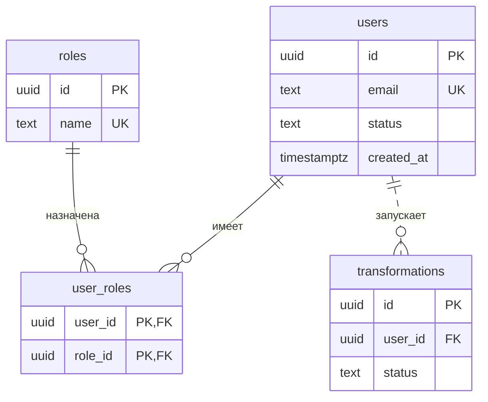

# Базы данных

## Содержание

- [Типы баз данных](#типы-баз-данных)
- [Реляционная модель](#реляционная-модель)
- [Ключи, ограничения и связи](#ключи-ограничения-и-связи)
- [SQL](#sql)
- [Нормальные формы](#нормальные-формы)
- [Транзакции и ACID](#транзакции-и-acid)
- [Индексы](#индексы)
- [Работа с базой из приложения](#работа-с-базой-из-приложения)
- [Типичные ошибки](#типичные-ошибки)
- [Полезные ссылки](#полезные-ссылки)
- [Вопросы по теории](#вопросы-по-теории)

## Типы баз данных

База данных — организованный набор данных. СУБД — программа, которая хранит их, выполняет запросы, проверяет ограничения и разделяет доступ между клиентами. PostgreSQL — СУБД, а `myapp` внутри неё — база данных.

| Тип | Примеры | Когда подходит |
| --- | --- | --- |
| Реляционные: таблицы, схема, связи по ключам, SQL | PostgreSQL, MySQL, SQLite | связанные бизнес-данные с транзакциями: пользователи, роли, история операций |
| Документные: JSON-подобные документы | MongoDB | объект, который читается целиком, без сложных связей |
| Ключ-значение | Redis, Memcached | кеш, счётчики rate limit, данные с TTL |
| Поисковые | Elasticsearch | полнотекстовый поиск. Источник истины остаётся в основной БД |
| Графовые | Neo4j | связи на много уровней: рекомендации, маршруты |

OLTP — много коротких операций с отдельными строками (вход, заказ). OLAP — редкие тяжёлые агрегаты по большим объёмам. PostgreSQL рассчитан на OLTP.

Реляционная БД — выбор по умолчанию для бизнес-данных. Другие типы подключают под задачу, с которой реляционная справляется плохо. В PostgreSQL часть таких задач закрывается расширениями: `jsonb`, полнотекстовый поиск, PostGIS, pgvector.

## Реляционная модель

Данные хранятся в таблицах. Строка описывает один объект, столбец — одно свойство фиксированного типа. Порядок строк не определён: без `ORDER BY` СУБД вправе вернуть их в любом порядке.

| Данные | Тип PostgreSQL | Почему |
| --- | --- | --- |
| идентификатор | `uuid` или `bigint GENERATED ALWAYS AS IDENTITY` | `uuid` можно создать до вставки и он не раскрывает число записей |
| строка | `text` | `varchar(n)` такой же по скорости и только ограничивает длину |
| деньги | `numeric(12, 2)` | `real` и `double precision` дают ошибки округления |
| момент времени | `timestamptz` | хранится в UTC. `timestamp` без зоны не знает часовой пояс |
| документ | `jsonb` | для данных без постоянной структуры. Поля для фильтров и связей — отдельные столбцы |

`NULL` означает «значение неизвестно». Сравнение с `NULL` даёт `NULL`, поэтому проверка пишется как `IS NULL`, а не `= NULL`.

## Ключи, ограничения и связи

- **Первичный ключ** (`PRIMARY KEY`) однозначно определяет строку, уникален и не бывает `NULL`.
- **Естественный ключ** имеет смысл вне системы (`email`), но может меняться. Поэтому первичным делают суррогатный `id`, а для `email` создают `UNIQUE`.
- **Составной ключ** состоит из нескольких столбцов, например `(user_id, role_id)`.
- **Внешний ключ** (`FOREIGN KEY`) ссылается на первичный или уникальный ключ другой таблицы. СУБД не сохранит ссылку на несуществующую строку.

Ограничения проверяет сама СУБД при каждой записи, поэтому их не обойти ни параллельными запросами, ни другим клиентом.

| Ограничение | Что гарантирует |
| --- | --- |
| `NOT NULL` | значение обязательно |
| `UNIQUE` | значение не повторяется. `SELECT` перед `INSERT` без него не защищает от гонки |
| `CHECK` | значение удовлетворяет условию, например `status IN ('active', 'blocked')` |
| `FOREIGN KEY` | ссылка указывает на существующую строку |

При удалении родителя: `RESTRICT` запрещает удаление, пока есть ссылки; `CASCADE` удаляет зависимые строки; `SET NULL` обнуляет ссылку. Каскад подходит для частей, которые не существуют без родителя (попытка подтверждения email). Запрет — для независимых сущностей (роль, которую нельзя удалить, пока она назначена).

| Связь | Как реализуется | Пример |
| --- | --- | --- |
| один к одному | внешний ключ с `UNIQUE` | `user_settings.user_id` |
| один ко многим | внешний ключ на стороне «многих» | `transformations.user_id` |
| многие ко многим | таблица-связка с двумя внешними ключами | `user_roles(user_id, role_id)` |



Концы линии — кратность: `||` ровно один, `|o` ноль или один, `}o` ноль или много. Сплошная линия (`--`) — внешний ключ входит в первичный ключ дочерней таблицы. Пунктир (`..`) — у дочерней таблицы свой `id`.

## SQL

| Группа | Команды | Назначение |
| --- | --- | --- |
| DDL | `CREATE`, `ALTER`, `DROP` | структура: таблицы, индексы, ограничения |
| DML | `SELECT`, `INSERT`, `UPDATE`, `DELETE` | данные |
| TCL | `BEGIN`, `COMMIT`, `ROLLBACK` | транзакции |

```sql
CREATE TABLE users (
  id         uuid PRIMARY KEY DEFAULT gen_random_uuid(),
  email      text NOT NULL UNIQUE,
  status     text NOT NULL CHECK (status IN ('pending', 'active', 'blocked', 'deleting', 'deleted')),
  created_at timestamptz NOT NULL DEFAULT now()
);

CREATE TABLE user_roles (
  user_id uuid REFERENCES users (id) ON DELETE CASCADE,
  role_id uuid REFERENCES roles (id) ON DELETE RESTRICT,
  PRIMARY KEY (user_id, role_id)
);

SELECT r.name, count(*) AS users_count
FROM roles r
JOIN user_roles ur ON ur.role_id = r.id
JOIN users u ON u.id = ur.user_id
WHERE u.status = 'active'
GROUP BY r.name
HAVING count(*) >= 2
ORDER BY users_count DESC;
```

Логический порядок выполнения: `FROM` / `JOIN` → `WHERE` → `GROUP BY` → `HAVING` → `SELECT` → `ORDER BY` → `LIMIT`. Поэтому `WHERE` не видит агрегаты, а `HAVING` фильтрует уже группы.

| JOIN | Результат |
| --- | --- |
| `INNER JOIN` | только строки с парой в обеих таблицах |
| `LEFT JOIN` | все строки левой таблицы; без пары столбцы правой равны `NULL` |
| `FULL JOIN` | все строки обеих таблиц |

Пользователей без ролей находят так: `LEFT JOIN user_roles` и `WHERE user_roles.user_id IS NULL`.

## Нормальные формы

Нормализация убирает дублирование, из-за которого возникают аномалии. В таблице `user_roles_flat(user_id, role_name, email)` с ключом `(user_id, role_name)` email повторяется в каждой строке пользователя:

- **обновление** — при смене email нужно исправить все строки, пропущенная сохранит старый адрес;
- **вставка** — пользователя без ролей сохранить нельзя, потому что `role_name` входит в ключ;
- **удаление** — снятие последней роли удаляет и email.

Функциональная зависимость `A → B` означает, что значение `A` однозначно определяет `B`, например `user_id → email`. Каждая следующая форма включает требования предыдущей.

| Форма | Требование | Нарушение | Исправление |
| --- | --- | --- | --- |
| 1NF | в ячейке одно значение | `users.roles = 'admin,editor'` | отдельная строка на каждую пару в `user_roles` |
| 2NF | неключевой столбец зависит от всего составного ключа | `email` зависит только от `user_id` | `email` хранится в `users` |
| 3NF | неключевой столбец не зависит от другого неключевого | `transformations(id, user_id, user_email)`: `id → user_id → user_email` | email читается из `users` через `JOIN` |
| BCNF | левая часть любой зависимости — ключ | см. пример ниже | разбиение по нарушающей зависимости |
| 4NF | в таблице не смешиваются независимые списки | `user_facts(user_id, role_id, phone)` | `user_roles` и `user_phones` |

**BCNF.** Таблица `mentoring(student, topic, mentor)`: у студента по теме один ментор, каждый ментор ведёт одну тему (`mentor → topic`). Ключи — `(student, topic)` и `(student, mentor)`. 3NF выполняется, потому что все столбцы ключевые, но `mentor` определяет `topic`, не будучи ключом. При смене темы ментора придётся править строки всех его студентов. Разбиение на `mentor_topics(mentor, topic)` и `student_mentors(student, mentor)` убирает аномалию.

На практике схему доводят до 3NF или BCNF. Если все ключи таблицы из одного столбца, 3NF уже означает и более высокие формы.

Денормализация — сознательное дублирование ради скорости чтения, например счётчик пользователей у роли. Каждой копии нужен механизм синхронизации. Цена в строке заказа — не денормализация, а исторический факт, который не должен меняться вместе с ценой товара.

## Транзакции и ACID

Транзакция объединяет несколько операций: применяются либо все, либо ни одна.

```sql
BEGIN;
DELETE FROM user_roles WHERE user_id = $1;
INSERT INTO user_roles (user_id, role_id) VALUES ($1, $2), ($1, $3);
COMMIT;
```

Если любая команда завершится ошибкой, роли останутся прежними.

| Свойство | Смысл |
| --- | --- |
| Atomicity | применяется целиком или не применяется |
| Consistency | после транзакции выполнены все ограничения схемы |
| Isolation | параллельные транзакции влияют друг на друга только в пределах уровня изоляции |
| Durability | зафиксированные данные переживают сбой сервера |

В PostgreSQL по умолчанию Read Committed: повторное чтение той же строки может вернуть другое значение. Repeatable Read и Serializable работают со снимком данных; при конфликте транзакция может получить ошибку сериализации `40001` и должна быть повторена.

Потерянное обновление: две транзакции читают `attempts = 3` и обе записывают `4`, одна попытка теряется. Его предотвращают атомарным `UPDATE ... SET attempts = attempts + 1` или `SELECT ... FOR UPDATE`.

## Индексы

Индекс находит строки без полного просмотра таблицы. Чтение ускоряется, вставка и изменение замедляются.

`PRIMARY KEY` и `UNIQUE` создают индекс автоматически. Внешний ключ — нет, поэтому для `transformations.user_id` его добавляют вручную.

B-tree — тип по умолчанию: `=`, `<`, `>`, `ORDER BY`. Составной индекс работает слева направо: `(user_id, created_at)` ускоряет фильтр по `user_id` и сортировку по дате внутри пользователя, но почти не помогает запросу только по `created_at`.

```sql
CREATE INDEX transformations_user_created_idx
  ON transformations (user_id, created_at DESC, id DESC);

CREATE UNIQUE INDEX deletion_challenges_one_open_idx
  ON deletion_challenges (user_id)
  WHERE consumed_at IS NULL;
```

Второй индекс с условием выражает правило «не больше одной непогашенной попытки на пользователя». `EXPLAIN ANALYZE` показывает план: `Seq Scan` — полный просмотр, `Index Scan` — индекс. Индекс не применяется, если столбец обёрнут функцией или шаблон начинается с `%`.

## Работа с базой из приложения

**ORM** (Prisma, TypeORM, EF Core, SQLAlchemy) связывает таблицы с классами и строит параметризованные запросы. Сгенерированный SQL при разработке смотрят в журнале запросов.

**Миграции** — файлы изменений схемы в репозитории. Отметка о применённых миграциях хранится в базе, поэтому все окружения приходят к одной схеме. Автосинхронизацию моделей с базой (`synchronize` в TypeORM) в production не включают: она может удалить столбец вместе с данными.

**N+1** — один запрос за списком и ещё по запросу на каждый элемент. Связанные данные загружают одним запросом: `JOIN`, `WHERE user_id = ANY($1)`, `include` в Prisma, `relations` в TypeORM, `Include` в EF Core, `selectinload` в SQLAlchemy.

**Пул соединений.** Новое соединение с PostgreSQL дорогое. Пул держит несколько открытых и выдаёт их запросам. Сумма размеров пулов всех экземпляров приложения не должна превышать `max_connections` сервера.

**SQL-инъекции.** Значения передают параметрами и никогда не вставляют в текст запроса.

```javascript
await client.query(`SELECT id FROM users WHERE email = '${email}'`); // уязвимо
await client.query('SELECT id FROM users WHERE email = $1', [email]); // безопасно
```

В .NET параметр обозначается `@email`, в Python — `%s`. ORM параметризует запросы сам, сырой SQL внутри ORM снова требует параметров.

`SELECT *` читает лишние поля и может вернуть клиенту `password_hash`. Столбцы перечисляют явно.

## Типичные ошибки

| Что видно | Причина и исправление |
| --- | --- |
| Роли хранятся строкой `'admin,editor'` | нарушена 1NF, нужна таблица-связка |
| Два пользователя с одним email | уникальность проверена только `SELECT` перед `INSERT`. Нужен `UNIQUE`, конфликт превращают в **409** |
| Список замедляется по мере роста таблицы | нет индекса под фильтр и сортировку |
| `JOIN` по внешнему ключу медленный | PostgreSQL не индексирует внешний ключ автоматически |
| `0.1 + 0.2` даёт `0.30000000000000004` | деньги в `double precision`, нужен `numeric` |
| Время сдвинулось на несколько часов | использован `timestamp` без зоны, нужен `timestamptz` |
| В ответ API попал `password_hash` | `SELECT *` или вся сущность ORM |
| На страницу из 20 элементов уходит 21 запрос | N+1 |
| Счётчик попыток пропускает неверный ввод | потерянное обновление, нужен атомарный `UPDATE` |
| Схема на сервере отличается от локальной | изменения вносились вручную, а не миграциями |

## Полезные ссылки

### Общие

- [PostgreSQL — Tutorial](https://www.postgresql.org/docs/current/tutorial.html) — SQL на примерах: таблицы, запросы, `JOIN`, транзакции.
- [PostgreSQL — Constraints](https://www.postgresql.org/docs/current/ddl-constraints.html) — ключи, `UNIQUE`, `CHECK` и действия при удалении.
- [PostgreSQL — Transaction Isolation](https://www.postgresql.org/docs/current/transaction-iso.html) — уровни изоляции.
- [PostgreSQL — Indexes](https://www.postgresql.org/docs/current/indexes.html) — типы индексов, составные и частичные.
- [Use The Index, Luke](https://use-the-index-luke.com/) — индексы и планы запросов для разработчиков.
- [Wikipedia — Database normalization](https://en.wikipedia.org/wiki/Database_normalization) — определения нормальных форм.
- [OWASP — SQL Injection Prevention](https://cheatsheetseries.owasp.org/cheatsheets/SQL_Injection_Prevention_Cheat_Sheet.html) — параметризованные запросы.
- [Mermaid — Entity Relationship Diagrams](https://mermaid.js.org/syntax/entityRelationshipDiagram.html) — синтаксис ER-диаграмм.

### По языку

#### Node.js

- [Prisma — Relational data modeling](https://www.prisma.io/docs/orm/data-modeling/relational-databases) — связи один к одному, один ко многим и многие ко многим.
- [Prisma — How migrations work](https://www.prisma.io/docs/orm/migrations/how-migrations-work) — миграции схемы.
- [TypeORM — How migrations work?](https://typeorm.io/docs/migrations/why/) — миграции и почему `synchronize` небезопасен в production.
- [node-postgres — Queries](https://node-postgres.com/features/queries) — параметризованные запросы в `pg`.

#### .NET

- [EF Core — Relationships](https://learn.microsoft.com/en-us/ef/core/modeling/relationships) — связи и внешние ключи.
- [EF Core — Migrations](https://learn.microsoft.com/en-us/ef/core/managing-schemas/migrations/) — миграции схемы.
- [Npgsql — Basic usage](https://www.npgsql.org/doc/basic-usage.html) — подключение к PostgreSQL и параметры запросов.
- [IEnumrable and IQueryable in C#](https://www.c-sharpcorner.com/article/ienumrable-and-iqueryable-in-c-sharp)

#### Python

- [SQLAlchemy — ORM Quick Start](https://docs.sqlalchemy.org/en/20/orm/quickstart.html) — модели, связи и запросы.
- [Alembic — Tutorial](https://alembic.sqlalchemy.org/en/latest/tutorial.html) — миграции схемы.
- [psycopg — Passing parameters](https://www.psycopg.org/psycopg3/docs/basic/params.html) — параметры запросов.

## Вопросы по теории

1. Почему пользователей, роли и историю операций хранят в реляционной базе, а для счётчиков rate limit подходит хранилище ключ-значение?
2. Какие аномалии возникают в таблице `user_roles_flat(user_id, role_name, email)` и какую нормальную форму она нарушает?
3. Чем 3NF отличается от BCNF и как выглядит таблица, которая находится в 3NF, но не в BCNF?
4. Почему проверка через `SELECT` перед `INSERT` не защищает от двух пользователей с одним email?
5. Как не потерять неверную попытку ввода кода при двух параллельных запросах?
6. Почему индекс `(user_id, created_at)` ускоряет историю одного пользователя, но не поиск только по дате?
7. Как обнаружить проблему N+1 и как загрузить связанные данные одним запросом?
