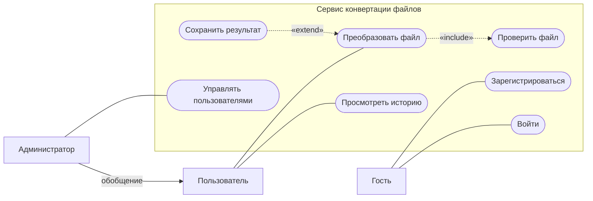
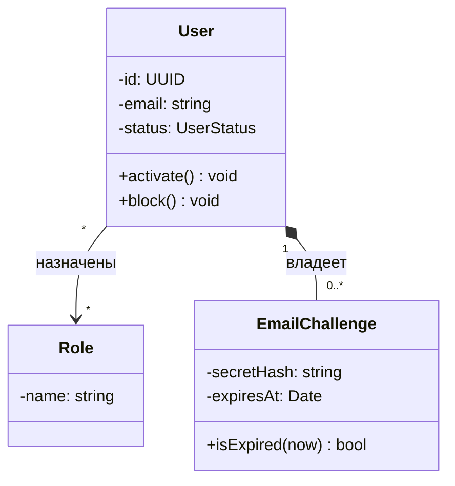
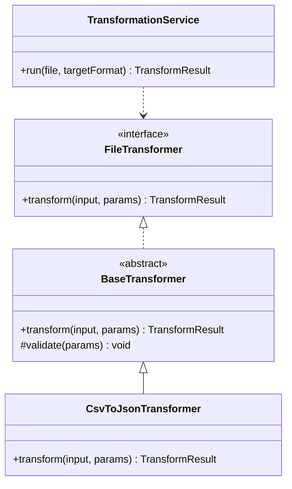
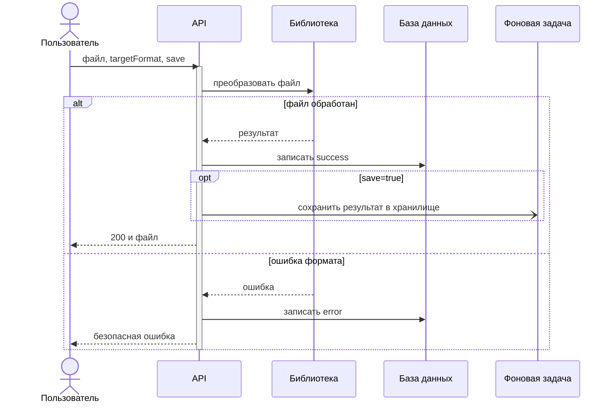
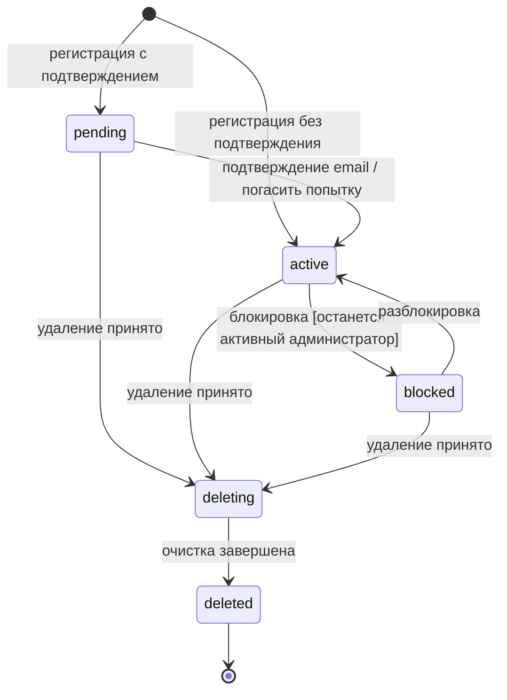
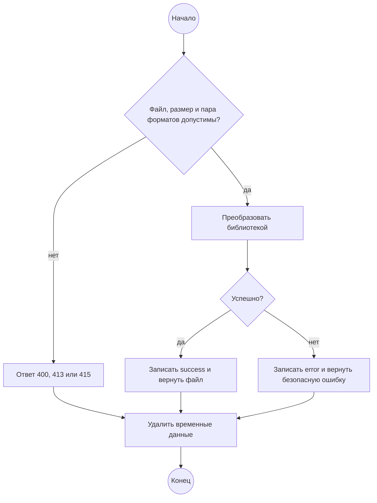
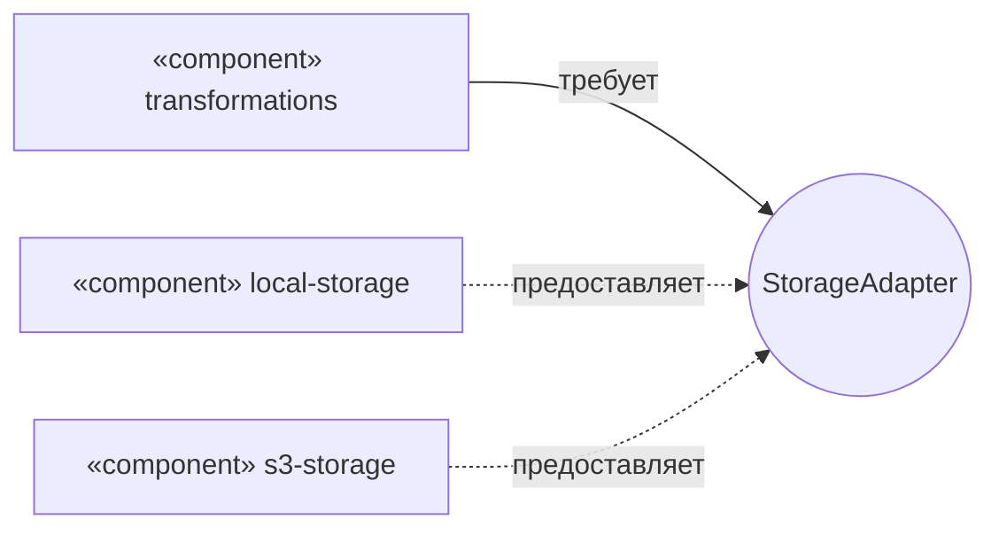
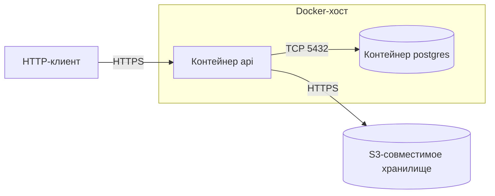

# UML-диаграммы

## Содержание

- [Что такое UML](#что-такое-uml)
- [Какую диаграмму выбрать](#какую-диаграмму-выбрать)
- [Общая нотация](#общая-нотация)
- [Диаграмма вариантов использования](#диаграмма-вариантов-использования)
- [Диаграмма классов](#диаграмма-классов)
- [Диаграмма последовательности](#диаграмма-последовательности)
- [Диаграмма состояний](#диаграмма-состояний)
- [Диаграмма деятельности](#диаграмма-деятельности)
- [Диаграммы компонентов и развёртывания](#диаграммы-компонентов-и-развёртывания)
- [Диаграммы как код](#диаграммы-как-код)
- [Типичные ошибки](#типичные-ошибки)
- [Полезные ссылки](#полезные-ссылки)
- [Вопросы по теории](#вопросы-по-теории)

## Что такое UML

UML (Unified Modeling Language) — графический язык для описания структуры и поведения системы. Актуальная версия — UML 2.5.1. Каждая диаграмма показывает один аспект: из каких частей состоит система, как части взаимодействуют или как меняется состояние объекта.

В бэкенде UML используют как эскиз: договориться о сценарии, данных и границах модулей, затем задокументировать решение. Полные формальные модели с генерацией кода встречаются редко.

| Структурные | Поведенческие |
| --- | --- |
| **классов** | **вариантов использования** |
| **компонентов** | **деятельности** |
| **развёртывания** | **состояний** |
| пакетов, объектов | **последовательности** |

Жирным выделены диаграммы, которые чаще всего нужны в бэкенде. Схема таблиц — это ER-диаграмма, она не входит в UML; нотация разобрана в `0.1 Базы данных.md`.

## Какую диаграмму выбрать

| Вопрос | Диаграмма | Mermaid |
| --- | --- | --- |
| Кто пользуется системой и каких целей достигает? | вариантов использования | нет, приближение через `flowchart` |
| Из каких классов и интерфейсов состоит модуль? | классов | `classDiagram` |
| Как запрос проходит между клиентом, API, базой и внешними сервисами? | последовательности | `sequenceDiagram` |
| Какие статусы есть у сущности и какие переходы разрешены? | состояний | `stateDiagram-v2` |
| Какие шаги и ветвления у процесса? | деятельности | приближение через `flowchart` |
| Из каких частей состоит система и через какие интерфейсы они связаны? | компонентов | приближение через `flowchart` |
| На каких серверах и в каких контейнерах всё запущено? | развёртывания | приближение через `flowchart` |

## Общая нотация

- **Стереотип** в «ёлочках» уточняет вид элемента: `«interface»`, `«include»`. В Mermaid записывается как `<<interface>>`.
- **Кратность:** `1` — ровно один, `0..1` — ноль или один, `*` — любое количество, `1..*` — хотя бы один.
- **Видимость:** `+` public, `-` private, `#` protected, `~` package.

## Диаграмма вариантов использования

Показывает, кто взаимодействует с системой и каких целей достигает, без деталей реализации.

| Элемент | Изображение | Смысл |
| --- | --- | --- |
| Актор | человечек | внешняя роль: человек или другая система |
| Вариант использования | овал | цель актора, формулируется глаголом: «Преобразовать файл» |
| Граница системы | прямоугольник вокруг овалов | что входит в систему |
| `«include»` | пунктир от базового варианта к включаемому | включаемый вариант выполняется всегда |
| `«extend»` | пунктир от расширения к базовому | расширение выполняется только при условии |
| Обобщение | сплошная линия с полым треугольником у общего элемента | администратор может всё, что может пользователь |

Mermaid эту диаграмму не поддерживает, поэтому актор изображён прямоугольником, а вариант использования — скруглённой фигурой:

Преобразование всегда включает проверку файла. Сохранение в хранилище расширяет его только при `save=true`.

## Диаграмма классов

Показывает классы и интерфейсы, их поля, методы и связи. Класс рисуется прямоугольником из трёх секций: имя, атрибуты, операции. Атрибут: `видимость имя: тип`. Операция: `видимость имя(параметры): тип`.

| Связь | Смысл | Изображение |
| --- | --- | --- |
| Ассоциация | объекты связаны долговременно | сплошная линия |
| Агрегация | целое и части, части существуют отдельно | полый ромб у целого |
| Композиция | части не существуют без целого | закрашенный ромб у целого |
| Обобщение | наследование, «является» | полый треугольник у родителя |
| Реализация | класс реализует интерфейс | пунктир, полый треугольник у интерфейса |
| Зависимость | временное использование | пунктирная стрелка |

В Mermaid: `-->` ассоциация, `o--` агрегация, `*--` композиция, `<|--` обобщение, `<|..` реализация, `..>` зависимость.

Попытки подтверждения email не существуют без пользователя — это композиция. Роль живёт отдельно от пользователя — ассоциация.

Структура преобразователей из `2.0 Общие требования к трансформации файлов.md`:

В TypeScript обобщение записывается через `extends`, реализация — через `implements`. В C# обе связи — через двоеточие. В Python класс наследует абстрактный базовый класс из модуля `abc`.

## Диаграмма последовательности

Показывает обмен сообщениями во времени. Время идёт сверху вниз, у каждого участника есть вертикальная линия жизни.

| Элемент | Изображение | Mermaid |
| --- | --- | --- |
| Синхронное сообщение | сплошная линия, закрашенная стрелка, отправитель ждёт | `A->>B: текст` |
| Ответ | пунктир | `B-->>A: текст` |
| Асинхронное сообщение | открытая стрелка, отправитель не ждёт | `A-)B: текст` |
| Фрагмент | рамка: `alt` ветвление, `opt` необязательная часть, `loop` цикл | `alt условие` … `else` … `end` |

API синхронно ждёт библиотеку и запись истории. Сохранение уходит фоновой задаче асинхронно, поэтому ответ пользователю не ждёт хранилища.

## Диаграмма состояний

Показывает, в каких состояниях бывает объект и какие события переводят его из одного состояния в другое. Переход подписывают как `событие [условие] / действие`.

Жизненный цикл пользователя по `1.0`, `1.5` и `1.6`:

Перехода, которого на диаграмме нет (из `deleted` в `active`), сервер не выполняет. В контракте изменения пользователя такой запрос получает **409**.

## Диаграмма деятельности

Показывает порядок действий процесса: ветвления, слияния и параллельные ветки. В отличие от диаграммы последовательности, здесь важны шаги, а не участники и сообщения.

Решение рисуется ромбом, параллельные ветки — толстой чертой (fork / join), дорожки (swimlanes) показывают, кто выполняет действие. Mermaid эту диаграмму не поддерживает, ближайшая замена — `flowchart`.

## Диаграммы компонентов и развёртывания

Диаграмма компонентов показывает крупные части системы и интерфейсы между ними. Компонент предоставляет интерфейс («леденец») или требует его («гнездо»). Компонент можно заменить любой другой реализацией того же интерфейса.

Модуль преобразований зависит только от интерфейса хранилища, поэтому локальный диск и S3 подключаются без изменения его кода.

Диаграмма развёртывания показывает узлы (серверы, контейнеры), размещённые на них артефакты и каналы связи.

## Диаграммы как код

Текстовые диаграммы хранят в репозитории рядом с кодом: изменения видны в ревью и в истории Git.

| Инструмент | Особенности |
| --- | --- |
| Mermaid | блоки `mermaid` отображаются в GitHub, Notion и Obsidian. Есть последовательность, классы, состояния, ER и `flowchart`. Нет вариантов использования, компонентов, развёртывания и деятельности в UML-нотации |
| PlantUML | полный набор UML-диаграмм, для отображения нужен сервер или плагин IDE |
| draw.io | ручное рисование, файл `.drawio` можно хранить в репозитории |

## Типичные ошибки

| Ошибка | Как правильно |
| --- | --- |
| Треугольник наследования у наследника | треугольник всегда у родителя или интерфейса |
| Композиция и агрегация выбраны наугад | часть удаляется вместе с целым — композиция, живёт отдельно — агрегация |
| Ответ нарисован сплошной линией | ответ — пунктир, асинхронное сообщение — открытая стрелка |
| На одной диаграмме все сценарии и классы системы | одна диаграмма отвечает на один вопрос |
| Вариант использования: «Нажать кнопку» | вариант использования — цель актора: «Преобразовать файл» |
| Стрелка `«include»` от включаемого варианта | `«include»` от базового к включаемому, `«extend»` — от расширения к базовому |
| Код разрешает переход, которого нет на диаграмме состояний | проверки в коде совпадают с диаграммой |

## Полезные ссылки

- [OMG — UML 2.5.1](https://www.omg.org/spec/UML/2.5.1/) — официальная спецификация.
- [uml-diagrams.org](https://www.uml-diagrams.org/) — справочник по видам диаграмм и нотации.
- [Martin Fowler — UML Distilled](https://martinfowler.com/books/uml.html) — практическое применение UML.
- [Mermaid — Sequence diagrams](https://mermaid.js.org/syntax/sequenceDiagram.html) — участники, сообщения, фрагменты.
- [Mermaid — Class diagrams](https://mermaid.js.org/syntax/classDiagram.html) — классы, связи, кратность.
- [Mermaid — State diagrams](https://mermaid.js.org/syntax/stateDiagram.html) — состояния и переходы.
- [Mermaid — Flowcharts](https://mermaid.js.org/syntax/flowchart.html) — фигуры для диаграмм, которых нет в Mermaid.
- [Mermaid Live Editor](https://mermaid.live/) — проверка диаграммы в браузере.
- [PlantUML](https://plantuml.com/) — все виды UML-диаграмм в текстовом формате.

## Вопросы по теории

1. Чем структурные диаграммы отличаются от поведенческих? Приведите по два примера каждого вида.
2. Как отличить агрегацию от композиции и какая из них описывает связь пользователя с попытками подтверждения email?
3. Чем синхронное сообщение отличается от асинхронного и почему сохранение результата в хранилище на диаграмме асинхронное?
4. Как диаграмма состояний пользователя помогает определить, какие запросы API должны завершаться **409**?
5. Чем `«include»` отличается от `«extend»` и куда направлены их стрелки?
6. Когда процесс описывают диаграммой деятельности, а когда — диаграммой последовательности?
7. Почему схему базы данных обычно рисуют ER-диаграммой, а не диаграммой классов?
