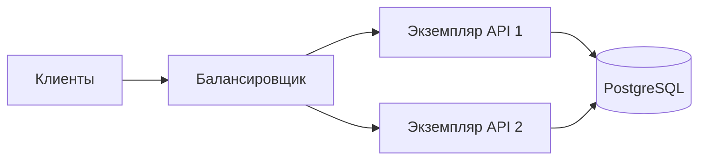
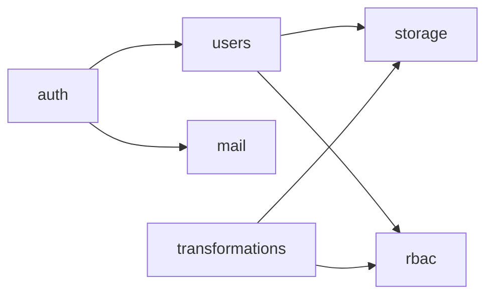
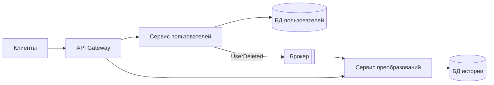
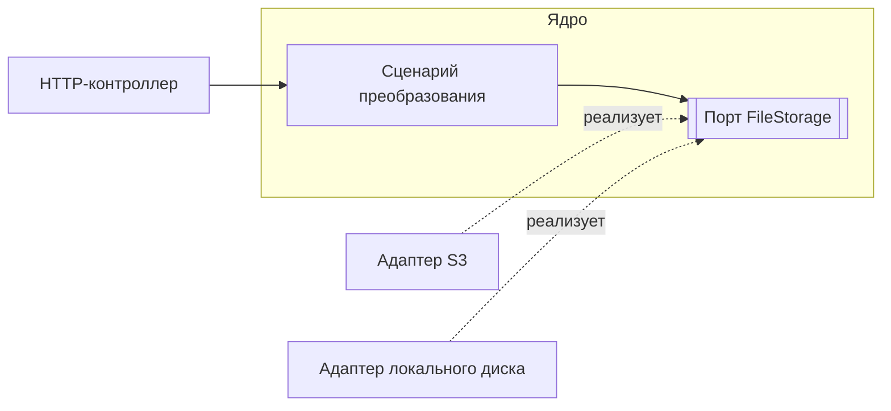

# Архитектуры Back End

## Содержание

- [Два уровня архитектуры](#два-уровня-архитектуры)
- [Монолит](#монолит)
- [Модульный монолит](#модульный-монолит)
- [Микросервисы](#микросервисы)
- [SOA](#soa)
- [Serverless](#serverless)
- [События, CQRS](#события-cqrs)
- [Архитектура внутри приложения](#архитектура-внутри-приложения)
- [Сравнение](#сравнение)
- [Как выбирать](#как-выбирать)
- [Типичные ошибки](#типичные-ошибки)
- [Полезные ссылки](#полезные-ссылки)
- [Вопросы по теории](#вопросы-по-теории)

## Два уровня архитектуры

Системный уровень определяет, из скольких независимо развёртываемых частей состоит система: монолит, микросервисы, SOA, serverless. Уровень приложения определяет, как организован код внутри одной такой части: модули, слои, порты и адаптеры.

Проект курса — монолит. Код делится на модули по бизнес-функциям (`auth`, `users`, `rbac`, `transformations`, `storage`), а каждый модуль — на слои.

## Монолит

Всё приложение собирается в один артефакт и запускается как один процесс с одной базой данных. Модули вызывают друг друга обычными вызовами функций, без сети.

| Плюсы | Минусы |
| --- | --- |
| один репозиторий, одна сборка, один деплой | любое изменение требует пересборки всего приложения |
| вызовы между модулями быстрые и не теряются | без явных границ код срастается |
| одна транзакция охватывает данные любых модулей | ошибка в одном модуле останавливает весь процесс |
| просто запускать локально | нагруженную часть нельзя масштабировать отдельно |

Монолит масштабируется горизонтально целиком: несколько одинаковых экземпляров работают за балансировщиком. Это работает, только если экземпляр не хранит состояние в памяти процесса или на локальном диске. В курсе эту задачу решают JWT без серверных сессий и объектное хранилище вместо локального диска в production.

Подходит для MVP, небольших команд и большинства проектов на старте.

## Модульный монолит

Один процесс и один деплой, но код разделён на модули по бизнес-функциям:

- модуль открывает другим только публичный API. В NestJS это провайдеры из `exports`;
- модуль владеет своими таблицами, другие модули получают данные только через его API;
- зависимости направлены в одну сторону и не образуют циклов;
- общий код без бизнес-логики (конфигурация, логирование) выносится отдельно.

Стрелка означает «вызывает публичный API». Взаимный вызов `users` и `rbac` говорит о неудачных границах: общую часть выносят в отдельный модуль или заменяют вызов событием.

При росте нагрузки или команды модуль выносится в отдельный сервис: вызов внутри процесса заменяется сетевым, а владение таблицами уже разделено.

## Микросервисы

Система состоит из небольших сервисов. Каждый отвечает за одну бизнес-функцию, развёртывается независимо и владеет своей базой (database per service). Общение — по HTTP, gRPC или через брокер сообщений. Клиенты ходят в API Gateway: маршрутизация, проверка токенов, ограничение частоты.

После удаления пользователя сервис пользователей публикует `UserDeleted`. Сервис преобразований получает событие и удаляет свою историю. Общей транзакции у них нет.

| Плюсы | Минусы |
| --- | --- |
| сервисы масштабируются и выкладываются независимо | сетевой вызов медленнее и может не пройти |
| отказ одного сервиса не обязательно останавливает остальные | данные согласуются с задержкой |
| у каждой команды свой цикл релизов | нужны оркестрация, трассировка, мониторинг |
| каждый сервис может использовать свой стек | отладка сложнее, чем в одном процессе |

- **Saga** — операция из локальных транзакций разных сервисов. Неудачный шаг отменяется компенсирующим действием: при сбое бронирования возвращается списанная оплата.
- **Распределённый монолит** — сервисы, которые выкладываются только вместе или работают с общей базой. Сочетает минусы обоих подходов.
- **Закон Конвея.** Структура системы повторяет структуру коммуникаций в организации. Микросервисы окупаются, когда над системой работают несколько независимых команд.

Подходит для крупных систем и частей с сильно различающейся нагрузкой.

## SOA

Сервис-ориентированная архитектура — предшественник микросервисов. Сервисы крупные (клиенты, счета, склад) и переиспользуются разными приложениями. Связывает их корпоративная шина (ESB): маршрутизация, преобразование форматов, часто и бизнес-логика. Обмен обычно идёт по SOAP.

Главное отличие от микросервисов — где лежит логика интеграции. В SOA она в шине, которая становится узким местом. Микросервисы следуют принципу «умные сервисы, простые каналы»: логика в сервисах, брокер только доставляет сообщения.

Новые проекты SOA почти не выбирают. Подходит для интеграции унаследованных корпоративных систем.

## Serverless

Код оформляется как функции, которые облако запускает в ответ на события: HTTP-запрос, загрузка файла, сообщение в очереди, расписание. Серверы и масштабирование берёт на себя провайдер (AWS Lambda, Azure Functions, Yandex Cloud Functions). Оплата — за число вызовов и время выполнения. Модель называют FaaS.

| Плюсы | Минусы |
| --- | --- |
| нет серверов, которые нужно настраивать | холодный старт после простоя |
| масштабирование без настройки | ограничение времени, у AWS Lambda — 15 минут |
| при редких вызовах дешевле постоянно работающего сервера | при постоянной высокой нагрузке обычно дороже |
| быстрая выкладка отдельной функции | привязка к провайдеру, сложнее локальная отладка |

Функция не хранит состояние между вызовами. Сотни параллельных экземпляров исчерпывают `max_connections` PostgreSQL, если каждый открывает своё соединение, поэтому между функциями и базой ставят пул (PgBouncer, Amazon RDS Proxy).

Подходит для вебхуков, обработки загруженных файлов, задач по расписанию и редких пиков нагрузки.

## События, CQRS

Компонент публикует событие («пользователь удалён»), подписчики реагируют независимо. Отправитель не знает получателей и не ждёт результата. Подход используется и внутри монолита (фоновые задачи), и между сервисами.

Брокеры обычно доставляют сообщение хотя бы один раз, поэтому обработчик должен быть идемпотентным: повтор не меняет результат. Подробнее это разобрано в `0.4 Идемпотентность.md`. Если записать данные в базу, а затем отправить событие, сбой между шагами потеряет событие. Transactional outbox записывает событие в таблицу в той же транзакции, что и данные; отдельный процесс доставляет его в брокер. Задание удаления пользователя из `1.6` хранится в базе по той же причине.

**CQRS** разделяет модели записи и чтения. Команды меняют состояние и проверяют правила, запросы только читают данные в удобной форме. В простом варианте обе модели работают с одной базой. Отдельное хранилище для чтения нужно, когда нагрузка или форма данных сильно различаются. Для обычного CRUD CQRS только добавляет код. Это паттерн модуля, а не способ развёртывания: его применяют и внутри монолита.

## Архитектура внутри приложения

### Слои

| Слой | Отвечает за | Пример в NestJS |
| --- | --- | --- |
| Представление | HTTP: маршруты, DTO, валидация, статусы | `UsersController` |
| Бизнес-логика | сценарии, правила, транзакции | `UsersService` |
| Доступ к данным | SQL или ORM | репозиторий TypeORM, Prisma Client |

Зависимости направлены только вниз. Контроллер не обращается к базе напрямую. Сервис ничего не знает об HTTP: не выбирает статус ответа и не читает cookies. Поэтому один сервис вызывают из контроллера, фоновой задачи или теста. В ASP.NET Core и FastAPI слои те же.

### Порты и адаптеры

Гексагональная архитектура развивает ту же идею. В центре — ядро со сценариями. Ядро объявляет интерфейсы (порты) для хранилища, почты, базы; инфраструктура реализует их адаптерами. Ядро не импортирует ни SDK хранилища, ни ORM.

Конкретный адаптер подставляет механизм внедрения зависимостей: провайдеры в NestJS, `IServiceCollection` в ASP.NET Core, `Depends` в FastAPI. Так в курсе подключаются хранилище файлов и преобразователи форматов.

Для простого CRUD полная гексагональная структура избыточна. Практичный компромисс — слои внутри модулей и интерфейсы только на границах с внешними системами.

## Сравнение

| Стиль | Развёртывание | Данные | Сложность | Подходит для |
| --- | --- | --- | --- | --- |
| Монолит | одно приложение | одна база | низкая | MVP, небольшие команды |
| Модульный монолит | одно приложение, изолированные модули | одна база, таблицы закреплены за модулями | низкая | большинство новых проектов |
| Микросервисы | много сервисов | своя база у каждого | высокая | крупные системы, несколько команд |
| SOA | крупные сервисы и шина | часто общие базы | высокая | интеграция унаследованных систем |
| Serverless | отдельные функции | внешняя база и хранилище | средняя | событийная и неравномерная нагрузка |

## Как выбирать

1. Начинать с модульного монолита: он быстро разрабатывается и не закрывает путь к сервисам.
2. Выносить модуль в отдельный сервис только по конкретной причине: его нагрузка растёт независимо, над ним работает отдельная команда, нужен свой цикл релизов.
3. Serverless — для эпизодических задач вокруг основной системы: вебхуки, обработка файлов, расписание.
4. CQRS — точечно, там, где чтение и запись сильно расходятся.

## Типичные ошибки

| Что видно | Причина и исправление |
| --- | --- |
| Бизнес-логику нельзя проверить без HTTP-запроса | логика в контроллере, её переносят в сервис |
| Модуль выполняет SQL к таблицам другого модуля | данные получают через публичный API модуля |
| Модули импортируют друг друга по кругу | неудачные границы, общую часть выделяют или заменяют вызов событием |
| Микросервисы выкладываются только вместе | распределённый монолит: общая база или жёстко связанные контракты |
| Отказ одного сервиса останавливает цепочку | нет таймаутов, часть вызовов стоит заменить событиями |
| Второй экземпляр API отвечает иначе, чем первый | состояние в памяти процесса, его переносят в базу или кеш |
| Повторная доставка события выполнила действие дважды | обработчик не идемпотентен |
| Serverless-функции исчерпали соединения с базой | каждая функция открывает своё соединение, нужен пул |

## Полезные ссылки

### Общие

- [Martin Fowler — Microservices](https://martinfowler.com/articles/microservices.html) — определение и характеристики микросервисов.
- [Martin Fowler — MonolithFirst](https://martinfowler.com/bliki/MonolithFirst.html) — почему проект начинают с монолита.
- [Martin Fowler — Serverless Architectures](https://martinfowler.com/articles/serverless.html) — устройство и компромиссы serverless.
- [Martin Fowler — CQRS](https://martinfowler.com/bliki/CQRS.html) — когда разделение моделей оправдано.
- [microservices.io — Patterns](https://microservices.io/patterns/) — Saga, Database per service, API Gateway, Transactional outbox.
- [Alistair Cockburn — Hexagonal Architecture](https://alistair.cockburn.us/hexagonal-architecture) — порты и адаптеры.
- [The Twelve-Factor App](https://12factor.net/ru/) — приложение без состояния, которое можно запускать в нескольких экземплярах.

### По языку

#### Node.js

- [NestJS — Modules](https://docs.nestjs.com/modules) — границы модулей, `imports` и `exports`.
- [NestJS — Custom providers](https://docs.nestjs.com/fundamentals/custom-providers) — подмена реализации интерфейса через DI.
- [NestJS — Microservices](https://docs.nestjs.com/microservices/basics) — транспорты для взаимодействия сервисов.

#### .NET

- [Microsoft — Common web application architectures](https://learn.microsoft.com/en-us/dotnet/architecture/modern-web-apps-azure/common-web-application-architectures) — монолит, слои и чистая архитектура в ASP.NET Core.
- [.NET — Dependency injection](https://learn.microsoft.com/en-us/dotnet/core/extensions/dependency-injection/overview) — регистрация реализаций интерфейсов.

#### Python

- [FastAPI — Bigger Applications](https://fastapi.tiangolo.com/tutorial/bigger-applications/) — разделение приложения на модули с `APIRouter`.
- [FastAPI — Dependencies](https://fastapi.tiangolo.com/tutorial/dependencies/) — внедрение зависимостей.
- [Cosmic Python](https://www.cosmicpython.com/) — репозиторий, unit of work и события на Python.

## Вопросы по теории

1. Почему монолит можно масштабировать горизонтально и что мешает запустить второй экземпляр приложения?
2. Чем модульный монолит отличается от обычного и какие правила не дают модулям срастись?
3. Почему у каждого микросервиса своя база данных и как согласовать данные нескольких сервисов без общей транзакции?
4. Что произойдёт, если брокер доставит событие повторно, а обработчик не идемпотентен?
5. В каких задачах serverless дешевле постоянно работающего сервера, а в каких дороже?
6. Чем CQRS отличается от разделения на микросервисы и обязательна ли для него отдельная база для чтения?
7. Почему в гексагональной архитектуре интерфейс хранилища принадлежит ядру, а реализация S3 — адаптеру?
