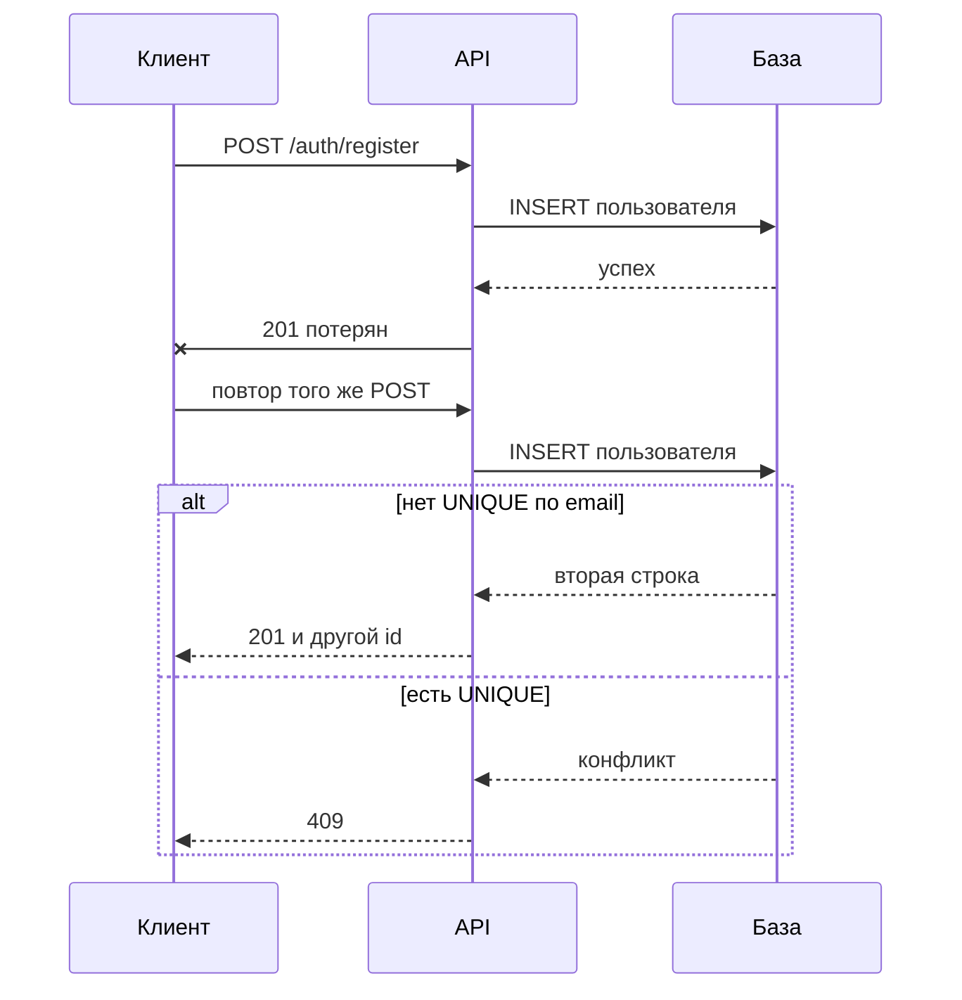
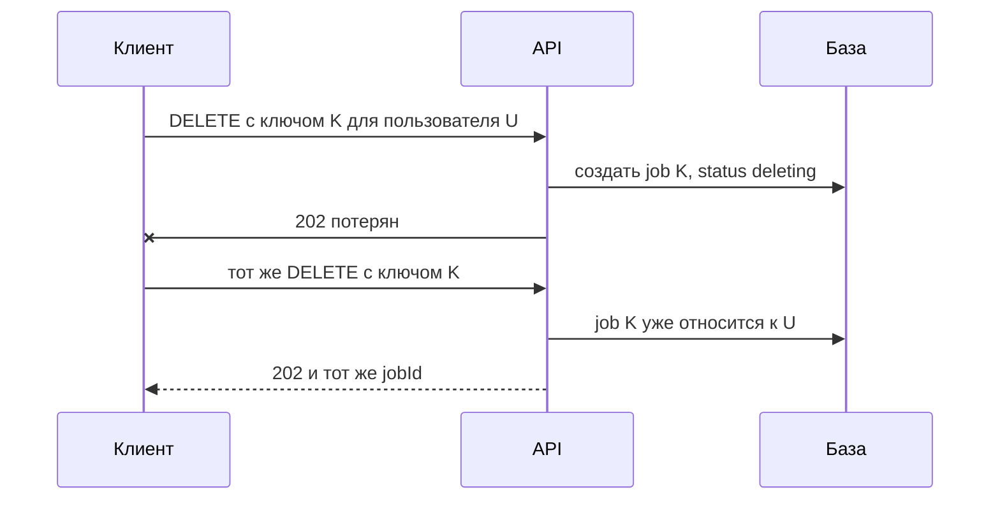

# Идемпотентность

## Содержание

- [Что такое идемпотентность](#что-такое-идемпотентность)
- [Безопасные и идемпотентные методы HTTP](#безопасные-и-идемпотентные-методы-http)
- [Примеры](#примеры)
- [Почему запросы повторяются](#почему-запросы-повторяются)
- [Как сделать операцию идемпотентной](#как-сделать-операцию-идемпотентной)
- [Ключ идемпотентности](#ключ-идемпотентности)
- [Повторы фоновых задач](#повторы-фоновых-задач)
- [Как это проявляется в системе](#как-это-проявляется-в-системе)
- [Типичные ошибки](#типичные-ошибки)
- [Полезные ссылки](#полезные-ссылки)
- [Вопросы по теории](#вопросы-по-теории)

## Что такое идемпотентность

Операция идемпотентна, если её повтор не меняет результат первого успешного выполнения. Один вызов и три одинаковых вызова оставляют сервер в одном состоянии. Клиент может отправить запрос ещё раз после обрыва связи и не создать вторую сущность, не отправить второе письмо и не запустить второй процесс удаления.

В математике это свойство записывают как `f(f(x)) = f(x)`. Модуль числа идемпотентен: абсолютная величина от −3, взятая повторно, снова даёт 3. Присваивание `name = 'Анна'` тоже: повтор оставляет то же значение. Прибавление `attempts = attempts + 1` не идемпотентно: каждый вызов увеличивает счётчик.

Идемпотентность относится к **намерению клиента изменить состояние сервера**, а не к байтам ответа. Журнал, счётчик rate limit и поле `updated_at` могут измениться при каждом запросе. RFC 9110 это допускает: учитывается эффект на ресурс, а не побочные наблюдения.

Совпадение HTTP-статуса при повторе — отдельное, более сильное свойство. Первый `DELETE` часто даёт **204**, второй — **404**, потому что ресурса уже нет. Состояние одно и то же: объекта нет. Контракт, который **повторяет сохранённый ответ** целиком, нужен там, где клиент должен получить тот же `jobId` или то же тело, а не только тот же конечный эффект.

Уникальное ограничение в базе защищает инвариант «не больше одной строки», но само по себе не делает HTTP-операцию идемпотентной. Повтор регистрации с занятым email даёт **409**, тогда как первый успех дал **201**. Состояние «один пользователь на адрес» сохранено, однако клиент, который не получил первый ответ, не узнает `id` созданной записи из повторного запроса.

## Безопасные и идемпотентные методы HTTP

RFC 9110 разделяет два свойства метода.


| Свойство                     | Смысл                                                      | Методы спецификации                  |
| ---------------------------- | ---------------------------------------------------------- | ------------------------------------ |
| Безопасный                   | клиент не намерен менять состояние                         | `GET`, `HEAD`, `OPTIONS`, `TRACE`    |
| Идемпотентный                | несколько одинаковых запросов дают тот же эффект, что один | безопасные, а также `PUT` и `DELETE` |
| Ни то ни другое по умолчанию | повтор накапливает эффект                                  | `POST`, `PATCH`                      |


Безопасный метод всегда идемпотентен. Обратное неверно: `PUT` и `DELETE` меняют данные, но повтор не усиливает изменение. `PUT /admin/rbac/roles/{roleId}` с одним и тем же телом оставляет роль в одном состоянии. `POST /admin/rbac/roles` с тем же `name` пытается создать ещё одну роль.

Спецификация описывает **семантику метода**, а не принуждает сервер. Ничто не мешает повесить на `GET` удаление или сделать `POST /auth/logout` идемпотентным. Клиенты и промежуточные узлы полагаются на заявленную семантику, поэтому безопасные методы не выполняют запись, а идемпотентный контракт объявляют явно, если он отличается от умолчания `POST`.

`PATCH` не идемпотентен в общем случае: JSON Patch с `add` в массив при каждом вызове дописывает элемент. Замена поля абсолютным значением (`displayName: "Анна"`) по эффекту совпадает с `PUT` этого поля. В `1.5` текстовые поля профиля обновляются таким абсолютным PATCH; загрузка новой фотографии генерирует новый ключ объекта и поэтому повтором не является.

Автоматический повтор уместен только для идемпотентного метода или для `POST` с ключом идемпотентности. Слепой retry `POST /api/convert` создаёт вторую запись истории.

## Примеры

**Присваивание имени.** Клиент дважды отправляет одно значение.


| Вызов                     | Было     | Стало    |
| ------------------------- | -------- | -------- |
| 1. `displayName = "Анна"` | `"Иван"` | `"Анна"` |
| 2. тот же запрос          | `"Анна"` | `"Анна"` |


Состояние после одного и двух вызовов совпадает. Операция идемпотентна.

**Создание преобразования.** Клиент дважды отправляет один и тот же CSV на `POST /api/convert`.


| Вызов | История                       |
| ----- | ----------------------------- |
| 1     | строка `t1`, статус `success` |
| 2     | строки `t1` и `t2`            |


Появилась вторая операция. Это не сбой: каждое преобразование — отдельный факт, который пользователь видит в истории из `2.3`. Метод выбран `POST` именно потому, что повтор должен создать новую попытку, а не вернуть прежний файл.

**Удаление объекта в хранилище.** Фоновая очистка из `2.4` вызывает `delete` по ключу. В S3-совместимой границе повторное удаление уже отсутствующего объекта успешно. Если считать отсутствие ошибкой, сбой после фактического удаления объекта зацикливает worker: каждый повтор получает «не найдено» и не отмечает задание выполненным.

**Чтение списка.** `GET /admin/users` с теми же параметрами не создаёт пользователей и не двигает cursor. Между двумя вызовами данные могут измениться — например, появится новая регистрация, — потому что безопасность метода не замораживает базу. Стабильная cursor pagination из `1.7` добавляет более сильное обещание обхода: повтор страницы с тем же cursor не дублирует элементы из-за одинакового `createdAt` и не вставляет в середину строки после `snapshotAt`.

**Выход.** `POST /auth/logout` очищает cookies текущего клиента и отвечает **204** независимо от того, были ли cookies. Второй вызов после первого оставляет браузер без сессии и снова даёт **204**. С точки зрения этого клиента операция идемпотентна. Скопированный refresh JWT на другом устройстве logout не отзывает: это ограничение stateless-схемы из `1.2`, а не нарушение идемпотентности текущего запроса.

## Почему запросы повторяются

Клиент повторяет запрос не только по кнопке дважды. Сеть, балансировщик и брокер сообщений делают повтор нормой.

Типичная потеря ответа:




Первый запрос уже создал пользователя, но клиент этого не увидел. Без уникального ограничения повтор создаёт второго. С ограничением инвариант «один email — одна строка» уцелеет, однако клиент получит ошибку вместо исходного **201** и `id`.

Другие источники повторов:

- пользователь нажимает «Отправить» повторно, пока первый запрос ещё выполняется;
- HTTP-клиент или прокси повторяет запрос после таймаута;
- балансировщик закрывает соединение, когда экземпляры API переключаются;
- брокер доставляет сообщение «хотя бы один раз»;
- worker после истечения lease снова запускает то же задание удаления.

Там, где повтор опасен, его запрещают контрактом (`POST` преобразования) либо делают безопасным (ключ удаления, `UNIQUE`, «отсутствие объекта = успех»).

## Как сделать операцию идемпотентной

Несколько приёмов закрывают разные случаи. Их можно сочетать.

**Семантика метода.** Замена ресурса целиком — `PUT`. Удаление — `DELETE`. Чтение — `GET`. Создание нового факта — `POST`. В `1.1` список ролей пользователя заменяется через `PUT /admin/rbac/users/{userId}/roles`: два одинаковых массива `roleIds` оставляют те же связи. Создание роли остаётся `POST`, потому что идентификатор выдаёт сервер.

**Естественный ключ.** Повтор распознаётся по смыслу операции, а не по случайному заголовку. У удаления из `1.6` на пользователя не больше одного deletion job: второй `DELETE` той же цели возвращает существующий `jobId`, даже если клиент прислал другой ключ.

**Уникальное ограничение.** `UNIQUE` на `users.email`, на паре `(role_id, permission_id)` и частичный уникальный индекс «одна непогашенная попытка» превращают гонку двух параллельных `INSERT` в конфликт базы. Обработчик переводит его в **409**, а не в необработанную ошибку. Это защита инварианта; для безопасного retry после таймаута обычно нужен ещё и сохранённый ответ.

**«Уже сделано» как успех.** Идемпотентный eraser и cleanup хранилища не требуют, чтобы объект существовал в момент вызова. Удаление отсутствующего файла, очистка уже пустого поля и повтор финализации при `job.status = succeeded` завершаются успехом.

**Условная запись.** `UPDATE ... WHERE status = 'queued'` или `INSERT ... ON CONFLICT DO NOTHING` делают переход состояния атомарным. Второй worker не берёт то же задание, пока первый держит lease.

```sql
INSERT INTO deletion_jobs (id, user_id, status)
VALUES ($1, $2, 'queued')
ON CONFLICT (user_id) DO NOTHING;
```

Если строка уже есть, повтор не создаёт второй процесс. Клиенту возвращают найденный `id`.

## Ключ идемпотентности

Когда естественного ключа нет или клиент должен знать идентификатор **до** ответа, клиент присылает свой ключ. Stripe сохраняет статус и тело первого запроса с данным `Idempotency-Key` и при повторе отдаёт сохранённый результат, не выполняя операцию заново. Ключ генерирует клиент: достаточно случайности, чтобы исключить столкновения; email и другие PII в ключе не используют.

В `1.6` клиент создаёт 16 случайных байт и передаёт 32 lowercase hex как `Idempotency-Key`. Сервер берёт это значение как `jobId`, поэтому адрес status endpoint известен, даже если **202** потерялся. Правила повтора:




- тот же ключ и та же цель — прежний job, **202**, без второго процесса и без повторной проверки challenge;
- другой ключ, но у пользователя job уже есть — существующий `jobId`, потому что естественный ключ один на цель;
- тот же ключ для другой цели — **409**, чтобы одна операция не получила два смысла.

Ключ сравнивают вместе с параметрами намерения. Иначе повтор с другим телом молча выполнил бы чужую операцию под видом retry. Неуспешная валидация до начала работы ключ не «сжигает»: клиент может исправить запрос и использовать его снова. После того как побочный эффект начался, повтор обязан возвращать исходный исход.

`GET` и `DELETE` в смысле RFC уже идемпотентны, поэтому отдельный ключ им обычно не нужен. Исключение — `DELETE` принятия удаления: это долгий процесс с **202**, и клиенту нужен стабильный `jobId` после потери ответа.

## Повторы фоновых задач

Брокеры и очереди почти всегда доставляют сообщение хотя бы один раз. Обработчик, который при каждом вызове создаёт объект или списывает ресурс, выполнит действие дважды. Поэтому фоновый шаг делают идемпотентным, а прогресс сохраняют в базе.

В `1.6` worker атомарно берёт lease на задание, вызывает все зарегистрированные eraser и затем финализацию. Пока lease жив, второй worker то же задание не начинает. После аварии процесса lease истекает, и задание можно взять снова. Повтор безопасен, потому что:

- отсутствующий объект хранилища считается уже удалённым;
- повторный вызов eraser после успеха снова возвращает `succeeded`;
- `eraseUserData` при пустых данных пользователя возвращает `succeeded`;
- финальная транзакция при паре `job.status = succeeded` и `user.status = deleted` завершается внутренним успехом.

Тот же приём нужен cleanup retention из `2.4`: сначала удаляется объект, затем очищаются поля истории. Если процесс упал между шагами, повтор снова вызывает `delete` и доводит запись.

Если записать строку в базу, а затем отправить сообщение в брокер, сбой между шагами потеряет событие. Transactional outbox кладёт событие в таблицу в той же транзакции, что и данные. Отдельный процесс доставляет его в брокер и тоже должен переносить повторную доставку: ключ события уникален, обработчик идемпотентен.

## Как это проявляется в системе

Идемпотентность в курсе — не отдельный модуль, а свойство конкретных операций. Одни намеренно идемпотентны, другие намеренно нет.

**Регистрация (`1.0`).** `POST /auth/register` создаёт пользователя и поэтому не является идемпотентным методом. `UNIQUE` по нормализованному email не даёт двум запросам создать две строки, в том числе для `pending`. Потерянный **201** при повторе превращается в **409**: аккаунт есть, но клиент не получает прежний `id`. Это приемлемо для регистрации, потому что повторный вход и подтверждение email идут по адресу, а не по потерянному идентификатору.

**Аутентификация (`1.2`).** Login, confirm и refresh — `POST` с новым эффектом: письмо, погашенная попытка, новая пара cookies. Их нельзя слепо повторять как «тот же вход». Logout напротив всегда очищает cookies текущего клиента и отвечает **204**: повтор безопасен и ожидаем.

**RBAC (`1.1`).** `PUT` роли, разрешения, назначения и списка `roleIds` пользователя заменяет ресурс целиком. Повтор с тем же телом оставляет политику прежней; версия политики может вырасти, если запись действительно выполнилась. `POST` создания роли или grant при конфликте уникальности даёт **409**: вторая связь «роль — разрешение» не появляется. Это защита инварианта, а не возврат первого **201**.

**Изменение профиля (`1.5`).** Повторный PATCH с тем же `displayName` оставляет то же имя. Повторная загрузка фотографии создаёт новый объект с новым случайным ключом: байты файла совпадают, операция — нет. Частичный уникальный индекс одной открытой email-попытки не даёт второму запросу после сбоя SMTP создать параллельный challenge.

**Удаление (`1.6`).** Центральный пример в системе. Принятие идемпотентно на двух уровнях: клиентский `Idempotency-Key` совпадает с `jobId`, а на пользователя существует не больше одного job. Ответ **202** можно потерять и запросить снова. Worker, eraser и финализация идемпотентны: иначе повтор после уже удалённого файла остановил бы очистку. Административный повтор `DELETE` при `failed` не создаёт новый job и не меняет tombstone: он возвращает тот же процесс в очередь.

**Списки (`1.7`, `2.3`).** `GET` не создаёт сущности: одинаковые параметры не порождают побочных записей. Cursor с `id` в составе ключа дополнительно убирает дубли страниц, которые выглядят как «повтор вернул другое». Это свойство чтения и пагинации, а не ключ идемпотентности записи.

**Преобразование файлов (`2.0`–`2.2`).** `POST /api/convert` и `POST /api/images/convert` намеренно не идемпотентны. Каждый вызов — новая попытка со своей строкой истории `success` или `error`. Идемпотентный `PUT` здесь был бы ошибкой контракта: пользователь не увидел бы повторные неуспешные попытки и не смог бы отличить два преобразования одного файла.

**Хранилище (`2.4`).** Скачивание по `GET` возвращает тот же объект, пока он существует и не истёк retention. Фоновая запись при `save=true` должна пережить повтор задачи без второго объекта с другим ключом: ключ заранее связан со строкой истории. Cleanup и eraser пользователя считают отсутствие объекта успехом, иначе удаление из `1.6` не сойдётся.

**Архитектура.** Несколько экземпляров API за балансировщиком не хранят «уже выполнено» в памяти процесса: ключ, job и lease живут в PostgreSQL. Иначе повтор попал бы на другой экземпляр и выполнился бы заново.


| Операция                           | Идемпотентна?           | Чем обеспечено                         |
| ---------------------------------- | ----------------------- | -------------------------------------- |
| `PUT` роли / `roleIds`             | да, замена целиком      | семантика `PUT`                        |
| `POST` регистрации, grant, convert | нет как HTTP-метод      | `UNIQUE` только защищает инвариант     |
| `POST /auth/logout`                | да для текущего клиента | всегда **204** и очистка cookies       |
| `DELETE` принятия удаления         | да                      | ключ + один job на пользователя        |
| worker и eraser удаления           | да                      | «уже нет» = успех, lease               |
| `GET` списка, истории, файла       | да как метод            | нет записи; cursor стабилизирует обход |
| cleanup retention                  | да                      | повторный `delete` объекта             |


## Типичные ошибки


| Что видно                                                           | Куда смотреть                                                                            |
| ------------------------------------------------------------------- | ---------------------------------------------------------------------------------------- |
| Два пользователя с одним email после «повтора регистрации»          | нет `UNIQUE`, уникальность проверяли только `SELECT` перед `INSERT`                      |
| Повтор confirm удаления создал второй job                           | нет уникального job на `user_id` или ключ не используется как `jobId`                    |
| Ключ удаления из запроса A применили к пользователю B               | повтор с другим намерением не отклонён **409**                                           |
| Worker бесконечно повторяет удаление файла                          | отсутствие объекта считается ошибкой, а не успехом                                       |
| Две строки истории на один «повтор» convert                         | ожидаемое поведение `POST`; ошибка — если convert сделали идемпотентным и скрыли попытку |
| Автоматический HTTP-retry после таймаута login создал второе письмо | retry включён для неидемпотентного `POST` без ключа                                      |
| Второй экземпляр API снова выполнил фоновую задачу                  | «уже сделано» хранилось в памяти процесса, а не в базе                                   |
| Одинаковый `createdAt` продублировал пользователя на двух страницах | cursor без `id`, это путают с идемпотентностью `GET`                                     |
| Повтор PATCH фотографии оставил старый объект в бакете              | новый ключ записан, старый не удалён; сама загрузка при этом не идемпотентна             |
| Logout второй раз вернул **401**                                    | контракт требует **204** без проверки сессии                                             |


## Полезные ссылки

### Общие

- [RFC 9110 — Idempotent Methods](https://www.rfc-editor.org/rfc/rfc9110.html#name-idempotent-methods) — определение идемпотентного метода и почему клиент может повторить запрос после обрыва.
- [RFC 9110 — Safe Methods](https://www.rfc-editor.org/rfc/rfc9110.html#name-safe-methods) — отличие безопасности метода от идемпотентности.
- [MDN — Idempotent](https://developer.mozilla.org/en-US/docs/Glossary/Idempotent) — краткие примеры `GET`, `POST` и `DELETE`, включая разный статус при том же эффекте.
- [Stripe — Idempotent requests](https://docs.stripe.com/api/idempotent_requests) — заголовок `Idempotency-Key`, сохранение первого ответа и запрет менять параметры при повторе.
- [IETF — Idempotency-Key header](https://datatracker.ietf.org/doc/draft-ietf-httpapi-idempotency-key-header/) — проект стандартного заголовка для неидемпотентных методов.
- [Microsoft — Retry pattern](https://learn.microsoft.com/en-us/azure/architecture/patterns/retry) — когда автоматический повтор допустим и почему он опасен для неидемпотентных вызовов.
- [Amazon S3 — DeleteObject](https://docs.aws.amazon.com/AmazonS3/latest/API/API_DeleteObject.html) — повторное удаление отсутствующего объекта.
- [PostgreSQL — INSERT ... ON CONFLICT](https://www.postgresql.org/docs/current/sql-insert.html#SQL-ON-CONFLICT) — атомарный «вставить или ничего не делать» по уникальному ключу.

### По языку

#### Node.js

**Node.js, NestJS.** На Express или Fastify контракт идемпотентности остаётся тем же: его задают уникальные ограничения, ключ и семантика маршрута, а не декоратор фреймворка.

- [Prisma — Constraints and indexes](https://www.prisma.io/docs/orm/prisma-schema/data-model/indexes) — `UNIQUE` и обработка конфликта при создании.
- [node-postgres — Queries](https://node-postgres.com/features/queries) — параметризованный `INSERT ... ON CONFLICT`.
- [NestJS — Exception filters](https://docs.nestjs.com/exception-filters) — превращение конфликта уникальности в **409**.

#### .NET

**.NET, ASP.NET Core.** Можно использовать как Minimal API, так и контроллеры, правила повтора от этого не зависят.

- [EF Core — Indexes](https://learn.microsoft.com/en-us/ef/core/modeling/indexes) — уникальные индексы как гарантия естественного ключа.
- [ASP.NET Core — Handle errors](https://learn.microsoft.com/en-us/aspnet/core/web-api/handle-errors) — конфликт уникальности как **409**, а не как необработанное исключение.
- [Polly — Resilience strategies](https://www.pollydocs.org/strategies/retry.html) — повтор HTTP-вызова только для идемпотентных операций.

#### Python

**Python, FastAPI.** Для Django или Flask те же `UNIQUE`, ключ и «отсутствие = успех».

- [SQLAlchemy — IntegrityError](https://docs.sqlalchemy.org/en/20/core/exceptions.html#sqlalchemy.exc.IntegrityError) — конфликт уникального ограничения.
- [psycopg — Passing parameters](https://www.psycopg.org/psycopg3/docs/basic/params.html) — безопасный `ON CONFLICT` с параметрами.
- [Celery — Tasks](https://docs.celeryq.dev/en/stable/userguide/tasks.html) — повторяемые фоновые задачи и требование идемпотентности обработчика.

## Вопросы по теории

1. Чем идемпотентность метода отличается от его безопасности и почему повторный `GET` может вернуть другие данные?
2. Почему второй `DELETE` вправе ответить **404**, оставаясь идемпотентным?
3. Почему `UNIQUE` по email не делает регистрацию идемпотентной для клиента, который потерял первый **201**?
4. Зачем удалению пользователя одновременно `Idempotency-Key` и уникальный job на `user_id`?
5. Почему преобразование файла нельзя сделать идемпотентным `PUT` и что потеряет история?
6. Что произойдёт, если eraser удаления сочтёт отсутствие объекта в хранилище ошибкой?
7. Почему автоматический retry уместен для `PUT` роли и опасен для `POST` входа без дополнительного ключа?

