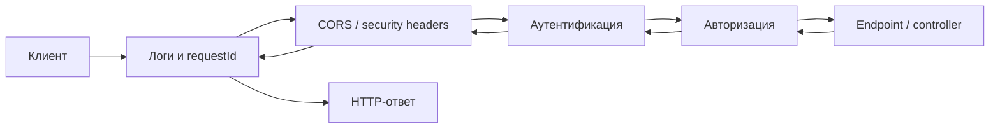
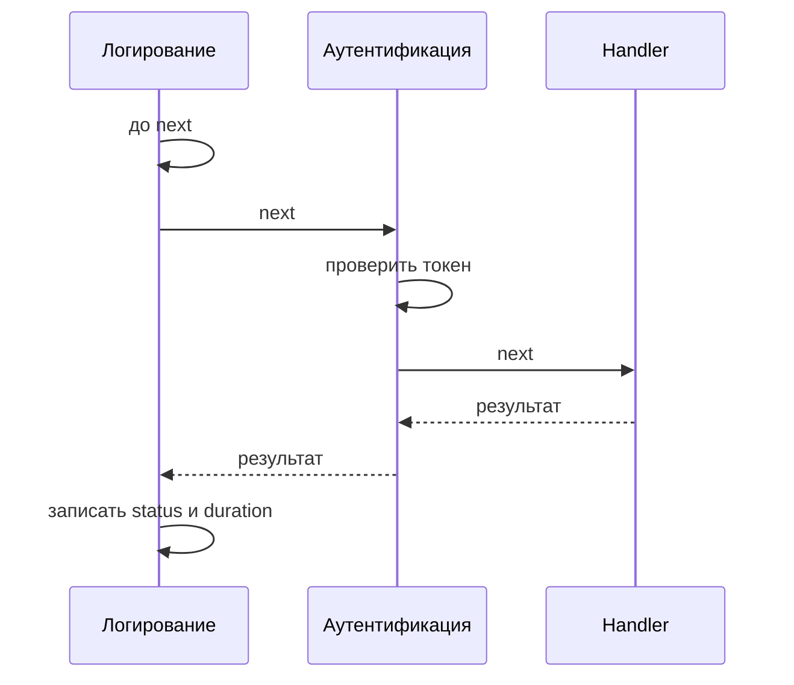

# Middleware

## Содержание

- [Что такое middleware](#что-такое-middleware)
- [Почему это важно](#почему-это-важно)
- [Как работает цепочка](#как-работает-цепочка)
- [Что помещать в middleware](#что-помещать-в-middleware)
- [Порядок важен](#порядок-важен)
- [.NET: middleware pipeline](#net-middleware-pipeline)
- [NestJS: middleware и request lifecycle](#nestjs-middleware-и-request-lifecycle)
- [Отладка и тесты](#отладка-и-тесты)
- [Типичные ошибки](#типичные-ошибки)
- [Полезные ссылки](#полезные-ссылки)
- [Вопросы по теории](#вопросы-по-теории)

## Что такое middleware

**Middleware** — компонент, который стоит между HTTP-сервером и обработчиком конкретного endpoint. Он получает запрос и ответ, может выполнить общую работу, передать управление следующему компоненту и обработать ответ на обратном пути.

Это не особенность .NET: та же идея есть в Express и NestJS, FastAPI, Django, Spring и API gateway. Названия и API различаются, но модель одна: запрос проходит через последовательность небольших слоёв, прежде чем попадёт в бизнес-обработчик.



Middleware не обязан пропускать запрос дальше. Например, CORS может ответить на preflight `OPTIONS`, rate limiter — вернуть **429**, а проверка токена — **401**. Такой компонент называют *short-circuiting* (завершающим цепочку).

## Почему это важно

Без общего конвейера контроллеры быстро начинают повторять один и тот же код: создать correlation ID, записать время, проверить origin, разобрать токен, сформировать единый JSON ошибки. Это даёт разные правила на разных endpoint и делает изменение безопасности дорогим.

Middleware выносит сквозные задачи в одно место:

- единые логи, метрики, трассировка и `X-Request-Id`;
- обработка непойманных исключений без утечки stack trace клиенту;
- CORS, HTTPS redirect, security headers и ограничение частоты;
- разбор cookie или bearer token и установка личности запроса;
- сжатие, кэширование, раздача статических файлов;
- проверка технических требований на границе API.

Преимущество — не только меньше строк. Порядок и политика становятся видны в одном файле старта приложения. Это особенно важно для цепочки из [авторизации](1.3%20Авторизация.md): запрос сначала устанавливает личность, затем проверяет права, и только потом выполняет бизнес-логику.

Middleware не заменяет слои приложения. Он не должен содержать SQL-логику конкретного use case, создавать пользователя или решать, можно ли редактировать именно этот ресурс. Эти решения остаются в handler, service и policy/guard.

## Как работает цепочка

Упрощённый псевдокод middleware выглядит так:

```text
async function middleware(request, response, next):
    выполнить код до next()
    await next()             // передать запрос следующему слою
    выполнить код после next()
```

Код до `next()` идёт в порядке регистрации, а код после `next()` — в обратном. Поэтому внешний middleware удобно использовать для измерения всего времени запроса или для перехвата исключения из любого внутреннего слоя.



Если аутентификация вернула **401** и не вызвала `next`, handler не будет запущен, а внешний логирующий слой всё равно увидит итоговый статус. Если handler бросает исключение, его перехватывает внешний exception handler, который расположен раньше него в цепочке.

## Что помещать в middleware

Хороший кандидат имеет три свойства: правило относится к многим endpoint, зависит от HTTP-границы и не требует знания бизнес-смысла конкретного действия.

| Задача | Где обычно находится | Почему |
| --- | --- | --- |
| `X-Request-Id`, время и access log | middleware | Нужны каждому запросу, включая 404 и 401 |
| CORS, HTTPS, security headers | middleware платформы | Применяются до бизнес-кода и часто до маршрута |
| Непойманные исключения → Problem Details | внешний middleware / exception filter | Одна безопасная форма ошибки для всего API |
| Проверка подписи токена | middleware или framework authentication | Устанавливает identity для следующих слоёв |
| Роль `users@read` для endpoint | .NET policy / Nest guard | Правило знает, какой handler выбран |
| Валидация DTO | endpoint filter / model binding / Nest pipe | Зависит от входной модели конкретной операции |
| Изменить пользователя или записать в БД | handler/service | Это бизнес-операция, а не транспортная политика |

Правило выбора простое: если компоненту нужна метаинформация выбранного route (например, `@Roles('admin')`), в NestJS это обычно guard, а в ASP.NET Core — authorization policy или filter. Обычный middleware ещё не должен принимать такое предметное решение.

## Порядок важен

Цепочка — это программа: перестановка двух строк меняет результат. Базовый порядок для API выглядит так:

1. Обработчик исключений и request ID — снаружи, чтобы покрыть весь последующий код.
2. HTTPS redirect, static files и технические заголовки.
3. CORS — до аутентификации и авторизации, чтобы браузер получил заголовки даже при отказе.
4. Маршрутизация (если фреймворк требует явного шага).
5. Аутентификация — устанавливает `user`/`HttpContext.User`.
6. Авторизация — решает, разрешён ли выбранный endpoint установленному пользователю.
7. Endpoint, controller или handler.

Конкретная схема зависит от фреймворка и задачи. Например, глобальный rate limit можно поставить до маршрутизации, а endpoint-specific rate limit в ASP.NET Core — после неё. Не стоит копировать порядок из чужого проекта без понимания, какой компонент от кого зависит.

## .NET: middleware pipeline

В ASP.NET Core middleware добавляют в `Program.cs` вызовами `app.Use…`. Порядок вызовов — порядок обработки запроса; обратный путь ответа идёт в обратном порядке. `app.Run` — завершающий middleware и не вызывает следующий компонент. `MapGet`, `MapGroup` и controllers объявляют endpoints.

Ниже — компактная структура API. Конфигурация JWT и policy намеренно опущена: важен порядок pipeline, а не конкретный provider токенов.

```csharp
var builder = WebApplication.CreateBuilder(args);

builder.Services.AddProblemDetails();
builder.Services.AddCors(options => options.AddPolicy("frontend", policy =>
    policy.WithOrigins("https://app.example.test")
          .AllowAnyHeader()
          .AllowAnyMethod()
          .AllowCredentials()));

builder.Services.AddAuthentication(/* JWT or cookie scheme */);
builder.Services.AddAuthorization();

var app = builder.Build();

// Этот слой снаружи exception handler: после обработанной ошибки он увидит итоговый status.
app.Use(async (context, next) =>
{
    var requestedId = context.Request.Headers["X-Request-Id"].FirstOrDefault();
    var requestId = Guid.TryParse(requestedId, out var id) ? id.ToString() : Guid.NewGuid().ToString();

    context.TraceIdentifier = requestId;
    context.Response.Headers["X-Request-Id"] = requestId;

    var startedAt = Stopwatch.GetTimestamp();
    await next();
    var elapsed = Stopwatch.GetElapsedTime(startedAt);

    app.Logger.LogInformation(
        "{Method} {Path} -> {StatusCode} in {ElapsedMs} ms; requestId={RequestId}",
        context.Request.Method, context.Request.Path, context.Response.StatusCode,
        elapsed.TotalMilliseconds, requestId);
});

app.UseExceptionHandler();              // ловит исключения из следующих компонентов
app.UseHttpsRedirection();

app.UseCors("frontend");                // раньше authentication и authorization
app.UseAuthentication();                 // создаёт HttpContext.User
app.UseAuthorization();                  // применяет policy endpoint

app.MapGet("/me", (ClaimsPrincipal user) =>
    Results.Ok(new { user = user.Identity?.Name }))
   .RequireAuthorization();

app.Run();
```

Для примера нужны `using System.Diagnostics;`, `using System.Security.Claims;` и пространства имён ASP.NET Core из шаблона. В реальном приложении вместо inline-функции request ID обычно делают отдельный класс `RequestContextMiddleware`; так его проще тестировать и переиспользовать.

`UseAuthentication()` не запрещает запрос сам по себе: он пытается установить пользователя. Решение «у этого endpoint должен быть аутентифицированный пользователь с таким-то правом» принимает `UseAuthorization()` по метаданным endpoint — например, `.RequireAuthorization("users.read")`. Поэтому `UseAuthentication` обязательно стоит раньше `UseAuthorization`.

### Вариант с собственным классом

```csharp
public sealed class RequestIdMiddleware(RequestDelegate next, ILogger<RequestIdMiddleware> logger)
{
    public async Task InvokeAsync(HttpContext context)
    {
        var requestId = Guid.NewGuid().ToString();
        context.TraceIdentifier = requestId;
        context.Response.Headers["X-Request-Id"] = requestId;

        try
        {
            await next(context);
        }
        finally
        {
            logger.LogInformation("{RequestId} {StatusCode}",
                requestId, context.Response.StatusCode);
        }
    }
}

// Program.cs
app.UseMiddleware<RequestIdMiddleware>();
app.UseExceptionHandler();
```

`try/finally` сохраняет лог даже при исключении. Но преобразовывать исключение в HTTP-ответ лучше единственным `UseExceptionHandler`, а не несколькими middleware, которые спорят, кто запишет response.

## NestJS: middleware и request lifecycle

NestJS использует middleware Express или Fastify на HTTP-границе, но добавляет собственные механизмы. Упрощённый входящий порядок: **middleware → guards → interceptors → pipes → controller**. После результата interceptor получает ответ на обратном пути. Exception filters формируют ответ при исключении.

Для request ID подойдёт class-based middleware. Пример ниже использует Express types; при `FastifyAdapter` типы `Request` и `Response` будут другими, но роль компонента не меняется.

```ts
// request-id.middleware.ts
import { Injectable, NestMiddleware } from '@nestjs/common';
import { randomUUID } from 'node:crypto';
import type { NextFunction, Request, Response } from 'express';

@Injectable()
export class RequestIdMiddleware implements NestMiddleware {
  use(req: Request, res: Response, next: NextFunction) {
    const requestId = req.header('x-request-id') ?? randomUUID();

    res.setHeader('x-request-id', requestId);
    res.on('finish', () => {
      console.info({
        requestId,
        method: req.method,
        path: req.originalUrl,
        statusCode: res.statusCode,
      });
    });

    next(); // без этого controller не получит запрос
  }
}
```

Подключение к маршрутам модуля:

```ts
// app.module.ts
import { MiddlewareConsumer, Module, NestModule, RequestMethod } from '@nestjs/common';
import { RequestIdMiddleware } from './common/request-id.middleware';

@Module({})
export class AppModule implements NestModule {
  configure(consumer: MiddlewareConsumer) {
    consumer
      .apply(RequestIdMiddleware)
      .forRoutes({ path: '*path', method: RequestMethod.ALL });
  }
}
```

Можно также зарегистрировать простую функцию глобально: `app.use((req, res, next) => { ...; next(); })`. Module-bound middleware через `MiddlewareConsumer` удобнее, когда правило относится только к определённому controller или группе маршрутов.

### Middleware — не guard

Проверить формат bearer token и прикрепить пользователя к `req` можно до controller. Но middleware не знает, какой handler будет вызван, и не читает его декораторы. Поэтому правило «для `GET /users` нужна роль admin» следует выразить guard, а не `if (req.path …)` в middleware.

```ts
// roles.guard.ts — схема, а не готовая JWT-реализация
import {
  CanActivate, Controller, ExecutionContext, Get, Injectable, SetMetadata, UseGuards,
} from '@nestjs/common';
import { Reflector } from '@nestjs/core';

@Injectable()
export class RolesGuard implements CanActivate {
  constructor(private readonly reflector: Reflector) {}

  canActivate(context: ExecutionContext): boolean {
    const roles = this.reflector.getAllAndOverride<string[]>('roles', [
      context.getHandler(),
      context.getClass(),
    ]) ?? [];

    const request = context.switchToHttp().getRequest<{ user?: { roles: string[] } }>();
    return roles.length === 0 || roles.some(role => request.user?.roles.includes(role));
  }
}

@Controller('users')
@UseGuards(RolesGuard)
export class UsersController {
  @Get()
  @SetMetadata('roles', ['admin'])
  findAll() { /* service call */ }
}
```

Для настоящего JWT-потока обычно используют Passport strategy и `AuthGuard('jwt')`; `RolesGuard` запускают после него. Guard может увидеть `ExecutionContext`, controller и handler, поэтому он подходит для декларативной авторизации. Подробнее о контракте доступа этого курса — в [1.3 Авторизация](1.3%20Авторизация.md).

## Отладка и тесты

Сначала сделайте pipeline наблюдаемым: логируйте method, path, status, duration и request ID. Не записывайте в лог заголовки `Authorization`, `Cookie`, `Set-Cookie`, тело пароля или сам JWT. Один `X-Request-Id` в ответе позволяет связать ответ клиента с серверным логом.

Минимальный набор проверок для middleware:

- запрос к существующему и несуществующему route получает `X-Request-Id`;
- endpoint, который бросает исключение, отдаёт единый безопасный JSON ошибки, а не stack trace;
- preflight `OPTIONS` получает корректный CORS-ответ;
- защищённый route без токена возвращает **401** до handler;
- пользователь без права получает **403** после установления личности;
- handler не вызывается, когда middleware/guard завершил запрос.

В .NET такой сценарий удобно запускать через `WebApplicationFactory<Program>` и `HttpClient`. В NestJS — через `@nestjs/testing`, `app.getHttpServer()` и `supertest`. Для порядка middleware не проверяют внутренние вызовы «ради вызовов»: тестируют наблюдаемый контракт — статус, заголовки, тело и отсутствие побочного эффекта.

## Типичные ошибки

| Что видно | Причина и исправление |
| --- | --- |
| Controller не вызывается и запрос «висит» | В Nest/Express middleware не вызвал `next()` и не отправил ответ |
| В браузере не видно error body при **401** | CORS поставлен после authentication/authorization; поставить CORS раньше |
| Любой защищённый endpoint видит пустой user | В .NET `UseAuthorization()` стоит раньше `UseAuthentication()` или схема не настроена |
| Policy не учитывает `.RequireAuthorization()` | `UseAuthorization()` расположен до routing; следовать диагностике ASP0001 |
| Ошибка из handler отдала stack trace | Нет внешнего exception handler или включён development-ответ в production |
| Логи не содержат **404** и **401** | Логирование находится внутри controller, а не на внешнем уровне pipeline |
| В Nest права проверяются по `req.path` | Middleware не знает metadata handler; перенести правило в guard |
| Два middleware формируют разные JSON ошибки | Сделать единый exception handler/filter владельцем формата ошибок |
| В middleware читается тело огромного файла целиком | Нарушены лимиты памяти и streaming; задать лимиты parser/upload механизма |

## Полезные ссылки

### Общие

- [MDN — Middleware](https://developer.mozilla.org/en-US/docs/Glossary/Middleware) — краткое определение промежуточного ПО в web-приложениях.
- [OWASP — REST Security Cheat Sheet](https://cheatsheetseries.owasp.org/cheatsheets/REST_Security_Cheat_Sheet.html) — заголовки, аутентификация и защита API.

### .NET

- [Microsoft Learn — ASP.NET Core middleware](https://learn.microsoft.com/en-us/aspnet/core/fundamentals/middleware/) — pipeline, `Use`, `Run`, порядок компонентов и short-circuiting.
- [Microsoft Learn — middleware в Minimal APIs](https://learn.microsoft.com/en-us/aspnet/core/fundamentals/minimal-apis/middleware) — автоматические и явные части pipeline, порядок CORS/auth/authz.
- [Microsoft Learn — Authentication overview](https://learn.microsoft.com/en-us/aspnet/core/security/authentication/) — схемы и `UseAuthentication`.
- [Microsoft Learn — ASP0001](https://learn.microsoft.com/en-us/aspnet/core/diagnostics/asp0001) — почему authorization между routing и endpoint критична.

### NestJS

- [NestJS — Middleware](https://docs.nestjs.com/middleware) — class/function middleware и `MiddlewareConsumer`.
- [NestJS — Request lifecycle](https://docs.nestjs.com/faq/request-lifecycle) — точный порядок middleware, guards, interceptors, pipes и filters.
- [NestJS — Guards](https://docs.nestjs.com/guards) — проверка прав с доступом к metadata handler.
- [NestJS — Exception filters](https://docs.nestjs.com/exception-filters) — единая обработка исключений.

## Вопросы по теории

1. Почему логирование всего запроса должно стоять раньше controller и route-specific middleware?
2. Что изменится, если middleware вызовет `next()` дважды или не вызовет его вовсе?
3. Почему CORS обычно располагают до authentication и authorization?
4. Чем в NestJS middleware отличается от guard, pipe и interceptor?
5. Почему `UseAuthentication()` не заменяет `UseAuthorization()` в ASP.NET Core?
6. Какие данные нельзя писать в middleware-логи и почему?
7. Где реализовать проверку «пользователь может редактировать только собственный профиль» и почему это не глобальный middleware?
