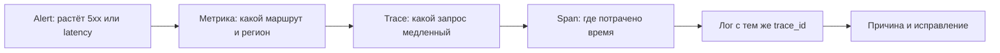
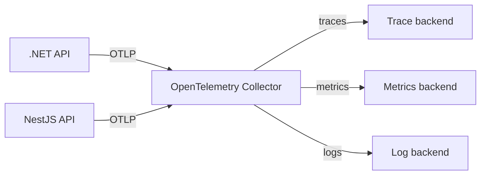

# Наблюдаемость

## Содержание

- [Что такое наблюдаемость и зачем она нужна](#что-такое-наблюдаемость-и-зачем-она-нужна)
- [Сигналы и общий контекст](#сигналы-и-общий-контекст)
- [OpenTelemetry и Collector](#opentelemetry-и-collector)
- [Быстрый локальный Collector](#быстрый-локальный-collector)
- [.NET: traces, metrics и logs](#net-traces-metrics-и-logs)
- [NestJS: автоматическая и ручная инструментация](#nestjs-автоматическая-и-ручная-инструментация)
- [Распространение контекста](#распространение-контекста)
- [Что измерять и как не испортить прод](#что-измерять-и-как-не-испортить-прод)
- [Типичные ошибки](#типичные-ошибки)
- [Полезные ссылки](#полезные-ссылки)
- [Вопросы по теории](#вопросы-по-теории)

## Что такое наблюдаемость и зачем она нужна

Наблюдаемость (observability) — способность понять внутреннее состояние работающей системы по телеметрии, которую она производит: логам, метрикам и трассам. Она отвечает не только на вопрос «упал ли сервис?», но и на вопрос «почему `POST /orders` стал занимать 4 секунды и в каком из пяти сервисов это произошло?».

Локальный debugger хорош, пока ошибку можно повторить на своей машине. В production запрос проходит через балансировщик, API, базу, кеш, очередь и другой сервис; экземпляров приложения несколько, а ответ клиенту мог уже потеряться. Наблюдаемость даёт общую картину без подключения отладчика к живому процессу.

Хорошая телеметрия сокращает время от симптома до причины:



Например, p95 latency `POST /orders` вырос. Метрика говорит, что проблема только в `eu-west`; trace показывает 2.7 секунды в исходящем вызове платежей; коррелированный лог раскрывает код ответа внешнего провайдера. Без trace пришлось бы сопоставлять разрозненные логи всех сервисов по времени.

Наблюдаемость не заменяет тесты, health checks, алерты или SLO. Тест предотвращает известную ошибку, а телеметрия помогает обнаружить неизвестную — деградацию зависимости, редкую гонку, конкретного клиента или рост нагрузки.

## Сигналы и общий контекст

Три основных сигнала дополняют друг друга.

| Сигнал | Что хранит | На какой вопрос отвечает | Пример |
| --- | --- | --- | --- |
| Логи | событие с деталями | Что случилось в конкретном месте? | `payment declined`, `orderId` |
| Метрики | числовой ряд во времени | Насколько часто, долго или много? | p95 latency, доля 5xx, длина очереди |
| Трассы | дерево работы одного запроса | Где именно был потрачен ресурс? | API → PostgreSQL → payments |

**Trace** описывает путь одной операции. Он состоит из **spans**: входящий HTTP-запрос, SQL-запрос, вызов `HttpClient` или участок прикладного кода. У всех spans одного пути один `trace_id`; у каждого span свой `span_id` и родитель. Именно этот контекст связывает сигнал от .NET-сервиса с сигналом от NestJS-сервиса.

**Resource attributes** описывают процесс, а не отдельный запрос: `service.name`, `service.version`, `deployment.environment`, регион. Они обязательны для фильтрации и для того, чтобы два приложения не оказались в одном сервисе на дашборде.

**Attributes** span или метрики описывают операцию: HTTP route, status code, тип платежа. Их значения должны быть ограниченными. `http.route = /orders/{id}` полезен, `http.target = /orders/8f1c...` создаёт миллионы временных рядов и опасен как label метрики.

Не записывайте в telemetry пароль, JWT, cookie, номер карты, email и полное тело запроса. Даже если backend телеметрии закрыт, это расширяет поверхность доступа к персональным данным.

## OpenTelemetry и Collector

[OpenTelemetry](https://opentelemetry.io/) (OTel) — открытый стандарт API, SDK, семантических соглашений и протокола [OTLP](https://opentelemetry.io/docs/specs/otel/protocol/). Код приложения инструментируется один раз, а backend можно заменить: Jaeger/Tempo, Prometheus/Grafana, облачный APM или другой OTLP-совместимый сервис.

Обычная схема выглядит так:



SDK в приложении создаёт и пакетирует телеметрию. Collector принимает OTLP, ограничивает память, делает batching, при необходимости фильтрует/обогащает данные и направляет их в backend. В production обычно отправляют данные сначала в Collector, а не в vendor endpoint из каждого приложения: меняется одна конфигурация, а не все сервисы.

`OTEL_EXPORTER_OTLP_ENDPOINT=http://collector:4318` означает базовый endpoint OTLP/HTTP. Для него SDK строит `/v1/traces`, `/v1/metrics` и `/v1/logs`. Порт `4317` обычно используется для OTLP/gRPC. Не смешивайте их и не добавляйте `/v1/traces` к gRPC endpoint.

## Быстрый локальный Collector

Для проверки SDK достаточно вывести все принятые сигналы в stdout контейнера. Сохраните рядом с проектом `otel-collector-config.yaml`:

```yaml
receivers:
  otlp:
    protocols:
      grpc:
        endpoint: 0.0.0.0:4317
      http:
        endpoint: 0.0.0.0:4318

processors:
  memory_limiter:
    check_interval: 1s
    limit_mib: 256
  batch: {}

exporters:
  debug:
    verbosity: detailed

service:
  pipelines:
    traces:
      receivers: [otlp]
      processors: [memory_limiter, batch]
      exporters: [debug]
    metrics:
      receivers: [otlp]
      processors: [memory_limiter, batch]
      exporters: [debug]
    logs:
      receivers: [otlp]
      processors: [memory_limiter, batch]
      exporters: [debug]
```

Запустите его и задайте endpoint для приложений:

```powershell
docker run --rm -p 4317:4317 -p 4318:4318 `
  -v "${PWD}/otel-collector-config.yaml:/etc/otelcol/config.yaml" `
  otel/opentelemetry-collector

$env:OTEL_EXPORTER_OTLP_ENDPOINT = 'http://localhost:4318'
```

Конфигурация с `debug` не является системой мониторинга: она лишь доказывает, что приложение действительно экспортирует данные. Затем замените exporter Collector на согласованный production backend.

## .NET: traces, metrics и logs

В .NET span называется `Activity`, а источником прикладных spans служит `ActivitySource`; метрики создаются через `Meter`, а логи проходят через привычный `ILogger`. OpenTelemetry подключается к этим платформенным API и экспортирует данные.

### 1. Установить пакеты

Для ASP.NET Core API с исходящими HTTP-вызовами и runtime-метриками:

```powershell
dotnet add package OpenTelemetry.Extensions.Hosting
dotnet add package OpenTelemetry.Exporter.OpenTelemetryProtocol
dotnet add package OpenTelemetry.Instrumentation.AspNetCore
dotnet add package OpenTelemetry.Instrumentation.Http
dotnet add package OpenTelemetry.Instrumentation.Runtime
```

### 2. Настроить `Program.cs`

```csharp
using System.Diagnostics;
using System.Diagnostics.Metrics;
using OpenTelemetry.Logs;
using OpenTelemetry.Metrics;
using OpenTelemetry.Resources;
using OpenTelemetry.Trace;

var builder = WebApplication.CreateBuilder(args);
const string serviceName = "orders-api";

builder.Services.AddOpenTelemetry()
    .ConfigureResource(resource => resource.AddService(
        serviceName: serviceName,
        serviceVersion: typeof(Program).Assembly.GetName().Version?.ToString()))
    .WithTracing(tracing => tracing
        .AddAspNetCoreInstrumentation(options => options.RecordException = true)
        .AddHttpClientInstrumentation()
        .AddSource(OrdersTelemetry.ActivitySource.Name)
        .AddOtlpExporter())
    .WithMetrics(metrics => metrics
        .AddAspNetCoreInstrumentation()
        .AddHttpClientInstrumentation()
        .AddRuntimeInstrumentation()
        .AddMeter(OrdersTelemetry.Meter.Name)
        .AddOtlpExporter());

builder.Logging.AddOpenTelemetry(logging =>
{
    logging.IncludeFormattedMessage = true;
    logging.IncludeScopes = true;
    logging.ParseStateValues = true;
    logging.AddOtlpExporter();
});

var app = builder.Build();
app.MapGet("/health", () => Results.Ok());
app.Run();

public static class OrdersTelemetry
{
    public static readonly ActivitySource ActivitySource = new("orders-api");
    public static readonly Meter Meter = new("orders-api");
    public static readonly Counter<long> OrdersCreated =
        Meter.CreateCounter<long>("orders.created");
}
```

`AddAspNetCoreInstrumentation()` создаёт spans входящих HTTP-запросов, `AddHttpClientInstrumentation()` — исходящих. При передаче `traceparent` в `HttpClient` контекст передаётся автоматически. Runtime instrumentation добавляет, например, данные о GC и потреблении CPU процесса.

### 3. Добавить только полезный прикладной span и метрику

Автоматической инструментации недостаточно, чтобы узнать время бизнес-операции «зарезервировать склад». Добавьте span на границе значимой работы, а не вокруг каждой строки:

```csharp
public sealed class OrderService(ILogger<OrderService> logger)
{
    public async Task ReserveStockAsync(CreateOrder command, CancellationToken ct)
    {
        using var activity = OrdersTelemetry.ActivitySource.StartActivity(
            "order.reserve_stock", ActivityKind.Internal);

        activity?.SetTag("order.currency", command.Currency);

        try
        {
            await ReserveAsync(command, ct);
            OrdersTelemetry.OrdersCreated.Add(1,
                new KeyValuePair<string, object?>("order.currency", command.Currency));
            logger.LogInformation("Stock reserved for order {OrderId}", command.OrderId);
        }
        catch (Exception exception)
        {
            activity?.RecordException(exception);
            activity?.SetStatus(ActivityStatusCode.Error, exception.Message);
            logger.LogError(exception, "Could not reserve stock for order {OrderId}", command.OrderId);
            throw;
        }
    }

    private static Task ReserveAsync(CreateOrder command, CancellationToken ct) => Task.CompletedTask;
}
```

`ActivitySource.StartActivity()` может вернуть `null`, когда trace не sampled, поэтому корректный код использует `?.`. Лог получит `TraceId`/`SpanId` от текущей `Activity` через OTel logging provider; `OrderId` оставляют в структурированном поле лога, но не делают label метрики.

## NestJS: автоматическая и ручная инструментация

Node-инструментация должна загрузиться **до** `@nestjs/core`, Express/Fastify, `pg` и остальных библиотек: она патчит их при импорте. Поэтому надёжнее запускать compiled NestJS-приложение через preload, а не импортировать SDK после `NestFactory.create()`.

### 1. Установить пакеты

```powershell
npm i @opentelemetry/api @opentelemetry/sdk-node `
  @opentelemetry/sdk-metrics `
  @opentelemetry/auto-instrumentations-node `
  @opentelemetry/exporter-trace-otlp-http `
  @opentelemetry/exporter-metrics-otlp-http
```

### 2. Создать `src/instrumentation.ts`

```ts
import { metrics } from '@opentelemetry/api';
import { getNodeAutoInstrumentations } from '@opentelemetry/auto-instrumentations-node';
import { OTLPMetricExporter } from '@opentelemetry/exporter-metrics-otlp-http';
import { OTLPTraceExporter } from '@opentelemetry/exporter-trace-otlp-http';
import { PeriodicExportingMetricReader } from '@opentelemetry/sdk-metrics';
import { NodeSDK } from '@opentelemetry/sdk-node';

export const otelSdk = new NodeSDK({
  serviceName: 'orders-api',
  traceExporter: new OTLPTraceExporter(),
  metricReader: new PeriodicExportingMetricReader({
    exporter: new OTLPMetricExporter(),
  }),
  instrumentations: [getNodeAutoInstrumentations()],
});

otelSdk.start();

export const ordersMeter = metrics.getMeter('orders-api');
export const quotesCalculated = ordersMeter.createCounter('pricing.quotes.calculated');
```

`OTLPTraceExporter` и `OTLPMetricExporter` читают `OTEL_EXPORTER_OTLP_ENDPOINT`. Auto-instrumentations создают spans HTTP, `fetch`, распространённых драйверов БД и Nest core там, где версия пакета поддерживает используемую версию NestJS. В NestJS 12 проверьте совместимость `@opentelemetry/instrumentation-nestjs-core`: HTTP и database spans продолжат работать, но framework spans могут отсутствовать.

### 3. Запустить до NestJS

Для ESM-build `dist/instrumentation.js` должен быть импортирован до `dist/main.js`:

```json
{
  "scripts": {
    "start:prod": "node --import ./dist/instrumentation.js dist/main.js"
  }
}
```

Для CommonJS используйте `node --require ./dist/instrumentation.js dist/main.js`. При graceful shutdown вызовите `otelSdk.shutdown()` после остановки NestJS, чтобы отправить последний batch.

### 4. Добавить span в provider

Автоинструментация показывает контроллер и SQL/HTTP-вызовы, но не знает значения прикладного метода. Явный span даёт эту границу:

```ts
import { Injectable } from '@nestjs/common';
import { SpanStatusCode, trace } from '@opentelemetry/api';
import { quotesCalculated } from './instrumentation';

const tracer = trace.getTracer('orders-api');

@Injectable()
export class PricingService {
  async quote(cart: { items: unknown[]; currency: string }) {
    return tracer.startActiveSpan('PricingService.quote', async (span) => {
      try {
        span.setAttribute('cart.items_count', cart.items.length);
        span.setAttribute('order.currency', cart.currency);
        const total = await this.calculate(cart);
        quotesCalculated.add(1, { 'order.currency': cart.currency });
        return total;
      } catch (error) {
        span.recordException(error as Error);
        span.setStatus({ code: SpanStatusCode.ERROR });
        throw error;
      } finally {
        span.end();
      }
    });
  }

  private async calculate(cart: { items: unknown[] }) {
    return cart.items.length * 100;
  }
}
```

`startActiveSpan()` делает span текущим, поэтому дочерние HTTP и database spans будут вложены корректно. `finally` обязателен: span, не завершённый при ошибке, создаёт искаженную трассу.

## Распространение контекста

Для HTTP OpenTelemetry по умолчанию использует W3C Trace Context. Клиент отправляет заголовок наподобие `traceparent: 00-<trace-id>-<parent-span-id>-01`; сервер продолжает тот же trace и создаёт дочерний span. `HttpClient` в .NET и автоинструментация Node делают это сами, когда SDK запущен достаточно рано.

Не генерируйте новый `trace_id` в каждом сервисе и не подменяйте `traceparent` собственным `X-Request-Id`. Можно сохранять свой request ID для UX или поиска, но это другой идентификатор. Его добавляют как span attribute или structured log field после проверки формата, а не вместо стандартизированного контекста.

Очередь не имеет вложенного синхронного вызова. Producer записывает context в headers сообщения, consumer извлекает его и начинает `CONSUMER` span; тогда работа worker будет связана с исходным HTTP-запросом. Для fan-out уместны [span links](https://opentelemetry.io/docs/concepts/signals/traces/#span-links), а не выбор произвольного одного родителя.

## Что измерять и как не испортить прод

Начинайте с пользовательского результата, а не с количества графиков.

| Цель | Сигнал | Пример |
| --- | --- | --- |
| Доступность API | counter + alert | доля `5xx` по `http.route` |
| Скорость API | histogram | p50/p95/p99 latency по route |
| Насыщение | gauge/histogram | очередь jobs, pool соединений, GC pauses |
| Бизнес-результат | counter | успешные заказы по валюте/каналу |
| Причина отдельного сбоя | trace + logs | trace с exception и логом оплаты |

Практические правила:

- У метрики ограниченный набор attributes: `route`, статус-класс, валюта из справочника. Нельзя использовать user ID, order ID, URL с ID, случайный UUID или текст ошибки.
- Не включайте каждый trace без оценки трафика и стоимости. Начните с parent-based sampling и небольшой доли успешных запросов; ошибки и медленные запросы сохраняйте по правилам backend/Collector.
- Error должен быть виден во всех сигналах: HTTP 5xx увеличивает метрику, server span имеет error status и exception, лог содержит exception и trace context.
- Устанавливайте `service.name` явно и стабильно; версию и окружение передавайте как resource attributes. Не добавляйте hostname в `service.name` — это instance attribute.
- Заранее определите владельца дашбордов, SLO и алертов. Телеметрия, которую никто не смотрит и которая не вызывает действия, — лишняя нагрузка.

## Типичные ошибки

| Что видно | Причина | Исправление |
| --- | --- | --- |
| В backend нет NestJS spans | SDK импортирован после Nest/драйвера | preload через `--import`/`--require` до `main.js` |
| HTTP spans есть, но бизнес-время — один большой блок | auto-instrumentation не знает provider | добавить один manual span вокруг значимой операции |
| .NET не показывает собственный span | `ActivitySource` не зарегистрирован | добавить `.AddSource(OrdersTelemetry.ActivitySource.Name)` |
| Два сервиса имеют разные traces на один запрос | gateway удаляет `traceparent` или создан новый trace | пропустить W3C headers и не генерировать ID вручную |
| Backend перегружен или дорог | attributes метрики имеют миллионы значений | оставить только низкокардинальные labels |
| В trace видны токены или адреса | записано всё тело/headers запроса | allowlist безопасных attributes, redaction до export |
| При завершении процесса пропадают последние данные | SDK не успевает отправить batch | graceful shutdown и `otelSdk.shutdown()`; в .NET завершение host закроет provider |
| Локально данные есть, в production нет | endpoint/протокол/сеть различаются | проверить `OTEL_EXPORTER_OTLP_ENDPOINT`, порт `4318` для HTTP и логи Collector |

## Полезные ссылки

### Общие

- [OpenTelemetry — документация](https://opentelemetry.io/docs/) — API, SDK, семантические соглашения и Collector.
- [OTLP exporter configuration](https://opentelemetry.io/docs/languages/sdk-configuration/otlp-exporter/) — endpoint, порты и signal-specific переменные окружения.
- [W3C Trace Context](https://www.w3.org/TR/trace-context/) — формат `traceparent` и межсервисное распространение контекста.
- [OpenTelemetry Collector в Docker](https://opentelemetry.io/docs/collector/install/docker/) — минимальная конфигурация receiver/pipeline/exporter.

### .NET

- [.NET observability with OpenTelemetry](https://learn.microsoft.com/en-us/dotnet/core/diagnostics/observability-with-otel) — как OTel использует `ILogger`, `Meter` и `ActivitySource`.
- [OpenTelemetry .NET: ASP.NET Core traces](https://opentelemetry.io/docs/languages/dotnet/traces/getting-started-aspnetcore/) — регистрация ASP.NET Core instrumentation.
- [OpenTelemetry .NET: metrics](https://opentelemetry.io/docs/languages/dotnet/metrics/) — meters, instruments и экспорт метрик.
- [OTLP + Aspire Dashboard](https://learn.microsoft.com/en-us/dotnet/core/diagnostics/observability-otlp-example) — локальная визуализация OTLP для .NET.

### NestJS и Node.js

- [NestJS — OpenTelemetry](https://docs.nestjs.com/observability/opentelemetry) — порядок загрузки SDK, auto-instrumentation и ручные spans.
- [OpenTelemetry JavaScript](https://opentelemetry.io/docs/languages/js/) — SDK, exporters и инструментирование Node.js.
- [OpenTelemetry JS auto-instrumentations](https://github.com/open-telemetry/opentelemetry-js-contrib/tree/main/metapackages/auto-instrumentations-node) — список пакетов, которые могут быть инструментированы автоматически.

## Вопросы по теории

1. Почему рост p95 latency нельзя диагностировать только по логам?
2. Чем `trace_id` отличается от `span_id`, и почему у сервиса не должно быть нового trace на каждом hop?
3. Почему `order.id` опасен как attribute метрики, но может быть допустимым structured field лога?
4. Почему SDK NestJS должен быть загружен до импорта `@nestjs/core` и database driver?
5. Зачем application SDK обычно отправляет данные в Collector, а не прямо в backend?
6. Что нужно сделать с ручным span при исключении и почему?
