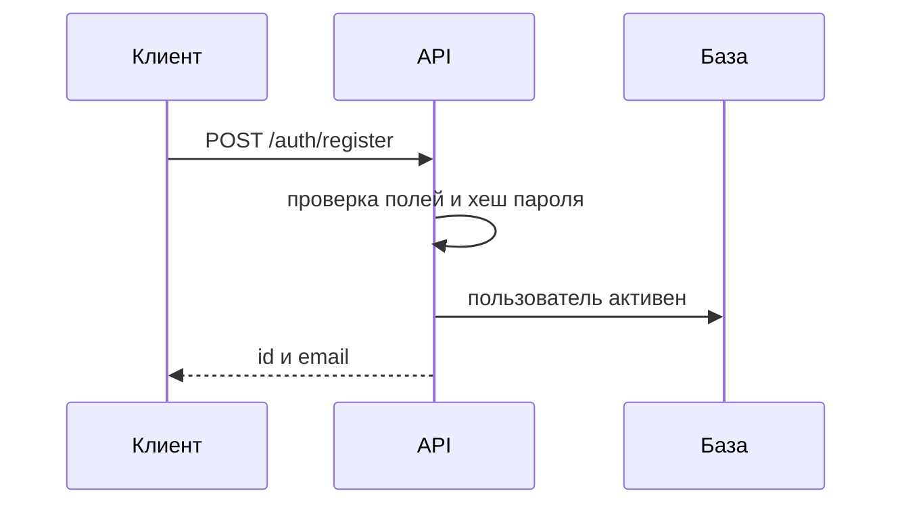
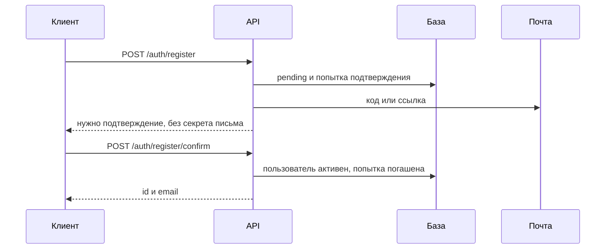

# Регистрация

## Содержание

- [Теория](#теория)
  - [Ситуация](#ситуация)
  - [Модель](#модель)
  - [Понятия и связь с бэкендом](#понятия-и-связь-с-бэкендом)
  - [Зоны ответственности](#зоны-ответственности)
  - [Пример](#пример)
  - [Типичные сбои](#типичные-сбои)
  - [Полезные ссылки](#полезные-ссылки)
  - [Вопросы по теории](#вопросы-по-теории)
- [Практическое задание](#практическое-задание)
  - [1.1 Общее](#11-общее)
  - [1.2 Сценарии](#12-сценарии-user-stories)
  - [1.3 Контракт](#13-контракт)
  - [1.4 Ошибки и ограничения](#14-ошибки-и-ограничения)
  - [1.5 Аудит](#15-аудитлоги)
  - [1.6 Нефункциональные требования](#16-нефункциональные-требования)

# Теория

## Ситуация

Гость отправляет email и пароль. Дальше возможен один из исходов: аккаунт сразу становится активным, сервер ждёт код или переход по ссылке из письма, поля не проходят проверку, почта уже занята, письмо не отправилось или срабатывает ограничение по частоте запросов либо по числу попыток.

Отдельный фронтенд не нужен, все запросы можно отправлять из HTTP-клиента.

## Модель

В регистрации участвуют гость, API, база данных и, если флаг включён, почтовый сервер. Отправлять ли письмо и каким способом, решает сервер. Если бы это выбирал клиент, подтверждение можно было бы обойти тем же запросом.

Без подтверждения сервер проверяет поля, считает хеш пароля и создаёт активного пользователя.




При включённом подтверждении создаются пользователь в состоянии `pending` и одна непогашенная попытка. Почта к этому моменту уже считается занятой, поэтому второй запрос регистрации на неё получит ту же ошибку, что и при повторной регистрации активного аккаунта. Другая схема хранения допустима, только если ответы API останутся прежними, включая занятость email до активации.




Вместо самого кода или токена попытка хранит HMAC-SHA256 от него с ключом из конфигурации. Для шестизначного кода попытку сначала находят по идентификатору и только затем сравнивают HMAC, поскольку перебрать хеши короткого кода по всей таблице слишком просто. Токен ссылки — 32 случайных байта, и попытка находится по HMAC этого токена: перебор здесь невозможен. Идентификатор в токен не входит, формат `attemptId.secret` относится ко входу, а не к регистрации. Секрет сравнивается за постоянное время, обычное сравнение строк для этого не подходит. Ключ HMAC при этом не заменяет соль пароля.

Аккаунт по ссылке активируется POST-запросом. Почтовые сканеры и превью сами открывают URL методом GET и израсходовали бы одноразовый токен раньше, чем письмо откроет человек.

Возможный набор полей (схема может быть и другой):


| `users`         | Описание                                                                              |
| --------------- | ------------------------------------------------------------------------------------- |
| `id`            | идентификатор пользователя                                                            |
| `email`         | нормализованный email: без крайних пробелов, в нижнем регистре, с уникальным индексом |
| `password_hash` | медленный хеш пароля, соль входит в строку, отдельного поля для неё нет               |
| `status`        | `pending` или `active`                                                                |
| `created_at`    | время создания                                                                        |
| `updated_at`    | время обновления                                                                      |


| `registration_challenges` | Описание                                                                                        |
| ------------------------- | ----------------------------------------------------------------------------------------------- |
| `id`                      | идентификатор попытки: его отдаёт ответ регистрации, по нему `confirm` находит попытку для кода |
| `user_id`                 | ссылка на `users.id`                                                                            |
| `method`                  | способ: `otp` или `magic_link`                                                                  |
| `secret_hash`             | HMAC-SHA256 от кода или токена с ключом из конфигурации, сам секрет не хранится                 |
| `expires_at`              | конец TTL: 10 минут после отправки письма, повторная отправка запускает отсчёт заново           |
| `attempts`                | число неверных вводов кода: после пятого попытка погашена, повторная отправка обнуляет счётчик  |
| `last_sent_at`            | время последней отправки письма: следующая не раньше чем через 60 секунд                        |
| `consumed_at`             | момент погашения попытки: успешное подтверждение или пятый неверный ввод кода                   |


### Нормальная форма

Таблица `users` находится в нормальной форме Бойса — Кодда (BCNF). `registration_challenges` тоже соответствовала бы BCNF, но из-за вычисляемого поля `expires_at` формально остаётся во второй нормальной форме (2NF).

Каждая следующая форма включает требования предыдущей:

- **1NF:** каждая ячейка содержит одно значение, без списков и наборов. В `password_hash` одной строкой записаны алгоритм, cost, соль и сам хеш, однако запросы к базе к этим частям по отдельности не обращаются. Строку целиком разбирает функция проверки из библиотеки, так что для базы это одно значение.
- **2NF:** неключевое поле зависит от ключа целиком, без частичных зависимостей. Все ключи схемы простые, то есть состоят из одного поля: `id` и `email` в `users`, `id` в `registration_challenges`. У простого ключа нет частей, поэтому 2NF выполняется автоматически.
- **3NF и BCNF:** неключевые поля зависят только от ключа и не определяются друг другом. Для таблиц с простыми ключами эти две формы совпадают. Попытка ссылается на пользователя через `user_id`, а его `email` и `status` хранятся только в `users`.
- **4NF и 5NF:** в одной таблице не смешиваются независимые списки фактов, например роли и телефоны одного пользователя. Таблица в 3NF с простыми ключами удовлетворяет этому требованию автоматически (теорема Дейта — Фейгина), поэтому `users` находится и в 5NF.

Исключение составляет поле `expires_at`. Его значение всегда равно `last_sent_at` плюс 10 минут, то есть одно неключевое поле определяется другим. Возникает транзитивная зависимость от ключа через `last_sent_at`, которую 3NF не допускает.

Такая зависимость создаёт риск аномалии обновления. Если при повторной отправке обновить `last_sent_at`, но не `expires_at`, отсчёт TTL не начнётся заново, хотя контракт этого требует. Поэтому оба поля обновляются одним `UPDATE`.

Зависимость пропадает, если `expires_at` не хранить, а вычислять при проверке как `last_sent_at` плюс 10 минут. В этом случае таблица попытки, как и `users`, будет в BCNF и в 5NF. Хранить оба поля тоже допустимо. Это сознательная денормализация, зато срок действия попытки читается из записи без вычислений.

## Понятия и связь с бэкендом


### Пароль

В базе хранится результат односторонней функции. При входе сервер пропускает введённый пароль через ту же функцию и сравнивает результаты.

Для нового приложения предпочтителен Argon2id. Если нативный Argon2 в среде не собирается, его заменяют на bcrypt с cost не ниже 12. Параметр cost определяет стоимость вычисления одного хеша при регистрации и при входе. Оба алгоритма создают отдельную соль для каждого пароля и встраивают её в итоговую строку. Поэтому два хеша одного и того же пароля различаются, но проверка через библиотеку всё равно проходит.

Для паролей не подходят MD5, SHA-1, SHA-256 без соли и без большого числа итераций, CRC32, а также самодельные функции с общим секретом для всех пользователей. При утечке базы такие пароли перебираются слишком дёшево. У bcrypt есть и своё ограничение: байты после 72-го молча отбрасываются, и разные пароли с общим началом начинают совпадать. Поэтому слишком длинный пароль отклоняется проверкой ещё до хеширования.

### Письмо

Письма отправляются по SMTP. IMAP и POP3 этому API не нужны, так как читать почтовый ящик серверу не требуется.

Дальше письмо проходит такой путь:

1. Приложение передаёт его SMTP-серверу.
2. SMTP-сервер находит почтовый сервер домена получателя.
3. Сервер получателя помещает письмо во входящие или в спам, учитывая в том числе SPF и DKIM отправителя.

На стенде шаги 2 и 3 заменяет локальный перехватчик почты, например Mailpit. Письмо видно в его интерфейсе, но о доставке на боевой домен это ничего не говорит. Библиотека языка выполняет только шаг 1. Пароль от ящика Gmail или Яндекса для локальной работы не нужен, а для доступа приложения к боевому ящику часто нужен отдельный пароль приложения.

Если SMTP не принял письмо, попытка и запись `pending` сохраняются, а клиент получает **503**. Повторная регистрация в этом случае вернёт ошибку занятого email, поэтому письмо запрашивают повторной отправкой.

### Что будет на входе

После регистрации с активным статусом пользователь ещё не вошёл в систему. Позже модуль аутентификации будет выдавать два JWT в cookies: access на 15 минут и refresh на 30 дней. Это отдельный контракт, при регистрации токены не подписываются.

JWT состоит из трёх частей, разделённых точками: заголовка, полезной нагрузки и подписи. Первые две закодированы в base64url, и прочитать их может любой, к кому попал токен. Подпись позволяет серверу обнаружить подмену, но содержимое не скрывает, поэтому пароль, его хеш и секрет подписи в полезную нагрузку не помещают. Короткий срок жизни access ограничивает время, в течение которого украденным токеном можно воспользоваться, а refresh нужен, чтобы не запрашивать пароль каждые 15 минут.

### Сводка


| Понятие    | Смысл в регистрации                         | На что опирается реализация                                                      |
| ---------- | ------------------------------------------- | -------------------------------------------------------------------------------- |
| Гость      | вызов без сессии                            | операция публичная, роль появится в RBAC                                         |
| Хеш пароля | односторонний результат с собственной солью | Argon2id или bcrypt, проверка функцией библиотеки                                |
| `pending`  | email уже занят, вход ещё рано открывать    | тот же пользователь, другая стадия, либо отдельная заявка с той же уникальностью |
| OTP        | 6 цифр, 10 минут, 5 попыток                 | поиск по id попытки, в базе только HMAC                                          |
| Magic link | одноразовый токен той же попытки            | активация через POST                                                             |
| SMTP       | доставка секрета владельцу ящика            | SMTP-клиент выбранного языка и локальный перехватчик почты                       |
| JWT        | пропуск уже вошедшего пользователя          | модули аутентификации и авторизации, не ответ регистрации                        |


## Зоны ответственности


| Клиент                                                             | Сервер                                                            |
| ------------------------------------------------------------------ | ----------------------------------------------------------------- |
| Отправляет email и пароль                                          | Проверяет формат, политику пароля и уникальность                  |
| По активному статусу переходит к входу                             | Создаёт активную запись и не создаёт сессию                       |
| По признаку подтверждения показывает ввод кода или ожидание письма | Создаёт `pending`, попытку и письмо                               |
| Присылает код или токен на подтверждение                           | Гасит попытку и активирует запись                                 |
| Показывает ошибку поля или ожидание по статусу ответа              | Отличает неверный ввод, просрочку, занятый email и предел частоты |
| Держит пароль только до отправки формы                             | Хранит хеш пароля и HMAC секрета письма                           |


Запрос из браузера с другого origin сначала проходит предварительную CORS-проверку. Пока клиентом служит HTTP-утилита, настройку списка доверенных origin можно отложить до появления страницы. Если браузер показывает сетевую ошибку, а в журнале API регистрация отмечена как успешная, значит, запись создана, но браузеру не вернули разрешающий заголовок.

## Пример

В примере пароль `секрет12` хешируется библиотекой bcrypt. Программа выводит строку хеша и проверяет, что хеш не совпадает с паролем, повторный хеш того же пароля отличается от первого, а проверка через библиотеку проходит для исходного пароля и не проходит для другого.

### Node.js

**Node.js, библиотека bcrypt.** Cost 12 — минимально допустимое значение для bcrypt. Предпочтительный Argon2id для Node.js есть в пакете `argon2`.

```sh
npm install bcrypt
node hash-demo.js
```

```javascript
const { hash, compare } = require('bcrypt');

async function main() {
  const password = 'секрет12';
  const stored = await hash(password, 12);
  const again = await hash(password, 12);

  console.log(stored);
  console.log(stored === password);
  console.log(stored === again);
  console.log(await compare(password, stored));
  console.log(await compare('секрет13', stored));
}

main();
```


### .NET

**.NET, пакет BCrypt.Net-Next.** `workFactor: 12` — минимально допустимое значение для bcrypt. Argon2id для .NET есть в пакете `Isopoh.Cryptography.Argon2`. Подходит и `PasswordHasher` из ASP.NET Core Identity на основе PBKDF2, но число итераций в нём нужно сверить с актуальной рекомендацией OWASP.

```sh
dotnet new console -o HashDemo
cd HashDemo
dotnet add package BCrypt.Net-Next
dotnet run
```

```csharp
using BCrypt.Net;

var password = "секрет12";
var stored = BCrypt.Net.BCrypt.HashPassword(password, workFactor: 12);
var again = BCrypt.Net.BCrypt.HashPassword(password, workFactor: 12);

Console.WriteLine(stored);
Console.WriteLine(stored == password);
Console.WriteLine(stored == again);
Console.WriteLine(BCrypt.Net.BCrypt.Verify(password, stored));
Console.WriteLine(BCrypt.Net.BCrypt.Verify("секрет13", stored));
```


### Python

**Python, пакет bcrypt.** `rounds=12` — минимально допустимое значение для bcrypt. Предпочтительный Argon2id для Python есть в пакете `argon2-cffi`.

```sh
pip install bcrypt
python hash_demo.py
```

```python
import bcrypt

password = "секрет12".encode()
stored = bcrypt.hashpw(password, bcrypt.gensalt(rounds=12))
again = bcrypt.hashpw(password, bcrypt.gensalt(rounds=12))

print(stored.decode())
print(stored == password)
print(stored == again)
print(bcrypt.checkpw(password, stored))
print(bcrypt.checkpw("секрет13".encode(), stored))
```

---

Строка хеша bcrypt начинается с `$2` и самого пароля не содержит. Второй вызов возвращает другую строку, потому что соль генерируется заново. Функция проверки из библиотеки сверяет пароль с конкретной сохранённой строкой.

## Типичные сбои


| Что видно                                                        | Куда смотреть                                                                                          |
| ---------------------------------------------------------------- | ------------------------------------------------------------------------------------------------------ |
| В ответе или в журнале есть пароль                               | в ответ попала вся строка пользователя, в журнал — тело запроса или секрет письма                      |
| В базе пароль совпадает с введённым                              | в сохранение ушло исходное поле                                                                        |
| Одинаковые пароли дают одну и ту же строку                       | у хеша нет собственной соли                                                                            |
| Два длинных разных пароля позже совпадают                        | алгоритм обрезал секрет. У bcrypt это происходит после 72 байт                                         |
| `User@Example.com` создал второго пользователя                   | в индекс записан email без нижнего регистра                                                            |
| Параллельная регистрация одного email даёт необработанную ошибку | нет уникального индекса, либо конфликт индекса не превращён в ответ 1.4                                |
| Код есть и в перехватчике почты, и в ответе регистрации          | секрет письма вернулся клиенту, подтверждение больше ничего не доказывает                              |
| Ссылка сразу оказывается использованной                          | GET погасил токен, его успело открыть превью или сканер                                                |
| Верный код после пяти ошибок всё ещё проходит                    | попытка не гасится на пятом неверном вводе                                                             |
| Письмо негде открыть локально                                    | SMTP указывает на боевой ящик. Для стенда нужен локальный перехватчик, например Mailpit                |
| Повторная регистрация после сбоя почты                           | `pending` уже занял email. Клиенту нужен был **503**, а новое письмо запрашивается повторной отправкой |


## Полезные ссылки


### Общие

- [MDN — HTTP response status codes](https://developer.mozilla.org/en-US/docs/Web/HTTP/Reference/Status) — статусы, которые возвращает регистрация.
- [MDN — CORS](https://developer.mozilla.org/en-US/docs/Web/HTTP/Guides/CORS) — почему браузер может показать сбой при уже созданной записи.
- [OWASP — Password Storage Cheat Sheet](https://cheatsheetseries.owasp.org/cheatsheets/Password_Storage_Cheat_Sheet.html) — Argon2id, bcrypt и почему быстрый хеш не подходит.
- [OWASP — Forgot Password Cheat Sheet](https://cheatsheetseries.owasp.org/cheatsheets/Forgot_Password_Cheat_Sheet.html) — одноразовые PIN и ссылки: срок, перебор, доставка отдельным каналом.
- [jwt.io — Introduction](https://www.jwt.io/introduction) — как устроен JWT. При регистрации токены не выпускаются.
- [Mailpit](https://mailpit.axllent.org/) — локальный SMTP-сервер с интерфейсом для просмотра писем на стенде.
- [PostgreSQL — Unique indexes](https://www.postgresql.org/docs/current/indexes-unique.html) — уникальные индексы, если используется PostgreSQL.
- [Bruno](https://www.usebruno.com/) или [Postman](https://www.postman.com/) — отправка тех же запросов, которые позже будет отправлять форма.


### По языку


#### Node.js

**Node.js, NestJS.** На Express или Fastify контракт регистрации остаётся тем же.

- [NestJS — First steps](https://docs.nestjs.com/first-steps) — создание приложения и запуск.
- [NestJS — Modules](https://docs.nestjs.com/modules) — выделение регистрации в отдельный модуль.
- [NestJS — Validation](https://docs.nestjs.com/techniques/validation) — валидация тела запроса.
- [NestJS — Configuration](https://docs.nestjs.com/techniques/configuration) — флаг подтверждения и настройки SMTP из переменных окружения.
- [argon2](https://www.npmjs.com/package/argon2) — Argon2id для Node.js.
- [bcrypt](https://www.npmjs.com/package/bcrypt) — хеш и сравнение, cost не ниже 12.
- [Node.js — crypto](https://nodejs.org/api/crypto.html) — HMAC и `timingSafeEqual` для секрета письма.
- [Nodemailer](https://nodemailer.com/) — отправка писем по SMTP.
- [NestJS — OpenAPI](https://docs.nestjs.com/openapi/introduction) — описание операций.
- [Prisma Migrate](https://www.prisma.io/docs/orm/prisma-migrate) или [TypeORM — How migrations work](https://typeorm.io/docs/migrations/why) — миграции схемы вместо автоматической синхронизации при запуске.


#### .NET

**.NET, ASP.NET Core.** Можно использовать как Minimal API, так и контроллеры, контракт регистрации от этого не зависит.

- [ASP.NET Core — Minimal API](https://learn.microsoft.com/en-us/aspnet/core/tutorials/min-web-api) — создание HTTP API.
- [Валидация моделей](https://learn.microsoft.com/en-us/aspnet/core/mvc/models/validation) — валидация тела запроса.
- [Конфигурация](https://learn.microsoft.com/en-us/aspnet/core/fundamentals/configuration/) — флаг подтверждения и настройки SMTP из переменных окружения.
- [Isopoh.Cryptography.Argon2](https://github.com/mheyman/Isopoh.Cryptography.Argon2) — Argon2id для .NET.
- [BCrypt.Net-Next](https://github.com/BcryptNet/bcrypt.net) — хеш и `Verify`, work factor не ниже 12.
- [CryptographicOperations.FixedTimeEquals](https://learn.microsoft.com/en-us/dotnet/api/system.security.cryptography.cryptographicoperations.fixedtimeequals) — сравнение секрета письма за постоянное время.
- [MailKit](https://github.com/jstedfast/MailKit) — отправка писем по SMTP.
- [Swashbuckle](https://learn.microsoft.com/en-us/aspnet/core/tutorials/getting-started-with-swashbuckle) — описание операций в OpenAPI.
- [EF Core — Migrations](https://learn.microsoft.com/en-us/ef/core/managing-schemas/migrations/) — миграции схемы вместо обновления базы при запуске.


#### Python

**Python, FastAPI.** Для Django или Flask контракт не меняется, библиотеки для хеширования и SMTP подходят те же.

- [FastAPI — First steps](https://fastapi.tiangolo.com/tutorial/first-steps/) — создание приложения, запуск и интерактивная схема API.
- [Pydantic — Validators](https://docs.pydantic.dev/latest/concepts/validators/) — валидация тела запроса.
- [FastAPI — Settings](https://fastapi.tiangolo.com/advanced/settings/) — флаг подтверждения и настройки SMTP из переменных окружения.
- [argon2-cffi](https://argon2-cffi.readthedocs.io/en/stable/) — Argon2id для Python.
- [bcrypt](https://github.com/pyca/bcrypt) — хеш и `checkpw`, rounds не ниже 12.
- [hmac](https://docs.python.org/3/library/hmac.html) — HMAC и `compare_digest` для секрета письма.
- [smtplib](https://docs.python.org/3/library/smtplib.html) — отправка писем по SMTP средствами стандартной библиотеки.
- [Alembic](https://alembic.sqlalchemy.org/en/latest/tutorial.html) — миграции схемы вместо создания таблиц при запуске.

## Вопросы по теории

1. Чем медленный хеш с собственной солью лучше быстрого SHA-256 для пароля, и что сервер сравнивает при входе?
2. Почему шестизначный код хранят как HMAC и ищут попытку по её идентификатору, а не по хешу кода?
3. Почему переход по ссылке из письма не активирует аккаунт?
4. Какую часть доставки письма выполняет приложение, и от чего зависит, попадёт ли письмо во входящие или в спам?
5. Что означает сетевая ошибка в браузере, если в журнале API регистрация уже успешна?
6. Почему `registration_challenges` формально находится только во 2NF, и какую аномалию обновления допускает такая схема?

# Практическое задание

Функциональность регистрации пользователя в системе.
Гость создаёт учётную запись по email и паролю. Если подтверждение выключено, аккаунт активен сразу, а если включено, ждёт кода из письма или перехода по ссылке. Способ подтверждения выбирает сервер. Пароль хранится только в виде медленного хеша, повторная регистрация на тот же email запрещена.

## 1) Регистрация


### 1.1 Общее

**Назначение:** создать аккаунт пользователя по email и паролю.

**Пользователи/роли:** гость (неаутентифицированный пользователь).

**Зависимости/связанные настройки:** подтверждение email для регистрации включается отдельным флагом сценария «регистрация». Пока нет модуля настроек, флаг задаётся в конфигурации приложения. Подтверждение входа задаёт собственный флаг модуля аутентификации и на регистрацию не влияет.

Сессию создаёт модуль аутентификации, сама регистрация токены не выдаёт. Роль `user` назначает RBAC в той же транзакции, где пользователь становится `active`. Пока модуль RBAC не подключён, регистрация роль не создаёт: уже активные пользователи получат её при первой загрузке пустой конфигурации RBAC.

### 1.2 Сценарии (user stories)

1. **Регистрация без подтверждения:** пользователь вводит email и пароль, аккаунт сразу становится активным и пригодным для входа. Сам вход при этом не выполняется.
2. **Регистрация с подтверждением:** пользователь вводит email и пароль, а затем подтверждает email кодом (OTP) или по ссылке (magic link). Какой из двух способов используется, определяет настройка сервера.


### 1.3 Контракт


#### 1.3.1 Запрос на регистрацию


| `POST /auth/register` | Проверки/валидация                                                                                                                                                                                                                                                                          |
| --------------------- | ------------------------------------------------------------------------------------------------------------------------------------------------------------------------------------------------------------------------------------------------------------------------------------------- |
| `email: string`       | Обязателен, валидный формат. Перед сравнением и записью обрезаются крайние пробелы, буквы приводятся к нижнему регистру. `user+tag@example.com` — отдельный адрес. Повторная регистрация на уже существующий `email` запрещена. Это относится и к аккаунту, который ещё ждёт подтверждения. |
| `password: string`    | Обязателен. Крайние пробелы у пароля сохраняются. Политика пароля: от 8 символов, минимум одна буква любого алфавита и одна цифра. Слишком длинный пароль отклоняется проверкой: алгоритм не должен молча отрезать хвост.                                                                   |


**Логика/шаги:**

1. Принять `email`, `password`.
2. Проверить валидность входных данных.
3. Посчитать медленный хеш пароля с отдельной солью для каждого пароля. Восстановить пароль из хеша нельзя. Соль входит в итоговую строку, поэтому отдельное поле для неё не нужно.
4. Если подтверждение регистрации выключено — создать пользователя в активном состоянии и, если модуль RBAC подключён, назначить роль `user` в той же транзакции.
5. Если подтверждение регистрации включено — создать пользователя в состоянии `pending` без роли, сохранить попытку подтверждения и отправить письмо выбранным способом:
    - код (OTP), или
    - ссылка (magic link).

Флаг влияет только на новые регистрации. Если его выключили уже после регистрации, созданная запись `pending` сама активной не станет. Её по-прежнему завершают подтверждение или повторная отправка.

Если письмо не ушло, запись `pending` и попытка сохраняются. Повторный `register` на этот email вернёт ошибку занятой почты, а доставить письмо заново можно только повторной отправкой.

Уникальность email обеспечивает ограничение в базе данных. Конфликт по этому ограничению возвращается как обычная ошибка повторной регистрации и не должен приводить к необработанному сбою сервера.

**Ответы:**

- **Подтверждение выключено:** **201 Created**, `id`, нормализованный `email`, `status: active`. Пароль, хеш и токены в ответ не входят.
- **Подтверждение включено:** **202 Accepted**, `confirmationRequired: true`, `method` (`otp` или `magic_link`), `attemptId`, `expiresInSeconds: 600`, `resendAfterSeconds: 60`. Код и токен ссылки передаются только в письме и в ответе отсутствуют.


#### 1.3.2 Подтверждение регистрации через email

**Общее правило:** новый пользователь проходит подтверждение, только если в момент регистрации был включён флаг сценария «регистрация». Уже выпущенную попытку можно подтвердить или отправить заново независимо от того, включён ли флаг сейчас.


| `POST /auth/register/confirm`               | Параметры                                                                                                                                                                                                                                     |
| ------------------------------------------- | --------------------------------------------------------------------------------------------------------------------------------------------------------------------------------------------------------------------------------------------- |
| Код (OTP): `идентификатор попытки` + `code` | Длина: 6 цифр. TTL: 10 минут. Лимит попыток ввода: 5. Пятая попытка ещё может быть успешной. Пятый неверный ввод — это неверный код, и попытка после него погашена. Следующий запрос, даже с верным кодом, отклоняется как исчерпанный лимит. |
| Ссылка (magic link): `token`                | 32 случайных байта. Попытка находится по HMAC токена, идентификатор в него не входит. TTL: 10 минут. Токен одноразовый. Аккаунт активирует `POST` с токеном. Открытие ссылки само по себе статус не меняет.                                      |


| `POST /auth/register/resend` | Параметры                                                                                                                                                                                                                                                 |
| ---------------------------- | --------------------------------------------------------------------------------------------------------------------------------------------------------------------------------------------------------------------------------------------------------- |
| `email`                      | Не чаще 1 раза в 60 секунд. Для кода новое письмо заменяет предыдущий код, заново запускает TTL и обнуляет счётчик попыток. Старый код больше не подходит. Для ссылки новое письмо заменяет предыдущую ссылку, заново запускает TTL и гасит старый токен. |


**Логика/шаги:**

1. Найти попытку и проверить, что она ещё не погашена. Если попытка не найдена или уже погашена, ответ такой же, как при неверном коде.
2. Отклонить просроченную попытку, не увеличивая счётчик вводов.
3. Сравнить секрет. Код и токен хранятся в базе в виде, из которого их нельзя восстановить. Если код не совпал, счётчик попыток увеличивается.
4. При успехе перевести пользователя в активное состояние, назначить роль `user`, если модуль RBAC подключён и роль ещё не назначена, и погасить попытку.

**Ответы:**

- **Успех confirm:** **200 OK**, `id`, `email`, `status: active`.
- **Успех resend:** **202 Accepted**, `confirmationRequired: true`, `method`, `attemptId`, `expiresInSeconds: 600`, `resendAfterSeconds: 60`. Секрет в ответе отсутствует.
- **Ошибки:** см. раздел 1.4.


### 1.4 Ошибки и ограничения

- **400** — некорректный email.
- **400** — пароль не проходит политику.
- **409** — email уже зарегистрирован.
- **400** — неверный или просроченный код или токен подтверждения, а также ненайденная и уже погашенная попытка.
- **429** — исчерпаны попытки ввода кода, повторная отправка раньше 60 секунд или слишком частая регистрация.
- **503** — письмо не отправлено. Запись `pending` и попытка при этом сохранены.

Вместо `409` допускается нейтральный ответ, по которому нельзя понять, занята ли почта. В этом случае такой же ответ должна возвращать и повторная отправка. Нейтральный ответ не содержит `id` существующего аккаунта и не повторяет тело успешного создания, если по этому телу видно, создан ли аккаунт. По умолчанию используется явный `409`.

### 1.5 Аудит/логи

Логировать: попытки регистрации (успех и неуспех), отправку кода или ссылки, успешные и неуспешные подтверждения.

В журнал не попадают пароль, хеш пароля, код, токен ссылки и тело запроса целиком.

### 1.6 Нефункциональные требования

- Защита от спама и перебора: rate limit на регистрацию и повторную отправку. Числовой порог регистрации задаётся в конфигурации.
- Пароль и секрет письма нельзя восстановить из базы, ответа API и журнала.
- Общие нефункциональные требования проекта (валидация входных данных, описание API, тесты) относятся и к этим операциям.
