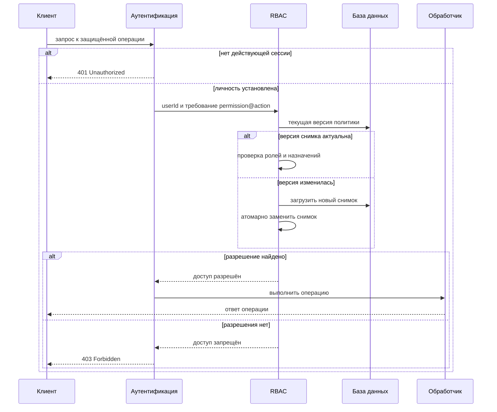
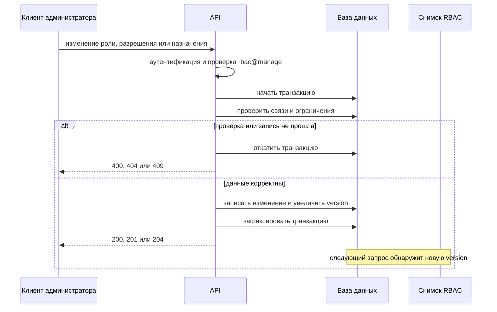
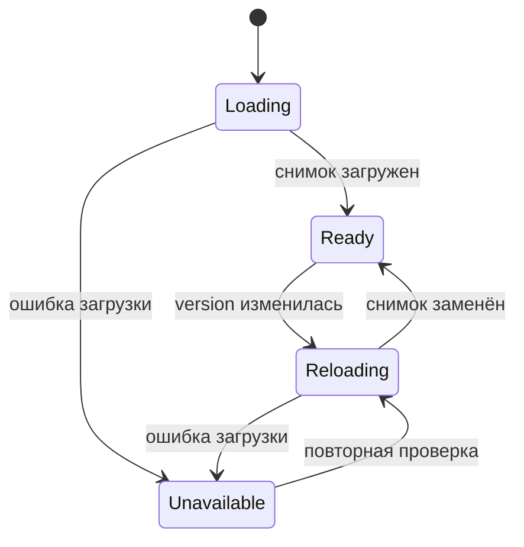

# RBAC

## Содержание

- [Теория](#теория)
  - [Ситуация](#ситуация)
  - [Модель](#модель)
  - [Понятия и связь с бэкендом](#понятия-и-связь-с-бэкендом)
  - [Зоны ответственности](#зоны-ответственности)
  - [Пример](#пример)
  - [Типичные сбои](#типичные-сбои)
  - [Полезные ссылки](#полезные-ссылки)
  - [Вопросы по теории](#вопросы-по-теории)
- [Практическое задание](#практическое-задание)
  - [1.1 Общее](#11-общее)
  - [1.2 Сценарии](#12-сценарии-user-stories)
  - [1.3 Контракт](#13-контракт)
  - [1.4 Ошибки и ограничения](#14-ошибки-и-ограничения)
  - [1.5 Аудит](#15-аудитлоги)
  - [1.6 Нефункциональные требования](#16-нефункциональные-требования)

# Теория

## Ситуация

Аутентифицированный пользователь обращается к защищённой операции, а сервер сопоставляет требуемое разрешение с его ролями. Дальше возможен один из исходов: обработчик выполняется, запрос без действующей сессии получает **401**, пользователю без разрешения возвращается **403**, а при недоступной актуальной конфигурации доступа — **503**. Администратор отдельно создаёт роли и разрешения, связывает их между собой и назначает роли пользователям; некорректные данные, отсутствующие сущности, конфликты и опасное удаление получают **400**, **404** или **409**.

Отдельный фронтенд не нужен, все запросы можно отправлять из HTTP-клиента.

## Модель

В проверке доступа участвуют клиент, аутентификация, RBAC, база данных и обработчик защищённой операции. Клиент сообщает, что хочет сделать, но требуемые `permission` и `action` задаёт сам обработчик. Иначе пользователь мог бы подменить требование на более слабое.

Аутентификация сначала устанавливает личность пользователя. RBAC получает проверенный `userId`, объединяет разрешения всех назначенных ему ролей и допускает запрос только при точном совпадении разрешения и действия.



Проверка идёт до чтения целевого ресурса. Поэтому пользователь без права получает **403** независимо от того, существует ли запрошенная запись, и не может перебирать идентификаторы по различию между **403** и **404**.

Изменение политики выполняется одной транзакцией. Вместе с ролями, разрешениями или назначениями увеличивается номер версии. После успешного ответа любой новый запрос сначала увидит эту версию и при необходимости загрузит снимок заново.



Снимок заменяется целиком, а не дополняется по частям. Если новая версия не загрузилась, старые правила не используются: защищённая операция получает **503**, её обработчик не запускается. Изменение в базе при этом уже сохранено, поэтому повторять административный запрос не нужно.



Роль объединяет разрешения, но сама не описывает конкретную HTTP-операцию. Например, обработчик своего профиля требует `users@read`, обработчик списка пользователей — `users@list`, а обработчик удаления — `users@delete`. Если у пользователя несколько ролей, достаточно подходящего назначения хотя бы в одной из них. Отсутствие роли, разрешения или действия всегда означает запрет.

Возможный набор полей (схема может быть и другой):

| `roles` | Описание |
| --- | --- |
| `id` | идентификатор роли |
| `name` | нормализованное уникальное имя |
| `description` | необязательное описание |
| `created_at` | время создания |
| `updated_at` | время последнего изменения |

| `permissions` | Описание |
| --- | --- |
| `id` | идентификатор разрешения |
| `name` | нормализованное уникальное имя ресурса, например `users` |
| `description` | необязательное описание |
| `created_at` | время создания |
| `updated_at` | время последнего изменения |

| `permission_actions` | Описание |
| --- | --- |
| `id` | идентификатор действия |
| `permission_id` | ссылка на `permissions.id` |
| `name` | действие, например `read`, `update` или `delete`; пара `permission_id` + `name` уникальна |

| `grants` | Описание |
| --- | --- |
| `id` | идентификатор назначения |
| `role_id` | ссылка на `roles.id` |
| `permission_id` | ссылка на `permissions.id`; пара `role_id` + `permission_id` уникальна |
| `all_actions` | признак доступа ко всем текущим и будущим действиям разрешения |
| `created_at` | время создания |
| `updated_at` | время последнего изменения |

| `grant_actions` | Описание |
| --- | --- |
| `grant_id` | ссылка на `grants.id` |
| `permission_action_id` | ссылка на `permission_actions.id`; вместе с `grant_id` образует первичный ключ |

| `user_roles` | Описание |
| --- | --- |
| `user_id` | ссылка на существующего пользователя |
| `role_id` | ссылка на `roles.id`; вместе с `user_id` образует первичный ключ |

| `rbac_policy_state` | Описание |
| --- | --- |
| `id` | фиксированный идентификатор единственной строки |
| `version` | монотонно возрастающая версия политики |
| `updated_at` | время последнего изменения политики |

### Нормальная форма

Все таблицы схемы находятся в нормальной форме Бойса — Кодда (BCNF) и не требуют сознательной денормализации в базе данных.

Каждая следующая форма включает требования предыдущей:

- **1NF:** каждая ячейка содержит одно значение. Массивы действий и ролей из API раскладываются по строкам `permission_actions`, `grant_actions` и `user_roles`, а не сохраняются в одном текстовом или JSON-поле.
- **2NF:** неключевое поле зависит от ключа целиком. В таблицах-связках `grant_actions` и `user_roles` неключевых полей нет, а в остальных таблицах используется простой ключ `id`.
- **3NF и BCNF:** описания и временные метки относятся только к своей роли, разрешению или назначению. Имя роли не копируется в `user_roles`, а имя разрешения и действия не копируется в `grants`, поэтому изменение названия выполняется в одном месте.
- **4NF:** независимые многозначные факты разделены. Роли пользователя хранятся отдельно от действий разрешения, иначе сочетание двух списков создавало бы лишние строки и аномалии обновления.
- **5NF:** связи «пользователь — роль», «роль — разрешение» и «назначение — действие» восстанавливаются соединением по внешним ключам. Дополнительных зависимостей соединения, которые требовали бы объединить эти факты в одну таблицу, нет.

Снимок в памяти содержит уже соединённые данные и потому выглядит денормализованным, но источником истины не является. Его можно удалить и построить заново из нормализованных таблиц. Версия политики не даёт использовать такой снимок после изменения исходных строк.

## Понятия и связь с бэкендом

### Аутентификация и авторизация

Аутентификация отвечает на вопрос «кто отправил запрос». В этой системе она проверяет access JWT из cookie и передаёт дальше `userId`. Если cookie отсутствует, токен повреждён или истёк, сервер возвращает **401 Unauthorized** до вызова RBAC.

Авторизация отвечает на другой вопрос: «может ли уже известный пользователь выполнить эту операцию». RBAC принимает решение после аутентификации. Действующая сессия без нужного разрешения приводит к **403 Forbidden**; повторный вход сам по себе прав не добавит.

Роли из тела запроса, query-параметров и неподписанных заголовков не используются. Хранить роли только внутри access JWT тоже недостаточно для динамической политики: удалённая роль продолжала бы действовать до истечения токена. Поэтому JWT подтверждает личность, а текущие роли и назначения берутся из актуального снимка серверных данных.

### Роли, разрешения и назначения

Роль описывает рабочую функцию, например `admin`, `support` или `user`. Разрешение называет ресурс, а действие уточняет операцию над ним. Пара `users@read` означает чтение пользователей, тогда как `users@delete` даёт отдельное право.

Назначение связывает одну роль с одним разрешением. Непустой список действий открывает только перечисленные операции. Пустой список означает все действия разрешения, включая добавленные позднее; в базе этот случай отмечается `all_actions`, чтобы отсутствие строк не смешивалось с незавершённой записью.

Права нескольких ролей объединяются. Пользователь с ролями `viewer` и `editor` получает сумму их назначений, а не пересечение. Прямых назначений «пользователь — разрешение» нет: любое право проходит через роль, иначе централизованный аудит ролей перестал бы показывать фактический доступ.

### Запрет по умолчанию и минимальные привилегии

При отсутствии совпавшего назначения результатом служит запрет. Это относится и к новому обработчику, для которого забыли указать правило, и к неизвестному действию, и к пользователю без ролей. Открывать операцию при неполной конфигурации опасно: ошибка администратора превращается в доступ для всех.

Каждому обработчику назначается минимально необходимая пара `permission@action`. Проверка одной роли `admin` по имени быстро приводит к разрозненным условиям в коде. Проверка разрешений оставляет состав ролей изменяемым: роль можно переименовать или перераспределить, не меняя защищённые обработчики.

Клиент вправе скрыть кнопку, которой пользователь не сможет воспользоваться, однако это только интерфейсное решение. Окончательная проверка выполняется на сервере для каждого запроса, поскольку HTTP-запрос можно отправить без интерфейса.

### Динамическая политика и кеш

Чтение нескольких таблиц для каждого запроса даёт актуальный результат, но создаёт повторяющуюся нагрузку. Снимок в памяти ускоряет проверку, если приложение умеет отличать текущую копию от устаревшей.

Версия политики меняется в той же транзакции, что и конфигурация RBAC. Каждый процесс сравнивает версию снимка с версией базы перед решением. При несовпадении он сначала строит новый снимок, проверяет его целостность и только затем атомарно заменяет старый. Частично загруженный набор правил никогда не участвует в авторизации.

Транзакция также защищает составные изменения. Например, обновление разрешения меняет несколько действий и увеличивает версию как одно целое. Если любое ограничение нарушено, откатываются и действия, и версия, поэтому остальные процессы не пытаются загрузить состояние, которого нет.

Кешировать окончательный ответ «пользователю разрешено» без привязки к версии нельзя. После снятия роли такой результат сохранил бы доступ дольше, чем политика в базе.

### Границы RBAC

RBAC хорошо описывает вертикальные права: кто может просматривать список всех пользователей, менять настройки или удалять записи. Одной роли недостаточно для правила «пользователь может изменить только собственный профиль». Здесь решение зависит от отношения между текущим `userId` и владельцем ресурса, поэтому после общей проверки разрешения нужна проверка принадлежности.

Попытка выразить каждое отношение отдельной ролью приводит к росту числа ролей и сложной конфигурации. Для правил по владельцу, организации, времени или состоянию ресурса к RBAC добавляют проверки атрибутов или отношений. Наличие `users@update` означает право войти в сценарий обновления, но не отменяет проверку `targetUserId`.

### Что будет в аутентификации и защищённых операциях

Модуль аутентификации позже выдаст access и refresh JWT в cookies. RBAC не проверяет пароль, не создаёт сессию и не подписывает токены. Он получает личность только после успешной проверки access JWT.

Защищённые операции объявляют требуемые разрешение и действие на сервере. Свой профиль потребует `users@read`, список пользователей — `users@list`, изменение — `users@update`, удаление — `users@delete`. Чужая цель добавляет действие `*_any` уже в обработчике, после базовой пары и до поиска записи. Фильтрация полей и само изменение данных остаются обязанностью соответствующих модулей.

### Сводка

| Понятие | Смысл в RBAC | На что опирается реализация |
| --- | --- | --- |
| Пользователь | субъект проверки доступа | проверенный `userId` из аутентификации |
| Роль | набор рабочих полномочий | связь `user_roles` |
| Разрешение | защищаемый ресурс | уникальное имя в `permissions` |
| Действие | операция над ресурсом | строки `permission_actions` |
| Назначение | права роли на разрешение | `grants` и `grant_actions` |
| Запрет по умолчанию | отсутствие совпадения означает отказ | серверная проверка каждого запроса |
| Версия политики | признак актуальности снимка | транзакция и `rbac_policy_state` |
| **401** | личность не установлена | модуль аутентификации |
| **403** | личность известна, права нет | решение RBAC |

## Зоны ответственности

| Клиент | Сервер |
| --- | --- |
| Отправляет cookie сессии вместе с запросом | Проверяет JWT и получает `userId` |
| Запрашивает бизнес-операцию | Сам определяет требуемые `permission` и `action` |
| Может скрывать недоступные элементы интерфейса | Проверяет право независимо от интерфейса |
| Показывает вход после **401** | Не вызывает RBAC без установленной личности |
| Показывает отказ в доступе после **403** | Не раскрывает существование ресурса до проверки права |
| Отправляет административные формы RBAC | Нормализует данные, проверяет связи и применяет транзакцию |
| После успешного изменения может повторить бизнес-запрос | Обнаруживает новую версию политики без перезапуска |

Запрос из браузера с другого origin сначала проходит CORS-проверку. RBAC не заменяет CORS: первый механизм решает, имеет ли пользователь право на операцию, второй — разрешено ли браузеру передать ответ странице с конкретного origin. Скрытая кнопка, CORS и RBAC решают разные задачи.

## Пример

Программа проверяет доступ по каталогу `users`. Роль `user` даёт `read`, `update` и `delete`. Роль `admin` имеет пустой набор действий — по контракту это все действия разрешения, включая `list` и `delete_any`. Затем она выводит четыре решения: владелец читает профиль, владелец не получает список всех пользователей, объединение ролей даёт `list`, пустой набор у `admin` открывает `delete_any`.

### Node.js

**Node.js 22 или новее, стандартные `Map` и `Set`.** Внешние пакеты не нужны; в приложении ту же функцию вызывает guard или другой серверный перехватчик.

```sh
node rbac-demo.js
```

```javascript
const grants = new Map([
  ['user', new Map([['users', new Set(['read', 'update', 'delete'])]])],
  ['admin', new Map([['users', new Set()]])],
]);

function can(roles, permission, action) {
  return roles.some((role) => {
    const roleGrants = grants.get(role);
    if (!roleGrants?.has(permission)) return false;

    const actions = roleGrants.get(permission);
    return actions.size === 0 || actions.has(action);
  });
}

console.log(can(['user'], 'users', 'read'));
console.log(can(['user'], 'users', 'list'));
console.log(can(['user', 'admin'], 'users', 'list'));
console.log(can(['admin'], 'users', 'delete_any'));
```

### .NET

**.NET 8 или новее, стандартные `Dictionary` и `HashSet`.** Дополнительный NuGet-пакет не нужен; в ASP.NET Core проверка подключается через authorization handler.

```sh
dotnet new console -o RbacDemo
cd RbacDemo
dotnet run
```

```csharp
var grants = new Dictionary<string, Dictionary<string, HashSet<string>>>
{
    ["user"] = new() { ["users"] = new() { "read", "update", "delete" } },
    ["admin"] = new() { ["users"] = new() }
};

bool Can(IEnumerable<string> roles, string permission, string action)
{
    foreach (var role in roles)
    {
        if (grants.TryGetValue(role, out var roleGrants) &&
            roleGrants.TryGetValue(permission, out var actions) &&
            (actions.Count == 0 || actions.Contains(action)))
            return true;
    }

    return false;
}

Console.WriteLine(Can(new[] { "user" }, "users", "read").ToString().ToLowerInvariant());
Console.WriteLine(Can(new[] { "user" }, "users", "list").ToString().ToLowerInvariant());
Console.WriteLine(Can(new[] { "user", "admin" }, "users", "list").ToString().ToLowerInvariant());
Console.WriteLine(Can(new[] { "admin" }, "users", "delete_any").ToString().ToLowerInvariant());
```

### Python

**Python 3.10 или новее, стандартные `dict` и `set`.** Сторонний пакет не нужен; в FastAPI проверку можно оформить как dependency.

```sh
python rbac_demo.py
```

```python
grants = {
    "user": {"users": {"read", "update", "delete"}},
    "admin": {"users": set()},
}


def can(roles: list[str], permission: str, action: str) -> bool:
    for role in roles:
        role_grants = grants.get(role, {})
        if permission not in role_grants:
            continue

        actions = role_grants[permission]
        if not actions or action in actions:
            return True
    return False


print(str(can(["user"], "users", "read")).lower())
print(str(can(["user"], "users", "list")).lower())
print(str(can(["user", "admin"], "users", "list")).lower())
print(str(can(["admin"], "users", "delete_any")).lower())
```

---

Все три программы выводят `true`, `false`, `true` и `true`. Вторая строка — запрет по умолчанию: `list` нет ни у одной роли `user`. Третья показывает объединение ролей. Четвёртая проходит благодаря пустому набору, который в контракте означает все действия разрешения, включая добавленные позднее.

## Типичные сбои

| Что видно | Куда смотреть |
| --- | --- |
| Неаутентифицированный запрос получает **403** | RBAC запущен раньше аутентификации; личность должна устанавливаться до проверки прав |
| Пользователь с действующей сессией без права получает **401** | отказ RBAC ошибочно смешан с невалидной сессией |
| Скрытую в интерфейсе операцию удаётся вызвать напрямую | обработчик полагается на клиент и не выполняет серверную проверку |
| Новый обработчик доступен всем | отсутствие требования трактуется как разрешение вместо запрета по умолчанию |
| Пользователь с двумя ролями не получает право второй роли | реализация остановилась на первой роли или ищет пересечение вместо объединения |
| Пустой список действий ничего не разрешает | представление `all_actions` расходится между API, базой и функцией проверки |
| Снятая роль действует до истечения JWT | роли читаются только из токена, а не из актуального снимка политики |
| После изменения один процесс разрешает запрос, другой запрещает | кеши процессов не сверяют общую версию политики |
| Во время перезагрузки часть правил уже новая, часть старая | снимок изменяется на месте вместо полной загрузки и атомарной замены |
| При сбое загрузки запрос проходит по старым правилам | система продолжает использовать устаревший снимок вместо **503** |
| Удаление роли незаметно снимает её со всех пользователей | для независимых связей настроен каскад вместо запрета удаления |
| Обновление разрешения оставило grant на удалённое действие | нет проверки ссылок или все изменения выполнены без одной транзакции |
| Два параллельных создания дали одинаковые имена | уникальность проверена только запросом приложения, но не ограничением базы |
| Администратор удалил последнее право управления RBAC | отсутствует проверка, что после изменения остаётся носитель `rbac@manage` |
| Без права можно отличить существующий `userId` от вымышленного | ресурс ищется до авторизации и ответы **403** и **404** раскрывают результат |
| В журнал попал JWT или полный объект пользователя | логируется cookie, заголовок или всё тело запроса вместо идентификаторов события |

## Полезные ссылки

### Общие

- [NIST — Role Based Access Control FAQ](https://csrc.nist.gov/projects/role-based-access-control/faqs) — базовая модель RBAC: пользователи, роли, разрешения и связи между ними.
- [OWASP — Authorization Cheat Sheet](https://cheatsheetseries.owasp.org/cheatsheets/Authorization_Cheat_Sheet.html) — запрет по умолчанию, минимальные привилегии и проверка каждого запроса на сервере.
- [MDN — 401 Unauthorized](https://developer.mozilla.org/en-US/docs/Web/HTTP/Reference/Status/401) — ответ при отсутствии действительных данных аутентификации.
- [MDN — 403 Forbidden](https://developer.mozilla.org/en-US/docs/Web/HTTP/Reference/Status/403) — ответ аутентифицированному клиенту без требуемого разрешения.
- [PostgreSQL — Constraints](https://www.postgresql.org/docs/current/ddl-constraints.html) — уникальность, внешние ключи и варианты удаления связанных строк при использовании PostgreSQL.
- [OpenAPI Specification](https://spec.openapis.org/oas/latest.html) — описание административных операций, тел запросов и ответов RBAC независимо от стека.

### По языку

#### Node.js

**Node.js, NestJS.** На Express или Fastify контракт RBAC остаётся тем же.

- [NestJS — Authorization](https://docs.nestjs.com/security/authorization) — варианты ролевых и policy-based проверок.
- [NestJS — Guards](https://docs.nestjs.com/guards) — серверный перехват запроса перед вызовом обработчика.
- [Prisma ORM — Many-to-many relations](https://www.prisma.io/docs/orm/prisma-schema/data-model/relations/many-to-many-relations) — явные таблицы связей для ролей, разрешений и действий.
- [TypeORM — Transactions](https://typeorm.io/docs/advanced-topics/transactions/) — атомарное изменение политики и её версии.
- [Prisma ORM — Migrations](https://www.prisma.io/docs/orm/prisma-migrate) — перенос схемы RBAC между окружениями при использовании Prisma.
- [TypeORM — Migrations](https://typeorm.io/docs/advanced-topics/migrations/) — перенос схемы RBAC между окружениями при использовании TypeORM.
- [NestJS — OpenAPI](https://docs.nestjs.com/openapi/introduction) — документирование административного API и его ошибок.

#### .NET

**.NET, ASP.NET Core.** Можно использовать как Minimal API, так и контроллеры, контракт RBAC от этого не зависит.

- [ASP.NET Core — Role-based authorization](https://learn.microsoft.com/en-us/aspnet/core/security/authorization/roles?view=aspnetcore-10.0) — пользователи с несколькими ролями и декларативные проверки.
- [ASP.NET Core — Policy-based authorization](https://learn.microsoft.com/en-us/aspnet/core/security/authorization/policies?view=aspnetcore-10.0) — требования и handlers для проверки `permission@action`.
- [EF Core — Many-to-many relationships](https://learn.microsoft.com/en-us/ef/core/modeling/relationships/many-to-many) — отображение таблиц-связок схемы RBAC.
- [EF Core — Transactions](https://learn.microsoft.com/en-us/ef/core/saving/transactions) — согласованная запись конфигурации и версии политики.
- [EF Core — Migrations](https://learn.microsoft.com/en-us/ef/core/managing-schemas/migrations/) — версионирование схемы базы данных.
- [ASP.NET Core — OpenAPI overview](https://learn.microsoft.com/en-us/aspnet/core/fundamentals/openapi/overview?view=aspnetcore-10.0) — генерация спецификации административных операций.

#### Python

**Python, FastAPI.** Для Django или Flask контракт RBAC не меняется.

- [FastAPI — Dependencies](https://fastapi.tiangolo.com/tutorial/dependencies/) — общая серверная проверка роли и разрешения перед обработчиком.
- [FastAPI — OAuth2 scopes](https://fastapi.tiangolo.com/advanced/security/oauth2-scopes/) — декларативные требования безопасности; фактическую проверку актуальной политики выполняет dependency.
- [SQLAlchemy — Many-to-many](https://docs.sqlalchemy.org/en/20/orm/basic_relationships.html#many-to-many) — таблицы связей и association object.
- [SQLAlchemy — Transactions](https://docs.sqlalchemy.org/en/20/orm/session_transaction.html) — единая транзакция для конфигурации и версии.
- [Alembic — Tutorial](https://alembic.sqlalchemy.org/en/latest/tutorial.html) — миграции схемы RBAC.
- [FastAPI — First Steps](https://fastapi.tiangolo.com/tutorial/first-steps/) — создание операций и автоматическая схема OpenAPI.

## Вопросы по теории

1. Чем аутентификация отличается от авторизации и почему отсутствие сессии даёт **401**, а нехватка разрешения — **403**?
2. Как вычисляется результат для пользователя с несколькими ролями и чем назначение конкретных действий отличается от назначения всех действий?
3. Что произойдёт при отсутствии подходящего правила и почему запрет по умолчанию безопаснее разрешения по умолчанию?
4. Почему требуемые `permission` и `action` задаются обработчиком на сервере, а актуальные роли нельзя брать только из access JWT?
5. Как версия политики и атомарная замена снимка не дают разным процессам продолжать работу по устаревшим правилам?
6. Почему действия и роли вынесены в отдельные строки и каким требованиям 1NF–5NF соответствует такая схема?
7. Почему одного `users@update` недостаточно для правила «пользователь меняет только собственный профиль» и какая дополнительная проверка нужна?

# Практическое задание

Функциональность управления доступом на основе ролей в системе.
Аутентифицированный пользователь получает доступ к защищённой операции, только если хотя бы одна его роль разрешает требуемое действие. Администратор управляет ролями, разрешениями, назначениями и ролями пользователей через API. Изменения применяются без перезапуска, а отсутствие правила всегда означает запрет.

## 1) RBAC

### 1.1 Общее

**Назначение:** централизованно проверять и изменять права пользователей через роли и разрешения.

**Пользователи/роли:**

- аутентифицированный пользователь — субъект проверки доступа;
- администратор RBAC — пользователь с разрешением `rbac@manage`;
- один пользователь может иметь ноль, одну или несколько ролей.

**Зависимости/связанные настройки:**

- модуль аутентификации проверяет access JWT из cookie и передаёт `userId`;
- база данных хранит пользователей, роли, разрешения, действия и назначения;
- сервер хранит снимок политики и её версию для обновления без перезапуска;
- `RBAC_BOOTSTRAP_ADMIN_USER_ID` задаёт существующего пользователя, которому начальная загрузка назначает роль `admin`.

Начальная загрузка выполняется один раз и только для пустой конфигурации RBAC. Она создаёт разрешение `rbac` с действием `manage` и разрешение `users` с действиями `read`, `read_any`, `update`, `update_any`, `delete`, `delete_any`, `list`. Роль `user` получает `users@read`, `users@update` и `users@delete`. Роль `admin` получает `rbac@manage` и все действия `users`. Пользователь из `RBAC_BOOTSTRAP_ADMIN_USER_ID` получает `admin`. Каждый уже существующий пользователь без ролей получает `user`. Повторный запуск роли не переназначает. Публичной операции у загрузки нет.

Дальше роль `user` назначается в той же транзакции, в которой регистрация переводит пользователя в `active`, если эта связь ещё не существует. Пользователь `pending` роль не получает. Состав прав выбирает RBAC, а не запрос регистрации. После появления хотя бы одного администратора дальнейшие назначения меняются через API. Операция, после которой ни один пользователь не сохранил бы `rbac@manage`, запрещена.

Сессию и JWT создаёт модуль аутентификации. RBAC токены не выдаёт и пароль не проверяет.

Каждая защищённая операция задаёт `permission` и `action` в серверной конфигурации обработчика. Клиент эти значения не выбирает.

### 1.2 Сценарии (user stories)

1. **Разрешённая операция:** у пользователя есть несколько ролей, и хотя бы одна из них содержит требуемое разрешение и действие; обработчик выполняется.
2. **Запрещённая операция:** пользователь аутентифицирован, но совпавшего назначения нет; сервер возвращает **403**, не вызывая обработчик.
3. **Загрузка при старте:** приложение загружает роли, действия и назначения из базы и становится готовым принимать защищённые запросы.
4. **Динамическое обновление:** администратор меняет политику, версия увеличивается, и следующие запросы используют новое состояние без перезапуска и повторного входа.
5. **Управление политикой:** администратор создаёт, просматривает, заменяет и удаляет роли, разрешения и назначения.
6. **Назначение ролей пользователю:** администратор заменяет список ролей пользователя; пустой список снимает все роли и оставляет защищённые операции запрещёнными.
7. **Роль по умолчанию:** переход в `active` назначает роль `user`, если она ещё не назначена. Свой профиль, его изменение и подтверждённое удаление становятся доступны без отдельного назначения.

### 1.3 Контракт

#### 1.3.1 Проверка доступа

| `authorize(userId, permission, action)` | Проверки/валидация |
| --- | --- |
| `userId: string` | Берётся только из контекста после проверки access JWT. Значение из тела, query или произвольного заголовка не принимается |
| `permission: string` | Задаётся защищённым обработчиком, нормализовано в нижний регистр и существует в политике |
| `action: string` | Задаётся защищённым обработчиком, нормализовано в нижний регистр и допустимо для разрешения |

**Логика/шаги:**

1. Аутентифицировать запрос. При отсутствии действующей сессии вернуть **401**, не вызывая RBAC.
2. Сверить версию локального снимка с версией политики в базе.
3. Если версии различаются, полностью загрузить новый снимок, проверить связи и атомарно заменить текущий.
4. Найти все роли пользователя по `userId`.
5. Для каждой роли найти назначение с требуемым разрешением.
6. Разрешить доступ, если хотя бы одно назначение охватывает все действия или содержит требуемое действие.
7. Если совпадения нет, вернуть **403**. Обработчик и чтение целевого ресурса не выполняются.

Роли из JWT не участвуют в решении. Изменение назначений действует для следующего запроса без выпуска нового токена.

**Ответы:**

- **Доступ разрешён:** внутренний результат `allowed`; выполняется защищённый обработчик.
- **Доступ запрещён:** **403 Forbidden** со стандартной ошибкой без списка ролей, разрешений и сведений о существовании целевого ресурса.
- **Актуальная политика недоступна:** **503 Service Unavailable**; обработчик не выполняется и старый снимок не используется.

В ответах RBAC нет JWT, cookies, пароля, хеша пароля и внутреннего содержимого снимка.

#### 1.3.2 Управление ролями

| Операция | Входные данные и правила |
| --- | --- |
| `GET /admin/rbac/roles` | Вернуть список ролей |
| `POST /admin/rbac/roles` | `name: string`, `description?: string`; создать роль |
| `PUT /admin/rbac/roles/{roleId}` | `name: string`, `description?: string`; полностью заменить изменяемые поля |
| `DELETE /admin/rbac/roles/{roleId}` | Удалить роль только без назначений разрешений и без назначенных пользователей |

`name` обрезается по краям и приводится к нижнему регистру. Допустимы от 1 до 64 символов по шаблону `^[a-z][a-z0-9._-]{0,63}$`. Уникальность нормализованного имени обеспечивает ограничение базы данных. `description` после обрезки содержит не более 500 символов; пустая строка сохраняется как `null`.

Идентификатор генерирует сервер. Представление роли содержит `id`, `name`, `description`, `createdAt`, `updatedAt`.

**Логика/шаги:**

1. Проверить сессию и `rbac@manage`.
2. Провалидировать путь и тело запроса.
3. Выполнить изменение и увеличение версии политики в одной транзакции.
4. Преобразовать конфликт уникального ограничения в **409**, а не в необработанную ошибку.

**Ответы:**

- **Список:** **200 OK**, массив ролей.
- **Создание:** **201 Created**, созданная роль.
- **Замена:** **200 OK**, актуальная роль.
- **Удаление:** **204 No Content**, без тела.
- **Ошибки:** см. раздел 1.4.

Ответы содержат только поля роли и не содержат данные пользователей, JWT, cookies и другие секреты.

#### 1.3.3 Управление разрешениями

| Операция | Входные данные и правила |
| --- | --- |
| `GET /admin/rbac/permissions` | Вернуть разрешения вместе с допустимыми действиями |
| `POST /admin/rbac/permissions` | `name: string`, `description?: string`, `actions: string[]`; создать разрешение |
| `PUT /admin/rbac/permissions/{permissionId}` | `name: string`, `description?: string`, `actions: string[]`; полностью заменить изменяемые поля и набор действий |
| `DELETE /admin/rbac/permissions/{permissionId}` | Удалить разрешение только при отсутствии назначений ролям |

`name` и каждое действие нормализуются и проверяются по тем же правилам, что имя роли. `actions` содержит от 1 до 64 уникальных значений после нормализации. Повтор одного действия в массиве считается ошибкой **400**.

Удаление действия, которое входит в конкретное назначение роли, возвращает **409**. Для назначения всех действий удаление допустимо: после изменения оно охватывает только оставшиеся действия. Добавленное позднее действие автоматически входит в назначения с признаком всех действий и не входит в назначения с явным списком.

Идентификатор генерирует сервер. Представление разрешения содержит `id`, `name`, `description`, нормализованный `actions`, `createdAt`, `updatedAt`.

**Логика/шаги:**

1. Проверить сессию и `rbac@manage`.
2. Провалидировать разрешение и весь набор действий.
3. Проверить ссылки существующих назначений.
4. Убедиться, что итоговая политика оставляет хотя бы одного пользователя с `rbac@manage`.
5. Записать разрешение, действия и новую версию политики одной транзакцией.

**Ответы:**

- **Список:** **200 OK**, массив разрешений с действиями.
- **Создание:** **201 Created**, созданное разрешение.
- **Замена:** **200 OK**, актуальное разрешение.
- **Удаление:** **204 No Content**, без тела.
- **Ошибки:** см. раздел 1.4.

В ответах нет пользователей, токенов, cookies и секретов приложения.

#### 1.3.4 Управление назначениями разрешений

| Операция | Входные данные и правила |
| --- | --- |
| `GET /admin/rbac/grants` | Вернуть назначения ролей |
| `POST /admin/rbac/grants` | `roleId: string`, `permissionId: string`, `actions?: string[]`; создать назначение |
| `PUT /admin/rbac/grants/{grantId}` | `roleId: string`, `permissionId: string`, `actions?: string[]`; полностью заменить назначение |
| `DELETE /admin/rbac/grants/{grantId}` | Удалить назначение |

Роль и разрешение должны существовать. Для одной пары `roleId` + `permissionId` допускается одно назначение. Отсутствующий или пустой `actions` означает все текущие и будущие действия этого разрешения. Непустой массив содержит только уникальные действия из `permission_actions`.

API явно возвращает `allActions: true` и `actions: []` для назначения всех действий. Для ограниченного назначения возвращаются `allActions: false` и нормализованный непустой `actions`.

Идентификатор генерирует сервер. Представление назначения содержит `id`, `roleId`, `permissionId`, `allActions`, `actions`, `createdAt`, `updatedAt`.

**Логика/шаги:**

1. Проверить сессию и `rbac@manage`.
2. Проверить существование роли, разрешения и перечисленных действий.
3. Проверить уникальность пары роли и разрешения.
4. Записать назначение, выбранные действия и новую версию политики одной транзакцией.
5. Перед фиксацией убедиться, что в итоговой политике остаётся хотя бы один пользователь с `rbac@manage`.

**Ответы:**

- **Список:** **200 OK**, массив назначений.
- **Создание:** **201 Created**, созданное назначение.
- **Замена:** **200 OK**, актуальное назначение.
- **Удаление:** **204 No Content**, без тела.
- **Ошибки:** см. раздел 1.4.

Ответы не содержат JWT, cookies и данные пользователей, кроме идентификаторов, прямо относящихся к операции.

#### 1.3.5 Назначение ролей пользователю

| Операция | Входные данные и правила |
| --- | --- |
| `GET /admin/rbac/users/{userId}/roles` | Вернуть идентификаторы ролей существующего пользователя |
| `PUT /admin/rbac/users/{userId}/roles` | `roleIds: string[]`; полностью заменить список ролей пользователя |

Все `roleIds` должны существовать и не повторяться. Пустой массив допустим и снимает все роли. Удаление неиспользуемой роли выполняется отдельной операцией из раздела 1.3.2.

**Логика/шаги:**

1. Проверить сессию и `rbac@manage`.
2. Проверить существование пользователя и всех ролей.
3. Заменить связи `user_roles` и увеличить версию политики одной транзакцией.
4. Отклонить изменение, если после него ни один пользователь не сохраняет `rbac@manage`.

**Ответы:**

- **Чтение:** **200 OK**, `userId` и `roleIds`.
- **Замена:** **200 OK**, `userId` и актуальное значение `roleIds`.
- **Ошибки:** см. раздел 1.4.

Ответ не содержит email, пароль, хеш, JWT, cookies и поля профиля пользователя.

#### 1.3.6 Согласованность политики

**Общее правило:** конфигурация в базе является источником истины, а снимок используется только для чтения.

**Логика/шаги:**

1. При старте загрузить политику и её `version`. До успешной загрузки readiness-проверка не проходит.
2. Каждое административное изменение выполнить вместе с `version + 1` в одной транзакции.
3. Перед каждой проверкой доступа сравнить версию снимка с версией базы.
4. При несовпадении построить новый снимок отдельно и заменить старый только после полной успешной загрузки.
5. Если транзакция изменения откатилась, оставить прежние данные и версию.
6. Если изменение зафиксировано, но новый снимок временно не загрузился, сохранить изменение в базе и возвращать защищённым операциям **503** до успешной перезагрузки. Повторять административный запрос не требуется.

Запрос, выполнявшийся одновременно с фиксацией изменения, может завершиться по старой или новой версии. Каждый запрос, начатый после успешного ответа административной операции, использует новую версию.

Прямое изменение таблиц RBAC в обход сервиса не поддерживается, если оно не увеличивает `rbac_policy_state.version` в той же транзакции.

### 1.4 Ошибки и ограничения

- **400 Bad Request** — невалидный идентификатор, имя, описание или тело; пустой набор действий разрешения; повтор значения в массиве; действие не принадлежит разрешению.
- **401 Unauthorized** — access JWT отсутствует, невалиден или истёк. Этот ответ формирует модуль аутентификации до RBAC.
- **403 Forbidden** — пользователь аутентифицирован, но не имеет требуемого разрешения и действия.
- **404 Not Found** — роль, разрешение, назначение или пользователь из административной операции не найдены.
- **409 Conflict** — имя роли или разрешения уже занято; пара роли и разрешения уже назначена; удаляемая сущность используется; удаляемое действие входит в конкретное назначение; изменение оставило бы систему без пользователя с `rbac@manage`.
- **503 Service Unavailable** — база или актуальный снимок политики недоступны. Защищённый обработчик не выполняется.

На защищённой бизнес-операции проверка права выполняется раньше поиска целевого ресурса. Пользователь без права получает **403**, а не **404**, даже если идентификатор ресурса не существует. На административных операциях **404** возвращается только после успешной проверки `rbac@manage`.

### 1.5 Аудит/логи

Логировать:

- создание, замену и удаление ролей, разрешений и назначений;
- замену ролей пользователя;
- отклонённые административные операции с результатом **400**, **403**, **404**, **409** или **503**;
- отказы обычных проверок доступа с `actorUserId`, `permission`, `action` и идентификатором операции;
- изменение версии политики, успешную перезагрузку снимка и ошибки перезагрузки.

Для административного события сохраняются `actorUserId`, вид операции, тип и идентификатор сущности, версия политики и результат. Значения `description`, полное тело запроса и полный снимок не логируются.

В журнал не попадают JWT, cookies, пароль, хеш пароля, секреты приложения и заголовки запроса целиком.

### 1.6 Нефункциональные требования

- Проверка доступа применяется централизованно; публичные операции помечаются явно. Ошибка или неполная конфигурация приводит к запрету либо **503**, но не к разрешению доступа.
- Изменения связанных таблиц и версии политики атомарны. Индексы покрывают роли пользователя, назначения и уникальные имена.
- Автоматические тесты покрывают разрешение и запрет, объединение ролей, все и отдельные действия, откат транзакции, недоступность снимка и назначение роли `user` при переходе в `active`.
- Общие нефункциональные требования проекта — CORS, OpenAPI, структурированные логи, health checks и покрытие тестами не ниже 80% — относятся и к этим операциям.
