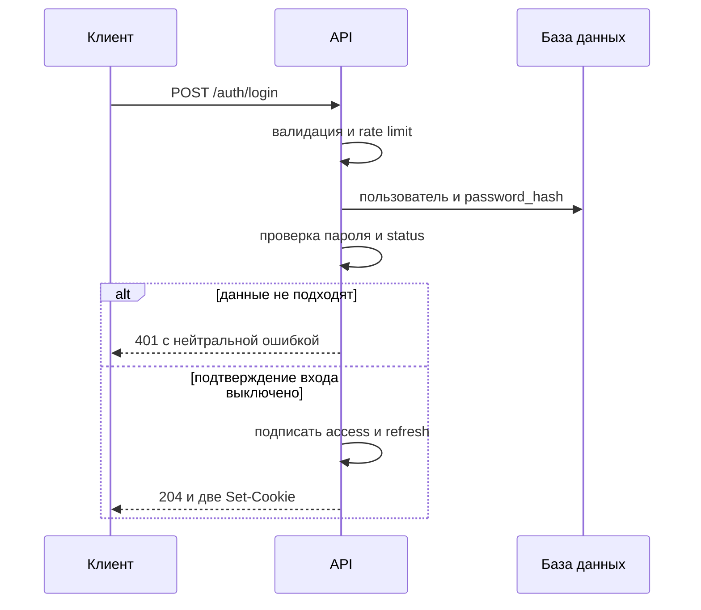
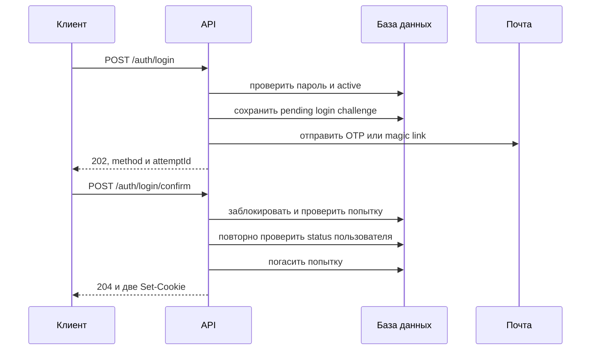
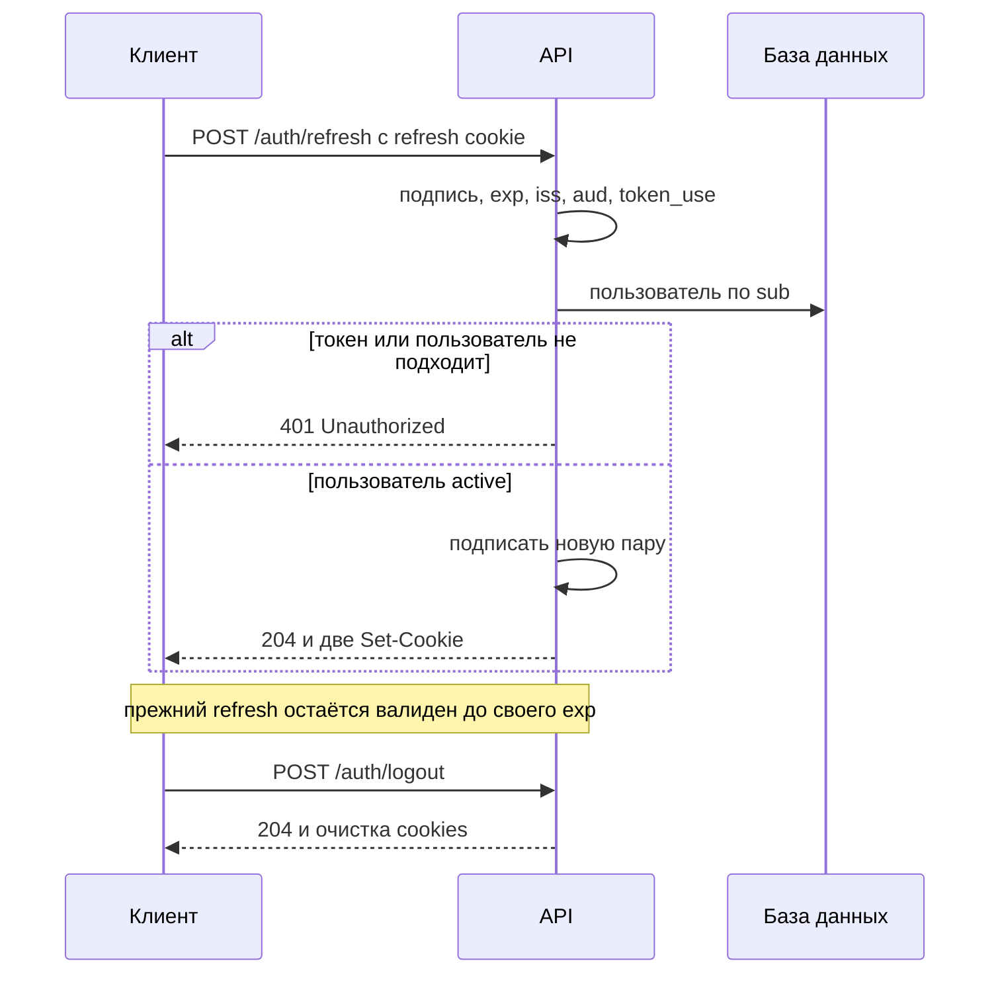

# Аутентификация

## Содержание

- [Теория](#теория)
  - [Ситуация](#ситуация)
  - [Модель](#модель)
  - [Понятия и связь с бэкендом](#понятия-и-связь-с-бэкендом)
  - [Зоны ответственности](#зоны-ответственности)
  - [Пример](#пример)
  - [Типичные сбои](#типичные-сбои)
  - [Полезные ссылки](#полезные-ссылки)
  - [Вопросы по теории](#вопросы-по-теории)
- [Практическое задание](#практическое-задание)
  - [1.1 Общее](#11-общее)
  - [1.2 Сценарии](#12-сценарии-user-stories)
  - [1.3 Контракт](#13-контракт)
  - [1.4 Ошибки и ограничения](#14-ошибки-и-ограничения)
  - [1.5 Аудит](#15-аудитлоги)
  - [1.6 Нефункциональные требования](#16-нефункциональные-требования)

# Теория

## Ситуация

Гость отправляет email и пароль по HTTPS. Дальше возможен один из исходов: сервер сразу устанавливает access- и refresh-cookie, сначала требует код или ссылку из письма, возвращает нейтральный отказ без раскрытия существования аккаунта, отклоняет неверный формат, ограничивает частоту попыток либо сообщает о недоступности базы, подписи токенов или почты.

Пользователь с refresh-cookie может получить новую пару токенов, а выход очищает cookies. Отдельный фронтенд не нужен, все запросы можно отправлять из HTTP-клиента с поддержкой cookies.

## Модель

В прямом входе участвуют клиент, API и база данных. Клиент сообщает email и пароль, но сервер сам проверяет хеш, статус пользователя и настройку подтверждения. Только пользователь в состоянии `active` может получить токены.



Если подтверждение входа включено, правильный пароль ещё не создаёт сессию. Сервер проверяет прежнюю незавершённую попытку этого пользователя: в течение 60 секунд новое письмо запрещено, а после паузы прежняя попытка заменяется новой. Клиент не выбирает между OTP и magic link.



Для OTP попытка находится по `attemptId`, после чего HMAC введённого кода сравнивается с сохранённым значением за постоянное время. Magic link содержит идентификатор попытки и случайный секрет; сервер также сначала находит запись, а затем сравнивает HMAC секрета. Ссылка передаёт токен во фрагменте URL, который браузер не отправляет веб-серверу и в `Referer`; клиентская страница читает фрагмент и отправляет токен в теле POST. Поэтому access log и почтовый сканер с обычным GET не получают либо не расходуют секрет.

Refresh проходит без пароля, однако не без серверной проверки пользователя. Подпись и claims подтверждают происхождение токена, а чтение пользователя по `sub` подтверждает, что аккаунт всё ещё существует и имеет статус `active`.



Сервер не хранит refresh JWT, `jti`, список разрешённых или отозванных токенов и запись сессии. Поэтому ротация выдаёт новую пару, но не превращает прежний refresh в одноразовый. Если старый токен украден, отличить его повторное использование от обычного refresh невозможно. Logout удаляет cookies только в браузере, который отправил запрос, и не отзывает скопированный токен.

Access и refresh подписываются разными HMAC-ключами алгоритмом HS256. В обоих токенах есть `sub`, `iss`, `aud`, `iat`, `exp` и `token_use`; поле `token_use` равно `access` или `refresh`. Проверяющий код фиксирует допустимый алгоритм и ожидаемый тип токена, поэтому refresh нельзя использовать вместо access даже при ошибочной передаче не в ту cookie.

Роли в JWT не помещаются и при проверке не учитываются. Токен устанавливает личность, а RBAC получает актуальные роли и назначения из серверных данных. Снятие роли начинает действовать без ожидания окончания 15 минут access-токена.

Аутентификация добавляет только таблицу попыток входа. Таблицы refresh-сессий нет.

| `login_challenges` | Описание |
| --- | --- |
| `id` | идентификатор попытки; используется как `attemptId` и входит в токен magic link |
| `user_id` | ссылка на пользователя; частичный уникальный индекс допускает одну непогашенную попытку на пользователя |
| `method` | выбранный сервером способ: `otp` или `magic_link` |
| `secret_hash` | HMAC-SHA256 от кода или случайного секрета с отдельным ключом приложения |
| `last_sent_at` | время последней генерации секрета; от него считаются TTL 10 минут и пауза resend 60 секунд |
| `attempts` | число неверных вводов OTP; после пятого попытка погашается |
| `consumed_at` | время успешного подтверждения, замены попытки, исчерпания вводов или смены статуса пользователя |
| `consumed_reason` | `confirmed`, `replaced`, `attempts_exhausted` или `user_inactive`; до погашения равно `null` |
| `created_at` | время создания попытки |

### Нормальная форма

`login_challenges` находится в нормальной форме Бойса — Кодда (BCNF). Таблица не хранит вычисляемое `expires_at`: срок действия определяется как `last_sent_at` плюс фиксированные 10 минут, поэтому аномалии одновременного обновления двух времён нет.

Каждая следующая форма включает требования предыдущей:

- **1NF:** каждое поле содержит одно значение. Код, токен и история отправок не складываются в массив; resend заменяет `secret_hash` и `last_sent_at`.
- **2NF:** первичный ключ состоит из одного `id`, поэтому частичных зависимостей от части ключа нет.
- **3NF и BCNF:** `user_id`, `method`, хеш, счётчик и времена описывают только одну попытку. Email, пароль и статус не копируются из `users`, а читаются по внешнему ключу.
- **4NF:** у одной строки нет независимых списков секретов или доставок. Каждая попытка представлена отдельной строкой.
- **5NF:** попытка и пользователь восстанавливаются обычным соединением по `user_id`; дополнительных зависимостей соединения нет.

Частичный уникальный индекс по `user_id` для строк с `consumed_at IS NULL` задаёт бизнес-правило, но не создаёт денормализацию. Новая попытка сначала гасит прежнюю в той же транзакции, а затем занимает освободившееся уникальное значение.

## Понятия и связь с бэкендом

### Парольный вход и нейтральная ошибка

Пароль передаётся серверу внутри защищённого канала TLS. HTTPS не скрывает пароль от самого приложения, поэтому тело запроса нельзя журналировать, сохранять в очереди или включать в трассировку. Сервер сравнивает пароль с медленным хешем из `users.password_hash` функцией той же библиотеки, которой хеш был создан при регистрации.

Ответ «email не найден» позволил бы собрать список пользователей. Поэтому отсутствующий email, неверный пароль и состояние `pending`, `blocked`, `deleting` или `deleted` дают одинаковые статус, код и текст. Для отсутствующего пользователя сервер выполняет проверку заранее подготовленного фиктивного хеша, чтобы заметная разница времени не стала вторым каналом раскрытия.

Фиктивная проверка не гарантирует абсолютно одинаковое время: запрос к базе, кеши и нагрузка всё равно различаются. Основную защиту дают нейтральный ответ, HTTPS и rate limit. Постоянная блокировка аккаунта после нескольких ошибок не используется, поскольку злоумышленник смог бы заблокировать чужую учётную запись.

### JWT и проверка claims

JWT состоит из заголовка, payload и подписи. Payload кодируется base64url, но не шифруется, поэтому его может прочитать владелец cookie или любой, кто получил токен. Пароль, хеш, ключи, email и роли туда не входят.

Подпись проверяется только с заранее заданным HS256. Сервер не принимает алгоритм из токена как настройку и не переключается на `none` или другой алгоритм. Access и refresh используют независимые ключи длиной не менее 32 случайных байт и разные значения `token_use`; это уменьшает последствия утечки одного ключа и исключает смешение типов.

`sub` содержит неизменяемый идентификатор пользователя, `iss` — ожидаемого издателя, `aud` — ожидаемого получателя, `iat` — время выпуска, `exp` — конец срока действия. Допустимое расхождение часов составляет не более 30 секунд и не продлевает cookie. После криптографической проверки сервер читает пользователя по `sub`; отсутствие записи либо статус `pending`, `blocked`, `deleting` или `deleted` приводит к **401**.

Ключи JWT и HMAC попыток загружаются из защищённой конфигурации. Если хотя бы одного обязательного ключа нет, он пустой или короче 32 байт, приложение не подставляет значение по умолчанию, не генерирует новый ключ при каждом запуске и не проходит readiness-проверку.

### Access, refresh и stateless-ротация

Access действует 15 минут и отправляется на защищённые операции. Refresh действует 30 дней и принимается только `POST /auth/refresh`. При каждом успешном refresh оба токена выпускаются заново, причём новый refresh получает новый срок 30 дней от момента ротации.

Такой срок образует скользящую сессию. Поскольку состояние refresh не хранится, украденный токен активного пользователя нельзя принудительно отозвать до его `exp`. Более того, злоумышленник может успеть обменять его на новый refresh с новым сроком. Блокировка или удаление пользователя прекращает обмен и доступ, потому что access и refresh каждый раз требуют чтения актуального пользователя.

Reuse detection требует хотя бы хеша текущего refresh или семейства токенов в серверной сессии. Это сознательно исключено контрактом. Смена ключа подписи отзовёт сразу все токены этого типа и потому не подходит для выхода одного пользователя.

### Email challenge

Подтверждение входа — второй шаг после правильного пароля, а не замена пароля. Настройка сервера включает шаг и выбирает один способ для новых попыток: шестизначный OTP либо magic link со случайным секретом длиной 32 байта.

Оба способа действуют 10 минут. OTP допускает пять вводов: пятый ещё может быть успешным, а пятый неверный ответ возвращает ошибку кода и одновременно гасит попытку. Повторная отправка разрешена не раньше 60 секунд, заменяет прежний секрет, заново запускает TTL и обнуляет счётчик OTP.

HMAC делает значение в базе невосстановимым без отдельного ключа приложения. Обычный SHA-256 для шестизначного OTP не подходит: все миллион вариантов можно заранее перебрать. Сравнение HMAC выполняется за постоянное время.

### Cookies, CORS и CSRF

Политика по умолчанию предполагает один origin для страницы и API. Cookies имеют `HttpOnly`, `Secure`, `SameSite=Strict`, не содержат `Domain` и потому остаются host-only. Access доступен по пути `/`, а refresh — только по `/auth/refresh`. JavaScript не читает токены и не переносит их в local storage.

Другой origin не всегда означает другой site. Например, `app.example.com` и `api.example.com` различаются origin, но обычно считаются same-site. Для доверенного frontend-origin сервер перечисляет точный адрес в CORS, включает credentials, а клиент использует `credentials: "include"`. Значение `Access-Control-Allow-Origin: *` вместе с credentials недопустимо.

Любое cross-origin-размещение, в том числе same-site, требует для изменяющих состояние запросов точного заголовка `Origin` и пользовательского заголовка `X-CSRF-Protection: 1`. Пользовательский заголовок запускает CORS preflight, который сервер разрешает только доверенному origin. Иначе соседний скомпрометированный поддомен того же site смог бы отправлять cookies, несмотря на `SameSite=Strict`. Неизвестный origin или отсутствие заголовка отклоняется с **403**.

Если frontend расположен ещё и на другом site, cookies дополнительно переключаются на `SameSite=None; Secure`; правила проверки `Origin` и CSRF-заголовка остаются теми же. GET не выполняет вход, refresh, logout или другие изменения состояния.

XSS и CSRF различаются. `HttpOnly` мешает прочитать токен через JavaScript, но вредоносный код на доверенной странице всё равно может отправлять запросы от имени пользователя. Поэтому нужны экранирование вывода, Content Security Policy и отсутствие секретов в доступном JavaScript.

### Протоколы без передачи пароля

SRP и OPAQUE относятся к PAKE: клиент доказывает знание пароля через специальный криптографический обмен, а сервер хранит верификатор. Их нельзя добавить только на endpoint входа, поскольку меняются регистрация, формат серверных данных, клиент и протокол восстановления. PAKE также не отменяет TLS.

WebAuthn использует пару ключей и challenge сервера; приватный ключ остаётся в аутентификаторе. OAuth 2.0 с PKCE решает другую задачу: приложение получает результат входа у внешнего провайдера, а PKCE связывает authorization code с клиентом. Ни WebAuthn, ни OAuth с PKCE не являются скрытой передачей пароля в контракте email+пароль.

### Что произойдёт при авторизации

Аутентификация отвечает на вопрос «кто отправил запрос» и передаёт проверенный `userId`. Авторизация затем получает актуальные роли из RBAC и решает, разрешено ли действие. Невалидная или отсутствующая сессия даёт **401**, а действующая сессия без права — **403**.

Роль из JWT, тела запроса или произвольного заголовка не участвует в решении. Logout тоже не меняет роли и не удаляет пользователя: он лишь очищает cookies текущего клиента.

### Сводка

| Понятие | Смысл в аутентификации | На что опирается реализация |
| --- | --- | --- |
| Нейтральная ошибка | не раскрывает наличие и статус аккаунта | один ответ и фиктивная проверка хеша |
| Access JWT | короткое подтверждение личности | HS256, `token_use=access`, TTL 15 минут |
| Refresh JWT | получение новой пары без пароля | HS256 с другим ключом, TTL 30 дней |
| Stateless refresh | сервер не хранит сессию и отзыв | проверка токена и актуального пользователя |
| OTP | второй шаг из 6 цифр | HMAC, TTL 10 минут, не более 5 вводов |
| Magic link | второй шаг со случайным секретом | HMAC и активация только через POST |
| HttpOnly cookie | JavaScript не читает JWT | `Secure`, `SameSite` и ограниченный `Path` |
| RBAC | проверка права после входа | актуальные роли на сервере, а не claims JWT |

## Зоны ответственности

| Клиент | Сервер |
| --- | --- |
| Отправляет email и пароль только по HTTPS | Нормализует email, проверяет хеш и статус |
| Хранит cookies средствами браузера | Никогда не возвращает JWT в JSON |
| Показывает одинаковую ошибку входа | Не раскрывает существование и статус аккаунта |
| По ответу **202** показывает нужный второй шаг | Сам выбирает OTP или magic link |
| Отправляет OTP либо токен ссылки через POST | Проверяет TTL, число попыток и HMAC |
| Вызывает refresh после истечения access | Проверяет refresh и актуального пользователя |
| После **401** предлагает войти заново | Не превращает ошибку сессии в **403** |
| Вызывает logout и удаляет локальное состояние интерфейса | Очищает обе cookies с исходными атрибутами |

При другом доверенном origin клиент включает credentials и CSRF-заголовок для изменяющих состояние запросов, а сервер возвращает CORS-заголовки только этому origin. При другом site дополнительно меняется `SameSite`; один только CORS не заменяет проверку аутентификации или защиту от CSRF.

## Пример

Программа выпускает access и refresh для пользователя `user-42` с одинаковыми `iss` и `aud`, но с разными ключами и `token_use`. Затем она проверяет оба токена и выводит пять строк в одном порядке: тип access, совпадение `sub`, невозможность принять refresh за access, TTL access и TTL refresh.

### Node.js

**Node.js 22 или новее, библиотека jsonwebtoken.** Для HS256 каждый ключ содержит не менее 32 случайных байт; в приложении ключи access и refresh различаются.

```sh
npm install jsonwebtoken
node jwt-demo.js
```

```javascript
const jwt = require('jsonwebtoken');

const accessKey = 'access-0123456789abcdef-0123456789';
const refreshKey = 'refresh-0123456789abcdef-01234567';
const now = Math.floor(Date.now() / 1000);

function issue(kind, key, ttl) {
  return jwt.sign({
    sub: 'user-42', iss: 'course-api', aud: 'course-web',
    iat: now, exp: now + ttl, token_use: kind,
  }, key, { algorithm: 'HS256' });
}

function read(token, key) {
  return jwt.verify(token, key, {
    algorithms: ['HS256'], issuer: 'course-api', audience: 'course-web',
  });
}

const access = read(issue('access', accessKey, 900), accessKey);
const refresh = read(issue('refresh', refreshKey, 2592000), refreshKey);
console.log(access.token_use);
console.log(access.sub === 'user-42');
console.log(refresh.token_use === 'access');
console.log(access.exp - access.iat);
console.log(refresh.exp - refresh.iat);
```

### .NET

**.NET 8 или новее, пакет System.IdentityModel.Tokens.Jwt.** Для HS256 используется отдельный ключ не короче 32 байт на каждый тип токена; `ClockSkew` в приложении задаётся явно.

```sh
dotnet new console -o JwtDemo
cd JwtDemo
dotnet add package System.IdentityModel.Tokens.Jwt
dotnet run
```

```csharp
using System.IdentityModel.Tokens.Jwt;
using System.Security.Claims;
using System.Text;
using Microsoft.IdentityModel.Tokens;

var accessKey = "access-0123456789abcdef-0123456789";
var refreshKey = "refresh-0123456789abcdef-01234567";
var now = DateTimeOffset.UtcNow.ToUnixTimeSeconds();
var handler = new JwtSecurityTokenHandler { MapInboundClaims = false };

string Issue(string kind, string key, long ttl) =>
    handler.WriteToken(new JwtSecurityToken("course-api", "course-web",
        new[] { new Claim("sub", "user-42"), new Claim("token_use", kind),
            new Claim("iat", now.ToString(), ClaimValueTypes.Integer64) },
        expires: DateTimeOffset.FromUnixTimeSeconds(now + ttl).UtcDateTime,
        signingCredentials: new(new SymmetricSecurityKey(Encoding.UTF8.GetBytes(key)),
            SecurityAlgorithms.HmacSha256)));

ClaimsPrincipal Read(string token, string key) => handler.ValidateToken(token,
    new TokenValidationParameters { ValidIssuer = "course-api", ValidAudience = "course-web",
        IssuerSigningKey = new SymmetricSecurityKey(Encoding.UTF8.GetBytes(key)),
        ValidateIssuerSigningKey = true, ValidAlgorithms = new[] { SecurityAlgorithms.HmacSha256 },
        ClockSkew = TimeSpan.Zero },
    out _);

var access = Read(Issue("access", accessKey, 900), accessKey);
var refresh = Read(Issue("refresh", refreshKey, 2592000), refreshKey);
string Claim(ClaimsPrincipal p, string name) => p.FindFirst(name)!.Value;
Console.WriteLine(Claim(access, "token_use"));
Console.WriteLine((Claim(access, "sub") == "user-42").ToString().ToLowerInvariant());
Console.WriteLine((Claim(refresh, "token_use") == "access").ToString().ToLowerInvariant());
Console.WriteLine(long.Parse(Claim(access, "exp")) - long.Parse(Claim(access, "iat")));
Console.WriteLine(long.Parse(Claim(refresh, "exp")) - long.Parse(Claim(refresh, "iat")));
```

### Python

**Python 3.10 или новее, библиотека PyJWT.** Ключ HS256 содержит не менее 32 случайных байт; access и refresh подписываются разными ключами.

```sh
pip install PyJWT
python jwt_demo.py
```

```python
import time
import jwt

access_key = "access-0123456789abcdef-0123456789"
refresh_key = "refresh-0123456789abcdef-01234567"
now = int(time.time())


def issue(kind: str, key: str, ttl: int) -> str:
    claims = {"sub": "user-42", "iss": "course-api", "aud": "course-web",
              "iat": now, "exp": now + ttl, "token_use": kind}
    return jwt.encode(claims, key, algorithm="HS256")


def read(token: str, key: str) -> dict:
    return jwt.decode(token, key, algorithms=["HS256"],
                      issuer="course-api", audience="course-web")


access = read(issue("access", access_key, 900), access_key)
refresh = read(issue("refresh", refresh_key, 2592000), refresh_key)
print(access["token_use"])
print(str(access["sub"] == "user-42").lower())
print(str(refresh["token_use"] == "access").lower())
print(access["exp"] - access["iat"])
print(refresh["exp"] - refresh["iat"])
```

---

Все три программы выводят `access`, `true`, `false`, `900` и `2592000`. Третья строка подтверждает, что проверка ожидаемого `token_use` должна отклонить refresh на месте access; одна корректная подпись для этого недостаточна.

## Типичные сбои

| Что видно | Куда смотреть |
| --- | --- |
| Для неизвестного email ответ отличается | отсутствующий пользователь обошёл нейтральную ошибку или фиктивную проверку хеша |
| `pending` получает токены | перед выпуском не проверяется актуальный `users.status` |
| Заблокированный пользователь продолжает refresh | после JWT не выполняется чтение пользователя по `sub` |
| Refresh подходит как access | не проверяется `token_use` либо используется один общий проверяющий код без ожидаемого типа |
| После снятия роли право живёт 15 минут | роли читаются из JWT вместо актуальных данных RBAC |
| JWT читается в JavaScript | cookie создана без `HttpOnly` или токен возвращён в JSON |
| Cookie не приходит по HTTPS | не совпадают host, `Path`, `SameSite` или настройки credentials/CORS |
| Cross-site cookie не приходит | для доверенного cross-site frontend не установлены `SameSite=None; Secure` |
| Посторонний origin, включая соседний same-site-поддомен, может вызвать refresh | проверка `Origin` и CSRF-заголовка включена только для cross-site либо отсутствует |
| OTP виден в базе | сохранён исходный код или быстрый хеш без ключа вместо HMAC |
| Верный OTP после пяти ошибок проходит | пятый неверный ввод не погасил попытку |
| Старое письмо работает после resend | не заменены `secret_hash` и `last_sent_at` |
| Ссылка расходуется при открытии письма | GET меняет состояние вместо показа страницы с последующим POST |
| После logout украденный refresh работает | это ограничение stateless-схемы; очистка cookie не отзывает копию |
| Старый refresh работает после ротации | сервер не хранит семейство токенов, поэтому reuse detection невозможен |
| После перезапуска все JWT случайно перестали работать | ключ генерируется при старте вместо загрузки из защищённой конфигурации |
| Приложение запускается с тестовым ключом | отсутствующий секрет заменяется значением по умолчанию вместо отказа readiness |
| После сбоя почты новый код неизвестен, а старый уже неверен | секрет заменён до SMTP; повтор возможен через resend после 60 секунд |
| В журнале есть пароль или JWT | логируется тело запроса, `Cookie`, `Set-Cookie` либо исключение с исходными данными |

## Полезные ссылки

### Общие

- [OWASP — Authentication Cheat Sheet](https://cheatsheetseries.owasp.org/cheatsheets/Authentication_Cheat_Sheet.html) — нейтральные ошибки, защита от перебора и повторная проверка личности.
- [OWASP — Password Storage Cheat Sheet](https://cheatsheetseries.owasp.org/cheatsheets/Password_Storage_Cheat_Sheet.html) — проверка пароля тем же медленным алгоритмом, который применялся при регистрации.
- [OWASP — JSON Web Token Cheat Sheet](https://cheatsheetseries.owasp.org/cheatsheets/JSON_Web_Token_for_Java_Cheat_Sheet.html) — угрозы JWT, срок действия и ограничения stateless-отзыва; механизмы относятся не только к Java.
- [RFC 7519 — JSON Web Token](https://www.rfc-editor.org/rfc/rfc7519) — формат JWT и зарегистрированные claims `sub`, `aud`, `exp` и `iat`.
- [RFC 8725 — JWT Best Current Practices](https://www.rfc-editor.org/rfc/rfc8725) — фиксация алгоритма, проверка issuer/audience и разделение типов токенов.
- [MDN — Set-Cookie](https://developer.mozilla.org/en-US/docs/Web/HTTP/Reference/Headers/Set-Cookie) — атрибуты `HttpOnly`, `Secure`, `SameSite`, `Path` и `Domain`.
- [MDN — CORS](https://developer.mozilla.org/en-US/docs/Web/HTTP/Guides/CORS) — credentials, точный разрешённый origin и предварительные запросы браузера.
- [OWASP — Cross-Site Request Forgery Prevention Cheat Sheet](https://cheatsheetseries.owasp.org/cheatsheets/Cross-Site_Request_Forgery_Prevention_Cheat_Sheet.html) — защита cookie-аутентификации через SameSite, Origin и пользовательские заголовки.
- [OWASP — Forgot Password Cheat Sheet](https://cheatsheetseries.owasp.org/cheatsheets/Forgot_Password_Cheat_Sheet.html) — правила для коротких OTP и одноразовых ссылок, применимые к email challenge.
- [W3C — Web Authentication](https://www.w3.org/TR/webauthn-3/) — challenge и ключевая пара как альтернатива парольному входу.
- [RFC 9807 — OPAQUE](https://www.rfc-editor.org/rfc/rfc9807) — стандартизованный PAKE, который требует отдельного протокола регистрации и входа.

### По языку

#### Node.js

**Node.js, NestJS.** На Express или Fastify контракт аутентификации остаётся тем же.

- [NestJS — Authentication](https://docs.nestjs.com/security/authentication) — подключение проверки личности к маршрутам.
- [NestJS — Cookies](https://docs.nestjs.com/techniques/cookies) — чтение и установка cookies через HTTP-адаптер.
- [jsonwebtoken](https://www.npmjs.com/package/jsonwebtoken) — подпись и проверка HS256 JWT из примера.
- [Node.js — crypto](https://nodejs.org/api/crypto.html) — HMAC, случайные байты и сравнение секрета за постоянное время.
- [NestJS — Configuration](https://docs.nestjs.com/techniques/configuration) — обязательные ключи, issuer, audience, cookie и SMTP без значений по умолчанию.
- [NestJS — CORS](https://docs.nestjs.com/security/cors) — точный список доверенных frontend-origin и credentials.
- [NestJS — OpenAPI](https://docs.nestjs.com/openapi/introduction) — описание login, confirm, refresh, logout и веток ошибок.
- [Prisma Migrate](https://www.prisma.io/docs/orm/prisma-migrate) или [TypeORM — Migrations](https://typeorm.io/docs/advanced-topics/migrations/) — создание `login_challenges` миграцией.

#### .NET

**.NET, ASP.NET Core.** Minimal API и контроллеры используют один контракт аутентификации.

- [ASP.NET Core — JWT bearer authentication](https://learn.microsoft.com/en-us/aspnet/core/security/authentication/configure-jwt-bearer-authentication) — проверка подписи, issuer, audience и срока JWT.
- [CookieOptions](https://learn.microsoft.com/en-us/dotnet/api/microsoft.aspnetcore.http.cookieoptions) — установка `HttpOnly`, `Secure`, `SameSite`, `Path` и срока cookie.
- [System.IdentityModel.Tokens.Jwt](https://www.nuget.org/packages/System.IdentityModel.Tokens.Jwt) — выпуск и проверка JWT из примера.
- [CryptographicOperations.FixedTimeEquals](https://learn.microsoft.com/en-us/dotnet/api/system.security.cryptography.cryptographicoperations.fixedtimeequals) — сравнение HMAC email challenge за постоянное время.
- [ASP.NET Core — Configuration](https://learn.microsoft.com/en-us/aspnet/core/fundamentals/configuration/) — загрузка ключей и параметров из защищённого окружения.
- [ASP.NET Core — CORS](https://learn.microsoft.com/en-us/aspnet/core/security/cors) — разрешение credentials только доверенным origin.
- [ASP.NET Core — OpenAPI](https://learn.microsoft.com/en-us/aspnet/core/fundamentals/openapi/overview) — актуальная спецификация операций аутентификации.
- [EF Core — Migrations](https://learn.microsoft.com/en-us/ef/core/managing-schemas/migrations/) — перенос таблицы попыток между окружениями.

#### Python

**Python, FastAPI.** Для Django или Flask контракт аутентификации не меняется.

- [FastAPI — OAuth2 with JWT](https://fastapi.tiangolo.com/tutorial/security/oauth2-jwt/) — создание и проверка JWT; способ доставки в контракте заменён на HttpOnly cookies.
- [FastAPI — Response Cookies](https://fastapi.tiangolo.com/advanced/response-cookies/) — установка cookies в ответе.
- [PyJWT](https://pyjwt.readthedocs.io/en/stable/) — HS256 и проверка claims в примере.
- [Python — hmac](https://docs.python.org/3/library/hmac.html) — HMAC и `compare_digest` для OTP и magic link.
- [FastAPI — Settings](https://fastapi.tiangolo.com/advanced/settings/) — обязательные ключи, параметры JWT, cookies и SMTP.
- [FastAPI — CORS](https://fastapi.tiangolo.com/tutorial/cors/) — точные origin, credentials и разрешённые заголовки.
- [FastAPI — Metadata and Docs URLs](https://fastapi.tiangolo.com/tutorial/metadata/) — настройка автоматически создаваемой OpenAPI-документации.
- [Alembic — Tutorial](https://alembic.sqlalchemy.org/en/latest/tutorial.html) — миграция `login_challenges`.

## Вопросы по теории

1. Почему одинаковый ответ для неизвестного email, неверного пароля и неактивного статуса снижает риск перечисления аккаунтов, но не отменяет rate limit?
2. Зачем access и refresh используют разные ключи и `token_use`, если оба токена уже имеют корректную подпись?
3. Почему stateless-ротация не позволяет обнаружить повторное использование старого refresh и чем пришлось бы дополнить схему для reuse detection?
4. Что произойдёт после блокировки пользователя с ещё действующими access и refresh, если каждая проверка получает пользователя по `sub`?
5. Почему magic link активирует POST, а обычное открытие ссылки методом GET не меняет состояние?
6. Чем cross-origin отличается от cross-site и когда cookie действительно требуется `SameSite=None`?
7. Почему `login_challenges` соответствует BCNF и какую аномалию создало бы отдельное поле `expires_at`, всегда равное `last_sent_at` плюс 10 минут?

# Практическое задание

Функциональность аутентификации пользователя в системе.
Гость входит по email и паролю, после чего сразу получает access и refresh в HttpOnly cookies либо сначала подтверждает вход через email. Access действует 15 минут, refresh — 30 дней. Refresh-сессии на сервере не хранятся, logout очищает cookies, а каждый токен принимается только для существующего пользователя в состоянии `active`.

## 1) Аутентификация

### 1.1 Общее

**Назначение:** установить личность пользователя по email и паролю, выдать пару JWT и поддержать refresh и logout.

**Пользователи/роли:**

- гость — выполняет вход и email challenge;
- пользователь с refresh-cookie — обновляет пару токенов;
- любой клиент — может вызвать идемпотентный logout.

**Зависимости/связанные настройки:**

- регистрация создаёт пользователя и медленный хеш пароля, но токены не выдаёт;
- `LOGIN_EMAIL_CONFIRMATION_ENABLED` включает второй шаг только для входа;
- `LOGIN_EMAIL_CONFIRMATION_METHOD` имеет одно значение `otp` или `magic_link`, которое выбирает сервер;
- `JWT_ACCESS_SECRET` и `JWT_REFRESH_SECRET` содержат разные случайные значения длиной не менее 32 байт;
- `LOGIN_CHALLENGE_HMAC_KEY` содержит отдельный случайный ключ длиной не менее 32 байт;
- `JWT_ISSUER` и `JWT_AUDIENCE` обязательны и одинаково используются при выпуске и проверке;
- SMTP и адрес доверенного frontend задаются в конфигурации приложения;
- политика cookies по умолчанию: host-only, `HttpOnly`, `Secure`, `SameSite=Strict`, без `Domain`.

Пока отдельного API настроек нет, флаг и способ подтверждения входа меняются в конфигурации приложения. Изменение действует только на новые запросы входа; уже созданная попытка сохраняет свой способ и может быть подтверждена или отправлена повторно.

Если любой обязательный ключ отсутствует, пуст или короче 32 байт, приложение завершается при запуске и не проходит readiness-проверку. Тестовое значение, случайный ключ на каждый запуск и общий ключ для access, refresh и email challenge запрещены.

RBAC не доверяет ролям из JWT и получает актуальные назначения из серверных данных. Аутентификация передаёт ему только проверенный `userId`.

### 1.2 Сценарии (user stories)

1. **Вход без подтверждения:** пользователь с правильными email и паролем в состоянии `active` получает две cookies.
2. **Вход с OTP:** после правильного пароля пользователь получает `attemptId`, вводит шестизначный код и только тогда получает cookies.
3. **Вход с magic link:** после правильного пароля пользователь получает письмо, открывает страницу и подтверждает вход отдельным POST с токеном.
4. **Повторная отправка:** пользователь ждёт 60 секунд, после чего получает новый код или ссылку; прежний секрет перестаёт работать.
5. **Обновление токенов:** действующий refresh и актуальный статус `active` дают новую пару без ввода пароля.
6. **Выход:** сервер очищает обе cookies, даже если они отсутствуют или уже невалидны.
7. **Прекращение доступа:** `pending`, `blocked`, `deleting`, `deleted` и отсутствующий пользователь не проходят вход, access или refresh.

### 1.3 Контракт

#### 1.3.1 Запрос на вход

| `POST /auth/login` | Проверки/валидация |
| --- | --- |
| `email: string` | Обязателен, валидный формат; крайние пробелы удаляются, буквы приводятся к нижнему регистру |
| `password: string` | Обязателен; крайние и внутренние пробелы сохраняются, значение не нормализуется |

**Логика/шаги:**

1. Проверить формат тела и ограничение частоты до дорогой проверки хеша.
2. Получить пользователя по нормализованному email. Если запись отсутствует, проверить пароль по заранее подготовленному фиктивному хешу.
3. Сравнить пароль с `password_hash` функцией библиотеки.
4. Для отсутствующего пользователя, неверного пароля и любого статуса кроме `active` вернуть одну нейтральную ошибку **401**.
5. Если подтверждение входа выключено, подписать access и refresh, затем одним ответом установить обе cookies.
6. Если подтверждение включено, проверить прежнюю незавершённую попытку пользователя. Пока от её `last_sent_at` не прошло 60 секунд, вернуть **429** с оставшимся временем, не создавая попытку и не отправляя письмо.
7. После паузы одной транзакцией заблокировать пользователя, затем прежнюю попытку, повторно проверить `active` и 60-секундную паузу, погасить прежнюю попытку и создать новую выбранного сервером способа. При смене статуса вернуть нейтральный **401** без письма. Зафиксировать попытку до обращения к SMTP.
8. Передать секрет только в письмо. На этом шаге JWT и cookies не выдаются.

Если транзакция попытки не зафиксирована, письмо не отправляется, клиент получает **503** и может повторить вход. Если SMTP не принял письмо после фиксации, попытка сохраняется, а **503** содержит `confirmationRequired`, `method`, `attemptId` и `retryAfterSeconds`, но не секрет. Повтор выполняется через resend либо через новый login после той же паузы 60 секунд; оба пути заменяют секрет и не обходят ограничение отправки.

Оба JWT создаются до формирования ответа. Если подпись хотя бы одного токена не удалась, заголовки `Set-Cookie` не отправляются и возвращается **503**. Потерянный клиентом успешный ответ не создаёт серверной сессии: прямой вход можно повторить, а уже погашенный email challenge начинается заново с login.

**Ответы:**

- **Прямой успех:** **204 No Content**, `Set-Cookie` для access и refresh, без тела.
- **Нужен второй шаг:** **202 Accepted**, `confirmationRequired: true`, `method`, `attemptId`, `expiresInSeconds: 600`, `resendAfterSeconds: 60`.
- **Неверные реквизиты или статус:** **401 Unauthorized** с одним кодом `invalid_credentials`.
- В JSON нет пароля, хеша, JWT, OTP, токена ссылки, ключей, ролей и сведений о существовании аккаунта.

#### 1.3.2 Подтверждение и повторная отправка

| Операция | Входные данные и правила |
| --- | --- |
| `POST /auth/login/confirm` для OTP | `attemptId: string`, `code: string`; код содержит ровно 6 цифр |
| `POST /auth/login/confirm` для magic link | `token: string` в формате `attemptId.secret`; случайный `secret` содержит 32 байта до base64url-кодирования, письмо передаёт token во фрагменте URL |
| `POST /auth/login/resend` | `attemptId: string`; способ попытки не меняется |

**Логика подтверждения:**

1. По идентификатору попытки получить `user_id` без принятия решения, затем заблокировать пользователя и строку попытки именно в этом порядке и перечитать их состояние. Ненайденная попытка получает **400**.
2. Если `attempts` уже равно 5 и `consumed_reason` равно `attempts_exhausted`, вернуть **429**. Ненайденная, просроченная, успешно погашенная, заменённая или погашенная как `user_inactive` попытка получает общий ответ **400**.
3. Просрочка определяется как `last_sent_at + 10 минут`; просроченная попытка не увеличивает `attempts`.
4. Проверить уже заблокированного пользователя по `user_id`. Если он отсутствует или его статус не `active`, погасить попытку с причиной `user_inactive` и вернуть тот же **401 invalid_credentials**, что при входе.
5. Посчитать HMAC-SHA256 присланного секрета и сравнить с `secret_hash` за постоянное время.
6. При неверном OTP увеличить `attempts` в той же транзакции. Пятый ввод ещё проверяется; пятый неверный ввод возвращает **400** и гасит попытку с причиной `attempts_exhausted`. Следующий ввод возвращает **429**.
7. При неверном magic link вернуть **400**; счётчик к ссылке не применяется.
8. При совпадении подписать оба JWT, погасить попытку с причиной `confirmed`, зафиксировать транзакцию и установить две cookies.

Если подпись токенов или фиксация транзакции не удалась, cookies не отправляются, возвращается **503**, а откатившуюся попытку можно подтвердить повторно. Если ответ потерян уже после фиксации, попытка остаётся погашенной и пользователь начинает новый login.

**Логика resend:**

1. По `attemptId` получить `user_id`, заблокировать пользователя, затем попытку и принять только попытку активного пользователя. Истёкший TTL запрещает подтверждение, но не resend; ненайденная, заменённая, подтверждённая или погашенная как `user_inactive` попытка получает **400**, а `attempts_exhausted` — **429**.
2. Если от `last_sent_at` прошло меньше 60 секунд, вернуть **429** и число оставшихся секунд.
3. Создать новый секрет того же способа, заменить `secret_hash`, установить новое `last_sent_at` и обнулить `attempts` одной транзакцией.
4. После фиксации отправить письмо. Старый код или ссылка больше не подходят.
5. Если SMTP не принял новое письмо, вернуть **503**. Новый хеш остаётся сохранённым, старый секрет не восстанавливается, следующая отправка возможна через 60 секунд.

**Ответы:**

- **Подтверждение:** **204 No Content** и две cookies, без тела.
- **Resend:** **202 Accepted**, `method`, `attemptId`, `expiresInSeconds: 600`, `resendAfterSeconds: 60`.
- **Ошибки:** см. раздел 1.4.
- Ответы не содержат JWT, пароль, хеш, OTP, токен ссылки и HMAC.

#### 1.3.3 JWT и cookies

| Claim | Access | Refresh |
| --- | --- | --- |
| `sub` | идентификатор пользователя | тот же идентификатор пользователя |
| `iss` | значение `JWT_ISSUER` | значение `JWT_ISSUER` |
| `aud` | значение `JWT_AUDIENCE` | значение `JWT_AUDIENCE` |
| `iat` | время выпуска сервера | время выпуска сервера |
| `exp` | `iat + 15 минут` | `iat + 30 дней` |
| `token_use` | `access` | `refresh` |

Алгоритм подписи — только HS256. Access подписывается `JWT_ACCESS_SECRET`, refresh — `JWT_REFRESH_SECRET`. `jti`, роли, email, пароль, хеш и персональные данные в payload отсутствуют. Полный JWT нигде на сервере не сохраняется.

| Cookie | Атрибуты по умолчанию |
| --- | --- |
| `access_token` | `HttpOnly; Secure; SameSite=Strict; Path=/; Max-Age=900`, без `Domain` |
| `refresh_token` | `HttpOnly; Secure; SameSite=Strict; Path=/auth/refresh; Max-Age=2592000`, без `Domain` |

Срок cookie совпадает с `exp`. Сервер не возвращает токены в теле, заголовке, доступном JavaScript, или URL. Все операции работают только по HTTPS; исключение для незащищённого production-окружения не предусмотрено.

По умолчанию frontend и API имеют один origin. Для другого доверенного origin CORS перечисляет точный origin, разрешает credentials и заголовок `X-CSRF-Protection`, а браузер отправляет запросы с `credentials: "include"`. Все POST-запросы из другого origin проверяют точный `Origin` и заголовок `X-CSRF-Protection: 1`, независимо от того, относятся ли оба origin к одному site. Если origin находится на другом site, обе auth-cookie дополнительно получают `SameSite=None; Secure`. Отклонённая CSRF-проверка возвращает **403** с кодом `csrf_rejected`.

#### 1.3.4 Обновление токенов

| `POST /auth/refresh` | Проверки/валидация |
| --- | --- |
| Cookie `refresh_token` | Обязательна; JWT должен иметь HS256, корректные подпись, `iss`, `aud`, `iat`, `exp`, непустой `sub` и `token_use=refresh` |

**Логика/шаги:**

1. Извлечь refresh только из cookie; значение из тела, query или другого заголовка не принимать.
2. Проверить формат, алгоритм, подпись и claims с допустимым расхождением часов не более 30 секунд.
3. Получить пользователя по `sub` из базы.
4. Если пользователь отсутствует либо имеет статус `pending`, `blocked`, `deleting` или `deleted`, вернуть **401** без выпуска cookies.
5. Для пользователя `active` подписать новый access на 15 минут и новый refresh на 30 дней от текущего момента.
6. Установить обе cookies одним ответом. Прежний refresh не сохранять и не добавлять в denylist.

Ротация не инвалидирует использованный refresh: любая его копия остаётся криптографически действующей до собственного `exp`. Повторное использование не обнаруживается, конкретный refresh принудительно не отзывается.

Если база недоступна, вернуть **503**, а не **401**. Если подпись новой пары не удалась, вернуть **503** без `Set-Cookie`; прежняя cookie клиента остаётся пригодной для повторной попытки до своего `exp`.

**Ответы:**

- **Успех:** **204 No Content** и новая пара cookies.
- **Недействующая сессия:** **401 Unauthorized** с кодом `invalid_session`.
- В ответе нет JWT, `sub`, статуса пользователя, ролей и ключей.

#### 1.3.5 Выход

| `POST /auth/logout` | Правило |
| --- | --- |
| Тело отсутствует | Операция не требует валидного access или refresh и всегда очищает cookies текущего клиента |

Сервер отправляет истёкшие `access_token` и `refresh_token` с теми же `Path`, `Secure`, `SameSite` и отсутствующим `Domain`, что использовались при установке. Для cross-origin-конфигурации применяется CSRF-проверка, а для cross-site дополнительно сохраняется `SameSite=None`.

**Ответ:** **204 No Content** независимо от наличия cookies. Тела, JWT и сведений о пользователе нет.

Logout не записывает refresh в базу и не отзывает его копию на другом устройстве. После очистки клиент удаляет локальное состояние интерфейса и переходит к форме входа.

#### 1.3.6 Проверка access

**Общее правило:** каждая защищённая операция сначала вызывает единую проверку аутентификации.

| Вход | Проверки/валидация |
| --- | --- |
| Cookie `access_token` | HS256, подпись, `iss`, `aud`, `iat`, `exp`, непустой `sub`, `token_use=access` |

**Логика/шаги:**

1. Проверить access с допустимым расхождением часов не более 30 секунд.
2. Получить пользователя по `sub`, выбрав только `id` и `status`.
3. Принять только существующего пользователя со статусом `active`.
4. Передать дальше `userId`, но не claims ролей.

Отсутствующая cookie, невалидный или истёкший JWT, неизвестный пользователь и статусы `pending`, `blocked`, `deleting`, `deleted` дают один ответ **401 invalid_session**. Недоступность базы даёт **503**. При успехе отдельного HTTP-ответа нет: запрос переходит к RBAC и обработчику.

### 1.4 Ошибки и ограничения

- **400 Bad Request** — неверный формат login, confirm или resend; неверный либо просроченный OTP или magic link; попытка не найдена, заменена, уже успешно использована либо погашена как `user_inactive`.
- **401 Unauthorized** — нейтральный отказ для неизвестного email, неверного пароля и пользователя не в состоянии `active`; access или refresh отсутствует, невалиден, истёк, имеет неверный тип либо ссылается на отсутствующего или неактивного пользователя.
- **403 Forbidden** — запрос из недоверенного origin или обязательная CSRF-проверка не пройдена; код ответа `csrf_rejected` не подменяет решение RBAC.
- **429 Too Many Requests** — превышен rate limit входа; новое письмо через login или resend запрошено раньше 60 секунд; OTP уже исчерпал пять вводов.
- **503 Service Unavailable** — недоступны база, SMTP или операция подписи; состояние частичного сбоя описано у соответствующей операции.

Ошибка **401** входа имеет одинаковые код `invalid_credentials`, текст и форму для неизвестного email, неверного пароля, `pending`, `blocked`, `deleting` и `deleted`. Ошибка сессии имеет общий код `invalid_session` и не сообщает, какая проверка JWT или пользователя не прошла.

### 1.5 Аудит/логи

Логировать:

- успешный и неуспешный login, срабатывание обоих rate limit и результат email challenge;
- создание, resend, успешное подтверждение, неверный ввод, просрочку и исчерпание попытки;
- успешный и неуспешный refresh, logout и отказ проверки access;
- недоступность базы, SMTP и подписи токенов;
- отклонение origin или CSRF-проверки.

Для известного пользователя сохраняются `userId`, тип события, способ challenge, `attemptId`, результат, время и идентификатор запроса. Для неизвестного email используется необратимый служебный идентификатор с отдельным ключом, чтобы сопоставлять атаки без записи адреса. Причина JWT журналируется категорией `missing`, `malformed`, `signature`, `expired`, `claims`, `token_use` или `user_inactive`, но наружу возвращается общая ошибка.

В журнал не попадают email в открытом виде, пароль, хеш пароля, OTP, токен magic link, HMAC, JWT, `Cookie`, `Set-Cookie`, ключи, полный URL, полное тело запроса и полные заголовки.

### 1.6 Нефункциональные требования

- `POST /auth/login` допускает не более 30 запросов с IP за минуту и не более 5 неуспешных проверок на пару email и IP за 15 минут. Refresh — не более 30 запросов с IP за минуту. OTP имеет 5 попыток, resend — паузу 60 секунд.
- Индексы покрывают поиск по нормализованному email и единственную непогашенную попытку по `user_id`. Подтверждение выполняется транзакционно.
- Автоматические тесты покрывают прямой вход, оба email-способа, пятую попытку, resend, logout, статусы пользователя и CSRF.
- Общие нефункциональные требования проекта — валидация входных данных, CORS, OpenAPI, структурированные логи, health checks и покрытие тестами не ниже 80% — относятся и к этим операциям.
