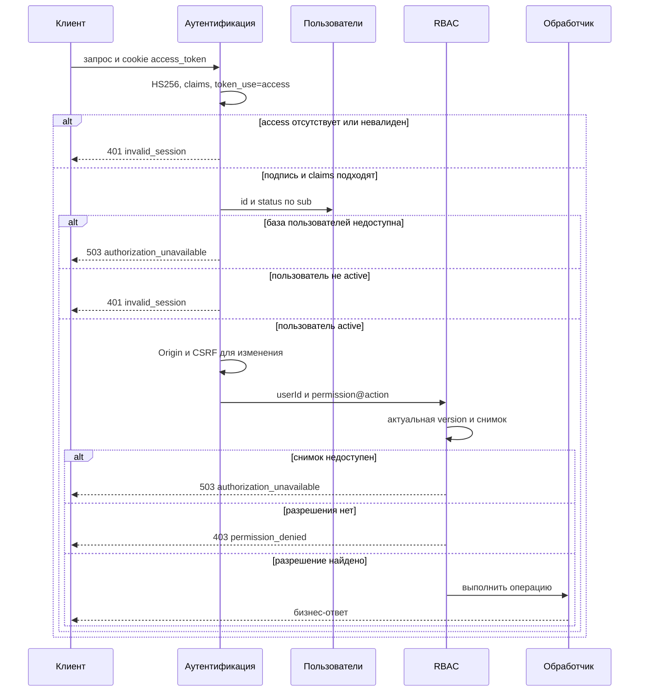
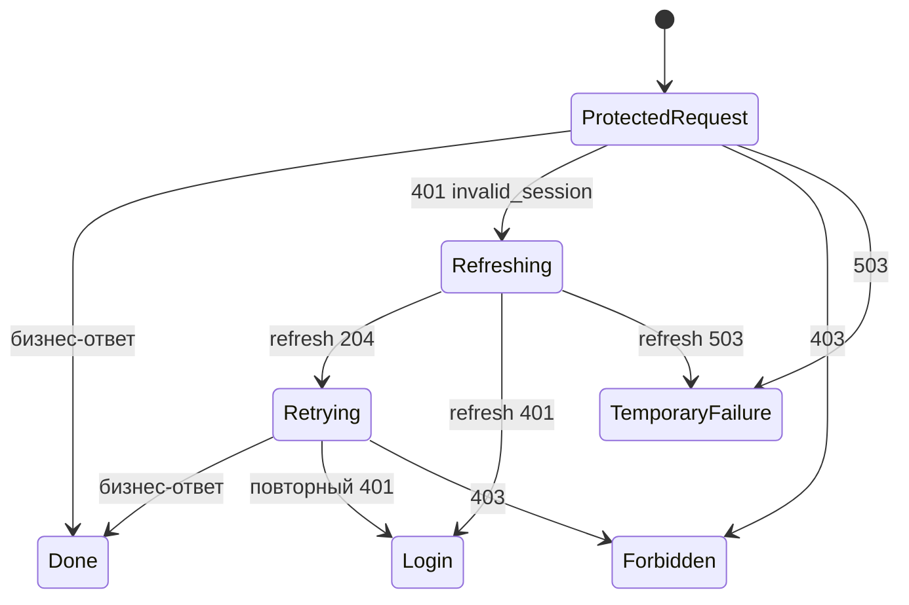
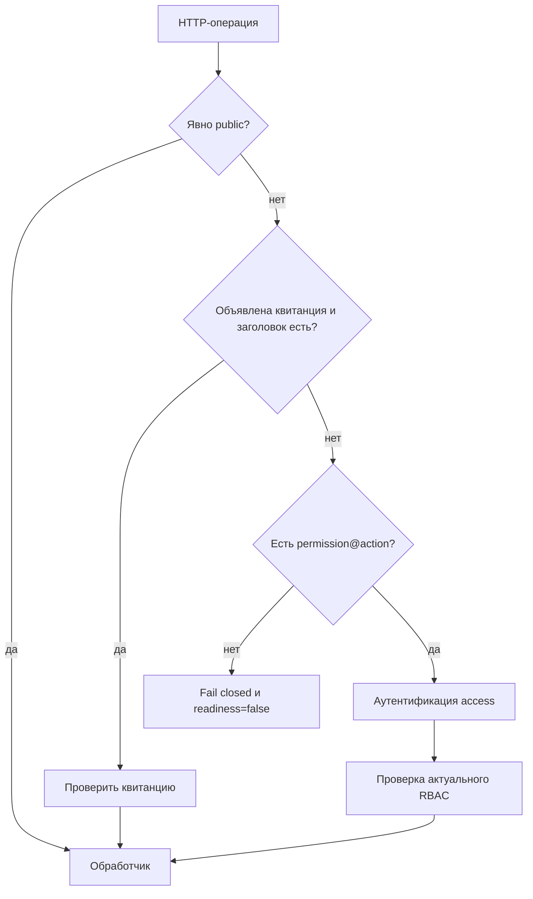

# Авторизация

## Содержание

- [Теория](#теория)
  - [Ситуация](#ситуация)
  - [Модель](#модель)
  - [Понятия и связь с бэкендом](#понятия-и-связь-с-бэкендом)
  - [Зоны ответственности](#зоны-ответственности)
  - [Типичные сбои](#типичные-сбои)
  - [Полезные ссылки](#полезные-ссылки)
  - [Вопросы по теории](#вопросы-по-теории)
- [Практическое задание](#практическое-задание)
  - [1.1 Общее](#11-общее)
  - [1.2 Сценарии](#12-сценарии-user-stories)
  - [1.3 Контракт](#13-контракт)
  - [1.4 Ошибки и ограничения](#14-ошибки-и-ограничения)
  - [1.5 Аудит](#15-аудитлоги)
  - [1.6 Нефункциональные требования](#16-нефункциональные-требования)

# Теория

## Ситуация

Пользователь обращается к защищённой операции с access JWT в cookie. Дальше возможен один из исходов: личность не установлена и сервер возвращает **401**, пользователь установлен, но действие ему запрещено с ответом **403**, актуальные данные пользователя или RBAC недоступны и приходит **503**, либо обработчик выполняется и возвращает собственный результат.

Если access истёк, клиент один раз обновляет пару токенов через refresh и повторяет исходный запрос. Ответ **403** не запускает refresh, поскольку новая пара подтверждает ту же личность и не добавляет прав.

## Модель

В защищённом запросе участвуют клиент, аутентификация access JWT, база пользователей, RBAC и бизнес-обработчик. Порядок фиксирован: сначала устанавливается личность, затем проверяется право, и только после этого читается целевой ресурс и выполняется операция.

RBAC получает `userId` только после полной проверки токена и статуса пользователя. Требуемые `permission` и `action` задаются на сервере обработчиком. Значения из JWT, тела, query и произвольного заголовка не могут ослабить требование.

Истёкший access не обновляется внутри защищённого обработчика. Клиент получает **401**, вызывает отдельный endpoint аутентификации и повторяет исходный запрос не более одного раза.

Несколько параллельных запросов могут одновременно увидеть истёкший access. Клиент объединяет их вокруг одного refresh: остальные ждут его результата, а не ротируют refresh независимо. После успешного refresh каждый ожидающий запрос повторяется один раз.

Каждая HTTP-операция заранее относится к одному из трёх видов. Публичная операция имеет явную метку и не запускает access-проверку. Защищённая операция объявляет одну пару `permission@action`. Операция по квитанции объявляет имя заголовка; если заголовок есть, access и RBAC не запускаются, а обработчик проверяет квитанцию. Квитанция может сочетаться с одной парой: нет заголовка — обычная цепочка access и RBAC. Отсутствие всякой декларации считается ошибкой конфигурации и не открывает маршрут.

Авторизация не добавляет таблиц и не меняет существующую схему. Пользователь и его статус читаются из `users`, а роли, разрешения, назначения и версия политики — из нормализованных таблиц RBAC. Refresh JWT, `jti` и серверная сессия по-прежнему не сохраняются.

## Понятия и связь с бэкендом

### Аутентификация перед авторизацией

Аутентификация устанавливает личность. Access извлекается только из HttpOnly cookie `access_token`, проверяется фиксированным HS256 с access-ключом, ожидаемыми `iss`, `aud`, `iat`, `exp`, непустым `sub` и `token_use=access`. Затем сервер получает пользователя по `sub` и принимает только статус `active`.

Авторизация получает уже проверенный `userId` и отвечает на другой вопрос: разрешено ли этому пользователю выполнить серверное требование `permission@action`. Если поменять порядок, отсутствие сессии начнёт выглядеть как нехватка роли, а клиент не сможет понять, нужен ли refresh.

Публичная операция не пытается разобрать случайно присланную access-cookie. Например, повреждённая cookie не мешает повторному входу или проверке `/health`. Endpoint refresh тоже не проходит access-guard: он отдельно проверяет refresh JWT по контракту аутентификации.

### Разделение 401, 403 и 503

**401 Unauthorized** означает, что сервер не смог установить действующую личность: cookie отсутствует, JWT повреждён или истёк, claims не подходят, пользователь не найден либо имеет статус `pending`, `blocked`, `deleting` или `deleted`. RBAC и обработчик после такого ответа не вызываются.

**403 Forbidden** означает, что активный пользователь уже установлен, но запрос запрещён. Причиной служит отсутствие актуального разрешения, провал проверки владельца либо отклонение CSRF для state-changing операции. Повторный вход или refresh не исправит этот результат.

**503 Service Unavailable** означает, что решение нельзя безопасно принять: база пользователей или актуальный снимок RBAC недоступны, либо конфигурация маршрутов не прошла проверку. Ошибка зависимости не маскируется под **401** или **403**, иначе временный сбой выглядел бы как изменение личности или прав.

### JWT устанавливает личность, но не роль

Подпись JWT доказывает, что claims выпущены доверенным сервером и не изменены. Она не доказывает, что пользователь всё ещё активен, поэтому запрос пользователя выполняется по `sub` каждый раз. Блокировка или удаление прекращает новые запросы даже до окончания 15 минут.

Роль, разрешение и действие в JWT не используются. Иначе снятая роль продолжала бы действовать до `exp`, а изменение политики требовало бы выпуска новой пары. Access может содержать только контрактные claims личности; неизвестные claims не становятся источником прав.

JWT является bearer credential: любой, кто получил его, может действовать от имени пользователя до окончания срока и проверки актуального статуса. `HttpOnly` снижает риск чтения токена через JavaScript, но не отменяет HTTPS, защиту от XSS и CSRF.

### Актуальный RBAC и запрет по умолчанию

Обработчик задаёт минимальную пару, например `reports@read` или `users@delete`. RBAC объединяет права всех актуальных ролей пользователя по правилам модуля RBAC. Совпадение имени роли, скрытая кнопка или значение от клиента сами по себе ничего не разрешают.

Перед решением процесс сравнивает версию локального снимка с `rbac_policy_state.version`. Если версия изменилась, новый снимок строится целиком и атомарно заменяет старый. При сбое загрузки старые права не используются, а запрос получает **503**.

Отсутствие пользователя в снимке, отсутствие ролей, неизвестное разрешение, неизвестное действие и отсутствие подходящего назначения дают запрет. Маршрут без метки public, без пары `permission@action` и без объявленной квитанции не становится публичным: проверка конфигурации снимает readiness, а запрос не достигает обработчика.

### Целевой ресурс и дополнительные правила

Проверка общего разрешения выполняется раньше чтения целевого ресурса. Пользователь без `reports@read` получает **403** и для существующего, и для вымышленного `reportId`, поэтому наличие записи не раскрывается перебором.

Дополнительное действие `*_any` не заменяет базовую пару маршрута. Обработчик проверяет его после базового права и до поиска цели. В декларации по-прежнему одна пара: профиль объявляет `users@read`, а `users@read_any` проверяется для чужого идентификатора.

После успешного RBAC обработчик может загрузить ресурс. Отсутствующая запись тогда даёт **404**. Правило «можно менять только собственную запись» требует сравнения `userId` с владельцем; несовпадение даёт **403**, даже если общее разрешение `profile@update` присутствует.

Авторизация проверяется в начале запроса. Если access истёк или пользователь был заблокирован уже после успешной проверки, выполняющийся обработчик не прерывается; все следующие запросы увидят новое состояние. Длительная операция сама определяет, нужна ли повторная проверка перед критической фиксацией.

### Refresh на клиенте

Клиент реагирует только на **401** с кодом `invalid_session` от защищённой операции. Один общий promise, task или coroutine выполняет `POST /auth/refresh`, а остальные запросы ждут. Успех **204** разрешает единственный повтор с новыми cookies.

Ответ **401** от refresh означает окончание клиентской сессии: локальное состояние пользователя очищается и показывается вход. При **503** состояние не стирается, поскольку токен может оставаться действующим; клиент показывает временный сбой и позволяет повторить действие позже без бесконечного цикла.

Ответ **403** не вызывает refresh. Автоматический refresh после каждого **403** создаёт лишнюю нагрузку и не меняет роли. Повторный **401** после успешного refresh также завершает цикл и переводит пользователя ко входу.

### Cookies, CORS и CSRF

Авторизация использует политику аутентификации без изменений: по умолчанию frontend и API имеют один origin, `access_token` является host-only cookie с `HttpOnly; Secure; SameSite=Strict; Path=/`, а refresh доступен только по `/auth/refresh`. JavaScript отправляет cookies средствами браузера и не читает JWT.

Для другого доверенного origin CORS перечисляет точный адрес, разрешает credentials, а клиент устанавливает `credentials: "include"`. Любая изменяющая состояние операция из другого origin проверяет точный `Origin` и требует `X-CSRF-Protection: 1`, даже если frontend и API остаются same-site: `SameSite=Strict` не защищает от скомпрометированного соседнего поддомена. Если origin ещё и cross-site, cookies дополнительно получают `SameSite=None; Secure`.

CORS управляет тем, может ли браузерная страница прочитать ответ и отправить credentialed-запрос. RBAC управляет правом уже установленного пользователя. Ни CORS, ни скрытие элемента интерфейса не заменяют серверную авторизацию.

### Сводка

| Понятие | Смысл в авторизации | На что опирается реализация |
| --- | --- | --- |
| Аутентификация | устанавливает активного пользователя | access JWT и чтение `users` по `sub` |
| Авторизация | решает, разрешено ли действие | актуальный снимок RBAC |
| **401** | личность не установлена | отказ до RBAC |
| **403** | личность установлена, запрос запрещён | RBAC, ownership или CSRF |
| **503** | безопасное решение временно невозможно | fail closed без старого снимка |
| Public | операция без access-guard | явная серверная метка |
| Квитанция | доступ без сессии по секретной квитанции | объявленный заголовок; без него — пара маршрута |
| `permission@action` | минимальное требование обработчика | серверная конфигурация маршрута |
| Single-flight refresh | один refresh для параллельных **401** | координация запросов на клиенте |

## Зоны ответственности

| Клиент | Сервер |
| --- | --- |
| Отправляет cookies с `credentials: "include"` при другом origin | Извлекает access только из `access_token` |
| После **401** выполняет один refresh и один повтор | Возвращает **401** до RBAC и обработчика |
| После **403** показывает отказ без refresh | Возвращает **403** только после установки личности |
| При **503** предлагает повторить позже | Не использует недоступную или устаревшую политику |
| Может скрывать недоступные действия | Проверяет каждую операцию независимо от интерфейса |
| Не передаёт роль или требуемое право | Берёт `permission@action` из обработчика |
| Повторяет только запрос, отклонённый guard | Не запускает бизнес-логику до завершения проверок |
| Для cross-origin изменения отправляет CSRF-заголовок | Проверяет `Origin`, CSRF и актуальный RBAC |

Refresh, выпуск JWT и очистка cookies относятся к аутентификации. Авторизация не подписывает токены, не хранит сессии и не меняет роли.

## Типичные сбои

| Что видно | Куда смотреть |
| --- | --- |
| Запрос без cookie получает **403** | RBAC вызван до аутентификации либо её ошибка преобразована в запрет права |
| Пользователь без права получает **401** | отказ RBAC ошибочно запускает refresh и смешивает два типа решения |
| Заблокированный пользователь проходит до RBAC | после подписи JWT не читается актуальный `users.status` |
| Снятая роль действует до `exp` access | роли и разрешения берутся из claims JWT |
| Клиент может передать более слабое право | `permission` или `action` читаются из запроса, а не из обработчика |
| Новый маршрут открыт без настройки | отсутствие public и `permission@action` трактуется как разрешение |
| Публичный login ломается из-за старой cookie | access-guard запускается для операции с явной меткой public |
| Любая ошибка зависимости даёт **401** | недоступность базы или снимка скрыта под ошибкой сессии вместо **503** |
| При сбое обновления используются старые права | RBAC продолжает работу по устаревшему снимку вместо fail closed |
| По **403** можно узнать существование записи | ресурс читается раньше общей проверки разрешения |
| Скрытую кнопку удаётся вызвать HTTP-запросом | интерфейс считается источником решения вместо серверного guard |
| Один истёкший access вызывает несколько refresh | у клиента нет single-flight координации параллельных **401** |
| После **403** начинается цикл refresh | клиент не различает `invalid_session` и `permission_denied` |
| Запрос бесконечно повторяется после refresh | отсутствует ограничение одного повтора |
| Cross-origin изменение, включая same-site, проходит без CSRF-проверки | защита ошибочно включена только вместе с `SameSite=None`, без точного `Origin` и пользовательского заголовка |
| CORS разрешает `*` вместе с cookies | credentialed-origin настроен как wildcard вместо точного списка |
| В журнале видны JWT или cookies | логируются заголовки запроса целиком |
| Обработчик меняет данные до решения RBAC | guard подключён после бизнес-логики или только внутри части обработчиков |

## Полезные ссылки

### Общие

- [OWASP — Authorization Cheat Sheet](https://cheatsheetseries.owasp.org/cheatsheets/Authorization_Cheat_Sheet.html) — запрет по умолчанию, минимальные привилегии и проверка каждого запроса.
- [OWASP — REST Security Cheat Sheet](https://cheatsheetseries.owasp.org/cheatsheets/REST_Security_Cheat_Sheet.html) — серверная проверка access token и разграничение HTTP-статусов.
- [NIST — Role Based Access Control FAQ](https://csrc.nist.gov/projects/role-based-access-control/faqs) — модель пользователей, ролей, разрешений и сессий RBAC.
- [RFC 9110 — HTTP Semantics](https://www.rfc-editor.org/rfc/rfc9110) — нормативный смысл **401**, **403**, **404** и **503**.
- [RFC 8725 — JWT Best Current Practices](https://www.rfc-editor.org/rfc/rfc8725) — фиксация алгоритма и взаимно исключающие правила проверки разных типов JWT.
- [MDN — 401 Unauthorized](https://developer.mozilla.org/en-US/docs/Web/HTTP/Reference/Status/401) — ответ, когда действующая личность не установлена.
- [MDN — 403 Forbidden](https://developer.mozilla.org/en-US/docs/Web/HTTP/Reference/Status/403) — ответ установленному пользователю, которому запрос запрещён.
- [MDN — CORS](https://developer.mozilla.org/en-US/docs/Web/HTTP/Guides/CORS) — credentialed-запросы, точный origin и preflight.
- [OWASP — Cross-Site Request Forgery Prevention Cheat Sheet](https://cheatsheetseries.owasp.org/cheatsheets/Cross-Site_Request_Forgery_Prevention_Cheat_Sheet.html) — `SameSite`, проверка `Origin` и пользовательский заголовок для cookie-аутентификации.
- [OpenAPI Specification — Security Scheme Object](https://spec.openapis.org/oas/latest.html#security-scheme-object) — описание cookie-аутентификации и требований защищённых операций.

### По языку

#### Node.js

**Node.js, NestJS.** На Express или Fastify порядок access → пользователь → RBAC → обработчик остаётся тем же.

- [NestJS — Guards](https://docs.nestjs.com/guards) — централизованная проверка до вызова обработчика.
- [NestJS — Authentication](https://docs.nestjs.com/security/authentication) — установка личности по JWT.
- [NestJS — Authorization](https://docs.nestjs.com/security/authorization) — role- и claims-based guards; актуальные права по контракту загружаются из RBAC.
- [NestJS — Custom decorators](https://docs.nestjs.com/custom-decorators) — серверные метки public и `permission@action`.
- [NestJS — CORS](https://docs.nestjs.com/security/cors) — точные доверенные origin и credentials.
- [NestJS — OpenAPI security](https://docs.nestjs.com/openapi/security) — описание cookie security scheme и защищённых операций.

#### .NET

**.NET, ASP.NET Core.** Minimal API и контроллеры используют одну middleware-цепочку и policy-based authorization.

- [ASP.NET Core — Overview of authorization](https://learn.microsoft.com/en-us/aspnet/core/security/authorization/introduction) — разделение аутентификации и авторизации.
- [ASP.NET Core — Policy-based authorization](https://learn.microsoft.com/en-us/aspnet/core/security/authorization/policies) — requirements и handlers для `permission@action`.
- [ASP.NET Core — JWT bearer authentication](https://learn.microsoft.com/en-us/aspnet/core/security/authentication/configure-jwt-bearer-authentication) — проверка JWT до authorization middleware.
- [ASP.NET Core — CORS](https://learn.microsoft.com/en-us/aspnet/core/security/cors) — порядок middleware, точные origin и credentials.
- [ASP.NET Core — OpenAPI](https://learn.microsoft.com/en-us/aspnet/core/fundamentals/openapi/overview) — описание security scheme и ответов защищённых операций.

#### Python

**Python, FastAPI.** Для Django или Flask сохраняются тот же порядок dependencies и те же статусы.

- [FastAPI — Dependencies](https://fastapi.tiangolo.com/tutorial/dependencies/) — последовательное выполнение общей аутентификации и проверки права.
- [FastAPI — Security](https://fastapi.tiangolo.com/tutorial/security/) — построение контекста пользователя до обработчика.
- [FastAPI — OAuth2 scopes](https://fastapi.tiangolo.com/advanced/security/oauth2-scopes/) — декларация требований; актуальное решение по контракту принимает серверный RBAC.
- [FastAPI — CORS](https://fastapi.tiangolo.com/tutorial/cors/) — credentials и явный список origin.
- [FastAPI — Metadata and Docs URLs](https://fastapi.tiangolo.com/tutorial/metadata/) — актуальная OpenAPI-документация операций и ошибок.

## Вопросы по теории

1. Почему невалидный access должен завершиться **401** до RBAC, а отсутствие разрешения у активного пользователя — **403**?
2. Зачем после проверки подписи JWT каждый запрос получает пользователя по `sub` и проверяет его актуальный статус?
3. Почему роли из access JWT не подходят для политики, которая должна применяться сразу после снятия роли?
4. Что произойдёт, если версия политики изменилась, но новый снимок RBAC не удалось загрузить, и почему старый снимок нельзя продолжать использовать?
5. Почему целевой ресурс читается после общей проверки разрешения и в каком случае после неё появляется **404**?
6. Как single-flight refresh предотвращает гонку ротации при нескольких одновременных ответах **401**?
7. Чем CORS и CSRF отличаются от RBAC и почему ни один из этих механизмов не заменяет остальные?

# Практическое задание

Функциональность авторизации запросов пользователя в системе.
Каждая защищённая операция сначала проверяет access JWT и актуальный статус пользователя, затем применяет RBAC и только после этого запускает обработчик. Отсутствующая сессия возвращает **401**, нехватка права у установленного пользователя — **403**, а недоступность данных для безопасного решения — **503**.

## 1) Авторизация

### 1.1 Общее

**Назначение:** централизованно допускать к защищённым операциям только активных пользователей с актуальным разрешением.

**Пользователи/роли:**

- гость — вызывает только явно публичные операции;
- аутентифицированный пользователь — проходит access-проверку и RBAC;
- администратор RBAC — проходит ту же цепочку с разрешением `rbac@manage`.

**Зависимости/связанные настройки:**

- аутентификация выпускает access JWT на 15 минут в HttpOnly cookie `access_token`;
- access проверяется по контракту аутентификации: HS256, access-ключ, `iss`, `aud`, `iat`, `exp`, `sub`, `token_use=access`;
- база пользователей является источником актуального `status`;
- RBAC предоставляет актуальный снимок ролей, разрешений, действий, назначений и `version`;
- каждая HTTP-операция имеет метку public, одну пару `permission@action`, объявленную квитанцию либо квитанцию вместе с одной парой;
- cookie- и CORS-политика совпадает с аутентификацией: same-origin, host-only, `Secure`, `SameSite=Strict` по умолчанию.

Выпуск и refresh JWT, email challenge и logout выполняет аутентификация. Авторизация не подписывает токены, не устанавливает cookies, не проверяет пароль и не хранит refresh, `jti` или серверную сессию.

Роли и разрешения из JWT, тела, query и произвольных заголовков игнорируются. RBAC использует только актуальные серверные данные согласно контракту управления ролями.

### 1.2 Сценарии (user stories)

1. **Разрешённый запрос:** access валиден, пользователь `active`, а одна из актуальных ролей содержит требуемое действие; обработчик выполняется.
2. **Сессии нет:** access отсутствует, повреждён, истёк или имеет неверные claims; сервер возвращает **401**, не вызывая RBAC.
3. **Пользователь больше не активен:** JWT валиден, но пользователь отсутствует, `pending`, `blocked`, `deleting` или `deleted`; сервер возвращает **401**.
4. **Права нет:** личность установлена, но совпавшего назначения нет; сервер возвращает **403**, не читая целевой ресурс.
5. **Политика недоступна:** актуальный снимок нельзя получить; сервер возвращает **503** и не использует старые права.
6. **Access истёк:** клиент выполняет один refresh, а после успеха один раз повторяет запрос.
7. **Публичная операция:** явная метка public пропускает access и RBAC; случайная невалидная cookie не меняет её контракт.
8. **Проверка владельца:** после общего RBAC обработчик загружает ресурс и разрешает действие только его владельцу.

### 1.3 Контракт

#### 1.3.1 Защищённая операция

| Вход | Источник и правило |
| --- | --- |
| Cookie `access_token` | Единственный источник access JWT; значение из `Authorization`, тела, query и другого заголовка не принимается |
| `permission` | Нормализованное имя разрешения из серверной конфигурации обработчика |
| `action` | Нормализованное действие того же обработчика |
| HTTP method и path | Используются для выбора метаданных операции, но не определяют право из данных клиента |

**Логика/шаги:**

1. Найти серверную декларацию операции. Если она явно public, перейти к обработчику без разбора access и RBAC.
2. Для защищённой операции извлечь `access_token` из cookie и проверить HS256, подпись, `iss`, `aud`, `iat`, `exp`, непустой `sub` и `token_use=access`.
3. При любой ошибке access вернуть **401 invalid_session**. RBAC, чтение ресурса и обработчик не вызывать.
4. Получить из `users` только `id` и `status` по `sub`. Принять только существующего пользователя со статусом `active`; остальные случаи вернуть как **401 invalid_session**.
5. Для изменяющей состояние операции из другого origin проверить допустимый `Origin` и обязательный CSRF-заголовок независимо от границы site. После установленной личности отказ получает **403 csrf_rejected**.
6. Передать в RBAC только `userId`, `permission` и `action` из обработчика.
7. Сверить версию снимка с версией политики. При несовпадении полностью загрузить и атомарно установить новый снимок.
8. Если актуальный снимок недоступен, вернуть **503 authorization_unavailable**, не используя старый.
9. Если ни одна актуальная роль не разрешает действие, вернуть **403 permission_denied**.
10. Только после разрешения RBAC читать целевой ресурс, выполнять ownership-проверки и запускать бизнес-логику.

Access проверяется на момент начала запроса. Истечение `exp` во время уже допущенного обработчика его не прерывает. Блокировка пользователя или изменение политики, зафиксированные после соответствующей проверки, действуют для следующих запросов; длительная критическая операция при необходимости повторяет проверку перед фиксацией по собственному контракту.

Если база пользователей недоступна, вернуть **503**, а не **401**. Если проверка пользователя прошла, но RBAC недоступен, также вернуть **503**. При обоих исходах обработчик не запускается и частичных бизнес-изменений нет.

**Ответы:**

- **Доступ разрешён:** статус и тело определяет бизнес-обработчик.
- **Личность не установлена:** **401 Unauthorized**, код `invalid_session`.
- **Запрос запрещён:** **403 Forbidden**, код `permission_denied`, `ownership_denied` или `csrf_rejected`.
- **Решение недоступно:** **503 Service Unavailable**, код `authorization_unavailable`.
- В ответе авторизации нет JWT, cookies, `sub`, статуса пользователя, его ролей, требуемого разрешения, внутренней версии и содержимого снимка.

#### 1.3.2 Декларация операций

| Вид операции | Обязательная серверная декларация |
| --- | --- |
| Публичная | `public=true`; access и RBAC не запускаются |
| Защищённая | ровно одна пара `permission@action`; `public` отсутствует |
| По квитанции | имя заголовка; при его наличии access и RBAC не запускаются. Рядом допустима одна пара `permission@action` для вызова без заголовка |

Публичными помечаются операции регистрации, login, email confirm/resend, refresh, logout и минимальная liveness-проверка. Каждая из них применяет собственные проверки, rate limit и статусы. Readiness может быть доступна только внутренней инфраструктуре. Статус удаления не публичный: заголовок `Deletion-Receipt` открывает ветку владельца, а без него действует пара `users@delete`.

Все остальные операции защищены по умолчанию. При старте приложение проверяет декларацию, а имена требований проходят формат RBAC. `public=true` вместе с парой или квитанцией, а также отсутствие всякой декларации снимают readiness; если запрос всё же достиг процесса, он получает **503 authorization_unavailable**, а обработчик не запускается. Квитанция вместе с одной парой допустима. Если объявленный заголовок есть, выполняется проверка квитанции. Если его нет, нужна пара, и запрос идёт по обычной цепочке.

Неизвестные в актуальной политике `permission` или `action` не являются ошибкой клиента и дают **403 permission_denied**. Добавление назначения в RBAC начинает разрешать следующие запросы без изменения обработчика и без нового JWT.

Клиент не передаёт вид операции, `permission` или `action`. OpenAPI помечает cookie security только у защищённых операций, но документация не является источником решения: серверные метаданные проверяются независимо.

#### 1.3.3 Refresh и повтор запроса на клиенте

**Общее правило:** refresh запускается только после **401 invalid_session** от защищённой операции.

**Логика/шаги:**

1. При первом **401 invalid_session** приостановить остальные запросы, получившие ту же ошибку.
2. Если refresh уже выполняется, присоединиться к его результату; второй `POST /auth/refresh` не отправлять.
3. При **204** от refresh повторить каждый приостановленный запрос один раз с новыми cookies.
4. Если повтор снова вернул **401**, больше не обновлять токены, очистить локальное состояние пользователя и показать вход.
5. При **401** от refresh выполнить те же очистку и переход ко входу.
6. При **503** от refresh не очищать пользовательское состояние и не создавать цикл; показать временную ошибку и разрешить ручной повтор позже.
7. Ответ **403** или **503** исходной защищённой операции не запускает refresh.

Повтор допустим, потому что **401** сформирован guard до обработчика и исходная бизнес-операция не начиналась. Потерянный сетевой ответ без подтверждённого **401** автоматически не повторяется. Потоковое или иное невоспроизводимое тело требует нового действия пользователя.

Клиент не читает JWT и не вычисляет `exp`: HttpOnly-cookie недоступна JavaScript, а источником решения служит ответ сервера. При другом origin исходный запрос, refresh и повтор используют `credentials: "include"`.

#### 1.3.4 Ресурс и ownership

**Общее правило:** общая проверка `permission@action` предшествует поиску целевого ресурса.

**Логика/шаги:**

1. После RBAC получить ресурс по идентификатору.
2. Если ресурс отсутствует, вернуть **404 Not Found**.
3. Если операция имеет дополнительное правило владельца, организации или состояния, проверить его по установленному `userId` и данным ресурса.
4. При несовпадении вернуть **403 ownership_denied**.
5. Только после обеих проверок выполнить чтение или изменение.

Пользователь без общего разрешения получает **403 permission_denied** независимо от существования идентификатора. Пользователь с общим разрешением может получить **404**, поскольку уже допущен к поиску этого типа ресурса.

Транзакция и состояние после частичного сбоя принадлежат бизнес-операции. Авторизация гарантирует, что обработчик не начался до допуска, но не заменяет транзакцию самого изменения.

#### 1.3.5 Cookies, CORS и CSRF

По умолчанию frontend и API имеют один origin. `access_token` остаётся host-only cookie с `HttpOnly; Secure; SameSite=Strict; Path=/`; авторизация её не переустанавливает.

Для другого доверенного origin сервер возвращает конкретный `Access-Control-Allow-Origin`, `Access-Control-Allow-Credentials: true` и разрешает необходимые методы и заголовки. Wildcard `*` для credentialed-запросов запрещён. Клиент использует `credentials: "include"`.

Защищённая изменяющая состояние операция из другого origin после успешной access-проверки принимает только точный разрешённый `Origin` и `X-CSRF-Protection: 1`. Это правило действует и для same-site origin. Если frontend находится на другом site, аутентификация дополнительно устанавливает cookies с `SameSite=None; Secure`. GET и HEAD не изменяют состояние.

CORS preflight не требует access-cookie и отвечает только для разрешённого origin, метода и набора заголовков. Успешный preflight не означает разрешение бизнес-операции; фактический запрос всё равно проходит access, пользователя и RBAC.

#### 1.3.6 Частичные сбои

- Если access корректен, но чтение пользователя не удалось, возвращается **503**; RBAC и обработчик не запускаются.
- Если пользователь установлен, но версия или снимок RBAC недоступны, возвращается **503**; старый снимок не используется.
- Если аудит временно не отправился во внешнюю систему, решение доступа не меняется и обработчик не повторяется. Ошибка записывается в локальный структурированный журнал и влияет на мониторинг готовности канала логов.
- Если бизнес-обработчик начал работу и завершился ошибкой, сохраняется его статус. Авторизация не превращает бизнес-сбой в **401** или **403** и не повторяет операцию.
- Если обязательные JWT-ключи отсутствуют либо начальный снимок RBAC не загружен, приложение не проходит readiness и не принимает защищённые запросы.

### 1.4 Ошибки и ограничения

- **400 Bad Request** — бизнес-вход не прошёл валидацию после успешной авторизации; это не результат access или RBAC.
- **401 Unauthorized** — `access_token` отсутствует, повреждён, истёк, подписан не тем ключом, имеет неверные claims или тип; пользователь по `sub` отсутствует либо не `active`.
- **403 Forbidden** — активный пользователь не имеет требуемого разрешения, не проходит ownership или не выполнил CSRF-условие state-changing операции.
- **404 Not Found** — ресурс не найден после успешного RBAC.
- **429 Too Many Requests** — сработал rate limit защищённой бизнес-операции; refresh автоматически не запускается.
- **503 Service Unavailable** — база пользователей, актуальный снимок RBAC или корректная конфигурация маршрутов недоступны.

**401** никогда не означает нехватку роли, а **403** никогда не используется для отсутствующей, истёкшей или невалидной сессии. Недоступность зависимости не выдаётся за изменение прав и всегда получает **503**.

Проверка общего права выполняется до чтения ресурса. Поэтому без права ответ всегда **403**, а **404** возможен только после допуска к поиску ресурса.

### 1.5 Аудит/логи

Логировать:

- **401** с категорией `missing`, `malformed`, `signature`, `expired`, `claims`, `token_use` или `user_inactive`;
- **403** с категорией `permission_denied`, `ownership_denied` или `csrf_rejected`;
- **503** с категорией зависимости `users`, `rbac_version`, `rbac_snapshot` или `route_configuration`;
- успешный допуск к критическим операциям;
- обнаруженную при старте операцию без корректной декларации;
- single-flight refresh и его итог на клиентской стороне без содержимого cookies.

Для решения RBAC журнал содержит `requestId`, `actorUserId`, имя операции, серверные `permission` и `action`, версию политики и результат. Идентификатор целевого ресурса добавляется только после допуска к его чтению. Полный список ролей и разрешений не записывается.

В журнал не попадают JWT, `Cookie`, `Set-Cookie`, ключи, пароль, хеш, email challenge, полное тело запроса, полные заголовки и чувствительные данные ресурса.

### 1.6 Нефункциональные требования

- Единая цепочка access → актуальный пользователь → CSRF для изменения → RBAC → ресурс → обработчик применяется ко всем защищённым операциям. Публичные маршруты маркируются явно.
- Ошибка или неполная конфигурация приводит к **401**, **403** или **503**, но никогда не разрешает запрос.
- Автоматические тесты покрывают порядок проверки, все причины **401**, отказ **403**, недоступность **503**, блокировку пользователя, изменение роли без нового JWT и ownership.
- Общие нефункциональные требования проекта — валидация входных данных, CORS, OpenAPI, структурированные логи, health checks и покрытие тестами не ниже 80% — относятся и к этим операциям.
