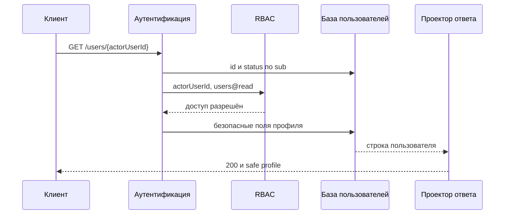
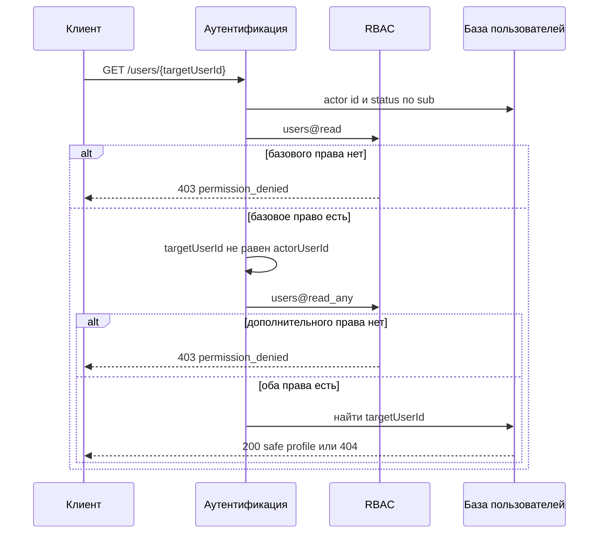
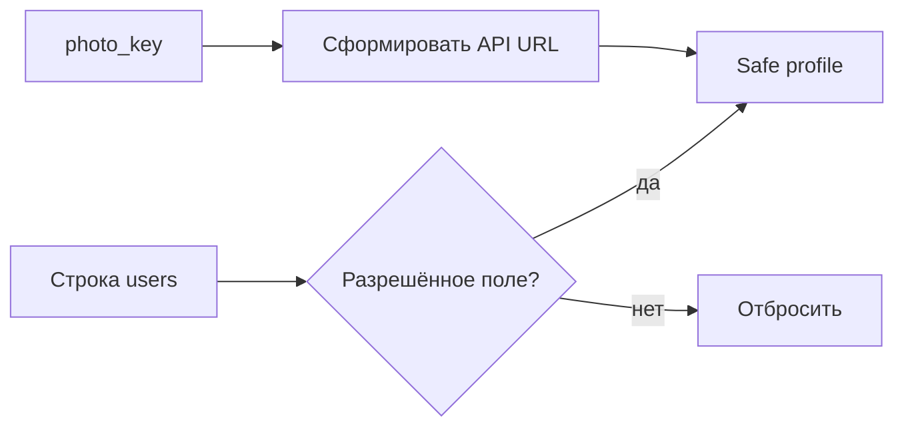

# Просмотр данных пользователя

## Содержание

- [Теория](#теория)
  - [Ситуация](#ситуация)
  - [Модель](#модель)
  - [Понятия и связь с бэкендом](#понятия-и-связь-с-бэкендом)
  - [Зоны ответственности](#зоны-ответственности)
  - [Типичные сбои](#типичные-сбои)
  - [Полезные ссылки](#полезные-ссылки)
  - [Вопросы по теории](#вопросы-по-теории)
- [Практическое задание](#практическое-задание)
  - [1.1 Общее](#11-общее)
  - [1.2 Сценарии](#12-сценарии-user-stories)
  - [1.3 Контракт](#13-контракт)
  - [1.4 Ошибки и ограничения](#14-ошибки-и-ограничения)
  - [1.5 Аудит](#15-аудитлоги)
  - [1.6 Нефункциональные требования](#16-нефункциональные-требования)

# Теория

## Ситуация

Активный пользователь запрашивает свой или чужой профиль с access JWT в cookie. Дальше возможен один из исходов: сервер возвращает безопасное представление профиля, отклоняет недействующую сессию с **401**, запрещает доступ с **403**, сообщает об отсутствующей записи или фотографии через **404**, ограничивает частоту запросов через **429** либо возвращает **503**, когда актуальные данные пользователя, RBAC или файловое хранилище недоступны.

Отдельный фронтенд не нужен, все запросы можно отправлять из HTTP-клиента с поддержкой cookies.

## Модель

В чтении профиля участвуют клиент, аутентификация, RBAC, база пользователей и проектор ответа. Сервер сначала устанавливает активного пользователя, затем проверяет базовое разрешение и только после этого решает, можно ли искать целевую запись. Клиент не выбирает разрешение и не определяет состав ответа.

Для собственного профиля достаточно `users@read`. Сравнить `targetUserId` с проверенным `actorUserId` можно без чтения целевой записи.

Для чужого профиля после базового `users@read` требуется дополнительное `users@read_any`. Обе проверки завершаются до поиска цели, поэтому пользователь без права получает **403** как для существующего, так и для вымышленного идентификатора.

Проектор ответа использует фиксированный разрешённый список. Даже если запрос к базе по ошибке получил больше столбцов, наружу выходят только `id`, `email`, `displayName`, `photoUrl`, `status`, `createdAt` и `updatedAt`.

Фотография хранится за отдельной границей. В базе находится непрозрачный `photo_key`, а `photoUrl` указывает на защищённую операцию API. Локальный путь, имя бакета, ключ объекта, подписанный URL и реквизиты хранилища в профиль не попадают. Операция фотографии повторяет проверки профиля, получает объект через абстракцию хранилища и возвращает нормализованное изображение.

Состав таблицы `users` расширяется профильными полями. Имена столбцов внутри базы могут отличаться, но ограничения и публичное представление сохраняются.

| `users` | Описание |
| --- | --- |
| `id` | неизменяемый идентификатор пользователя и первичный ключ |
| `email` | нормализованный email с уникальным индексом; крайние пробелы удалены, буквы приведены к нижнему регистру |
| `password_hash` | медленный хеш пароля; никогда не входит в профиль |
| `display_name` | `null` либо имя после обрезки крайних Unicode-пробелов и нормализации NFC, от 1 до 80 кодовых точек |
| `photo_key` | `null` либо непрозрачный уникальный ключ нормализованного объекта в хранилище |
| `status` | `pending`, `active`, `blocked`, `deleting` или `deleted`, ограничение проверяется базой |
| `created_at` | UTC-время создания, назначенное базой данных; после создания не меняется |
| `updated_at` | серверное время последнего изменения в UTC |

### Нормальная форма

Таблица `users` находится в нормальной форме Бойса — Кодда (BCNF) и, при указанных зависимостях, в пятой нормальной форме (5NF).

Каждая следующая форма включает требования предыдущей:

- **1NF:** каждое поле содержит одно значение. Имя, email и ключ фотографии не смешиваются в JSON или список; несколько фотографий и история профиля в одной ячейке не хранятся.
- **2NF:** первичный ключ `id` простой, поэтому частичной зависимости от части ключа нет. Уникальный `email` служит альтернативным ключом.
- **3NF и BCNF:** `display_name`, `photo_key`, `status` и временные метки описывают пользователя, определяемого ключом. Публичный `photoUrl` не сохраняется, поскольку он вычисляется из `photo_key` и конфигурации API; это исключает транзитивную зависимость и рассогласование двух адресов одного объекта.
- **4NF:** независимые списки ролей, challenge и файлов не помещаются в `users`; они относятся к отдельным таблицам или внешнему хранилищу.
- **5NF:** строку пользователя не приходится раскладывать на несколько отношений ради восстановления одной и той же профильной информации. Связи с ролями и challenge восстанавливаются по внешним ключам и не создают дополнительной зависимости соединения внутри `users`.

`photo_key` является внутренней ссылкой, а не копией публичного URL. Если базовый адрес API изменится, все `photoUrl` формируются заново без массового обновления строк. Уникальный индекс не позволяет двум профилям случайно ссылаться на один управляемый объект.

## Понятия и связь с бэкендом

### Безопасное представление и default-deny

Сущность базы и HTTP-представление решают разные задачи. Строка `users` нужна для входа, статуса и связей, поэтому содержит поля, которые клиенту не требуются. Safe profile создаётся явным проектором с разрешённым списком, а не сериализацией ORM-сущности.

Исключающий список ненадёжен: новое внутреннее поле может случайно появиться в ответе после миграции. Разрешающий список сохраняет прежний контракт, пока поле не добавлено в проектор осознанно. `password_hash`, секреты challenge, JWT, `photo_key`, роли, служебные версии и внутренние флаги не выдаются ни владельцу, ни администратору.

Email возвращается полностью и в нормализованном виде. Маскирование не применяется, поскольку владелец знает свой адрес, а просмотр чужого профиля уже требует отдельного `users@read_any`. Скрытие части строки не заменило бы контроль доступа и затруднило бы однозначную идентификацию учётной записи.

### IDOR, право владельца и `*_any`

IDOR возникает, когда замена идентификатора в URL даёт доступ к чужому объекту. Совпадение `targetUserId` с проверенным `actorUserId` разрешает только ветку владельца и только после `users@read`. Идентификатор из JWT, а не параметр клиента, определяет текущего пользователя.

Для чужой записи требуется `users@read_any`. Имя роли `admin` или `support` не проверяется в обработчике: актуальное решение принимает RBAC по назначениям из серверных данных. Пользователь может иметь подходящее разрешение через любую роль, а переименование роли не меняет контракт операции.

Базовое право и дополнительное право проверяются до запроса цели. После обеих проверок отсутствие пользователя становится обычным **404**. Такой порядок не позволяет клиенту без `users@read_any` выяснять, какие идентификаторы существуют.

### Цепочка защищённой операции

Access JWT читается из HttpOnly cookie по правилам аутентификации: фиксированный HS256, корректные `iss`, `aud`, `iat`, `exp`, непустой `sub` и `token_use=access`. Подпись устанавливает происхождение токена, но сервер всё равно читает актуальные `id` и `status`.

Только `active` проходит дальше. `pending`, `blocked`, `deleting`, `deleted` и отсутствующий пользователь получают одинаковый **401 invalid_session**. Состояния `deleting` и `deleted` добавлены для асинхронного удаления: первое немедленно прекращает доступ после принятия запроса, второе обозначает завершённую анонимизацию. Stateless access и refresh физически не отзываются, однако обязательная проверка статуса блокирует их использование.

После аутентификации RBAC сверяет актуальную версию политики. Недоступность базы пользователей или актуального снимка возвращает **503**, а не ложный **401** или **403**. Целевой профиль и фотография читаются только после завершения этой цепочки.

### Валидация имени

`displayName` допускает `null`, если имя не задано. Непустое значение обрезается по краям с учётом Unicode whitespace и нормализуется в NFC. После нормализации остаётся от 1 до 80 кодовых точек; символы управления диапазонов U+0000–U+001F и U+007F–U+009F запрещены.

Внутренние пробелы, регистр, диакритика и символы разных письменностей сохраняются. Имя не проверяется выражением «только латинские буквы», поскольку это исключило бы реальные имена. При выводе строка остаётся данными: защита от XSS выполняется контекстным экранированием на клиенте, а не удалением обычной пунктуации на сервере.

### Фотография и граница хранилища

Профиль не принимает произвольный внешний URL. Иначе пользователь смог бы подставить следящий адрес, небезопасную схему или ресурс, жизненным циклом которого система не управляет. Загрузка фотографии относится к изменению профиля, где сервер проверяет содержимое, удаляет метаданные и сохраняет нормализованный объект.

Чтение обращается к интерфейсу хранилища по `photo_key`. Для production по умолчанию используется S3-совместимое объектное хранилище, пригодное для нескольких экземпляров API. Локальная файловая система допустима только в однопроцессном окружении разработки и реализует тот же интерфейс. Публичный контракт от выбранного backend не меняется.

`photoUrl` имеет вид `https://api.example.test/users/{id}/photo` и не является прямым адресом бакета. Операция снова проверяет владельца или `users@read_any`, поэтому знание URL не открывает объект. Для `deleting` и `deleted` проектор возвращает `photoUrl: null`, а операция изображения — **404** без обращения к хранилищу: worker удаления может уже очистить объект, пока внутренний ключ ещё нужен для идемпотентного завершения. В ответе изображения нет исходного имени файла, EXIF и внутренних заголовков хранилища.

### Что изменится при редактировании и удалении

Изменение профиля будет управлять `display_name`, email и фотографией с отдельными правилами для владельца и администратора. Чтение само ничего не записывает и не принимает профильные поля от клиента.

Удаление добавит административный переход `pending`, `active` или `blocked` в `deleting`, а для Self — переход `active` в `deleting` после подтверждения. После очистки состояние станет `deleted`. Строка пользователя сохранится ради ссылочной целостности, но email станет техническим уникальным адресом, имя и фотография будут очищены. Просмотр удалённой записи с достаточным правом по-прежнему использует ту же форму safe profile и не раскрывает прежние PII.

### Сводка

| Понятие | Смысл в просмотре профиля | На что опирается реализация |
| --- | --- | --- |
| Safe profile | фиксированные семь публичных полей | разрешающий проектор ответа |
| Self | просмотр собственного `userId` | `users@read` и сравнение идентификаторов |
| Any | просмотр чужого `userId` | дополнительное `users@read_any` |
| IDOR | подмена идентификатора в пути | серверная проверка владельца до поиска цели |
| Актуальный статус | к операции допускается только `active` | чтение `users` после проверки JWT |
| `deleting` | удаление принято и доступ уже прекращён | проверка статуса каждого access и refresh |
| `deleted` | PII анонимизированы | сохранённая техническая строка без прежних PII |
| `photoUrl` | защищённый адрес API | внутренний `photo_key` и интерфейс хранилища |

## Зоны ответственности

| Клиент | Сервер |
| --- | --- |
| Отправляет cookie средствами браузера | Проверяет access JWT и актуальный статус |
| Передаёт целевой `userId` | Берёт `actorUserId` только из проверенного `sub` |
| Не передаёт имя роли или право | Проверяет `users@read` и при необходимости `users@read_any` |
| Показывает поля safe profile | Формирует ответ по фиксированному разрешённому списку |
| Обрабатывает `null` у имени и фотографии | Возвращает одинаковую каноническую форму профиля |
| Загружает `photoUrl` как защищённый ресурс | Не раскрывает ключ, путь и реквизиты хранилища |
| После **401** запускает один refresh по правилам авторизации | Не вызывает RBAC и обработчик при недействующей сессии |
| После **403** показывает отказ без refresh | Не ищет цель до проверки необходимых прав |

При другом доверенном origin клиент отправляет cookies с `credentials: "include"`, а сервер разрешает credentials только точному origin. Чтение профиля не изменяет состояние и не требует CSRF-заголовка, но всё равно проходит аутентификацию и RBAC.

## Типичные сбои

| Что видно | Куда смотреть |
| --- | --- |
| Собственный профиль получает **403** | отсутствует базовое назначение `users@read` либо владельца ошибочно проверяют по роли |
| Чужой профиль открывается с одним `users@read` | не выполнена дополнительная проверка `users@read_any` |
| Без `users@read_any` существующий id даёт **403**, а вымышленный **404** | целевая запись ищется раньше дополнительного права |
| Заблокированный пользователь читает профиль | после подписи JWT не проверяется актуальный `status` |
| Снятая роль действует до истечения access | разрешения читаются из JWT вместо актуального снимка RBAC |
| В JSON появился `passwordHash` или `photoKey` | сериализуется сущность базы вместо разрешающего проектора |
| После миграции в ответ попало новое внутреннее поле | фильтрация построена на исключающем списке |
| `photoUrl` ведёт прямо в приватный бакет | нарушена граница API и наружу выдан ключ либо подписанный адрес хранилища |
| По URL фотографии можно обойти доступ к профилю | операция изображения не повторяет `users@read` и `users@read_any` |
| Один пользователь отображается с двумя вариантами email | чтение или запись обошли нормализацию и уникальный индекс |
| Имя из одних пробелов сохранено как непустое | длина проверена до обрезки Unicode-пробелов |
| Одинаково выглядящие имена сравниваются по разным байтам | перед сохранением не выполнена нормализация NFC |
| Недоступная база даёт **401** | ошибка зависимости смешана с недействующей сессией вместо **503** |
| В журнале видны email, JWT или ключ объекта | логируются тело ответа, cookies либо строка пользователя целиком |

## Полезные ссылки

### Общие

- [OWASP API Security — Broken Object Level Authorization](https://owasp.org/API-Security/editions/2023/en/0xa1-broken-object-level-authorization/) — объясняет IDOR/BOLA и обязательную проверку доступа к каждому идентификатору объекта.
- [OWASP API Security — Broken Object Property Level Authorization](https://owasp.org/API-Security/editions/2023/en/0xa3-broken-object-property-level-authorization/) — показывает риск выдачи внутренних полей при сериализации полной сущности.
- [OWASP — Authorization Cheat Sheet](https://cheatsheetseries.owasp.org/cheatsheets/Authorization_Cheat_Sheet.html) — обосновывает запрет по умолчанию, минимальные привилегии и серверную проверку каждого запроса.
- [RFC 9110 — HTTP Semantics](https://www.rfc-editor.org/rfc/rfc9110) — определяет смысл ответов **401**, **403**, **404**, **429** и **503**.
- [Unicode Standard Annex #15 — Unicode Normalization Forms](https://unicode.org/reports/tr15/) — задаёт нормализацию NFC, используемую для `displayName`.
- [PostgreSQL — Constraints](https://www.postgresql.org/docs/current/ddl-constraints.html) — описывает уникальные ограничения и проверки значений при использовании PostgreSQL.
- [Amazon S3 — Object keys](https://docs.aws.amazon.com/AmazonS3/latest/userguide/object-keys.html) — объясняет внутренние ключи объектов, которые не должны становиться полями профиля.
- [MinIO AIStor — Documentation](https://min.io/docs/minio/linux/index.html) — подтверждает нативный S3 API для переносимой границы собственного объектного хранилища.
- [OpenAPI Specification — Security Scheme Object](https://spec.openapis.org/oas/latest.html#security-scheme-object) — нужна для описания cookie-аутентификации защищённых операций.

### По языку

#### Node.js

**Node.js, NestJS.** На Express или Fastify порядок access → актуальный пользователь → RBAC → проектор остаётся тем же.

- [NestJS — Guards](https://docs.nestjs.com/guards) — подключение аутентификации и проверок разрешений до обработчика.
- [NestJS — Serialization](https://docs.nestjs.com/techniques/serialization) — отдельные response-модели и исключение внутренних полей из JSON.
- [NestJS — Streaming files](https://docs.nestjs.com/techniques/streaming-files) — возврат фотографии через защищённую операцию API.
- [AWS SDK for JavaScript — S3 examples](https://docs.aws.amazon.com/sdk-for-javascript/v3/developer-guide/javascript_s3_code_examples.html) — чтение объекта через S3-совместимую границу.
- [NestJS — OpenAPI](https://docs.nestjs.com/openapi/introduction) — описание safe profile, cookie security и ответов операции.
- [Prisma Migrate](https://www.prisma.io/docs/orm/prisma-migrate) или [TypeORM — Migrations](https://typeorm.io/docs/advanced-topics/migrations/) — добавление профильных столбцов и ограничений миграцией.

#### .NET

**.NET, ASP.NET Core.** Minimal API и контроллеры используют один контракт профиля.

- [ASP.NET Core — Policy-based authorization](https://learn.microsoft.com/en-us/aspnet/core/security/authorization/policies) — требования `users@read` и `users@read_any`.
- [System.Text.Json — Customize properties](https://learn.microsoft.com/en-us/dotnet/standard/serialization/system-text-json/customize-properties) — явная response-модель вместо сериализации сущности базы.
- [ASP.NET Core — File results](https://learn.microsoft.com/en-us/aspnet/core/web-api/action-return-types) — возврат типизированного файла из защищённой операции.
- [AWS SDK for .NET — S3](https://docs.aws.amazon.com/sdk-for-net/v3/developer-guide/csharp_s3_code_examples.html) — доступ к S3-совместимому хранилищу через клиент.
- [ASP.NET Core — OpenAPI](https://learn.microsoft.com/en-us/aspnet/core/fundamentals/openapi/overview) — документирование формы профиля и ответов авторизации.
- [EF Core — Migrations](https://learn.microsoft.com/en-us/ef/core/managing-schemas/migrations/) — перенос изменений `users` между окружениями.

#### Python

**Python, FastAPI.** Для Django или Flask сохраняются тот же разрешающий список и порядок проверок.

- [FastAPI — Dependencies](https://fastapi.tiangolo.com/tutorial/dependencies/) — последовательная аутентификация и проверка разрешений.
- [FastAPI — Response Model](https://fastapi.tiangolo.com/tutorial/response-model/) — фильтрация ответа по объявленной безопасной модели.
- [FastAPI — Custom Response](https://fastapi.tiangolo.com/advanced/custom-response/) — потоковый или файловый ответ для фотографии.
- [Boto3 — S3](https://boto3.amazonaws.com/v1/documentation/api/latest/guide/s3-examples.html) — чтение объектов из S3-совместимого хранилища.
- [FastAPI — Metadata and Docs URLs](https://fastapi.tiangolo.com/tutorial/metadata/) — публикация актуальной OpenAPI-схемы.
- [Alembic — Tutorial](https://alembic.sqlalchemy.org/en/latest/tutorial.html) — миграция профильных столбцов и индексов.

## Вопросы по теории

1. Почему разрешающий список полей безопаснее списка исключений, когда таблица `users` со временем расширяется?
2. Зачем `users@read_any` проверять до поиска чужого пользователя и чем этот порядок защищает от IDOR?
3. Почему корректная подпись access JWT недостаточна без чтения актуального `status`?
4. Чем `photoUrl` отличается от `photo_key` и почему прямой адрес приватного бакета не должен входить в профиль?
5. Почему NFC полезна для `displayName`, но не заменяет контекстное экранирование при выводе?
6. Как состояния `deleting` и `deleted` прекращают работу stateless access и refresh без физического отзыва токенов?
7. Почему отсутствие сохраняемого `photoUrl` помогает таблице `users` оставаться в BCNF?

# Практическое задание

Функциональность просмотра данных пользователя в системе.
Активный пользователь с `users@read` получает собственный безопасный профиль. Для чужого профиля дополнительно требуется `users@read_any`; обе проверки выполняются до поиска целевой записи. Ответ всегда ограничен семью каноническими полями, а фотография доступна только через защищённую границу API.

## 1) Просмотр данных пользователя

### 1.1 Общее

**Назначение:** вернуть канонический профиль пользователя и его нормализованную фотографию без внутренних и секретных данных.

**Пользователи/роли:**

- активный пользователь с `users@read` — просматривает собственный профиль;
- активный пользователь с `users@read` и `users@read_any` — просматривает чужой профиль;
- имя роли не участвует в решении, права берутся из актуального RBAC.

**Единый каталог разрешений работы с пользователями:**

| Разрешение | Назначение |
| --- | --- |
| `users@read` | чтение собственного профиля |
| `users@read_any` | дополнительный допуск к чужому профилю |
| `users@update` | изменение собственного профиля |
| `users@update_any` | дополнительный допуск к изменению чужого пользователя и прямой смене email администратором |
| `users@delete` | подтверждённое удаление собственной учётной записи |
| `users@delete_any` | дополнительный допуск к удалению чужого пользователя администратором |
| `users@list` | просмотр административного списка пользователей |

Роль `user` получает `users@read`, `users@update` и `users@delete` при переходе в `active`. Действия `*_any` и `list` в неё не входят.

**Зависимости/связанные настройки:**

- аутентификация проверяет access JWT из cookie и принимает только существующего пользователя со статусом `active`;
- авторизация применяет цепочку access → актуальный пользователь → актуальный RBAC → целевой ресурс → обработчик;
- RBAC хранит действия `read`, `read_any`, `update`, `update_any`, `delete`, `delete_any` и `list` разрешения `users`;
- `PUBLIC_API_BASE_URL` задаёт HTTPS-адрес, из которого формируется `photoUrl`;
- хранилище фотографий реализует операции чтения по непрозрачному ключу и удаления; ключ и реквизиты хранилища клиенту не выдаются;
- production использует S3-совместимое объектное хранилище, локальная файловая система допускается только для одного экземпляра приложения в среде разработки.

Канонический профиль содержит ровно `id`, нормализованный `email`, `displayName`, `photoUrl`, `status`, `createdAt`, `updatedAt`. Email в разрешённом ответе не маскируется. Для `deleting` и `deleted` поле `photoUrl` равно `null`, даже если внутренний ключ ещё очищается. `password_hash`, секреты challenge, JWT, роли, `photo_key`, служебные версии и внутренние поля отсутствуют.

Допустимые статусы пользователя: `pending`, `active`, `blocked`, `deleting`, `deleted`. Только `active` проходит аутентификацию. `deleting` означает, что асинхронное удаление принято и токены уже перестали работать; `deleted` означает, что очистка и анонимизация завершены.

Изменение имени и фотографии выполняет функциональность редактирования профиля. Удаление объектов и анонимизацию выполняет функциональность удаления. Просмотр не меняет строку пользователя, объект фотографии, JWT или конфигурацию RBAC.

### 1.2 Сценарии (user stories)

1. **Собственный профиль:** активный пользователь с `users@read` запрашивает свой `userId` и получает safe profile.
2. **Чужой профиль:** активный пользователь с `users@read` и `users@read_any` запрашивает чужой `userId` и получает тот же набор полей.
3. **Нет базового права:** запрос завершается **403** до сравнения с существующей записью и до поиска цели.
4. **Нет дополнительного права:** чужой `userId` получает **403** до поиска цели, даже если такой пользователь не существует.
5. **Цель отсутствует:** пользователь с обоими нужными правами получает **404** после разрешённого поиска.
6. **Фотография задана:** клиент обращается по `photoUrl`, повторно проходит те же проверки и получает нормализованное изображение.
7. **Фотографии нет:** разрешённый запрос изображения получает **404** без раскрытия внутреннего ключа.

### 1.3 Контракт

#### 1.3.1 Получение профиля пользователя

| `GET /users/{userId}` | Проверки/валидация |
| --- | --- |
| `userId: string` | От 1 до 128 ASCII-символов, допустимы буквы, цифры, `_` и `-`; значение сравнивается с проверенным `actorUserId` без преобразования |
| Cookie `access_token` | Проверяется полностью по контракту аутентификации; принимается только пользователь `active` |

**Логика/шаги:**

1. Проверить формат `userId`.
2. Проверить access JWT, получить пользователя по `sub` и принять только `active`. При отказе вернуть **401** до RBAC.
3. Проверить актуальное `users@read`. При отсутствии вернуть **403**, не выполняя поиск целевого пользователя.
4. Сравнить `userId` с `actorUserId`.
5. Если идентификаторы различаются, проверить актуальное `users@read_any`. При отсутствии вернуть **403**, не выполняя поиск цели.
6. После всех необходимых прав выбрать по `userId` только `id`, `email`, `display_name`, `photo_key`, `status`, `created_at`, `updated_at`.
7. Если строка отсутствует, вернуть **404**.
8. Сформировать safe profile. При `photo_key = null` либо статусе `deleting` или `deleted` вернуть `photoUrl: null`, иначе сформировать защищённый URL API без самого ключа.

**Ответы:**

- **Успех:** **200 OK** и `id`, `email`, `displayName`, `photoUrl`, `status`, `createdAt`, `updatedAt`.
- `displayName` равно `null`, если имя не задано; `photoUrl` равно `null`, если фотографии нет либо статус равен `deleting` или `deleted`.
- `email` возвращается полностью, уже нормализованным и без маскирования.
- В ответе нет пароля, `password_hash`, challenge, HMAC, JWT, cookies, ролей, разрешений, `photo_key`, локального пути, адреса бакета и внутренних полей.

#### 1.3.2 Получение фотографии профиля

| `GET /users/{userId}/photo` | Проверки/валидация |
| --- | --- |
| `userId: string` | Те же формат и сравнение, что у получения профиля |
| Cookie `access_token` | Та же цепочка проверки активного пользователя |

**Логика/шаги:**

1. Выполнить шаги аутентификации, `users@read`, сравнения владельца и при необходимости `users@read_any` до поиска цели.
2. Получить только `id`, `status` и `photo_key` целевого пользователя.
3. Если пользователя или фотографии нет либо статус равен `deleting` или `deleted`, вернуть **404** без обращения к хранилищу.
4. Прочитать объект через интерфейс хранилища по внутреннему ключу.
5. Вернуть байты нормализованного WebP с `Content-Type: image/webp`, `X-Content-Type-Options: nosniff` и `Cache-Control: private, max-age=300`.

Если строка содержит ключ, но объект отсутствует, операция возвращает **503**, поскольку это нарушение согласованности, а не состояние «фотография не задана». Событие отправляется в мониторинг. Ключ, путь, имя бакета, исходное имя файла и заголовки авторизации хранилища в ответ не попадают.

#### 1.3.3 Каноническое представление

| Поле | Правило |
| --- | --- |
| `id: string` | неизменяемый идентификатор |
| `email: string` | полный нормализованный email; без крайних пробелов, в нижнем регистре |
| `displayName: string \| null` | NFC, от 1 до 80 кодовых точек после обрезки; без управляющих символов |
| `photoUrl: string \| null` | HTTPS URL защищённой операции API; `null`, если фотографии нет либо статус равен `deleting` или `deleted` |
| `status: string` | одно из `pending`, `active`, `blocked`, `deleting`, `deleted` |
| `createdAt: string` | UTC date-time в формате RFC 3339 |
| `updatedAt: string` | UTC date-time в формате RFC 3339 |

Одинаковая форма используется для собственного, чужого и административного представления пользователя. Поля не добавляются по имени роли. Пользователь со статусом, отличным от `active`, не может выступать вызывающей стороной, но цель с любым из пяти статусов видна обладателю необходимых прав.

`displayName` валидируется при записи: `null` очищает имя; строка обрезается по краям, нормализуется в NFC, после чего должна содержать от 1 до 80 кодовых точек и не содержать U+0000–U+001F или U+007F–U+009F. Просмотр возвращает сохранённое значение без повторной коррекции.

#### 1.3.4 Граница хранения фотографий

Приложение хранит в `users.photo_key` только непрозрачный ключ объекта. Публичный `photoUrl` вычисляется из `PUBLIC_API_BASE_URL`, `userId` и фиксированного пути; клиентский URL, локальный путь и адрес бакета в базу не записываются.

Интерфейс хранилища предоставляет операции `read(key)` и `delete(key)` с однозначными результатами `found`, `not_found` и `unavailable`. Просмотр использует только `read`. Реализация может быть заменена без изменения HTTP-контракта и схемы профиля.

Объект фотографии является нормализованным WebP без анимации и метаданных. Проверку загрузки, преобразование, атомарную смену `photo_key` и очистку старого объекта определяет изменение профиля.

### 1.4 Ошибки и ограничения

- **400 Bad Request** — `userId` не соответствует формату.
- **401 Unauthorized** — access отсутствует, невалиден, истёк, имеет неверные claims либо ссылается на отсутствующего пользователя или пользователя не в состоянии `active`.
- **403 Forbidden** — активный пользователь не имеет `users@read`; для чужого идентификатора отсутствует `users@read_any`.
- **404 Not Found** — целевой пользователь не найден после всех необходимых проверок; фотография не задана либо недоступна для статуса `deleting` или `deleted`.
- **429 Too Many Requests** — превышен установленный лимит чтения профиля или фотографии.
- **503 Service Unavailable** — недоступны база пользователей, актуальный снимок RBAC или хранилище; строка и объект фотографии рассогласованы.

Проверка базового права выполняется раньше поиска ресурса. Для чужого идентификатора дополнительное `users@read_any` также проверяется раньше поиска. Поэтому **404** получает только пользователь, уже допущенный к чтению цели такого типа.

### 1.5 Аудит/логи

Логировать:

- успешное чтение чужого профиля и фотографии;
- отказ `users@read` или `users@read_any`;
- **404** после разрешённого поиска;
- срабатывание rate limit;
- недоступность базы, RBAC и хранилища;
- рассогласование `photo_key` и объекта.

Событие содержит `requestId`, `actorUserId`, вид операции, признак `self` или `foreign`, `targetUserId` после допуска к поиску, результат и длительность. Для отказа до поиска сохраняются путь операции и категория права без проверки существования цели.

В журнал не попадают email, `displayName`, `photoUrl`, байты фотографии, `photo_key`, пароль, `password_hash`, challenge, JWT, `Cookie`, `Set-Cookie`, роли, полный профиль, полное тело ответа и заголовки запроса целиком.

### 1.6 Нефункциональные требования

- Собственный профиль и фотография допускают не более 120 запросов пользователя за минуту, чужие — не более 60. Следующий запрос получает **429**.
- Запрос к базе выбирает только поля safe profile, а запрос фотографии — `id`, `status` и `photo_key`. Хранилище читается потоково.
- Автоматические тесты покрывают Self/чужой профиль, оба разрешения, порядок прав до поиска, все пять статусов и защищённую фотографию.
- Общие нефункциональные требования проекта — валидация входных данных, CORS, OpenAPI, структурированные логи, health checks и покрытие тестами не ниже 80% — относятся и к этим операциям.
