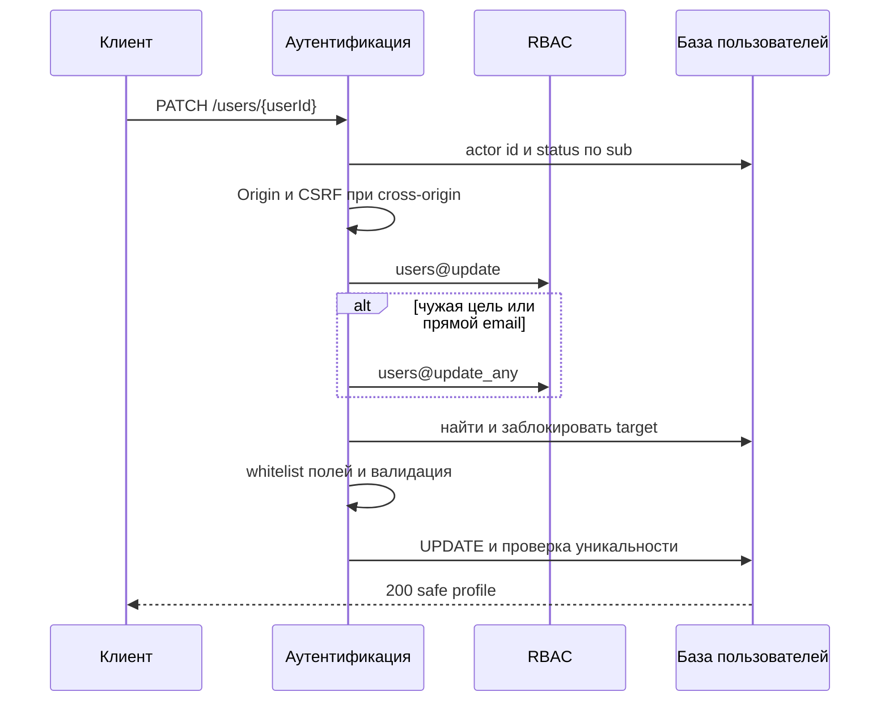
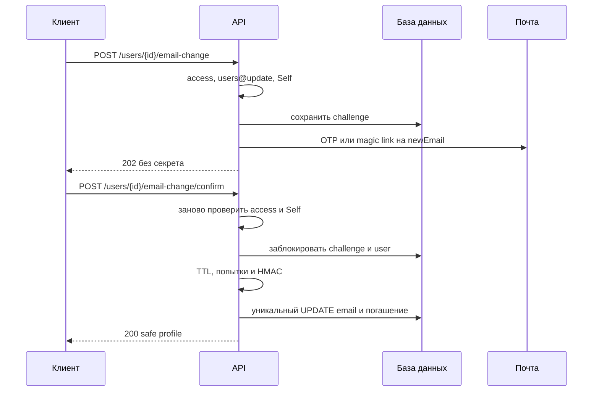
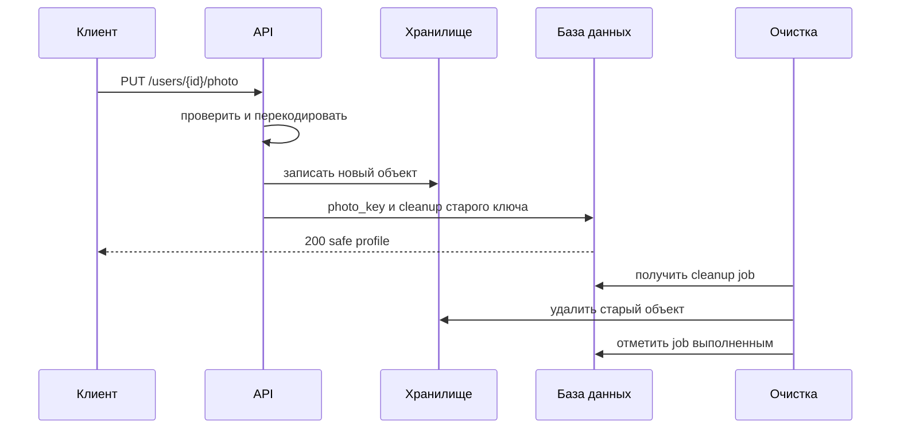
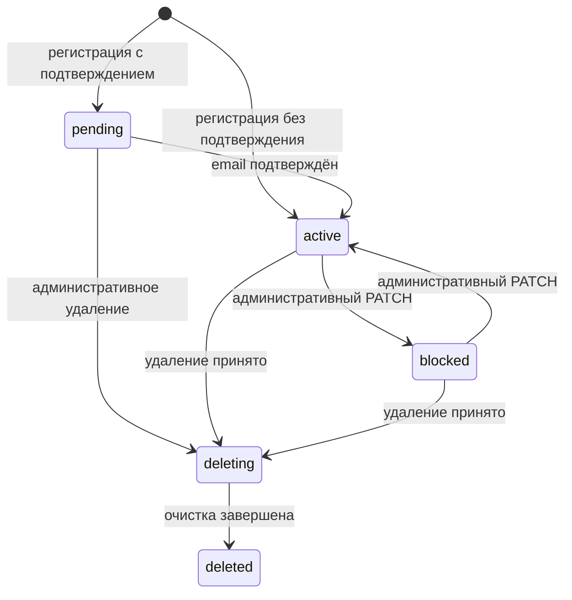

# Изменение данных пользователя

## Содержание

- [Теория](#теория)
  - [Ситуация](#ситуация)
  - [Модель](#модель)
  - [Понятия и связь с бэкендом](#понятия-и-связь-с-бэкендом)
  - [Зоны ответственности](#зоны-ответственности)
  - [Типичные сбои](#типичные-сбои)
  - [Полезные ссылки](#полезные-ссылки)
  - [Вопросы по теории](#вопросы-по-теории)
- [Практическое задание](#практическое-задание)
  - [1.1 Общее](#11-общее)
  - [1.2 Сценарии](#12-сценарии-user-stories)
  - [1.3 Контракт](#13-контракт)
  - [1.4 Ошибки и ограничения](#14-ошибки-и-ограничения)
  - [1.5 Аудит](#15-аудитлоги)
  - [1.6 Нефункциональные требования](#16-нефункциональные-требования)

# Теория

## Ситуация

Активный пользователь изменяет своё отображаемое имя или фотографию, а email подтверждает через письмо. Обладатель административного права может изменить чужой профиль и email напрямую. Дальше возможен один из исходов: профиль атомарно обновлён, создан email challenge, фотография заменена, поля отклонены с **400**, сессия отклонена с **401**, право или поле запрещено с **403**, цель не найдена с **404**, состояние или email конфликтуют с ответом **409**, файл слишком велик с **413**, тип файла не поддерживается с **415**, сработал **429** либо зависимость недоступна и возвращается **503**.

Отдельный фронтенд не нужен, все запросы можно отправлять из HTTP-клиента с поддержкой cookies и `multipart/form-data`.

## Модель

В обычном PATCH участвуют клиент, аутентификация, RBAC и база пользователей. Базовое `users@update` проверяется до поиска цели. Если `targetUserId` отличается от проверенного `actorUserId`, дополнительное `users@update_any` также проверяется до поиска. Прямое изменение email всегда требует `users@update_any`, даже когда администратор меняет собственный адрес.

Self не передаёт email в общий PATCH. Сначала сервер создаёт challenge на новый нормализованный адрес и отправляет выбранный сервером OTP или magic link. Подтверждение требует одновременно действующего challenge и действующей сессии того же пользователя.

Проверка уникальности перед отправкой письма улучшает ответ, но не является окончательной защитой от гонки. Другой запрос может занять адрес после проверки. Источником истины остаётся уникальный индекс `users.email`, поэтому конфликт при финальном `UPDATE` превращается в **409**, а challenge погашается с причиной `email_conflict`.

Фотография проходит декодирование и нормализацию до смены ссылки в профиле. Новый объект сначала записывается под новым непрозрачным ключом. Затем транзакция меняет `photo_key` и создаёт задание очистки старого объекта. Это не оставляет профиль без прежней фотографии, если загрузка нового объекта не удалась.

Статус пользователя образует отдельный жизненный цикл. PATCH администратора управляет только переходами между `active` и `blocked`. `pending` завершается регистрацией, а `deleting` и `deleted` принадлежат процессу удаления и через PATCH не устанавливаются.

Для смены email и надёжной очистки объектов добавляются две таблицы. Таблица `users` сохраняет профильную схему из просмотра данных.

| `users` | Описание |
| --- | --- |
| `id` | неизменяемый первичный ключ |
| `email` | нормализованный email с уникальным индексом |
| `password_hash` | медленный хеш пароля, не входит в профиль |
| `display_name` | `null` либо NFC-строка от 1 до 80 кодовых точек |
| `photo_key` | `null` либо уникальный непрозрачный ключ объекта |
| `status` | `pending`, `active`, `blocked`, `deleting` или `deleted` |
| `created_at` | UTC-время создания, назначенное базой данных и неизменяемое после вставки |
| `updated_at` | время последнего изменения в UTC |

| `email_change_challenges` | Описание |
| --- | --- |
| `id` | идентификатор challenge |
| `user_id` | ссылка на `users.id`; частичный уникальный индекс допускает один непогашенный challenge на пользователя |
| `new_email` | нормализованный адрес, который будет записан после подтверждения |
| `method` | `otp` или `magic_link`, выбранный сервером при создании |
| `secret_hash` | HMAC-SHA256 от OTP или случайного секрета; исходное значение не хранится |
| `last_sent_at` | время последней отправки; от него считаются TTL 10 минут и пауза 60 секунд |
| `attempts` | число неверных OTP; пятый неверный ввод погашает challenge |
| `consumed_at` | `null` до погашения |
| `consumed_reason` | `confirmed`, `replaced`, `attempts_exhausted`, `email_conflict`, `admin_override` или `user_inactive` |
| `created_at` | время создания challenge |

| `storage_cleanup_jobs` | Описание |
| --- | --- |
| `id` | идентификатор задания очистки |
| `object_key` | внутренний ключ объекта; один ключ встречается не более одного раза |
| `reason` | `photo_replaced`, `photo_cleared` или `orphan_upload` |
| `status` | `queued`, `succeeded` или `failed` |
| `attempts` | число запусков обработчика |
| `next_attempt_at` | время следующего допустимого запуска; при создании равно текущему времени |
| `last_error_code` | категория последнего сбоя без URL, ключей доступа и тела ответа |
| `created_at` | время создания задания |
| `updated_at` | время последнего изменения задания |

### Нормальная форма

`users`, `email_change_challenges` и `storage_cleanup_jobs` находятся в BCNF и, при указанных зависимостях, в 5NF.

Каждая следующая форма включает требования предыдущей:

- **1NF:** email, секретный хеш, ключ объекта и причина представлены отдельными атомарными значениями. История отправок и список старых фотографий не складываются в массивы одной строки; resend заменяет текущий секрет, а каждый удаляемый объект получает отдельное cleanup-задание.
- **2NF:** у `users`, `email_change_challenges` и `storage_cleanup_jobs` простые первичные ключи `id`, поэтому частичной зависимости от составного ключа нет.
- **3NF и BCNF:** challenge хранит `user_id`, но не копирует текущее имя, статус или старый email пользователя. TTL вычисляется как `last_sent_at + 10 минут`, поэтому отдельное зависимое `expires_at` не создаёт аномалию обновления. Cleanup-задание описывает один объект и не копирует `users.photo_key`.
- **4NF:** независимые challenge и объекты очистки вынесены в разные строки и таблицы. Их объединение с пользователем породило бы произведение двух независимых списков.
- **5NF:** связи пользователя с challenge и cleanup-заданиями восстанавливаются по ключам без дополнительной зависимости соединения. Разложение не теряет факты и не создаёт ложные сочетания.

`next_attempt_at` не вычисляется только из `attempts`: на него влияет время последнего сбоя. Поэтому это сохранённое состояние планировщика, а не транзитивная копия другого поля. Частичный уникальный индекс непогашенного challenge задаёт ограничение, но нормальную форму не меняет.

## Понятия и связь с бэкендом

### PATCH и разрешающий список полей

PATCH изменяет только перечисленные клиентом поля. Пустое тело и неизвестное поле отклоняются целиком: тихое игнорирование опечатки создало бы ложный успешный ответ. Поля `id`, `photoUrl`, `createdAt`, `updatedAt`, `passwordHash`, роли и внутренние ключи никогда не доступны через профильный PATCH.

Self изменяет только `displayName`. Фотография имеет отдельные операции, поскольку передача файла и частичные сбои хранилища отличаются от JSON. Email Self проходит challenge. Администратор с `users@update_any` может передать `displayName`, `email` и `status`, но не может через PATCH установить `pending`, `deleting` или `deleted`.

Транзакция блокирует целевую строку и обновляет только присланные столбцы. Параллельные изменения разных полей сохраняются, а два изменения одного поля применяются в порядке фиксации транзакций; последнее зафиксированное значение становится актуальным. Уникальный индекс разрешает гонку email независимо от предварительной проверки.

### Нормализация профильных полей

Email обрезается по краям и приводится к нижнему регистру. Теги вида `user+tag@example.com` не удаляются, точки и домены не переписываются по правилам отдельного провайдера. Поэтому два различных нормализованных значения считаются разными адресами, а одно значение защищено уникальным индексом.

`displayName: null` очищает имя. Строка обрезается с учётом Unicode whitespace, нормализуется в NFC и после этого должна содержать от 1 до 80 кодовых точек. Управляющие символы U+0000–U+001F и U+007F–U+009F запрещены. Внутренние пробелы, регистр и письменность сохраняются.

Одинаково выглядящие строки могут иметь разное двоичное представление из-за составных и комбинируемых символов. NFC приводит канонически эквивалентные последовательности к одной форме, но не выполняет транслитерацию и не защищает вывод от XSS.

### Email challenge и действующая сессия

OTP содержит ровно шесть цифр. Magic link содержит идентификатор challenge и 32 случайных байта до base64url-кодирования. Оба способа действуют 10 минут, а сервер выбирает один способ из конфигурации и сохраняет его в challenge.

Секрет хранится как HMAC-SHA256 с отдельным ключом приложения длиной не менее 32 случайных байт. Обычный SHA-256 не подходит для короткого OTP, поскольку миллион вариантов можно перебрать заранее. Сравнение HMAC выполняется за постоянное время.

OTP допускает пять вводов. Пятый ввод ещё может быть успешным; пятый неверный ответ возвращает **400** и одновременно гасит challenge, а следующий запрос получает **429**. Magic link одноразовый, но счётчик вводов к нему не применяется. Resend разрешён через 60 секунд, заменяет секрет, заново запускает TTL и обнуляет `attempts`.

Challenge доказывает доступ к новому почтовому ящику, но не устанавливает личность пользователя. Confirm снова проверяет access JWT, актуальный `active`, `users@update` и совпадение `userId` с `sub`. Самодостаточного подтверждения без сессии нет. Письмо помещает magic token во фрагмент URL, который не отправляется серверу и в `Referer`; клиентская страница читает фрагмент и передаёт token в теле POST. Открытие ссылки методом GET только показывает страницу.

### Уникальность email и гонки

При инициации сервер сообщает **409**, если новый email уже находится в `users`. Одновременно начавшиеся challenge разных пользователей могут пройти эту предварительную проверку, поэтому письмо не считается резервированием адреса.

Confirm блокирует challenge и пользователя, проверяет секрет, а затем пытается изменить `users.email`. Уникальный индекс выбирает единственного победителя. При конфликте точка отката отменяет только неудачный `UPDATE`, после чего challenge отмечается `email_conflict` и транзакция фиксируется с ответом **409**. Повторный confirm не создаёт бесконечную серию конфликтов.

Прямой административный PATCH подчиняется тому же уникальному индексу. Он гасит непогашенный email challenge целевого пользователя с причиной `admin_override`, чтобы ранее выданное письмо не отменило более позднее административное решение.

JWT содержит `sub`, но не email, поэтому успешная смена адреса не требует выпуска новой пары. Access и refresh продолжают идентифицировать того же пользователя. Если одновременно началось удаление или блокировка, повторная проверка строки перед фиксацией не позволяет изменить уже неактивную учётную запись.

### Проверка и нормализация фотографии

Загрузка принимает один JPEG, PNG или WebP размером не более 5 МиБ. HTTP `Content-Type`, сигнатура и результат полного декодирования должны согласовываться. SVG, GIF, AVIF, анимированное изображение, несколько файлов и дополнительные multipart-поля отклоняются.

Размер декодированного изображения составляет от 64×64 до 4096×4096 пикселей. Сервер применяет EXIF orientation, уменьшает изображение с сохранением пропорций до рамки 1024×1024, удаляет EXIF, ICC-комментарии и другие метаданные, запрещает анимацию и кодирует один WebP. Итоговый объект не превышает 2 МиБ; если ограничение выполнить не удалось, запрос получает **400**.

Расширение имени и заявленный MIME не доказывают содержимое. Полное декодирование обнаруживает повреждённый файл, а повторное кодирование убирает исходный контейнер и метаданные. Исходное имя не используется как путь или ключ. Новый ключ содержит не менее 128 случайных бит и генерируется сервером.

### Частичные сбои хранилища и почты

Challenge фиксируется до отправки письма. Если транзакция не завершилась, письмо не отправляется и клиент получает **503**. Если SMTP отклонил письмо после фиксации, challenge остаётся действующим, ответ **503** содержит его идентификатор и время до resend, но не OTP или токен.

Новый объект фотографии записывается раньше изменения базы. Если запись объекта не удалась, профиль остаётся прежним. Если объект записан, а транзакция профиля откатилась, API пытается удалить новый объект; недоступный объект подбирает периодический поиск неподтверждённых ключей старше одного часа.

После успешной транзакции профиль уже указывает на новый объект или `null`. Ошибка удаления прежнего объекта не откатывает профиль: `storage_cleanup_jobs` повторяет удаление до пяти раз с паузой одна минута. Операция удаления объекта считается успешной и при ответе хранилища `not_found`, поэтому повтор безопасен и отдельный lease не нужен.

### Статус и stateless JWT

PATCH администратора переводит только `active` в `blocked` и `blocked` в `active`. Повтор того же значения является успешным no-op и не меняет `updatedAt`. `pending` активируется только регистрационным подтверждением, а `deleting` и `deleted` устанавливает удаление.

После перехода в `blocked` следующие access и refresh получают **401**, поскольку аутентификация каждый раз читает статус. Подписанные stateless JWT физически не удаляются. Если пользователя снова активировать до `exp` старого refresh, копия токена снова сможет пройти проверку; полный отзыв потребовал бы серверных сессий, которых текущая аутентификация не хранит.

Переход `active` → `blocked` не может оставить систему без активного носителя `rbac@manage`. После появления статусов пользователя этот инвариант во всех операциях изменения политики считает носителем управления только пользователя в состоянии `active`. Проверка выполняется в той же транзакции под общей блокировкой состояния политики, поэтому блокировка, удаление и изменение назначений не могут параллельно вывести из строя последних администраторов. Нарушение возвращает **409**, а статус и challenge не меняются.

### Что будет при удалении

Удаление сначала переведёт пользователя в `deleting`, поэтому редактирование прекратится немедленно. Для Self исходным состоянием служит `active`, а администратор может принять удаление цели в `pending`, `active` или `blocked`. Затем асинхронный процесс удалит фотографию, очистит email challenge и PII, после чего установит `deleted`.

Операции профиля не запускают удаление и не устанавливают эти два статуса. Cleanup старой фотографии относится только к замене объекта и не анонимизирует остальные данные пользователя.

### Сводка

| Понятие | Смысл в изменении профиля | На что опирается реализация |
| --- | --- | --- |
| PATCH whitelist | меняются только известные поля | отдельные наборы Self и Admin |
| NFC | единая каноническая форма имени | Unicode-нормализация до проверки длины |
| Email challenge | Self подтверждает новый ящик | действующая сессия, HMAC, TTL и попытки |
| Уникальность email | один адрес принадлежит одной строке | уникальный индекс и обработка конфликта |
| `users@update_any` | чужой профиль и прямой email | дополнительная проверка актуального RBAC |
| Нормализация фото | один безопасный формат | декодирование, лимиты и повторное кодирование |
| Storage boundary | профиль не хранит внешний URL | непрозрачный `photo_key` и cleanup job |
| `blocked` | новые запросы не аутентифицируются | чтение актуального статуса для access и refresh |

## Зоны ответственности

| Клиент | Сервер |
| --- | --- |
| Передаёт только изменяемые поля | Отклоняет неизвестные и запрещённые поля целиком |
| Для Self не помещает email в PATCH | Требует challenge для self-смены email |
| Сохраняет `challengeId`, но не получает секрет из API | Отправляет OTP или magic link только на новый email |
| Подтверждает email с действующей cookie | Повторно проверяет active, право и владельца |
| Загружает один допустимый файл | Проверяет байты, декодирует и повторно кодирует изображение |
| Не формирует `photoUrl` | Генерирует API URL из внутреннего `photo_key` |
| После **409** перечитывает профиль | Превращает конфликт уникального индекса в обычный ответ |
| После **503** следует правилам конкретной операции | Сохраняет однозначное состояние для безопасного повтора |

При размещении frontend на другом origin все изменяющие состояние запросы после access-проверки требуют точный разрешённый `Origin` и `X-CSRF-Protection: 1`, даже если оба origin относятся к одному site. Для cross-site-размещения cookies дополнительно получают `SameSite=None; Secure`. CORS и CSRF не заменяют `users@update` или `users@update_any`.

## Типичные сбои

| Что видно | Куда смотреть |
| --- | --- |
| Self меняет email обычным PATCH | поле не отделено от разрешённого набора владельца |
| Admin меняет email без `users@update_any` | прямой email ошибочно разрешён одним базовым `users@update` |
| Чужая несуществующая цель даёт **404** без `users@update_any` | ресурс найден раньше дополнительного права |
| Неизвестное поле получает **200**, но не меняется | PATCH тихо игнорирует опечатки вместо **400** |
| Два пользователя получают один email | уникальность проверена запросом приложения без уникального индекса |
| Confirm иногда падает необработанной ошибкой базы | гонка уникального email не преобразована в **409** |
| Старое письмо меняет email после admin PATCH | административное изменение не погасило challenge |
| Magic link меняет email обычным GET | сканер письма может выполнить изменение без явного POST |
| Ссылка работает без действующей сессии | challenge ошибочно считается самостоятельной аутентификацией |
| Пятый неверный OTP не гасит challenge | счётчик и `consumed_reason` обновляются неатомарно |
| После resend подходит старый секрет | `secret_hash` и `last_sent_at` не заменены одной транзакцией |
| SMTP вернул ошибку, а повторный вызов создаёт вторую активную попытку | не соблюдён частичный уникальный индекс и контракт частичного сбоя |
| Два последних администратора одновременно стали `blocked` | переходы не сериализованы общей блокировкой инварианта `rbac@manage` |
| SVG проходит как фотография | проверяется только расширение или клиентский MIME |
| Маленький файл исчерпывает память при декодировании | нет ограничения декодированных размеров и полного безопасного декодирования |
| В фотографии остались GPS-координаты EXIF | исходный контейнер отдан без повторного кодирования и очистки метаданных |
| После замены растёт число старых объектов | cleanup job не создан в транзакции с новым `photo_key` |
| При сбое удаления старого объекта профиль откатывается | внешняя очистка ошибочно включена в критический ответ после фиксации |
| Заблокированный пользователь продолжает refresh | аутентификация не читает актуальный статус по `sub` |
| В журнале есть новый email, OTP или байты файла | логируется тело запроса, multipart или секрет письма |

## Полезные ссылки

### Общие

- [RFC 5789 — PATCH Method for HTTP](https://www.rfc-editor.org/rfc/rfc5789) — определяет частичное изменение ресурса и требования к обработке PATCH.
- [OWASP — Input Validation Cheat Sheet](https://cheatsheetseries.owasp.org/cheatsheets/Input_Validation_Cheat_Sheet.html) — объясняет разрешающие списки, синтаксическую и семантическую проверку полей.
- [OWASP — File Upload Cheat Sheet](https://cheatsheetseries.owasp.org/cheatsheets/File_Upload_Cheat_Sheet.html) — обосновывает проверку размера, сигнатуры, декодирование, новые имена и отдельное хранилище.
- [OWASP — Forgot Password Cheat Sheet](https://cheatsheetseries.owasp.org/cheatsheets/Forgot_Password_Cheat_Sheet.html) — правила одноразовых кодов и ссылок, применимые к подтверждению нового email.
- [Unicode Standard Annex #15 — Unicode Normalization Forms](https://unicode.org/reports/tr15/) — нормативное описание NFC для `displayName`.
- [PostgreSQL — Unique indexes](https://www.postgresql.org/docs/current/indexes-unique.html) — окончательная защита уникальности email при параллельных запросах.
- [PostgreSQL — Partial indexes](https://www.postgresql.org/docs/current/indexes-partial.html) — ограничение одной непогашенной попытки через условный уникальный индекс.
- [Amazon S3 — Consistency model](https://docs.aws.amazon.com/AmazonS3/latest/userguide/Welcome.html#ConsistencyModel) — свойства чтения и удаления объектов за границей базы данных.
- [OpenAPI Specification — File Upload](https://spec.openapis.org/oas/latest.html#considerations-for-file-uploads) — описание `multipart/form-data` и бинарных полей без привязки к серверному стеку.

### По языку

#### Node.js

**Node.js, NestJS.** На Express или Fastify правила полей, challenge и хранилища остаются теми же.

- [NestJS — Validation](https://docs.nestjs.com/techniques/validation) — whitelist JSON-полей и проверка DTO.
- [NestJS — File upload](https://docs.nestjs.com/techniques/file-upload) — приём одного multipart-файла и лимиты до обработчика.
- [Node.js — `crypto`](https://nodejs.org/api/crypto.html) — случайные байты, HMAC и сравнение секрета за постоянное время.
- [Sharp](https://sharp.pixelplumbing.com/) — декодирование, изменение размера, удаление метаданных и кодирование WebP.
- [Prisma — Transactions](https://www.prisma.io/docs/orm/prisma-client/queries/transactions) или [TypeORM — Transactions](https://typeorm.io/docs/advanced-topics/transactions/) — атомарное изменение пользователя и challenge.
- [NestJS — OpenAPI](https://docs.nestjs.com/openapi/introduction) — документирование PATCH, email challenge и multipart.
- [Prisma Migrate](https://www.prisma.io/docs/orm/prisma-migrate) или [TypeORM — Migrations](https://typeorm.io/docs/advanced-topics/migrations/) — создание challenge, cleanup jobs и индексов.

#### .NET

**.NET, ASP.NET Core.** Minimal API и контроллеры используют одинаковые правила нормализации и доступа.

- [ASP.NET Core — Model validation](https://learn.microsoft.com/en-us/aspnet/core/mvc/models/validation) — проверка JSON-моделей и ошибок полей.
- [ASP.NET Core — Upload files](https://learn.microsoft.com/en-us/aspnet/core/mvc/models/file-uploads) — multipart, потоковая загрузка и ограничения размера.
- [.NET — Unicode normalization](https://learn.microsoft.com/en-us/dotnet/api/system.string.normalize) — NFC для `displayName`.
- [.NET — HMACSHA256](https://learn.microsoft.com/en-us/dotnet/api/system.security.cryptography.hmacsha256) — невосстановимое представление OTP и magic link.
- [ImageSharp](https://docs.sixlabors.com/) — декодирование, изменение размера и повторное кодирование изображения.
- [EF Core — Transactions](https://learn.microsoft.com/en-us/ef/core/saving/transactions) — блокировка и атомарное обновление связанных строк.
- [EF Core — Migrations](https://learn.microsoft.com/en-us/ef/core/managing-schemas/migrations/) — перенос таблиц и уникальных индексов.
- [ASP.NET Core — OpenAPI](https://learn.microsoft.com/en-us/aspnet/core/fundamentals/openapi/overview) — описание тел, файлов и вариантов ответа.

#### Python

**Python, FastAPI.** Для Django или Flask контракт не меняется, а библиотеки обработки могут быть заменены.

- [FastAPI — Body Updates](https://fastapi.tiangolo.com/tutorial/body-updates/) — частичное обновление без перезаписи отсутствующих полей.
- [FastAPI — Request Files](https://fastapi.tiangolo.com/tutorial/request-files/) — приём `multipart/form-data` и потоковый файл.
- [Python — `unicodedata`](https://docs.python.org/3/library/unicodedata.html) — NFC для `displayName`.
- [Python — `hmac`](https://docs.python.org/3/library/hmac.html) — HMAC и `compare_digest` для challenge.
- [Pillow](https://pillow.readthedocs.io/en/stable/) — декодирование, проверка размеров и кодирование WebP.
- [SQLAlchemy — Transactions](https://docs.sqlalchemy.org/en/20/orm/session_transaction.html) — транзакция изменения email и погашения challenge.
- [Alembic — Tutorial](https://alembic.sqlalchemy.org/en/latest/tutorial.html) — миграции challenge, cleanup jobs и индексов.
- [FastAPI — Metadata and Docs URLs](https://fastapi.tiangolo.com/tutorial/metadata/) — публикация актуальной OpenAPI-схемы.

## Вопросы по теории

1. Почему PATCH должен отклонять неизвестное поле целиком, а не молча удалять его из тела?
2. Зачем confirm смены email требует и challenge, и действующую сессию того же пользователя?
3. Почему предварительная проверка email не устраняет необходимость уникального индекса при финальном `UPDATE`?
4. Что произойдёт, если SMTP не принял письмо после фиксации challenge, и почему прежнее состояние нельзя незаметно откатить?
5. Почему проверка расширения и `Content-Type` недостаточна для фотографии и зачем изображение повторно кодировать?
6. Как cleanup job сохраняет согласованность профиля, если удаление старого объекта временно не удалось?
7. Почему отсутствие `expires_at` помогает `email_change_challenges` соответствовать BCNF?

# Практическое задание

Функциональность изменения данных пользователя в системе.
Self меняет отображаемое имя и фотографию, а новый email подтверждает OTP или magic link с действующей сессией. Администратор с дополнительным `users@update_any` меняет чужой профиль и email через общий PATCH. Уникальные индексы, транзакции и задания очистки определяют результат параллельных запросов и частичных сбоев.

## 1) Изменение данных пользователя

### 1.1 Общее

**Назначение:** безопасно изменить разрешённые поля профиля, подтверждённый email и управляемую фотографию.

**Пользователи/роли:**

- активный пользователь с `users@update` — изменяет собственные `displayName` и фотографию, инициирует и подтверждает собственную смену email;
- активный пользователь с `users@update` и `users@update_any` — изменяет чужой профиль;
- прямое изменение email через PATCH всегда требует `users@update_any`, независимо от совпадения `actorUserId` и `targetUserId`;
- имя роли не заменяет проверку разрешений.

**Единый каталог разрешений работы с пользователями:**

| Разрешение | Назначение |
| --- | --- |
| `users@read` | чтение собственного профиля |
| `users@read_any` | дополнительный допуск к чужому профилю |
| `users@update` | изменение собственного профиля |
| `users@update_any` | дополнительный допуск к изменению чужого пользователя и прямой смене email администратором |
| `users@delete` | подтверждённое удаление собственной учётной записи |
| `users@delete_any` | дополнительный допуск к удалению чужого пользователя администратором |
| `users@list` | просмотр административного списка пользователей |

**Зависимости/связанные настройки:**

- access JWT и cookies полностью соответствуют аутентификации: access действует 15 минут, находится в HttpOnly cookie, а сервер принимает только актуальный `active`;
- защищённая цепочка соответствует авторизации: access → пользователь → CSRF для cross-origin-изменения → актуальный RBAC → цель → изменение;
- общий инвариант управления доступом считает носителем `rbac@manage` только пользователя `active` и сериализует изменения назначений, блокировку и удаление;
- `EMAIL_CHANGE_METHOD` имеет одно серверное значение `otp` или `magic_link`;
- `EMAIL_CHANGE_HMAC_KEY` содержит отдельное случайное значение длиной не менее 32 байт;
- SMTP и доверенный frontend-origin задаются конфигурацией приложения;
- хранилище фотографий реализует запись и удаление по непрозрачным ключам; production по умолчанию использует S3-совместимое хранилище, локальная реализация допустима только для одного экземпляра приложения в разработке;
- фоновый обработчик выполняет `storage_cleanup_jobs`: до 5 попыток с паузой 1 минута, `not_found` считается успехом.

Если обязательный HMAC-ключ отсутствует, пуст или короче 32 байт, приложение не проходит readiness. Ключ JWT, регистрационный ключ, ключ login challenge и ключ смены email не объединяются.

Канонический профиль содержит ровно `id`, нормализованный `email`, `displayName`, `photoUrl`, `status`, `createdAt`, `updatedAt`. Email не маскируется; для `deleting` и `deleted` общий проектор возвращает `photoUrl: null`, хотя операции редактирования не завершаются успехом для этих состояний. В ответах нет `password_hash`, challenge secrets, HMAC, JWT, cookies, `photo_key`, ролей и внутренних полей.

Допустимые статусы — `pending`, `active`, `blocked`, `deleting`, `deleted`; только `active` аутентифицируется. `deleting` и `deleted` добавлены для асинхронного удаления и не устанавливаются операциями редактирования.

### 1.2 Сценарии (user stories)

1. **Self меняет имя:** пользователь отправляет только `displayName` и получает обновлённый safe profile.
2. **Self меняет фотографию:** пользователь загружает один допустимый файл, сервер нормализует его и атомарно переключает профиль на новый объект.
3. **Self очищает фотографию:** ссылка удаляется сразу, а объект надёжно очищается фоновым заданием.
4. **Self меняет email:** сервер отправляет OTP или magic link на новый адрес, а confirm с той же активной сессией атомарно меняет email.
5. **Admin меняет чужой профиль:** после `users@update` и `users@update_any` общий PATCH принимает `displayName`, прямой `email` и допустимый `status`.
6. **Admin меняет email напрямую:** PATCH с `users@update_any` не создаёт письмо и гасит прежний self challenge цели.
7. **Параллельный email:** единственный `UPDATE`, прошедший уникальный индекс, завершается успехом; проигравший получает **409**.
8. **Частичный сбой:** состояние пользователя, challenge и объектов остаётся однозначным, а ответ сообщает, каким запросом безопасно продолжить.

### 1.3 Контракт

#### 1.3.1 Обновление профильных полей

| `PATCH /users/{userId}` | Проверки/валидация |
| --- | --- |
| `userId: string` | От 1 до 128 ASCII-символов, допустимы буквы, цифры, `_` и `-` |
| `displayName: string \| null` | Разрешён Self и Admin; `null` очищает, строка нормализуется и проверяется по правилам имени |
| `email: string` | Разрешён только при наличии `users@update_any`; нормализуется как при регистрации |
| `status: string` | Разрешён только при наличии `users@update_any`; итоговое значение только `active` или `blocked` |

Тело содержит от одного до трёх уникальных полей из таблицы. Пустое тело, повтор ключа в JSON, неизвестное поле и поля `id`, `photoUrl`, `createdAt`, `updatedAt`, `password`, `passwordHash`, роли или внутренние ключи дают **400**. `email: null` и `status: null` недопустимы.

`displayName` после обрезки Unicode whitespace и NFC содержит от 1 до 80 кодовых точек и не содержит U+0000–U+001F или U+007F–U+009F. Пустая после обрезки строка получает **400**; для очистки используется только `null`.

Email после удаления крайних пробелов и приведения букв к нижнему регистру должен иметь валидный формат и не превышать 254 символа. Теги `+tag` сохраняются. Адрес, совпадающий с текущим после нормализации, считается успешным no-op.

**Логика/шаги:**

1. Проверить формат пути и JSON до обращения к базе.
2. Проверить access, актуальный `active` и для запроса из другого origin точный `Origin` с `X-CSRF-Protection: 1`, в том числе при same-site-размещении.
3. Проверить актуальное `users@update` до поиска цели.
4. Если `userId` отличается от `actorUserId`, проверить `users@update_any` до поиска цели.
5. Если тело содержит `email` или `status`, проверить `users@update_any`, даже для собственной цели.
6. Если запрошен `status = blocked`, сначала получить общую блокировку состояния политики. Затем найти и заблокировать строку пользователя. Отсутствующая строка получает **404**.
7. Разрешить изменение только цели в состоянии `active` или `blocked`. Для `pending`, `deleting` и `deleted` вернуть **409**.
8. Провалидировать и нормализовать все значения до записи.
9. Перед переходом `active` → `blocked` под общей блокировкой инварианта RBAC убедиться, что после перехода остаётся хотя бы один другой активный пользователь с `rbac@manage`. Иначе вернуть **409** без изменений.
10. Одним `UPDATE` изменить только присланные поля. Конфликт уникального `users.email` преобразовать в **409**.
11. При прямой смене email погасить непогашенный `email_change_challenges` цели с причиной `admin_override` в той же транзакции.
12. При переходе в `blocked` погасить непогашенные login- и email-change challenge с причиной `user_inactive`. Следующие access и refresh перестают работать из-за проверки статуса.
13. Если все нормализованные значения уже совпадают, вернуть текущий профиль без изменения `updatedAt`; иначе установить новое серверное `updatedAt`.

**Ответы:**

- **Успех:** **200 OK** и канонический safe profile.
- **Ошибки:** см. раздел 1.4.
- В ответе нет пароля, хеша, challenge, JWT, cookies, ролей, `photo_key`, прежних значений и внутренних полей.

#### 1.3.2 Инициация и resend смены email

| Операция | Входные данные и правила |
| --- | --- |
| `POST /users/{userId}/email-change` | `newEmail: string`; только Self с `users@update` |
| `POST /users/{userId}/email-change/resend` | `challengeId: string`; только Self с `users@update`, способ и адрес не меняются |

`newEmail` нормализуется по тем же правилам, что email регистрации. Текущий адрес и адрес, уже занятый строкой `users`, получают **409**. Способ выбирает сервер из `EMAIL_CHANGE_METHOD`; клиент не передаёт `method`.

**Логика инициации:**

1. Проверить access, актуальный `active`, CSRF при необходимости и `users@update`.
2. Сравнить `userId` с `actorUserId`. Несовпадение вернуть как **403** до поиска целевой записи; Admin использует прямой PATCH.
3. Заблокировать строку пользователя, затем его непогашенный challenge в общем порядке блокировок; нормализовать `newEmail` и проверить текущее состояние.
4. Если непогашенный challenge создан или отправлен менее 60 секунд назад, вернуть **429** с оставшимся временем.
5. После паузы одной транзакцией погасить прежний challenge как `replaced` и создать новый с выбранным способом, новым HMAC и `attempts = 0`.
6. Зафиксировать транзакцию, затем отправить секрет только на `newEmail`.

**Логика resend:**

1. Повторить access, `active`, CSRF, `users@update` и Self, заблокировать пользователя, затем challenge по `challengeId` и `user_id`.
2. Ненайденный, заменённый, уже подтверждённый или погашенный как `user_inactive` challenge получает **400**; `attempts_exhausted` получает **429**; `admin_override` и `email_conflict` получают **409**.
3. Если с `last_sent_at` не прошло 60 секунд, вернуть **429** с оставшимся временем.
4. Создать новый секрет того же способа, заменить `secret_hash`, обновить `last_sent_at` и обнулить `attempts` одной транзакцией.
5. После фиксации отправить письмо. Прежний OTP или токен сразу перестаёт подходить.

Если транзакция не зафиксирована, письмо не отправляется, состояние не меняется и возвращается **503**. Если SMTP не принял письмо после фиксации, challenge сохраняется, а **503** содержит `confirmationRequired: true`, `method`, `challengeId`, `retryAfterSeconds`, но не секрет. Повтор выполняется через resend после общей паузы 60 секунд.

**Ответы:**

- **Принято:** **202 Accepted**, `confirmationRequired: true`, `method`, `challengeId`, `expiresInSeconds: 600`, `resendAfterSeconds: 60`.
- **SMTP недоступен после фиксации:** **503 Service Unavailable** с теми же безопасными полями и `retryAfterSeconds`.
- OTP, токен ссылки, HMAC, текущий и новый email, JWT и cookies в JSON отсутствуют.

#### 1.3.3 Подтверждение смены email

| `POST /users/{userId}/email-change/confirm` | Входные данные |
| --- | --- |
| OTP | `challengeId: string`, `code: string` из ровно 6 цифр |
| Magic link | `token: string` в формате `challengeId.secret`, где secret содержит 32 случайных байта до base64url; письмо передаёт token во фрагменте URL |

Тело содержит ровно один вариант. GET по ссылке состояние не меняет; клиентская страница извлекает токен и отправляет POST с действующей cookie.

**Логика/шаги:**

1. Проверить access, актуальный `active`, CSRF, `users@update` и совпадение `userId` с `actorUserId`.
2. Заблокировать пользователя, затем найти и заблокировать challenge в том же порядке, что initiation, resend, PATCH и удаление.
3. Убедиться, что challenge принадлежит пользователю и имеет ожидаемый способ. Ненайденный, заменённый, уже подтверждённый или погашенный как `user_inactive` challenge получает **400**; `attempts_exhausted` получает **429**; `admin_override` и `email_conflict` получают **409**.
4. Определить просрочку как `last_sent_at + 10 минут`. Просроченный challenge получает **400** без увеличения `attempts`.
5. Повторно проверить, что пользователь всё ещё `active`. При смене статуса погасить challenge как `user_inactive` и вернуть **401 invalid_session**.
6. Посчитать HMAC-SHA256 секрета и сравнить за постоянное время.
7. Для неверного OTP увеличить `attempts`. Пятый ввод проверяется; пятый неверный получает **400** и `attempts_exhausted`, следующий запрос получает **429**. Неверный magic link получает **400** без счётчика.
8. При совпадении попытаться изменить `users.email` и `updated_at` под уникальным индексом.
9. При уникальном конфликте откатить только `UPDATE` до точки отката, погасить challenge как `email_conflict`, зафиксировать это состояние и вернуть **409**.
10. При успехе погасить challenge как `confirmed` в той же транзакции и вернуть safe profile.

Если вся транзакция откатилась, challenge остаётся пригодным для повтора и возвращается **503**. Если фиксация прошла, но ответ потерян, email уже изменён; повтор получает ошибку погашенного challenge, а актуальное значение возвращает чтение профиля.

**Ответы:**

- **Успех:** **200 OK** и канонический safe profile с новым нормализованным email.
- **Ошибки:** см. раздел 1.4.
- В ответе нет OTP, токена ссылки, HMAC, старого email, JWT, cookies и внутренних полей.

#### 1.3.4 Загрузка фотографии

| `PUT /users/{userId}/photo` | Проверки/валидация |
| --- | --- |
| `file` | ровно один multipart-файл; JPEG, PNG или WebP; не более 5 МиБ |
| Остальные multipart-поля | запрещены |

Для Self требуется `users@update`; для чужого `userId` дополнительно требуется `users@update_any` до поиска цели. Цель должна иметь статус `active` или `blocked`; `pending`, `deleting` и `deleted` получают **409**.

**Правила файла:**

1. Остановить чтение после 5 МиБ и вернуть **413**.
2. Сопоставить заявленный MIME, сигнатуру и результат декодирования. Неподдерживаемый контейнер получает **415**, повреждённое содержимое — **400**.
3. Принять ровно один неанимированный кадр от 64×64 до 4096×4096 пикселей.
4. Применить EXIF orientation, сохранить пропорции и уменьшить до рамки 1024×1024 без увеличения маленького изображения.
5. Удалить все метаданные и повторно закодировать один WebP размером не более 2 МиБ. Невозможность уложиться в лимит даёт **400**.
6. Сгенерировать непрозрачный ключ как минимум из 128 случайных бит; исходное имя и `userId` в ключ не помещать.

**Логика сохранения:**

1. Выполнить защищённую цепочку и валидацию файла.
2. Записать нормализованный объект под новым ключом. До успеха база не меняется.
3. Заблокировать пользователя, повторно проверить допустимый статус и начать транзакцию.
4. Заменить `photo_key`, обновить `updated_at` и, если был старый ключ, создать `storage_cleanup_jobs` с причиной `photo_replaced`.
5. Зафиксировать транзакцию и вернуть новый safe profile.

Если загрузка объекта не удалась, возвращается **503**, а прежний профиль не меняется. Если объект записан, но транзакция откатилась, сервер пытается удалить новый объект; периодический сборщик удаляет оставшийся неподтверждённый объект старше одного часа. Если транзакция успешна, последующая ошибка удаления старого объекта не меняет ответ: cleanup job повторяет удаление до пяти раз, затем переходит в `failed`.

**Ответ:** **200 OK** и safe profile с новым защищённым `photoUrl`. Байты, исходное имя, метаданные, ключ объекта, путь и реквизиты хранилища в JSON и журнал не попадают.

#### 1.3.5 Очистка фотографии

| `DELETE /users/{userId}/photo` | Правило |
| --- | --- |
| Тело отсутствует | Self требует `users@update`, чужая цель дополнительно требует `users@update_any` |

После прав сервер блокирует строку пользователя. Для `pending`, `deleting` и `deleted` возвращается **409**. Если `photo_key` уже равен `null`, операция возвращает **204** без изменения `updatedAt`.

Если фотография задана, одна транзакция устанавливает `photo_key = null`, обновляет `updated_at` и создаёт cleanup job с причиной `photo_cleared`. После фиксации возвращается **204 No Content**. Недоступность хранилища не восстанавливает ссылку: фоновая очистка повторяет удаление до пяти раз, а `not_found` считается успехом.

Ответ не содержит тела, прежнего `photoUrl`, ключа объекта, JWT, cookies и внутренних данных.

#### 1.3.6 Канонический профиль и границы статусов

Каждый успешный JSON-ответ содержит только:

- `id`;
- полный нормализованный `email`;
- `displayName: string | null`;
- защищённый `photoUrl: string | null`;
- `status`;
- `createdAt`;
- `updatedAt`.

Self изменяет `displayName` через PATCH, фотографию через отдельные операции и email через challenge. Admin с `users@update_any` изменяет `displayName`, нормализованный email и `active`/`blocked` через PATCH, а фотографию — через те же файловые операции.

`pending` управляется регистрацией. `deleting` устанавливается сразу после принятия удаления, `deleted` — после анонимизации. Редактирование этих состояний не обходит и не отменяет.

Общий проектор устанавливает `photoUrl: null` для `deleting` и `deleted`, даже если внутренний `photo_key` ещё нужен worker удаления. Успешные ответы редактирования возвращают только `active` или `blocked`.

### 1.4 Ошибки и ограничения

- **400 Bad Request** — невалидный путь, JSON или multipart; неизвестное или повторное поле, пустой PATCH, несколько файлов либо лишняя multipart-часть; неверные `displayName` или email; повреждённое, анимированное, слишком маленькое, слишком большое после декодирования или не укладывающееся в итоговый лимит изображение; неверный формат challenge, неверный или просроченный секрет, ненайденный, заменённый, уже подтверждённый либо погашенный как `user_inactive` challenge.
- **401 Unauthorized** — access отсутствует, невалиден, истёк или ссылается на отсутствующего либо неактивного пользователя; статус изменился до критической фиксации confirm.
- **403 Forbidden** — отсутствует `users@update`; чужая цель или прямой email не разрешены `users@update_any`; Self передал `email` или `status` в PATCH; не пройдена cross-origin CSRF-проверка.
- **404 Not Found** — целевой пользователь не найден после всех необходимых разрешений.
- **409 Conflict** — email занят при предварительной или финальной проверке; при инициации смены email новый адрес совпадает с текущим; цель имеет `pending`, `deleting` или `deleted`; challenge погашен с причиной `admin_override` или `email_conflict`; блокировка оставила бы систему без активного пользователя с `rbac@manage`. Совпадение адреса в административном PATCH остаётся успешным no-op и получает **200**.
- **413 Content Too Large** — multipart-файл превышает 5 МиБ.
- **415 Unsupported Media Type** — контейнер не JPEG, PNG или WebP либо заявленный MIME не соответствует поддерживаемому формату.
- **429 Too Many Requests** — превышен rate limit изменения; письмо запрошено раньше 60 секунд; OTP уже исчерпал пять вводов.
- **503 Service Unavailable** — недоступны база, актуальный RBAC, SMTP, хранилище или транзакционная запись; состояние частичного сбоя описано у операции.

Базовое право проверяется раньше поиска пользователя. Для чужой цели `users@update_any` также проверяется раньше поиска. Поэтому клиент без права получает **403**, а **404** возможен только после допуска к цели.

### 1.5 Аудит/логи

Логировать:

- успешный и отклонённый PATCH с `actorUserId`, `targetUserId`, именами полей и результатом;
- переход `active` ↔ `blocked`;
- создание, resend, неверный ввод, просрочку, конфликт и успешное подтверждение email challenge;
- загрузку, замену и очистку фотографии без содержимого файла и ключа объекта;
- создание, повтор и завершение storage cleanup;
- конфликты уникального индекса, rate limit и недоступность зависимостей.

Имена изменённых полей записываются, их прежние и новые значения — нет. Для challenge сохраняются `challengeId`, способ, событие и результат, но не адрес назначения. Для cleanup внешний ключ объекта заменяется внутренним идентификатором задания в обычном журнале; сам ключ доступен только обработчику с ограниченным доступом.

В журнал не попадают email, `displayName`, фотография, метаданные, локальный путь, `photo_key`, пароль, `password_hash`, OTP, magic-link token, HMAC, JWT, `Cookie`, `Set-Cookie`, ключи приложения, полный URL, полное тело запроса, multipart и полные заголовки.

### 1.6 Нефункциональные требования

- PATCH и операции фотографии допускают не более 30 изменяющих запросов пользователя за час. Email challenge: пауза resend 60 секунд и не более 5 писем на пользователя за час. Следующая попытка получает **429**.
- Изменения строки пользователя выполняются транзакцией; уникальность email обеспечивает база, конфликт получает **409**. Один непогашенный email challenge на пользователя задаёт частичный уникальный индекс.
- Cleanup worker обрабатывает `queued` задания с наступившим `next_attempt_at`, повторяет сбой до 5 раз с паузой 1 минута и считает `not_found` успехом. Периодическая сверка удаляет неподтверждённые объекты старше одного часа, не трогая ключи из `users.photo_key`.
- Автоматические тесты покрывают whitelist полей, Self/Admin, гонку email, пятый OTP, смену и очистку фотографии, cleanup и защиту последнего активного `rbac@manage`.
- Общие нефункциональные требования проекта — валидация входных данных, CORS, OpenAPI, структурированные логи, health checks и покрытие тестами не ниже 80% — относятся и к этим операциям.
