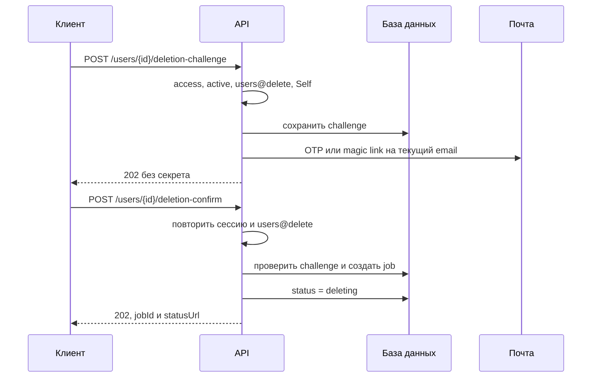
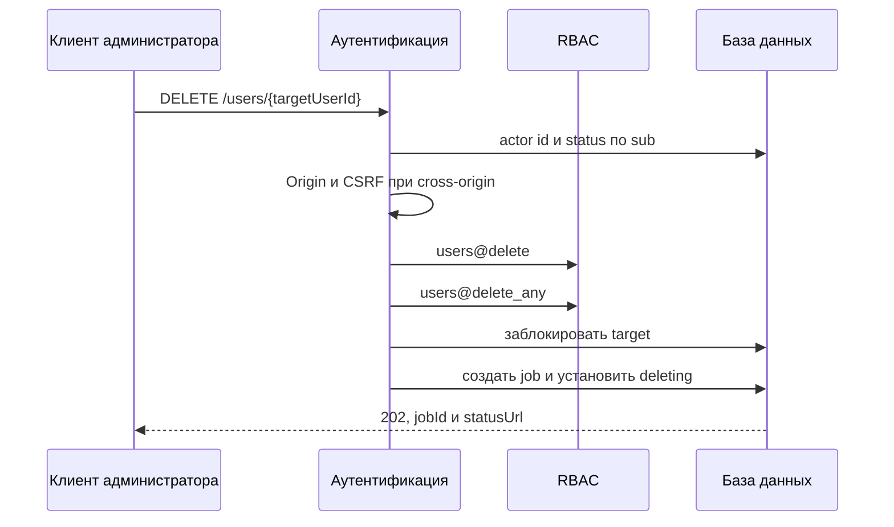
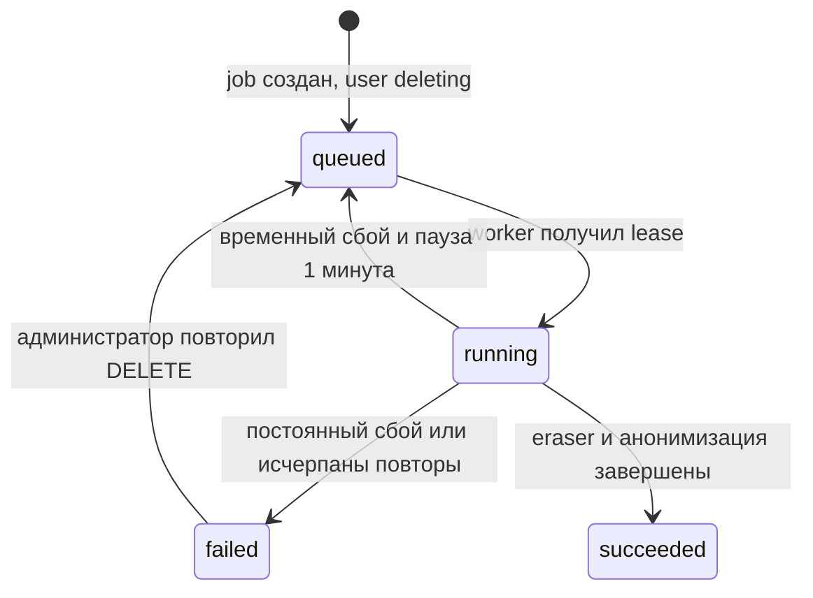
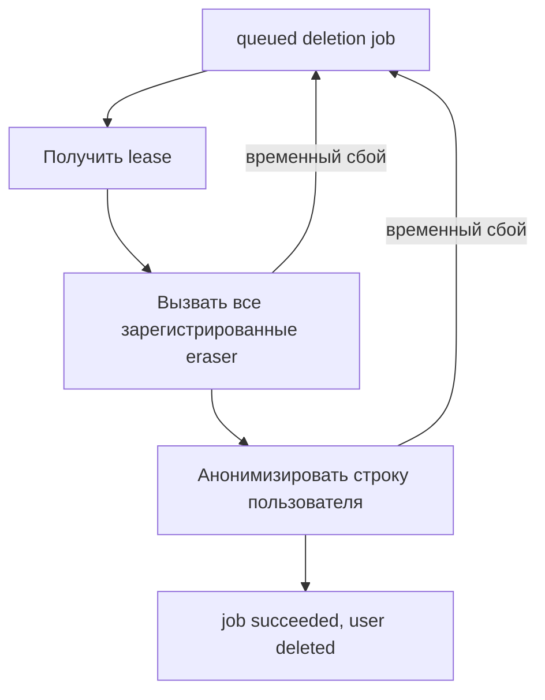

# Удаление пользователя

## Содержание

- [Теория](#теория)
  - [Ситуация](#ситуация)
  - [Модель](#модель)
  - [Понятия и связь с бэкендом](#понятия-и-связь-с-бэкендом)
  - [Зоны ответственности](#зоны-ответственности)
  - [Типичные сбои](#типичные-сбои)
  - [Полезные ссылки](#полезные-ссылки)
  - [Вопросы по теории](#вопросы-по-теории)
- [Практическое задание](#практическое-задание)
  - [1.1 Общее](#11-общее)
  - [1.2 Сценарии](#12-сценарии-user-stories)
  - [1.3 Контракт](#13-контракт)
  - [1.4 Ошибки и ограничения](#14-ошибки-и-ограничения)
  - [1.5 Аудит](#15-аудитлоги)
  - [1.6 Нефункциональные требования](#16-нефункциональные-требования)

# Теория

## Ситуация

Активный пользователь запрашивает удаление собственной учётной записи и сначала подтверждает текущий email. Администратор запускает удаление чужого пользователя без email challenge. Дальше возможен один из исходов: асинхронное задание принято с **202**, минимальный статус задания возвращён с **200**, входные данные отклонены с **400**, сессия недействительна с **401**, право или прямое self-delete запрещены с **403**, цель или задание не найдены с **404**, идентификатор операции конфликтует с **409**, сработал **429** либо необходимая до принятия зависимость недоступна и возвращается **503**. Сбой хранилища или worker после **202** отражается состоянием задания и не меняет уже зафиксированный ответ о принятии.

Удаление выбирает анонимизацию основной строки пользователя. PII, парольные данные, challenge, роли и файлы очищаются, а технический `id`, временные метки и минимальный аудит без PII сохраняются ради ссылочной целостности и доказательства выполнения процесса.

## Модель

Self-delete состоит из подтверждения email и принятия задания. Challenge следует тем же правилам, что регистрация и вход: сервер выбирает OTP или magic link, хранит только HMAC, применяет TTL 10 минут, пять вводов OTP и паузу resend 60 секунд. Confirm дополнительно требует действующей сессии.

Администратор использует `DELETE /users/{userId}` для чужой цели в состоянии `pending`, `active` или `blocked`. Базовое `users@delete` и дополнительное `users@delete_any` проверяются до поиска цели. Для собственного идентификатора этот endpoint запрещён: даже администратор проходит self-подтверждение, чтобы административное право не обходило защиту собственной учётной записи.

`status = deleting` фиксируется в одной транзакции с заданием. С этого момента новые access и refresh перестают работать, поскольку аутентификация принимает только `active`. Stateless JWT остаются криптографически действительными до `exp`, но обязательное чтение пользователя по `sub` блокирует их и до истечения срока.

Задание хранится в базе, поэтому принятие не зависит от внешней очереди сообщений. Worker атомарно получает lease и вызывает идемпотентные eraser, затем финализацию. Потеря ответа после внешнего удаления приводит к повторному вызову тех же eraser; отсутствие уже удалённого объекта считается успехом.

Основная строка не удаляется. Назначения ролей снимаются уже в транзакции принятия вместе с переходом в `deleting`, чтобы политика RBAC сразу отражала необратимое прекращение доступа. После успешной очистки внешних объектов одна финальная транзакция заменяет email техническим уникальным адресом `deleted.<32 hex>@example.invalid`, очищает `display_name`, `photo_key` и `password_hash`, удаляет challenge, устанавливает `deleted` и завершает job. Исходный email освобождается только при фиксации этой транзакции.

Для процесса добавляются таблицы challenge и заданий. `password_hash` в `users` становится nullable только для `deleted`; ограничение базы не допускает `null` у остальных статусов.

| `users` | Описание |
| --- | --- |
| `id` | сохранённый непрозрачный технический идентификатор |
| `email` | текущий нормализованный email либо уникальный tombstone после анонимизации |
| `password_hash` | медленный хеш до удаления, `null` только при `deleted` |
| `display_name` | профильное имя, `null` после анонимизации |
| `photo_key` | ключ фотографии, `null` после анонимизации |
| `status` | `pending`, `active`, `blocked`, `deleting` или `deleted` |
| `created_at` | сохранённое неизменяемое UTC-время, назначенное базой при создании пользователя |
| `updated_at` | время последнего перехода или анонимизации |

| `deletion_challenges` | Описание |
| --- | --- |
| `id` | идентификатор challenge |
| `user_id` | ссылка на `users.id`; один непогашенный challenge на пользователя |
| `method` | `otp` или `magic_link`, выбранный сервером |
| `secret_hash` | HMAC-SHA256, исходный OTP или token не хранится |
| `last_sent_at` | начало TTL 10 минут и паузы resend 60 секунд |
| `attempts` | число неверных OTP, максимум пять |
| `consumed_at` | время погашения |
| `consumed_reason` | `confirmed`, `replaced`, `attempts_exhausted`, `job_exists` или `user_inactive` |
| `created_at` | время создания |

| `deletion_jobs` | Описание |
| --- | --- |
| `id` | 32 lowercase hex из `Idempotency-Key`; одновременно непрозрачный `jobId` |
| `user_id` | уникальная ссылка на техническую строку пользователя |
| `status` | `queued`, `running`, `succeeded` или `failed` |
| `tombstone_email` | случайный уникальный адрес для финальной анонимизации |
| `attempts` | число запусков worker |
| `lease_until` | срок владения заданием, `null` вне выполнения |
| `next_attempt_at` | время, раньше которого задание в `queued` нельзя получать; при первом запуске равно времени создания |
| `last_error_code` | машинная категория без PII и внешнего текста ошибки |
| `created_at` | время принятия |
| `updated_at` | время последнего изменения |
| `finished_at` | время успеха, иначе `null` |

### Нормальная форма

Таблицы `users`, `deletion_challenges` и `deletion_jobs` находятся в BCNF и, при указанных зависимостях, в 5NF.

Каждая следующая форма включает требования предыдущей:

- **1NF:** email, статус и код результата атомарны. Список eraser не хранится в строке job: worker вызывает текущий реестр обработчиков приложения.
- **2NF:** у всех трёх таблиц простые ключи, поэтому частичной зависимости нет.
- **3NF и BCNF:** challenge не копирует email пользователя, а job не копирует `display_name`, `photo_key` или статус строки `users`. TTL вычисляется из `last_sent_at`, поэтому зависимого `expires_at` нет.
- **4NF:** независимые challenge и задания вынесены из `users`. Их хранение в одной строке создало бы два независимых многозначных набора.
- **5NF:** пользователь, challenge и job соединяются по ключам без дополнительной зависимости соединения.

`tombstone_email` хранится в job до финальной транзакции, чтобы повтор worker использовал то же значение. Это не копия PII и не вычисляемое поле строки пользователя. После завершения оно совпадает с `users.email`, но обе строки описывают разные факты: результат конкретного задания и текущее техническое состояние пользователя. Перенос выполняется один раз одной финальной транзакцией, а завершённый job неизменяем.

`next_attempt_at` зависит не только от `attempts`, но и от времени последнего сбоя, поэтому хранит состояние планировщика, а не транзитивную копию счётчика.

## Понятия и связь с бэкендом

### Право на удаление и границы хранения

Статья 17 GDPR устанавливает право на удаление персональных данных, но также перечисляет исключения, например законную обязанность хранения или защиту юридических требований. Политика продукта должна определить применимое основание и срок хранения до запуска технического процесса.

Технический контракт выбирает анонимизацию основной строки. Прежние email, имя, фотография, парольный хеш, challenge secrets и связанная пользовательская информация удаляются. Сохранённый случайный `id` больше не сопоставляется с человеком через PII. Журнал фиксирует ход процесса без actor id, target id, email, IP, `jobId`, причины и содержимого данных.

Принятие удаления не может оставить систему без активного носителя `rbac@manage`. Если удаляемому пользователю назначено это разрешение, self- и admin-ветки под общей блокировкой инварианта RBAC проверяют наличие другого активного носителя до создания job и перехода в `deleting`. Нарушение возвращает **409**. Та же транзакция удаляет `user_roles` цели и увеличивает `rbac_policy_state.version`, поэтому последующие изменения политики уже не считают пользователя в `deleting` носителем прав. Общая блокировка используется и при административной блокировке пользователя, поэтому параллельные операции не обходят правило из RBAC.

Анонимизация отличается от сокрытия. Шифрование с сохранённым ключом, base64, обычный хеш email и перенос в архив оставляют возможность восстановления или перебора. Tombstone генерируется случайно и не выводится из исходного email.

### Асинхронное удаление и HTTP 202

Файлы и данные разных модулей нельзя надёжно удалить в одной транзакции реляционной базы. Поэтому API атомарно принимает работу, прекращает доступ и возвращает **202 Accepted**, а worker завершает очистку позже.

**202** означает принятие, но не успех очистки. Клиент получает `jobId` и проверяет отдельный status endpoint. Self после перехода в `deleting` предъявляет непрозрачную квитанцию `jobId`, поскольку обычная сессия уже недействительна. Активный Admin запрашивает статус чужой цели с `users@delete` и `users@delete_any`. Обе ветки возвращают `queued`, `running`, `succeeded` или `failed`, но не сообщают, какой конкретно объект вызвал сбой.

Хранение job в базе устраняет dual-write между строкой пользователя и брокером. Worker выбирает `queued` либо просроченный `running`, устанавливает lease и вызывает все eraser, затем финализацию. Второй worker не берёт то же задание, пока жив lease. После аварии процесса lease истекает, и повтор снова вызывает все eraser: они идемпотентны, поэтому уже очищенные данные не мешают.

### Идемпотентность и известный клиенту jobId

Клиент создаёт `Idempotency-Key` как 16 случайных байт и передаёт 32 lowercase hex. Сервер использует это значение как `jobId`, поэтому клиент знает адрес статуса ещё до запроса. Потеря ответа после перехода в `deleting` не оставляет пользователя без способа узнать результат.

Повтор того же ключа для той же цели возвращает прежний job без второго процесса. Другой ключ для пользователя с уже созданным job также возвращает существующий `jobId`. Повтор ключа для другой цели получает **409**, чтобы одна операция не получила два смысла.

Идемпотентность относится и к eraser. Удаление отсутствующего файла успешно, очистка уже пустого поля ничего не меняет, а повторный вызов после успеха снова возвращает `succeeded`. Если внешний вызов выполнился, но ответ потерялся, повтор обязан привести к тому же состоянию. Отдельная таблица шагов не нужна: прогресс не хранится по eraser, потому что каждый обработчик можно безопасно вызвать снова.

### Немедленное прекращение доступа

Транзакция принятия меняет `users.status` на `deleting`. Проверки access и refresh из аутентификации после подписи токена получают актуальную строку и принимают только `active`, поэтому следующий запрос возвращает **401 invalid_session**.

Сервер также отправляет истёкшие access- и refresh-cookie клиенту Self. Это очищает текущий браузер, но не является отзывом: скопированный stateless JWT физически существует до `exp`. Блокировку обеспечивает только status check. Административное удаление не может очистить cookies на устройствах цели, но тот же check прекращает их работу.

Запрос, уже прошедший авторизацию одновременно с принятием удаления, сам по себе не прерывается. Критические операции изменения профиля, email и данных других модулей повторно проверяют статус перед фиксацией по собственному контракту.

### Подтверждение Self

Письмо отправляется на текущий нормализованный email пользователя. OTP содержит шесть цифр; magic link содержит `challengeId` и 32 случайных байта. Сервер хранит HMAC-SHA256 с отдельным ключом длиной не менее 32 случайных байт и сравнивает его за постоянное время.

Оба способа действуют 10 минут. Пятый OTP может быть успешным; пятый неверный ввод возвращает **400** и гасит challenge, следующий получает **429**. Resend через 60 секунд заменяет секрет, заново запускает TTL и обнуляет счётчик.

Подтверждение email не заменяет сессию. Confirm требует активный access, `users@delete` и совпадение пути с `sub`. Письмо помещает magic token во фрагмент URL, который не отправляется серверу и в `Referer`; клиентская страница читает его и передаёт token в теле POST. Обычный GET только открывает страницу, а создание задания выполняет POST. Администратор удаляет чужого пользователя напрямую, а собственный идентификатор всегда направляется в подтверждённый self-flow.

### Контракт очистки модулей

Каждый модуль, который хранит данные или файлы пользователя, регистрирует обработчик `eraseUserData(userId, deletionJobId)`. Контракт обработчика обязателен:

1. повторный вызов с той же парой безопасен и не восстанавливает уже удалённые данные;
2. удаляются PII, исходные и производные файлы, секреты и прямые связи, которыми модуль владеет;
3. допустимый обезличенный агрегат не позволяет восстановить пользователя и не содержит исходный идентификатор;
4. результат имеет одно значение `succeeded`, `retryable_failure` или `permanent_failure` и безопасный машинный код;
5. исключение, журнал и результат не содержат очищаемые значения, ключи хранилища, полный `jobId` и содержимое файлов;
6. `succeeded` возвращается и тогда, когда данных уже нет.

Часть 2 с трансформациями файлов обязана зарегистрировать такой eraser до приёма первого файла. Он удалит исходные и результирующие объекты и очистит либо анонимизирует принадлежащие модулю записи. Имена будущих таблиц, бакетов и полей контракт не задаёт. Пока функциональность трансформаций не установлена и данных этого типа нет, обработчик не регистрируется.

Worker вызывает все зарегистрированные eraser по очереди и только после их успеха выполняет финальную транзакцию анонимизации. Временный сбой любого eraser или финализации возвращает job в очередь, постоянный переводит его в `failed` без возврата пользователя в `active`.

### Анонимизация и уникальный email

Финальная транзакция начинается только после успеха всех eraser. Она блокирует состояние политики, пользователя и job, убеждается в `deleting`, идемпотентно удаляет оставшиеся назначения ролей и challenge, очищает PII и парольный хеш, переносит сохранённый tombstone в `users.email`, устанавливает `deleted` и завершает job. Если защитное удаление ролей действительно изменило строки, версия RBAC увеличивается в той же транзакции.

Старый email остаётся занятым, пока очистка не закончена. После фиксации tombstone уникальный индекс освобождает адрес для новой регистрации. Параллельная регистрация до фиксации получает **409**, а после неё создаёт новую строку без связи с удалённым техническим `id`.

Сразу после перехода в `deleting` канонический профиль возвращает `photoUrl: null`, чтобы не направлять клиента к объекту, который worker уже мог удалить. После финальной анонимизации `displayName` также становится `null`. Профиль по-прежнему имеет поля `id`, `email`, `displayName`, `photoUrl`, `status`, `createdAt`, `updatedAt`, но авторизованный администратор видит только технический tombstone и `deleted`, а не прежние PII. `password_hash`, challenge secrets, JWT и внутренние поля никогда не входят в профиль.

### Ошибки и восстановление процесса

Если транзакция принятия откатилась, статус и challenge не меняются, job отсутствует, а клиент получает **503** и повторяет запрос с тем же ключом. Если фиксация прошла, status endpoint на заранее известном `jobId` показывает принятое состояние даже при потерянном HTTP-ответе.

Временный сбой после принятия не превращает уже возвращённый **202** в **503**. Worker сохраняет безопасную категорию и `next_attempt_at`, а status endpoint показывает `queued`, `running` или после исчерпания повторов `failed`.

Временный сбой повторяется до пяти раз с паузой одна минута. После пятого сбоя job становится `failed`, пользователь остаётся `deleting`, а PII не объявляются удалёнными. Администратор повторяет `DELETE` и тем самым переводит тот же job в `queued`, сбрасывает `attempts` и назначает `next_attempt_at` на текущее время; новый job и новый tombstone не создаются.

Успешно удалённые внешние данные не восстанавливаются при сбое более позднего eraser. Следующий запуск снова вызывает все обработчики, и уже очищенные возвращают `succeeded`. Статус `deleted` устанавливается только после полного успеха.

### Сводка

| Понятие | Смысл в удалении | На что опирается реализация |
| --- | --- | --- |
| **202 Accepted** | процесс принят, но не завершён | durable job и status endpoint |
| `deleting` | доступ прекращён немедленно | status check каждого access и refresh |
| `deleted` | PII и файлы очищены | финальная анонимизация после всех eraser |
| Idempotency | повтор не создаёт второй процесс | известный клиенту `jobId` и уникальный `user_id` |
| Lease | один worker владеет заданием ограниченное время | атомарный claim и безопасный повтор |
| Eraser | граница очистки соседнего модуля | `eraseUserData(userId, deletionJobId)` |
| Tombstone email | сохраняет `NOT NULL` и уникальность без PII | случайный адрес в `example.invalid` |

## Зоны ответственности

| Клиент | Сервер |
| --- | --- |
| Self запрашивает письмо на текущий email | Выбирает OTP или magic link и хранит только HMAC |
| Перед confirm создаёт случайный `Idempotency-Key` | Использует ключ как стабильный `jobId` |
| Отправляет confirm с действующей cookie | Повторно проверяет active, `users@delete` и владельца |
| Admin удаляет только чужой `userId` напрямую | Требует `users@delete` и `users@delete_any` до поиска |
| После **202** прекращает обычные запросы | Немедленно устанавливает `deleting` |
| Self проверяет статус по квитанции, Admin — после обоих прав | Не раскрывает PII и внутренние ошибки eraser |
| При `failed` обращается к администратору | Не возвращает пользователя в `active` автоматически |
| Не перечисляет хранилища и связанные сущности | Вызывает все зарегистрированные идемпотентные eraser |

При размещении frontend на другом origin инициирование, resend, confirm и административный DELETE требуют точный разрешённый `Origin` и `X-CSRF-Protection: 1`, даже если оба origin относятся к одному site. Для cross-site-размещения cookies дополнительно получают `SameSite=None; Secure`. Self-ветка status endpoint не принимает auth-cookie и проверяет квитанцию; Admin-ветка принимает access-cookie, повторяет аутентификацию и RBAC. GET не изменяет данные и не требует CSRF-заголовка.

## Типичные сбои

| Что видно | Куда смотреть |
| --- | --- |
| Self удаляется одним DELETE без письма | прямой административный путь не запрещён для собственного `userId` |
| Magic link запускает удаление обычным GET | сканер письма может погасить секрет без явного действия |
| Confirm работает после logout или блокировки | challenge ошибочно заменяет действующую сессию |
| После **202** access ещё читает профиль | `deleting` установлен после ответа либо status не проверяется |
| Refresh пользователя `deleting` выдаёт новую пару | после JWT не читается актуальная строка по `sub` |
| Удаление зависло без job | статус и постановка работы записываются раздельно |
| Потерянный ответ лишил Self способа узнать jobId | идентификатор создаётся только сервером после запроса, а не известен клиенту заранее |
| Повтор confirm создал второй процесс | нет уникального job по пользователю или идемпотентного ключа |
| Один ключ удаляет две разные цели | повтор `Idempotency-Key` не проверяет прежний смысл |
| Удаление приняло последнего активного `rbac@manage` | перед `deleting` не проверен общий инвариант RBAC либо параллельные операции не сериализованы |
| Два worker одновременно очищают одного пользователя | отсутствуют lease и атомарный claim задания |
| Сбой после удаления файла ломает повтор | `not_found` ошибочно считается неуспехом |
| Пользователь стал `deleted` до очистки трансформаций | финальный статус установлен раньше успеха всех зарегистрированных eraser |
| Ошибка eraser вернула пользователя в `active` | процесс нарушил необратимое прекращение доступа |
| Старый email остаётся занят после успеха | финальная транзакция не установила случайный tombstone |
| Tombstone можно вычислить из исходного email | используется обычный хеш или кодирование вместо случайного значения |
| В `deleted` остался `password_hash` или `photo_key` | ограничение финальной анонимизации не проверяет все PII-поля |
| Новая регистрация получила связи старого аккаунта | старый технический `id` переиспользован вместо новой строки |
| Self видит чужой status по случайному `jobId` | квитанция не сопоставлена с `user_id` из пути |
| Admin читает status без обоих delete-прав | административная ветка обошла access и RBAC |
| Status endpoint раскрывает email | квитанция содержит больше минимального состояния |
| В журнале есть OTP, JWT, полный `jobId` или удаляемые значения | логируются тело запроса, cookies, квитанция либо данные eraser |

## Полезные ссылки

### Общие

- [UK GDPR — Article 17](https://www.legislation.gov.uk/eur/2016/679/article/17/adopted/data.html) — первичный текст права на удаление и перечисленных законом исключений.
- [UK GDPR — Article 5](https://www.legislation.gov.uk/eur/2016/679/article/5/adopted/data.html) — принципы минимизации данных и ограничения срока хранения для профиля и аудита.
- [ICO — Right to erasure](https://ico.org.uk/for-organisations/uk-gdpr-guidance-and-resources/individual-rights/individual-rights/right-to-erasure/) — практическое объяснение границ запроса и проверки его выполнения.
- [RFC 9110 — 202 Accepted](https://www.rfc-editor.org/rfc/rfc9110#name-202-accepted) — смысл ответа асинхронной операции, результат которой ещё не завершён.
- [OWASP — User Privacy Protection Cheat Sheet](https://cheatsheetseries.owasp.org/cheatsheets/User_Privacy_Protection_Cheat_Sheet.html) — минимизация и защита персональных данных.
- [OWASP — Logging Cheat Sheet](https://cheatsheetseries.owasp.org/cheatsheets/Logging_Cheat_Sheet.html) — исключение токенов, PII и секретов из событий процесса.
- [PostgreSQL — Explicit Locking](https://www.postgresql.org/docs/current/explicit-locking.html) — блокировки строк и `SKIP LOCKED` для безопасного получения jobs при использовании PostgreSQL.
- [PostgreSQL — Constraints](https://www.postgresql.org/docs/current/ddl-constraints.html) — уникальность job пользователя, tombstone и проверки финального состояния.
- [Amazon S3 — DeleteObject](https://docs.aws.amazon.com/AmazonS3/latest/API/API_DeleteObject.html) — поведение повторного удаления объекта в S3-совместимой границе.
- [OpenAPI Specification — Responses](https://spec.openapis.org/oas/latest.html#responses-object) — описание **202**, status endpoint и вариантов ошибок.

### По языку

#### Node.js

**Node.js, NestJS.** На Express или Fastify durable job и eraser сохраняют тот же контракт.

- [NestJS — Queues](https://docs.nestjs.com/techniques/queues) — worker, повторы и обработка длительной работы; источником истины остаётся job в базе.
- [Node.js — `crypto.randomBytes`](https://nodejs.org/api/crypto.html#cryptorandombytessize-callback) — генерация challenge, idempotency key и случайного tombstone.
- [Node.js — `createHmac`](https://nodejs.org/api/crypto.html#cryptocreatehmacalgorithm-key-options) — HMAC challenge без хранения исходного секрета.
- [Prisma — Transactions](https://www.prisma.io/docs/orm/prisma-client/queries/transactions) или [TypeORM — Transactions](https://typeorm.io/docs/advanced-topics/transactions/) — атомарное создание job, смена статуса и финальная анонимизация.
- [NestJS — OpenAPI](https://docs.nestjs.com/openapi/introduction) — документирование challenge, **202** и status endpoint.
- [Prisma Migrate](https://www.prisma.io/docs/orm/prisma-migrate) или [TypeORM — Migrations](https://typeorm.io/docs/advanced-topics/migrations/) — создание таблиц удаления и ограничений.

#### .NET

**.NET, ASP.NET Core.** Minimal API и контроллеры используют общий hosted worker и транзакционный сервис.

- [.NET — Background tasks with hosted services](https://learn.microsoft.com/en-us/aspnet/core/fundamentals/host/hosted-services) — длительный worker и корректное завершение процесса.
- [.NET — RandomNumberGenerator](https://learn.microsoft.com/en-us/dotnet/api/system.security.cryptography.randomnumbergenerator) — криптографические байты для ключей и tombstone.
- [.NET — HMACSHA256](https://learn.microsoft.com/en-us/dotnet/api/system.security.cryptography.hmacsha256) — сохранение невосстановимого представления OTP и token.
- [EF Core — Transactions](https://learn.microsoft.com/en-us/ef/core/saving/transactions) — атомарное принятие и завершение удаления.
- [EF Core — Concurrency](https://learn.microsoft.com/en-us/ef/core/saving/concurrency) — обработка конкурирующих worker и изменений пользователя.
- [EF Core — Migrations](https://learn.microsoft.com/en-us/ef/core/managing-schemas/migrations/) — перенос таблиц jobs и challenge.
- [ASP.NET Core — OpenAPI](https://learn.microsoft.com/en-us/aspnet/core/fundamentals/openapi/overview) — описание cookie-защиты и асинхронных ответов.

#### Python

**Python, FastAPI.** Для Django или Flask сохраняются durable job, lease и идемпотентный eraser.

- [Celery — Tasks](https://docs.celeryq.dev/en/stable/userguide/tasks.html) — повторяемые фоновые задачи и требования к идемпотентности.
- [Python — `secrets`](https://docs.python.org/3/library/secrets.html) — криптографические идентификаторы, challenge и tombstone.
- [Python — `hmac`](https://docs.python.org/3/library/hmac.html) — HMAC и `compare_digest` для секрета подтверждения.
- [SQLAlchemy — Transactions](https://docs.sqlalchemy.org/en/20/orm/session_transaction.html) — атомарная смена статуса и фиксация job.
- [SQLAlchemy — Versioning](https://docs.sqlalchemy.org/en/20/orm/versioning.html) — обнаружение конкурирующих изменений при обработке строк.
- [Alembic — Tutorial](https://alembic.sqlalchemy.org/en/latest/tutorial.html) — миграции таблиц удаления и ограничений.
- [FastAPI — Metadata and Docs URLs](https://fastapi.tiangolo.com/tutorial/metadata/) — публикация актуального OpenAPI.

## Вопросы по теории

1. Почему **202 Accepted** не может означать, что PII уже удалены, и какую роль выполняет status endpoint?
2. Как `status = deleting` блокирует stateless access и refresh, хотя сами JWT физически не отзываются?
3. Зачем клиент знает `jobId` до отправки confirm и что произойдёт при потере успешного ответа?
4. Почему удаление отсутствующего файла должно считаться успешным при повторном запуске eraser?
5. Чем случайный tombstone отличается от хеша исходного email с точки зрения восстановления PII?
6. Какие гарантии обязан предоставить eraser будущего модуля трансформаций, не раскрывая его схему?
7. Почему таблица `deletion_jobs` не хранит список eraser и как повторный запуск использует идемпотентность обработчиков?

# Практическое задание

Функциональность удаления пользователя в системе.
Self подтверждает текущий email и с действующей сессией запускает асинхронное удаление; Admin запускает удаление чужого пользователя напрямую. Принятие немедленно устанавливает `deleting`, возвращает **202** и известный клиенту `jobId`, а идемпотентный worker очищает PII и файлы, анонимизирует основную строку и завершает её статусом `deleted`.

## 1) Удаление пользователя

### 1.1 Общее

**Назначение:** необратимо очистить персональные данные пользователя с немедленным прекращением доступа, наблюдаемым статусом и безопасным повтором.

**Пользователи/роли:**

- активный пользователь с `users@delete` — инициирует challenge и подтверждает удаление собственной учётной записи;
- активный пользователь с `users@delete` и `users@delete_any` — напрямую запускает удаление чужой учётной записи;
- собственный `userId` нельзя удалить административным endpoint даже при `users@delete_any`;
- Self получает статус после утраты сессии по непрозрачной квитанции `jobId`;
- активный Admin получает статус чужой цели только с `users@delete` и `users@delete_any`.

**Единый каталог разрешений работы с пользователями:**

| Разрешение | Назначение |
| --- | --- |
| `users@read` | чтение собственного профиля |
| `users@read_any` | дополнительный допуск к чужому профилю |
| `users@update` | изменение собственного профиля |
| `users@update_any` | дополнительный допуск к изменению чужого пользователя и прямой смене email администратором |
| `users@delete` | подтверждённое удаление собственной учётной записи |
| `users@delete_any` | дополнительный допуск к удалению чужого пользователя администратором |
| `users@list` | просмотр административного списка пользователей |

**Зависимости/связанные настройки:**

- access, refresh и cookies соответствуют аутентификации; каждый токен принимается только для существующего пользователя `active`;
- защищённая цепочка соответствует авторизации и актуальному RBAC;
- общий инвариант управления доступом считает носителем `rbac@manage` только пользователя `active` и сериализует изменения назначений, блокировку и удаление;
- назначение ролей пользователю повторно проверяет его статус под общей блокировкой и отклоняет `deleting` или `deleted`;
- `DELETION_CONFIRMATION_METHOD` имеет одно значение `otp` или `magic_link`, которое выбирает сервер;
- `DELETION_CHALLENGE_HMAC_KEY` содержит отдельное случайное значение длиной не менее 32 байт;
- SMTP отправляет challenge на текущий email Self;
- worker получает durable jobs из базы, применяет lease и вызывает зарегистрированные eraser;
- хранилище профиля и будущие модули предоставляют идемпотентную очистку;
- `DELETION_WORKER_LEASE_SECONDS` по умолчанию равен 300, максимальное число автоматических запусков равно 5, пауза между ними — 1 минута.

Если ключ отсутствует, пуст или короче 32 байт, приложение не проходит readiness. Ключ не совпадает с JWT-, регистрационным, login- или email-change-ключом.

Канонический профиль во всех пользовательских операциях содержит `id`, нормализованный `email`, `displayName`, `photoUrl`, `status`, `createdAt`, `updatedAt`. Email не маскируется. При `deleting` поле `photoUrl` уже равно `null`; после анонимизации email становится случайным tombstone, `displayName` также равен `null`, а `status` равен `deleted`. `password_hash`, challenge secrets, JWT, ключи объектов и внутренние поля не выдаются.

Статусы согласованы как `pending`, `active`, `blocked`, `deleting`, `deleted`; только `active` аутентифицируется. `deleting` добавлен как немедленный барьер на время асинхронной очистки, `deleted` — как завершённое анонимизированное состояние.

### 1.2 Сценарии (user stories)

1. **Self подтверждает удаление:** сервер отправляет OTP или magic link на текущий email, а confirm с активной сессией создаёт job.
2. **Admin удаляет чужого пользователя:** запрос с обоими правами создаёт job без письма.
3. **Доступ прекращается:** в транзакции принятия пользователь становится `deleting`, поэтому следующие access и refresh получают **401**.
4. **Клиент отслеживает процесс:** Self предъявляет заранее созданный `jobId`, а Admin проходит оба delete-разрешения; ответ содержит `queued`, `running`, `succeeded` или `failed`.
5. **Повтор запроса:** тот же процесс и `jobId` возвращаются без второго удаления и второго tombstone.
6. **Временный сбой:** worker снова вызывает все идемпотентные eraser, пользователь остаётся `deleting`.
7. **Полный успех:** файлы и PII очищены, основная строка анонимизирована, старый email освобождён, статус становится `deleted`.
8. **Постоянный сбой:** job становится `failed`, а администратор повторным DELETE переводит тот же job в очередь.

### 1.3 Контракт

#### 1.3.1 Инициация и resend self-подтверждения

| Операция | Входные данные и правила |
| --- | --- |
| `POST /users/{userId}/deletion-challenge` | тело отсутствует; только Self с `users@delete` |
| `POST /users/{userId}/deletion-challenge/resend` | `challengeId: string`; только Self с `users@delete` |

`userId` содержит от 1 до 128 ASCII-символов из букв, цифр, `_` и `-`. Сервер выбирает способ из `DELETION_CONFIRMATION_METHOD` и отправляет письмо на текущий email; клиент `method` и адрес не передаёт.

**Логика инициации:**

1. Проверить access, актуальный `active`, CSRF для запроса из другого origin независимо от границы site и `users@delete`.
2. Сравнить `userId` с `actorUserId`. Несовпадение вернуть как **403** до поиска цели.
3. Заблокировать пользователя, затем его непогашенный deletion challenge и существующий deletion job в общем порядке. Если job уже существует, вернуть **409** и не отправлять письмо.
4. Если непогашенный challenge отправлен менее 60 секунд назад, вернуть **429** с оставшимся временем.
5. После паузы погасить прежний challenge как `replaced` и создать новый выбранного способа с `attempts = 0` одной транзакцией.
6. Зафиксировать challenge, затем отправить секрет на текущий нормализованный email.

**Логика resend:**

1. Повторить access, `active`, CSRF, `users@delete` и Self, заблокировать пользователя, затем challenge по `challengeId`.
2. Ненайденный, заменённый, уже подтверждённый или погашенный как `user_inactive` challenge получает **400**; `attempts_exhausted` получает **429**; `job_exists` получает **409**.
3. Если после `last_sent_at` не прошло 60 секунд, вернуть **429**.
4. Создать новый секрет того же способа, заменить HMAC, обновить `last_sent_at` и обнулить `attempts` одной транзакцией.
5. После фиксации отправить письмо; прежний секрет больше не подходит.

Если транзакция не зафиксирована, письмо не отправляется и возвращается **503**. Если SMTP не принял письмо после фиксации, challenge сохраняется, а **503** содержит `confirmationRequired`, `method`, `challengeId` и `retryAfterSeconds`, но не email и секрет.

**Ответы:**

- **Принято:** **202 Accepted**, `confirmationRequired: true`, `method`, `challengeId`, `expiresInSeconds: 600`, `resendAfterSeconds: 60`.
- OTP, token, HMAC, email, JWT, cookies и данные профиля в JSON отсутствуют.

#### 1.3.2 Подтверждение Self и принятие удаления

| `POST /users/{userId}/deletion-confirm` | Входные данные |
| --- | --- |
| Заголовок `Idempotency-Key` | ровно 32 lowercase hex, созданные клиентом из 16 случайных байт; значение становится `jobId` |
| OTP | `challengeId: string`, `code: string` из ровно 6 цифр |
| Magic link | `token: string` в формате `challengeId.secret`, secret содержит 32 случайных байта до base64url; письмо передаёт token во фрагменте URL |

Тело содержит ровно один вариант секрета. GET по magic link состояние не меняет.

**Логика/шаги:**

1. Проверить путь, `Idempotency-Key` и форму тела.
2. До новой бизнес-операции проверить идемпотентный повтор: если такой `jobId` уже относится к тому же пользователю, вернуть его с **202** без повторной проверки challenge; если ключ относится к другой цели, вернуть **409**. Эта ветка не создаёт и не повторяет job.
3. Если job с таким ключом нет, проверить access, актуальный `active`, CSRF, `users@delete` и совпадение `userId` с `actorUserId`.
4. Получить общую блокировку состояния политики, затем заблокировать пользователя и challenge в установленном порядке транзакционных блокировок.
5. Проверить принадлежность, способ, погашение и TTL `last_sent_at + 10 минут`. Ненайденный, заменённый, уже подтверждённый или погашенный как `user_inactive` challenge получает **400**; `attempts_exhausted` получает **429**; `job_exists` получает существующий job с **202**.
6. Повторно проверить `active`; при другом статусе погасить challenge как `user_inactive` и вернуть **401**.
7. Сравнить HMAC за постоянное время. Пятый OTP ещё проверяется; пятый неверный получает **400** и гасит challenge, следующий получает **429**. Неверный magic link получает **400** без счётчика.
8. Если у пользователя уже есть job с другим ключом, погасить challenge как `job_exists` и вернуть существующий job с **202**.
9. Если пользователю назначено `rbac@manage`, под уже полученной блокировкой инварианта RBAC убедиться, что остаётся другой активный носитель. Иначе вернуть **409** без job и без перехода статуса.
10. Создать `deletion_jobs` со статусом `queued`, `attempts = 0` и `next_attempt_at = now` и сгенерировать один tombstone.
11. Установить пользователю `deleting`, удалить его `user_roles`, увеличить `rbac_policy_state.version`, обновить `updated_at`, погасить challenge как `confirmed` и погасить остальные login-, email-change- и deletion-challenge одной транзакцией.
12. Зафиксировать транзакцию, отправить клиенту истёкшие access- и refresh-cookie с исходными атрибутами и вернуть квитанцию.

Если транзакция откатилась, пользователь остаётся `active`, challenge пригоден для повтора, job отсутствует и возвращается **503**. После фиксации `jobId` уже известен клиенту из заголовка, поэтому потерянный ответ не мешает проверить статус.

**Ответ:** **202 Accepted**, `jobId`, `status`, `statusUrl`. `statusUrl` содержит только путь `/users/{userId}/deletion-status`, без квитанции в path или query; Self передаёт её позднее только в `Deletion-Receipt`. При первом принятии `status = queued`; при повторе возвращается актуальный статус существующего job. В ответе нет профиля, email, challenge secret, JWT, tombstone и внутренних полей.

#### 1.3.3 Административное принятие удаления

| `DELETE /users/{userId}` | Проверки/валидация |
| --- | --- |
| `userId: string` | От 1 до 128 ASCII-символов из букв, цифр, `_` и `-` |
| Заголовок `Idempotency-Key` | 32 lowercase hex из 16 случайных байт; значение становится `jobId` |
| Тело | отсутствует |

**Логика/шаги:**

1. Проверить путь и заголовок.
2. Проверить access, актуальный `active`, CSRF и базовое `users@delete`.
3. Если `userId` совпадает с `actorUserId`, вернуть **403 Forbidden** с кодом `self_confirmation_required`; собственная учётная запись удаляется только через challenge.
4. Проверить `users@delete_any` до поиска цели.
5. Если `jobId` уже относится к другой цели, вернуть **409**.
6. Получить общую блокировку состояния политики, затем найти и заблокировать целевого пользователя. После обоих прав отсутствие получает **404**.
7. После пользователя заблокировать существующий job, если он есть, и вернуть **202** с его `jobId`. Для `failed` перевести тот же job в `queued`, установить `next_attempt_at` в текущее время, сбросить `attempts` и очистить lease и `last_error_code`; новый tombstone не создавать.
8. Если статус цели `active` или `blocked` и ей назначено `rbac@manage`, под общей блокировкой инварианта RBAC убедиться, что остаётся другой активный носитель. Иначе вернуть **409** без изменений.
9. Если статус цели `pending`, `active` или `blocked`, создать job и tombstone с наступившим `next_attempt_at`, установить `deleting`, удалить `user_roles` цели и увеличить `rbac_policy_state.version` одной транзакцией.
10. Если статус `deleting` или `deleted`, но связанного job нет, вернуть **503** и событие нарушения согласованности.
11. Погасить все challenge цели при первом принятии.

**Ответ:** **202 Accepted**, `jobId`, актуальный `status`, `statusUrl` без квитанции в path или query. Email challenge не создаётся. В ответе нет target profile, email, password hash, JWT, tombstone, actor roles и внутренних полей.

#### 1.3.4 Статус удаления

| `GET /users/{userId}/deletion-status` | Проверки/валидация |
| --- | --- |
| Self | Заголовок `Deletion-Receipt` содержит `jobId` из 32 lowercase hex; auth-cookie и тело не используются |
| Admin | Действующий access, `users@delete` и `users@delete_any`; `userId` обязан отличаться от `actorUserId`; тело отсутствует |

Операция объявлена квитанцией `Deletion-Receipt` вместе с базовой парой `users@delete`. Если заголовок есть, выполняется Self-ветка и cookie не читается, даже когда она тоже прислана. Если заголовка нет, выполняется Admin-ветка: access и `users@delete`, затем `users@delete_any` до поиска цели. Операция не помечается public.

Self-ветка доступна после утраты сессии, поскольку `deleting` больше не аутентифицируется. Сервер находит job по квитанции и проверяет точное совпадение `job.user_id` с `userId` из пути. Несовпадение и неизвестная квитанция получают одинаковый **404**. Квитанция разрешает только чтение минимального статуса и не запускает либо не повторяет job.

Admin-ветка сначала полностью проверяет access и актуальный `active`, затем `users@delete` и `users@delete_any` до поиска чужой цели. Собственный `userId` получает **403** и использует Self-ветку. Отсутствующая цель или job после обоих прав получает **404**.

**Ответы:**

- **Найдено:** **200 OK**, `jobId`, `status`, `createdAt`, `updatedAt`, `finishedAt`.
- `status` имеет одно значение `queued`, `running`, `succeeded` или `failed`; `finishedAt` задан только для `succeeded`.
- **Не найдено:** **404 Not Found** для неизвестной цели, job, неверной квитанции или несовпадения квитанции с целью после соответствующих проверок.
- В ответе нет `userId`, actor, email, имени, фото, причины удаления, tombstone, ошибки внешнего сервиса, числа попыток, PII, JWT и внутренних полей.

Endpoint не принимает решение доступа к другим данным и не позволяет повторить job. Rate limit, случайность квитанции и проверка Admin защищают массовый перебор; успешный и неуспешный поиск не раскрывают пользовательские данные.

#### 1.3.5 Worker и обязательный eraser

Worker обрабатывает `queued` и `running` с истёкшим lease:

1. Атомарно получить job со статусом `queued` и `next_attempt_at <= now` либо `running` с истёкшим lease, установить `running`, `lease_until = now + 300 секунд`, очистить `next_attempt_at` и увеличить `attempts`.
2. По очереди вызвать каждый зарегистрированный `eraseUserData(userId, deletionJobId)`.
3. Если все eraser вернули `succeeded`, выполнить финальную анонимизацию из раздела 1.3.6.
4. Если любой eraser вернул `retryable_failure` и `attempts` меньше 5, сохранить безопасный код, вернуть job в `queued`, очистить lease и записать `next_attempt_at = now + 1 минута`.
5. Если `attempts` достиг 5 или результат `permanent_failure`, установить job `failed`, очистить lease и `next_attempt_at`; пользователь остаётся `deleting`.
6. Если финальная транзакция не зафиксировалась, считать это `retryable_failure` с теми же лимитом и паузой; исходный **202** не меняется.

Каждый модуль с пользовательскими данными обязан зарегистрировать eraser до приёма таких данных. Интерфейс принимает только `userId` и `deletionJobId`, идемпотентно удаляет принадлежащие модулю PII и объекты и возвращает `succeeded`, `retryable_failure` или `permanent_failure` с безопасным кодом. Повторный вызов после успеха снова возвращает `succeeded`.

Часть 2 с трансформациями обязана удалить исходные и результирующие файлы и очистить либо анонимизировать свои записи через этот интерфейс. Конкретные таблицы, поля, форматы и расположение объектов здесь не задаются. Без зарегистрированного eraser readiness модуля трансформаций не проходит.

#### 1.3.6 Финальная анонимизация

После успеха всех eraser worker выполняет одну транзакцию:

1. Блокирует состояние политики, пользователя, затем job. Пара `job.status = succeeded` и `user.status = deleted` сразу даёт внутренний идемпотентный успех; иначе требуются `job.status = running` и `user.status = deleting`.
2. Повторно убеждается, что профильная фотография удалена либо отсутствует.
3. Физически удаляет registration-, login-, email-change- и deletion-challenge пользователя.
4. Идемпотентно удаляет оставшиеся `user_roles`; если строки действительно удалены, увеличивает `rbac_policy_state.version`.
5. Устанавливает `email = tombstone_email`, `display_name = null`, `photo_key = null`, `password_hash = null`, `status = deleted`, новое `updated_at`.
6. Устанавливает job в `succeeded`, задаёт `finished_at` и очищает lease и `next_attempt_at`.

Ограничение базы допускает `password_hash = null` только при `status = deleted` и требует `display_name = null`, `photo_key = null` в этом состоянии. Уникальный tombstone имеет вид `deleted.<32 lowercase hex>@example.invalid` и не выводится из исходного email.

Старый email освобождается после фиксации этой транзакции. Строка `users` и её `id`, `created_at`, `updated_at` сохраняются, чтобы внешние ключи не превратились в висячие ссылки. Новая регистрация прежнего email создаёт новый `id` и не получает старые роли, файлы или историю.

Повтор финализации для уже `deleted` и `succeeded` возвращает внутренний успех без новых изменений. Status endpoint после этого возвращает `succeeded`.

### 1.4 Ошибки и ограничения

- **400 Bad Request** — невалидный `userId`, `jobId`, `Idempotency-Key`, тело challenge, OTP или magic link; challenge не найден, просрочен, заменён, уже подтверждён либо погашен как `user_inactive`.
- **401 Unauthorized** — access отсутствует, невалиден, истёк или ссылается на пользователя не в состоянии `active`; Self потерял active до принятия job.
- **403 Forbidden** — отсутствует `users@delete`; административной чужой цели не хватает `users@delete_any`; прямой DELETE или Admin-проверка статуса направлены на собственного пользователя; не пройдена CSRF-проверка.
- **404 Not Found** — целевой пользователь или job не найден после необходимых прав; Self-квитанция неизвестна либо относится к другой цели.
- **409 Conflict** — `Idempotency-Key` уже относится к другой цели; challenge инициирован или повторно отправлен после уже созданного job; удаление оставило бы систему без активного пользователя с `rbac@manage`.
- **429 Too Many Requests** — превышен rate limit; resend выполнен раньше 60 секунд; OTP уже исчерпал пять вводов.
- **503 Service Unavailable** — до принятия либо при чтении статуса недоступны база или актуальный RBAC; SMTP недоступен при отправке challenge; обязательная конфигурация eraser не готова; обнаружено `deleting`/`deleted` без job; транзакция принятия не зафиксирована. Сбой хранилища, worker или финальной транзакции после зафиксированного **202** отражается в статусе существующего job и не меняет ответ принятия.

Базовое право проверяется раньше поиска цели. Для чужого административного удаления `users@delete_any` также проверяется раньше поиска, поэтому клиент без права всегда получает **403**, а **404** возможен только после допуска.

Job со статусом `failed` не означает откат. Пользователь остаётся `deleting`, access и refresh не работают, автоматическое восстановление PII или статуса запрещено.

### 1.5 Аудит/логи

Логировать:

- создание, resend, неверный ввод, просрочку и погашение deletion challenge;
- принятие self/admin, идемпотентный повтор и конфликт ключа;
- переход пользователя в `deleting` и финальный `deleted`;
- claim, успех, повтор и постоянный сбой job;
- административный повтор `failed` job;
- нарушение согласованности и завершение анонимизации.

Событие содержит вид операции, безопасный код результата и время. В журнал не попадают `jobId`, `Idempotency-Key`, `Deletion-Receipt`, actorUserId, targetUserId, email, displayName, IP, reason, tombstone, OTP, magic-link token, HMAC, JWT, cookies, ключи хранилища, содержимое файлов, полное тело запроса и полные заголовки.

### 1.6 Нефункциональные требования

- Создание deletion challenge допускает не более 5 писем на пользователя за час; resend имеет паузу 60 секунд. Status endpoint допускает 60 запросов с IP за минуту. Следующая попытка получает **429**.
- Транзакция принятия атомарно создаёт job, устанавливает `deleting`, удаляет `user_roles`, увеличивает версию RBAC и гасит challenge. Worker читает задания из базы и не зависит от внешнего брокера.
- Уникальные ограничения покрывают `deletion_jobs.id`, один job на `user_id`, tombstone и один непогашенный challenge на пользователя. Индекс claim покрывает `status, next_attempt_at, lease_until`.
- Worker держит lease 5 минут, повторяет временный сбой до 5 раз с паузой 1 минута и переживает остановку процесса. Каждый eraser идемпотентен; отсутствие объекта в хранилище считается успехом.
- Readiness не проходит, если модуль хранит пользовательские данные без eraser.
- Автоматические тесты покрывают Self/Admin, обе ветки статуса, запрет прямого self-delete, защиту последнего активного `rbac@manage`, потерю **202**, повтор eraser, `failed`, tombstone и повторную регистрацию старого email.
- Общие нефункциональные требования проекта — валидация входных данных, CORS, OpenAPI, структурированные логи, health checks и покрытие тестами не ниже 80% — относятся и к этим операциям.
