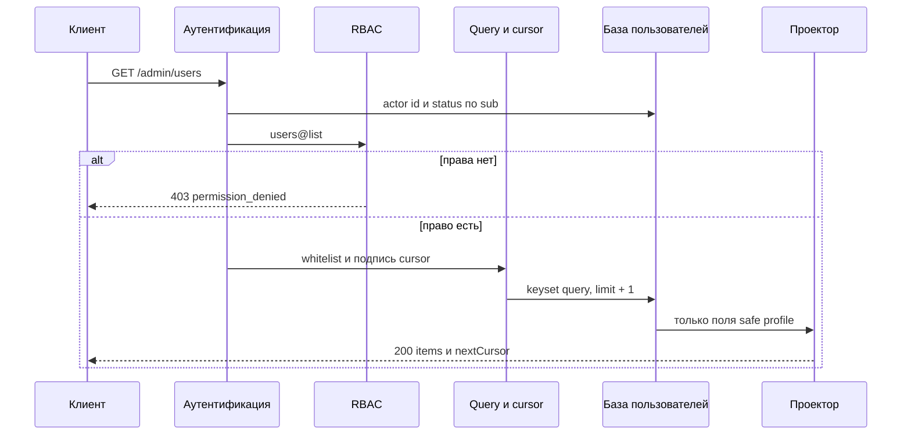
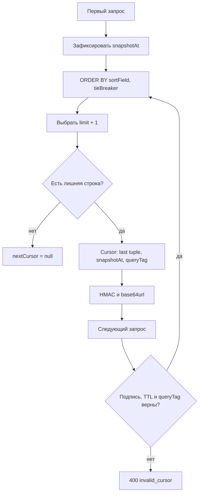

# Просмотр списка всех пользователей

## Содержание

- [Теория](#теория)
  - [Ситуация](#ситуация)
  - [Модель](#модель)
  - [Понятия и связь с бэкендом](#понятия-и-связь-с-бэкендом)
  - [Зоны ответственности](#зоны-ответственности)
  - [Типичные сбои](#типичные-сбои)
  - [Полезные ссылки](#полезные-ссылки)
  - [Вопросы по теории](#вопросы-по-теории)
- [Практическое задание](#практическое-задание)
  - [1.1 Общее](#11-общее)
  - [1.2 Сценарии](#12-сценарии-user-stories)
  - [1.3 Контракт](#13-контракт)
  - [1.4 Ошибки и ограничения](#14-ошибки-и-ограничения)
  - [1.5 Аудит](#15-аудитлоги)
  - [1.6 Нефункциональные требования](#16-нефункциональные-требования)

# Теория

## Ситуация

Активный пользователь с административным разрешением запрашивает `GET /admin/users`. Дальше возможен один из исходов: сервер возвращает страницу канонических профилей и следующий cursor, отклоняет параметры или cursor с **400**, сообщает о недействующей сессии через **401**, запрещает запрос без `users@list` через **403**, ограничивает частоту через **429** либо возвращает **503**, если база, актуальный RBAC или ключ проверки cursor недоступны.

Список не имеет отдельного «расширенного» объекта пользователя. Каждый элемент содержит тот же safe profile, что одиночный просмотр: `id`, `email`, `displayName`, `photoUrl`, `status`, `createdAt`, `updatedAt`.

## Модель

В запросе участвуют клиент, аутентификация, RBAC, валидатор query, база пользователей и проектор ответа. Проверка `users@list` завершается до построения поиска и чтения первой строки. Право даёт доступ ко всему административному набору, поэтому `users@read_any` для каждой строки не вызывается.



Первая страница фиксирует `snapshotAt` по часам базы перед выборкой и уже на ней применяет строгое `created_at < snapshotAt`. Поле `users.created_at` назначает та же база, а клиент и часы процесса его не задают; иначе рассинхронизация часов нарушила бы границу. Все страницы исключают пользователей на самой границе и после неё, поэтому параллельные регистрации не появляются посередине обхода. Сортировка разрешена только по неизменяемым `createdAt` и `id`; к выбранному полю добавляется второй неизменяемый компонент, который делает порядок полным.



Cursor содержит версию формата, идентификатор ключа, сортировку, направление, `snapshotAt`, последнее составное значение и keyed `queryTag` нормализованных query-параметров. Payload не содержит email, `displayName` или статус. HMAC-SHA256 с отдельным ключом защищает cursor от изменения, но не шифрует его, поэтому PII туда не помещаются.

Keyset pagination не использует номер страницы и большой `OFFSET`. Для направления `desc` следующая выборка берёт кортежи меньше последнего, для `asc` — больше. Запрашивается `limit + 1`: лишняя строка определяет `nextCursor`, но в `items` не возвращается.

Поиск и фильтр могут изменить принадлежность строки набору между HTTP-запросами. Контракт гарантирует неизменяемый порядок, исключение новых строк после `snapshotAt` и отсутствие повторов из-за одинакового sort value; исторический снимок mutable-полей не создаётся. Для административного обхода с меняющимся `status` клиент начинает новый проход, если ему нужен актуальный полный набор после массовых изменений.

Список использует существующую таблицу `users` и добавляет только индексы. Новых столбцов и таблиц нет.

| `users` | Роль в списке |
| --- | --- |
| `id` | публичное поле, поиск по точному значению и tie-breaker |
| `email` | публичное поле и prefix-поиск по нормализованной строке |
| `password_hash` | не выбирается и не возвращается |
| `display_name` | публичное nullable-поле и prefix-поиск после NFC и `lower` |
| `photo_key` | используется только для построения защищённого `photoUrl` вне статусов `deleting` и `deleted`, сам не возвращается |
| `status` | публичное поле и точный фильтр по пяти значениям |
| `created_at` | публичное поле, immutable-сортировка и snapshot boundary |
| `updated_at` | публичное поле, но не сортировка |

| Индекс | Назначение |
| --- | --- |
| `users_pkey (id)` | первичный ключ, точный поиск и сортировка по `id` |
| `users_list_created_id_idx (created_at, id)` | default-сортировка и составной cursor |
| `users_list_status_created_id_idx (status, created_at, id)` | фильтр статуса с default-сортировкой |
| `users_list_status_id_created_idx (status, id, created_at)` | фильтр статуса с сортировкой по `id` |
| `users_list_email_prefix_idx (email text_pattern_ops)` | нормализованный буквальный prefix email без wildcard |
| `users_list_name_prefix_idx (lower(normalize(display_name, NFC)) text_pattern_ops) WHERE display_name IS NOT NULL` | буквальный prefix имени; выражение запроса совпадает с индексом |

### Нормальная форма

Добавление индексов не меняет функциональные зависимости данных. `users` остаётся в BCNF и 5NF.

Каждая следующая форма включает требования предыдущей:

- **1NF:** профильные поля содержат по одному значению; список не хранится одной JSON-ячейкой и формируется запросом из строк.
- **2NF:** первичный ключ `id` простой, поэтому частичной зависимости нет. `email` остаётся альтернативным уникальным ключом.
- **3NF и BCNF:** `display_name`, `photo_key`, `status` и временные метки зависят от ключа пользователя. Публичный `photoUrl` вычисляется и не дублирует внутренний ключ в таблице.
- **4NF:** роли, challenge, задания удаления и файлы находятся за отдельными отношениями или границами; независимые списки не перемножаются внутри `users`.
- **5NF:** связи с другими сущностями восстанавливаются по ключам, а профиль не требует дополнительного разложения для устранения ложных комбинаций.

Функциональный индекс хранит служебное представление значения внутри структуры индекса, но не становится новым атрибутом HTTP-профиля или источником истины. Выражение запроса в точности совпадает с выражением индекса, а версия Unicode закреплена версией базы; после её смены индекс перестраивается миграцией. Изменение `display_name` обновляет индекс той же транзакцией базы, поэтому отдельной аномалии обновления нет.

## Понятия и связь с бэкендом

### Permission списка и минимальные привилегии

`users@list` является самостоятельным административным разрешением. Оно проверяется после действующего access и актуального `active`, но до разбора ресурсоёмкого поиска. Имя роли `admin` не участвует в обработчике; право может быть назначено любой роли через RBAC.

`users@read` и `users@read_any` относятся к `GET /users/{userId}`. Список не выполняет сотню проверок `read_any`: явное `users@list` уже разрешает выдачу страницы. Отсутствие права возвращает **403** до запроса `users`, поэтому количество и состав записей не раскрываются.

Аутентификация и cookies не меняются: access извлекается только из HttpOnly cookie, проверяются подпись и claims, затем база подтверждает `active`. `pending`, `blocked`, `deleting`, `deleted` и отсутствующий actor получают **401**. Целевые строки в списке могут иметь любой из пяти статусов.

### Cursor pagination и полный порядок

Offset pagination заставляет базу пропускать всё больше строк и может сдвигать страницы при вставках. Keyset pagination продолжает после последнего сортировочного кортежа и использует индексный диапазон.

Одного `createdAt` недостаточно: несколько пользователей могут быть созданы в одну и ту же единицу времени. Пара `(createdAt, id)` создаёт полный порядок. При сортировке по `id` используется `(id, createdAt)`; второй компонент унифицирует формат cursor, хотя уникальный `id` уже исключает равенство.

Оба поля неизменяемы после создания. `snapshotAt` исключает строки, созданные после первого запроса, и одинаково применяется на каждой странице. Cursor действует 15 минут; после истечения клиент начинает обход заново, чтобы долгоживущая квитанция не закрепляла старый набор.

### Целостность cursor

Cursor кодируется base64url, но это не защита. Сервер подписывает payload HMAC-SHA256 отдельным ключом длиной не менее 32 случайных байт и сравнивает подпись за постоянное время.

`queryTag` равен HMAC от канонических `limit`, `searchBy`, нормализованного `q`, `status`, `sort` и `order` с доменным префиксом `users-list-query`. Изменение хотя бы одного параметра вместе со старым cursor возвращает **400 invalid_cursor**. Отдельный префикс `users-list-cursor` используется для подписи payload тем же ключом, чтобы два назначения HMAC не смешивались. Версия payload позволяет отклонить устаревший формат после несовместимого изменения.

Cursor не содержит PII. Значение `q` сначала нормализуется, затем входит только в keyed `queryTag`; обычный SHA-256 не используется, поскольку короткий email или prefix можно было бы проверить офлайн по словарю. Подпись подтверждает происхождение cursor, но не даёт права доступа: каждый следующий запрос снова проходит access и `users@list`.

Payload содержит несекретный `kid`. Новые cursor подписываются активным ключом, а все предыдущие ключи, которыми подписаны ещё не истёкшие cursor, сохраняются на их TTL и 30 секунд допустимого расхождения часов. После этого старый ключ удаляется. Неизвестный `kid` получает общий **400 invalid_cursor**, а не вызывает подбор другого ключа.

### Whitelist поиска и фильтров

Query принимает только `cursor`, `limit`, `searchBy`, `q`, `status`, `sort` и `order`. Неизвестный или повторённый параметр получает **400**. Клиент не передаёт имя столбца, SQL-фрагмент, оператор сравнения или произвольное направление.

`searchBy=id` выполняет точное сравнение. `searchBy=email` выполняет буквальный prefix длиной не менее трёх символов по нормализованному email; `%`, `_` и другие символы не получают wildcard-смысла. `searchBy=displayName` обрезает строку и приводит её к NFC. Дальше база сравнивает буквальный prefix через `lower(normalize(display_name, NFC))` и `lower` того же `q`. Это не полный Unicode case fold: `casefold()` есть только в PostgreSQL 18 и здесь не используется, поэтому `ß` не превращается в `ss`. Длина считается по `q` после обрезки и NFC и составляет не менее трёх кодовых точек.

`searchBy` и `q` присутствуют вместе либо оба отсутствуют. Поиск сразу по всем полям не выполняется, поскольку такой OR ухудшает предсказуемость индексов и делает семантику короткой строки неоднозначной.

Фильтр `status` принимает ровно одно значение `pending`, `active`, `blocked`, `deleting` или `deleted`. Сортировка допускает только `createdAt` и `id`, направление — `asc` или `desc`. Значения по умолчанию — `createdAt desc`.

### Канонический профиль и email

Каждый элемент страницы содержит ровно `id`, нормализованный `email`, `displayName`, `photoUrl`, `status`, `createdAt`, `updatedAt`. `lastLoginAt`, роли, причины блокировки, признаки challenge и данные удаления не добавляются.

Email возвращается полностью и не маскируется. Это однозначное решение: `users@list` является отдельным привилегированным доступом, а административный поиск по email требует отличать похожие аккаунты. Маскирование не заменило бы RBAC и могло бы сделать два адреса неразличимыми.

Минимизация PII достигается не искажением разрешённого поля, а строгим `users@list`, небольшими страницами, rate limit, аудитом и запретом выгрузки лишних столбцов. `password_hash`, challenge secrets, JWT, cookies, `photo_key`, tombstone job, роли и внутренние поля не выбираются.

`photoUrl` строится без обращения к хранилищу и ведёт на защищённую операцию профиля. Само наличие `users@list` не выдаёт байты объекта: загрузка URL применяет правила чтения фотографии. Это сохраняет независимость разрешений и не создаёт N+1-запросов к файловому хранилищу при построении страницы.

### Поиск, индексы и план запроса

Параметры передаются в запрос как значения, а не конкатенируются с SQL. Выбор sort field и order выполняется сервером из двух небольших whitelist. Это закрывает SQL injection через имена столбцов и операторы.

Default-запрос использует `users_list_created_id_idx`. Фильтр статуса использует один из индексов с `status` первым. Prefix email использует `users_list_email_prefix_idx`, а prefix имени — `users_list_name_prefix_idx` с тем же `lower(normalize(..., NFC))`, что и условие запроса. Поиск с одной или двумя кодовыми точками запрещён, поиск по подстроке, fuzzy search и одновременный OR по нескольким полям отсутствуют.

API запрашивает `limit + 1` строк и не вычисляет `totalCount`. Точный общий размер потребовал бы отдельного потенциально тяжёлого запроса и быстро устаревал бы при регистрации и удалении. `nextCursor = null` однозначно обозначает конец обхода.

### Статусы удаления в административном списке

`deleting` появляется сразу после **202** удаления, поэтому список показывает прекращённый доступ ещё до завершения файловой очистки. В этом состоянии `photoUrl` уже равен `null`, чтобы не ссылаться на объект, который worker мог удалить. `deleted` означает успешную анонимизацию: email уже заменён случайным tombstone, имя и фотография очищены.

Список не раскрывает прогресс deletion job. Для этого существует отдельный status endpoint по `jobId`. Фильтр `status=deleting` помогает оператору найти технические строки, но не заменяет мониторинг jobs и не показывает причины сбоя.

### Сводка

| Понятие | Смысл в списке | На что опирается реализация |
| --- | --- | --- |
| `users@list` | доступ ко всему административному набору | одна актуальная проверка RBAC до query |
| Safe profile | одинаковые семь полей каждой строки | разрешающий проектор |
| Keyset pagination | продолжение после последнего кортежа | range query вместо `OFFSET` |
| Tie-breaker | полный порядок одинаковых времён | неизменяемый `id` |
| `snapshotAt` | новые строки не входят в текущий обход | строгое `created_at < snapshotAt` |
| Signed cursor | клиент не меняет границу и параметры | HMAC, TTL, version и keyed query tag |
| Whitelist | фиксированные search, filter и sort | серверные варианты без SQL от клиента |
| Полный email | однозначная административная идентификация | отдельное привилегированное `users@list` |

## Зоны ответственности

| Клиент | Сервер |
| --- | --- |
| Передаёт только документированные query-параметры | Отклоняет неизвестные и повторённые параметры |
| Хранит cursor как непрозрачную строку | Проверяет HMAC, TTL, version, `kid` и query tag |
| Не изменяет фильтры между страницами | Связывает cursor с нормализованным query |
| После `nextCursor: null` завершает обход | Запрашивает `limit + 1` и формирует следующий cursor |
| Не передаёт SQL, имя произвольного поля или оператор | Выбирает поиск и сортировку из whitelist |
| Защищает экран списка как PII | Проверяет `users@list` на каждом запросе |
| Не ожидает `totalCount` | Возвращает только страницу и cursor |
| Отдельно запрашивает фотографию | Не выполняет N+1-вызовы хранилища |

Запрос списка использует GET и не меняет состояние, поэтому CSRF-заголовок не требуется. При другом доверенном origin клиент отправляет cookies с `credentials: "include"`, а сервер разрешает credentials только точному origin.

## Типичные сбои

| Что видно | Куда смотреть |
| --- | --- |
| Запрос без сессии получает **403** | RBAC запущен раньше аутентификации |
| Пользователь с `users@read_any` получает список без `users@list` | одиночное право ошибочно заменяет административное разрешение |
| Без `users@list` база выполняет тяжёлый поиск | право проверяется после построения query |
| В одной странице есть `passwordHash` или `photoKey` | список сериализует сущность вместо safe projector |
| Email иногда маскирован, иногда полный | нет единого решения; контракт требует полный нормализованный адрес |
| `lastLoginAt` появился только в списке | канонический safe profile расширен внутренним полем |
| Пользователь повторяется между страницами с одинаковым временем | cursor не содержит неизменяемый `id` tie-breaker |
| Новые регистрации появляются в середине обхода `asc` | cursor не сохраняет и не применяет `snapshotAt` |
| Существующая строка пропала за `snapshotAt` | `created_at` назначен часами приложения, а граница — часами базы |
| Старый cursor работает с другим фильтром | отсутствует `queryTag` или он не проверяется |
| Cursor можно изменить вручную | payload закодирован, но не защищён HMAC |
| По `queryTag` угадывается искомый email | вместо keyed HMAC используется обычный SHA-256 |
| Cursor раскрывает email в access log | сортировочное или поисковое PII помещено в payload |
| `%` в `q` возвращает почти всю таблицу | пользовательский prefix передан как SQL wildcard |
| `sort=password_hash` принимается сервером | имя столбца берётся из query без whitelist |
| Короткая страница всегда завершает обход | запрос не использует `limit + 1` для точного `hasMore` |
| Большой номер страницы становится медленнее | применяется `OFFSET`, а не keyset range |
| На каждую строку выполняется запрос хранилища | `photoUrl` строится из данных строки вместо загрузки объекта |
| Удалённый профиль показывает старый email | список читает архив или кеш до финальной анонимизации |
| В журнале есть `q` или полный cursor | логируются PII поиска и URL целиком |

## Полезные ссылки

### Общие

- [PostgreSQL — LIMIT and OFFSET](https://www.postgresql.org/docs/current/queries-limit.html) — объясняет обязательность предсказуемого `ORDER BY` и недостатки больших смещений.
- [PostgreSQL — Row constructor comparison](https://www.postgresql.org/docs/current/functions-comparisons.html#ROW-WISE-COMPARISON) — составное сравнение `(sort_value, id)` для keyset pagination.
- [PostgreSQL — Multicolumn indexes](https://www.postgresql.org/docs/current/indexes-multicolumn.html) — порядок столбцов индекса для фильтра и сортировки.
- [PostgreSQL — String Functions and Operators](https://www.postgresql.org/docs/current/functions-string.html) — `normalize` и `lower` в выражении индекса поиска имени. `casefold()` этой страницы относится к PostgreSQL 18 и в индексе не используется.
- [RFC 2104 — HMAC](https://www.rfc-editor.org/rfc/rfc2104) — механизм проверки целостности cursor отдельным секретным ключом.
- [RFC 4648 — Base64url](https://www.rfc-editor.org/rfc/rfc4648#section-5) — URL-безопасное кодирование бинарного cursor без обещания конфиденциальности.
- [OWASP — Secrets Management Cheat Sheet](https://cheatsheetseries.owasp.org/cheatsheets/Secrets_Management_Cheat_Sheet.html) — хранение и ротация ключей подписи cursor вне кода и журналов.
- [Unicode Standard — Default Case Algorithms](https://www.unicode.org/versions/latest/core-spec/chapter-3/#G33992) — полный case fold, которым поиск списка сознательно не пользуется: индекс вызывает `lower` базы.
- [OWASP API Security — Broken Object Property Level Authorization](https://owasp.org/API-Security/editions/2023/en/0xa3-broken-object-property-level-authorization/) — риск выдачи лишних свойств в элементах списка.
- [OWASP — Authorization Cheat Sheet](https://cheatsheetseries.owasp.org/cheatsheets/Authorization_Cheat_Sheet.html) — минимальные привилегии и серверная проверка `users@list`.
- [OpenAPI Specification — Parameter Object](https://spec.openapis.org/oas/latest.html#parameter-object) — описание допустимых query-параметров, enum и границ `limit`.

### По языку

#### Node.js

**Node.js, NestJS.** На Express или Fastify whitelist и keyset query сохраняют тот же контракт.

- [NestJS — Controllers](https://docs.nestjs.com/controllers) — объявление и получение query-параметров операции.
- [NestJS — Validation](https://docs.nestjs.com/techniques/validation) — преобразование `limit` и отклонение неизвестных значений.
- [Node.js — `crypto.createHmac`](https://nodejs.org/api/crypto.html#cryptocreatehmacalgorithm-key-options) — подпись cursor и формирование keyed query tag.
- [Prisma — Pagination](https://www.prisma.io/docs/orm/prisma-client/queries/pagination) — cursor-подход и отличие от offset pagination.
- [TypeORM — Select Query Builder](https://typeorm.io/docs/query-builder/select-query-builder) — параметризованные фильтры и составной range predicate.
- [NestJS — OpenAPI types and parameters](https://docs.nestjs.com/openapi/types-and-parameters) — документирование query enum и границ.
- [Prisma Migrate](https://www.prisma.io/docs/orm/prisma-migrate) или [TypeORM — Indices](https://typeorm.io/docs/advanced-topics/indices/) — создание составных и функциональных индексов.

#### .NET

**.NET, ASP.NET Core.** Minimal API и контроллеры используют один whitelist параметров и LINQ-запрос.

- [ASP.NET Core — Model binding](https://learn.microsoft.com/en-us/aspnet/core/mvc/models/model-binding) — типизированное получение query-параметров.
- [EF Core — Efficient pagination](https://learn.microsoft.com/en-us/ef/core/querying/pagination) — keyset pagination и уникальный составной порядок.
- [.NET — HMACSHA256](https://learn.microsoft.com/en-us/dotnet/api/system.security.cryptography.hmacsha256) — HMAC cursor.
- [.NET — Base64UrlEncoder](https://learn.microsoft.com/en-us/dotnet/api/microsoft.identitymodel.tokens.base64urlencoder) — URL-безопасное кодирование payload и подписи.
- [EF Core — Indexes](https://learn.microsoft.com/en-us/ef/core/modeling/indexes) — составные индексы под фильтр и порядок.
- [ASP.NET Core — OpenAPI](https://learn.microsoft.com/en-us/aspnet/core/fundamentals/openapi/overview) — описание security scheme, query и ответов.
- [EF Core — Migrations](https://learn.microsoft.com/en-us/ef/core/managing-schemas/migrations/) — перенос новых индексов между окружениями.

#### Python

**Python, FastAPI.** Для Django или Flask остаются те же нормализация, cursor и параметризованный запрос.

- [FastAPI — Query Parameters](https://fastapi.tiangolo.com/tutorial/query-params/) — типизированные query-параметры и default values.
- [Pydantic — Validators](https://docs.pydantic.dev/latest/concepts/validators/) — совместная проверка `searchBy` и `q`.
- [Python — `hmac`](https://docs.python.org/3/library/hmac.html) — HMAC и `compare_digest` для cursor.
- [Python — `base64`](https://docs.python.org/3/library/base64.html) — base64url-кодирование payload.
- [SQLAlchemy — SELECT](https://docs.sqlalchemy.org/en/20/tutorial/data_select.html) — параметризованный range query и составной порядок.
- [Alembic — Tutorial](https://alembic.sqlalchemy.org/en/latest/tutorial.html) — миграции составных и функциональных индексов.
- [FastAPI — Metadata and Docs URLs](https://fastapi.tiangolo.com/tutorial/metadata/) — актуальная OpenAPI-документация.

## Вопросы по теории

1. Почему одного `createdAt` недостаточно для стабильной cursor pagination и зачем добавляется `id`?
2. Чем keyset pagination отличается от `OFFSET` по стоимости и поведению при новых строках?
3. Зачем cursor одновременно содержит `snapshotAt`, `queryTag`, `kid`, version и HMAC?
4. Почему `users@list` проверяется один раз до query, а `users@read_any` не применяется к каждой строке?
5. Почему полный email допустим только при отдельном привилегированном разрешении и чем маскирование отличается от контроля доступа?
6. Что произойдёт с текущим обходом, если статус существующего пользователя изменится между страницами?
7. Почему функциональный индекс `lower(normalize(display_name, NFC))` не нарушает нормальные формы таблицы `users`?

# Практическое задание

Функциональность просмотра списка всех пользователей в системе.
Активный пользователь с `users@list` получает страницы канонических safe profile через `GET /admin/users`. Поиск, фильтр и сортировка ограничены whitelist, размер страницы имеет фиксированные default и maximum, а подписанный составной cursor связывает неизменяемый порядок с параметрами первого запроса.

## 1) Просмотр списка всех пользователей

### 1.1 Общее

**Назначение:** вернуть привилегированному пользователю стабильные страницы безопасных профилей с ограниченным поиском и фильтрацией.

**Пользователи/роли:**

- активный пользователь с `users@list` — получает список;
- активный пользователь без `users@list` получает **403**;
- имя роли `admin` не проверяется, решение принимает актуальный RBAC;
- статусы целевых пользователей не ограничивают присутствие в списке.

**Единый каталог разрешений работы с пользователями:**

| Разрешение | Назначение |
| --- | --- |
| `users@read` | чтение собственного профиля |
| `users@read_any` | дополнительный допуск к чужому профилю |
| `users@update` | изменение собственного профиля |
| `users@update_any` | дополнительный допуск к изменению чужого пользователя и прямой смене email администратором |
| `users@delete` | подтверждённое удаление собственной учётной записи |
| `users@delete_any` | дополнительный допуск к удалению чужого пользователя администратором |
| `users@list` | просмотр административного списка пользователей |

**Зависимости/связанные настройки:**

- access JWT и cookies полностью соответствуют аутентификации; только существующий actor со статусом `active` проходит к RBAC;
- `users@list` проверяется по актуальной версии политики до query пользователей;
- `USER_LIST_CURSOR_ACTIVE_KEY_ID` выбирает активный `kid`, а `USER_LIST_CURSOR_HMAC_KEYS` содержит key ring отдельных случайных значений длиной не менее 32 байт;
- default `limit` равен 20, maximum равен 100;
- cursor действует 15 минут с `snapshotAt`;
- `users.created_at` назначается UTC-часами базы данных и после создания не меняется;
- `PUBLIC_API_BASE_URL` формирует защищённый `photoUrl` без чтения хранилища.

Если активный `kid` не найден, любой cursor-ключ пуст или короче 32 байт либо два `kid` повторяются, приложение не проходит readiness. Ключи не совпадают с JWT- и challenge-ключами, не находятся в коде и не возвращаются клиенту. При ротации предыдущий ключ сохраняется не менее 15 минут 30 секунд, затем удаляется.

Канонический элемент содержит ровно `id`, нормализованный `email`, `displayName`, `photoUrl`, `status`, `createdAt`, `updatedAt`. Email возвращается полностью и никогда не маскируется на этом endpoint. `password_hash`, challenge secrets, JWT, cookies, роли, `photo_key`, deletion job и внутренние поля отсутствуют.

Статусы согласованы как `pending`, `active`, `blocked`, `deleting`, `deleted`; только `active` аутентифицируется как actor. В items разрешены все пять значений. `deleting` означает принятую очистку и всегда имеет `photoUrl: null`; `deleted` — завершённую анонимизацию с tombstone email и пустыми именем и фотографией.

### 1.2 Сценарии (user stories)

1. **Первая страница:** клиент без cursor получает до 20 пользователей в порядке `createdAt desc, id desc`.
2. **Следующая страница:** клиент передаёт `nextCursor` и неизменённые параметры, получает продолжение без повторов по одинаковому времени создания.
3. **Ограниченный поиск:** клиент выбирает ровно одно поле `id`, `email` или `displayName`; prefix email и имени содержит не менее трёх символов.
4. **Фильтр статуса:** клиент выбирает одно из пяти канонических состояний.
5. **Разрешённая сортировка:** клиент выбирает `createdAt` или `id` и направление `asc` или `desc`.
6. **Невалидный cursor:** изменённая подпись, истёкший TTL или несовпавшие параметры получают **400**.
7. **Нет права:** запрос получает **403** до поиска, сортировки и чтения пользователей.
8. **Конец обхода:** последняя страница возвращает `nextCursor: null`; отдельный `totalCount` не вычисляется.

### 1.3 Контракт

#### 1.3.1 Получение списка

| `GET /admin/users` | Правило |
| --- | --- |
| `cursor` | отсутствует на первой странице; на следующих содержит выданную сервером непрозрачную строку |
| `limit` | целое число от 1 до 100; при отсутствии равно 20 |
| `searchBy` | отсутствует вместе с `q` либо имеет `id`, `email` или `displayName` |
| `q` | присутствует только вместе с `searchBy`; формат зависит от выбранного поля |
| `status` | при наличии одно из `pending`, `active`, `blocked`, `deleting`, `deleted` |
| `sort` | `createdAt` или `id`; при отсутствии `createdAt` |
| `order` | `asc` или `desc`; при отсутствии `desc` |

Другие query-параметры и повтор одного параметра получают **400**. При передаче cursor `limit`, `searchBy`, `q`, `status`, `sort` и `order` должны после нормализации совпасть с первой страницей.

**Валидация поиска:**

- `searchBy=id` — `q` содержит от 1 до 128 ASCII-символов из букв, цифр, `_` и `-`; выполняется точное сравнение;
- `searchBy=email` — `q` после обрезки и lower case содержит от 3 до 254 видимых ASCII-символов без пробелов и управляющих символов; выполняется буквальный prefix, SQL wildcard не интерпретируется;
- `searchBy=displayName` — `q` после обрезки и NFC содержит от 3 до 80 кодовых точек без U+0000–U+001F и U+007F–U+009F; база сравнивает буквальный prefix через `lower(normalize(display_name, NFC))`;
- пустой `q`, `q` без `searchBy` и `searchBy` без `q` получают **400**.

**Логика/шаги:**

1. Проверить access JWT, получить пользователя по `sub` и принять только `active`. При отказе вернуть **401** до RBAC.
2. Проверить актуальное `users@list`. При отсутствии вернуть **403** до валидации поиска и запроса `users`.
3. Отклонить неизвестные, повторённые и невалидные query-параметры.
4. На первой странице получить `snapshotAt` из UTC-часов базы данных перед выборкой и нормализовать query.
5. На следующей странице проверить формат, `kid`, HMAC, version, TTL и `queryTag` cursor.
6. Построить только серверный вариант параметризованного keyset query и условие `created_at < snapshotAt`.
7. Выбрать `limit + 1` строк и только `id`, `email`, `display_name`, `photo_key`, `status`, `created_at`, `updated_at`.
8. Пропустить не более `limit` строк через safe projector.
9. Если лишняя строка есть, подписать cursor по последнему возвращённому элементу; иначе вернуть `nextCursor: null`.

Запрос к базе имеет таймаут 2 секунды. Истечение таймаута возвращает **503**, не частичную страницу. Никакой SQL-фрагмент, имя произвольного столбца или оператор из клиента в запрос не подставляется.

**Ответ:**

- **200 OK:** `items: SafeProfile[]`, `nextCursor: string | null`.
- `items` содержит от 0 до `limit` элементов.
- Пустая первая или следующая страница допустима и возвращает `nextCursor: null`.
- `totalCount`, номер страницы и предыдущий cursor не возвращаются.

#### 1.3.2 Составной cursor

Payload содержит:

| Поле | Значение |
| --- | --- |
| `v` | версия формата `1` |
| `kid` | идентификатор ключа, которым подписан cursor |
| `sort` | `createdAt` или `id` |
| `order` | `asc` или `desc` |
| `snapshotAt` | RFC 3339 UTC из часов базы данных перед первой выборкой |
| `lastSortValue` | последнее значение выбранного immutable-поля |
| `lastTieBreaker` | `id` при sort `createdAt`, `createdAt` при sort `id` |
| `queryTag` | HMAC от канонического набора query, включая `limit`, с отдельным доменным префиксом |
| `issuedAt` | серверное UTC-время первой страницы, неизменное до конца обхода |
| `expiresAt` | `issuedAt + 15 минут`, неизменное до конца обхода |

Payload сериализуется в каноническом порядке, кодируется base64url и получает HMAC-SHA256 через ключ, выбранный по `kid` из `USER_LIST_CURSOR_HMAC_KEYS`. Итоговая строка имеет формат `payload.signature`. Подпись сравнивается за постоянное время. Для `queryTag` и подписи используются доменные префиксы `users-list-query` и `users-list-cursor`.

Каждая следующая страница сохраняет исходные `issuedAt` и `expiresAt`, поэтому быстрые запросы не продлевают обход бесконечно. Неверное base64url, неизвестные version или `kid`, невалидная подпись, будущее `issuedAt`, несовпадающий пятнадцатиминутный интервал, истёкший `expiresAt`, недопустимое значение поля и несовпавший `queryTag` дают одинаковый **400 invalid_cursor** без подробности.

Для `createdAt desc` следующая страница использует:

```text
(created_at, id) < (:lastCreatedAt, :lastId)
```

Для `createdAt asc` используется `>`. Для sort `id` порядок кортежа меняется на `(id, created_at)`. В обоих случаях `ORDER BY` перечисляет те же поля и одинаковое направление.

Cursor не содержит email, `displayName`, status, роли, JWT, ключ подписи и SQL. Он не заменяет access: каждый запрос снова проходит аутентификацию и `users@list`.

#### 1.3.3 Безопасный элемент списка

| Поле | Правило |
| --- | --- |
| `id: string` | неизменяемый идентификатор |
| `email: string` | полный нормализованный email, без маскирования |
| `displayName: string \| null` | сохранённая NFC-строка или `null` |
| `photoUrl: string \| null` | защищённый HTTPS URL API; `null` без фотографии и при `deleting` или `deleted` |
| `status: string` | `pending`, `active`, `blocked`, `deleting` или `deleted` |
| `createdAt: string` | RFC 3339 UTC |
| `updatedAt: string` | RFC 3339 UTC |

Проектор фиксирован и не зависит от роли или search field. Для `deleting` поле `photoUrl` равно `null`; для `deleted` email является случайным tombstone, а `displayName` и `photoUrl` равны `null`. Для остальных статусов возвращаются актуальные разрешённые значения.

Email не маскируется ни при каком параметре. Пользователь без права не получает даже маскированный список, а пользователь с `users@list` получает полное поле. В items нет `password_hash`, challenge secrets, JWT, cookies, `photo_key`, ролей, login timestamps, причин статуса, deletion job и внутренних флагов.

Построение `photoUrl` не обращается к файловому хранилищу. Получение самих байтов выполняется отдельной защищённой операцией просмотра фотографии и может потребовать её собственные разрешения.

#### 1.3.4 Гонки и изменения между страницами

`createdAt` и `id` неизменяемы, поэтому уже возвращённая строка не перемещается относительно cursor. Строгая граница `snapshotAt` исключает пользователей, созданных одновременно с фиксацией границы или позже, при обоих направлениях сортировки; такие строки войдут в новый обход.

Изменение `email`, `displayName` или `status` не меняет позицию сортировки. Если строка перестала соответствовать поиску или фильтру до следующей страницы, она не возвращается; если начала соответствовать после прохождения её позиции, она появится только в новом обходе. Cursor не обещает исторический MVCC-снимок между HTTP-запросами.

Удаление не удаляет основную строку: `deleting` и затем `deleted` меняют фильтр, но `id` и `createdAt` сохраняются. Клиент, которому нужен итоговый набор после серии изменений, начинает первую страницу без cursor.

### 1.4 Ошибки и ограничения

- **400 Bad Request** — неизвестный или повторённый query-параметр; `limit` вне 1–100; невалидные `searchBy`, `q`, `status`, `sort` или `order`; cursor повреждён, истёк, имеет неверные подпись, `kid`, version или query tag.
- **401 Unauthorized** — access отсутствует, невалиден, истёк или ссылается на отсутствующего либо неактивного actor.
- **403 Forbidden** — активный actor не имеет актуального `users@list`.
- **429 Too Many Requests** — превышен rate limit списка.
- **503 Service Unavailable** — недоступны база, актуальный снимок RBAC или операция HMAC; запрос базы превысил 2 секунды; cursor-ключ не готов.

**404 Not Found** для списка не используется: корректный запрос без совпадений возвращает **200** с пустым `items`. Ошибка одной строки не превращает страницу в частичный ответ; при недоступной зависимости возвращается **503** без items.

### 1.5 Аудит/логи

Логировать:

- успешный запрос с `actorUserId`, нормализованными именами задействованных параметров, размером страницы, признаком `hasNext` и длительностью;
- **401**, **403**, **400 invalid_cursor**, **429** и **503** по безопасной категории;
- превышение таймаута базы и использование плана, вышедшего за порог мониторинга;
- отказ readiness из-за cursor-ключа или RBAC.

Значения `q`, cursor, email, `displayName`, `photoUrl`, состав `items` и полный URL не логируются. Для аналитики поиска сохраняются только `searchBy`, наличие `status`, `sort`, `order`, `limit` и необратимый краткоживущий request id.

В журнал не попадают PII строк, пароль, `password_hash`, challenge, JWT, `Cookie`, `Set-Cookie`, HMAC-ключ, payload cursor, роли, полное тело ответа и полные заголовки.

### 1.6 Нефункциональные требования

- Endpoint допускает не более 60 запросов actor за минуту и 120 запросов с IP за минуту. Первый превышенный лимит получает **429**. Значение `limit` больше 100 отклоняется, а не обрезается.
- База выполняет keyset range по составному индексу, выбирает `limit + 1` и не вычисляет `totalCount`. Построение страницы не обращается к хранилищу фотографий.
- Cursor действует 15 минут и привязан к query первой страницы. Поиск параметризован: символы `%` и `_` не получают wildcard-смысла.
- Автоматические тесты покрывают пустую страницу, одинаковые `createdAt`, оба направления сортировки, поиск и фильтр, подпись cursor, TTL, несовпадение query tag и все пять статусов в items.
- Общие нефункциональные требования проекта — валидация входных данных, CORS, OpenAPI, структурированные логи, health checks и покрытие тестами не ниже 80% — относятся и к этой операции.
