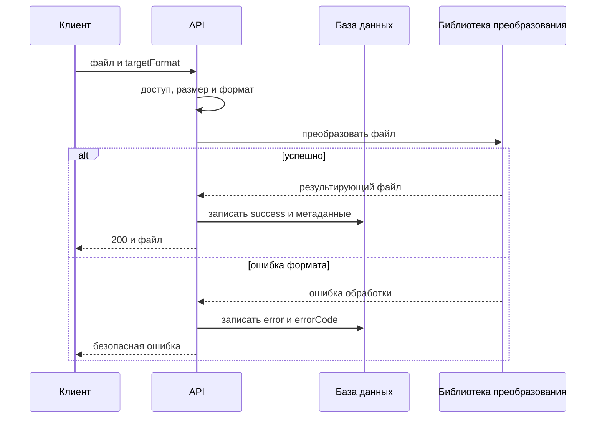
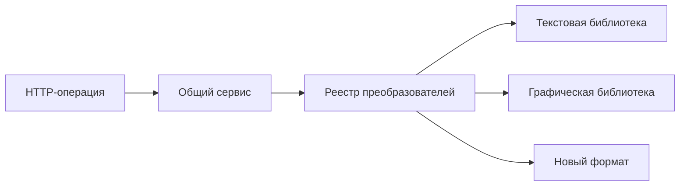

# Общие требования к трансформации файлов

## Содержание

- [Теория](#теория)
  - [Ситуация](#ситуация)
  - [Модель](#модель)
  - [Понятия и связь с бэкендом](#понятия-и-связь-с-бэкендом)
  - [Зоны ответственности](#зоны-ответственности)
  - [Типичные сбои](#типичные-сбои)
  - [Полезные ссылки](#полезные-ссылки)
  - [Вопросы по теории](#вопросы-по-теории)
- [Практическое задание](#практическое-задание)
  - [1.1 Общее](#11-общее)
  - [1.2 Сценарии](#12-сценарии-user-stories)
  - [1.3 Контракт](#13-контракт)
  - [1.4 Ошибки и ограничения](#14-ошибки-и-ограничения)
  - [1.5 Аудит](#15-аудитлоги)
  - [1.6 Нефункциональные требования](#16-нефункциональные-требования)

# Теория

## Ситуация

Активный пользователь отправляет файл и выбирает целевой формат. Сервер проверяет доступ и входные данные, передаёт файл подходящей библиотеке, возвращает результат и сохраняет метаданные операции в истории.

Дальше возможен один из исходов: файл успешно преобразован, вход отклонён, библиотека не смогла обработать содержимое, превышен лимит или обязательная зависимость временно недоступна.

Отдельный фронтенд не нужен, запросы можно отправлять из HTTP-клиента с поддержкой cookies и `multipart/form-data`.

## Модель

HTTP-слой не содержит алгоритмов конкретных форматов. Он выполняет общие проверки и выбирает зарегистрированный преобразователь по исходному и целевому форматам.

Каждый тип преобразования реализует один общий интерфейс. Внутри реализации находится вызов подходящей библиотеки: CSV-парсер, XML/YAML-сериализатор, Sharp, ImageSharp, Pillow или другой согласованный инструмент.

История содержит метаданные процесса, но не содержимое файлов.

| `transformations` | Описание |
| --- | --- |
| `id` | идентификатор операции |
| `user_id` | владелец операции |
| `type` | `file` или `image` |
| `source_format` | определённый исходный формат |
| `target_format` | выбранный целевой формат |
| `status` | `success` или `error` |
| `input_size` | размер входного файла в байтах |
| `output_size` | размер результата при успехе, иначе `null` |
| `duration_ms` | длительность обработки |
| `error_code` | безопасный код ошибки, иначе `null` |
| `created_at` | время начала в UTC |
| `completed_at` | время завершения; для каждой записанной попытки задано |

### Нормальная форма

Таблица `transformations` находится в BCNF.

- **1NF:** каждое поле содержит одно значение; байты файла и списки этапов в строке не хранятся.
- **2NF:** первичный ключ `id` простой, поэтому частичных зависимостей нет.
- **3NF и BCNF:** форматы, размеры и статус описывают одну операцию и зависят от её ключа. Email пользователя не копируется.
- **4NF:** независимые сохранённые файлы и события аудита не складываются в одну строку.
- **5NF:** пользователь и операция соединяются по `user_id`; дополнительных зависимостей соединения нет.

## Понятия и связь с бэкендом

### Интерфейс преобразователя

Преобразователь получает входной поток, параметры и выходной поток. Контроллеру не важно, какая библиотека выполняет работу. Добавление нового формата означает новую реализацию и регистрацию пары, а не изменение всех существующих веток.

Абстрактный класс допустим, но не обязателен. Интерфейс и композиция обычно достаточны: библиотека подключается через adapter, а общий сервис отвечает за доступ, историю и ошибки.

### Библиотеки, а не собственные парсеры

CSV, YAML, XML, JPEG, PNG и SVG имеют много граничных случаев. Собственный парсер или кодек легко ошибается в кавычках, Unicode, сущностях, цветовых профилях и повреждённых данных.

Используется поддерживаемая библиотека выбранного языка. Приложение задаёт ей лимиты и безопасные настройки, а затем переводит её ошибки в контрактные HTTP-статусы.

### Потоковая обработка

Поток позволяет не загружать весь большой файл в один буфер и поддерживает backpressure. Однако некоторые библиотеки всё равно строят полную модель документа или изображения, поэтому лимит размера остаётся обязательным.

Результат сначала полностью формируется во временной области. Клиент не получает частичный файл, если библиотека завершилась ошибкой.

### История и аудит

История — пользовательская функция. В ней видны формат, статус, размеры и длительность. Аудит — технический журнал запросов и ошибок.

После завершения попытки сохраняется `success` или `error`. Если историю записать не удалось, API возвращает **503**, а временный результат удаляется.

### Временное и постоянное хранение

Без `save=true` результат существует только до завершения ответа. Временные файлы недоступны по публичному URL и удаляются при успехе, ошибке или таймауте.

Постоянное хранение подключается через отдельный интерфейс. Локальный диск подходит для разработки одного экземпляра, а production использует S3-совместимое или другое согласованное хранилище.

### Удаление пользователя

Модуль трансформаций регистрирует обработчик удаления данных пользователя. Он удаляет сохранённые файлы и записи истории. Повторный вызов безопасен: уже отсутствующий объект считается удалённым.

### Сводка

| Понятие | Смысл | Реализация |
| --- | --- | --- |
| Интерфейс | единый вызов разных преобразователей | service/adapter |
| Реестр | выбор библиотеки по паре форматов | `source + target` |
| Поток | ограниченное потребление памяти | stream и backpressure |
| История | метаданные каждой попытки | `transformations` |
| Временный файл | целый результат до ответа | приватная временная область |
| Storage adapter | смена backend без изменения API | local или S3-compatible |

## Зоны ответственности

| Клиент | Сервер |
| --- | --- |
| Передаёт один файл и параметры | Проверяет access, `transformations@convert`, формат и размер |
| Выбирает опубликованное направление | Выбирает зарегистрированную библиотеку |
| Получает файл либо понятную ошибку | Не раскрывает stack trace библиотеки |
| Отдельно запрашивает историю | Сохраняет метаданные каждой попытки |
| Явно выбирает постоянное сохранение | По умолчанию удаляет временный результат |

## Типичные сбои

| Что видно | Куда смотреть |
| --- | --- |
| Новый формат потребовал менять контроллер | выбор библиотеки не вынесен в реестр |
| Большой файл исчерпал память | поток заменён чтением всего файла без лимита |
| Клиент получил обрезанный результат | ответ начат до завершения преобразования |
| Успешное преобразование отсутствует в истории | результат возвращён без обязательной записи метаданных |
| В истории находится содержимое файла | метаданные смешаны с пользовательскими данными |
| После ошибки остаются временные файлы | очистка не выполняется для всех веток |
| В ответе видно сообщение библиотеки | исключение не преобразовано в безопасный код |

## Полезные ссылки

### Общие

- [OWASP — File Upload Cheat Sheet](https://cheatsheetseries.owasp.org/cheatsheets/File_Upload_Cheat_Sheet.html) — проверка файлов, лимиты и безопасное хранение.
- [MDN — MIME types](https://developer.mozilla.org/en-US/docs/Web/HTTP/Guides/MIME_types) — корректный `Content-Type` входа и результата.
- [Refactoring Guru — Strategy](https://refactoring.guru/design-patterns/strategy) — выбор независимой реализации преобразования.
- [PostgreSQL — Transactions](https://www.postgresql.org/docs/current/tutorial-transactions.html) — согласованная запись истории.

### По языку

#### Node.js

**Node.js, NestJS.** На Express или Fastify контракт не меняется.

- [Node.js — Streams](https://nodejs.org/api/stream.html) — потоки и backpressure.
- [NestJS — File upload](https://docs.nestjs.com/techniques/file-upload) — приём multipart-файла.
- [NestJS — Providers](https://docs.nestjs.com/providers) — регистрация сервисов преобразования.
- [NestJS — OpenAPI](https://docs.nestjs.com/openapi/introduction) — описание файловых операций.
- [Prisma Migrate](https://www.prisma.io/docs/orm/prisma-migrate) — миграция истории.

#### .NET

**.NET, ASP.NET Core.** Minimal API и контроллеры используют тот же сервис.

- [.NET — Stream](https://learn.microsoft.com/en-us/dotnet/api/system.io.stream) — потоковый ввод и вывод.
- [ASP.NET Core — Upload files](https://learn.microsoft.com/en-us/aspnet/core/mvc/models/file-uploads) — приём файлов и лимиты.
- [.NET — Dependency injection](https://learn.microsoft.com/en-us/dotnet/core/extensions/dependency-injection) — регистрация реализаций.
- [ASP.NET Core — OpenAPI](https://learn.microsoft.com/en-us/aspnet/core/fundamentals/openapi/overview) — документация API.
- [EF Core — Migrations](https://learn.microsoft.com/en-us/ef/core/managing-schemas/migrations/) — перенос схемы.

#### Python

**Python, FastAPI.** Для Django или Flask общий контракт сохраняется.

- [Python — `io`](https://docs.python.org/3/library/io.html) — потоковые интерфейсы.
- [FastAPI — Request Files](https://fastapi.tiangolo.com/tutorial/request-files/) — multipart-файлы.
- [FastAPI — Dependencies](https://fastapi.tiangolo.com/tutorial/dependencies/) — подключение сервисов и доступа.
- [FastAPI — Metadata and Docs URLs](https://fastapi.tiangolo.com/tutorial/metadata/) — OpenAPI.
- [Alembic — Tutorial](https://alembic.sqlalchemy.org/en/latest/tutorial.html) — миграция истории.

## Вопросы по теории

1. Почему преобразование конкретного формата лучше скрыть за общим интерфейсом?
2. Какие ошибки возникают при самостоятельной реализации CSV, XML или графического кодека?
3. Почему потоковая обработка не отменяет лимит входного файла?
4. Чем пользовательская история отличается от технического аудита?
5. Почему результат формируют целиком до начала HTTP-ответа?
6. Что происходит с временными данными после ошибки или таймаута?
7. Почему таблица `transformations` соответствует BCNF?

# Практическое задание

Функциональность общего процесса трансформации файлов в системе.
Активный пользователь запускает поддерживаемое преобразование. Сервер вызывает библиотеку через общий интерфейс, возвращает целый результат и сохраняет безопасные метаданные операции.

## 1) Общие требования к трансформации файлов

### 1.1 Общее

**Назначение:** задать общий интерфейс, историю и правила жизненного цикла файлов для всех преобразований.

**Пользователи/роли:** активный пользователь с разрешением `transformations`. Имя роли не проверяется.

| Действие | Операция |
| --- | --- |
| `convert` | `POST /api/convert`, `POST /api/images/convert` и оба списка направлений |
| `history` | собственная история |
| `history_any` | история указанного пользователя; проверяется до поиска цели |
| `download` | скачивание собственного результата |
| `download_any` | скачивание результата указанного пользователя; проверяется до поиска цели |

При первой установке, пока разрешения `transformations` нет, модуль создаёт эти действия. Роль `user` получает `convert`, `history` и `download`. Роль `admin`, если она есть, получает все действия. Повторный запуск снятые назначения не восстанавливает. Нет роли `user` — readiness модуля не проходит.

**Зависимости/связанные настройки:**

- access JWT, cookies и цепочка авторизации соответствуют аутентификации и RBAC;
- конкретные пары и лимиты задаются требованиями текста и изображений;
- для каждого направления зарегистрирован один преобразователь;
- временная область недоступна публично;
- storage backend задаётся конфигурацией приложения.

Преобразователь использует библиотеку выбранного языка. Практический контракт не требует писать парсер или кодек самостоятельно.

### 1.2 Сценарии (user stories)

1. **Успех:** библиотека преобразует файл, сервер сохраняет `success`, клиент получает результат.
2. **Ошибка:** сервер сохраняет `error` и безопасный код, временные данные удаляются.
3. **Новая пара:** новая реализация регистрируется без изменения контрактов уже работающих пар.
4. **История:** пользователь позже получает метаданные текстовых и графических операций в одном списке.
5. **Сохранение:** по явному флагу попытка остаётся `success`, получает ключ и `storageStatus=pending`; HTTP-ответ не ждёт object storage.
6. **Удаление пользователя:** обработчик удаляет его сохранённые файлы и историю.

### 1.3 Контракт

#### 1.3.1 Интерфейс преобразователя

Преобразователь получает:

- входной поток;
- проверенные параметры;
- выходной поток.

Он возвращает фактические `contentType`, расширение и размер либо безопасный код ошибки. Он не проверяет JWT, не формирует HTTP-ответ и не пишет историю.

#### 1.3.2 Общий порядок

1. Проверить access JWT и актуальный статус `active`.
2. Для изменяющего запроса из другого origin проверить `Origin` и CSRF.
3. Проверить пару `permission@action` этой операции. При отказе вернуть **403** до разбора файла.
4. Проверить multipart, размер и параметры конкретной операции.
5. Определить исходный формат и найти зарегистрированную пару.
6. Вызвать библиотеку и сформировать временный результат.
7. При успехе записать `success`, размеры, длительность и вернуть файл.
8. При ошибке записать `error`, безопасный `errorCode` и вернуть статус из раздела 1.4.
9. Удалить временные данные при любом исходе.

Если запись истории не удалась, результат не возвращается; временные данные удаляются и возвращается **503**.

#### 1.3.3 История

В историю записываются только поля таблицы `transformations`. Содержимое, разобранные данные, JWT, cookies, временные пути и сообщения библиотеки не сохраняются.

#### 1.3.4 Временные данные и storage

Исходное имя не используется как путь. Временное имя генерирует сервер.

Без сохранения результат удаляется после ответа. При `save=true` сервер назначает ключ и оставляет копию для фоновой записи по правилам `2.4`, не задерживая выдачу преобразованного файла.

Обработчик удаления пользователя сначала удаляет принадлежащие ему объекты, затем строки истории. Отсутствующий объект или строка считаются уже удалёнными.

### 1.4 Ошибки и ограничения

- **400 Bad Request** — отсутствует файл или параметр, структура повреждена либо параметры невалидны.
- **401 Unauthorized** — сессия отсутствует, невалидна или пользователь не `active`.
- **403 Forbidden** — нет объявленного разрешения `transformations` либо cross-origin CSRF-проверка не пройдена.
- **413 Content Too Large** — превышен лимит входа или результата.
- **415 Unsupported Media Type** — формат или направление не поддерживаются.
- **503 Service Unavailable** — база истории, временная область или обязательная зависимость недоступна.
- **504 Gateway Timeout** — библиотека не завершила работу за установленное время.

Сообщение библиотеки и частичный результат клиенту не возвращаются.

### 1.5 Аудит/логи

Логировать: `requestId`, `transformationId`, `userId`, тип, форматы, размеры, результат, безопасный `errorCode` и длительность.

В журнал не попадают содержимое, разобранные значения, исходное имя, временный путь, JWT, cookies, multipart-тело и stack trace библиотеки.

### 1.6 Нефункциональные требования

- Применяются лимиты размера и timeout конкретного формата. Результат возвращается только целиком.
- Вызов ресурсоёмкой библиотеки не блокирует приём остальных запросов: его выносят в отдельный поток или пул, но HTTP-ответ дожидается конца преобразования. Очередь jobs для самого преобразования не используется.
- Индекс истории покрывает `user_id, created_at, id`.
- Тесты покрывают выбор библиотеки, успех, ошибку, timeout, историю и очистку временных файлов.
- Общие нефункциональные требования проекта и покрытие тестами не ниже 80% относятся ко всем преобразованиям.
