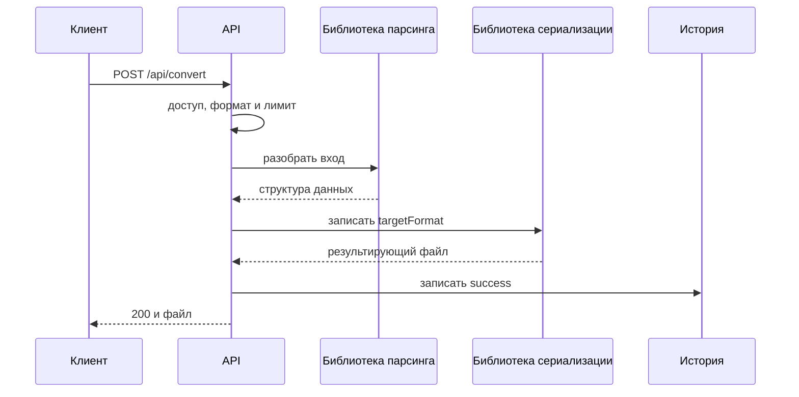
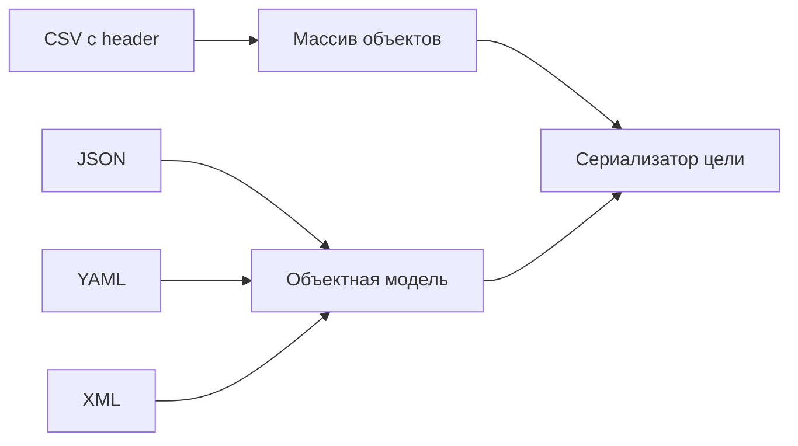

# Трансформация текстовых форматов

## Содержание

- [Теория](#теория)
  - [Ситуация](#ситуация)
  - [Модель](#модель)
  - [Понятия и связь с бэкендом](#понятия-и-связь-с-бэкендом)
  - [Зоны ответственности](#зоны-ответственности)
  - [Пример](#пример)
  - [Типичные сбои](#типичные-сбои)
  - [Полезные ссылки](#полезные-ссылки)
  - [Вопросы по теории](#вопросы-по-теории)
- [Практическое задание](#практическое-задание)
  - [1.1 Общее](#11-общее)
  - [1.2 Сценарии](#12-сценарии-user-stories)
  - [1.3 Контракт](#13-контракт)
  - [1.4 Ошибки и ограничения](#14-ошибки-и-ограничения)
  - [1.5 Аудит](#15-аудитлоги)
  - [1.6 Нефункциональные требования](#16-нефункциональные-требования)

# Теория

## Ситуация

Активный пользователь загружает CSV, JSON, XML или YAML и выбирает другой текстовый формат. Сервер проверяет файл, вызывает библиотеку парсинга и сериализации, сохраняет метаданные операции и возвращает преобразованный файл.

Дальше возможен один из исходов: успешное преобразование, синтаксическая или структурная ошибка, неподдерживаемый формат, превышение лимита, timeout либо временная ошибка зависимости.

Отдельный фронтенд не нужен, запросы можно отправлять из HTTP-клиента с cookies и `multipart/form-data`.

## Модель

Текстовые библиотеки работают с разными представлениями, поэтому сервис приводит результат парсинга к общей структуре данных. CSV использует таблицу, а JSON, YAML и XML — объектную модель.



Для CSV используется массив объектов: первая строка содержит названия колонок, остальные — значения. Это делает CSV → JSON/YAML однозначным и задаёт форму, которую JSON/YAML должны иметь для обратного преобразования.



Файл истории использует таблицу `transformations` из общих требований. Дополнительные таблицы не создаются.

## Понятия и связь с бэкендом

### Готовые библиотеки

CSV-парсер умеет обрабатывать quoted fields, переносы строк и экранированные кавычки. XML-парсер проверяет корректность разметки. YAML-библиотека различает строки, числа, boolean и `null`.

Эти правила не следует реализовывать вручную. Приложение отвечает за выбор библиотеки, безопасную конфигурацию, лимиты и перевод исключений в HTTP-ответ.

### Исходный формат

Расширение `.csv`, `.json`, `.xml`, `.yaml` или `.yml` объявляет формат. Сервер дополнительно проверяет, что соответствующая библиотека может полностью разобрать содержимое.

Клиентский `Content-Type` служит дополнительной проверкой, но не заменяет разбор. JSON также является допустимым YAML, поэтому угадывание только по первым символам ненадёжно.

### CSV

Первая строка CSV обязательна и содержит непустые уникальные названия колонок. Каждая запись имеет то же количество полей. Значения CSV остаются строками; автоматическое превращение `001` в число запрещено.

CSV → JSON/YAML возвращает массив объектов. JSON/YAML → CSV принимает массив плоских объектов с одинаковым набором ключей. Вложенный объект или массив нельзя однозначно записать в одну CSV-ячейку, поэтому он отклоняется.

Для CSV ↔ XML используется структура `rows → row → field`, где имя колонки хранится в атрибуте `name`.

### JSON и YAML

JSON соответствует RFC 8259. Дубликаты ключей, `NaN`, `Infinity` и данные после корневого значения отклоняются.

YAML загружается безопасным методом библиотеки. Пользовательские теги и создание произвольных объектов отключаются. JSON ↔ YAML сохраняет данные, но не комментарии и исходное форматирование.

### XML

XML обрабатывается без DTD, внешних сущностей и сетевых обращений. Это защищает от XXE.

При XML → JSON/YAML атрибуты получают префикс `@`, текст — `#text`, повторяющиеся элементы становятся массивом. При обратном преобразовании используется то же соглашение. Оно фиксируется тестами и документацией API.

### Кодировка и ограничения

Вход и результат используют UTF-8. BOM разрешён только в начале. Невалидная кодировка получает **400**.

Лимит каждого входного формата задаётся конфигурацией; значение по умолчанию — 10 МиБ. Результат не превышает 50 МиБ, timeout преобразования — 30 секунд.

CSV обрабатывается потоково, когда выбранная библиотека это поддерживает. Для JSON, XML и YAML лимит входа защищает операции, которым нужна полная структура в памяти.

### История

Успешная операция сохраняет исходный и целевой форматы, размеры и длительность. Ошибка сохраняет безопасный `errorCode`, но не фрагмент документа и не текст исключения библиотеки.

### Сводка

| Понятие | Смысл | Реализация |
| --- | --- | --- |
| Header CSV | имена полей результата | первая строка |
| Общая модель | связь JSON, YAML и XML | структуры библиотеки |
| Safe YAML | запрет создания объектов | безопасный loader |
| Safe XML | запрет внешних сущностей | настройки parser |
| UTF-8 | единая кодировка | decoder с проверкой |

## Зоны ответственности

| Клиент | Сервер |
| --- | --- |
| Передаёт файл с корректным расширением | Проверяет его выбранной библиотекой |
| Выбирает один из опубликованных targets | Проверяет направление |
| Не рассчитывает на сохранение комментариев | Сохраняет данные, а не оформление |
| Получает файл либо безопасную ошибку | Не раскрывает содержимое и stack trace |
| Запрашивает список форматов | Строит его из зарегистрированных пар |

## Пример

Программа преобразует CSV с колонками `name`, `age` и одной записью в JSON. Все три варианта выводят `[{"name":"Анна","age":"30"}]`. Значение возраста остаётся строкой, как оно представлено в CSV.

### Node.js

**Node.js 22 или новее, библиотека `csv-parse`.** Используется готовый CSV-парсер с режимом первой строки как header.

```sh
npm install csv-parse
node csv-to-json.js
```

```javascript
const { parse } = require('csv-parse/sync');

const input = 'name,age\nАнна,30\n';
const rows = parse(input, {
  columns: true,
  skip_empty_lines: true,
});

console.log(JSON.stringify(rows));
```

### .NET

**.NET 8 или новее, пакет CsvHelper.** Библиотека читает CSV по invariant culture, а стандартный JSON-сериализатор формирует результат.

```sh
dotnet new console -o CsvToJson
cd CsvToJson
dotnet add package CsvHelper
dotnet run
```

```csharp
using System.Globalization;
using System.Text.Encodings.Web;
using System.Text.Json;
using CsvHelper;

using var reader = new StringReader("name,age\nАнна,30\n");
using var csv = new CsvReader(reader, CultureInfo.InvariantCulture);
var rows = csv.GetRecords<dynamic>()
    .Select(row => ((IDictionary<string, object>)row)
        .ToDictionary(item => item.Key, item => item.Value?.ToString()))
    .ToList();
var options = new JsonSerializerOptions {
    Encoder = JavaScriptEncoder.UnsafeRelaxedJsonEscaping
};

Console.WriteLine(JsonSerializer.Serialize(rows, options));
```

### Python

**Python 3.10 или новее, стандартные модули `csv` и `json`.** Дополнительный пакет для CSV не нужен.

```sh
python csv_to_json.py
```

```python
import csv
import io
import json

source = io.StringIO("name,age\nАнна,30\n")
rows = list(csv.DictReader(source))

print(json.dumps(
    rows,
    ensure_ascii=False,
    separators=(",", ":"),
))
```

---

Библиотеки разбирают CSV, а код приложения только задаёт понятные параметры и сериализует полученную структуру.

## Типичные сбои

| Что видно | Куда смотреть |
| --- | --- |
| Поле с запятой разделилось на два | CSV разбирается через `split`, а не библиотекой |
| `001` превратился в `1` | включено автоматическое определение типов CSV |
| В CSV появился `[object Object]` | вложенная структура не отклонена |
| YAML создал объект приложения | используется небезопасный loader |
| XML обращается к внешнему URL | не отключены DTD и внешние сущности |
| JSON определяется как YAML | формат угадывается без учёта расширения |
| Клиент получил часть результата | ответ начат до завершения сериализации |
| В ошибке виден фрагмент документа | наружу передано исключение библиотеки |

## Полезные ссылки

### Общие

- [RFC 8259 — JSON](https://www.rfc-editor.org/rfc/rfc8259) — синтаксис и кодировка JSON.
- [RFC 4180 — CSV](https://www.rfc-editor.org/rfc/rfc4180) — quoted fields и строки CSV.
- [W3C — XML 1.0](https://www.w3.org/TR/xml/) — правила корректного XML.
- [YAML 1.2.2](https://yaml.org/spec/1.2.2/) — модель данных YAML.
- [OWASP — XXE Prevention](https://cheatsheetseries.owasp.org/cheatsheets/XML_External_Entity_Prevention_Cheat_Sheet.html) — безопасная конфигурация XML.

### По языку

#### Node.js

**Node.js, NestJS.** На Express или Fastify контракт не меняется.

- [csv-parse](https://csv.js.org/parse/) — CSV из примера.
- [fast-xml-parser](https://github.com/NaturalIntelligence/fast-xml-parser) — XML.
- [yaml](https://eemeli.org/yaml/) — YAML 1.2.
- [NestJS — File upload](https://docs.nestjs.com/techniques/file-upload) — multipart.
- [NestJS — OpenAPI](https://docs.nestjs.com/openapi/introduction) — документация API.

#### .NET

**.NET, ASP.NET Core.** Контракт одинаков для Minimal API и контроллеров.

- [CsvHelper](https://joshclose.github.io/CsvHelper/) — CSV из примера.
- [System.Text.Json](https://learn.microsoft.com/en-us/dotnet/api/system.text.json) — JSON.
- [XmlReaderSettings](https://learn.microsoft.com/en-us/dotnet/api/system.xml.xmlreadersettings) — безопасный XML.
- [YamlDotNet](https://github.com/aaubry/YamlDotNet) — YAML.
- [ASP.NET Core — Upload files](https://learn.microsoft.com/en-us/aspnet/core/mvc/models/file-uploads) — multipart.

#### Python

**Python, FastAPI.** Для Django или Flask контракт не меняется.

- [Python — `csv`](https://docs.python.org/3/library/csv.html) — CSV из примера.
- [Python — `json`](https://docs.python.org/3/library/json.html) — JSON.
- [defusedxml](https://pypi.org/project/defusedxml/) — безопасный XML.
- [PyYAML](https://pyyaml.org/wiki/PyYAMLDocumentation) — safe YAML.
- [FastAPI — Request Files](https://fastapi.tiangolo.com/tutorial/request-files/) — multipart.

## Вопросы по теории

1. Почему CSV нельзя корректно разобрать обычным `split` по запятой?
2. Зачем CSV-значения сохранять строками без автоматического определения типов?
3. Какие ограничения нужны при преобразовании вложенной структуры в CSV?
4. Чем безопасный YAML loader отличается от обычного?
5. Почему XML-парсер не должен загружать DTD и внешние сущности?
6. Почему расширение выбирает parser, но содержимое всё равно проверяется?
7. Какие данные сохраняются в истории при ошибке библиотеки?

# Практическое задание

Функциональность преобразования текстовых файлов в системе.
Активный пользователь преобразует CSV, JSON, XML и YAML по любому из двенадцати направлений. Готовые библиотеки выполняют парсинг и сериализацию, а сервер проверяет доступ, лимиты, ошибки и историю.

## 1) Трансформация текстовых форматов

### 1.1 Общее

**Назначение:** преобразовать текстовый файл между CSV, JSON, XML и YAML.

**Пользователи/роли:** активный пользователь с `transformations@convert`.

**Зависимости/связанные настройки:**

- общий процесс и история определены в `2.0`;
- лимит каждого входного формата задаётся конфигурацией, по умолчанию 10 МиБ;
- максимальный результат — 50 МиБ;
- timeout — 30 секунд;
- кодировка — UTF-8, начальный BOM допускается.

### 1.2 Сценарии (user stories)

1. **CSV → JSON/XML/YAML:** header и строки становятся таблицей объектов.
2. **JSON → CSV/XML/YAML:** библиотека разбирает JSON и проверяет форму для target.
3. **XML → CSV/JSON/YAML:** безопасный XML-парсер формирует структуру.
4. **YAML → CSV/JSON/XML:** safe loader формирует структуру.
5. **Список направлений:** клиент получает четыре исходных формата и три цели для каждого.

### 1.3 Контракт

#### 1.3.1 Преобразование файла

| `POST /api/convert` | Проверки/валидация |
| --- | --- |
| `file: binary` | Один непустой `.csv`, `.json`, `.xml`, `.yaml` или `.yml` |
| `targetFormat: string` | `csv`, `json`, `xml` или `yaml`, отличается от source |
| `save: string` | Необязательный `true` или `false`, правила из `2.4` |
| Остальные поля | запрещены |

Поддерживаются все двенадцать направлений между различными форматами.

**Логика/шаги:**

1. Проверить access JWT и статус `active`.
2. Проверить `transformations@convert`. При отсутствии вернуть **403** до разбора файла.
3. Проверить multipart, расширение, MIME и лимит.
4. Разобрать файл библиотекой объявленного формата.
5. Проверить, что структура подходит для target.
6. Сериализовать результат библиотекой target-формата.
7. Записать `success` и вернуть файл; при ошибке записать `error`.

**Ответы:**

- **200 OK:** файл с корректными `Content-Type` и `Content-Disposition: attachment; filename="converted.<ext>"`.
- **Ошибки:** см. раздел 1.4.
- В ответе нет исходного содержимого, внутренних путей, JWT, cookies и stack trace.

#### 1.3.2 Правила представления

- CSV имеет обязательный header; значения остаются строками.
- CSV → JSON/YAML создаёт массив объектов.
- JSON/YAML → CSV принимает массив плоских объектов с одинаковыми ключами.
- CSV ↔ XML использует `rows`, `row`, `field name`.
- JSON ↔ YAML сохраняет типы данных, но не комментарии и оформление.
- XML ↔ JSON/YAML использует соглашение `@attribute`, `#text`, массив для повторяющихся элементов.

#### 1.3.3 Список направлений

| `GET /api/convert/formats` | Проверки |
| --- | --- |
| Cookie `access_token` | действующий пользователь `active` |
| RBAC | `transformations@convert` |

**200 OK:**

```json
[
  {"source":"csv","target":["json","xml","yaml"]},
  {"source":"json","target":["csv","xml","yaml"]},
  {"source":"xml","target":["csv","json","yaml"]},
  {"source":"yaml","target":["csv","json","xml"]}
]
```

### 1.4 Ошибки и ограничения

- **400 Bad Request** — файл пуст, синтаксис или кодировка неверны, параметры невалидны либо структура не подходит для target.
- **401 Unauthorized** — сессия отсутствует, невалидна или пользователь не `active`.
- **403 Forbidden** — нет `transformations@convert` либо CSRF-проверка изменяющего запроса не пройдена.
- **413 Content Too Large** — вход или результат превысил лимит.
- **415 Unsupported Media Type** — source/target не поддерживается или содержимое не соответствует расширению.
- **503 Service Unavailable** — история или временная область недоступна.
- **504 Gateway Timeout** — обработка не завершилась за 30 секунд.

### 1.5 Аудит/логи

Логировать: `userId`, `transformationId`, `sourceFormat`, `targetFormat`, размеры, результат, безопасный код и длительность.

Не логировать содержимое, разобранные данные, исходное имя, временный путь, JWT, cookies и multipart-тело.

### 1.6 Нефункциональные требования

- Использовать поддерживаемые библиотеки, а не собственные парсеры. XML — без DTD и внешних сущностей, YAML — safe loader.
- Тесты покрывают 12 направлений, кавычки CSV, Unicode, ошибки библиотек, лимиты и timeout.
- Общие нефункциональные требования проекта и покрытие тестами не ниже 80% обязательны.
