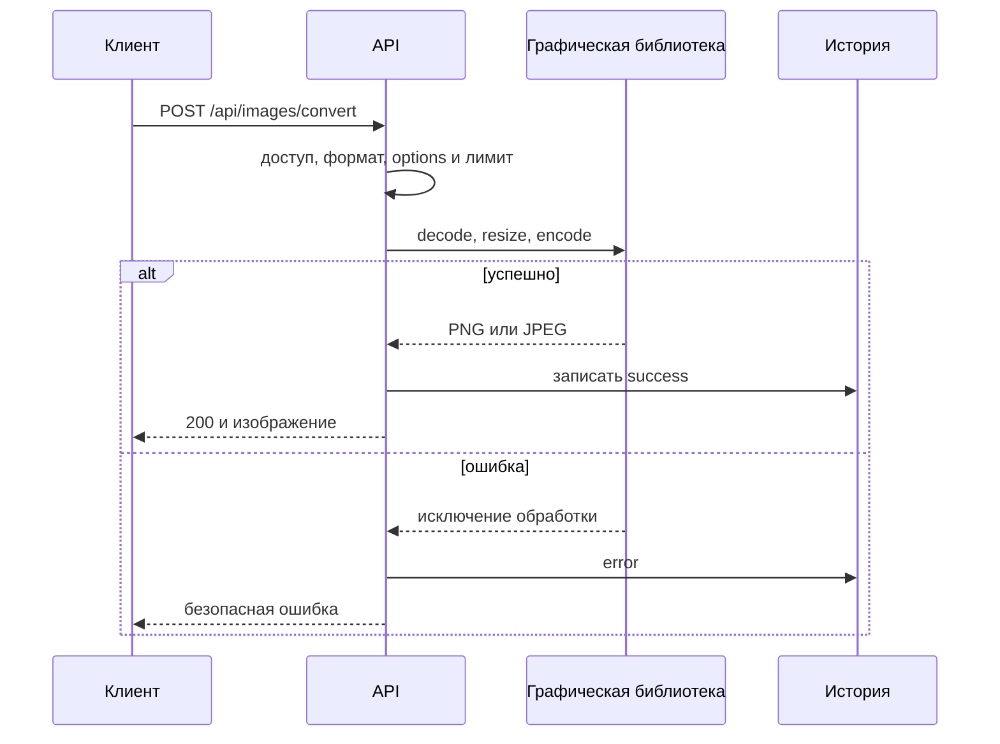
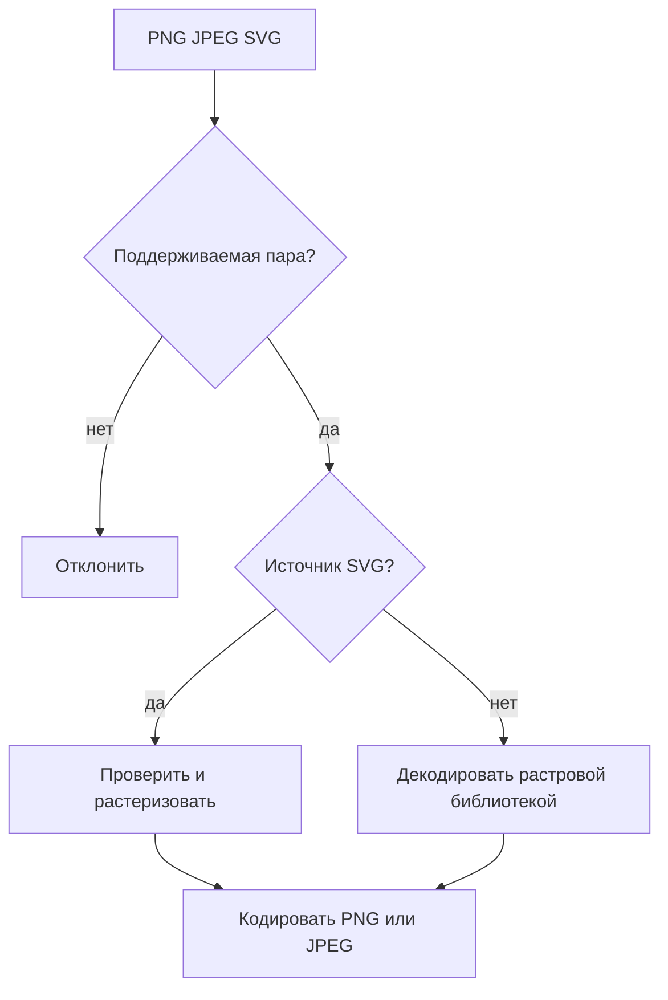

# Трансформация изображений

## Содержание

- [Теория](#теория)
  - [Ситуация](#ситуация)
  - [Модель](#модель)
  - [Понятия и связь с бэкендом](#понятия-и-связь-с-бэкендом)
  - [Зоны ответственности](#зоны-ответственности)
  - [Пример](#пример)
  - [Типичные сбои](#типичные-сбои)
  - [Полезные ссылки](#полезные-ссылки)
  - [Вопросы по теории](#вопросы-по-теории)
- [Практическое задание](#практическое-задание)
  - [1.1 Общее](#11-общее)
  - [1.2 Сценарии](#12-сценарии-user-stories)
  - [1.3 Контракт](#13-контракт)
  - [1.4 Ошибки и ограничения](#14-ошибки-и-ограничения)
  - [1.5 Аудит](#15-аудитлоги)
  - [1.6 Нефункциональные требования](#16-нефункциональные-требования)

# Теория

## Ситуация

Активный пользователь загружает PNG, JPEG или SVG и выбирает поддерживаемый результат. Сервер проверяет файл и параметры, вызывает графическую библиотеку, сохраняет метаданные операции и возвращает готовое изображение.

Дальше возможен один из исходов: преобразование выполнено, направление не поддерживается, файл повреждён, SVG небезопасен, превышен размер или время обработки либо обязательная зависимость недоступна.

PNG/JPEG → SVG не поддерживается: кодирование растрового файла в контейнер SVG не превращает пиксели в векторные объекты.

## Модель

API не обрабатывает пиксели самостоятельно. PNG и JPEG передаются растровой библиотеке, а SVG — библиотеке растеризации после безопасной проверки XML.



Направление определяет доступные параметры.



Таблица `transformations` из общих требований получает `type=image`. Дополнительные таблицы не нужны.

## Понятия и связь с бэкендом

### Библиотеки изображений

Sharp, ImageSharp и Pillow умеют декодировать PNG/JPEG, учитывать размеры, изменять формат и кодировать результат. Для SVG используются resvg, Svg.Skia, CairoSVG или аналог.

Приложение не реализует PNG, JPEG и SVG самостоятельно. Оно задаёт библиотеке разрешённые размеры, качество, фон и timeout, а затем преобразует исключения в контрактные ошибки.

### Растр и вектор

PNG и JPEG хранят пиксели. SVG хранит геометрические команды. SVG можно растеризовать в заданном размере, но обратное преобразование требует отдельной векторизации и не входит в задание.

JPEG не поддерживает прозрачность. При PNG/SVG → JPEG прозрачные области сводятся с фоном, по умолчанию белым. PNG сохраняет alpha.

### Проверка формата

Расширение и `Content-Type` проверяются вместе с сигнатурой и результатом декодирования. Переименование повреждённого файла в `.png` не делает его PNG.

Перед выделением большого буфера библиотека должна получить ограничения по ширине, высоте и числу пикселей. Это защищает от decompression bomb.

### Безопасный SVG

SVG является XML-документом и может содержать скрипты, внешние ссылки и другие активные конструкции. Перед растеризацией запрещаются DTD, внешние сущности, `script`, `foreignObject`, обработчики событий и внешние ресурсы.

Растеризатор запускается без сетевого доступа. Сам SVG никогда не возвращается как целевой формат, поэтому клиент получает только PNG или JPEG.

### Размеры и качество

При SVG → raster `width` и `height` задают итоговый размер. Если оба отсутствуют, используется intrinsic-размер SVG; если его нет — 1024×1024. Один размер сохраняет пропорции.

Каждая сторона результата не превышает 4096 пикселей, а общее число пикселей — 16 777 216. JPEG quality принимает целое значение 1–100, по умолчанию 85.

### Метаданные

EXIF orientation применяется перед кодированием JPEG. Выходной файл создаётся заново без EXIF, GPS и исходного имени.

### История и хранение

История содержит форматы, размеры файла, статус, длительность и безопасный код. Пиксели и SVG-разметка не сохраняются.

Без `save=true` временный результат удаляется после ответа. Постоянное сохранение выполняет storage adapter из `2.4`.

### Сводка

| Понятие | Смысл | Реализация |
| --- | --- | --- |
| Decode | проверка и чтение raster | графическая библиотека |
| Rasterize | SVG становится пикселями | SVG renderer |
| Pixel limit | защита памяти | width × height |
| Quality | настройка JPEG | encoder библиотеки |
| Background | замена прозрачности JPEG | `#RRGGBB` |
| Re-encode | новый безопасный файл | удаление метаданных |

## Зоны ответственности

| Клиент | Сервер |
| --- | --- |
| Передаёт один файл и options | Проверяет поля и направление |
| Выбирает PNG или JPEG | Вызывает подходящую библиотеку |
| Не запрашивает raster → SVG | Отклоняет векторизацию |
| Задаёт допустимый размер | Проверяет стороны и пиксели |
| Получает готовый файл | Удаляет метаданные и временные данные |

## Пример

Каждая программа создаёт в памяти PNG 2×1 с полупрозрачным красным цветом, преобразует его библиотекой в JPEG с белым фоном и сохраняет `output.jpeg`. Затем программа выводит `jpeg 2x1`.

### Node.js

**Node.js 22 или новее, библиотека Sharp.** Один и тот же пакет декодирует PNG, сводит alpha с фоном и кодирует JPEG.

```sh
npm install sharp
node png-to-jpeg.js
```

```javascript
const sharp = require('sharp');

async function main() {
  const png = await sharp({
    create: {
      width: 2, height: 1, channels: 4,
      background: { r: 255, g: 0, b: 0, alpha: 0.5 },
    },
  }).png().toBuffer();

  const info = await sharp(png)
    .flatten({ background: '#ffffff' })
    .jpeg({ quality: 85 })
    .toFile('output.jpeg');

  console.log(`${info.format} ${info.width}x${info.height}`);
}

main();
```

### .NET

**.NET 8 или новее, пакет SixLabors.ImageSharp.** Библиотека создаёт PNG, загружает его и кодирует JPEG.

```sh
dotnet new console -o PngToJpeg
cd PngToJpeg
dotnet add package SixLabors.ImageSharp
dotnet run
```

```csharp
using SixLabors.ImageSharp;
using SixLabors.ImageSharp.Formats.Jpeg;
using SixLabors.ImageSharp.PixelFormats;
using SixLabors.ImageSharp.Processing;

using var source = new Image<Rgba32>(2, 1, new Rgba32(255, 0, 0, 128));
using var png = new MemoryStream();
await source.SaveAsPngAsync(png);
png.Position = 0;

using var image = await Image.LoadAsync<Rgba32>(png);
image.Mutate(context => context.BackgroundColor(Color.White));
await image.SaveAsJpegAsync(
    "output.jpeg",
    new JpegEncoder { Quality = 85 });

Console.WriteLine($"jpeg {image.Width}x{image.Height}");
```

### Python

**Python 3.10 или новее, библиотека Pillow.** PNG создаётся в памяти, затем Pillow сводит alpha и сохраняет JPEG.

```sh
pip install Pillow
python png_to_jpeg.py
```

```python
import io
from PIL import Image

source = Image.new("RGBA", (2, 1), (255, 0, 0, 128))
png = io.BytesIO()
source.save(png, format="PNG")
png.seek(0)

image = Image.open(png).convert("RGBA")
result = Image.new("RGB", image.size, "white")
result.paste(image, mask=image.getchannel("A"))
result.save("output.jpeg", format="JPEG", quality=85)

print(f"jpeg {result.width}x{result.height}")
```

---

Пример выполняет реальную конвертацию библиотекой. Код приложения только передаёт настройки, а формат JPEG создаёт готовый encoder.

## Типичные сбои

| Что видно | Куда смотреть |
| --- | --- |
| PNG → SVG появился в списке | смена расширения ошибочно считается векторизацией |
| Маленький файл исчерпал память | нет лимита пикселей до декодирования |
| SVG загрузил внешний URL | rasterizer имеет сеть или пропущена проверка |
| JPEG повернут неверно | EXIF orientation не применён |
| Прозрачность стала чёрной | не задан фон перед JPEG |
| `quality` влияет на PNG | параметры не ограничены направлением |
| В ответе остались GPS-координаты | исходный файл возвращён без re-encode |
| Клиент получил часть JPEG | ответ открыт до завершения библиотеки |

## Полезные ссылки

### Общие

- [OWASP — File Upload Cheat Sheet](https://cheatsheetseries.owasp.org/cheatsheets/File_Upload_Cheat_Sheet.html) — проверка содержимого и лимитов.
- [OWASP — XXE Prevention](https://cheatsheetseries.owasp.org/cheatsheets/XML_External_Entity_Prevention_Cheat_Sheet.html) — безопасный SVG/XML.
- [W3C — SVG 2](https://www.w3.org/TR/SVG2/) — размеры и `viewBox`.
- [MDN — Image file type guide](https://developer.mozilla.org/en-US/docs/Web/Media/Guides/Formats/Image_types) — свойства PNG, JPEG и SVG.

### По языку

#### Node.js

**Node.js, NestJS.** На Express или Fastify контракт не меняется.

- [Sharp](https://sharp.pixelplumbing.com/) — PNG/JPEG из примера.
- [resvg-js](https://github.com/thx/resvg-js) — SVG → raster.
- [NestJS — File upload](https://docs.nestjs.com/techniques/file-upload) — multipart.
- [NestJS — OpenAPI](https://docs.nestjs.com/openapi/introduction) — документация операции.

#### .NET

**.NET, ASP.NET Core.** Контракт одинаков для Minimal API и контроллеров.

- [ImageSharp](https://docs.sixlabors.com/) — PNG/JPEG из примера.
- [Svg.Skia](https://github.com/wieslawsoltes/Svg.Skia) — SVG → raster.
- [ASP.NET Core — Upload files](https://learn.microsoft.com/en-us/aspnet/core/mvc/models/file-uploads) — multipart.
- [ASP.NET Core — OpenAPI](https://learn.microsoft.com/en-us/aspnet/core/fundamentals/openapi/overview) — документация.

#### Python

**Python, FastAPI.** Для Django или Flask контракт не меняется.

- [Pillow](https://pillow.readthedocs.io/en/stable/) — PNG/JPEG из примера.
- [CairoSVG](https://cairosvg.org/documentation/) — SVG → raster.
- [defusedxml](https://pypi.org/project/defusedxml/) — безопасный SVG/XML.
- [FastAPI — Request Files](https://fastapi.tiangolo.com/tutorial/request-files/) — multipart.

## Вопросы по теории

1. Почему PNG/JPEG → SVG не является обычным преобразованием формата?
2. Зачем использовать библиотеку вместо самостоятельного декодирования изображения?
3. Чем лимит размера файла отличается от лимита числа пикселей?
4. Какие возможности SVG запрещаются перед растеризацией?
5. Почему перед JPEG нужно явно обработать прозрачность?
6. Зачем применять EXIF orientation и повторно кодировать результат?
7. Какие метаданные сохраняются в истории при ошибке библиотеки?

# Практическое задание

Функциональность преобразования изображений в системе.
Активный пользователь преобразует PNG в JPEG, JPEG в PNG и SVG в PNG или JPEG. Готовые графические библиотеки выполняют декодирование, растеризацию и кодирование, а сервер задаёт безопасные параметры и лимиты.

## 1) Трансформация изображений

### 1.1 Общее

**Назначение:** преобразовать поддерживаемое изображение в PNG или JPEG.

**Пользователи/роли:** активный пользователь с `transformations@convert`.

**Зависимости/связанные настройки:**

- общий процесс и история заданы в `2.0`;
- лимит входа задаётся отдельно для PNG, JPEG и SVG, по умолчанию 10 МиБ;
- максимальная сторона результата — 4096, максимум — 16 777 216 пикселей;
- JPEG quality по умолчанию 85;
- фон по умолчанию `#ffffff`;
- timeout — 30 секунд.

### 1.2 Сценарии (user stories)

1. **PNG → JPEG:** библиотека сводит alpha с фоном и кодирует JPEG.
2. **JPEG → PNG:** библиотека декодирует JPEG и кодирует PNG.
3. **SVG → PNG:** безопасный SVG растеризуется в PNG.
4. **SVG → JPEG:** SVG растеризуется и получает фон.
5. **Список направлений:** клиент получает только четыре пары.

PNG/JPEG → SVG и преобразование формата в самого себя не поддерживаются.

### 1.3 Контракт

#### 1.3.1 Преобразование изображения

| `POST /api/images/convert` | Проверки/валидация |
| --- | --- |
| `file: binary` | Один непустой PNG, JPEG или SVG |
| `targetFormat: string` | `png` или `jpeg` |
| `options: string` | Необязательный JSON-объект |
| `save: string` | Необязательный `true` или `false`, правила из `2.4` |
| Остальные поля | запрещены |

Поддерживаются `png→jpeg`, `jpeg→png`, `svg→png`, `svg→jpeg`.

**Логика/шаги:**

1. Проверить access JWT и статус `active`.
2. Проверить `transformations@convert`. При отсутствии вернуть **403** до разбора файла.
3. Проверить multipart, расширение, MIME и лимит.
4. Проверить направление и `options`.
5. Передать файл и параметры выбранной библиотеке.
6. Проверить итоговые размеры и сформировать временный результат.
7. Записать `success` и вернуть файл; при ошибке записать `error`.

**Ответы:**

- **200 OK:** `image/png` или `image/jpeg`, `Content-Disposition: attachment; filename="converted.<ext>"`, `X-Content-Type-Options: nosniff`.
- **Ошибки:** см. раздел 1.4.
- В ответе нет исходного имени, SVG-текста, EXIF, внутренних путей, JWT и cookies.

#### 1.3.2 Параметры

| Поле | Правило |
| --- | --- |
| `quality` | Целое 1–100, только для JPEG, по умолчанию 85 |
| `width` | Целое 1–4096, только для SVG |
| `height` | Целое 1–4096, только для SVG |
| `background` | `#RRGGBB`, только для JPEG, по умолчанию `#ffffff` |

Если у SVG не переданы размеры, используется intrinsic-размер, а при его отсутствии — 1024×1024. Один размер сохраняет пропорции. Неизвестные или неприменимые поля дают **400**.

#### 1.3.3 Безопасность SVG

SVG разбирается без DTD, внешних сущностей и сети. `script`, `foreignObject`, обработчики событий и внешние ресурсы запрещены.

Результатом всегда является PNG или JPEG; исходный SVG напрямую не возвращается.

#### 1.3.4 Список направлений

| `GET /api/images/convert/formats` | Проверки |
| --- | --- |
| Cookie `access_token` | действующий пользователь `active` |
| RBAC | `transformations@convert` |

**200 OK:**

```json
[
  {"source":"png","target":["jpeg"]},
  {"source":"jpeg","target":["png"]},
  {"source":"svg","target":["png","jpeg"]}
]
```

### 1.4 Ошибки и ограничения

- **400 Bad Request** — файл повреждён, options невалидны, SVG небезопасен либо размеры недопустимы.
- **401 Unauthorized** — сессия отсутствует, невалидна или пользователь не `active`.
- **403 Forbidden** — нет `transformations@convert` либо CSRF-проверка изменяющего запроса не пройдена.
- **413 Content Too Large** — вход или результат превысил лимит.
- **415 Unsupported Media Type** — формат или направление не поддерживается.
- **503 Service Unavailable** — история, временная область или библиотека недоступна.
- **504 Gateway Timeout** — обработка не завершилась за 30 секунд.

### 1.5 Аудит/логи

Логировать: `userId`, `transformationId`, форматы, размер входа и результата, итоговые размеры, результат, безопасный код и длительность.

Не логировать байты, SVG/XML, EXIF, исходное имя, временный путь, JWT, cookies и multipart-тело.

### 1.6 Нефункциональные требования

- Использовать поддерживаемые библиотеки, а не собственные кодеки. SVG renderer не имеет сетевого доступа. Результат повторно кодируется без исходных метаданных.
- Тесты покрывают четыре пары, alpha, EXIF, размеры, опасный SVG, лимиты и timeout.
- Общие нефункциональные требования проекта и покрытие тестами не ниже 80% обязательны.
