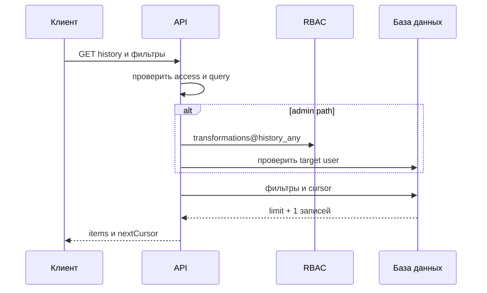

# Просмотр истории трансформаций файлов пользователя

## Содержание

- [Теория](#теория)
  - [Ситуация](#ситуация)
  - [Модель](#модель)
  - [Понятия и связь с бэкендом](#понятия-и-связь-с-бэкендом)
  - [Зоны ответственности](#зоны-ответственности)
  - [Типичные сбои](#типичные-сбои)
  - [Полезные ссылки](#полезные-ссылки)
  - [Вопросы по теории](#вопросы-по-теории)
- [Практическое задание](#практическое-задание)
  - [1.1 Общее](#11-общее)
  - [1.2 Сценарии](#12-сценарии-user-stories)
  - [1.3 Контракт](#13-контракт)
  - [1.4 Ошибки и ограничения](#14-ошибки-и-ограничения)
  - [1.5 Аудит](#15-аудитлоги)
  - [1.6 Нефункциональные требования](#16-нефункциональные-требования)

# Теория

## Ситуация

Активный пользователь запрашивает собственную историю текстовых и графических преобразований. Пользователь с административным разрешением может посмотреть историю указанного пользователя.

Дальше возможен один из исходов: сервер возвращает страницу метаданных, отклоняет фильтр или cursor, запрещает чужую историю, сообщает об отсутствующем пользователе, ограничивает частоту либо возвращает временную ошибку базы.

Содержимое файлов, email и поля профиля в историю не входят. Отдельный фронтенд не нужен, запросы можно отправлять из HTTP-клиента с cookies.

## Модель

Self получает `userId` из проверенного access JWT. Административная операция сначала проверяет `transformations@history_any`, затем ищет целевого пользователя.

История сортируется по `created_at DESC, id DESC`. Cursor содержит последнюю пару сортировки следующей страницы.

API читает таблицу `transformations` из общих требований. Дополнительные таблицы не создаются.

## Понятия и связь с бэкендом

### Cursor pagination

Offset заставляет базу пропускать всё больше строк. Cursor начинает запрос после последней пары `created_at, id`, поэтому использует составной индекс и не зависит от номера страницы.

`created_at` может совпасть у нескольких операций, поэтому одного времени недостаточно. `id` делает порядок однозначным.

Cursor кодирует версию, последнее время, `id` и канонический набор фильтров вместе с `limit` через base64url. После декодирования сервер проверяет форму, типы и совпадение набора с текущим query. Другой фильтр или другой `limit` получают **400**: обход начинается заново. Cursor не даёт прав: Self-фильтр по `user_id` и RBAC применяются заново при каждом запросе.

Новые операции появляются перед уже просмотренными страницами. Они не попадут в текущее продолжение и будут видны после запроса новой первой страницы.

### Фильтры

Можно фильтровать тип, исходный формат, целевой формат, результат и период. Значения проверяются по опубликованным форматам.

Период задаётся в UTC. `createdAtFrom` включается, `createdAtTo` не включается. Неверный порядок дат получает **400**. Набор фильтров закрепляется в cursor первой страницы и на продолжении не меняется.

### Self и Admin

Self endpoint не принимает `userId`; владелец всегда берётся из `sub`. Это исключает доступ к чужой истории через подмену query. Операция объявляет `transformations@history` и проверяет его до чтения истории.

Admin endpoint требует `transformations@history_any`. Право проверяется до поиска цели, поэтому клиент без права получает **403** независимо от существования `userId`.

### Форма элемента

Элемент содержит только метаданные операции: форматы, статус, размеры, длительность, безопасный код и время. `durationMs` можно хранить при завершении или вычислять из времён — публичный контракт от этого не меняется.

После подключения хранения добавляются `storageStatus`, `hasStoredFile` и `fileExpiresAt`. Внутренний ключ объекта не выдаётся.

### Retention

Срок истории задаётся конфигурацией, по умолчанию 90 дней. Фоновая очистка удаляет старые записи небольшими порциями.

Если у записи есть сохранённый файл, сначала удаляется объект через storage adapter, затем запись истории. Обработчик удаления пользователя использует тот же порядок без ожидания retention.

### Сводка

| Понятие | Смысл | Реализация |
| --- | --- | --- |
| Cursor | позиция следующей страницы и её фильтры | `created_at + id + query` |
| Self | только собственные записи | `user_id` из `sub` |
| Admin | история другого пользователя | `history_any` |
| Filter | ограничение списка | разрешённые query-поля |
| Retention | ограниченный срок истории | фоновая очистка |

## Зоны ответственности

| Клиент | Сервер |
| --- | --- |
| Передаёт фильтры и cursor | Проверяет их формат |
| Для Self не передаёт `userId` | Берёт владельца из access JWT |
| Сохраняет cursor как непрозрачную строку | Применяет стабильную сортировку |
| Показывает только метаданные | Не выдаёт содержимое и PII |
| Начинает новую выборку без cursor | Показывает новые операции на первой странице |

## Типичные сбои

| Что видно | Куда смотреть |
| --- | --- |
| Записи повторяются между страницами | cursor использует только время без `id` |
| Self видит чужую запись | `user_id` принят из query |
| Без admin-права можно проверить существование user | цель ищется до RBAC |
| Большая страница замедляет API | limit не ограничен |
| В элементе появился email | профиль пользователя присоединён без необходимости |
| Ошибка содержит фрагмент файла | в историю попало сообщение библиотеки |
| Старые записи не удаляются | retention job не запущен |

## Полезные ссылки

### Общие

- [PostgreSQL — Multicolumn indexes](https://www.postgresql.org/docs/current/indexes-multicolumn.html) — индекс для `user_id, created_at, id`.
- [OWASP — Authorization Cheat Sheet](https://cheatsheetseries.owasp.org/cheatsheets/Authorization_Cheat_Sheet.html) — проверка Self/Admin.
- [MDN — URLSearchParams](https://developer.mozilla.org/en-US/docs/Web/API/URLSearchParams) — передача фильтров клиентом.

### По языку

#### Node.js

**Node.js, NestJS.** На Express или Fastify контракт пагинации не меняется.

- [Prisma — Pagination](https://www.prisma.io/docs/orm/prisma-client/queries/pagination) — cursor pagination.
- [NestJS — Controllers](https://docs.nestjs.com/controllers) — query-параметры.
- [NestJS — OpenAPI](https://docs.nestjs.com/openapi/introduction) — описание фильтров и страницы.

#### .NET

**.NET, ASP.NET Core.** Minimal API и контроллеры возвращают одну форму страницы.

- [EF Core — Efficient querying](https://learn.microsoft.com/en-us/ef/core/performance/efficient-querying) — keyset pagination.
- [ASP.NET Core — Model validation](https://learn.microsoft.com/en-us/aspnet/core/mvc/models/validation) — query validation.
- [ASP.NET Core — OpenAPI](https://learn.microsoft.com/en-us/aspnet/core/fundamentals/openapi/overview) — описание ответа.

#### Python

**Python, FastAPI.** Для Django или Flask правила cursor сохраняются.

- [SQLAlchemy — SELECT](https://docs.sqlalchemy.org/en/20/core/selectable.html) — фильтры и сортировка.
- [FastAPI — Query Parameters](https://fastapi.tiangolo.com/tutorial/query-params/) — query validation.
- [FastAPI — Metadata and Docs URLs](https://fastapi.tiangolo.com/tutorial/metadata/) — OpenAPI.

## Вопросы по теории

1. Почему cursor использует и `created_at`, и `id`?
2. Чем cursor pagination отличается от offset на больших страницах?
3. Почему Self endpoint не принимает `userId`?
4. Зачем административное право проверять до поиска пользователя?
5. Какие данные входят в элемент истории, а какие относятся только к аудиту?
6. Как новые операции ведут себя при продолжении уже начатой пагинации?
7. В каком порядке удаляются сохранённый файл и запись истории?

# Практическое задание

Функциональность просмотра истории трансформаций пользователя в системе.
Активный пользователь получает страницы собственной истории, а обладатель административного разрешения — историю указанного пользователя. Ответ содержит метаданные без содержимого файлов и PII.

## 1) Просмотр истории трансформаций

### 1.1 Общее

**Назначение:** вернуть страницу завершённых текстовых и графических преобразований.

**Пользователи/роли:**

- Self с `transformations@history` — собственная история после аутентификации;
- Admin с `transformations@history_any` — история указанного пользователя.

**Зависимости/связанные настройки:**

- таблица `transformations` определена в `2.0`;
- размер страницы по умолчанию 20, максимум 100;
- сортировка всегда `created_at DESC, id DESC`;
- срок хранения по умолчанию 90 дней.

### 1.2 Сценарии (user stories)

1. **Self:** пользователь получает страницу собственных операций.
2. **Продолжение:** `nextCursor` открывает следующую страницу.
3. **Admin:** после проверки права возвращается история цели.
4. **Фильтры:** тип, форматы, статус и период ограничивают список.
5. **Пустая страница:** корректный запрос без результатов возвращает пустой массив.

### 1.3 Контракт

#### 1.3.1 Query-параметры

| Параметр | Правило |
| --- | --- |
| `cursor: string` | необязательная позиция следующей страницы |
| `limit: integer` | 1–100, по умолчанию 20 |
| `type: string` | `file` или `image` |
| `sourceFormat: string` | поддерживаемый исходный формат |
| `targetFormat: string` | поддерживаемый целевой формат |
| `status: string` | `success` или `error` |
| `createdAtFrom: date-time` | включительная UTC-граница |
| `createdAtTo: date-time` | исключительная UTC-граница |

Все фильтры необязательны. При наличии cursor `limit` и все фильтры должны совпасть с каноническим набором внутри cursor. Другой набор получает **400** и требует новую первую страницу.

#### 1.3.2 Собственная история

| `GET /api/transformations/history` | Проверки |
| --- | --- |
| Cookie `access_token` | действующий пользователь `active` |
| RBAC | `transformations@history` |

**Логика/шаги:**

1. Проверить access и query.
2. Проверить `transformations@history`. При отсутствии вернуть **403** до чтения истории.
3. Взять `userId` из `sub`.
4. Применить фильтры и условие после cursor.
5. Выбрать `limit + 1` строк в фиксированном порядке.
6. Вернуть не более `limit`; при наличии продолжения сформировать `nextCursor` с тем же набором фильтров.

#### 1.3.3 История указанного пользователя

| `GET /admin/users/{userId}/transformations/history` | Проверки |
| --- | --- |
| Cookie `access_token` | действующий пользователь `active` |
| RBAC | `transformations@history_any` |

Право проверяется до поиска цели. После допуска отсутствующий пользователь получает **404**. Остальные фильтры и пагинация совпадают с Self.

#### 1.3.4 Форма ответа

**200 OK:**

- `items: TransformationHistoryItem[]`;
- `nextCursor: string | null`.

`TransformationHistoryItem` содержит:

- `id`;
- `type`;
- `sourceFormat`;
- `targetFormat`;
- `status`;
- `inputSize`;
- `outputSize: number | null`;
- `durationMs: number`;
- `errorCode: string | null`;
- `createdAt`;
- `storageStatus: "not_requested" | "pending" | "available" | "error"`;
- `hasStoredFile`;
- `fileExpiresAt: date-time | null`.

До реализации сохранения из `2.4` все записи возвращают `storageStatus=not_requested`, `hasStoredFile=false` и `fileExpiresAt=null`. Поля хранения появляются в схеме вместе с `2.4`.

В ответе нет `userId`, email, имени файла, содержимого, временного пути и storage key.

#### 1.3.5 Cursor и retention

Cursor кодирует версию, `createdAt`, `id` последней записи и канонический набор `limit`, `type`, `sourceFormat`, `targetFormat`, `status`, `createdAtFrom`, `createdAtTo` через base64url. Отсутствующий фильтр кодируется явно. После декодирования проверяются версия, формат времени, идентификатор и совпадение набора с текущим query. Невалидный cursor и несовпадение набора получают **400**.

Cleanup удаляет записи старше настроенного срока. При наличии сохранённого объекта сначала вызывается его удаление; отсутствие объекта считается уже выполненной очисткой.

### 1.4 Ошибки и ограничения

- **400 Bad Request** — query, период или cursor невалидны.
- **401 Unauthorized** — сессия отсутствует, невалидна или пользователь не `active`.
- **403 Forbidden** — собственная история вызвана без `transformations@history` либо admin path вызван без `transformations@history_any`.
- **404 Not Found** — целевой пользователь admin path не найден после проверки права.
- **429 Too Many Requests** — превышен rate limit чтения истории.
- **503 Service Unavailable** — база или RBAC недоступны.

### 1.5 Аудит/логи

Логировать: `actorUserId`, Self/Admin, `targetUserId` для разрешённого admin-запроса, категории фильтров, limit, число элементов, результат и длительность.

Не логировать полный cursor, содержимое файлов, email, имена файлов, storage key, JWT, cookies и полный ответ.

### 1.6 Нефункциональные требования

- Пагинация обязательна, offset не используется. Индекс покрывает `user_id, created_at, id`. Запрос выбирает только поля ответа и `limit + 1`.
- Чтение истории допускает не более 60 запросов пользователя за минуту; следующий получает **429**.
- Retention удаляет записи старше настроенного срока небольшими порциями. При наличии объекта сначала вызывается его удаление.
- Тесты покрывают Self/Admin, одинаковое `createdAt`, cursor, фильтры, пустую страницу и retention.
- Общие нефункциональные требования проекта и покрытие тестами не ниже 80% обязательны.
