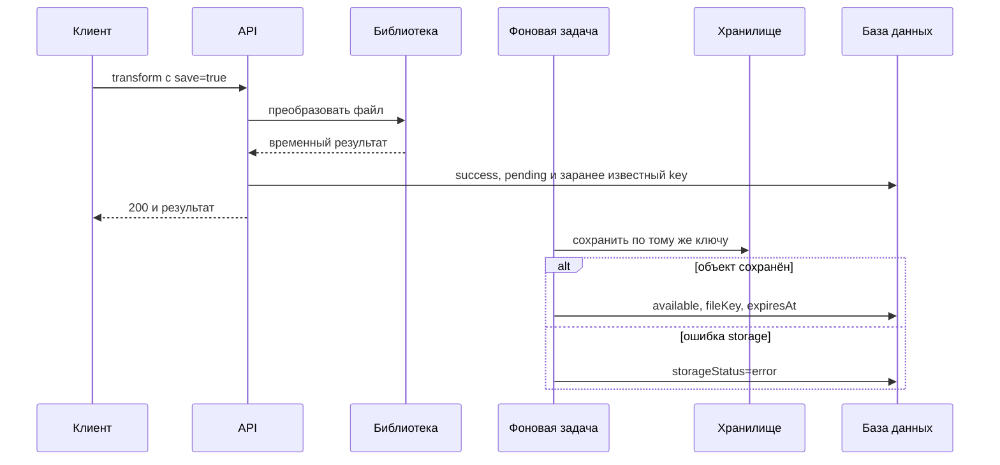
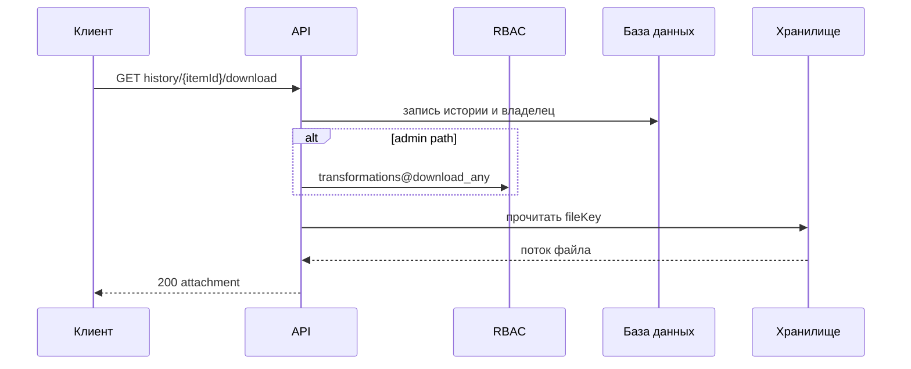

# Сохранение результатов трансформаций в хранилище

## Содержание

- [Теория](#теория)
  - [Ситуация](#ситуация)
  - [Модель](#модель)
  - [Понятия и связь с бэкендом](#понятия-и-связь-с-бэкендом)
  - [Зоны ответственности](#зоны-ответственности)
  - [Типичные сбои](#типичные-сбои)
  - [Полезные ссылки](#полезные-ссылки)
  - [Вопросы по теории](#вопросы-по-теории)
- [Практическое задание](#практическое-задание)
  - [1.1 Общее](#11-общее)
  - [1.2 Сценарии](#12-сценарии-user-stories)
  - [1.3 Контракт](#13-контракт)
  - [1.4 Ошибки и ограничения](#14-ошибки-и-ограничения)
  - [1.5 Аудит](#15-аудитлоги)
  - [1.6 Нефункциональные требования](#16-нефункциональные-требования)

# Теория

## Ситуация

Пользователь может добавить `save=true` к преобразованию. Тогда после готовности результата сервер отмечает историю как `pending`, сразу возвращает преобразованный файл и дописывает объект в хранилище фоновой задачей. Без флага результат только возвращается клиенту и удаляется после ответа.

Сохранённый файл доступен для скачивания до окончания retention. Self скачивает только собственный результат, а Admin — результат указанного пользователя после проверки отдельного права.

## Модель

Библиотека преобразования сначала создаёт готовый временный файл. При `save=true` сервер сразу назначает случайный ключ, сохраняет копию во внутренней временной области и отмечает историю как `pending`. HTTP-ответ не ждёт object storage. Очередь — сами строки истории со статусом `pending`.

Скачивание проходит через API. Прямой адрес хранилища клиенту не выдаётся.

Схема `transformations` расширяется необязательными полями:

| Поле | Описание |
| --- | --- |
| `storage_status` | `not_requested`, `pending`, `available` или `error` |
| `stored_file_key` | внутренний случайный ключ результата, иначе `null` |
| `stored_file_until` | срок хранения, иначе `null` |
| `storage_error_code` | безопасный код фоновой ошибки, иначе `null` |

### Нормальная форма

Таблица остаётся в BCNF: storage-поля описывают ту же операцию и зависят от её `id`.

- **1NF:** статус, ключ, срок и код ошибки являются атомарными значениями.
- **2NF:** первичный ключ простой.
- **3NF и BCNF:** storage key и срок относятся только к одной трансформации; адрес бакета не копируется.
- **4NF:** несколько версий файла не хранятся в одной строке; по контракту результат один.
- **5NF:** дополнительное разложение не требуется для связи один-к-одному.

## Понятия и связь с бэкендом

### Storage adapter

Бизнес-логика использует операции `save`, `read` и `delete`. Локальная файловая система и S3-совместимое хранилище реализуют один интерфейс.

Локальный диск подходит для разработки одного экземпляра. В production обычно используется объектное хранилище, доступное всем экземплярам API.

### Приватный ключ

Ключ генерирует сервер из случайного значения. В нём нет email, `userId` и исходного имени. Bucket и credentials находятся в конфигурации.

Даже случайный ключ не считается разрешением. API всегда проверяет access JWT и владельца записи.

### Фоновое сохранение

`save=true` означает, что сервер принял запрос на сохранение. Успешный ответ преобразования не ждёт object storage: клиент уже получает файл, а история показывает `pending`.

Ключ назначается до ответа клиенту. Фоновая задача пишет объект по этому ключу, поэтому повтор не создаёт второй файл. После записи состояние становится `available` или при постоянном сбое `error`. При `available` появляется скачивание, при `error` пользователь может повторить преобразование. Отдельный endpoint ожидания не нужен: состояние возвращает обычная история.

### Частичные сбои

Если запись объекта временно не удалась, строка остаётся `pending`, и следующая попытка пишет тот же ключ. Статус самой трансформации остаётся `success`: преобразованный файл уже был выдан клиенту.

Если объект записан, но обновление истории не прошло, повтор снова пишет тот же ключ и доводит строку до `available`.

Если временную копию не удалось сохранить, ответ преобразования всё равно остаётся **200**, а история сразу получает `storage_status=error`.

### Скачивание и IDOR

Self-запрос выбирает историю одновременно по `itemId` и текущему `userId`. Чужой и несуществующий id дают одинаковый **404**.

Admin endpoint требует `transformations@download_any` до поиска целевого пользователя. Знание URL или `itemId` не обходит проверку.

### Retention

Срок задаётся конфигурацией, по умолчанию 90 дней. Фоновая задача сначала удаляет объект, затем очищает storage-поля записи истории. Саму строку истории удаляет retention из `2.3`.

Отсутствующий объект считается уже удалённым. Это позволяет безопасно повторить cleanup после сбоя.

### Сводка

| Понятие | Смысл | Реализация |
| --- | --- | --- |
| `save` | явный выбор пользователя | multipart boolean |
| `pending` | файл ещё сохраняется | строка истории как очередь |
| Storage adapter | смена backend | `save/read/delete` |
| Private key | внутренняя ссылка | случайное значение |
| Ownership | защита от IDOR | item + current user |
| Retention | срок результата | `stored_file_until` |

## Зоны ответственности

| Клиент | Сервер |
| --- | --- |
| Передаёт `save=true` явно | Не сохраняет результат по умолчанию |
| Скачивает через API | Не выдаёт прямой URL storage |
| Использует item истории | Проверяет владельца и admin-право |
| По **404** убирает кнопку скачивания | Удаляет истёкшие объекты |
| Показывает `pending`, `available` или `error` | Обновляет состояние фоновой записи |

## Типичные сбои

| Что видно | Куда смотреть |
| --- | --- |
| `save=false` создал объект | значение по умолчанию обработано неверно |
| `pending` никогда не завершается | фоновая задача не обработала очередь |
| В ответе виден file key | внутренняя модель истории сериализована напрямую |
| Чужой item скачивается | запись ищется без ограничения владельца |
| Файл доступен после retention | download не проверяет срок |
| История удалена, объект остался | cleanup удаляет базу раньше storage |
| Storage-сбой превратил трансформацию в error | перепутаны статус преобразования и статус сохранения |
| Недоступный storage ломает `save=false` | adapter вызывается без флага |

## Полезные ссылки

### Общие

- [OWASP — File Upload Cheat Sheet](https://cheatsheetseries.owasp.org/cheatsheets/File_Upload_Cheat_Sheet.html) — приватное хранение и безопасные имена.
- [OWASP — Authorization Cheat Sheet](https://cheatsheetseries.owasp.org/cheatsheets/Authorization_Cheat_Sheet.html) — проверка владельца.
- [Amazon S3 — Object keys](https://docs.aws.amazon.com/AmazonS3/latest/userguide/object-keys.html) — внутренние ключи объектов.
- [Amazon S3 — Data consistency](https://docs.aws.amazon.com/AmazonS3/latest/userguide/Welcome.html#ConsistencyModel) — поведение операций storage.

### По языку

#### Node.js

**Node.js, NestJS.** На Express или Fastify storage contract не меняется.

- [AWS SDK for JavaScript — S3 examples](https://docs.aws.amazon.com/sdk-for-javascript/v3/developer-guide/javascript_s3_code_examples.html) — запись, чтение и удаление.
- [NestJS — Streaming files](https://docs.nestjs.com/techniques/streaming-files) — потоковое скачивание.
- [NestJS — Task scheduling](https://docs.nestjs.com/techniques/task-scheduling) — retention cleanup.
- [NestJS — OpenAPI](https://docs.nestjs.com/openapi/introduction) — документация `save` и download.

#### .NET

**.NET, ASP.NET Core.** Контракт одинаков для Minimal API и контроллеров.

- [AWS SDK for .NET — S3](https://docs.aws.amazon.com/sdk-for-net/v3/developer-guide/csharp_s3_code_examples.html) — операции с объектами.
- [ASP.NET Core — Action return types](https://learn.microsoft.com/en-us/aspnet/core/web-api/action-return-types) — файловый ответ.
- [.NET — Worker services](https://learn.microsoft.com/en-us/dotnet/core/extensions/workers) — фоновая очистка.
- [ASP.NET Core — OpenAPI](https://learn.microsoft.com/en-us/aspnet/core/fundamentals/openapi/overview) — документация API.

#### Python

**Python, FastAPI.** Для Django или Flask lifecycle файла сохраняется.

- [Boto3 — S3 examples](https://boto3.amazonaws.com/v1/documentation/api/latest/guide/s3-examples.html) — работа с объектами.
- [FastAPI — Custom Response](https://fastapi.tiangolo.com/advanced/custom-response/) — потоковый download.
- [Python — `asyncio`](https://docs.python.org/3/library/asyncio.html) — фоновая cleanup-задача.
- [FastAPI — Metadata and Docs URLs](https://fastapi.tiangolo.com/tutorial/metadata/) — OpenAPI.

## Вопросы по теории

1. Почему `save=false` не должен обращаться к постоянному хранилищу?
2. Зачем скрывать storage key даже при случайном значении?
3. Почему `save=true` возвращает результат до окончания фоновой записи?
4. Чем статус трансформации отличается от `storageStatus`?
5. Как ownership-проверка защищает download от IDOR?
6. Почему cleanup сначала удаляет объект, а затем запись или ссылку?
7. Почему два storage-поля не нарушают BCNF таблицы `transformations`?

# Практическое задание

Функциональность сохранения результатов трансформаций в системе.
Пользователь явно выбирает фоновое сохранение результата. Преобразованный файл возвращается сразу, а состояние сохранения отображается в истории. Сохранённый объект остаётся приватным, скачивается только через API и удаляется после retention.

## 1) Сохранение результатов трансформаций

### 1.1 Общее

**Назначение:** сохранить успешный результат и предоставить защищённое скачивание.

**Пользователи/роли:**

- Self с `transformations@convert` сохраняет результат и с `transformations@download` скачивает только свой;
- Admin с `transformations@download_any` скачивает результат указанного пользователя.

**Зависимости/связанные настройки:**

- преобразования и история определены в `2.0`–`2.3`;
- `save` по умолчанию `false`;
- storage backend задаётся конфигурацией;
- сохраняется только успешный результат, уже ограниченный лимитом преобразования;
- retention по умолчанию — 90 дней.

### 1.2 Сценарии (user stories)

1. **Без сохранения:** результат возвращается и удаляется после ответа.
2. **С сохранением:** результат возвращается сразу, история получает `pending`, а фоновая задача записывает объект.
3. **Self download:** владелец получает сохранённый файл.
4. **Admin download:** после права возвращается файл указанного пользователя.
5. **Истечение:** объект удаляется, скачивание возвращает **404**.
6. **Сбой storage:** трансформация остаётся успешной, а история получает `storageStatus=error`.

### 1.3 Контракт

#### 1.3.1 Флаг сохранения

| Операции | Дополнительное multipart-поле |
| --- | --- |
| `POST /api/convert` | `save: string`, необязательно, `true` или `false` |
| `POST /api/images/convert` | то же |

Отсутствующий `save` равен `false`. Остальные значения получают **400**.

**Логика при `save=false`:**

1. Выполнить обычную трансформацию.
2. Записать `success` без storage key.
3. Вернуть результат и очистить временный файл.

**Логика при `save=true`:**

1. Выполнить обычную трансформацию.
2. Сгенерировать случайный `stored_file_key` и сохранить копию результата во внутренней временной области под этим ключом.
3. Записать `success`, `storage_status=pending` и ключ.
4. Вернуть файл, не ожидая object storage.
5. Фоновая задача читает строки с `storage_status=pending`, записывает объект по уже известному ключу и ставит `available` с `stored_file_until`.

Если копию для сохранения создать не удалось, файл всё равно возвращается, а история получает `storage_status=error`. Если storage временно недоступен, строка остаётся `pending`, и задача повторит запись по тому же ключу. Постоянный сбой или исчезновение временной копии переводят сохранение в `error`. Повторная запись по тому же ключу не создаёт второй объект.

Успешный ответ содержит `X-Transformation-Id` и `X-Save-Status: not_requested|pending|error`. Окончательное состояние читается из истории. Отдельная таблица заданий не нужна: очередь — это строки истории со статусом `pending`.

#### 1.3.2 Собственное скачивание

| `GET /api/transformations/history/{itemId}/download` | Проверки |
| --- | --- |
| Cookie `access_token` | действующий пользователь `active` |
| RBAC | `transformations@download` до поиска записи |

Отсутствие `transformations@download` даёт **403** до поиска. После допуска запись выбирается по `itemId` и текущему `userId`. Чужой, отсутствующий, несохранённый, ошибочный или истёкший результат получает **404**. Состояние `pending` получает **409 Conflict** с кодом `file_not_ready`.

При успехе сервер читает объект потоково и возвращает **200**, контрактный `Content-Type`, `Content-Disposition: attachment; filename="converted.<ext>"` и `X-Content-Type-Options: nosniff`.

Если история содержит key, но storage не находит объект, возвращается **503** и создаётся событие рассогласования.

#### 1.3.3 Административное скачивание

| `GET /admin/users/{userId}/transformations/history/{itemId}/download` | Проверки |
| --- | --- |
| Cookie `access_token` | действующий пользователь `active` |
| RBAC | `transformations@download_any` |

Право проверяется до поиска пользователя. После допуска отсутствующий пользователь или item получает **404**. Остальные правила совпадают с Self.

#### 1.3.4 Расширение истории

Элемент истории получает:

- `storageStatus: "not_requested" | "pending" | "available" | "error"`;
- `hasStoredFile: boolean`;
- `fileExpiresAt: date-time | null`.

`hasStoredFile=true` только при `available`. Storage key, локальный путь, bucket и внутренний код ошибки в ответ не входят.

#### 1.3.5 Retention и удаление пользователя

Фоновая задача выбирает истёкшие записи небольшими порциями. Для сохранённого результата она сначала вызывает `delete(key)`, затем очищает storage-поля. `not_found` считается успешным удалением. Обработчик удаления пользователя выполняет те же действия немедленно для всех его записей.

### 1.4 Ошибки и ограничения

- **400 Bad Request** — `save` не является `true` или `false`.
- **401 Unauthorized** — сессия отсутствует, невалидна или пользователь не `active`.
- **403 Forbidden** — своё скачивание вызвано без `transformations@download`, admin download вызван без `transformations@download_any`, либо CSRF-проверка POST не пройдена.
- **404 Not Found** — пользователь, item или сохранённый файл недоступны после проверки права.
- **409 Conflict** — сохранение ещё имеет состояние `pending`.
- **503 Service Unavailable** — база недоступна при операции download либо история указывает на отсутствующий объект.

Недоступность постоянного storage не влияет на `save=false` и не задерживает успешный ответ при `save=true`; ошибка становится видна в истории.

### 1.5 Аудит/логи

Логировать: `userId`, `transformationId`, действие `save`, `download` или `delete`, размер, результат и длительность.

Не логировать содержимое, исходное имя, storage key, путь, bucket, credentials, JWT, cookies и полный ответ storage.

### 1.6 Нефункциональные требования

- Storage adapter поддерживает `save`, `read`, `delete`. Файлы приватны и недоступны по прямой публичной ссылке.
- Фоновая запись читает `storage_status=pending` и пишет объект по заранее сохранённому ключу. Cleanup и eraser считают `not_found` успехом.
- Индекс покрывает `storage_status` и `stored_file_until`.
- Тесты покрывают `save=false/true`, переходы `pending/available/error`, повтор записи по тому же ключу, Self/Admin download, IDOR и истечение.
- Общие нефункциональные требования проекта и покрытие тестами не ниже 80% обязательны.
