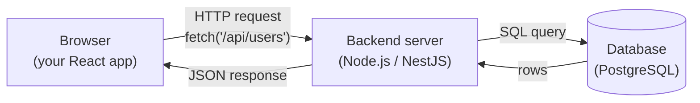
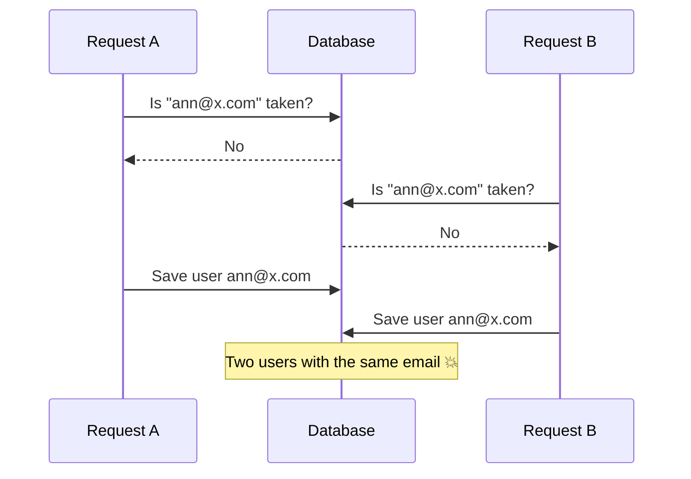
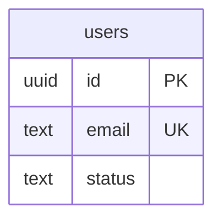
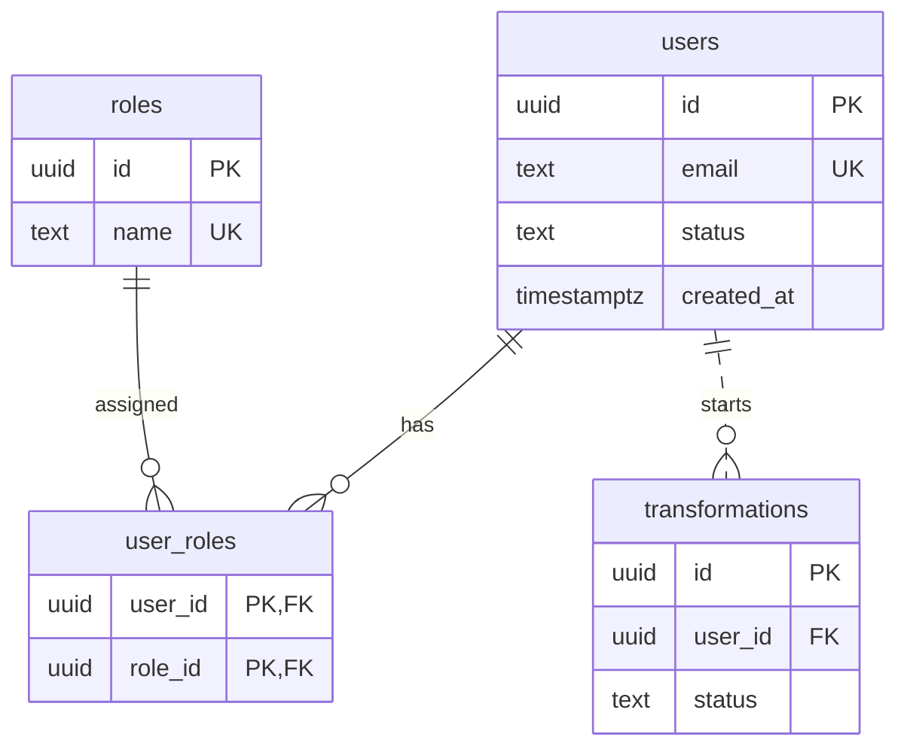
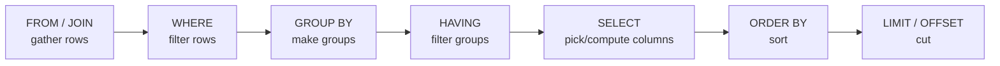
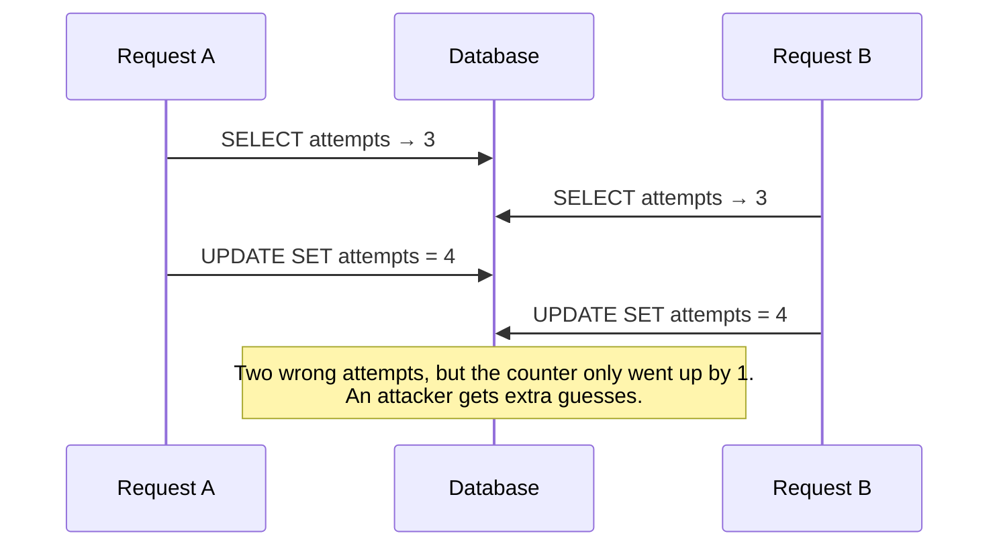
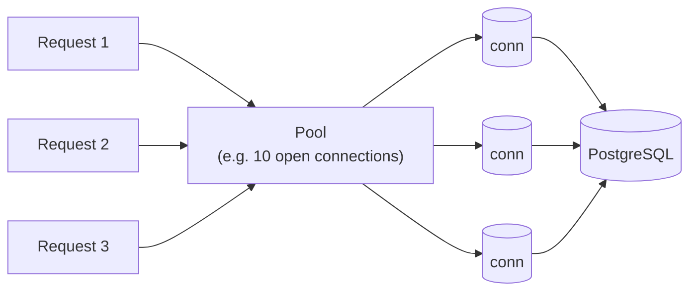

# 0.1 Databases

> How a backend stores data safely and finds it quickly. This covers relational databases, SQL, keys, relationships, normalization, transactions, and indexes, and how a Node.js/NestJS app talks to all of it.
>
> Course source: [0.1 Databases](../courses-content/backend/A/1/en/0.1%20Базы%20данных.md)
>
> Study time: 5 sessions, one a day, about 1.5–2.5 hours each (see "How to learn this guide").

---

## What you'll learn

The parts build on each other. Read them in order the first time.

**Before we start**
- A. Where the database sits in a web app
- B. Many requests at the same time (concurrency)
- C. Set up a playground to run the examples

**Part 1: Foundations**
1. Database vs DBMS
2. Kinds of databases, and why we use a relational one
3. Tables, rows, and columns
4. Column types and `NULL`

**Part 2: Talking to the database with SQL**
5. What SQL is
6. Creating and changing tables
7. Reading and writing rows (CRUD)

**Part 3: Keeping data correct**
8. Primary keys
9. Constraints, and why the database must enforce them
10. Foreign keys and relationships
11. Reading ER diagrams

**Part 4: Querying across tables**
12. JOINs
13. Aggregates, `GROUP BY`, and `HAVING`

**Part 5: Designing good tables**
14. Normalization and normal forms

**Part 6: Concurrency and safety**
15. Transactions and ACID
16. Isolation levels and concurrency bugs

**Part 7: Speed**
17. Indexes

**Part 8: Using the database from application code**
18. Drivers, connections, and connection pools
19. SQL injection and query parameters
20. ORMs and query builders
21. Migrations
22. The N+1 problem
23. Never return more data than needed

**Then:** In code · Common mistakes · Cheat sheet · Self-check questions · Further reading

---

## How to learn this guide

Study it **one session a day**, and don't just read it: **type and run things.** Databases click when you see the database accept, reject, and return real rows.

### The plan: one session a day

Each session covers one or two topics of the course file and ends with an exercise and its self-check questions. The times are realistic for careful study: reading slowly, running every example, doing the exercise, and answering the questions. They don't include breaks or time spent asking questions. If a day runs long, stop at the end of a section and finish it the next day; don't rush.

| Day | Read | Course topic | Time |
|---|---|---|---|
| 1 | Before we start, Parts 1–2 (sections 1–7) | Types of databases · Relational model · SQL (basics) | ~2.5 h, including the one-time playground setup |
| 2 | Part 3 (sections 8–11) | Keys, constraints, and relationships | ~2–2.5 h |
| 3 | Parts 4–5 (sections 12–14) | SQL (JOINs, `GROUP BY`) · Normal forms | ~2 h |
| 4 | Parts 6–7 (sections 15–17) | Transactions and ACID · Indexes | ~2–2.5 h |
| 5 | Part 8 (sections 18–23), In code, Common mistakes | Working with the database from the application · Common mistakes | ~2–2.5 h |

That's about 10–11 hours over 5 days. The order differs from the course file in one place: the course teaches all of SQL after keys. Here the SQL basics come first (Part 2), because you need them to try keys and constraints, and JOINs and `GROUP BY` come later (Part 4), because they combine tables through foreign keys.

### What to do each day

1. **Day 1** (read ~60 min · playground setup ~20 min · examples ~20 min · exercise and questions ~40 min). Set up the playground (Before we start, C). **Exercise:** create a `notes` table (`id`, `title`, `body`, `created_at`), insert 5 notes, fetch the 2 newest, update one, and delete one. **Self-check:** 1, 9.
2. **Day 2** (read ~60 min · examples ~20 min · exercise ~40 min · questions ~10 min). **Exercise:** create the tables from sections 9–10, then break every rule on purpose and read each error: a duplicate email (which SQLSTATE do you get, and which HTTP status should the API return?), a bad `status`, a user without a `password_hash`, and a transformation for a `user_id` that doesn't exist. Then delete a user who has roles, try to delete a role that's still assigned, and explain why the results differ. Finish with the "Try it" at the end of section 11. **Self-check:** 4, 8, 10.
3. **Day 3** (read ~40 min · queries ~30 min · exercise ~40 min · questions ~10 min). Load the sample data from section 12 and predict each query's result **before** running it. **Exercise:** list every role with its number of users, including roles with 0 users (hint: `LEFT JOIN` and `count(ur.user_id)`, not `count(*)`). Then normalize `orders(order_id, customer_email, customer_name, product_name, product_price, quantity)` to 3NF on paper. **Self-check:** 2, 3, 15.
4. **Day 4** (read ~50 min · section 16 experiments ~40 min · section 17 experiments ~30 min · questions ~10 min). **Exercise:** the "Try it" experiments at the end of section 16 (in two psql windows) and at the end of section 17. **Self-check:** 5, 6, 16.
5. **Day 5** (read ~45 min · In code ~50 min · exercise ~15 min · Common mistakes and questions ~25 min). Read In code and match every function and Prisma call to its section. **Exercise:** run the query an attacker's input would produce, `SELECT id, email FROM users WHERE email = '' OR '1'='1';`, and watch every user come back. Then count how many queries the N+1 loop in section 22 runs for a page of 50 users, and how many the `include` version runs. Finish by reading Common mistakes. **Self-check:** 7, 11, 12, 13, 14.

### How to work through each section

1. **Read the section once, quickly**, for the big picture.
2. **Run the examples.** Change one thing and run again: remove a `WHERE`, swap `JOIN` for `LEFT JOIN`, insert a duplicate.
3. **Explain it out loud in one or two sentences**, as if to a frontend colleague. If you can't, re-read that section only.
4. **Move on only when the current section makes sense.** Every section builds on the ones before it, so a gap now becomes confusion later.

### After the first pass

- Use the **Cheat sheet** as your daily reference while building the project.
- A few days later, answer **all** the self-check questions without scrolling up (about 30–40 minutes), and re-read the section behind every answer you missed. Spaced repetition is what makes it stick, and it's good preparation for the mentor's theory check.
- When you reach the registration and RBAC tasks (1.1.0, 2.1.3), come back to Parts 3 and 6. They will make much more sense once you need them.

---

## Before we start

### A. Where the database sits in a web app

As a frontend developer, you know this half of the picture: the browser sends a `fetch` request to an API and gets JSON back. The backend is the other side of that request. Most of the time, the backend's job is to **read or change data that lives in a database**.



Key points:

- **The browser never talks to the database directly.** Only the backend does. The backend holds the database password, checks who the user is and what they may do, and decides which data to send back.
- The database is a **separate program**, usually on a separate machine or container. The backend connects to it over the network, much like the browser connects to the backend.
- The database is where data lives **permanently**. Your backend server can restart at any time, and anything kept only in its memory (variables, objects) is lost. Data in the database survives.

> **Frontend bridge:** think of the database as the "real" state, like the server state that React Query or SWR caches on the frontend. The backend is the only one allowed to read and change it.

### B. Many requests at the same time (concurrency)

A React app usually serves one user: the person in front of the screen. A backend serves **all users at once**. Two people can click "Register" in the same millisecond, and the server handles both requests **concurrently**. The steps of the two requests can interleave in any order.

That creates a whole class of bugs that don't exist on the frontend. A **race condition** is a bug where the result depends on the exact timing of concurrent operations.

Example: "check that the email is free, then save the user" looks correct, but:



Each request was correct on its own; together they broke the rule. Much of this doc (constraints in section 9, transactions in sections 15–16) is about how the database protects you from this.

### C. Set up a playground

You'll learn this much faster by running the examples. We use **PostgreSQL** (often called "Postgres"), the database the course uses.

The easiest way to run it is **Docker**. Docker runs programs in isolated "containers", so you can start a ready-made Postgres with one command and delete it later without installing anything permanently. Install [Docker Desktop](https://www.docker.com/products/docker-desktop/), then:

```bash
# Start Postgres in the background (container name: pg-learn, password: postgres)
docker run --name pg-learn -e POSTGRES_PASSWORD=postgres -p 5432:5432 -d postgres:18

# Open psql, the command-line SQL client that ships inside the container
docker exec -it pg-learn psql -U postgres
```

Useful `psql` commands. These are `psql` shortcuts, not SQL, so they start with a backslash and need no `;`:

| Command | What it does |
|---|---|
| `\dt` | list tables |
| `\d users` | describe the `users` table (columns, constraints, indexes) |
| `\x` | toggle "expanded" output (easier to read wide rows) |
| `\q` | quit |

If you prefer a GUI with autocomplete, connect [DBeaver](https://dbeaver.io/), [TablePlus](https://tableplus.com/), or [pgAdmin](https://www.pgadmin.org/) to `localhost:5432` with user `postgres` and password `postgres`.

**An online SQL sandbox works for most of this guide too.** It runs in the browser and often has autocomplete. Check two things first:

- It must run **PostgreSQL 13 or newer**, not MySQL or SQLite. The dialects differ, and this guide uses Postgres features such as `gen_random_uuid()`, `timestamptz`, `ILIKE`, and `RETURNING`. Run `SELECT version();` to check.
- Many sandboxes start from an empty database on every run. If yours does, keep the whole script in the editor (the `CREATE TABLE`s, the `INSERT`s, then your query) and run it together, and use fixed IDs like the sample data in section 12 instead of copying a generated one.

Use the Docker playground for **day 4** of the study plan. Its experiments need two separate connections at the same time, which a browser sandbox can't give you, and they load 100,000 rows, which many sandboxes limit. You'll also need the Docker database for the course project itself.

When you're done: `docker stop pg-learn` (pause) or `docker rm -f pg-learn` (delete it and its data).

---

## Why this matters

Almost every feature in the course project is a database feature underneath:

| Course feature | What it means for the database |
|---|---|
| Registration (1.1.0) | store users; email must be **unique**; save confirmation codes |
| Authentication (1.1.1) | find a user by email quickly (an **index**); store refresh tokens/sessions |
| RBAC (2.1.3) | users ↔ roles is a **many-to-many relationship** |
| Update/delete user (3.1.5–3.1.6) | change several tables **all or nothing** (a **transaction**) |
| List users (3.1.7) | filter, sort, and paginate efficiently (**indexes**, no **N+1**) |
| Transformation history (5.2.3) | one user has many history records (**one-to-many**), sorted by date |

If the database design is wrong, no amount of good code on top of it fixes it. If it's right, much of your validation and safety comes for free.

---

# Part 1: Foundations

## 1. Database vs DBMS

These two words are often mixed up:

- A **database** is an organized collection of data, for example "all the data of my app".
- A **DBMS** (Database Management System) is the **program** that stores the data on disk, answers queries, enforces rules, and lets many clients use it at the same time.

**PostgreSQL is a DBMS.** One running PostgreSQL **server** (the process listening on port 5432) can hold many **databases**, for example `myapp` and `myapp_test`. In everyday speech, people say "the database" for all three: the server, the program, and the data.

> ⚠️ **The word "schema" has two meanings.** Usually it means **the structure of your data**: which tables exist, their columns, types, and rules ("the database schema"). That is how the course uses it. In PostgreSQL it is *also* the name of a folder-like namespace inside a database. The default one is called `public`. You can ignore the second meaning for now; when this doc says "schema", it means the structure.

## 2. Kinds of databases, and why we use a relational one

There are several families of databases, each good at different things:

| Kind | How data looks | Examples | Good for |
|---|---|---|---|
| **Relational (SQL)** | tables with fixed columns, linked by keys | PostgreSQL, MySQL, SQLite | business data with relationships and rules: users, roles, orders, history |
| **Document** | JSON-like documents | MongoDB | objects that are always read and written as a whole, with few relationships |
| **Key-value** | a giant `Map<key, value>` in memory | Redis, Memcached | caches, rate-limit counters, short-lived data that expires (a **TTL**, "time to live") |
| **Search** | inverted indexes over text | Elasticsearch, OpenSearch | full-text search; it's a *copy* of the data, and the main database stays the source of truth |
| **Graph** | nodes and edges | Neo4j | deep chains of relationships: "friends of friends", recommendations, routes |
| **Analytical (data warehouse)** | tables + SQL, but stored **by column** | BigQuery, ClickHouse, Snowflake, Redshift | heavy reports over huge data (OLAP, below); not for an app's day-to-day reads and writes |

Two more terms you'll meet:

- **OLTP** (Online Transaction Processing) means **many small, fast operations** on a few rows at a time: "log this user in", "save this order". This is what a web app's backend does all day. **PostgreSQL is built for OLTP.**
- **OLAP** (Online Analytical Processing) means **rare, heavy queries** over huge amounts of data: "average order value per country per month for 5 years". The analytical databases in the table above are built for this.

> **Why analytical databases are their own category even though they use SQL:** the table above sorts databases by *data model*, but there's a second axis: *workload* (OLTP vs OLAP). PostgreSQL stores data **row by row**, so reading or updating one whole user is fast. BigQuery and friends store data **column by column**, so "sum one column over a billion rows" is fast, but changing one row is slow and each query takes seconds. They also don't enforce constraints like `UNIQUE` or foreign keys. Same language, opposite strengths. In practice, a company's app writes to PostgreSQL, and the data is copied into the warehouse for reporting.

**Rule of thumb:** use a relational database as the **default** for business data. Add another kind only when you have a specific job the relational one does badly, for example Redis for rate limiting. PostgreSQL can also cover many "other" jobs through features and extensions: `jsonb` for JSON documents, built-in full-text search, PostGIS for maps, pgvector for AI embeddings.

In the course project, users, roles, and transformation history go in **PostgreSQL**. Rate-limit counters could later go in **Redis**.

## 3. Tables, rows, and columns

A relational database stores data in **tables**. A table is like a spreadsheet with strict rules:

- A **column** is one property, with a fixed **type** (text, number, date…). Every row has the same columns.
- A **row** is one thing, for example one user.

`users` table:

| id | email | status | created_at |
|---|---|---|---|
| 7f3a… | ann@x.com | active | 2026-01-10 09:00:00+00 |
| 91bc… | bob@x.com | pending | 2026-01-11 14:30:00+00 |

> **Frontend bridge:** a table is like a TypeScript array of objects that all match the same `interface User { id: string; email: string; status: string; createdAt: Date }`. **Where the analogy breaks:**
> 1. A cell holds a single plain value. There are no nested objects or arrays (in the normal design); related data goes into **other tables** (section 10).
> 2. **Rows have no guaranteed order.** Unlike an array, a table is a *set* of rows. Without an explicit `ORDER BY` (section 7), the database may return rows in any order, and that order can change between runs. Never rely on "insertion order".

## 4. Column types and `NULL`

Every column has a type. Picking the right one prevents whole classes of bugs. The common choices in PostgreSQL:

| Data | PostgreSQL type | JS/TS value you get back | Why this type |
|---|---|---|---|
| ID | `uuid` (or `bigint GENERATED ALWAYS AS IDENTITY`) | `string` | see section 8 |
| text of any length | `text` | `string` | in Postgres, `varchar(n)` is no faster; it only adds a length limit |
| whole number | `integer` (up to ~2.1 billion), `bigint` (huge) | `number` / ⚠️ `string` for `bigint` | |
| money, exact decimals | `numeric(12, 2)` (12 digits total, 2 after the point) | ⚠️ `string` | floats can't store `0.1` exactly |
| yes/no | `boolean` | `boolean` | |
| point in time | `timestamptz` | `Date` | stored in UTC; correct across time zones |
| JSON document | `jsonb` | object | for data with no fixed shape |

Three rules worth remembering:

- **Never use `real` or `double precision` (floats) for money.** It's the same problem you know from JS: `0.1 + 0.2 === 0.30000000000000004`. `numeric` stores exact decimals. The Node driver returns `numeric` and `bigint` as **strings**, so precision isn't lost when they're converted to a JS `number`.
- **Use `timestamptz`, not `timestamp`.** Despite the name, `timestamptz` ("timestamp with time zone") stores an exact moment in UTC and converts correctly. Plain `timestamp` is just a date and clock reading with no time zone, so the same value means different moments on servers in different zones. This causes the classic "times are shifted by 3 hours" bug.
- **`jsonb` is not an escape hatch.** Use it for truly shapeless data, like user preferences. Anything you filter by, sort by, or link to other tables must be a real column.

### `NULL`

`NULL` means **"no value / unknown"**. It's not `0`, not `''`, and not `false`.

The surprising part: **any comparison with `NULL` gives `NULL`** ("unknown"), which counts as not true. So `WHERE deleted_at = NULL` matches **nothing**, not even rows where `deleted_at` is `NULL`. Use `IS NULL` and `IS NOT NULL`:

```sql
SELECT * FROM users WHERE deleted_at = NULL;   -- ❌ always returns 0 rows
SELECT * FROM users WHERE deleted_at IS NULL;  -- ✅
```

> **Frontend bridge:** SQL `NULL` behaves roughly like JS `NaN`. It isn't equal to anything, not even itself.

---

# Part 2: Talking to the database with SQL

## 5. What SQL is

**SQL** (Structured Query Language) is the language you use to talk to a relational database. Every relational DBMS speaks it, with small dialect differences; we use the PostgreSQL dialect. You write what you want, and the database figures out how to get it.

SQL commands fall into groups:

| Group | Stands for | Commands | Purpose |
|---|---|---|---|
| **DDL** | Data Definition Language | `CREATE`, `ALTER`, `DROP` | change the **structure** (tables, constraints, indexes) |
| **DML** | Data Manipulation Language | `SELECT`, `INSERT`, `UPDATE`, `DELETE` | read and change **data** |
| **TCL** | Transaction Control Language | `BEGIN`, `COMMIT`, `ROLLBACK` | group changes into transactions (section 15) |

Syntax rules:

- Keywords are case-insensitive. `SELECT` and `select` are the same; uppercase keywords are just a convention for readability.
- **Strings use single quotes:** `'ann@x.com'`. Double quotes are for identifiers (table and column names) and you rarely need them.
- Names are conventionally **`snake_case`** (`created_at`), not `camelCase`. Postgres folds unquoted names to lowercase, so `createdAt` silently becomes `createdat`.
- `--` starts a comment. A `;` ends a statement.

## 6. Creating and changing tables

A first, minimal version of the `users` table:

```sql
CREATE TABLE users (
  id         uuid PRIMARY KEY DEFAULT gen_random_uuid(),
  email      text,
  status     text,
  created_at timestamptz DEFAULT now()
);
```

Line by line:

- `CREATE TABLE users (...)` creates a table called `users`.
- Each line is `column_name type [extra rules]`.
- `PRIMARY KEY` marks `id` as the unique identifier of each row (section 8).
- `DEFAULT gen_random_uuid()` means "if the insert doesn't give an `id`, generate a random UUID". `DEFAULT now()` means "use the current time".

This table has no rules yet: `email` could be empty or duplicated. We add the rules in section 9.

Changing the structure later:

```sql
ALTER TABLE users ADD COLUMN display_name text;    -- add a column
ALTER TABLE users DROP COLUMN display_name;        -- remove a column (and its data!)
ALTER TABLE users RENAME COLUMN status TO state;   -- rename
DROP TABLE users;                                  -- delete the whole table and all rows
```

In a real project you don't type `ALTER TABLE` by hand on the server. You write **migrations** (section 21).

## 7. Reading and writing rows (CRUD)

**CRUD** = Create, Read, Update, Delete, the four basic operations. They map onto SQL and onto HTTP methods you already know:

| CRUD | SQL | Typical HTTP |
|---|---|---|
| Create | `INSERT` | `POST` |
| Read | `SELECT` | `GET` |
| Update | `UPDATE` | `PUT` / `PATCH` |
| Delete | `DELETE` | `DELETE` |

### Create: `INSERT`

```sql
INSERT INTO users (email, status) VALUES ('ann@x.com', 'active');

-- several rows at once
INSERT INTO users (email, status) VALUES
  ('bob@x.com', 'pending'),
  ('cat@x.com', 'active');

-- RETURNING gives you back the saved row, including generated columns (id, created_at)
INSERT INTO users (email, status) VALUES ('dan@x.com', 'pending')
RETURNING id, created_at;
```

`RETURNING` is very handy in an API. You insert and get the new `id` in one round trip, ready to send back in the response.

### Read: `SELECT`

```sql
SELECT id, email FROM users;                          -- specific columns
SELECT * FROM users;                                  -- all columns (avoid in app code, see section 23)

SELECT id, email FROM users WHERE status = 'active';  -- filter rows
SELECT * FROM users WHERE status = 'active' AND created_at > '2026-01-01';
SELECT * FROM users WHERE status IN ('pending', 'blocked');
SELECT * FROM users WHERE email ILIKE '%@x.com';      -- pattern: % = any characters; ILIKE ignores case

SELECT * FROM users ORDER BY created_at DESC;         -- sort, newest first
SELECT * FROM users ORDER BY created_at DESC LIMIT 20 OFFSET 40;  -- page 3 with 20 per page
```

- `WHERE` keeps only the rows that match the condition, like `array.filter()`.
- `ORDER BY` sorts, like `array.sort()`. `ASC` (default) is ascending, `DESC` is descending. **Without it, the order is undefined** (section 3).
- `LIMIT` takes at most N rows. `OFFSET` skips N rows first. Together they give you **pagination**.

### Update: `UPDATE`

```sql
UPDATE users SET status = 'blocked' WHERE id = '7f3a…';
UPDATE users SET status = 'active', display_name = 'Ann' WHERE email = 'ann@x.com';
```

> ⚠️ **`UPDATE` without `WHERE` changes every row in the table.** Same for `DELETE`. Always write the `WHERE` first.

### Delete: `DELETE`

```sql
DELETE FROM users WHERE id = '7f3a…';
```

`UPDATE` and `DELETE` also support `RETURNING`.

---

# Part 3: Keeping data correct

## 8. Primary keys

A **primary key (PK)** is the column (or set of columns) that **uniquely identifies each row**. The database guarantees two things about it: it's **unique**, and it's **never `NULL`**. It's how other tables point at a row, and how your API addresses it (`GET /users/:id`).

### Natural key vs surrogate key

- A **natural key** is a value that has meaning in the real world, like `email`. It's tempting to use as the PK, but real-world values **change**: users change their email. If `email` were the PK, every table referencing it would need updating.
- A **surrogate key** is a meaningless ID created only to identify the row, like `id`. It never changes.

**Standard practice:** the PK is a surrogate `id`, and natural keys like `email` get a separate **`UNIQUE`** rule (section 9).

### `uuid` or auto-incrementing number?

| | `uuid` | `bigint GENERATED ALWAYS AS IDENTITY` |
|---|---|---|
| Looks like | `5b30857f-0bfa-48b5-ac0b-5c64e28078d1` | `1, 2, 3, …` |
| Can be created before inserting (in app code) | ✅ | ❌ the database assigns it |
| Reveals how many rows you have / easy to guess the next one | ❌ no | ✅ yes, `/users/1001` hints `/users/1002` exists |
| Size | 16 bytes | 8 bytes |

For a public API, **`uuid` is a good default.** Postgres generates them with `gen_random_uuid()`, a random "version 4" UUID. **PostgreSQL 18+** also has `uuidv7()`, which produces a **time-ordered** UUID. New rows get "bigger" IDs, which keeps indexes (section 17) more compact and fast. If your Postgres is 18 or newer, `uuidv7()` is the better default.

### Composite key

A PK can consist of **several columns together**. That's a **composite key**. Example: in `user_roles(user_id, role_id)` the pair is the key, because the same user can't have the same role twice. Neither column is unique on its own. You'll see this in section 10.

## 9. Constraints, and why the database must enforce them

A **constraint** is a rule attached to a table that the database **checks on every single write**. If a write breaks a rule, the database rejects it with an error and nothing changes.

| Constraint | Guarantees | Example |
|---|---|---|
| `PRIMARY KEY` | unique + not null identifier | `id uuid PRIMARY KEY` |
| `NOT NULL` | the value is required | `email text NOT NULL` |
| `UNIQUE` | no two rows have the same value | `email text UNIQUE` |
| `CHECK (…)` | the value satisfies a condition | `CHECK (status IN ('pending', 'active', 'blocked'))` |
| `FOREIGN KEY` | the value points to an existing row in another table | section 10 |

Plus `DEFAULT`, which is not a constraint but often sits next to them: it fills a value when none is given.

The `users` table, now with real rules:

```sql
CREATE TABLE users (
  id            uuid PRIMARY KEY DEFAULT gen_random_uuid(),
  email         text NOT NULL UNIQUE,
  password_hash text NOT NULL,
  status        text NOT NULL DEFAULT 'pending'
                CHECK (status IN ('pending', 'active', 'blocked', 'deleting', 'deleted')),
  created_at    timestamptz NOT NULL DEFAULT now()
);
```

### Why not just check in the code?

Because of concurrency (Before we start, B). Look at the race condition again: two requests both run `SELECT … WHERE email = ?`, both see "free", and both insert. **A check in application code followed by a write is never safe on its own.** Between the check and the write, another request can sneak in.

A `UNIQUE` constraint is checked **inside the database, at the moment of the write**, and the database handles concurrent writes correctly. The second insert simply fails:

```
ERROR:  duplicate key value violates unique constraint "users_email_key"
DETAIL:  Key (email)=(ann@x.com) already exists.
```

Every Postgres error also carries a **SQLSTATE code**: a five-character code that programs check instead of the message text. psql doesn't print it by default, but your Node code reads it as `err.code`. This one is `23505`, which means **unique violation**. Your backend catches that specific code and turns it into the HTTP response **`409 Conflict`** ("this email is already registered").

So the pattern is:

1. **Constraint in the database**: this is the real guarantee.
2. Optionally, a check in code first, only to show a nicer error early. Never rely on it for correctness.

Constraints also protect you from **every other way** data gets written: a second service, an admin script, a bug in a different endpoint. The database is the last line of defense.

> **Frontend bridge:** this is like form validation. Validating in the browser gives nice UX, but the server must re-validate because the browser can be bypassed. In the same way, the backend checks for nice errors, but the **database** must enforce the rules because the backend can be "bypassed" by concurrency, bugs, and other clients.

## 10. Foreign keys and relationships

Data about different things lives in different tables, and tables are linked together.

A **foreign key (FK)** is a column whose value **must match the primary key** (or a unique column) **of a row in another table**. The database refuses to save a reference to a row that doesn't exist. That property is called **referential integrity**.

```sql
CREATE TABLE transformations (
  id         uuid PRIMARY KEY DEFAULT gen_random_uuid(),
  user_id    uuid NOT NULL REFERENCES users (id),   -- ← foreign key
  kind       text NOT NULL,
  status     text NOT NULL,
  created_at timestamptz NOT NULL DEFAULT now()
);
```

`REFERENCES users (id)` is a rule: **every `user_id` saved in `transformations` must be an `id` that exists in `users`.** Try it (using the `users` table from section 9):

```sql
INSERT INTO users (email, password_hash) VALUES ('ann@x.com', 'x')
RETURNING id;                                   -- copy the id it prints

INSERT INTO transformations (user_id, kind, status)
VALUES ('<paste that id>', 'text', 'queued');   -- ✅ saved: Ann exists

INSERT INTO transformations (user_id, kind, status)
VALUES ('00000000-0000-0000-0000-000000000000', 'text', 'queued');
-- ❌ ERROR: insert or update on table "transformations" violates
--    foreign key constraint "transformations_user_id_fkey"   (SQLSTATE 23503)
```

The last insert has a perfectly valid UUID, but no user has that `id`, so the database refuses it. It's the same check as `users.find(u => u.id === t.userId) !== undefined` in JS, except the database runs it on every write and nobody can skip it.

**Parent and child.** The two tables in a foreign key get names:

- The **parent** is the table being pointed **at** (`users`). Its rows can exist on their own.
- The **child** is the table that **holds the FK column** (`transformations`). Each of its rows belongs to a parent row and points up to it through `user_id`.

The link is stored only in the child. `users` has no column listing its transformations; to find them, you look for children whose `user_id` matches. Think of comments on a blog post: each comment stores `post_id`, the post stores nothing about its comments. These names matter in a moment, when we decide what happens to the children if a parent is deleted.

### The three kinds of relationships

| Relationship | Meaning | How to build it | Course example |
|---|---|---|---|
| **One-to-many** (1:N) | one parent has many children | FK on the **"many"** side | one user → many transformations: `transformations.user_id` |
| **One-to-one** (1:1) | one parent has at most one child | FK + `UNIQUE` on the child | `user_settings.user_id UNIQUE` |
| **Many-to-many** (N:M) | many on both sides | a third **junction table** with two FKs | users ↔ roles via `user_roles` |

**Many-to-many needs a junction table.** A user can have many roles, and a role can belong to many users. You can't store that with one FK on either side, and you must **not** store `roles = 'admin,editor'` as a string (section 14 explains why). Instead:

```sql
CREATE TABLE roles (
  id   uuid PRIMARY KEY DEFAULT gen_random_uuid(),
  name text NOT NULL UNIQUE
);

CREATE TABLE user_roles (
  user_id uuid NOT NULL REFERENCES users (id) ON DELETE CASCADE,
  role_id uuid NOT NULL REFERENCES roles (id) ON DELETE RESTRICT,
  PRIMARY KEY (user_id, role_id)           -- composite key: each pair at most once
);
```

Each row in `user_roles` says "this user has this role". Ann being both admin and editor is two rows.

> Note the order: `roles` must be created **before** `user_roles`, because a foreign key can only point at a table that already exists. (The course's example shows `user_roles` without creating `roles` first, so it would fail if run as-is.)

### What happens when the parent is deleted? (`ON DELETE`)

If a user is deleted, what happens to the rows that reference them? You choose per foreign key:

| Option | Behavior | Use when |
|---|---|---|
| `RESTRICT` / `NO ACTION` (default) | **refuse** to delete the parent while children exist | the child is independent and important: you can't delete a role that is still assigned |
| `CASCADE` | **also delete** the children | the child can't exist without the parent: a user's email-confirmation codes, their role assignments |
| `SET NULL` | keep the children, set their FK to `NULL` (so the FK column must allow `NULL`) | the child should survive: keep an audit log entry but forget who did it |

In `user_roles` above: deleting a user cascades and removes their role links. Deleting a role that's still assigned is refused.

## 11. Reading ER diagrams

**Bottom line:** an ER diagram is a map of the tables you already know from sections 9–10. **Boxes are tables, lines are foreign keys, and the symbols at the ends of a line say "how many".** Nothing in it is new; it's a drawing of `CREATE TABLE` statements.

The course uses these diagrams to describe data models, so being able to read one tells you which tables, columns, and foreign keys to create.

### The two words in the name

- An **entity** is a kind of thing you store: a user, a role, a transformation. Each entity becomes a **table**.
- A **relationship** is a link between two entities: "a user starts transformations". Each relationship becomes a **foreign key** (section 10).

The course draws ER diagrams with [Mermaid](https://mermaid.js.org/syntax/entityRelationshipDiagram.html), a text format that turns into a picture. GitHub renders it automatically. In VS Code's Markdown preview you need the **Markdown Preview Mermaid Support** extension; without it you see the text, which is still readable once you know the rules below.

### Step 1: the boxes

Each box is one table. Each line inside is `type name`, optionally followed by a key marker:

| Marker | Means | SQL |
|---|---|---|
| `PK` | primary key (section 8) | `PRIMARY KEY` |
| `FK` | foreign key (section 10) | `REFERENCES …` |
| `UK` | unique key (section 9) | `UNIQUE` |



That box says exactly what this SQL says:

```sql
CREATE TABLE users (id uuid PRIMARY KEY, email text UNIQUE, status text);
```

### Step 2: the symbols at the ends of a line

A line between two boxes means there's a foreign key between those tables. Each **end** of the line carries a symbol that answers one question: **how many rows of the table at *this* end?**

Each symbol is made of two marks:

- The mark **touching the box** is the **maximum**: `|` means one, a three-pronged "crow's foot" (`{` or `}` in Mermaid text) means many.
- The mark **toward the middle of the line** is the **minimum**: `o` means zero (optional), `|` means one (required).

| Mermaid, left end | Mermaid, right end | Drawn, from the box outward | Minimum | Maximum | Read as |
|---|---|---|---|---|---|
| `\|\|` | `\|\|` | bar, bar | 1 | 1 | exactly one |
| `\|o` | `o\|` | bar, circle | 0 | 1 | zero or one |
| `}\|` | `\|{` | crow's foot, bar | 1 | many | one or many |
| `}o` | `o{` | crow's foot, circle | 0 | many | zero or many |

The left and right versions are mirror images, so that the many-mark always touches its own box. To remember the marks: a **circle looks like 0**, a **bar looks like 1**, and a **crow's foot fans out into many**.

### Step 3: read every line twice, once from each side

**The rule:** take **one row** of the table on one side, then read the symbol at the **other** end.

```
users ||--o{ transformations
      ↑↑  ↑↑
      ││  └┴─ at the transformations end: "zero or many transformations"
      └┴───── at the users end:           "exactly one user"
```

- Start from one **user**, look at the far end (`o{`): "one user has **zero or many** transformations."
- Start from one **transformation**, look at the far end (`||`): "one transformation belongs to **exactly one** user."

The text after the `:` in Mermaid (`"starts"`, `"has"`) is just a verb label so you can say the line as a sentence. It doesn't change the meaning.

### Step 4: from the diagram to SQL

| What you see | What you build |
|---|---|
| a "many" mark at one end | that table is the **child** and holds the FK column (section 10) |
| "exactly one" at the parent's end | the FK column is `NOT NULL`: a child must have a parent |
| "zero or one" at the parent's end | the FK column allows `NULL`: a child may have no parent |
| "zero or one" at the child's end | one-to-one: FK + `UNIQUE` on the child |
| a table with two "one-to-many" lines coming in | a **junction table** for a many-to-many relationship (section 10) |

### Step 5: solid vs dashed lines

The line style shows whether the foreign key is part of the child's primary key:

- **Solid line (`--`)**: an **identifying** relationship. The FK columns **are part of the child's primary key**. A `user_roles` row has no `id` of its own; its whole identity *is* the pair `(user_id, role_id)`.
- **Dashed line (`..`)**: a **non-identifying** relationship. The child has its **own `id`**, and the FK is just a normal column. A transformation has its own `id`; `user_id` only says who it belongs to.

To check from SQL: if the FK column appears inside `PRIMARY KEY (…)`, the line is solid. This is a detail of the drawing. If you mix the two up, the tables still work the same way.

### Putting it together



Read line by line:

1. `users ||--o{ user_roles`: one user has zero or many `user_roles` rows; each row belongs to exactly one user. Solid line, because `user_id` is part of the `user_roles` primary key.
2. `roles ||--o{ user_roles`: one role appears in zero or many `user_roles` rows; each row points to exactly one role. Also solid.
3. Lines 1 and 2 together: `user_roles` has two one-to-many lines coming in, so it's the **junction table** for the many-to-many relationship users ↔ roles.
4. `users ||..o{ transformations`: one user starts zero or many transformations; each transformation belongs to exactly one user, so `transformations.user_id` is `NOT NULL`. Dashed, because a transformation has its own `id`.

**Try it:** each user has zero or one `user_settings` row, and each settings row belongs to exactly one user. Write the Mermaid line.

<details><summary>Answer</summary>

`users ||--o| user_settings : "has"`. At the `user_settings` end, `o|` means zero or one.

In SQL, the simplest version makes `user_id` the primary key of `user_settings`: `user_id uuid PRIMARY KEY REFERENCES users (id)`. A primary key is already unique and not null, so each user gets at most one settings row. The FK is the primary key, which is why the line is solid (`--`). If `user_settings` had its own `id` and `user_id` were a normal `NOT NULL UNIQUE` column, the line would be dashed (`users ||..o| user_settings`).

</details>

---

# Part 4: Querying across tables

## 12. JOINs

Data is split across tables, so you need a way to combine it in one query. That's a **JOIN**. It matches rows from two tables by a condition, usually "FK = PK".

Load this sample data first. It uses the tables from sections 9–10. The `DELETE`s empty those tables (no `WHERE`, on purpose: here you do want every row gone), children first, because a parent row can't be deleted while children still point at it (section 10). An `id` you give yourself is used instead of the `DEFAULT`, so the IDs are easy to recognize:

```sql
DELETE FROM transformations;
DELETE FROM user_roles;
DELETE FROM users;
DELETE FROM roles;

INSERT INTO users (id, email, password_hash, status) VALUES
  ('11111111-1111-1111-1111-111111111111', 'ann@x.com', 'x', 'active'),
  ('22222222-2222-2222-2222-222222222222', 'bob@x.com', 'x', 'active'),
  ('33333333-3333-3333-3333-333333333333', 'cat@x.com', 'x', 'pending');

INSERT INTO roles (id, name) VALUES
  ('aaaaaaaa-aaaa-aaaa-aaaa-aaaaaaaaaaaa', 'admin'),
  ('bbbbbbbb-bbbb-bbbb-bbbb-bbbbbbbbbbbb', 'editor'),
  ('cccccccc-cccc-cccc-cccc-cccccccccccc', 'viewer');

INSERT INTO user_roles (user_id, role_id) VALUES
  ('11111111-1111-1111-1111-111111111111', 'aaaaaaaa-aaaa-aaaa-aaaa-aaaaaaaaaaaa'),  -- Ann: admin
  ('11111111-1111-1111-1111-111111111111', 'bbbbbbbb-bbbb-bbbb-bbbb-bbbbbbbbbbbb'),  -- Ann: editor
  ('22222222-2222-2222-2222-222222222222', 'bbbbbbbb-bbbb-bbbb-bbbb-bbbbbbbbbbbb');  -- Bob: editor
```

Ann is admin and editor, Bob is editor, Cat has no roles, and nobody is a viewer.

```sql
SELECT u.email, r.name AS role
FROM users u
JOIN user_roles ur ON ur.user_id = u.id
JOIN roles r       ON r.id = ur.role_id;
```

- `users u` gives the table a short **alias** `u`, so you can write `u.email`.
- `ON` is the matching condition.
- `AS role` renames a column in the result.

Result: (ann@x.com, admin), (ann@x.com, editor), (bob@x.com, editor). **Cat is missing**, because `JOIN` (short for `INNER JOIN`) only keeps rows that have a match.

| JOIN type | Keeps |
|---|---|
| `INNER JOIN` (or just `JOIN`) | only rows that match in **both** tables |
| `LEFT JOIN` | **all** rows from the left table; where there's no match, the right table's columns are `NULL` |
| `FULL JOIN` | all rows from both sides, with `NULL` where there's no match |

```sql
-- Every user, with their roles if they have any
SELECT u.email, r.name AS role
FROM users u
LEFT JOIN user_roles ur ON ur.user_id = u.id
LEFT JOIN roles r       ON r.id = ur.role_id;
-- the same three rows, plus (cat@x.com, NULL)
```

**A common trick: find rows with no match** (an "anti-join"). Users without any role:

```sql
SELECT u.email
FROM users u
LEFT JOIN user_roles ur ON ur.user_id = u.id
WHERE ur.user_id IS NULL;      -- no match was found → the joined columns are NULL
-- → cat@x.com
```

## 13. Aggregates, `GROUP BY`, and `HAVING`

**Aggregate functions** collapse many rows into one value: `count(*)`, `sum(x)`, `avg(x)`, `min(x)`, `max(x)`. `count(*)` counts rows, while `count(column)` counts only the rows where that column isn't `NULL`. The difference matters after a `LEFT JOIN`, where unmatched rows have `NULL`s.

```sql
SELECT count(*) FROM users WHERE status = 'active';   -- one number
```

**`GROUP BY`** splits rows into groups and computes the aggregate **per group**:

```sql
SELECT status, count(*) AS users_count
FROM users
GROUP BY status;
-- active  | 2
-- pending | 1
```

> **Frontend bridge:** `GROUP BY` is like a `reduce` into an object keyed by `status`, counting as it goes.

**`HAVING`** filters **groups** after they're formed. **`WHERE`** filters **rows** before grouping. The course's example combines everything:

```sql
SELECT r.name, count(*) AS users_count
FROM roles r
JOIN user_roles ur ON ur.role_id = r.id
JOIN users u       ON u.id = ur.user_id
WHERE u.status = 'active'          -- 1. keep only active users' rows
GROUP BY r.name                    -- 2. one group per role
HAVING count(*) >= 2               -- 3. keep roles with at least 2 active users
ORDER BY users_count DESC;         -- 4. most popular role first
-- → editor | 2   (admin has only one active user, Ann, so HAVING drops it)
```

### The logical order of a `SELECT`

You *write* `SELECT` first, but the database *evaluates* the clauses in this order:



This explains two rules that confuse beginners:

- **`WHERE count(*) > 2` is an error.** `WHERE` runs before groups exist, so there's nothing to count yet. Use `HAVING`.
- **You can `ORDER BY users_count`** (an alias defined in `SELECT`), because `ORDER BY` runs after `SELECT`. You can't use that alias in `WHERE`.

---

# Part 5: Designing good tables

## 14. Normalization and normal forms

**Normalization** means organizing tables so that **each fact is stored in exactly one place**. Duplicated facts eventually disagree with each other.

### The problem: anomalies

Imagine one "flat" table with key `(user_id, role_name)`:

`user_roles_flat`

| user_id | role_name | email |
|---|---|---|
| u1 | admin | ann@x.com |
| u1 | editor | ann@x.com |

Ann's email is stored twice. That causes three kinds of **anomalies** (bugs caused by table design):

- **Update anomaly:** Ann changes her email; you must update *every* one of her rows. Miss one, and the data contradicts itself.
- **Insert anomaly:** you can't store a user who has no roles yet, because `role_name` is part of the key and can't be empty.
- **Delete anomaly:** remove Ann's last role and her email disappears with it.

### Functional dependency

The tool for spotting these problems: **`A → B`** ("A determines B") means that knowing `A` tells you exactly one value of `B`. Example: `user_id → email`, because a user has exactly one email.

A **key** (or **candidate key**) is a minimal set of columns that determines *every other* column, so it identifies the row. The PK is the candidate key you chose; `email` is another candidate key in `users`.

### The normal forms

Each **normal form** is a level of "cleanliness", and each includes all the previous ones.

| Form | Rule in plain English | Violation | Fix |
|---|---|---|---|
| **1NF** | each cell holds **one** value: no lists, no repeating groups | `users.roles = 'admin,editor'` | one row per user–role pair in `user_roles` |
| **2NF** | every non-key column depends on the **whole** key, not part of a composite key | `user_roles_flat`: `email` depends only on `user_id`, part of the key | move `email` to `users` |
| **3NF** | non-key columns depend **only on the key**, not on another non-key column | `transformations(id, user_id, user_email)`: `id → user_id → user_email` | drop `user_email`; get it from `users` with a `JOIN` |
| **BCNF** | for every dependency `A → B`, **`A` must be a key** | see the example below | split the table along the violating dependency |
| **4NF** | don't mix **independent lists** in one table | `user_facts(user_id, role_id, phone)` | separate `user_roles` and `user_phones` |

**A memory hook for 1NF–3NF:** every non-key column must depend on "the key (1NF), the whole key (2NF), and nothing but the key (3NF)".

**BCNF example.** `mentoring(student, topic, mentor)`. Rules: a student has one mentor per topic, and each mentor teaches only one topic (`mentor → topic`).

- Candidate keys: `(student, topic)` and `(student, mentor)`.
- It's in 3NF, because every column belongs to some key, and 3NF only restricts *non-key* columns.
- It breaks BCNF: `mentor → topic`, but `mentor` alone is not a key. If a mentor switches topic, you must update the rows of all their students.
- Fix: split into `mentor_topics(mentor, topic)` and `student_mentors(student, mentor)`.

**4NF example.** In `user_facts(user_id, role_id, phone)`, a user's roles and phones have nothing to do with each other. A user with 2 roles and 3 phones needs 2 × 3 = 6 rows to list every combination, and adding a phone means adding a row per role. Independent lists belong in separate tables.

**In practice:** design tables to **3NF or BCNF**. Bonus fact: if a table is in 3NF and **every key is a single column**, it's automatically in the higher forms too. That's why surrogate `id` keys keep life simple.

### Denormalization

**Denormalization** is *deliberately* storing a copy of data to make reads faster, for example keeping `users_count` on `roles` instead of counting `user_roles` every time. It's a legitimate optimization, but every copy needs a mechanism that keeps it in sync (updated in the same transaction, or by a trigger or job). Do it only when you've measured a real need.

**Not everything that looks duplicated is denormalization.** The price stored in an order row is a **historical fact**: what the customer paid *then*. It must **not** change when the product's price changes later. Likewise, a transformation record may store the original filename even if the file is later renamed.

---

# Part 6: Concurrency and safety

## 15. Transactions and ACID

A **transaction** groups several statements so that **either all of them take effect, or none do**.

Example from the course: replace a user's roles. That's a delete followed by an insert. If the insert failed halfway, the user would end up with no roles at all. Wrap both in a transaction (the IDs are Ann, admin, and viewer from section 12's sample data):

```sql
BEGIN;                                                    -- start
DELETE FROM user_roles WHERE user_id = '11111111-1111-1111-1111-111111111111';
INSERT INTO user_roles (user_id, role_id) VALUES
  ('11111111-1111-1111-1111-111111111111', 'aaaaaaaa-aaaa-aaaa-aaaa-aaaaaaaaaaaa'),
  ('11111111-1111-1111-1111-111111111111', 'cccccccc-cccc-cccc-cccc-cccccccccccc');
COMMIT;                                                   -- make it all permanent
```

If anything fails between `BEGIN` and `COMMIT`, you run `ROLLBACK` (or the connection dies), and **everything since `BEGIN` is undone**. The old roles are still there. Try it with `ROLLBACK;` instead of `COMMIT;` first: afterwards, `SELECT * FROM user_roles;` shows Ann still has admin and editor. Then run it with `COMMIT;`, and she has admin and viewer.

**Autocommit:** a single statement that's not inside `BEGIN … COMMIT` is automatically its own tiny transaction. So one `UPDATE` is always all-or-nothing by itself. You need an explicit transaction when **several** statements must succeed or fail together.

### ACID

The four guarantees a transaction gives:

| Letter | Property | Plain meaning |
|---|---|---|
| **A** | **Atomicity** | all or nothing; never half-done |
| **C** | **Consistency** | after the transaction, every constraint (section 9) still holds. Business rules that aren't constraints are *your code's* job |
| **I** | **Isolation** | concurrent transactions don't see each other's half-finished work (how strictly depends on the isolation level, next section) |
| **D** | **Durability** | once `COMMIT` returns, the data survives a crash or power loss |

## 16. Isolation levels and concurrency bugs

Many transactions run at the same time. **Isolation** decides how much they can see of each other. Stricter isolation means fewer surprises but more conflicts. First, the phenomena that can happen:

| Phenomenon | What happens |
|---|---|
| **Dirty read** | you read another transaction's changes **before it committed** (and it might roll back) |
| **Non-repeatable read** | you read a row twice in your transaction and get **different values**, because someone committed a change in between |
| **Phantom read** | you run the same `WHERE` query twice and get **different sets of rows**, because someone inserted or deleted matching rows |
| **Lost update** | two transactions read a value, both compute a new value from it, both write, and **one write silently overwrites the other** |

PostgreSQL's isolation levels:

| Level | Dirty read | Non-repeatable read | Phantom read | Lost update | Notes |
|---|---|---|---|---|---|
| **Read Committed** (**default**) | never | possible | possible | **possible** | each *statement* sees data committed before it started |
| **Repeatable Read** | never | never | never (in Postgres) | never: one side gets an error | the whole transaction works from one **snapshot** of the data |
| **Serializable** | never | never | never | never: one side gets an error | also works from a snapshot, and behaves as if transactions ran one at a time |

You choose the level when you start a transaction: `BEGIN ISOLATION LEVEL REPEATABLE READ;`. A plain `BEGIN;` gives you Read Committed.

At **Repeatable Read** and **Serializable**, when Postgres detects that concurrent transactions conflict, it aborts one of them with a **serialization failure**, **SQLSTATE `40001`**. That's not a bug. The correct reaction is to **retry the whole transaction** from the start. If you use these levels, your code needs a retry loop.

### The lost update, and how to prevent it

The course's example: a confirmation code allows only 3 wrong attempts. Two wrong guesses arrive at the same time:



The bug is **read → compute in JS → write back**, and Read Committed, the default, doesn't prevent it. There are two fixes, simplest first. (`email_confirmations` is a table from the registration task, so these two snippets are for reading. The "Try it" below has a table of its own.)

1. **Atomic update: let the database do the math.**
   ```sql
   UPDATE email_confirmations
   SET attempts = attempts + 1
   WHERE id = '…'
   RETURNING attempts;
   ```
   The database locks the row while updating. The second request **waits**, then increments the new value. 3 → 4 → 5, and nothing is lost. Use this whenever the change can be expressed in one statement.

2. **Pessimistic lock: `SELECT … FOR UPDATE`** inside a transaction.
   ```sql
   BEGIN;
   SELECT attempts, code_hash FROM email_confirmations WHERE id = '…' FOR UPDATE;  -- locks the row
   -- …your code decides what to do…
   UPDATE email_confirmations SET attempts = 4 WHERE id = '…';
   COMMIT;                                                                        -- unlocks
   ```
   Other transactions trying to `FOR UPDATE` the same row wait until you commit. Use this when the decision needs logic in code between the read and the write.

### Try it: watch it happen in two windows

Open a second terminal and run the same `docker exec -it pg-learn psql -U postgres` command, so you have two psql sessions, **A** and **B**. In either one, create a table with a single counter:

```sql
CREATE TABLE counters (id integer PRIMARY KEY, attempts integer NOT NULL);
INSERT INTO counters VALUES (1, 3);
```

Run each step in the window shown, in this order. When a window **hangs**, it's waiting for a lock.

**Experiment 1: the lost update** (Read Committed, the default)

| Step | Window | SQL | What you see |
|---|---|---|---|
| 1 | A | `BEGIN; SELECT attempts FROM counters WHERE id = 1;` | 3 |
| 2 | B | `BEGIN; SELECT attempts FROM counters WHERE id = 1;` | 3 |
| 3 | A | `UPDATE counters SET attempts = 4 WHERE id = 1;` | your "code" computed 3 + 1 |
| 4 | B | `UPDATE counters SET attempts = 4 WHERE id = 1;` | **hangs**: A holds the row's lock |
| 5 | A | `COMMIT;` | B continues |
| 6 | B | `COMMIT;` | |
| 7 | either | `SELECT attempts FROM counters WHERE id = 1;` | **4**: two wrong attempts, counted once |

**Experiment 2: the atomic fix.** Reset with `UPDATE counters SET attempts = 3 WHERE id = 1;`, then:

| Step | Window | SQL | What you see |
|---|---|---|---|
| 1 | A | `BEGIN; UPDATE counters SET attempts = attempts + 1 WHERE id = 1 RETURNING attempts;` | 4 |
| 2 | B | `BEGIN; UPDATE counters SET attempts = attempts + 1 WHERE id = 1 RETURNING attempts;` | **hangs** |
| 3 | A | `COMMIT;` | B now returns **5** |
| 4 | B | `COMMIT;` | nothing was lost |

The `BEGIN` is only there to slow things down so you can watch the wait. In real code, the single `UPDATE` needs no `BEGIN`.

**Experiment 3: Repeatable Read turns the lost update into an error.** Reset to 3 and repeat experiment 1, but start both windows with `BEGIN ISOLATION LEVEL REPEATABLE READ;` instead of `BEGIN;`. At step 5, B's `UPDATE` fails with `ERROR: could not serialize access due to concurrent update`. That's SQLSTATE `40001`: B must run `ROLLBACK;` and retry the whole transaction.

**Experiment 4: `SELECT … FOR UPDATE`.** Reset to 3, then:

| Step | Window | SQL | What you see |
|---|---|---|---|
| 1 | A | `BEGIN; SELECT attempts FROM counters WHERE id = 1 FOR UPDATE;` | 3, and A now holds the lock |
| 2 | B | `BEGIN; SELECT attempts FROM counters WHERE id = 1 FOR UPDATE;` | **hangs**, before it can even read |
| 3 | A | `UPDATE counters SET attempts = 4 WHERE id = 1; COMMIT;` | B now returns **4**, the fresh value |
| 4 | B | `UPDATE counters SET attempts = 5 WHERE id = 1; COMMIT;` | B computed 4 + 1 from fresh data: **5** |

Finish with `DROP TABLE counters;`.

---

# Part 7: Speed

## 17. Indexes

Without help, to find `WHERE email = 'ann@x.com'` the database must read **every row** of the table. That's a **sequential scan** (`Seq Scan`). Fine for 100 rows, terrible for 10 million.

An **index** is a separate, sorted data structure that lets the database **jump straight to** the matching rows, like the index at the back of a book.

- ✅ Reads with matching filters and sorts get **much faster**.
- ❌ Every `INSERT`/`UPDATE`/`DELETE` gets **a little slower** (indexes must be updated too), and indexes use disk space. Don't index everything; index what your queries filter, join, and sort by.

### Which indexes exist automatically?

- `PRIMARY KEY` and `UNIQUE` **create an index automatically**. That's how the database checks uniqueness fast. So `users.email UNIQUE` is already indexed.
- **A `FOREIGN KEY` does NOT create an index.** `transformations.user_id` has no index unless you add one, and "all transformations of user X" (and the `JOIN` on it) will scan the whole table. Add it yourself:

```sql
CREATE INDEX transformations_user_id_idx ON transformations (user_id);
```

### B-tree: the default index type

The default index type is **B-tree** (a balanced sorted tree). It handles `=`, `<`, `>`, `BETWEEN`, `IN`, and `ORDER BY`. (It can't serve `LIKE 'abc%'` prefix searches with the default text settings of a typical database, including your Docker one; that needs a special index setup, so don't count on it.) Other types exist for special cases (GIN for `jsonb` and full-text search, GiST for geometry), but B-tree covers almost everything in this course.

### Composite indexes: left to right

An index can cover **several columns**. It's sorted by the first column, then by the second within equal firsts, like a phone book sorted by last name and then first name.

```sql
CREATE INDEX transformations_user_created_idx
  ON transformations (user_id, created_at DESC, id DESC);
```

This index makes "**one user's** history, newest first" very fast. That's exactly the course's history page (5.2.3). The trailing `id DESC` gives a stable order when two rows share the same timestamp, which matters for pagination.

The **leftmost-prefix rule**: the index helps queries that filter by a *prefix* of its columns:

| Query | Uses the index well? |
|---|---|
| `WHERE user_id = '…'` | ✅ |
| `WHERE user_id = '…' ORDER BY created_at DESC` | ✅ perfect fit |
| `WHERE created_at > '2026-01-01'` (no `user_id`) | ❌ barely: like searching a phone book by first name only |
### Partial and unique partial indexes

A **partial index** only covers rows matching a `WHERE`. Combined with `UNIQUE`, it can enforce rules a plain constraint can't:

```sql
-- "At most ONE unconsumed account-deletion challenge per user"
CREATE UNIQUE INDEX deletion_challenges_one_open_idx
  ON deletion_challenges (user_id)
  WHERE consumed_at IS NULL;
```

A user can have many *consumed* challenges, but only one open one. Like any unique rule, it's race-proof.

### When an index is NOT used

- **The column is wrapped in a function.** `WHERE lower(email) = 'ann@x.com'` can't use an index on `email`. Fix: create an **expression index** `CREATE INDEX ON users (lower(email));`, or store emails already lowercased.
- **The pattern starts with `%`.** `LIKE '%@x.com'` can't use a B-tree, because the index is sorted by the *beginning* of the string.
- **The table is tiny, or the query matches most rows.** The planner correctly decides a full scan is cheaper.

### `EXPLAIN ANALYZE`: see what the database actually did

`EXPLAIN` shows the **query plan**: the steps the database chose to run a query. `EXPLAIN ANALYZE` also **runs** the query and adds the real timings. ⚠️ Because it really executes the statement, be careful using it on `UPDATE` or `DELETE`. In a plan, look for:

- `Seq Scan`: a full scan of the table (usually bad on big tables);
- `Index Scan`, `Index Only Scan`, or `Bitmap Index Scan`: the database used an index.

**Try it 1: a composite index.** This uses Ann from section 12. Both experiments run inside `BEGIN … ROLLBACK`, so nothing stays in your database. New SQL here: `generate_series(1, 100000)` produces the numbers 1 to 100,000; `INSERT … SELECT` inserts one row for every row the `SELECT` returns; `ANALYZE` refreshes the statistics the database uses to choose a plan; `IF EXISTS` skips the drop when there's nothing to drop.

```sql
BEGIN;
DROP INDEX IF EXISTS transformations_user_created_idx;   -- in case you created it above
INSERT INTO transformations (user_id, kind, status)
SELECT '11111111-1111-1111-1111-111111111111', 'text', 'done' FROM generate_series(1, 100000);
ANALYZE transformations;

EXPLAIN ANALYZE
SELECT id FROM transformations
WHERE user_id = '11111111-1111-1111-1111-111111111111'
ORDER BY created_at DESC LIMIT 20;
-- Seq Scan + Sort: reads all 100,000 rows, then sorts them

CREATE INDEX transformations_user_created_idx
  ON transformations (user_id, created_at DESC, id DESC);

EXPLAIN ANALYZE
SELECT id FROM transformations
WHERE user_id = '11111111-1111-1111-1111-111111111111'
ORDER BY created_at DESC LIMIT 20;
-- Index Only Scan: reads just the first 20 entries of the index
ROLLBACK;
```

Compare the `Execution Time` at the bottom of the two plans: the index version is many times faster.

**Try it 2: what stops an index.** `'user' || g || '@x.com'` glues text together (`||` is SQL's `+` for strings), and `AS g` names each generated number, so this inserts `user1@x.com` … `user100000@x.com`. Plain `EXPLAIN` shows the plan without running the query.

```sql
BEGIN;
INSERT INTO users (email, password_hash)
SELECT 'user' || g || '@x.com', 'x' FROM generate_series(1, 100000) AS g;
ANALYZE users;

EXPLAIN SELECT id FROM users WHERE email = 'user500@x.com';          -- Index Scan (the UNIQUE index)
EXPLAIN SELECT id FROM users WHERE lower(email) = 'user500@x.com';   -- Seq Scan: the column is inside a function
EXPLAIN SELECT id FROM users WHERE email LIKE '%500@x.com';          -- Seq Scan: the pattern starts with %

CREATE INDEX users_lower_email_idx ON users (lower(email));          -- an expression index
EXPLAIN SELECT id FROM users WHERE lower(email) = 'user500@x.com';   -- now uses users_lower_email_idx
ROLLBACK;
```

---

# Part 8: Using the database from application code

## 18. Drivers, connections, and connection pools

Your Node app talks to Postgres through a **driver**, a library that speaks Postgres's network protocol. In Node it's [`pg`](https://node-postgres.com/) (node-postgres). Every ORM in Node uses a driver like this underneath.

Opening a **connection** to Postgres is **expensive**: a network handshake, authentication, and a new server process on the Postgres side. Opening one per HTTP request would be slow.

A **connection pool** keeps a few connections **open and reuses them**. A query borrows a connection, runs, and returns it to the pool. If all are busy, the next query waits in line.



Two important facts:

- Postgres has a hard limit, **`max_connections`** (default **100**). If you run 4 copies of your app, each with a pool of 30, that's 120 connections, and some will be refused. **Sum of all pool sizes < `max_connections`.**
- **A transaction belongs to one connection.** All statements of a transaction must run on the **same** connection. With a pool, you check out one client for the whole transaction. ORMs handle this for you (section "In code").

## 19. SQL injection and query parameters

**SQL injection** is one of the most dangerous and most common security bugs. It happens when user input is **pasted into the SQL text**:

```ts
// ❌ VULNERABLE: never build SQL with string concatenation or template literals
await pool.query(`SELECT id FROM users WHERE email = '${email}'`);
```

If someone sends the email `' OR '1'='1`, the query becomes `… WHERE email = '' OR '1'='1'`, which matches every user. Worse inputs can read other tables or delete data.

The fix is **query parameters** (also called **parameterized queries** or **prepared statements**): put placeholders in the SQL and send the values **separately**. Postgres placeholders are `$1`, `$2`, …:

```ts
// ✅ SAFE: the value is sent separately and is never interpreted as SQL
await pool.query('SELECT id FROM users WHERE email = $1', [email]);
```

The database knows `$1` is *a value*, so even `' OR '1'='1` is just a weird email that matches nothing.

- Parameters work for **values only**, not for table or column names. If a column name comes from user input (for example `?sortBy=email`), check it against an **allowlist** of known column names.

> **Frontend bridge:** this is the database version of XSS. Never put untrusted input into code (HTML there, SQL here). Pass it as data.

## 20. ORMs and query builders

Writing all SQL by hand works, but it's repetitive, and results come back as untyped objects. Libraries help at different levels:

| Level | What it does | Node examples |
|---|---|---|
| **Driver** | sends your SQL, returns rows | `pg` |
| **Query builder** | builds SQL from typed function calls; you still think in SQL | Kysely, Knex, Drizzle (query builder API) |
| **ORM** (Object-Relational Mapper) | maps tables to classes/objects, handles relations, migrations, transactions | TypeORM, Prisma, MikroORM, Drizzle |

An ORM lets you write `prisma.user.findUnique({ where: { email } })` instead of SQL, and gives you typed results. The costs: it hides the SQL it generates, and that SQL can be inefficient (see N+1 below). **Always turn on query logging during development** to see the SQL your ORM actually runs.

**This project uses Prisma.** TypeORM, which the course's NestJS boilerplate uses, is the main alternative: it describes tables with decorators on classes instead of a separate schema file. The concepts in this doc (constraints, transactions, N+1, migrations) are the same in every ORM. Only the syntax changes.

> ⚠️ **Prisma version: use Prisma 7, and pin it.** As of November 2026, plain `npm install prisma` installs **Prisma 8**. That is still a *release candidate* (a near-final test version) and a full rewrite with a different API, and it changes from week to week. The stable version is **Prisma 7**. Install it explicitly with `prisma@7` and `@prisma/client@7`. Everything in this doc is Prisma 7. Most tutorials and Stack Overflow answers you'll find are written for Prisma 7 or older too.

### Prisma in one minute

Prisma has three parts:

1. **The schema file** (`prisma/schema.prisma`). You describe your tables as **models** in Prisma's own small language. One `model` is one table:
   ```prisma
   model User {
     id    String @id @default(dbgenerated("gen_random_uuid()")) @db.Uuid
     email String @unique
   }
   ```
   `@id` makes the field the primary key, `@unique` adds a `UNIQUE` constraint, and `@default(…)` sets a `DEFAULT`. The full version is in "In code".
2. **The generated client.** `npx prisma generate` reads the schema and **generates TypeScript code** with one property per model: `prisma.user`, `prisma.role`, and so on. Each has typed methods like `findMany`, `findUnique`, `create`, `update`, and `delete`. Your editor autocompletes every field, and a typo in a field name is a compile error.
3. **Prisma Migrate**: turns changes to the schema file into SQL migration files (next section).

> **Frontend bridge:** this is like GraphQL Code Generator or an OpenAPI client generator: a schema goes in, and typed functions come out.

**ORMs and SQL injection.** An ORM parameterizes every query automatically when you use its normal API (section 19). Raw SQL inside an ORM is dangerous again if you build the string yourself. In Prisma, `` prisma.$queryRaw`SELECT … WHERE email = ${email}` `` is **safe**: it's a tagged template, so Prisma turns each `${…}` into a parameter. `prisma.$queryRawUnsafe(…)` with a string you assembled is **not** safe.

## 21. Migrations

Your schema changes as the project grows: new tables, new columns, new indexes. Every environment needs **exactly the same** schema: your laptop, a teammate's laptop, the test database, production.

A **migration** is a file, committed to git, that describes **one schema change** as SQL.

With Prisma, the workflow is:

1. Change the models in `prisma/schema.prisma` (for example, add a `displayName` field to `User`).
2. Run `npx prisma migrate dev --name add_display_name`.
3. Prisma compares the schema file with the database and **writes the SQL for you**:
   ```sql
   -- prisma/migrations/20261125093000_add_display_name/migration.sql
   ALTER TABLE "users" ADD COLUMN "display_name" TEXT;
   ```
4. It applies that SQL to your local database.
5. Run `npx prisma generate` to update the typed client. In Prisma 7, `migrate dev` **no longer does this for you**; older tutorials skip this step because it used to be automatic.
6. You **review the SQL** and commit the migration folder together with the code that uses it.
7. On a server (CI, staging, production) you run `npx prisma migrate deploy`. It applies only the migrations that are new there, and never generates anything.

The migration tool records which migrations were already applied, in a table inside the database itself (Prisma's is `_prisma_migrations`). Running a migration therefore applies only the missing ones, in order, and every environment ends up identical.

Some tools also write an "undo" step (a `down` migration). Prisma doesn't. To reverse a change, you write a **new** migration that undoes it ("fix forward").

> **Frontend bridge:** migrations are like git commits for your database structure. They're an ordered history that anyone can replay to reach the current state.

**Auto-sync is not a migration tool.** Some ORMs can make the database match your models directly, with no migration files: TypeORM's `synchronize: true`, or Prisma's `npx prisma db push`. That's convenient for a quick throwaway experiment, but **never use it for a real environment**. It can't tell a rename from "drop + add", so it may **drop a column together with its data**. It also leaves no reviewable history. Use migrations.

Rules:

- Never edit the schema by hand on a server; always go through a migration.
- Never edit a migration that has already been applied somewhere. Write a new one.
- Review generated migrations before running them. Tools guess; you verify.

## 22. The N+1 problem

The most common ORM performance bug. You load a list (**1** query), then for **each** item load something related (**N** more queries):

```ts
// ❌ 1 query for 20 users + 20 queries for their roles = 21 queries
const users = await prisma.user.findMany({ take: 20 });
for (const user of users) {
  const roles = await prisma.userRole.findMany({ where: { userId: user.id } });
  // …
}
```

Each query is fast on its own, but 21 network round trips add up, and it grows with the page size.

**How to spot it:** turn on query logging and look for the same query repeated with different IDs.

**How to fix it:** load related data in **one** query (or a fixed number of queries):

- a SQL `JOIN`;
- one query for all IDs at once: `WHERE user_id = ANY($1)`, where `$1` is an array of IDs (`= ANY(array)` is Postgres's "is in this array");
- the ORM's relation loading. In Prisma: `prisma.user.findMany({ take: 20, include: { roles: true } })`. Prisma then fetches the related rows with a `JOIN` or with **one** extra query for all 20 users, never one query per user. (In TypeORM it's `find({ relations: { roles: true } })`.)

## 23. Never return more data than needed

`SELECT *`, or returning a whole ORM entity, sends **every column**. That's wasteful, and **dangerous**: it can leak `password_hash`, internal flags, or tokens straight into your JSON response.

- In SQL, list the columns: `SELECT id, email, status FROM users`.
- In Prisma, use `select: { id: true, email: true }` to choose fields, or `omit: { passwordHash: true }` to leave one out. `omit` can also be set once, for the whole app, when you create the client.
- In the API layer, **map the entity to a response object** (a DTO) containing only the public fields. This is a habit for the whole course.

---

## In code

All examples are TypeScript. **NestJS pieces (modules, services, dependency injection) are taught in later topics.** You don't need to understand them yet; read those parts for the database calls, and treat the Nest wrapper as "a class whose constructor receives the tools it needs".

### 1. The raw driver: `pg`

This is the layer every ORM sits on. Seeing it once makes everything else less magical.

```ts
import { Pool } from 'pg';

// One pool for the whole app, created once at startup
const pool = new Pool({
  host: 'localhost',
  port: 5432,
  user: 'postgres',
  password: process.env.POSTGRES_PASSWORD,
  database: 'myapp',
  max: 10, // pool size (also the default)
});

// A simple parameterized query. rows is an array of plain objects
export async function findUserByEmail(email: string) {
  const { rows } = await pool.query<{ id: string; email: string; status: string }>(
    'SELECT id, email, status FROM users WHERE email = $1', // list columns; never SELECT *
    [email],
  );
  return rows[0] ?? null;
}

// Insert and handle the unique constraint: the race-proof way to reject duplicate emails
export async function createUser(email: string, passwordHash: string) {
  try {
    const { rows } = await pool.query<{ id: string }>(
      'INSERT INTO users (email, password_hash) VALUES ($1, $2) RETURNING id',
      [email, passwordHash],
    );
    return rows[0].id;
  } catch (err: any) {
    if (err.code === '23505') {
      // unique_violation → the API layer turns this into 409 Conflict
      throw new Error('EMAIL_TAKEN');
    }
    throw err; // anything else is a real error
  }
}

// A transaction: ALL statements must run on the SAME client (connection)
export async function replaceRoles(userId: string, roleIds: string[]) {
  const client = await pool.connect(); // borrow one connection from the pool
  try {
    await client.query('BEGIN');
    await client.query('DELETE FROM user_roles WHERE user_id = $1', [userId]);
    for (const roleId of roleIds) {
      await client.query('INSERT INTO user_roles (user_id, role_id) VALUES ($1, $2)', [userId, roleId]);
    }
    await client.query('COMMIT');
  } catch (err) {
    await client.query('ROLLBACK'); // undo everything since BEGIN
    throw err;
  } finally {
    client.release(); // ALWAYS give the connection back, or the pool runs dry
  }
}

// Atomic counter: no lost updates
export async function registerWrongAttempt(confirmationId: string) {
  const { rows } = await pool.query<{ attempts: number }>(
    'UPDATE email_confirmations SET attempts = attempts + 1 WHERE id = $1 RETURNING attempts',
    [confirmationId],
  );
  return rows[0]?.attempts;
}
```

### 2. In NestJS with Prisma 7

#### 2a. The schema: the tables from this guide, as Prisma models

```prisma
// prisma/schema.prisma

generator client {
  provider = "prisma-client"            // the Prisma 7 generator
  output   = "../src/generated/prisma"  // generated TS code goes INTO your project
}

datasource db {
  provider = "postgresql"               // the URL lives in prisma.config.ts (2b), not here
}

model User {
  id           String     @id @default(dbgenerated("gen_random_uuid()")) @db.Uuid
  email        String     @unique
  passwordHash String     @map("password_hash")
  status       String     @default("pending")
  createdAt    DateTime   @default(now()) @map("created_at") @db.Timestamptz(6)
  roles        UserRole[] // not a column: lets you navigate User → its UserRole rows

  @@map("users")                        // model User ↔ table "users"
}

model Role {
  id    String     @id @default(dbgenerated("gen_random_uuid()")) @db.Uuid
  name  String     @unique
  users UserRole[]

  @@map("roles")
}

// The junction table from section 10, written out explicitly
model UserRole {
  userId String @map("user_id") @db.Uuid
  roleId String @map("role_id") @db.Uuid
  user   User   @relation(fields: [userId], references: [id], onDelete: Cascade)
  role   Role   @relation(fields: [roleId], references: [id], onDelete: Restrict)

  @@id([userId, roleId])                // composite primary key
  @@map("user_roles")
}
```

How this maps to what you learned:

| Prisma | SQL / concept from this guide |
|---|---|
| `@id` / `@@id([a, b])` | `PRIMARY KEY` / composite key (section 8) |
| `@unique` | `UNIQUE` (section 9) |
| `@default(…)` | `DEFAULT` |
| `String` (no `?`) / `String?` | `text NOT NULL` / nullable `text` |
| `@relation(fields, references, onDelete)` | `FOREIGN KEY … REFERENCES … ON DELETE` (section 10) |
| `@map("snake_case")` / `@@map("table")` | camelCase in TS, snake_case in the database (section 5) |
| `@db.Uuid`, `@db.Timestamptz(6)` | the exact Postgres type (section 4) |
| `@@index([userId, createdAt(sort: Desc)])` | `CREATE INDEX` (section 17) |

Three Prisma traps, each tied to a section above:

1. **`DateTime` alone becomes `timestamp(3)`, which has *no time zone*.** That's the "times shifted by 3 hours" bug from section 4. Always add `@db.Timestamptz(6)`.
2. **Prisma can create many-to-many relationships "implicitly"** (`roles Role[]` directly on `User`). It then makes a hidden junction table named `_RoleToUser`. Writing the junction model yourself (`UserRole`) gives you control over its name, keys, `ON DELETE` rules, and extra columns such as `assigned_at`.
3. **The schema language has no `CHECK` constraints.** For `status`, either use a Prisma `enum` (it creates a Postgres enum type), or generate the migration with `npx prisma migrate dev --create-only`, add the `CHECK` to the SQL by hand, and then apply it.

#### 2b. Connecting: config and a `PrismaService`

Packages, pinned to Prisma 7:

```bash
npm install --save-dev prisma@7
npm install @prisma/client@7 @prisma/adapter-pg@7 pg dotenv
```

`dotenv` loads your `.env` file. Prisma 7 no longer does that by itself, and `prisma.config.ts` below imports it.

`@prisma/adapter-pg` is a **driver adapter**: in Prisma 7, Prisma sends its SQL through the ordinary `pg` driver from example 1, so the pool, parameters, and error codes are all the same things you learned there.

```ts
// prisma.config.ts: used by the Prisma CLI (migrate, generate)
import 'dotenv/config'; // load .env; Prisma 7 does not do this by itself
import { defineConfig, env } from 'prisma/config';

export default defineConfig({
  schema: 'prisma/schema.prisma',
  datasource: { url: env('DATABASE_URL') },
});
```

```ts
// src/prisma/prisma.service.ts: used by your running app
import { Injectable, OnModuleDestroy } from '@nestjs/common';
import { PrismaPg } from '@prisma/adapter-pg';
import { PrismaClient } from '../generated/prisma/client'; // path follows `output` in the schema

@Injectable()
export class PrismaService extends PrismaClient implements OnModuleDestroy {
  constructor() {
    super({
      // the adapter creates a pg connection pool under the hood (section 18)
      adapter: new PrismaPg({ connectionString: process.env.DATABASE_URL }),
      log: ['query'], // development only: print every SQL query, the way to spot N+1
    });
  }

  async onModuleDestroy() {
    await this.$disconnect(); // close the pool when the app shuts down
  }
}
```

`PrismaService` *is* the Prisma client: one object for the whole app, holding the pool. Nest creates it once and hands it to every service that asks for it in its constructor.

#### 2c. A service that uses it

```ts
// src/users/users.service.ts
import { ConflictException, Injectable } from '@nestjs/common';
import { Prisma } from '../generated/prisma/client';
import { PrismaService } from '../prisma/prisma.service';

@Injectable()
export class UsersService {
  constructor(private readonly prisma: PrismaService) {}

  // Parameterized automatically. `select` = list your columns (section 23).
  findByEmail(email: string) {
    return this.prisma.user.findUnique({
      where: { email },
      select: { id: true, email: true, status: true },
    });
  }

  // Unique violation → 409, the same idea as with raw pg
  async create(email: string, passwordHash: string) {
    try {
      const user = await this.prisma.user.create({
        data: { email, passwordHash },
        select: { id: true },
      });
      return user.id;
    } catch (err) {
      // P2002 = Prisma's code for Postgres 23505 (unique violation)
      if (err instanceof Prisma.PrismaClientKnownRequestError && err.code === 'P2002') {
        throw new ConflictException('Email is already registered'); // Nest turns this into HTTP 409
      }
      throw err;
    }
  }

  // Users WITH their role names, one page, stable order: no N+1, no password_hash
  listWithRoles(page: number, pageSize = 20) {
    return this.prisma.user.findMany({
      select: {
        id: true,
        email: true,
        status: true,
        roles: { select: { role: { select: { name: true } } } },
      },
      orderBy: [{ createdAt: 'desc' }, { id: 'desc' }], // with a tie-breaker
      skip: (page - 1) * pageSize,
      take: pageSize,
    });
  }

  // A transaction: everything inside uses `tx`, which is bound to ONE connection.
  // Throw inside → ROLLBACK. Return normally → COMMIT.
  async replaceRoles(userId: string, roleIds: string[]) {
    await this.prisma.$transaction(async (tx) => {
      await tx.userRole.deleteMany({ where: { userId } });
      await tx.userRole.createMany({ data: roleIds.map((roleId) => ({ userId, roleId })) });
    });
  }

  // Atomic counter, no lost update: `increment` becomes SET attempts = attempts + 1
  // (assumes an EmailConfirmation model with an `attempts Int` field)
  registerWrongAttempt(confirmationId: string) {
    return this.prisma.emailConfirmation.update({
      where: { id: confirmationId },
      data: { attempts: { increment: 1 } },
      select: { attempts: true },
    });
  }
}
```

The Prisma error codes you'll meet most:

| Prisma code | Postgres SQLSTATE | Meaning | Typical HTTP response |
|---|---|---|---|
| `P2002` | `23505` | unique constraint violated | 409 Conflict |
| `P2003` | `23503` | foreign key constraint violated | 409 or 400 |
| `P2025` | — | the record to update or delete was not found | 404 Not Found |

#### 2d. Wiring it into Nest

```ts
// src/prisma/prisma.module.ts
@Global() // available everywhere without importing the module again
@Module({ providers: [PrismaService], exports: [PrismaService] })
export class PrismaModule {}

// src/users/users.module.ts
@Module({ providers: [UsersService] })
export class UsersModule {}

// src/app.module.ts
@Module({ imports: [PrismaModule, UsersModule] })
export class AppModule {}
```

The exact project setup (module format, folder layout, `.env`) is done when you set up the project before task 1.1.0. These snippets show the *shape* of it.

Underneath, **Nest and Prisma wrap exactly the same SQL, pool, and error codes you saw in example 1**: `$transaction` does the `BEGIN`/`COMMIT`/`ROLLBACK` on a single connection for you, and Nest turns `ConflictException` into the 409 response.

---

## Common mistakes

| What you see | Cause | Fix |
|---|---|---|
| Roles stored as `'admin,editor'` | breaks 1NF | junction table `user_roles` |
| Two users with the same email | uniqueness checked only with `SELECT` before `INSERT` (race condition) | `UNIQUE` constraint; catch `23505` → **409** |
| `WHERE x = NULL` returns nothing | comparison with `NULL` is never true | `IS NULL` / `IS NOT NULL` |
| `UPDATE` changed every row | forgot `WHERE` | always write `WHERE` first; test inside a transaction |
| The list gets slower as data grows | no index for the filter + sort | composite index matching `WHERE` + `ORDER BY` |
| `JOIN` on a foreign key is slow | Postgres doesn't index FKs automatically | `CREATE INDEX` on the FK column |
| `0.1 + 0.2` money errors | float types | `numeric(12, 2)` |
| Times shifted by a few hours | `timestamp` without time zone | `timestamptz` |
| `bigint`/`numeric` arrive as strings in JS | the `pg` driver avoids precision loss | expected; convert deliberately, or use `integer` where the range allows |
| `password_hash` appears in the API response | `SELECT *` or returning the whole Prisma object | Prisma `select` / `omit`; map to a response DTO |
| A page of 20 items runs 21 queries | N+1 | `JOIN` / Prisma `include` or nested `select` / `= ANY($1)` |
| Counter skips attempts under load | lost update (read → compute in JS → write) | atomic `SET x = x + 1` (Prisma `{ increment: 1 }`), or `SELECT … FOR UPDATE` |
| Schema on the server differs from local | manual changes, `prisma db push`, or `synchronize` | migrations only (`migrate dev` locally, `migrate deploy` on servers) |
| Prisma dates shifted by a few hours | `DateTime` without `@db.Timestamptz` → `timestamp` with no time zone | `@db.Timestamptz(6)` on every `DateTime` |
| `npm install prisma` brought a different API than the tutorials | npm's `latest` tag points at the Prisma 8 release candidate | pin `prisma@7` and `@prisma/client@7` |
| User input breaks the query | SQL built with template strings | parameters `$1`; allowlist for column names |
| Rows come back in a "random" order | no `ORDER BY` | always `ORDER BY` when order matters, plus a tie-breaker (`id`) |
| "Too many connections" errors | pool sizes × app instances > `max_connections` | smaller pools; keep the total under the limit |

**Frontend habits that hurt here:**
- *"I validated it already."* A check in code is UX; the **constraint** is the guarantee.
- *"I'll just fetch the list and loop."* Every `await` inside a loop is a network round trip to the database (N+1).
- *"Return the whole object, the client picks what it needs."* On the backend, whatever you return is public. Return only what's needed.
- *"Store it as a JSON blob, it's easier."* Fine for shapeless data; wrong for anything you filter, join, or need to keep consistent.

---

## Cheat sheet

**Types:** `uuid` IDs · `text` strings · `integer`/`bigint` · `numeric(p,s)` money · `boolean` · `timestamptz` time · `jsonb` shapeless data

**Table template:**
```sql
CREATE TABLE things (
  id         uuid PRIMARY KEY DEFAULT gen_random_uuid(),  -- uuidv7() on PG 18+
  owner_id   uuid NOT NULL REFERENCES users (id) ON DELETE CASCADE,
  name       text NOT NULL,
  status     text NOT NULL DEFAULT 'new' CHECK (status IN ('new', 'done')),
  created_at timestamptz NOT NULL DEFAULT now(),
  UNIQUE (owner_id, name)
);
CREATE INDEX things_owner_created_idx ON things (owner_id, created_at DESC, id DESC);
```

**CRUD:**
```sql
INSERT INTO t (a, b) VALUES ($1, $2) RETURNING id;
SELECT a, b FROM t WHERE x = $1 ORDER BY created_at DESC, id DESC LIMIT 20 OFFSET 0;
UPDATE t SET a = $1 WHERE id = $2 RETURNING *;
DELETE FROM t WHERE id = $1;
```

**Relationships:** 1:N → FK on the "many" side · 1:1 → FK + `UNIQUE` · N:M → junction table with composite PK

**`ON DELETE`:** `RESTRICT` (refuse) · `CASCADE` (delete children) · `SET NULL` (orphan, keep the children)

**JOINs:** `JOIN` = matches only · `LEFT JOIN` = all left rows + `NULL`s · anti-join = `LEFT JOIN … WHERE right.id IS NULL` or `NOT EXISTS`

**Evaluation order:** `FROM/JOIN → WHERE → GROUP BY → HAVING → SELECT → ORDER BY → LIMIT`

**Normal forms:** depend on "the key (1NF), the whole key (2NF), nothing but the key (3NF)"; BCNF = every determinant is a key; 4NF = don't mix independent lists

**Transactions:** `BEGIN … COMMIT` / `ROLLBACK` · same connection for the whole transaction · default level Read Committed · `40001` → retry

**Lost update fixes:** `SET x = x + 1` in one statement, or `SELECT … FOR UPDATE` inside a transaction

**Indexes:** PK/UNIQUE auto-indexed · **FKs are not** · composite = leftmost prefix · partial `WHERE …` · functions and leading `%` defeat them · check with `EXPLAIN ANALYZE`

**SQLSTATE codes:** `23505` unique → 409 · `23503` foreign key · `23502` not null · `23514` check · `40001` serialization failure → retry

**App rules:** parameters always (`$1`) · pool total < `max_connections` · migrations, never auto-sync · no N+1 · never `SELECT *` into a response

**Prisma 7:** pin `prisma@7` + `@prisma/client@7` · `prisma migrate dev --name x` then `prisma generate` (local) · `prisma migrate deploy` (servers) · never `db push` for real environments · `@db.Timestamptz(6)` on dates · `select`/`omit` sensitive fields · `include` relations (no N+1) · `$transaction(async (tx) => …)` · `{ increment: 1 }` for counters · `P2002` → 409, `P2025` → 404 · `$queryRaw` tagged template is safe, `$queryRawUnsafe` is not

---

## Self-check questions

**1. Why do users, roles, and operation history go in a relational database, while rate-limit counters fit a key-value store?** *(course)*
<details><summary>Answer</summary>

Users, roles, and history are related business data that need relationships (FKs), rules (constraints), and all-or-nothing changes (transactions). That is exactly what relational databases provide. Rate-limit counters are simple, short-lived, very frequently updated numbers that should expire automatically. An in-memory key-value store like Redis handles that faster and offers built-in TTL. Losing a counter is also harmless, so you don't need relational guarantees.
</details>

**2. Which anomalies arise in `user_roles_flat(user_id, role_name, email)`, and which normal form does it violate?** *(course)*
<details><summary>Answer</summary>

- **Update:** changing an email means updating every row of that user; miss one and the data contradicts itself.
- **Insert:** a user without roles can't be stored, because `role_name` is part of the key.
- **Delete:** removing a user's last role also deletes their email.

It violates **2NF**: `email` depends only on `user_id`, which is *part* of the composite key `(user_id, role_name)`. Fix: store `email` in `users`.
</details>

**3. How does 3NF differ from BCNF, and what does a table in 3NF but not BCNF look like?** *(course)*
<details><summary>Answer</summary>

3NF only restricts **non-key** columns: they must depend only on a key. BCNF is stricter: in **every** dependency `A → B`, `A` must be a key, even when `B` is a key column. Example: `mentoring(student, topic, mentor)` with `mentor → topic`. Every column is part of some candidate key, so 3NF holds, but `mentor` is not a key, so BCNF fails. Split it into `mentor_topics(mentor, topic)` and `student_mentors(student, mentor)`.
</details>

**4. Why does checking with `SELECT` before `INSERT` fail to prevent two users with the same email?** *(course)*
<details><summary>Answer</summary>

Because of concurrency. Two requests can both run the `SELECT`, both see "not taken", and then both `INSERT`. The check and the write are separate steps, and another request can slip in between. A `UNIQUE` constraint is enforced by the database at the moment of writing, so the second insert fails with `23505`, which you translate into a 409.
</details>

**5. How do you make sure a wrong code-entry attempt is counted when two requests run in parallel?** *(course)*
<details><summary>Answer</summary>

Don't read the counter into code and write it back (that's a lost update). Use an atomic `UPDATE … SET attempts = attempts + 1 … RETURNING attempts`: the row is locked during the update, so concurrent increments queue up and none are lost. If the logic needs code between the read and the write, use `SELECT … FOR UPDATE` inside a transaction.
</details>

**6. Why does an index on `(user_id, created_at)` speed up one user's history but not a search by date alone?** *(course)*
<details><summary>Answer</summary>

A composite index is sorted by `user_id` first and by `created_at` only *within* each user. Finding one user's rows sorted by date is a single contiguous range in the index. A date-only search would have to look inside every user's section separately, like searching a phone book by first name. Use the leftmost-prefix rule: a separate index on `created_at` is needed for that query.
</details>

**7. How do you detect an N+1 problem, and how do you load related data in one query?** *(course)*
<details><summary>Answer</summary>

Turn on SQL query logging and look for the same query repeated once per item with different IDs, or count the queries per request. Fix it with a `JOIN`, a single `WHERE id = ANY($1)` query for all IDs, or the ORM's relation loading (`include` or a nested `select` in Prisma).
</details>

**8. What's wrong with using `email` as the primary key of `users`?**
<details><summary>Answer</summary>

Emails change. Every foreign key pointing at the user would have to change too. Use a surrogate `id` as the PK and a `UNIQUE` constraint on `email`.
</details>

**9. `SELECT * FROM users WHERE deleted_at = NULL` returns nothing, even though some rows have no `deleted_at`. Why?**
<details><summary>Answer</summary>

Any comparison with `NULL` results in `NULL` ("unknown"), which is not true, so no row matches. Use `WHERE deleted_at IS NULL`.
</details>

**10. Deleting a role fails with a foreign-key error, but deleting a user silently removes their role assignments. How is that configured?**
<details><summary>Answer</summary>

`user_roles.role_id` references `roles` with `ON DELETE RESTRICT` (the default): you can't delete a role while it's assigned. `user_roles.user_id` references `users` with `ON DELETE CASCADE`: deleting the user deletes their junction rows.
</details>

**11. You need to delete a user's sessions and mark the user as deleted. Why a transaction, and what must be true about the connection?**
<details><summary>Answer</summary>

Without a transaction, a failure between the two statements leaves a half-done state (sessions gone, but the user still active, or the reverse). A transaction makes them all-or-nothing. All statements must run on the **same** connection from the pool, which is why `pg` needs `pool.connect()` and Prisma gives you a transaction-scoped client `tx` inside `$transaction`.
</details>

**12. Why is `prisma db push` (or TypeORM's `synchronize: true`) dangerous outside quick experiments?**
<details><summary>Answer</summary>

It changes the database directly to match your models, and it can't tell a rename from "drop + add". It may drop a column together with its data. It also leaves no reviewable history. Migrations are explicit, versioned, reviewed, and replayable across environments.
</details>

**13. A teammate builds a query with `` `ORDER BY ${req.query.sortBy}` ``. Parameters can't be used for column names. How do you make it safe?**
<details><summary>Answer</summary>

Check `sortBy` against an **allowlist** of known column names (for example `['created_at', 'email']`) and reject anything else. Only then insert the validated name into the SQL. Parameters (`$1`) protect values; identifiers need allowlisting.
</details>

**14. Your app runs 5 instances with a pool of 25 each, and Postgres has `max_connections = 100`. What happens?**
<details><summary>Answer</summary>

5 × 25 = 125 > 100. Under load, new connections get refused ("too many connections") and requests fail. Lower the pool size (for example to 15 per instance, leaving room for admin and migration connections), or put a connection pooler such as PgBouncer (a small program that shares a few database connections among many app connections) in front of Postgres.
</details>

**15. Why is `WHERE count(*) >= 2` an error, and what do you write instead?**
<details><summary>Answer</summary>

The database evaluates `WHERE` before `GROUP BY` (the logical order in section 13), so when `WHERE` runs there are no groups yet and nothing to count. Filter groups with `HAVING count(*) >= 2`, which runs after grouping.
</details>

**16. A transaction at Repeatable Read fails with SQLSTATE `40001`. What happened, and what should your code do?**
<details><summary>Answer</summary>

Another transaction committed a change that conflicts with this one, for example it updated the same row after this transaction took its snapshot. Postgres aborted this transaction instead of letting it overwrite that change (which would be a lost update). It isn't a bug: roll back and retry the whole transaction from the start, usually in a loop with a small limit on attempts.
</details>

---

## Further reading

**PostgreSQL (official)**
- [Tutorial](https://www.postgresql.org/docs/current/tutorial.html): SQL by example: tables, queries, JOINs, transactions
- [Data types](https://www.postgresql.org/docs/current/datatype.html)
- [Constraints](https://www.postgresql.org/docs/current/ddl-constraints.html): keys, `UNIQUE`, `CHECK`, `ON DELETE` actions
- [Transaction isolation](https://www.postgresql.org/docs/current/transaction-iso.html)
- [Indexes](https://www.postgresql.org/docs/current/indexes.html): composite, partial, and expression indexes
- [Error codes (SQLSTATE)](https://www.postgresql.org/docs/current/errcodes-appendix.html)

**Concepts**
- [Use The Index, Luke](https://use-the-index-luke.com/): the best developer-focused guide to indexes and query plans
- [Wikipedia: Database normalization](https://en.wikipedia.org/wiki/Database_normalization)
- [OWASP: SQL Injection Prevention Cheat Sheet](https://cheatsheetseries.owasp.org/cheatsheets/SQL_Injection_Prevention_Cheat_Sheet.html)
- [Mermaid: ER diagrams](https://mermaid.js.org/syntax/entityRelationshipDiagram.html)

**Node.js / NestJS**
- [node-postgres: queries](https://node-postgres.com/features/queries) · [pooling](https://node-postgres.com/features/pooling) · [transactions](https://node-postgres.com/features/transactions)
- [Prisma 7 + NestJS (official guide)](https://www.prisma.io/docs/guides/v7/frameworks/nestjs): the setup this doc follows
- [Upgrading to Prisma 7](https://www.prisma.io/docs/guides/upgrade-prisma-orm/v7): what changed in version 7, such as no automatic `generate` after `migrate dev` and no automatic `.env` loading
- [Prisma: relational data modeling](https://www.prisma.io/docs/orm/data-modeling/relational-databases) · [how migrations work](https://www.prisma.io/docs/orm/migrations/how-migrations-work)
- ⚠️ Prisma's docs site increasingly shows **Prisma 8** pages by default. If a page mentions `contract.prisma`, `@prisma/orm-postgres`, or `db.orm…` queries, it's about version 8. Look for the v7 version of the page instead.
